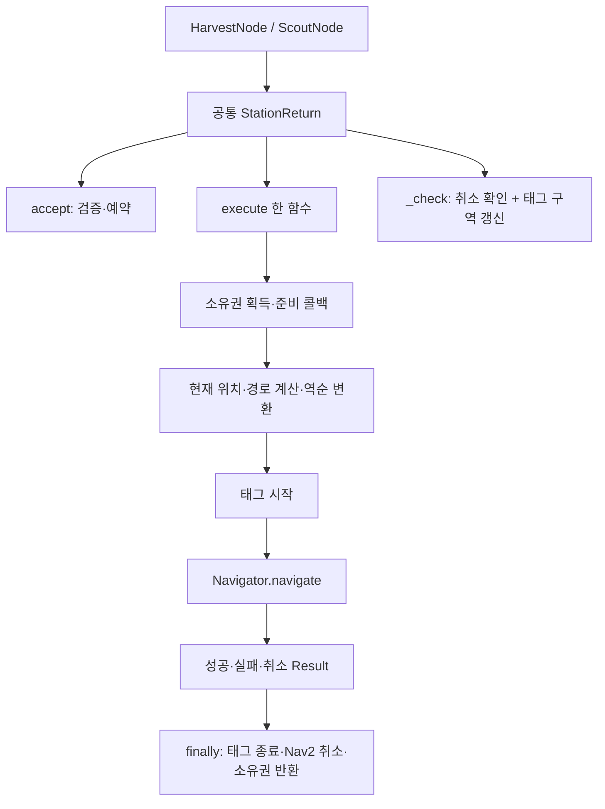
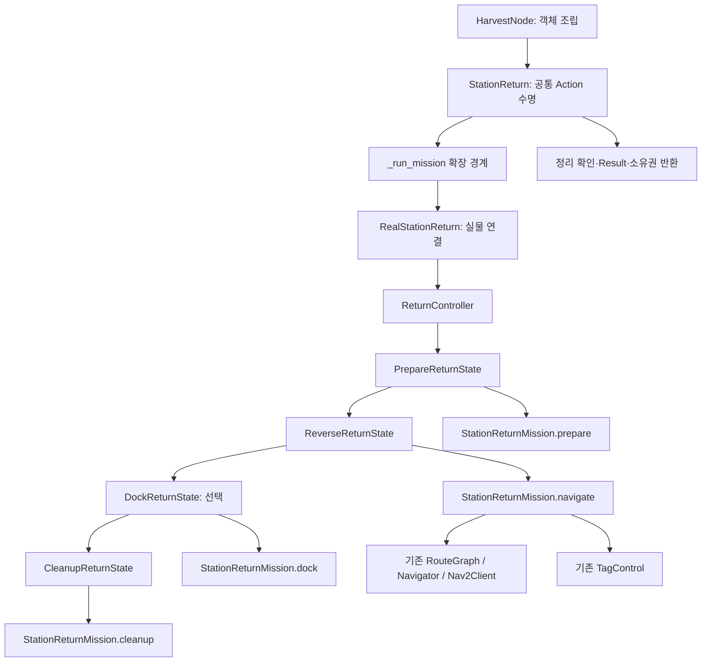

# 시뮬 선행 후진 복귀 구현을 컴포넌트 구조로 분리한 변경 설명

대상: 기존 시뮬 후진 복귀 구현 담당자 / 작성일: 2026-10-30

## 1. 먼저 전달할 핵심

**시뮬에서 먼저 구현한 후진 복귀를 기반으로 실물 수확 복귀를 개발했다. 후진 경로 알고리즘이나 후진 RPP를 처음부터 새로 만든 것이 아니다.** 기존 구현의 Action·경로 계획·주행·태그·정리가 한 실행 함수에 모여 있던 부분을, 프로젝트에서 합의한 Node / 통신 / Mission / Controller / States 책임에 맞춰 분리했다.

기존 `StationReturn`, `ActionHandoff`, `Navigator`, `Nav2Client`, `StationReverse`를 유지·재사용했다. 그 위에 수확 복귀 Mission/상태 전환을 붙였고, 실물에서 필요한 재시도·태그 수명·코너 원호·벽 도킹을 별도 컴포넌트로 연결했다.

**현재 시뮬은 기존 기본 실행 경로를 계속 사용한다. 실물에서 구조를 분리했다고 시뮬 실행까지 새 Mission으로 전환한 것은 아니다.** 이번 인계는 이 구조 변경을 시뮬 담당자에게 설명하고, 같은 컴포넌트로 연결할 때 필요한 차이를 전달하는 목적이다.

## 2. 비교한 실제 버전

| 기준 | 커밋 | 의미 |
|---|---|---|
| 후진 복귀 최초 도입 | `7b0e1a4fa71b77250447df857b23b4dbd260c388` | `feat: add shared reverse station return for scout and harvest`, 2026-10-15 |
| 실물 확장 전 비교 기준 | `48d2d1c812a968058254ddb2355ee5dfc9b96c68` | 이 시점의 station_return.py는 최초 도입본과 동일함을 Git diff로 확인 |
| 현재 수확 성공본 | `cf4023b6fa99497d992410620986272cd927128b` | 컴포넌트 분리와 실물 원호·도킹이 포함된 현재 확정 커밋 |

브랜치: `feat/harvest-handoff-real-20261018`. 아래 경로는 `farm_project/` 기준이며 패키지는 `robot/ros_ws/src/` 아래에 있다.

운송 구조는 분리 설계를 참고하는 데 사용했다. 운송 최신 코드 자체를 병합한 것은 아니며, 운송 브랜치 통합은 현재 보류 중이다.

## 3. 기존 시뮬 구현에서 이미 제공하던 것

최초 도입 커밋에는 다음이 이미 있었다. 이번 실물 개발에서 새로 만든 기능으로 설명하면 안 된다.

- 공통 `ReturnToStation.action`과 `StationReturn` ActionServer.
- `ActionHandoff`를 통한 작업 예약·실행 소유권·중단 처리.
- 환경 설정에서 스테이션 위치/방향을 읽고 그래프 노드와 대조하는 기능.
- station→현재 위치의 그래프 경로를 계산하고 점/엣지를 뒤집어 복귀하는 방식.
- `Navigator.navigate(..., reverse=True)` 및 후진 Path 생성 연결.
- `ReverseRegulatedPurePursuitController` 플러그인과 `StationReverse` 선택.
- 주행 중 태그 구역 확인, 태그 시작/종료.
- Feedback/Result와 취소·실패·Nav2 정리.
- 기존 시뮬에서 복귀 성공을 `docked=true`로 반환하던 계약.

이 구현은 이미 공통 주행 컴포넌트를 재사용하고 있었다. 문제를 ‘전체 코드가 컴포넌트가 아니었다’고 표현하면 부정확하다. **이번에 손본 부분은 복귀 업무의 단계 제어가 공통 Action 실행 안에 함께 들어 있던 구조**다.

## 4. 변경 전 구조: StationReturn이 업무 순서까지 직접 실행

`farm_common/farm_common/station_return.py`의 `execute()`가 통신 수명과 업무 실행 순서를 함께 소유했다. 준비→주행→정리에 별도 복귀 State/Controller는 없었다.

이 상태에서 실물 코너 접근·방향 정렬·원호·정밀 도킹을 계속 추가하면 공통 Action 실행 함수에 수확 전용 업무가 늘어난다. 또한 시뮬/예찰의 기존 복귀를 유지하면서 실물만 확장하기가 어려워진다. 그래서 공통 Action의 수명은 남기고, 업무 단계를 교체할 경계를 만들었다.

## 5. 변경 후 구조: 공통 통신 수명과 수확 업무 실행 분리

### 공통 StationReturn에 남긴 책임

- ActionServer 생성, Goal 검증·예약·수락.
- 소유권 획득, 외부 취소·중단 확인.
- Feedback 타이머와 Result 생성.
- 성공·실패·취소의 ROS Action 종결.
- 정리 실패를 `CANCEL_UNCONFIRMED`로 처리하고 소유권 반환.

### 수확 컴포넌트로 분리한 책임

| 컴포넌트 | 책임 | 소유하지 않는 것 |
|---|---|---|
| `RealStationReturn` | 실물 준비 정책, 지도 별칭, 출력 소유권, Mission/코너/도킹 연결 | 후진 제어 수식을 직접 계산하지 않음 |
| `StationReturnMission` | 준비·경로·주행·태그 세션·도킹·정리의 실제 작업 | ActionServer나 ROS 결과 종결을 만들지 않음 |
| `ReturnController` | 상태 전환, 완료 큐, 실행 세대, 오류 전달 | 경로·벽 관측·속도를 계산하지 않음 |
| 각 ReturnState | 자신의 작업 요청과 완료 후 다음 상태 결정 | enter 안에서 주행 완료까지 기다리지 않음 |
| `CornerNavigation` | 직선 접근·정렬·원호 실행 조립 | 태그·Action 결과를 소유하지 않음 |
| `StationDocking` | 벽 목표 관측과 기존 벽 제어기 실행 연결 | 관제 통신이나 수확 작업을 관리하지 않음 |

기존 다른 업무의 StateController 클래스를 그대로 재사용한 것은 아니다. 복귀 요청마다 `ReturnController`를 생성하되, **enter는 요청 후 반환 / 완료 이벤트는 전환 요청 / Controller가 exit·enter 관리**라는 합의된 형식에 맞춘 것이다.

## 6. 기존 코드가 어디로 이동했는가

| 기존 위치/처리 | 현재 위치/처리 | 변경 의미 |
|---|---|---|
| `StationReturn.execute()` 안의 준비·경로·주행 | 기본 `_run_mission()`으로 추출, 실물은 이를 재정의해 Mission/Controller 실행 | 기존 시뮬 호환과 수확 단계 확장을 분리 |
| execute 안의 `replace(...reversed(...))` | `farm_navigation.route.reverse_plan()` | 같은 역순 계산을 공통 함수로 재사용 |
| execute의 태그 종료·Nav2 취소 | `_cleanup_mission()` 확장 경계 및 Mission.cleanup | 업무별 정리 순서 분리 |
| execute의 `mode == sim` 완료 판정 | `_mission_docked()` | 실물 도킹 완료 의미를 별도로 연결 |
| 생성자 안의 고정 `Nav2Client(...)` | 선택적 `client_factory` | 기존 기본값 유지하며 수확 오류 분류를 주입 |
| 수확 Node가 항상 StationReturn 생성 | real + station_return_config일 때 RealStationReturn 생성 | 시뮬/예찰 기본 동작 자동 전환 방지 |

중요한 한계: **공통 클래스에서 업무 코드가 완전히 사라진 것은 아니다.** 기존 시뮬 호환을 위해 `_run_mission()` 기본 구현에 원래 순서가 남아 있다. 실물은 그 경계를 재정의해 새 컴포넌트를 사용한다. 시뮬까지 새 구조로 통합하려면 이 다음 연결 작업이 필요하다.

주요 파일:

- `robot/ros_ws/src/farm_common/farm_common/station_return.py`
- `robot/ros_ws/src/farm_navigation/farm_navigation/route.py`
- `robot/ros_ws/src/farm_navigation/farm_navigation/nav2_client.py`
- `robot/ros_ws/src/harvest_robot/harvest_robot/node.py`
- `robot/ros_ws/src/harvest_robot/harvest_robot/station_return_real.py`
- `robot/ros_ws/src/harvest_robot/harvest_robot/station_return_mission.py`
- `robot/ros_ws/src/harvest_robot/harvest_robot/station_return_states.py`

## 7. 실행 방식: enter에서 요청하고 완료 이벤트로 전환

현재 실행 흐름은 다음과 같다.

1. 공통 `execute()`가 복귀 제어권을 획득한다.
2. 실물 `_run_mission()`이 새 Mission과 ReturnController를 만든다.
3. Controller가 PrepareReturnState.enter를 호출한다.
4. enter는 `run_async()`로 Mission.prepare를 작업 스레드에 예약하고 즉시 반환한다.
5. 작업 완료 콜백은 `(epoch, state, future)`를 큐에 넣는다.
6. Controller가 큐를 읽어 현재 상태·세대와 일치하는 완료만 처리한다.
7. State.completed가 결과를 확인한 후 다음 상태 전환을 요청한다.
8. Controller.transition이 이전 exit와 다음 enter를 실행한다.
9. 실패하면 CleanupReturnState로 전환한다. 정리 실패는 별도로 보관해 공통 Action 종결부에 전달한다.

작업 스레드는 한 개이며 상태 작업이 동시에 주행 출력을 내도록 만들지 않았다. ROS 콜백은 기존 executor가 처리한다. 이름이 Controller라고 해서 새 속도 제어기를 만든 것은 아니다.

## 8. 구조 분리와 함께 바뀐 실제 동작

단순히 함수 위치만 옮긴 부분과 동작 변경을 구분해야 한다.

### 8.1 후진 경로 원리는 유지

원래 시뮬의 station→현재 위치 계획을 뒤집는 방식을 그대로 사용한다. 실제 지나온 궤적을 저장했다가 재생하는 방식으로 바꾸지 않았다. 그래프 데이터나 스테이션 좌표를 코드에 고정하지 않았다.

`reverse_plan()`은 점과 엣지 순서를 뒤집고 새 plan_id를 만든다. 기존 메타데이터는 유지한다. 임의 headings가 있는 모든 경로의 방향 의미까지 자동 변환하는 일반 함수로 확대 해석하지 않는다.

### 8.2 재시도는 기존 컴포넌트에 연결

기존 Nav2Client의 기본 오류 분류는 빈 문구 또는 `collision ahead`를 대상으로 했다. 후진 플러그인이 반환하는 `Collision on reverse route`, `Collision on reverse heading alignment`는 비어 있지 않아 기본 분류로 처리되지 않을 수 있었다.

현재 선택형 `retryable_control_error`를 추가해 실물 복귀에서 후진 오류를 분류한다. 공통의 **ABORTED + FollowPath NO_VALID_CONTROL** 조건은 유지한다. 원호에서는 `collision on transfer arc`도 같은 경계로 연결한다. 기존 정지 확인·재시도 컴포넌트를 사용하며 모든 실패를 재시도하지 않는다.

정지 출력은 현재 return/task_id가 가진 기존 출력 소유자를 통해 내보낸다. 실물 설정의 retry_count=5를 연결했지만 시뮬의 횟수·출력 정책까지 자동 변경하지 않았다.

### 8.3 태그 세션 수명을 Mission으로 이동하고 유지 방식 변경

기존: 복귀 시작에 `begin()`을 호출하고 `_check()`에서 구역/방향 판별 결과가 바뀌면 `begin(section)`을 다시 호출했다.

현재 실물 Mission:

- 최초에는 위치·차체 방향으로 유효 구역을 선택한 뒤 시작한다.
- 같은 구역 안에서는 일시적인 방향 흔들림으로 태그 토큰을 교체하지 않는다.
- 실제 구역 이탈 시 종료하고 새 구역 시작은 다음 갱신 주기로 분리한다.
- 주행 중에는 기존 위치 보정과 FollowPath가 함께 작동한다.
- 도킹 전에 세션을 닫고, 성공·실패·취소에도 정리를 시도한다.

시뮬 기본 StationReturn의 `_check()`는 기존 동작을 유지한다. 새 세션 정책을 받으려면 시뮬도 새 Mission을 연결해야 한다. ACK나 실제 보정 성공까지 이 구조가 보장하는 것은 아니다.

### 8.4 정리 예외 처리 보완

기존 execute의 finally에서는 태그 종료가 Nav2 취소용 try보다 앞에 있었다. 태그 종료 예외가 발생하면 후속 취소가 실행되지 않을 여지가 있었다.

현재 기본 `_cleanup_mission()`은 태그 종료의 finally에서 Navigator.cancel_nav를 호출한다. 수확 Mission도 태그→도킹→주행 정리를 중첩 finally로 연결한다. 정리 실패를 성공으로 숨기지 않고 공통 Action에 전달한다. 이 부분은 기본 경로에도 적용된 보완이다.

## 9. 실물 시험에서 나중에 붙인 확장 — 구조 변경과 구분

아래는 기존 시뮬 복귀를 컴포넌트로 나눈 것과 별개로, 실물 조건에 맞춰 추가한 기능이다. 시뮬 구조 정리에 모두 가져와야 하는 것은 아니다.

### 코너

`station_corner_plan.py`, `station_corner_navigation.py`, `station_corner_config.py`로 분리했다.

- 실제 그래프 코너와 시작 위치 연결부를 구분.
- 후진 접근→실제 정지→필요한 Spin→실제 odom 자세 기준 원호→남은 후진 경로.
- 기존 Navigator/Nav2Client/SpinClient/ArcSpec/ArcController/공간 검사를 재사용.
- 현재 코너 계획은 기존 원호가 지원하는 후진 좌회전·최대90도 범위. 시뮬의 임의 코너가 모두 지원되는 것은 아님.
- 실물 반경0.20m와 별도 원호 속도는 실물 조립 선택값.

기존 후진 RPP 플러그인을 재사용하며 `skip_position_approach_rotation`, `use_work_curvature` 선택 옵션만 추가했다. 기본 OFF이고 실물 코너 접근 인스턴스에 켰다. ArcController 상한도 인스턴스별로 분리했으며 기존 기본값0.01m/s·0.15rad/s를 유지했다.

### 도킹

`station_docking.py`가 공통 `DockWallTracker`/벽 목표 계산/기존 WallController 확장을 조립한다. 실물에서는 뒤·왼쪽 벽 기준 자세를 사용한다.

Mission에 docking 객체가 있으면 DockReturnState를 실행하고 완료 후 mission.docked=True가 된다. 없으면 도킹 상태를 건너뛴다. 실물은 도킹·정리까지 끝나야 SUCCESS/docked=true를 반환한다.

실물 벽 거리·좌표·방향·5mm/1도 허용치·팔 상태 생략 설정은 시뮬에 복사하지 않는다.

## 10. 시뮬 담당자가 이어서 해야 할 구조 반영

### 현재 상태를 먼저 구분

| 항목 | 현재 시뮬 기본 경로 | 현재 실물 경로 |
|---|---|---|
| Action 수명 | 공통 StationReturn | 같은 공통 StationReturn |
| 업무 실행 | 기본 `_run_mission()` | Mission + Controller + States |
| 태그 수명 | 기존 기본 방식 | 새 Mission 방식 |
| 코너/도킹 | 기존 시뮬 구현 | 별도 컴포넌트 조립 |
| 성공 docked | mode=sim이면 true | 실제 Mission 도킹 완료값 |

**시뮬 담당자에게 요청하는 핵심은 실물값 이식이 아니라, 수확 복귀의 업무 실행도 같은 Mission/Controller를 사용하도록 조립 경계를 맞추는 것이다.**

### 반영 순서

1. 기존 시뮬 StationReturn/ActionHandoff/Navigator와 설정은 먼저 보존한다.
2. `StationReturnMission`, `ReturnController`를 import해 사용하고 파일 복사본을 만들지 않는다.
3. 시뮬의 graph, station, poses, settings, navigator, corridors, tag_control, prepare/check를 주입한다.
4. 공통 `_run_mission()` 확장 경계에서 Controller.run을 호출하도록 조립한다.
5. Mission.check가 주행 중 호출되도록 연결하고, 취소 검사 자체는 공통 취소 경계를 사용한다. check→mission.check→check의 재귀 연결을 만들지 않는다. 실물 RealStationReturn의 위임 구조를 참고한다.
6. `_cleanup_mission()`에서 Controller의 cleanup_error를 전달하고, Action 정리 실패 정책을 유지한다.
7. `_mission_docked()`의 의미를 정한다. 도킹 객체가 없는 새 Mission은 docked=False이므로 기존 sim 성공=true와 무조건 연결하면 계약이 달라진다. 추상 복귀 완료를 유지할지 물리 도킹까지 실행할지 명시해야 한다.
8. 상태 구조가 같은 조건에서 동작하는 것을 먼저 검증한 후 코너·도킹은 시뮬 기하/센서 조건에 맞춰 추가한다.

### 추가로 필요한 공통 변경

현재 HarvestNode는 실물에서만 RealStationReturn을 선택한다. 따라서 시뮬을 새 컴포넌트 구조로 전환할 수 있는 일반 조립 경계까지 완성된 상태는 아니다.

권장안은 **수확 업무 컴포넌트는 harvest_robot에 하나만 유지하고, 실물/시뮬 어댑터가 준비·출력·센서·데이터를 주입하는 구조**다. 이를 위해 node.py의 선택/조립 경계 등을 바꾸어야 한다면 변경안을 제시해 사용자 승인을 받은 뒤 진행한다. 본 문서는 그 추가 변경을 이미 적용하거나 승인한 기록이 아니다.

RealStationReturn의 mode 검사를 지우거나 실물 Jetson/출력 객체를 시뮬에 복제하지 않는다. 시뮬 전용 어댑터·설정·launch는 sim/에 두고, 공통 업무 로직을 sim 복사본이나 monkey patch로 변경하지 않는다. 동일 이름 ActionServer를 중복 생성하지 않는다.

## 11. 구조 반영 검증에서 꼭 볼 것

- enter가 작업 예약 후 반환하고, Controller만 상태 전환을 수행하는가.
- 준비→후진→선택 도킹→정리 순서가 지켜지는가.
- 이전 상태/요청의 늦은 완료가 새 상태를 전환시키지 않는가.
- 준비·주행·도킹 실패와 취소에서도 태그/Nav2/출력을 정리하는가.
- 정리 실패가 SUCCESS로 반환되지 않는가.
- 원래 시뮬 그래프의 역순 경로와 목표 방향이 유지되는가.
- 후진 충돌 재시도가 환경의 실제 정지 출력·소유권과 연결되는가.
- 같은 구역 태그 토큰 유지와 구역 이탈 종료가 기록되는가.
- 도킹 미선택/선택 각각에서 관제가 받는 docked 의미가 합의와 일치하는가.
- 기존 예찰 복귀·인계·전진에 영향을 주지 않는가.

참고 시험: harvest_robot/test의 `test_station_return_components.py`, `test_station_return_real.py`, `test_station_corner.py`, `test_station_docking.py`. 새 시뮬 시험은 sim/tests, Isaac 결과는 sim/runs에 분리한다. 단위시험을 실물/Isaac 주행 성공으로 표현하지 않는다.

## 12. 확인된 결과와 남은 상태

실물 원본 workspace에서 관제 복귀 요청→후진→두 벽 도킹→SUCCESS/docked=true까지 확인했다. 2026-10-30 20:18:43 KST, task `RETURN_3e875504cd584bd6bdfa3e8875289889`. 팔 상태 수신 생략 차체 시험이며 전체 팔 연동 성공은 아니다.

현재 코드로 시뮬 새 구조를 실행한 결과는 없다. 이번 문서는 기존 시뮬 선행 구현과 확정 소스의 Git diff를 읽어 작성했으며 코드·설정·로봇을 변경하지 않았다. 운송 최신본 통합도 수행하지 않았다.

담당자 회신에는 자신의 기준 커밋, 새 Mission 연결 대상 파일, 추가 공통 승인 필요 부분, docked 의미, 기존 기능 회귀 및 Isaac 결과를 구분해 적어주면 된다.

상세 근거: `docs/changes/STATION_RETURN_REAL_PC_20261028.md`의 ‘운송 구조 참고 복귀 컴포넌트 분리’ 절, `docs/changes/STATION_DOCKING_SOURCE_INTEGRATION_20261030.md`. 과거 기록의 도킹 미구현/docked=false는 당시 단계이며 현재 실물 완료 의미와 구분한다.
