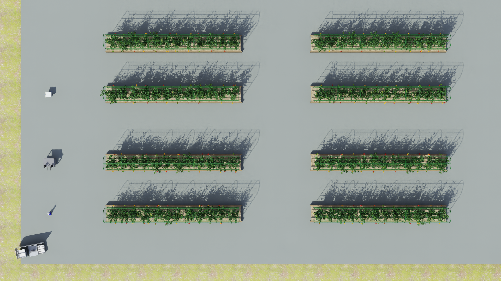
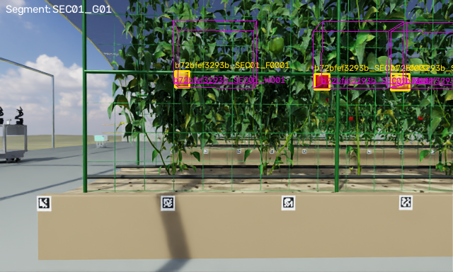
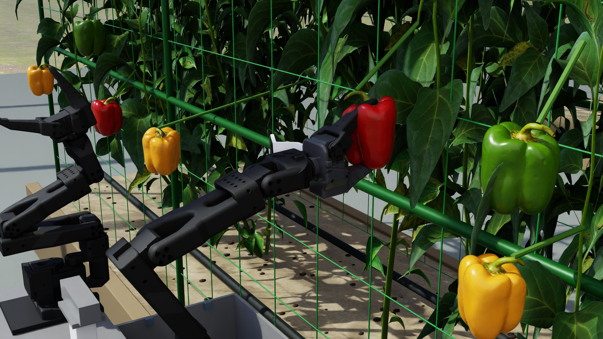
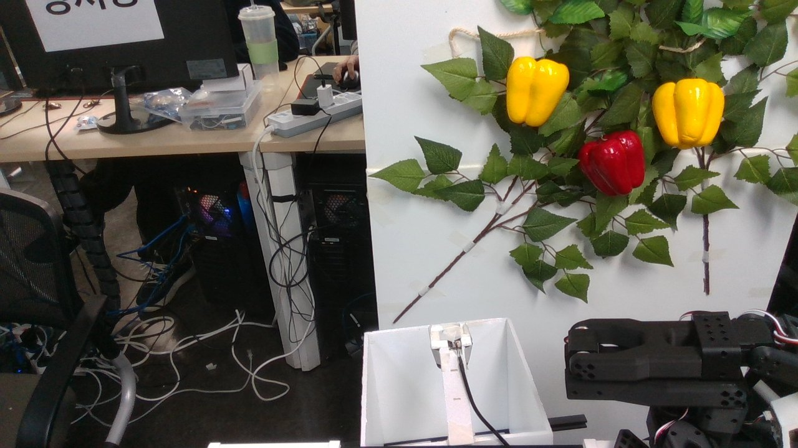
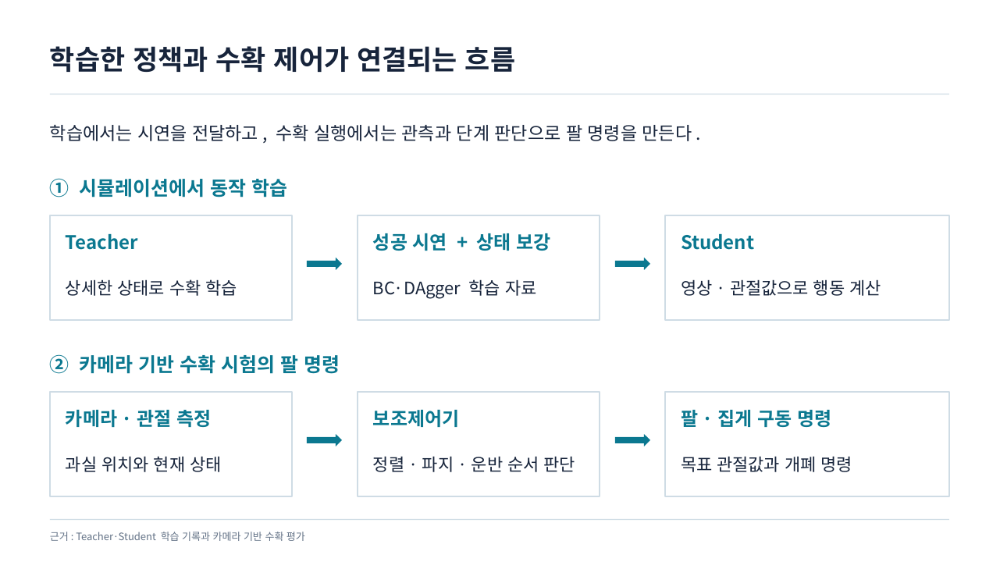
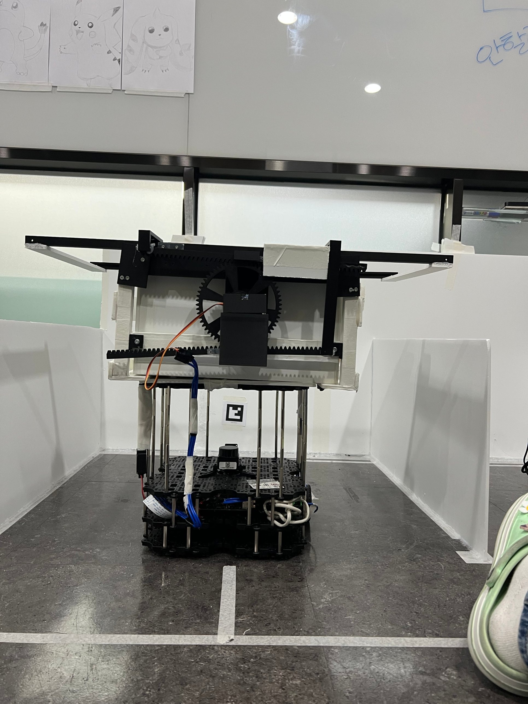
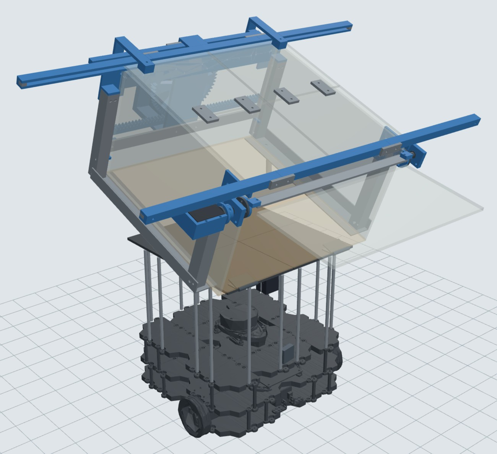
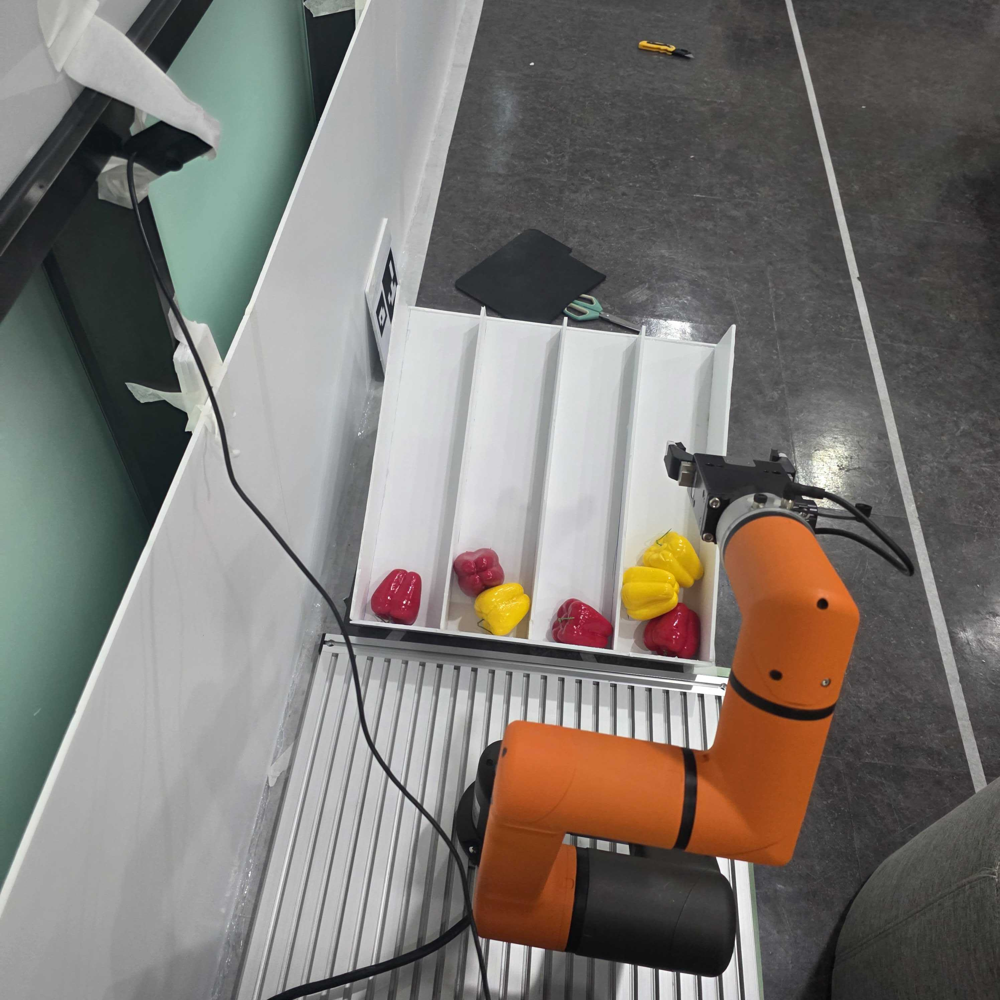
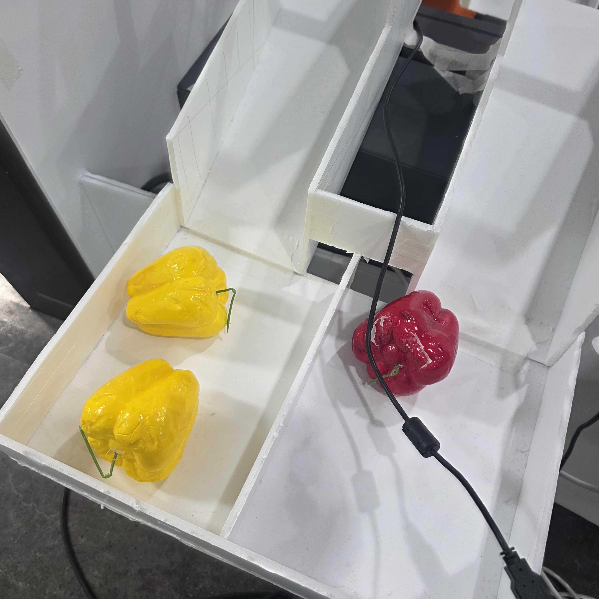
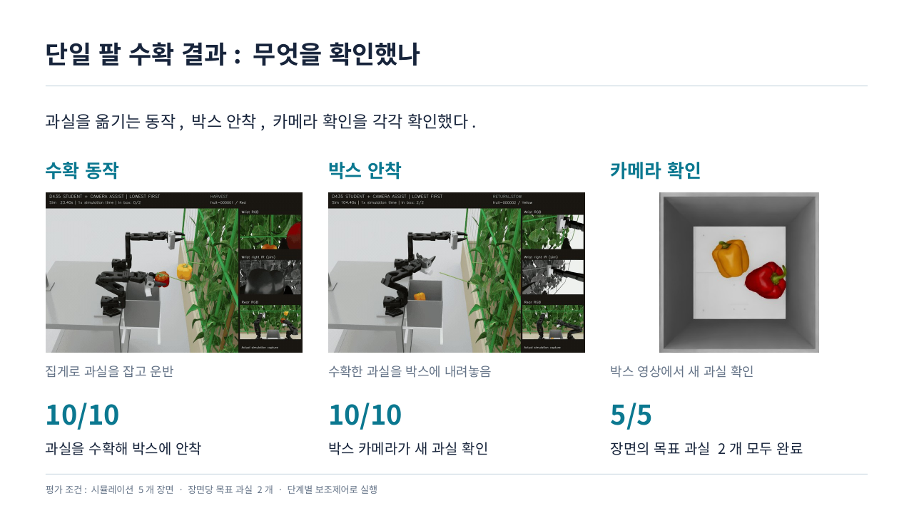

<div align="center">

# MANYFARM · 매니팜

### 파프리카 예찰부터 수확·운송·선별까지, 로봇이 이어가는 농작업

**AI 비전 · 자율주행 · 로봇팔 · 다중 로봇 협업 · 농장 시뮬레이션**

[프로젝트 소개](#프로젝트-소개) · [주요 기능](#주요-기능) · [검증 결과](#검증-결과) · [코드와 문서](#코드와-문서)



*Isaac Sim으로 구성한 가상 농장. 시스템 배치를 보여주는 연출 화면입니다.*

</div>

## 프로젝트 소개

**매니팜은 파프리카의 상태를 관찰하고, 수확할 위치를 찾아, 수확물을 운반하고 색상별로 선별하는 협업 로봇 프로젝트입니다.** 예찰로봇이 만든 작업 정보를 수확로봇에 전달하고, 운송로봇과 선별장이 후속 작업을 맡도록 연결합니다.

반복적인 관찰·수확·운반 작업의 부담을 줄이는 것을 목표로, 각 로봇의 동작과 작업 인계 과정을 개발합니다. 실제 장비 시험과 Isaac Sim 기반 가상 농장 시험을 함께 진행하며, 공통 로봇 제어 코드에 환경별 지도·센서·장치 설정을 연결합니다.

### 팸플릿용 소개 문구

> 매니팜(MANYFARM)은 AI 비전과 자율주행 로봇을 활용해 파프리카의 예찰·수확·운송·선별을 연결하는 스마트 농업 프로젝트입니다. 예찰로봇이 수확 대상을 찾고, 수확로봇이 과실을 따서 담으면, 운송로봇이 선별장으로 옮기고 협동로봇이 색상별로 분류합니다. 실제 로봇과 가상 농장에서 작업 흐름을 구현·검증하며 농작업 자동화를 연구합니다.

## 작업 흐름

**예찰 → 작업 배정 → 수확 → 운송 인계 → 선별장 하역 → 색상별 선별**

| 단계 | 담당 | 주요 역할 |
|---|---|---|
| 01 · 예찰 | 예찰로봇 | 재배 구역을 이동하며 카메라로 빨강·노랑 파프리카를 검출하고 수확 작업 위치를 생성 |
| 02 · 작업 배정 | 관제 | 작업 요청을 전달하고 로봇의 진행 상태와 결과를 관리 |
| 03 · 수확 | 수확로봇 | 지정 위치로 이동·정차한 뒤 로봇팔로 과실을 집어 수확 박스에 적재 |
| 04 · 인계·운송 | 수확로봇 + 운송로봇 | 인계 자세와 도킹 상태를 확인하고 과실을 받아 선별장으로 이동 |
| 05 · 선별 | HCR-3A 선별장 | 카메라로 구역과 색상을 판정하고 과실을 색상별 보관부로 분류 |
| 06 · 다음 작업·복귀 | 각 로봇 | 작업 결과를 보고하고 다음 요청을 수행하거나 스테이션으로 복귀 |

위 표는 전체 운영 흐름입니다. 단계별 구현·시험 결과와 전체 연속 실행의 검증 범위는 아래에서 구분합니다.

## 주요 기능

### 1. 예찰 · 수확할 위치를 찾는 로봇

RGB-D 카메라와 YOLO 기반 비전으로 파프리카를 검출하고 위치 정보를 정리합니다. 재배 구역을 관측한 결과를 로봇팔이 작업할 수 있는 **수확 작업 구간(Window)**으로 나누어 후속 작업에 전달합니다.

- 지도와 경로 그래프를 이용한 구역 이동 및 정차 관측
- 빨강·노랑 과실 검출과 관측 위치 기반 과실 등록
- 작업 위치·예상 수량을 포함한 수확 태스크 생성

<p align="center">
  
</p>

*시뮬레이션 예찰 검출 기록. 예찰 예상 수량과 실제 수확 수량은 별도로 집계합니다.*

### 2. 수확 · 이동과 로봇팔 작업의 연결

수확로봇은 화단 진입, 작업 위치 이동, 실제 정지 확인을 거쳐 로봇팔의 수확 동작을 요청합니다. 카메라 기반 과실 관측과 파지 보정을 적용하고, 수확 박스에 담은 과실을 운송로봇에 인계하도록 구성했습니다.

- Nav2 기반 경로 추종과 작업 구간별 이동
- AprilTag 관측과 AMCL을 연결한 위치 추정 보조
- Teacher–Student 학습과 BC·DAgger를 활용한 수확 정책 연구
- 카메라·관절 관측을 이용한 정렬·파지·운반 단계 제어
- 인계 후 작업 자세 복구, 스테이션 복귀 및 라이다 기반 정밀 도킹

<table>
  <tr>
    <td align="center" width="50%"><br><sub>시뮬레이션 파지 자세</sub></td>
    <td align="center" width="50%"><br><sub>실물 수확 시험 장치</sub></td>
  </tr>
</table>

학습한 정책과 카메라 기반 시험의 보조제어는 구분합니다. 아래 그림은 학습 과정과 실제 팔 명령을 만드는 제어 흐름을 설명합니다.

<p align="center">
  
</p>

### 3. 운송 · 로봇 사이의 과실 인계

운송로봇은 수확로봇에 접근해 과실을 인수하고 선별장으로 옮기는 역할을 맡습니다. 수납·개폐·배출 기구와 자율주행을 연결하고, 마커·라이다를 이용한 정밀 접근과 도킹을 구성합니다.

인계는 **수확 측 준비 → 운송 도킹 확인 → 배출 결과 확인 → 운송 이격 → 수확 자세 복구** 순서로 처리합니다. 작업 요청과 물리 동작 완료를 구분하고, 작업 식별자로 이벤트의 순서와 중복을 확인합니다.

<table>
  <tr>
    <td align="center" width="50%"><br><sub>운송로봇 실물</sub></td>
    <td align="center" width="50%"><br><sub>배출 기구 CAD 설계</sub></td>
  </tr>
</table>

### 4. 선별 · 색상을 판정하고 분류하는 협동로봇

HCR-3A 협동로봇과 카메라를 연결해 선별장 A–D 구역의 과실을 확인합니다. PC가 색상·구역에 따른 작업을 Modbus TCP로 요청하고, 로봇이 티칭된 집기·운반·놓기 동작을 수행합니다. 작업 번호와 완료 응답을 대조해 처리 수량을 집계합니다.

<table>
  <tr>
    <td align="center" width="50%"><br><sub>HCR-3A 실물 선별장</sub></td>
    <td align="center" width="50%"><br><sub>색상별 분류 결과</sub></td>
  </tr>
</table>

### 5. 시뮬레이션 · 가상 농장에서의 개발과 검증

Isaac Sim에 재배 베드, 로봇, 카메라, 라이다와 선별장을 구성했습니다. 가상 농장에서 예찰·수확·인계 동작을 시험하고, 영상과 작업 로그를 비교해 단계별 문제를 분석합니다.

- **농장 환경:** 8개 물리 베드와 양쪽 면을 나눈 16개 예찰 구역
- **공통 제어:** 실물·시뮬레이션에서 공통 업무 로직을 사용하고 장치·지도 설정을 분리
- **합성 데이터:** 과실 라벨과 RGB 영상을 생성하고 밝기·노이즈·블러 후처리 적용
- **결과 분석:** 예찰 예상량, 실제 바구니 적재량, 선별 처리량을 구분해 손실 원인 추적

## 핵심 기술

| 분야 | 사용 기술·구성 |
|---|---|
| 로봇 통신·실행 | ROS 2 Jazzy, Action·Topic·Service, 비동기 상태 전환 |
| 자율주행·위치 추정 | Nav2, AMCL, AprilTag, LiDAR, GeoJSON 경로 그래프 |
| 비전 | RGB-D 카메라, Intel RealSense D435, YOLO, OpenCV |
| 수확 학습·제어 | PPO, Teacher–Student, BC·DAgger, 단계별 보조제어 |
| 시뮬레이션·데이터 | NVIDIA Isaac Sim, USD 로봇·농장 자산, 합성 영상·라벨 생성 |
| 선별장 연동 | HCR-3A, 카메라 색상 판정, Modbus TCP |
| 시스템 구성 | 관제 요청·결과 연동, 공통 로봇 로직, 환경별 설정·장치 어댑터 |

## 검증 결과

아래는 **제공된 발표 자료와 저장소에 기록된 개별 시험 결과**입니다. 서로 다른 날짜·장치·환경의 결과이므로 하나의 전체 시스템 성공률로 합산하지 않습니다.

| 시험 | 확인한 결과 | 시험 조건·해석 범위 |
|---|---|---|
| 단일 팔 카메라 기반 수확 | 과실 수확·박스 안착 **10/10**, 박스 카메라 신규 과실 확인 **10/10**, 장면 완료 **5/5** | 시뮬레이션 5개 장면, 장면당 목표 2개, 단계별 보조제어 적용 |
| AprilTag 보정 연동 | 전송한 보정 요청 **10건 모두 AMCL 적용** | 2026-10-10 실물 주행. 모든 영상 관측의 채택률이나 주행 정확도를 의미하지 않음 |
| 인계 후 자세 복구 | 인계·복구 후 다음 Window 작업 성공 | 2026-10-27 실제 차체 + PC 더미 시험 |
| 배출 요청·응답 | 실제 Jetson 배출 단계 최종 `SUCCEEDED` 확인 | 2026-10-28 개별 배출 연동 시험 |
| 스테이션 복귀·도킹 | 실물 복귀 및 두 벽 기준 도킹 성공 회차 확보 | 2026-10-30 팔 상태를 생략한 차체 시험 |

<details>
<summary>단일 팔 수확 시험 결과 보기</summary>



원본 발표 도식의 설명까지 함께 확인할 수 있습니다.

</details>

### 현재 개선 과제

예찰·수확·운송·선별의 개별 기능과 연계 시험을 바탕으로 전체 흐름의 반복 안정성을 개선하고 있습니다. 저장소의 수량 분석에서는 예찰 중복 등록, 작업영역·가림에 따른 미수확, 파지 실패·낙하, 선별 카메라의 미검출과 조기 종료 사례를 구분했습니다.

- 실제 팔·운송로봇을 포함한 전체 연속 실행 및 반복 검증
- 예찰 과실 중복 등록과 수확·선별 단계의 수량 손실 개선
- 수확로봇 후진·코너 추종과 로봇 간 인계 안정성 개선
- AprilTag 위치 보정의 예찰로봇 적용 확대
- 양팔 분담과 승강 구조를 활용한 다높이 수확으로 확장

양팔 분담·승강 수확은 향후 개발 구상입니다. 수량 차이에 대한 분석 결과는 [예찰–수확–선별 손실 분석](farm_project/sim/docs/SCOUT_TO_SORT_LOSS_ANALYSIS.md)에서 확인할 수 있습니다.

## 코드와 문서

```text
main/
├── README.md                    # 프로젝트 소개
├── docs/readme/                  # 소개용 이미지와 자료 출처
└── farm_project/
    ├── control/                 # 관제 연결 시험 도구
    ├── robot/
    │   ├── config/              # 실물 환경·장치·지도 설정
    │   ├── models/              # 모델 자산
    │   └── ros_ws/src/          # 공통 제어·로봇별 패키지
    ├── sim/                     # 가상 장치·농장 자산·시험 도구
    ├── scripts/                 # 빌드·환경 설정 스크립트
    ├── tests/                   # 공통 시험
    └── docs/                    # 상태·설계·변경 기록
```

| 확인할 내용 | 문서·코드 |
|---|---|
| 구현 상태와 날짜별 시험 기록 | [PROJECT_STATE](farm_project/docs/PROJECT_STATE.md) |
| 실물·시뮬레이션 실행 절차 | [실행 가이드](farm_project/docs/RUN_GUIDE_20261002.md) · [시뮬레이션 실행 가이드](farm_project/sim/docs/RUN_GUIDE_20261006.md) |
| 공통 메시지·액션 | [farm_interfaces](farm_project/robot/ros_ws/src/farm_interfaces) |
| 로봇별 구현 | [예찰](farm_project/robot/ros_ws/src/scout_robot) · [수확](farm_project/robot/ros_ws/src/harvest_robot) · [운송](farm_project/robot/ros_ws/src/transport_robot) · [선별](farm_project/robot/ros_ws/src/hcr_sorting) |
| 합성 학습 데이터 생성 | [데이터셋 가이드](farm_project/SCOUT_DATASET_README_KO.md) |
| 이미지 출처와 시험 근거 | [자료 안내](docs/readme/SOURCES.md) |

실행 문서는 작성 시점의 환경과 명령을 설명합니다. 실제 실행 전 최신 상태·변경 기록과 사용하는 장치의 설정을 함께 확인하세요. 이 저장소의 `control/`은 관제 연결 시험 도구이며 외부 관제 프로그램 전체를 포함하지 않습니다.

---

**MANYFARM · 매니팜** · 파프리카 예찰·수확·운송·선별 협업 로봇 프로젝트
