

# 🌱 ManyFarm | 매니팜

### 예찰부터 수확·운송·선별까지 연결하는 다중 로봇 스마트팜

**실제 로봇 · 웹 관제 · Isaac Sim 가상 농장**

[프로젝트 소개](#overview) · [아키텍처](#architecture) · [실물 시연](#demo) · [웹 관제](#dashboard) · [시뮬레이션](#simulation) · [핵심 기술](#technologies) · [팀 구성](#team)

 

## 📌 Overview

ManyFarm은 **파프리카의 상태를 관찰하고, 수확할 위치를 찾아, 수확물을 운반하고 색상별로 선별하는 협업 로봇 프로젝트**입니다.

예찰로봇이 만든 작업 정보를 수확로봇에 전달하고, 운송로봇과 선별장이 후속 작업을 이어갑니다. 웹 관제에서 작업과 진행 상태를 확인하며, 실제 장비와 Isaac Sim 가상 농장에서 동작을 시험합니다.

한 로봇의 기능 구현을 넘어 **관측 결과가 다음 로봇의 작업으로 이어지는 전체 공정**을 만드는 데 초점을 두었습니다.

| 항목 | 내용 |
|---|---|
| 개발 기간 | 2026.09 시작 · 2026.11 최종 발표 |
| 팀 구성 | 7명 · 로봇 주행·기구·로봇팔·비전·관제·시뮬레이션 |
| 대상 작업 | 파프리카 예찰 → 수확 → 인계·운송 → 하역·선별 |
| 실물 환경 | 예찰·수확·운송 이동 로봇, 모형 작물 화단, HCR-3A 선별장 |
| 가상 환경 | Isaac Sim · 8개 재배 베드 · 16개 작업 구역 |

 

## 🏗️ System Architecture

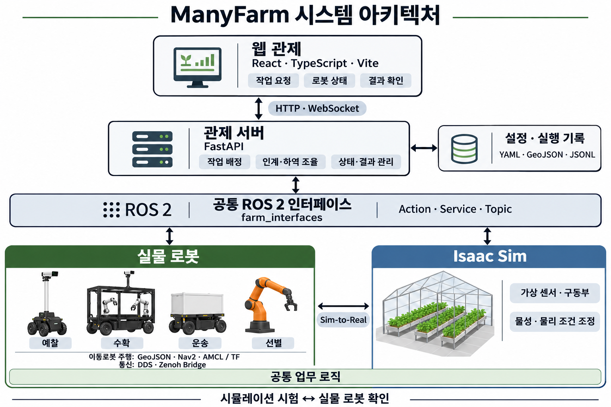

**웹 관제 ↔ 관제 서버 ↔ ROS 2 공통 인터페이스 ↔ 실물·시뮬레이션**

HTTP·WebSocket으로 작업과 상태를 연결하고, ROS 2와 Zenoh를 통해 로봇 실행부를 연동합니다.

 

## 🔄 System Workflow

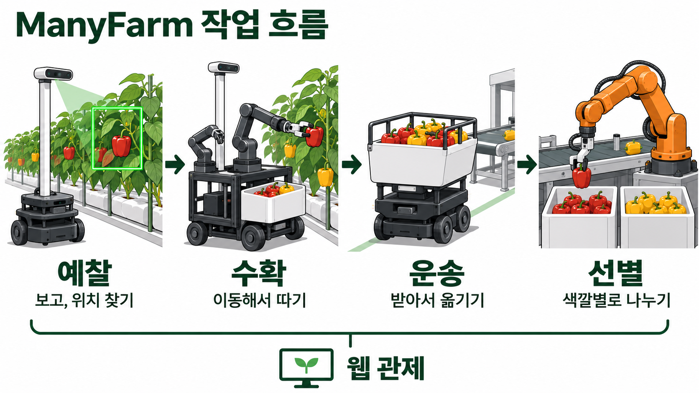

**관측 결과를 작업으로 연결하고, 인계 후 수확과 운송을 병행합니다.**

### 함께 일하는 로봇

<table>
<tr><th width="225">예찰로봇</th><th width="225">수확로봇</th><th width="225">운송로봇</th><th width="225">선별장 협동로봇</th></tr>
<tr><td align="center">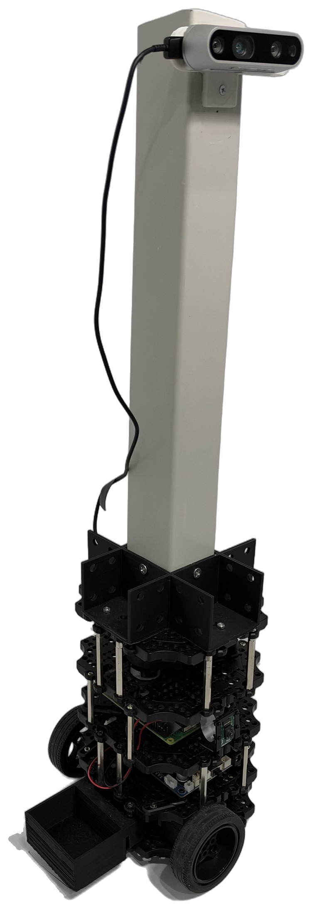</td><td align="center">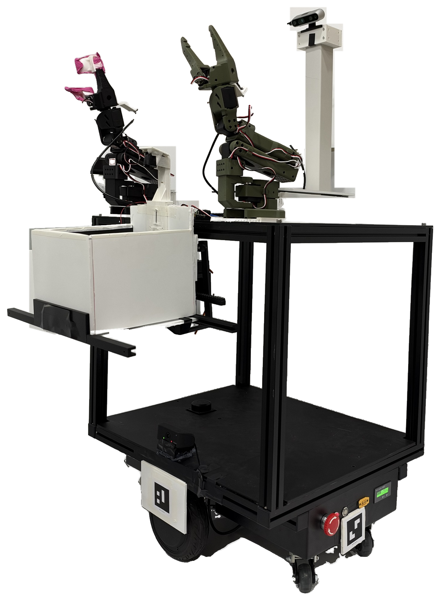</td><td align="center">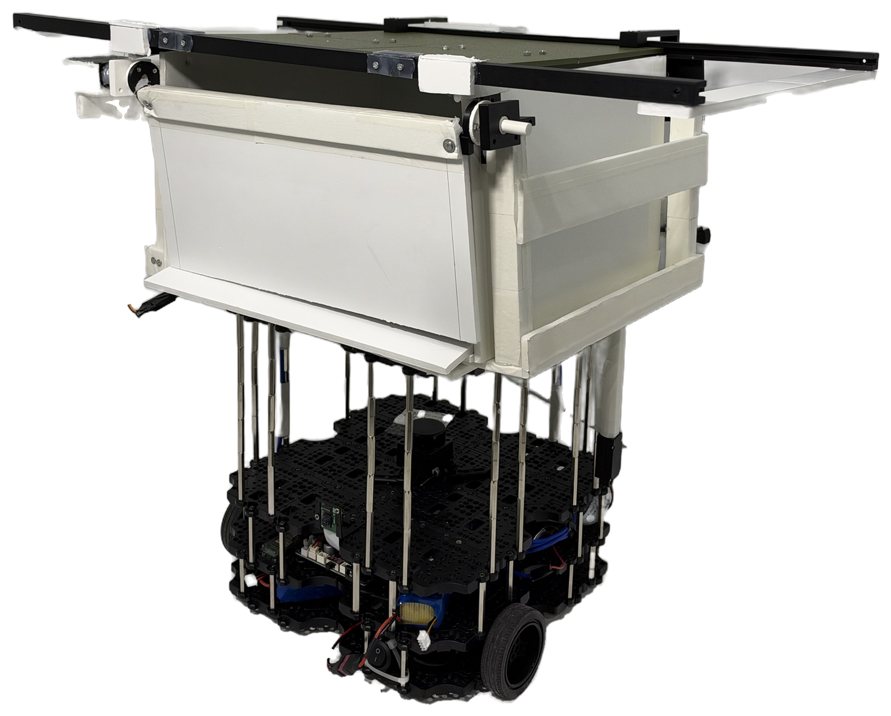</td><td align="center">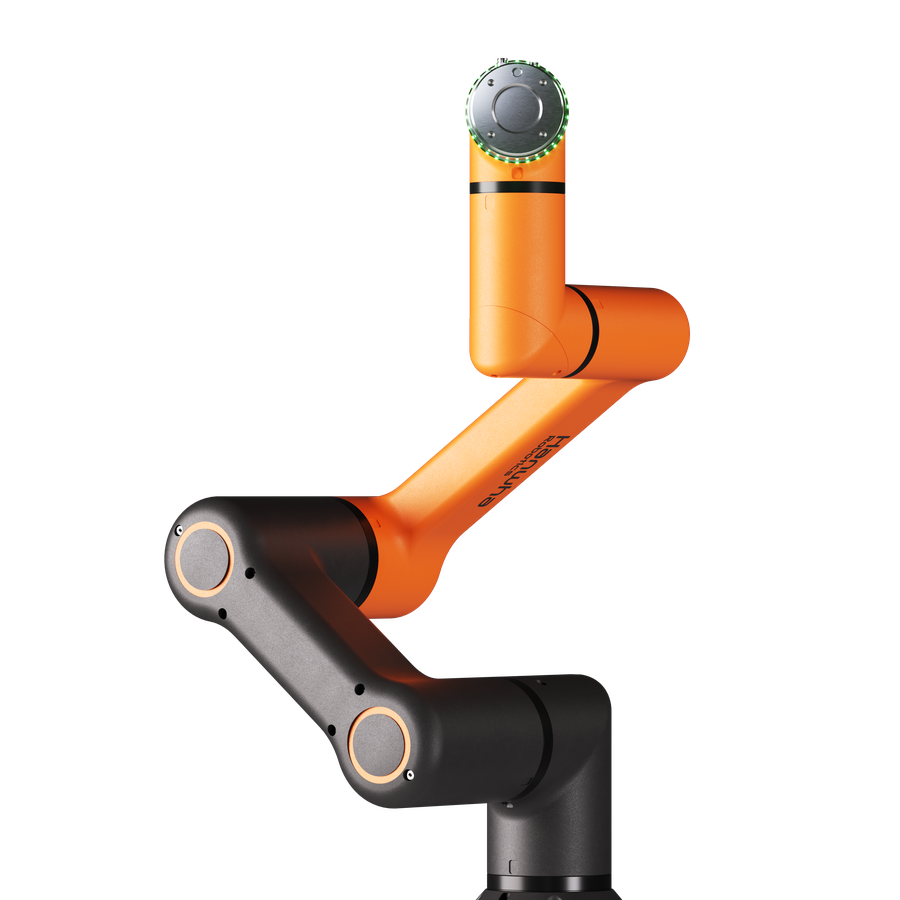</td></tr>
<tr><td align="center"><b>TurtleBot3 Burger</b></td><td align="center"><b>Vic Pinky + SO-ARM101</b></td><td align="center"><b>TurtleBot3 Waffle Pi</b></td><td align="center"><b>Hanwha HCR-3A</b></td></tr>
<tr><td><b>화단 관측</b> 과실을 찾아 수확할 영역과 정차 위치를 정합니다.</td><td><b>과실 수확</b> 작업 위치로 이동해 과실을 따고 상자에 담습니다.</td><td><b>인계·운반·하역</b> 수확물을 받아 선별장으로 옮기고 내려놓습니다.</td><td><b>색상별 선별</b> HCR-3A가 과실을 집어 색상별로 분류합니다.</td></tr>
</table>

선별장 협동로봇 제품 이미지: <a href="https://hanwharobotics.com/kr/product/view?menuSeq=2&amp;prdtSeq=75">한화로보틱스</a>

<h3>하드웨어 상세 구성</h3>

<table>
<tr><th width="120">로봇</th><th width="520">주요 하드웨어</th><th width="280">역할</th></tr>
<tr>
<th rowspan="2" align="center">예&#8288;찰&#8288;로&#8288;봇</th>
<td>TurtleBot3 Burger · Raspberry Pi 4 · OpenCR · LiDAR/IMU</td><td>이동·위치 추정·영상 처리</td></tr>
<tr>
<td>Intel RealSense D435 · 카메라 지지대</td><td>RGB 영상과 깊이로 과실 위치 관측</td></tr>
<tr>
<th rowspan="4" align="center">수&#8288;확&#8288;로&#8288;봇</th>
<td>Vic Pinky · LiDAR · 태그 관측 카메라</td><td>작업점 이동·위치 보정·복귀</td></tr>
<tr>
<td>SO-ARM101 두 팔 · 그리퍼 · 고정 프레임</td><td>과실 파지·분리·상자 적재</td></tr>
<tr>
<td>Jetson · 깊이 카메라 · U20 손목 RGB 카메라</td><td>수확 제어·3D 위치 추정·근접 영상 보정</td></tr>
<tr>
<td>수확 상자 · 박스 관측 카메라 · 배출 기구</td><td>투입 확인·수량 기록·운송 인계</td></tr>
<tr>
<th rowspan="4" align="center">운&#8288;송&#8288;로&#8288;봇</th>
<td>TurtleBot3 Waffle Pi · Raspberry Pi · OpenCR · LDS LiDAR · Pi Camera V2</td><td>경로 주행·마커 기반 도킹</td></tr>
<tr>
<td>MG996R 서보 ×2 · 랙·피니언 슬라이딩 덮개 · 앞문</td><td>상부 덮개와 배출문 개폐</td></tr>
<tr>
<td>리니어 액추에이터 · L298N 드라이버</td><td>바구니를 기울여 하역</td></tr>
<tr>
<td>HW-316F(XL4015) DC-DC · 주행/기구 분리 배터리</td><td>기구 전원 공급</td></tr>
<tr>
<th rowspan="1" align="center">선&#8288;별&#8288;로&#8288;봇</th>
<td>HCR-3A 협동로봇 · 그리퍼 · 카메라 · 선별 기구</td><td>색상 판정·집기·분류 위치에 놓기</td></tr>
</table>

수확 로봇은 양팔 구성으로 모델링·조립했으며, 제어·학습 검증은 **한 팔 중심**으로 진행했습니다.

[수확 URDF](https://github.com/Robot3FinalProject/robotarm/blob/main/src/smartfarm_description/urdf/harvest_robot.urdf)

### 시험 공간과 로봇 배치

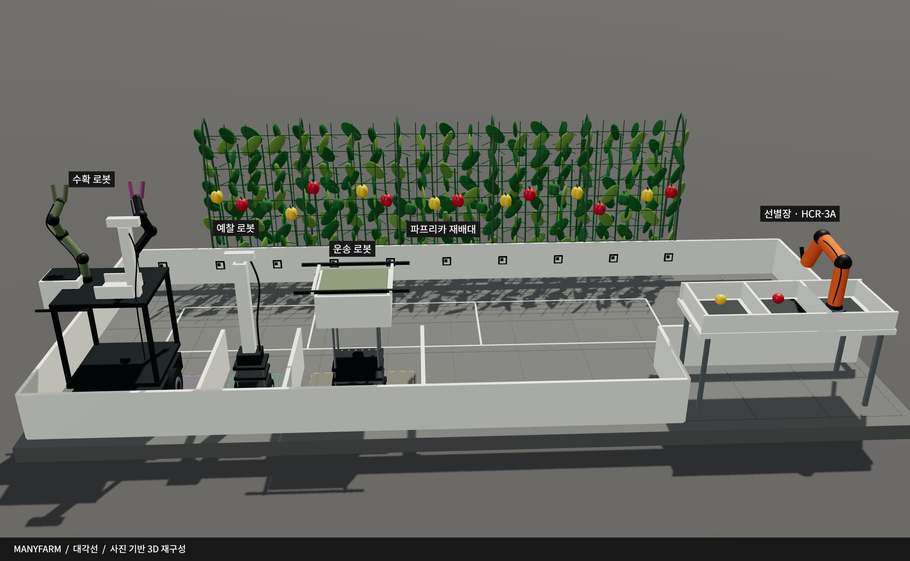

 

## 🎬 Real Robot Demo

### 01 · 예찰 — 화단을 살펴 수확 위치 정하기

**이동 → 멈춰서 관측 → 수확할 영역과 정차 위치 결정**

<table>
<tr><th width="300">화단을 따라 이동하며 관측</th><th width="620">관측한 화면에서 수확 영역으로</th></tr>
<tr>
<td align="center" valign="middle">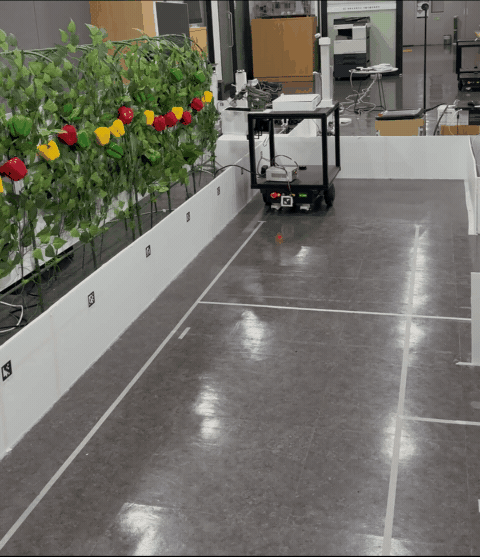</td>
<td valign="middle">
<b>카메라로 본 화단</b> 
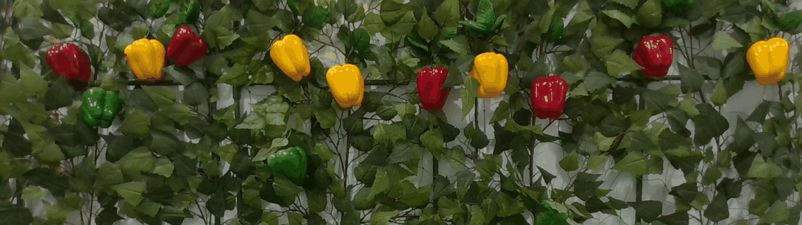 
<b>↓ 수확할 영역 나누기</b> 
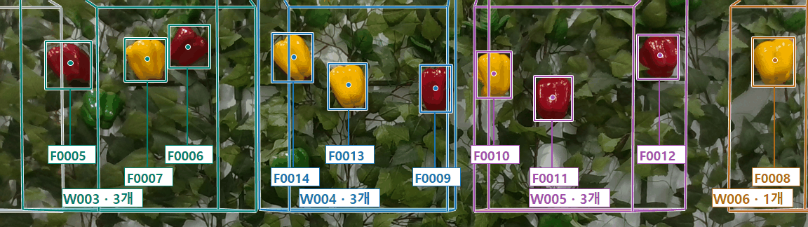
</td>
</tr>
</table>

**작업창(Window)**은 로봇팔이 수확할 영역입니다. 관측 결과를 작업창으로 묶고, 위치·예상 수량과 수확로봇의 정차점을 다음 작업에 연결합니다.

#### YOLO11n-seg · RGB-D 과실 위치 추정

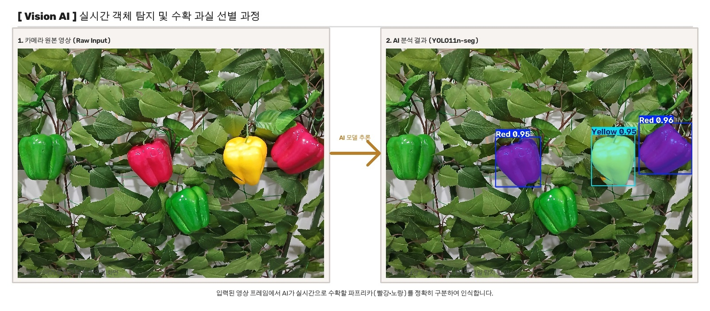

**과실 마스크 → 깊이 결합 → 지도 좌표 변환 → 작업창·정차점 생성**

빨강·노랑 과실을 분리하고, RGB-D와 TF로 수확 위치를 계산합니다.

### 02 · 수확 — 작업점으로 이동하고, 따서 담기

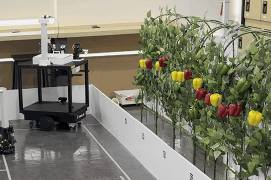

**작업점 이동 → 정차 → 과실 파지·분리 → 상자 적재**

#### PPO 강화학습 · 카메라 기반 수확 제어

<table>
<tr><th width="460">수확 동작 학습</th><th width="460">카메라 기반 수확 실행</th></tr>
<tr><td align="center">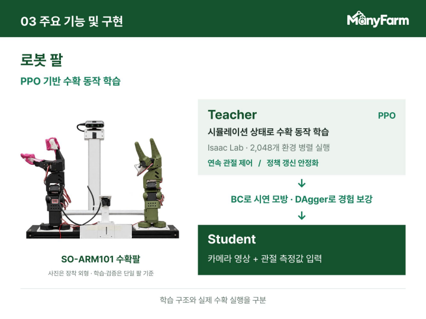</td><td align="center">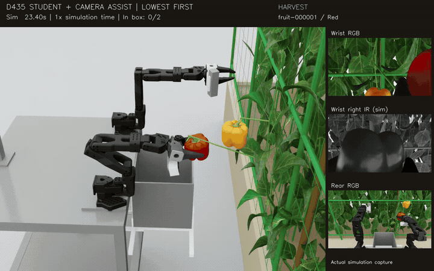</td></tr>
<tr><td><b>잡기 → 당기기 → 옮기기 → 놓기</b> Isaac Lab·PPO로 단계별 동작을 학습하고, 시연을 카메라 기반 정책 학습에 연결했습니다.</td><td><b>과실 위치 확인 → 접근 보정 → 상자 투입</b> 화면의 카메라 기반 시험과 실물 수확에는 단계별 보조제어를 사용했습니다.</td></tr>
</table>

#### AprilTag · AMCL 위치 보정

**벽의 태그 관측 → 촬영 시각·위치 편향 보정 → AMCL 위치 갱신 → 경로 추종**

실물 주행에서 태그 관측의 AMCL 반영을 확인했습니다.

### 03 · 운송 — 인계부터 선별장 하역까지

<table>
<tr><th width="460">01 · 도킹·인계</th><th width="460">02 · 선별장 하역</th></tr>
<tr><td align="center">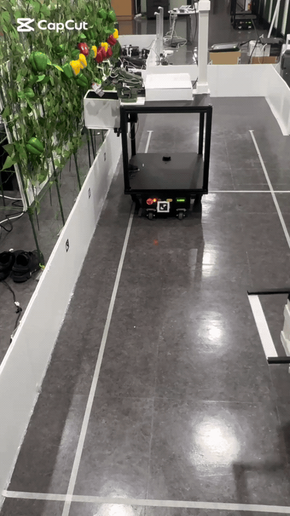</td><td align="center">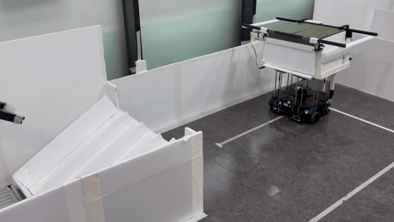</td></tr>
<tr><td>수확로봇에 접근해 수확물을 받습니다.</td><td>선별장으로 운반하고 적재함을 기울여 전달합니다.</td></tr>
</table>

### 04 · 선별 — 과실을 색상별로

<table>
<tr><td align="center">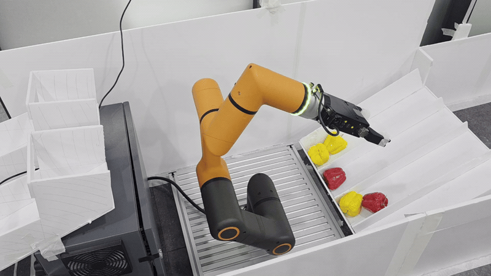</td><td align="center">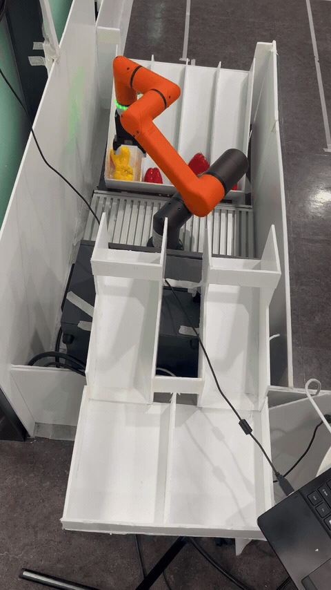</td></tr>
</table>

카메라로 **과실의 색상을 구분**하고, 협동로봇이 색상별 분류 위치로 옮깁니다. 선별 결과와 처리 수량은 관제에 기록합니다.

 

## 🖥️ Web Dashboard

작업을 시작하고, 지도 위 로봇과 공정 진행 상태를 한눈에 확인합니다.

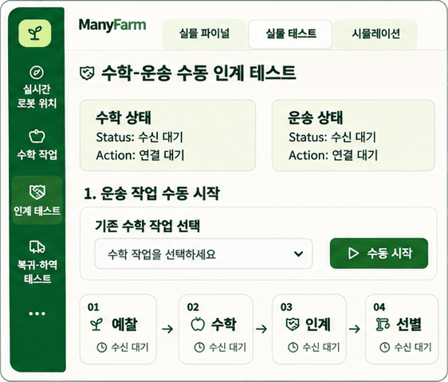

**위치·상태 모니터링 · 작업 요청·취소 · 인계·하역 조율 · 결과 조회**

작업 결과 화면

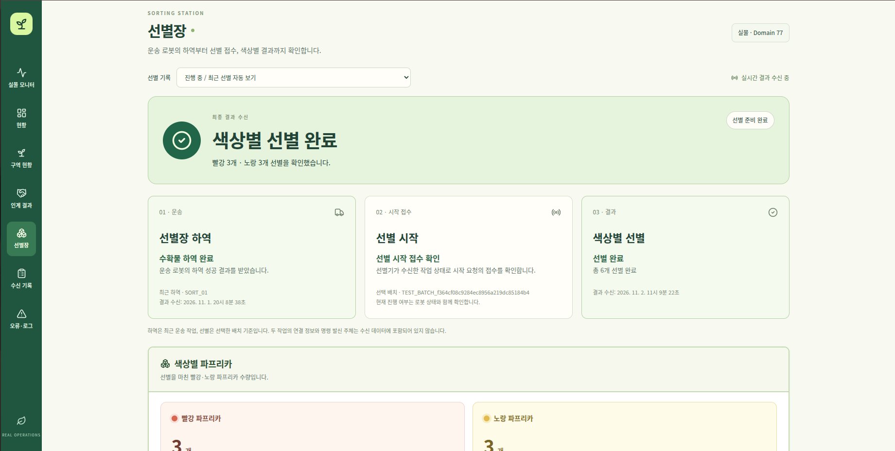

 

## 🌐 Simulation · Sim-to-Real

**실물과 시뮬레이션에 공통 업무 로직을 적용**하고, 물체의 물성과 물리 동작을 실제 환경에 가깝게 조정하며 **Sim-to-Real**을 진행했습니다.

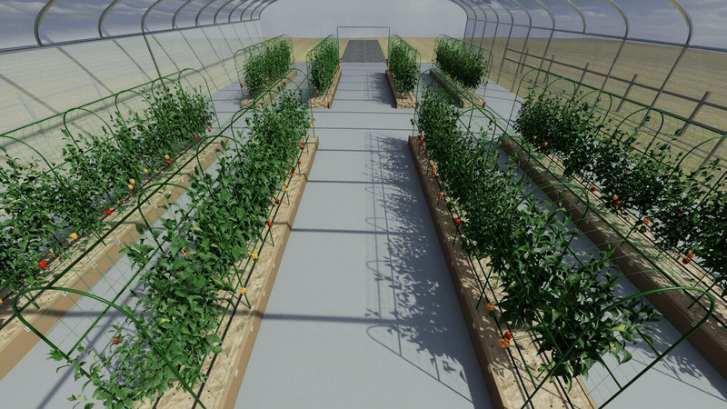

**공통 로직 연결 → 물리 조건 조정 → 시뮬레이션 시험 → 실물 로봇 확인**

Isaac Sim의 **8개 베드·16개 작업 구역**에서 협업 공정을 시험하고, 실제 로봇에서도 동작을 확인했습니다. 가상 센서·구동부 연동과 합성 데이터 생성에도 같은 개발 환경을 활용했습니다.

### 시뮬레이션에서 확인한 결과

| 시험 | 결과 | 시험 범위 |
|---|---|---|
| **16구역 예찰·수확** | **137개 작업창 완료** · 실제 대상의 **94.27%**를 작업창에 포함 | 10/23–24, 19회 시도 중 구역 성공 16회·실패 2회·외부 중단 1회. 창 포함 181/192개 |
| **수확량 추적** | **125개** 레이저 통과 집계 | 같은 시험의 대상 192개 대비 65.10%. 작업 완료와 실제 수확량을 따로 평가 |
| **운송 → 선별 → 복귀** | **10개 전량 선별** · 잔류 0 · 두 로봇 복귀 | 10/30 단회 시험. 기존 예찰·수확 결과를 재사용 |

시뮬레이션 농장 지도

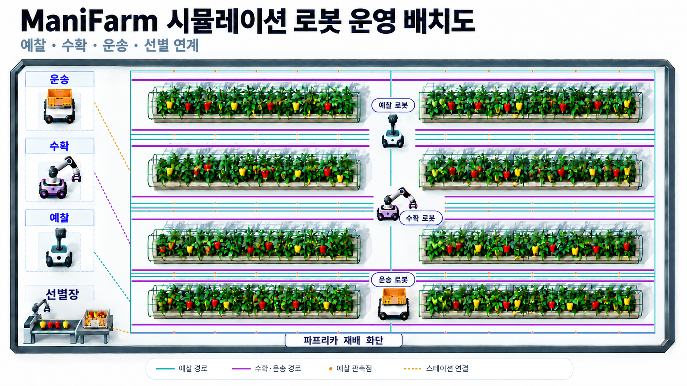

 

## 🔑 Core Technologies

<table>
<tr><th width="460">YOLO11n-seg · RGB-D · TF</th><th width="460">Nav2 · GeoJSON · AprilTag · AMCL</th></tr>
<tr><td><b>과실 인식·3D 위치 추정</b> 과실 마스크와 깊이를 지도 좌표로 변환하고, 팔 작업 범위에 맞춰 작업창·정차점을 생성합니다.</td><td><b>경로 주행·위치 보정</b> GeoJSON 경로를 Nav2로 추종하고, AprilTag 관측의 시각·편향을 보정해 AMCL에 반영합니다.</td></tr>
<tr><th>Isaac Lab · PPO · BC/DAgger</th><th>ROS 2 · FSM · DDS/Zenoh</th></tr>
<tr><td><b>수확 동작 학습</b> PPO로 접근·파지·운반·놓기를 단계별 학습하고, Teacher 시연을 카메라 기반 Student 학습에 연결했습니다. 실물 수확은 단계별 보조제어로 수행했습니다.</td><td><b>다중 로봇 작업 조율</b> Action·Service·Topic으로 작업·상태·결과를 교환하고, 상태머신으로 수확·인계·하역·복귀를 연결합니다.</td></tr>
<tr><th>OpenCR · UART · Modbus TCP</th><th>Isaac Sim · Sim-to-Real</th></tr>
<tr><td><b>운송 기구·선별장 제어</b> OpenCR로 덮개·앞문·틸트를 제어하고, HCR-3A의 티칭 동작을 색상 판정·선별 요청과 연결합니다.</td><td><b>공통 코드·가상 장치 연동</b> 업무 로직과 장치 어댑터를 분리하고, 카메라·접촉·물성 조건을 조정하며 시뮬레이션과 실물에서 시험했습니다.</td></tr>
</table>

 

## 👥 Team

| 팀원 | 주요 담당 |
|---|---|
| 최은비 | PM·발표, 수확로봇 차체 제어·인계·복귀 |
| 신동민 | 예찰·운송로봇 주행, 정밀 도킹 |
| 채윤식 | 운송로봇 기구·펌웨어 |
| 조병현 | 수확 팔·기구, HCR 선별 |
| 황은하 | Vision AI, 수확 상자 검사 |
| 전민석 | 중앙 관제, 작업 관리 |
| 양시영 | 시뮬레이션, 공통 코드 통합 |

 

## 📂 Repositories

| 저장소 | 확인할 내용 |
|---|---|
| [main](https://github.com/Robot3FinalProject/main) | 프로젝트 소개, 공통 로봇 코드, 환경 설정, Isaac Sim 자산·시험 도구 |
| [Frontend](https://github.com/Robot3FinalProject/Frontend) | 웹 관제, 서버, 작업 관리와 실행 기록 |
| [Control](https://github.com/Robot3FinalProject/Control) | 터미널 관제·인터페이스 및 연동 시험 도구 |
| [robotarm](https://github.com/Robot3FinalProject/robotarm) | 로봇 모델과 로봇팔 관련 자산·구현 |
| [sorting](https://github.com/Robot3FinalProject/sorting) | HCR-3A 선별장 제어 |
| [vision_paprika_detection](https://github.com/Robot3FinalProject/vision_paprika_detection) | 파프리카 비전 관련 구현 |

---

**ManyFarm · 매니팜** — 관측한 정보를 다음 로봇의 작업으로 연결합니다.
