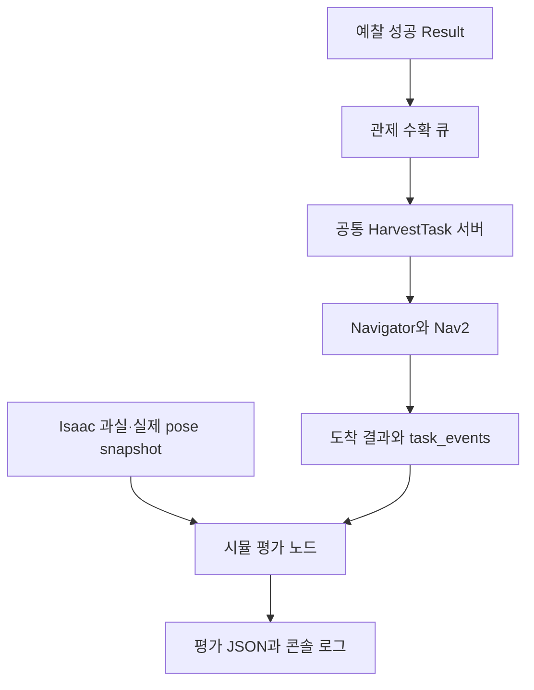

# 농작물 수확 로봇 — 현재 상태 인수인계

> 2026-10-20 수확105 재현/설정 수정: **§78**. 원래 끝점 정체105를 재현했고 sim의 위치 재접근/실제 끝점 추종 설정으로 같은 경로1건과 연속 window 주행3건을 통과했다. 전체 반복 시험은 별도 진행 중이다.

> 2026-10-20 예상 개수 불일치 실패 제거: **§76**. 예찰 예상량은 참고값이며, 팔 카메라의 작업 가능 목록을 수확하고 다음 window로 진행한다. 목록0도 측정 정지 확인 후 수확0으로 완료한다.

> 2026-10-19 SEC01~SEC16 반복 통합 시험 진행 중: **§75**. 각 SEC 예찰→전체 window 수확이 모두 성공해야 다음 SEC로 진행하며 실패 시 전체 시뮬레이션 재기동 후 같은 SEC를 재시도한다. 현재 성공률·전체 완료를 확정한 기록이 아니다.

> 2026-10-16 팔 없이 즉시 완료 원인: **§67**. 실행 명령이 이전 이동 전용 프로파일을 선택했다. 해당 프로파일을 현행 수확 작업 설정에 연결했으며 이미 실행 중인 서버에는 런치 재시작이 필요하다.

> 2026-10-16 수확105 수정: **§66**. 평평한 바퀴 충돌 단면이 저속 회전을 막는 것을 대조 시험으로 확인하고 둥근 타이어 단면을 적용했다. 보정 상한2rad/s·원래 이득 유지. 실제 Nav2 정렬/이동3개와 Teacher 팔 Action2/2 성공. 전체 농장 연속 수확·실물 검증은 별도다.

> 2026-10-16 수확 액션 연결 확인: **§63**. 기본 수확 액션은 정차 후60Hz Teacher 팔 작업과 실측 결과를 기다린다. 근처 과실 물리를 유지하며 카메라 정책 교체 경계도 명시했다.

> 최신 팔 통합: **2026-10-16, §62**. 60Hz Teacher r2 적용,480Hz 실행 폐기. 주행 사용자 확인은 §61이며 아래 과거 시점의 미구현/480Hz 설명과 구분한다.

> 최신 주행 통합: **2026-10-13, §37**. AprilTag 전달본을 반영했으며 아래 날짜별 절의 인수 대기·미구현 표기는 작성 당시 기록이다. 현재 실행 조건과 이번 검증은 §37 및 연결 문서를 우선 확인한다.

- 작성 기준일: 2026-10-06, Asia/Seoul.
- 저장소: https://github.com/Robot3FinalProject/main
- 기준 브랜치: `main`.
- 확인한 코드 커밋: `068b42eb0ebe54b3b57cffe254a20b2f9e3b202e` (2026-10-06 11:19:12 KST).
- 아래 파일 경로는 모두 저장소 안의 `farm_project/` 기준이다. 사용자 작업 경로는 `~/main/farm_project`다.
- 최초 작성은 위 커밋의 정적 대조·기존 로그 검토였다. 이후 사용자 요청에 따른 로컬 미커밋 과실/오른팔 물리·좌표 구현과 이번 GPU Isaac 시험 결과를 §15에 추가했다. 이전 검토 절의 “미실행”은 해당 작성 단계의 기록이며 최신 적용 상태는 §15와 연결 보고서를 따른다. 실물 로봇 시험은 하지 않았다.
- 2026-10-06 이번 검토에서 `git fetch origin` 성공 후 `HEAD...origin/main`의 앞섬/뒤처짐은 `0/0`이었다. 코드 HEAD와 원격 main은 동일하다. 기존 인계 패키지와 이번 문서 수정은 미커밋·원격 미반영 상태다.

## 1. 프로젝트 목적과 현재 구현 범위

전체 목표는 **예찰 → 수확 → 운송 → 분류**를 관제로 연결하고, 실물과 Isaac Sim에서 공통 로봇 업무 코드를 사용하는 것이다. 현재 대상 작물은 파프리카(bell pepper)다. 9월 10일의 토마토 기획 문서 두 개는 초기 목표·역할 분담의 참고 자료이며, 현재 작물·메시지·실행 상태를 나타내는 문서가 아니다.

사용자 담당은 시뮬 환경·로봇·센서 구현, 합성 비전 데이터 생성, 실물 담당자 소스 통합, 반복 시험 및 Sim-to-Real 비교다. 관제 통신규약과 업무 FSM을 시뮬 파트에서 임의로 재정의하지 않는다.

| 구성 | 확인한 현재 상태 | 완료로 해석하면 안 되는 범위 |
|---|---|---|
| 예찰 | Burger, 상태 기반 `scout_new`, RGB-D/YOLO, 과실 등록·Window 생성, ScoutArea 서버 | 최신 규약으로 전체 예찰·수확 연계가 재검증된 것은 아님 |
| 수확 | 공통 `harvest_robot` 서버·Nav2 이동, 시뮬 정차 후60Hz Teacher 오른팔 수확(§62) | 실물 팔·Student 및 이번 주기 변경 후 전체 Nav2 연계 재검증은 미실행 |
| 수확 물리 기반 | 288개 과실9g·response6·단일 박스 바닥, 물리60Hz/정책20Hz/렌더30Hz 및 실제 파지·적재 GPU 시험(§62) | 독립26/32를 농장 전체/실물 성능으로 인증하지 않음 |
| 수확 평가 | Isaac 과실 정답과 도착 시 작업 박스 안의 개수 비교 | 실제 수확 성공 수량·IK 도달 가능성·충돌 회피 판정이 아님 |
| 운송·분류 | 전체 프로젝트 목표 및 별도 팀 파트 | 이 통합 저장소의 transport/sorting launch는 오류를 내는 미구현 스텁 |
| 관제 | 외부 관제와 공통 인터페이스, 임시 예찰 명령 클라이언트 | `control/scripts/send_scout_area.py`가 수확 큐까지 실행하지는 않음 |
| 실물 연결 | 예찰 프로파일 및 인수한 수확 real 장치·주행·태그 프로파일/bringup | 수확 단일 주행 성공은 담당자 기록이며 이번 PC에서 실물 재검증하지 않음(§37) |

전체 시뮬 실행은 `farm_sim_runtime all.launch.py`다. `farm_bringup all.launch.py`는 미구현 스텁이므로 혼동하지 않는다. 최신 시뮬 실행 절차는 [시뮬 실행·로그 가이드](../sim/docs/RUN_GUIDE_20261006.md)를 사용한다.

## 2. 코드 구조와 수정 경계

| 위치 | 책임 |
|---|---|
| `control/` | 현재는 임시 관제 테스트 클라이언트 등. 외부 관제 프로그램 전체와 동일하지 않음 |
| `robot/ros_ws/src/scout_robot/scout_new/` | 현행 예찰 Node·Mission·Communication·StateController·States |
| `robot/ros_ws/src/scout_robot/scout_robot/` | 예찰 계산·워커·기존 서버 및 호환 코드. 기존 서버와 새 서버 중복 실행 금지 |
| `robot/ros_ws/src/harvest_robot/harvest_robot/` | 공통 수확 Action 서버·계약·이동 미션·상태 제어 |
| `robot/ros_ws/src/farm_navigation/` | 공통 그래프 계획·Nav2 요청·위치 조회·정지 및 도착 확인 |
| `robot/ros_ws/src/farm_interfaces/` | ROS 메시지·액션·서비스 형식 |
| `robot/ros_ws/src/farm_bringup/` | 환경 선택 및 로봇·주행·모니터링 launch |
| `robot/config/`, `robot/models/` | 실물 설정 및 공유 모델. 시뮬 조정을 이유로 임의 변경하지 않음 |
| `sim/ros_ws/src/farm_sim_config/` | 시뮬 지도·그래프·장치·Nav2·비전·예찰 설정 |
| `sim/ros_ws/src/farm_sim_devices/` | 가상 장치, 센서·구동·ROS 연결, scene truth |
| `sim/ros_ws/src/farm_sim_runtime/` | Isaac 단독/다중 로봇 실행, station 배치, 시뮬 launch |
| `sim/ros_ws/src/farm_sim_harvest/` | 수확 평가 노드. 공통 수확 업무 코드를 복제하지 않음 |
| `sim/assets/`, `sim/tools/`, `sim/tests/`, `sim/runs/` | 시뮬 자산·도구·시험·실행 결과 |

`AGENTS.md`와 `sim/AGENTS.md`의 기존 승인 규칙을 따른다. 공통 미션·주행·메시지 변경은 구체적인 변경안과 실물 영향을 제시하고 승인받아야 한다. 최초 인수인계 문서 작성 승인과 이후 §15의 sim 물리·좌표 구현 요청을 구분하며 공통 업무 변경으로 확대하지 않는다.

## 3. 현행 주행·지도·배치

공통 `Navigator`는 선택된 설정에 따라 동작한다. 시뮬 예찰은 **자체 RouteGraph 계획 → Path 생성 → Nav2 FollowPath/RPP → 정지·도착 오차 확인**을 사용한다. 2026-10-13 수확은 같은 graph/FollowPath를 진입·작업·이탈 단계로 연결하고 작업 구간 안의 정방향 중간 출발을 지원한다(§37). 전달 `route_server` 대안도 코드에 있지만 현재 실물/시뮬 프로파일은 graph를 선택한다. Window XY·yaw로 이동한다는 설명이 `NavigateToPose`를 사용한다는 뜻은 아니다.

- 원본: `sim/ros_ws/src/farm_sim_config/config/task.yaml`, `sim/ros_ws/src/farm_sim_config/maps/scout_harvest.geojson`.
- 파생 설정·역할별 그래프 생성: `sim/tools/rebuild_route_data.py`; 검사: `sim/tools/validate_route_data.py`.
- 데이터에서 확인: 8개 물리 베드, 16개 Section, Section당 5개 관측점으로 총 80개 관측점.
- Section은 `SEC01`~`SEC16`; 물리 USD의 `Bed_XX`와 같은 번호라고 가정하지 않는다. 예: `SEC01`의 평가 대상은 `/World/Vegetation/Bed_02`다.
- Segment 예: `SEC01_G01`. 실물의 `SEC_01` 등은 해당 환경 설정의 실제 키를 사용한다. sim/real 이름을 일괄 치환하지 않는다.
- 지도: `sim/ros_ws/src/farm_sim_config/maps/count_test_farm_map.yaml`, map ID `farm_map_v1`, 해상도 0.05 m/pixel, origin 약 `[-8.075, -15.075, 0]`.
- 실물 예찰은 `robot/config/environments/scout_real.yaml`, map ID `many_farm_v1`, `robot/config/maps/many_farm/`를 사용한다. 시뮬 지도와 섞지 않는다.

이번에 GeoJSON 점·엣지로 계산한 **약연결 성분**은 다음과 같다. 방향을 무시한 연결성 확인이며, 모든 방향의 경로·장애물·실제 주행 성공을 검증한 결과는 아니다.

| 그래프 | 노드 | 방향 엣지 항목 | 약연결 성분 |
|---|---:|---:|---:|
| `scout_harvest.geojson` | 227 | 516 | 1 |
| `graph.geojson` (예찰) | 211 | 452 | 1 |
| `harvest_graph.geojson` | 143 | 260 | 1 |

따라서 과거의 ‘16개 비연결 성분’ 설명은 복원 전 기록이다.

| 로봇 | station 노드 | X, Y (m) | yaw (rad) |
|---|---:|---|---:|
| `scout_01` | 8001 | -5.0, 13.25 | -1.5707963267948966 |
| `harvest_01` | 8002 | -2.0, 13.25 | -1.5707963267948966 |

station 원본과 AMCL 초기 pose를 일치시킨다. `station_spawn.json`의 운송·분류 station은 `DESIGN_PROPOSAL`이고 yaw가 null이므로 실행 완료된 로봇 배치로 취급하지 않는다. 수확 자산의 논리 주행 프레임은 자산 축과 180도 차이가 있다(`control_frame_yaw_rad=π`); 박스 좌표·바퀴 부호를 월드 축과 혼동하지 않는다.

## 4. 2026-10-06 관제 통신 계약

정의 원본은 `robot/ros_ws/src/farm_interfaces/`, 반영 배경은 [PROTOCOL-20261006-014](changes/PROTOCOL-20261006-014.md)다. 아래는 확인한 필드이며, 이후 규약 변경 시 실제 `.action`/`.msg`를 다시 확인한다.

### ScoutArea

- Action: `/scout_01/scout_area`, 형식: `farm_interfaces/action/ScoutArea`.
- Goal: `robot_id`, `task_id`, **`section_id` 단일 값**, `map_id`, `frame_id`, `crop_type`, `target_ripeness`, `timestamp`.
- 현재 예찰 서버는 `frame_id=map`, `crop_type=PAPRIKA`, `target_ripeness=RIPE`와 설정의 robot/map/section을 검사한다.
- Result: `robot_id`, `task_id`, `result_code`, `section_id`, `completed_segment_count`, `harvest_task_count`, `total_expected_count`, **`harvest_tasks[]`**, `error_code`, `error_message`, `timestamp`.
- Feedback: `robot_id`, `task_id`, `phase`, `section_id`, `segment_id`, `completed_segment_count`, `segment_expected_count`, `harvest_tasks[]`, `timestamp`.
- 수확 작업 등록은 **성공 Result의 최종 목록** 기준이다. Feedback은 진행 정보이며, `SECTION_COMPLETE`를 작업 큐 등록 신호로 사용하지 않는다.
- 실패·취소 Result는 마지막 저장 성공 시점의 부분 목록을 포함할 수 있다. 보관하되 자동 수확 전송은 보류한다.
- `section_ids[]`, `completed_section_ids`, `completed_section_count`를 현재 ROS 계약에 다시 넣지 않는다. 내부 `survey.json`에 과거 분석 필드가 남는 것은 별개다.

### HarvestTask

공유 `HarvestTask.msg`는 **`task_id`, `window_id`, `goal_pose`, `expected_count` 네 필드**다. `section_id`, `segment_id`, `sequence`는 현재 이 ROS 메시지의 필드가 아니다.

- Action: `/harvest_01/harvest_task`, 형식: `farm_interfaces/action/HarvestTask`.
- Goal: `robot_id`, `map_id`, 중첩 `harvest_task`, `timestamp`.
- Result: `robot_id`, `task_id`, `window_id`, `result_code`, `expected_count`, `harvested_count`, `failed_count`, `error_code`, `error_message`, `timestamp`.
- Feedback: `robot_id`, `task_id`, `success_count`, `failed_count`, `timestamp`. `phase`, `progress_ratio`, `detected_count` 등은 없음.
- `goal_pose`는 `frame_id`, `position{x,y,z}`(m), `yaw`(rad)를 갖는 `RobotPose`다.
- 현재 완료 정책은 `ARRIVAL_ONLY_NO_HARVEST`: 도착·방향·정지를 확인하면 `SUCCESS`, `harvested_count=0`, `failed_count=0`. 요청의 `expected_count`는 유지한다.
- 한 번에 한 작업만 수락하고, 현재 서버 프로세스에서 성공한 같은 `task_id`는 다시 거절한다. 재시작을 넘는 영구 중복 방지를 보장하는 것은 아니다.
- `window_id`는 비어 있지 않은 식별자로 그대로 전달한다. `SEC01_G01_W01`은 명명 예시이며 세션 접두사가 붙은 실제 ID를 잘라내거나 새로 만들지 않는다.

`RobotStatus.msg`, `GetHarvestTasks.srv`의 정의가 존재하는 것과 발행기·서비스 서버의 운영은 다르다. 최신 반영 기록상 예찰·수확 상태 발행기는 별도 구현이 필요하고, 현재 Result 기반 흐름은 GetHarvestTasks를 호출하지 않는다.

## 5. 비전·환경 설정

사용 환경 기준은 Ubuntu 24.04.4, ROS 2 Jazzy, Isaac Sim 5.1.0, RTX 4070 SUPER 12GB다. 사용자 제공 개발환경 기록이며 이번에 설치 환경을 직접 점검한 결과는 아니다.

| 항목 | 현재 파일에서 확인한 값 |
|---|---|
| 시뮬 장면 | `sim/assets/envs/output/farm_with_plants_v5.usd` |
| 시뮬 예찰 모델 | `robot/models/scout/yolo11_seg_2class_synth_and_sim_v2.0.pt` |
| 시뮬 모델 설정 | `sim/ros_ws/src/farm_sim_config/config/scout_vision.json` |
| 시뮬 실시간 예찰 카메라 | `scout_fleet.json`: 640×384, 설정 FPS 15, 공유메모리 `farm_scout_01_rgbd` |
| 시뮬 추론 최대 FPS 설정 | 15.0. 실제 달성 FPS를 확인한 수치는 아님 |
| 실물 카메라 설정 | `robot/config/vision/scout_real.json`: 1280×720, 설정 FPS 6 |
| 실물 모델 설정 | `model_yolo11_seg_ver1.2.pt`, 기존 외부 worker 경로. 시뮬 모델로 자동 교체되지 않음 |
| 데이터셋 생성 설정 | `sim/config/scout_dataset.json`: 1280×720, seed 930, 과실 회전 최대 30도, 후처리 활성화 |
| 수확 카메라 | `harvest.json`에서 disabled; 현재 수확 평가는 카메라 재탐지를 사용하지 않음 |

실시간 영상, 합성 데이터셋, 실물 D435 설정을 같은 해상도·FPS·노이즈 조건으로 설명하지 않는다. 현행 시뮬 추론 설정에는 추가 노이즈/블러를 넣지 않는다고 명시되어 있으며 데이터셋 후처리와 구분한다.

장면 USD는 Git에서 LFS로 관리한다. 이번 로컬 파일은 `PXR-USDC` 헤더의 실제 바이너리 객체이며 크기는 2,795,738 bytes다. 파일 존재·헤더만 확인했고 USD 참조·기하·Isaac 로딩은 검증하지 않았다. 새 PC에서는 포인터 텍스트만 받은 상태인지 확인한다. 이 인수인계 ZIP은 USD·모델 파일을 포함하지 않는다.

## 6. 수확 작업 박스 평가와 로그



위 관제 큐는 연동 계약상 필요한 역할이다. 현재 임시 예찰 클라이언트에 자동 수확 큐가 구현되어 있다는 뜻은 아니다. 정답 snapshot은 평가로만 흐르며 공통 제어·YOLO 입력으로 주입하지 않는다.

- 공통 서버 진단 이벤트: `/harvest_01/task_events`, `std_msgs/String`, RELIABLE/TRANSIENT_LOCAL, depth 100.
- 평가 노드: `sim/ros_ws/src/farm_sim_harvest/farm_sim_harvest/audit_node.py`.
- 평가 설정: `sim/ros_ws/src/farm_sim_config/config/harvest_audit.json`.
- **결과 파일: `sim/runs/harvest_motion/<평가세션>/<task_id>_<event_id>.json`.**
- 정답 snapshot: `sim/runs/runtime/harvest_scene.json`.
- 콘솔: `workspace audit: ...`; 파일 기록 실패는 `시뮬 과실 평가/로그 실패: ...`로 출력.
- 평가 노드는 `farm_sim_runtime harvest.launch.py`가 추가한다. 공통 `farm_bringup harvest.launch.py`만 실행하면 이 평가 노드가 붙지 않는다.

작업 박스는 논리 `base_footprint`에서 중심 `[-0.19, 0.435, 0.828]` m, 크기 `[0.35, 0.10, 0.45]` m다. 빨강·노랑 과실의 월드 AABB 중심을 박스에 포함하는지 검사하고 초록 과실은 별도 제외 개수로 기록한다. 팔의 실제 관절 가동 범위를 계산한 결과가 아니다.

주요 평가 필드: `evaluation.status`, `expected_count`, `actual_in_workspace`, `count_delta`(실제-예상), `repeated_gt_ids`, `matched_fruits`, `ignored_green_count`. `repeated_gt_ids`는 같은 평가 노드와 scene session에서 앞서 센 과실의 재등장이다. 과실을 제거하거나 실제로 수확하지 않는다. 수량 차이만으로 어느 열매가 YOLO 미검출됐는지까지 확정할 수는 없다.

평가 상태는 `OK`, `SKIPPED_NOT_ARRIVED`, `UNAVAILABLE`을 구분한다. snapshot은 기록 후 0.5초 이내, 도착 시각 대비 -0.25~+0.5초 범위여야 한다. 늦은 과거 이벤트 재수신 등으로 평가가 불가능할 수 있다. 평가 실패가 이미 성공한 수확 Action 결과를 바꾸지는 않는다.

다른 로그 위치는 [실행 가이드의 로그 표](../sim/docs/RUN_GUIDE_20261006.md#5-결과와-로그)를 참고한다.

## 7. 검증 상태와 인수 시 주의할 사항

| 항목 | 확인 수준 | 해석 |
|---|---|---|
| 소스·설정·메시지·launch 구성 | 이번 로컬 HEAD와 미커밋 문서 정적 대조 | 현행 코드가 무엇인지 확인한 근거 |
| 그래프 규모·약연결성·관측점 수 | 이번에 JSON/YAML 계산 | 실제 로봇 주행 성공을 뜻하지 않음 |
| 고정 캐스터 마찰 보정 | 10/6 적용 기록 및 사용자 ‘수확 로봇 이동 정상’ 보고 | 이동 불능이 해결됐다는 사용자 확인. 새 통합 주행 시험을 수행한 것은 아님 |
| 예찰 SEC01 성공·작업 8개/예상 12개 | 기존 `sim/runs/scout_survey/c1167c0c9631/survey.json` 열람 | 구형 `section_ids` Goal을 사용한 과거 로그. 최신 단일 Section 계약 E2E 합격 근거로 쓰지 않음 |
| 실물 4·6·8번 주행·최종 예찰 실패 | 10/2 예찰 인수인계 기록 | 팀원의 당시 시험 결과. 이번 직접 검증 아님 |
| 과거 단위/구성 검사 | 개별 변경 문서에 결과 존재 | 해당 변경 당시 기록. 이번에 모든 검사를 재실행한 것은 아님 |
| 최신 규약 colcon·생성 메시지·관제→예찰→수확 | 이번 미실행 | 사용자 환경에서 확인 후 결과 문서 갱신 필요 |

현재 이어서 확인할 항목:

1. 최신 farm_interfaces로 로봇·관제를 모두 재빌드한 뒤 성공 Result 기반 수확 작업 전달 확인.
2. `harvest:=true` 실행에서 수확 이동과 audit JSON 생성 확인. ‘움직인다’와 ‘예상/실제 수량이 일치한다’를 별도 기록.
3. 관제의 RobotStatus 필수 여부와 상태 발행기 구현 범위 조율.
4. 실물 수확 장치·프로파일 인수 및 실물 비전 모델 경로/버전 결정.
5. 서로 다른 Segment의 중복 과실 등록, 위치추정 오차에 따른 Window 누락 재현. 과거 주요 관심 이슈이며 현행 발생률은 미확인.
6. 교통 제어·도킹·운송·분류의 통합 범위 결정. 데이터에 공용 경로가 있다고 교통 제어가 구현된 것은 아님.

## 8. 과거 문서를 읽을 때의 우선 확인

- `docs/SUMMARY_인수인계서.md`는 10/2의 예찰 인수인계로 보존한다. 전체 프로젝트 최신 상태로 단독 사용하지 않는다.
- `docs/RUN_GUIDE_20261002.md`의 일부 스텁 설명과 기본 구역 설명은 변경 전 내용이다. 현행 임시 클라이언트 기본값은 `SEC01`이다.
- 10/2 수확 문서의 구형 Goal 필드 예시보다 10/6의 실제 `.action`/`.msg` 정의를 확인한다.
- 10/6의 일부 과거 패치 문서에도 `harvest:=true` 없는 전체 실행 예시가 있다. 수확 시험은 새 실행 가이드를 사용한다.
- 본 문서도 고정된 기준 커밋의 요약이다. 이후 변경은 [Codex 작업·공유 절차](CODEX_HANDOFF.md)에 따라 갱신한다. 업무 의도와 구현이 충돌하면 [결정 기록](DECISIONS.md)에 차이를 남기고 사용자에게 확인한다.


## 9. 이번 로컬 검토의 Git 상태와 보존 범위

- 검토일: 2026-10-06 KST. Git 루트는 `/home/ysy/main`, 프로젝트는 그 아래 `farm_project/`다.
- 브랜치 `main`, HEAD 및 fetch 후 `origin/main`: `068b42eb0ebe54b3b57cffe254a20b2f9e3b202e`. CODEX_HANDOFF의 기준 코드와 동일하다.
- 원격: `origin`, `https://github.com/Robot3FinalProject/main.git`. `git rev-list --left-right --count HEAD...origin/main` 결과 `0 0`; 커밋 기준 차이가 없다. 작업 트리 문서는 별도다.
- 시작 시 기존 수정: `AGENTS.md`, `README.md`, `sim/docs/CHANGELOG.md`.
- 시작 시 미추적: `docs/CODEX_HANDOFF.md`, `docs/DECISIONS.md`, `docs/HANDOFF_SOURCES_20261006.json`, 이 문서, `sim/docs/RUN_GUIDE_20261006.md`, `backups/codex_handoff_before_20261006_114034.tar.gz`.
- 이번 변경: 기존 상태 문서 내용을 유지하면서 로컬 확인 결과·실행 요약·충돌 근거를 보강하고 `sim/docs/CHANGELOG.md`에 문서 검토를 추가했다. 사용자 요청은 문서 작업만 승인한다. 실행 코드·설정·시험·모델·USD 변경 없음.
- fetch는 원격 추적 정보 조회이며 pull/merge를 수행하지 않았다. commit/push도 수행하지 않았다. 다른 작업자의 문서와 백업을 삭제·이동하지 않았다.

## 10. 현재 코드에 맞춘 실행 요약

아래 명령은 소스와 대조한 실행 절차이며 이번에 실행한 명령이 아니다. 비전용 robot_venv를 활성화하고 Isaac Python 실제 경로를 설정한다. 빌드 도구와 의존성 설치 여부는 이번에 검증하지 않았다.

```bash
cd /home/ysy/main/farm_project
source /opt/ros/jazzy/setup.bash
export FARM_ISAAC_PYTHON="$HOME/isaac/env_isaaclab/bin/python3.11"
export FARM_VISION_PYTHON="$VIRTUAL_ENV/bin/python"
bash scripts/build.sh sim
source scripts/env.sh sim
python robot/ros_ws/src/farm_interfaces/examples/verify_interfaces.py
ros2 launch farm_sim_runtime all.launch.py \
  project_root:="$PWD" isaac_python:="$FARM_ISAAC_PYTHON" \
  vision_python:="$FARM_VISION_PYTHON" harvest:=true device:=0
```

별도 관제 터미널도 동일 인터페이스 install을 source한다. 예찰 요청은 `python control/scripts/send_scout_area.py --section SEC01 SEC02`; 수확 이동 시험은 실행 가이드의 `harvest_smoke_goal.py` 예시를 사용한다. 외부 관제 자동 큐 연결은 이 클라이언트가 제공하지 않는다.

실물 예찰은 ROS 환경에서 `bash scripts/build.sh real`, `source scripts/env.sh real` 후 다음처럼 실행한다. 비전 Python은 실제 D435/worker 환경으로 지정해야 한다.

```bash
ros2 launch farm_bringup scout.launch.py mode:=real project_root:="$PWD" \
  environment_config:=robot/config/environments/scout_real.yaml
ros2 launch farm_bringup rviz.launch.py mode:=real project_root:="$PWD" \
  environment_config:=robot/config/environments/scout_real.yaml
```

두 launch는 각 터미널에서 실행한다. 실물 Nav2 초기 pose는 인계 문서상 수동 지정이 필요하다. 실물 수확 launch 기본 `mode=real, devices=true`는 명시적 미구현 오류다. `devices=false`와 외부 실물 드라이버·실물 환경 설정을 준비하는 경계가 있을 뿐, 저장소에 완성된 실물 수확 프로파일이 있다는 의미는 아니다.

## 11. 기존 실행 산출물에서 확인한 증거

이번에는 로그 파일을 읽었으며 재실행하지 않았다. 로그 파일명·내부 UTC timestamp를 사용하고 파일 수정 시각이나 세션 이름의 사전순을 최신 실행 순서로 해석하지 않는다.

| 산출물 | 기존 결과와 이번 확인 | 한계 |
|---|---|---|
| `sim/runs/scout_survey/c1167c0c9631/survey.json` | SEC01 SUCCESS, 구형 배열 Goal. 작업 수와 예상 합계는 보고서 필드에 저장 | 최신 프로토콜 적용 이후 실행 증거가 아님 |
| `sim/runs/harvest_motion/aa9781127777/`의 JSON | 2026-10-06 09:55:37 KST, SUCCESS, 수확 0, 평가 OK, 예상/실제 1/1, 차이 0 | 단일 이동·박스 평가. 전체 예찰→관제→수확 연동·팔 작업 증거가 아님 |
| `sim/runs/harvest_motion/523dd253fcb4/`의 JSON | 2026-10-06 10:21:28 KST, SUCCESS, 수확 0, 평가 OK, 예상/실제 1/1, 차이 0 | 실행 커밋·생성 인터페이스 버전과의 연결 근거 부족 |
| `sim/runs/harvest_motion/`의 나머지 JSON | 총 8건 중 6건 FAILED/NAVIGATION_FAILED, 평가 SKIPPED_NOT_ARRIVED | 이전 실패 기록 보존. 현재 실패율이나 패치 후 회귀율로 해석하지 않음 |
| `sim/docs/changes/CASTER-FIX-20261006-013-applied.jsonl` | APPLY 기록의 after SHA-256과 현재 수확 USD SHA-256 일치 (`2fcbce1c…f14fa1`) | 패치 적용 파일 식별 확인. PhysX 접촉력·실물 동역학 검증 아님 |

## 12. 오래된 설명과 현재 코드의 차이

| 오래된 문서·설명 | 현재 근거 | 이번 판단 |
|---|---|---|
| `sim/docs/INTEGRATION_REVIEW_20261002.md` §3·§4.2의 128노드/112엣지·16성분, BED ID·FOV 자동 관측·NavigateToPose | `task.yaml`, 3개 GeoJSON, `scout_runtime.yaml`; 변경 이력 SIM-DATA-003/SIM-NAV-005 | 복원 전 기록. 현재 8베드/16Section/80관측점, 역할별 연결 그래프, FollowPath/RPP |
| 같은 검토서 §4.4의 수확 README만 존재·launch 미구현 | `robot/ros_ws/src/harvest_robot/`, `farm_bringup/launch/harvest.launch.py`; HARVEST-COMMON-009 | 공통 수확 이동 서버 구현 완료. real 장치·팔 작업은 미완료 |
| HARVEST-SIM-008의 시뮬 내부 업무 서버 | HARVEST-COMMON-009, `farm_sim_harvest`의 audit/evaluation, 공통 harvest 서버 | 이관 후 책임 분리가 현행. 과거 위치로 복원하지 않음 |
| 인수 검토서 §4.3 및 10/2 인계서의 배열 Goal·SECTION_COMPLETE 작업 전달 | `farm_interfaces/action/ScoutArea.action`, `scout_new/scout_communication.py`, PROTOCOL-014 | 단일 Section Goal·성공 Result 최종 목록 기준. 과거 보고서 내부 배열은 ROS 계약 근거가 아님 |
| 10/2 수확 예시의 Section/Segment/sequence 필드 | `farm_interfaces/msg/HarvestTask.msg`, `harvest_robot/contract.py` | 현재 네 필드만 전달. 수신 Window ID 보존 |
| `farm_bringup/launch/all.launch.py`의 “현재 scout 경로 점검만 지원” 오류 문구 | 해당 launch는 여전히 오류 스텁. 실제 예찰 서버·수확 조합은 별도 launch에 구현 | 이 오류는 공통 all의 미구현을 뜻한다. 프로젝트 전체 기능 설명으로 확대하면 부정확 |
| CASTER-FIX-013·PROTOCOL-014의 `harvest:=true` 없는 all 실행 예시 | `farm_sim_runtime/launch/all.launch.py`: harvest 기본 false | 수확 시험에는 true 명시. 최신 RUN_GUIDE_20261006 사용 |
| 기존 인계 패키지의 “PC 변경 확인 불가·USD 포인터만 확인” | 이번 git status, 로컬 USD 헤더/크기 | 이번 로컬 검토에서는 작업 트리와 실제 바이너리 존재 확인. 과거 검토 제한은 당시 기록으로 보존 |

## 13. 이번 검증과 바로 이어서 할 작업

직접 수행한 확인은 `git status --short`, 브랜치/HEAD/원격 조회, `git fetch origin`, 커밋 차이 계산, 관련 문서·소스 정적 대조, Python 3 표준 라이브러리 GeoJSON 약연결성 계산, YAML 관측점 집계, 기존 JSON 로그 열람, USD 헤더·크기·패치 SHA-256 비교다. 그래프 수치와 관측점 수는 §3과 일치했다. 문서 링크 존재 및 문서 변경 범위를 종료 시 확인한다. 기존 프로토콜 기록의 6개/9개 검사와 이력의 371개 경로 검사는 이번에 재실행하지 않았다.

미실행: colcon 빌드, 생성 메시지/CDR 왕복 검사, ROS 네트워크, Isaac/PhysX, D435, 실물 주행, 최신 규약 전체 E2E. 이번 정적 확인에 별도 런타임 로그는 생성하지 않았다. 과거 로그 위치는 §6·§11에 기록했다.

다음 작업은 최신 동일 인터페이스로 관제와 로봇을 빌드하고, 단일 SEC01 성공 Result의 원본 Task를 수확 서버에 전달하는 통합 시험이다. 코드 SHA·프로파일·모델·ROS_DOMAIN_ID·실행 명령·Goal/Result·survey/audit 로그를 함께 남겨 현행 코드와 결과를 연결한다. 이후 중복 과실/Window 누락 재현, 상태 발행 계약 조율, 실물 수확 장치 인수를 진행한다. 구현 변경이 필요하면 해당 공통 파일·실물 영향·검증안을 제시하고 기존 승인 절차를 따른다.

문서 복원은 기존 내용과 비교해 이번 보강만 되돌린다. 시작 때 있던 미커밋 인계 문서 전체를 HEAD로 reset하면 기존 작업이 없어지므로 사용하지 않는다. 이번 문서와 이력은 commit/push하지 않았으며 원격에는 반영되지 않았다.

## 14. 로봇팔 Teacher 전체 묶음 수령 — 2026-10-06 추가

이 절은 수령 당시 기록이다. 이후 사용자 구현 요청에 따른 현재 적용 상태는 §15를 따른다.

- 사용자 요청으로 `main/robotarm/harvest_teacher_9g.tar.gz`를 검토했다. 자료 전체 수신 후 한 번에 작업하기로 하여 설정만 먼저 적용하는 이전 제안은 보류했다. 운영 sim/공통/실물 코드는 아직 변경하지 않았다.
- 직접 확인: 외부 archive SHA256 일치, manifest 2,148개 파일 해시 일치, Teacher 정책4개+각 run.json 해시 일치, 기존 인계 문서4개와 동일. 실행 소스·로봇/과실/박스·USD/cache·YOLO·환경 정보·과거 평가 원본·실물 참고 도구를 확보했다.
- 검토용 추출: `sim/runs/robotarm/received_20261006_143434/manyfarm_robotarm/`. 소스 기준 `abe9e13357e1be549500712b62c5582649d444ab`와 현재 수정본이며, 10/1 당시 미커밋 소스 전체를 복원한 묶음은 아니다.
- 원본 평가 직접 집계: 빨강 실패2/성공1, 노랑 성공2/실패1. 총3/6 성공이며 실패 플래그는 부적격분리2+분리 후 보유 전 낙하1. 새 수신 PC 물리 실행 결과가 아니다.
- 코드 검토로 실제480Hz/정책20Hz 및 physics step별40ms 분리 누적 확인. 추가 발견: 캐시 경로 치환 시 converter hash 불일치로 받은 USD 재생성 경로, 복귀 물리25ms와 제어50ms 계산 불일치. 통합 전 보완·시험 필요.
- 전달 current USD는 차체/바퀴 고정의 평가용이므로 농장 주행 USD를 통째 교체하지 않는다. 박스 바닥 collision 자산은 확보했지만 기존 캐스터 저마찰 보정과 농장 오른팔 기하 정합을 별도로 유지해야 한다.
- 현 Isaac 주요 버전/commit은 일치, 비전 환경 일부 버전은 다르다. 설치·prepare·변환·새 ROS/PhysX/정책 실행은 하지 않았다. 수확 ActionServer 연결도 아직 없다.
- 상세 대상/증거/후속 작업: [로봇팔 묶음 수령 검토](../sim/docs/ROBOTARM_BUNDLE_RECEIPT_20261006.md). 이번 문서 보강은 미커밋·원격 미반영이며 기존 인계 내용과 구분한다.

## 15. 농장 과실·오른팔 물리 및 수확 이동 좌표 — 2026-10-06

이 절은 최초 적용 기록이다. 현재 운용 주기·과실 활성화는 아래 §18을 따른다.

사용자가 전체 묶음 기반 적용을 요청하고 Teacher 크기 통일을 선택했다. 시작 기준 커밋은 `068b42eb0ebe54b3b57cffe254a20b2f9e3b202e`이며 아래 구현은 이후 §16의 재검증과 커밋·푸시 요청 대상으로 확정됐다. 세부 검증·명령·제약은 [물리 적용 보고서](../sim/docs/ROBOTARM_PHYSICS_20261006.md)를 따른다.

- 농장 288개 과실(3색×96): 기존 위치·회전·색상·ID를 보존하며 폭70mm/높이75mm,9g rigid body·충돌·접촉·줄기 결합/분리 물리를 적용한다. source에서 직접 복제한 줄기 response5의 수치 결과를 대조했다. 새 자산은 `sim/assets/fruit/teacher_9g/`에 있어 받은 runs 폴더가 없어도 동작한다.
- 오른팔6축: 전달 drive gain·토크/속도 한도·HOME, 집게 접촉재질, 박스 바닥4타일을 적용한다. 주행 USD·바퀴·캐스터·왼팔은 교체하지 않는다. 원본 USD 저장 없이 실행 session layer로 구성한다.
- `task.yaml`의16구역을 오른팔 장착점 `[.19,.185,.713]`과 작업중심 `[.19,.500,.838]`에 맞췄다. 예찰 Window에서 생성하는 Goal 및 audit/영상 crop을 함께 동기화한다. 기존 graph의 짧은 연결을 사용하며 노드·엣지는 변경하지 않는다.
- 수확 경로 goal 연결한계9cm, 최종 도착2cm/.05rad, Nav2 내부허용1.5cm/.04rad. 기존보다 주행방향−38cm·베드 반대방향−6.5cm 목표가 바뀌므로 이전 위치 도착으로 성공 처리하지 않는다.
- `robotarm_physics.json`을 단독/통합 Isaac 실행에 연결했다.480Hz마다 외력을 갱신하고60Hz 렌더를 별도 수행한다. 정책 기준20Hz는 명세이며 정책 실행을 활성화하지 않는다. 예찰 단독 scene에 수확 로봇이 있으면 동일 물리/HOME를 적용하고, 없는 로봇을 단독 실행에서 추가하지 않는다.
- ROS 공통 업무는 여전히 이동 완료 후 수확0개를 반환한다(D-006). 학습 정책 추론·현장 재탐지·실제 파지/박스 적재·공통 FSM 변경은 아직 적용하지 않았다. 원본 평가3/6은 받은 과거 결과다.
- 검증: 관련 오프라인 검사, USD 정적 검사,371개 경로와48개 새 Goal 연결 검사, sim 패키지3개 빌드 및 GPU Isaac 물리 검증을 수행했다. 최종 수치·실행 로그는 연결된 보고서에 기록한다. 실제 Nav2 정밀 정지·전체 예찰→수확 E2E·학습정책 적재와 실물 시험은 미실행이다.
- 실행 로그: `sim/runs/robotarm/physics_smoke_gpu_20261006/`, 실제 실행별 설정/분리 기록은 `sim/runs/robotarm/physics/<session>/`. 중간 실패와 최종 결과를 구분한다. 원격 commit/push는 하지 않았다.

## 16. 로봇팔 물리 재검증 및 게시 요청 — 2026-10-06

- 사용자가 테스트 후 커밋·푸시를 요청했다. 이번 sim 구현·설정·필수 자산·관련 기록을 대상으로 하며 공통 `robot/`, `control/`, `scripts/` 실행 코드는 변경하지 않았다. 시작 시 별도로 있던 AGENTS/README 등 문서 변경과 수신 archive·백업은 보존한다.
- 새 분리 진단은 원시 인장력과 clamp 후 힘, 힘/후크/최대변위 분리 조건을 구분한다. 물성·힘 한도·분리 규칙은 그대로다. GUI 검사 도구는 선택 과실을 바라보고0.1N 유지와3N 분리를 자동 검증한다.
- 직접 확인: 단위·USD62개(skip0),371경로,sim3패키지 빌드. GPU에서288과실2초 유지,0.1N·1초 및 회복0.5초 유지,3N으로41.667ms 지속 후 분리·0.90448m 낙하.15개 check와 종료코드0 확인.
- 주의할 실제 동작: 같은 과실은0.5N에서도25mm 후크 조건으로 분리됐다. 개별 힘 한도2.3901N 아래에서도 거리 조건이 작동한다. “2~3N 미만에서 무조건 유지”하는 모델이 아니다. 외력 두 호출이 합산되는 것도 별도GPU 검사로 확인했다.
- 적용한 것은35g 원 학습 체크포인트에 대해 전달된9g **평가 환경**의 물성·수식이며, 정책 추론은 아직 실행하지 않는다. 새Nav2 주행·정밀 도착·그리퍼 실제 수확·실물 시험은 후속 범위다.
- [직접 확인 명령과 상세 결과](../sim/docs/ROBOTARM_PHYSICS_20261006.md#10-인장력-확인-방법과-커밋-전-재검증), [버전 관리 검증 요약](../sim/docs/changes/ROBOTARM_PHYSICS_VALIDATION_20261006.json). 원본 로그는 `sim/runs/robotarm/precommit_20261006/`다.
- 이 기록이 포함된 구현 커밋과 `origin/main`의 일치 여부로 게시 상태를 확인한다. 문서 자신의 미래 커밋 SHA는 기재하지 않는다.


## 17. GUI 검사 자동 종료와 프레임 저하 분석 — 2026-10-06

- 기준코드`1666a23bf47dc7f0e8a6f2dfafbc1d41e190f6cd`. 사용자가 만든 `manual_physics_check.json`은15개 검사 모두 통과했다. GUI 검사기는 정해진 검사 후 결과를 저장하고 창을 닫도록 설계되어 있다.
- 이번 PC GUI 직접 계측:현재288동적 과실480Hz8.30FPS, 추가 상태 진단 생략8.27FPS, 과실 고정 대조군480Hz22.22FPS/60Hz89.52FPS. 준비30/측정120프레임의 정지 구간이며 fleet/정책 실행 성능이 아니다.60Hz 대조군은 초기 reset 때문에 카메라높이8.05mm 차이가 있다.
- 현재 조건의 frame120.44ms 중 물리실행/결과동기화100.63ms(83.5%)가 주 병목이다. 실제CPU PhysX/NumPy이며 GPUDynamicsfalse, GPU평균11.9%. 전역60→480Hz와288개 동적 과실을 함께 고려해야 한다.
- runtime sceneCCD=true 확인으로 기존 false 설명을 정정했다. Teacher의 sceneCCDfalse와 차이가 있으며 전체 물리 환경 완전 동등 재현으로 보지 않는다. 이번 분석은 실행 설정이나 물성을 바꾸지 않았다.
- [상세 조건·한계·후속 개선](../sim/docs/ROBOTARM_PHYSICS_20261006.md#11-gui-자동-종료와-프레임-저하-실측--2026-10-06). 원본 성능 자료는 ignored `sim/runs/robotarm/perf_20261006/`에 있다. 운영/공통/실물 코드 변경 없음. 이번 분석 문서 갱신은 미커밋·원격 미반영이다.

## 18. 동적 물리 주기·수확 주변 과실 활성화 — 2026-10-06

- 사용자 “물리주기도 동적으로 … 수확중 수확로봇 인근 …” 승인에 따라 sim 실행/장치/설정만 변경했다. 기준 main/1666a23bf47dc7f0e8a6f2dfafbc1d41e190f6cd 이후 미커밋. 공통 업무·실물·원본 USD는 보존했다.
- 유휴60Hz, 수확 활동 중480Hz. 실제 오른팔 장착점 반경0.8m(유지1.0m)의 과실만 동적/줄기 계산한다. 여러 활동은 합집합이며 한 로봇 종료가 다른 로봇 활동을 끄지 않는다. 분리 과실은 영역 밖이어도 동적 유지,0.6초 정지 후 저주기 복귀한다. 박스 성공 판정/상대 고정은 미구현이다.
- 프레임60Hz와 내부 물리1~8tick을 분리해 시뮬 시간 연속성, clock60/상태30/라이다10/RGB-D15Hz를 유지한다. 같은 PhysicsScene에서는 고주기가 전역 적용되므로 다른 로봇의 계산 부하·수치 응답까지 독립되는 것은 아니다.
- 현재 실제 팔 FSM이 없으므로 이동 SUCCESS를 수확 활동으로 추정하지 않는다. 내부 set_activity API와 `/harvest_01/sim/harvest_activity` Bool heartbeat를 제공했다. 실제 정책 시작/종료 연결은 후속이다.
- 직접 검증: 단위/USD107개(skip0), sim3패키지 빌드, 실제 ROS bridge13항목 통과. GPU 선택 활성19항목 및 기존 전체288개 기준물리15항목 통과. 3개 활성 상태에서3N 분리/41.667ms 누적/0.20714m 하강 후60Hz 복귀, 비활성 과실·앵커·원본 USD 보존.
- 실제 예찰+수확 fleet6초에서60→480→60Hz/360프레임/1,200tick, 상태로봇별180개/RGB-D89개/시각 대응 정상. 고정60Hz 대조군은360tick이며 동일 센서 수를 확인했다. **동일0.08m/s 주행 명령에서 실제 월드 최종 위치가 약2.6cm 달랐다.** 고주기에서 바퀴 속도 응답이 달라지므로 동시 주행 무영향으로 보지 않는다. Nav2 폐루프 도착 오차·정책 성능·다수 수확로봇 GPU·운송로봇·실물 시험은 미실행이다.
- [구현·명령·검증 한계](../sim/docs/ADAPTIVE_HARVEST_PHYSICS_20261006.md), [버전 관리 검증 요약](../sim/docs/changes/ADAPTIVE_PHYSICS_VALIDATION_20261006.json). 원본 로그 `sim/runs/robotarm/adaptive_20261006/`. 다음은 동시 Nav2 주행 평가와 정책 연결 후60/120/240/480Hz 수확 성능 비교다. 독립 시험 세트별 주기가 필요하면 별도 Isaac 인스턴스로 분리한다.
- 문서/설정/구현은 로컬에 적용하고 sim 설치 패키지를 빌드했다. 이번 변경은 커밋·푸시하지 않았다. 기존 AGENTS/README·인수 자료·백업은 보존했다.

## 19. 도착 후 Teacher 순차 수확 적용 검토 — 2026-10-06

- 사용자 요청: 도착/정지 후 주변 과실을 활성화하고 Teacher에 좌표를 제공, 과실별 실제 안착/낙하 Feedback, 대상 처리 후 Result. 추가 확정은 현재 정차 위치의 빨강·노랑 각1회, 일반 실패 후 다음 대상, 녹색·차체 추가 이동 제외다. sim Teacher 정답 입력은 명시 승인 범위이며 공통 비전/실물에 확대하지 않는다.
- 개발에 필요한 정책·run.json·소스는 확보했다. 이번 직접 CPU 검사에서4개 hash/run hash 일치, 공식ActorCritic strict load·정규화 복원·82차원 합성입력→6차원 유한/결정적출력 확인. 현재 torch2.7.0+cu128/rsl-rl-lib3.1.2/isaaclab0.54.2다. 새 GPU 정책수확·학습을 실행한 것은 아니다.
- 전달 Teacher는 좌표 외 관절/TCP/접촉/분리/보유/박스 상태가 필요하다. 원본은 새 scene/physics step을 소유하고 첫 실패에서batch중단·다음assign거절·미수집분리과실복귀거절이 있어 현 농장World에 그대로 연결할 수 없다.82차원 관측/접촉,20Hz관절출력,실제안착,실패후물리복귀 어댑터가 필요하다.
- 정적FK에서 팔/박스는 강체좌표변환으로 일치한다. 반면 농장 root최소간격132.77mm,18cm미만34쌍/66개, 기울기중앙23.76°/최대41.17°로 전달검증배치와 다르다.0.8m물리반경은도달인증이아니다. 오프라인174정지후보/288root 중 연속근거리조건통과는고유53개(빨강18/노랑20/녹색15)이며실제Nav2/수확성공개수가아니다.
- [구현 검토·추가 확인 요청안](../sim/docs/TEACHER_HARVEST_INTEGRATION_REVIEW_20261006.md), [공통 파일·내부 타입 구체안](../sim/docs/proposals/HARVEST_ARM_COMMON_CONTRACT_20261006.md). 외부HarvestTask필드는유지하고공통Window실행기·후보조회/PickFruit를추가하는안과부분실패Result의미는사용자확인대기다. 공통소스/새타입등록/운영팔제어는아직변경하지않았다.
- 검토산출물은 `sim/runs/robotarm/policy_integration_review_20261006/`, 버전관리요약은 `sim/docs/changes/TEACHER_INTEGRATION_REVIEW_20261006.json`. 기존 미커밋 동적물리/사용자문서/원본묶음은보존했다. 이번검토문서도커밋·푸시하지않았다.


## 20. 시뮬 Teacher 실행과 공통 도착 후 대기 연결 — 2026-10-06

- 최신 사용자 확인은 “대부분은 sim 전용, 공통은 도착하자마자 result를 내는 부분을 sim 팔에 연결”하는 좁은 범위다(D-017). §19의 공통 후보조회/PickFruit/Window 실행기 제안은 채택하지 않았다. 외부 HarvestTask와 farm_interfaces는 유지한다. 공통 harvest_robot5개 파일은 이동/정지 후 내부 Action 요청·피드백·결과·취소 전달만 담당한다.
- sim에 실제 PhysX pose/접촉 측정,82D Teacher 상태, 전달4정책+run/hash,20Hz 관절 명령, 지역 물리 활성화, 현재 정차 빨강/노랑 각1회, 실제 복귀·안착 판정·누적 결과를 연결했다. 원본World를 중복 생성하거나 과실/관절 reset으로 성공을 만들지 않는다. `harvest_task.json`은 ARRIVAL_THEN_ARM, 장치 harvest_arm은 enabled다.
- **연결 구현과 수확 성능을 구분한다. 현재 실제 농장 과실3개 시험에서 적재 성공은0개다.** yellow1개 ENTRY시간 초과, red2개 bad_detach/낙하 후 실제 복귀·실패1 반환. 후보 전체 처리의 SUCCESS가 수확 성공을 의미하지 않는다. 최종 smoke는 정책 실행·후보ID·로그/수량·정지·프로세스 code0 정합을 통과했다. 실제 정책10회 후 취소 시험도 정지확인CANCELED/수량0/0/code0로 통과했다. --require-harvest 성공 기준은 미달이다.
- 직접 검증: 단위/USD178개 중176통과/실ROS2개skip, 실제ROS/UDP 별도2개통과, 공통1+sim3패키지 빌드. Teacher36개에는 실제4정책CPU·물리관측/state17+policy9+device10이 포함된다. 원본vendor5해시/kernel7AST일치. actual401샘플 원본FK 최대.2921mm/.052412°,400정책sample CPU재생 stage/status차이0.
- 원본 identity 과실배치와 농장 pose/연속위치·이웃·이동차체가 다르다. 큰좌표변환 오류근거는 찾지 못했지만 실패의 단독원인을 확정하거나 정책이 농장환경에 검증됐다고 보지 않는다. 다음은 원본/농장 조건 비교와 실제안착성능 확보, 그뒤 최신예찰/Nav2 포함E2E다. 실물·카메라모델·새학습·다수수확로봇·바구니상대고정은 미실행이다.
- [구현·실행·중간실패 및 최종검증](../sim/docs/TEACHER_HARVEST_RUNTIME_20261006.md), [공통변경 상세](changes/HARVEST_ARM_HOOK_20261006.md), [담당자 검토요청안](../sim/docs/TEACHER_FARM_EVALUATION_REQUEST_20261006.md). 원본로그 sim/runs/robotarm/teacher_integration_20261006 및 teacher/<session>/<job>. 요청안은 실제 전송하지 않았다.
- 기준main/1666a23 이후 미커밋·원격미반영. 기존 사용자AGENTS/README/인수문서/백업/원본묶음은 보존했다. 원본농장USD SHA256은1d9887539611d65ec9c284a810bcd0b8015493db0158147c7188b414f95395e7로 유지된다.

## 21. 임시 시뮬 관제 CLI — 2026-10-07

- 사용자 요청으로 `sim/tools/temporary_control.py` 추가. launch와 별도로 켜서 Section 입력→예찰 성공 Result→수확 작업 순차 요청→최종 수량까지 출력한다. 기존 관제/공통/실물 코드는 수정하지 않았다.
- 원본 작업 ID·Window ID·목표·예상 수량 보존. 예찰 실패/취소 부분 목록 제외, 수확 FAILED/CANCELED 시 큐 중단, Ctrl+C 자기 작업 취소와 종료 대기. 정지 미확인 시 추가 요청 차단. 로그 `sim/runs/temporary_control/*.jsonl`.
- 직접 검사: ROS 메시지 기반 단위검사6개 및 CLI 로딩. 실제 Action 네트워크/Isaac/Nav2 통합 사이클은 미실행. §20의 적재0/3 및 Window와 Teacher 근거리 조건 차이는 그대로다.
- 실행: [시뮬 가이드 §7](../sim/docs/RUN_GUIDE_20261006.md#7-임시-시뮬-관제로-한-사이클-실행--2026-10-07). 기준1666a23 이후 미커밋, 원격 미반영. 임시 파일은 운영 launch에 등록하지 않아 추후 삭제 가능하다.

## 22. RViz FollowPath 추종 표시 — 2026-10-07

- sim RViz3종에 `/scout_01/received_global_plan`(초록), `/harvest_01/received_global_plan`(주황)을 해당 로봇별로 추가했다. GeoJSON 기반 FollowPath를 처리하는 RPP의 변환/가지치기 구간이며 전체 Goal Path 보존 표시는 아니다. 기존 planner plan은 비활성화, route marker는 유지.
- 설치된 RPP 토픽 이름과 YAML 설정 확인. 실제 화면/이동 시험 미실행. RViz 설정 재로드로 적용, 로봇/Isaac 재시작 불필요. 공통 소스·주행 설정 변경 없음. 미커밋·원격 미반영.

## 23. 수확 베드 접근 경로 불일치 — 2026-10-07

- 현재16개Section 정차선은 기존 harvest graph보다60mm 옆에 있다. 실제SEC01 첫수확6로그에서 마지막60mm 구간/목표 yaw가90도 차이남을 확인. 재요청24.512m 우회도 실제 계획 기록이다.
- [구체 수정안](../sim/docs/proposals/HARVEST_PARALLEL_APPROACH_20261007.md): 오른팔 기준 sim 수확 주행선 정렬 + 공통 선택적 진입/방향 검사·이미 도착 재측정. AGENTS 공통 사전 승인 대기. 실행 코드는 아직 변경하지 않았으며 모든 abort 원인을 확정한 것은 아니다.
- 분석 sim/runs/navigation_review_20261007/geometry.json. 실제 신규 주행 미검증, 미커밋·원격 미반영.

## 24. 수확 평행 접근 승인·적용 — 2026-10-07

- §23 제안에 사용자 “수정해” 승인. sim 수확 주행선을 오른팔 정차선으로 정렬하고 공통 farm_navigation 선택 기능을 sim harvest에서만 활성화. 진입 정렬→평행 주행, 다른 구간 전 정방향 이탈, 이미 도착 재측정. 좁은 구간 자세 불량/지나친 목표는 복구 필요로 중단.
- 신규7검사·371경로 연결·farm_navigation build PASS. 기존 예찰도착검사9PASS/1구형fixture ERROR. 실제 새 Isaac 주행과 진입 회전 공간은 미검증. 운용 launch 재시작 후 station 출발 첫 Goal 재전송이 다음 확인이다.
- [구현/검증/한계](changes/HARVEST_PARALLEL_APPROACH_20261007.md). 기존 정책 적재성능 문제와 별개. 미커밋·원격 미반영.

## 25. 수확 진입 회전·제동 보정 — 2026-10-07

- 사용자 “해결해”에 따라 sim 수확 바퀴에 encoder 속도PI·제동 적용. 저속정렬0.06rad/s, 각가속0.1, Nav2 yaw gate0.01, 최종 허용0.05 유지. 공통/실물/원본USD 변경 없음. 기존 평행접근은 유지.
- 실제 Isaac 양방향 목표각도 후정지 오차0.00510/0.00932rad PASS,code0. servo4+평행7검사 및371경로/3패키지build PASS. Nav2 진입 전체·관제E2E·480Hz 동시주행은 아직 미검증. [상세](../sim/docs/HARVEST_BRAKING_20261007.md).
- 시험 도구는 UDP/카메라/평가 snapshot까지 격리했다. 중간 공유 snapshot 충돌 및 실패 비교 결과는 최종PASS와 구분한다. 현재 작업폴더에 적용·빌드 완료, 운영 all launch 재시작 필요. 미커밋·원격 미반영.

## 26. 실제 Nav2 코너 회전 시작 실패 — 2026-10-07

- 사용자18:06 Nav2 ABORTED는 Failed to make progress. 실제구동기록에서첫코너전(-1.998,11.838)근처 제자리, 각명령약±.005rad/s 반복 확인. §25 고정속도시험은 Nav2가속제한 피드백을 검증하지 못했다.
- sim RPP.max_angular_accel을.10→1.2로수정, 정렬속도.06유지. 런타임 param set가능. 설정/371경로검사 PASS. 실제 Nav2 재시험은 미실행. 미커밋·원격미반영.

## 27. 480Hz 수확 시험 GUI — 2026-10-08

- 사용자 요청으로 `python3 sim/tools/harvest_test_ui.py` 독립 GUI 추가. `Place robot`은 기존 정차선·팔 근거리·바닥 footprint를 만족하는 빨강/노랑 과실 위치로 시험 배치, `Harvest (480 Hz)`는 실제 정지/HOME 후 기존 Teacher를 실행한다. 주기·활성 과실·적재/실패 표시와 중지 버튼 제공. [실행·제한·기록](../sim/docs/HARVEST_TEST_UI_20261008.md).
- 기준 main/7d9ae40ec8e0d0bebf0e0552f8a6ee85ddfc9bc3 이후 미커밋. 초기 작업폴더 clean. sim 도구/런타임/UI·읽기 전용 API/시험·문서만 수정. 원본USD/정책/공통/실물/운영설정 변경 없음. ROS/colcon 불필요. 포트·snapshot 독립 및 외부 UDP 명령 차단.
- 직접 검사75개 PASS(skip0). 실제 Isaac5.1 GUI seed713 SEC10의 정책400회/주변5개/480Hz·실제복귀·정지/60Hz 복귀/종료0 확인. **실제 적재0/실패1(target_timeout)**이며 성능 개선으로 해석하지 않는다. 최종 창에서 팔/과실/바구니와 영문 패널을 시각 확인했고 GUI를 열어 두었다.
- 실제 통합·화면 증거 `sim/runs/harvest_test_ui/validation_20261008/`. 다양한 위치의 수확 성공률·Nav2 주행·사용자 수동 클릭·동시운영은 이번 미검증. 배치는 주행 성공이나 IK/모든 장애물 회피 보장이 아니다. 다음은 UI 관찰 및 기존 Teacher 농장 적재 성능 개선이다.
- 문서 갱신 완료, 커밋·푸시/원격 재조회 미실행.

## 28. 과실 충돌·중력 시각화 — 2026-10-08

- 사용자 후속 요청으로 공식 PhysX GUI 메뉴(Show By Type > Physics > Colliders)를 활성화하고 시험 UI에 충돌 표시·Physics only 관찰·선택 과실 상태/힘/접촉력 패널을 추가했다. [확인법과 모델 설명](../sim/docs/HARVEST_PHYSICS_INSPECTION_20261008.md).
- 현재 줄기는 connector native joint가 아니라 world 앵커 spring + 최초 랜덤 자세 복원 토크다. 대기중부착과실은고정. 이 모델에서는 중력이 켜져도 완전히 수직으로 돌아가지 않는다. 줄기 물성·원본USD·Teacher는 변경하지 않았다.
- 실제 팔 없는8초관찰: 선택9g 과실이10.788mm 하강/8.360°회전, mgZ -0.088290N과 줄기Fz +0.088290N 평형. 480Hz·주변5개, collider1/1, 안정후60Hz/0활성, 종료0. GUI 표시확인 및98PASS/1USDskip. 모든 접촉형상·파지성능을 보장하는 검증은 아니다.
- 로그 sim/runs/harvest_test_ui/physics_inspection_20261008. 기존 사용자창 보존, 최종 새진단창 열어둠. 7d9ae40 이후 미커밋·원격 미반영. 다음은 Harvest 중 두손가락 접촉/형상 대조와 필요 시 실제 connector 줄기 모델 설계다.

## 29. 로봇암팀 진단 회신 자료 — 2026-10-08

- 사용자 제공 `main/robotarm/SIM_TEAM_TEACHER_DIAGNOSTIC_REQUEST_KR.md`에 맞춰 전달본/모델해시·환경·독립재현·농장실패 연속로그를 확보했다. [회신 본문·실행·한계](../sim/docs/TEACHER_DIAGNOSTIC_REPLY_20261008.md), 산출물 `sim/runs/robotarm/receiver_diagnostic_20261008/TEACHER_DIAGNOSTIC_REPLY_20261008.tar.gz`.
- 새해제본2148개검증, 전달4정책/run.json불변. 실제독립480Hz/20Hz red182/yellow183각5회: 적재7/10. 송신10개trace1069tick와SHA256까지일치. 영상/YOLO제외진단이며원본카메라경로E2E가아니다.
- farm opt-in `--teacher-diagnostic-trace`로82D3종/실제rawaction·최종명령·PhysXtarget·dt/접촉/과실·초기~복귀/정지·USD/PhysX값추가. 제어/정책/물성은불변. headless노랑400tick timeout/빨강42tick bad_detach, 실제적재0/2, 복귀·정지및종료0. 60+2개검사PASS.
- 빨강에는양손물리접촉이있지만0.25초파지확인전총변위이탈(46.790mm/41.667ms)로분리됐다. 노랑은접근실패. farm자기충돌false/solver32·1과전달true/12·4, 초기랜덤과실자세·주행차체차이를회신검토항목으로기록했으며단독원인확정/보정은하지않았다.
- 이번GUI2회는World초기render에서nativeSIGSEGV로정책시작전종료, 별도실행오류로그보존. 이번viewport영상·동일초기조건farm대조·Nav2/실물은미실행. 이전§27/28GUI통과기록을이번재현으로표시하지않는다.
- 기존미커밋변경과robotarm원본보존. 문서/회신묶음작성, 발송·커밋·푸시·원격재조회없음. 다음은담당자에게묶음을전달하고동일초기조건의관측→명령→접촉비교조건을확정하는일이다.

## 30. AprilTag 배치·수확 카메라 — 2026-10-08

- 사용자 요청으로8개bed·16면에15개씩240개 태그를 sim 런타임에 배치했다. 사용자 확정: **각 면ID100~114 반복, `(section_id, tag_id)`로 식별**. 활성 구간 없는 ID 단독 map 보정은 허용하지 않는 인수 조건이다. 검은경계50mm/피치564mm/중심높이264mm, 종이64×69mm/중심높이261.5mm. [적용·검증·실행](../sim/docs/APRILTAG_INTEGRATION_20261008.md).
- 수확 URDF optical 링크 및 USD 런타임 카메라 추가. 논리 주행축↔자산축 yawπ를 반영해 실제 왼쪽을 본다. PCWEB400 추정 장착값/K/D,1280×720·10Hz 설정. 기존 sim bringup에서 `/harvest_01/apriltag_camera/image_raw`와 `camera_info` 연결. 예찰 카메라 장착값·공통/실물 소스·주행 경로는 유지했다.
- 19개 검사/실제USD240개·16벽/3패키지build/371경로 검사 PASS. 실제Isaac 정차 렌더ID104 검출 및RGB공유메모리 전달/K/D 확인. Kit 종료는120초timeout(code124), 결과 저장/검출 성공과 정상 종료를 구분한다. 최종 반복ID 배치의USD검사는 재실행했고 SEC01의 검증 영상은 동일하다. 로그 `sim/runs/apriltag_20261008/`.
- 로컬 인수본에서 태그 검출·공용 주행 보정 코드가 발견되지 않았다. [담당자 요청서](../sim/docs/APRILTAG_NAVIGATION_REQUEST_20261008.md) 작성, 외부 발송 없음. 실제DDS영상수신/연속주기·주행보정·실물USB는 미검증/인수대기. 실물harvest 장치bringup도 기존 미구현 상태다.
- 기준 main/450bf5f + 기존미커밋보존. 이번변경 미커밋·원격미반영, 원격재조회없음.

## 31. 농장 파프리카 랜덤 기울기 제거 — 2026-10-08

- 사용자 요청으로 기존 `sim/tools/randomize_pepper_rotation.py`를 실제Isaac에서적용했다. `sim/config/scout_dataset.json`의 최대각30→0°, seed734유지. 원본맵자동백업후저장.
- 288개추가XYZ회전=0, 실제world-Z기울기모두0°, 위치/원래회전연산/ID보존. 원래yaw는유지하며Teacher의identity과실과모든자세가완전히같은것은아니다. 전기울기는0.964~41.171°.
- 실행/전후검증 `sim/runs/pepper_rotation_zero_20261008/result.json`, 백업 `sim/assets/envs/output/farm_with_plants_v5.usd.before_rotation_20261008_142400_041527`. 기존켜진시뮬은재로드전까지이전배치이며새실행은0도맵사용. 수확성능개선은별도재시험필요. 실물/공통/정책/물성변경·커밋·푸시없음.

- 0도맵 별도UI 시작은기존초기화SIGSEGV(-11)로종료했다(`gui_result.json`). 현재열린운영창에는소급반영되지않으므로재시작필요. 맵파일저장/288개0도검증은완료·종료0이다.

## 32. 수확 시험 UI 시작 오류 수정 — 2026-10-08

- `python3 sim/tools/harvest_test_ui.py` 시작 종료를 수정했다. PhysX 충돌 메뉴 확장을 World/장치 초기화 후 활성화하고, layers 확장이 바꾸는 USD edit target을 원래 session으로 복원한다. 이전 native 초기 render 종료 및 뒤이어 확인된60Hz 요청/480Hz 실제값 불일치를 해결했다.
- 실제GUI3초/180tick 및14초/4200tick 정상종료0,60→480→60Hz·주변5과실 활성/해제 확인. 새 일반 시험창 실행 및 화면 확인 완료. 관련39개 검사PASS. 별도 경로 기하48개 subtest 실패는 남아 있으며 run_sim 실제GUI/수확성공률은 이번 미검증.
- 로그·화면·수정파일묶음 `sim/runs/harvest_ui_startup_fix_20261008/`. 0도맵/정책/물성/공통/실물 변경 없음. main/450bf5f 이후 미커밋 보존, 문서 갱신·커밋/푸시 없음. 다음은 열린 UI에서 배치·수확 비교 시험이다.


## 33. 학습 오른팔 충돌·물성 정렬 — 2026-10-08

- 사용자 지적으로 이전 검증에서 convexHull/convexDecomposition 차이를 놓친 것을 확인하고, 전달 current_robot을 기준으로 수정했다. [세부 항목·실행 결과](../sim/docs/HARVEST_PHYSICS_INSPECTION_20261008.md)의 추가 정정 절 참고.
- 전달 메시15개/여섯 몸체 질량·COM·관성, 집게카메라0.180kg 합성, 자기충돌true/solver12·4, GPU/TGS 접촉설정/재질, 팔 접촉센서4링크를 적용. 원본USD 대신 세션override, 런타임 기준자산은 sim/assets에 고정SHA256으로 보관. 차체/왼팔·바퀴 구동 구조와 정책/성공 기준 유지.
- 실제 독립·농장USD/PhysX115항목 일치, 단위·USD56PASS, GUI 대기/480Hz/60Hz복귀·종료0. 수확은 seed713 SEC10 노랑0/1, arm_collision 후 복귀2.779N접촉 안전정지. 물성정렬과 수확성공을 구분한다. 최종 배치·물리 관찰 GUI 열어둠.
- 학습 고정베이스와 농장 이동차체/장애물/과실배치 차이는 남는다. 로그/전달묶음 sim/runs/arm_physics_alignment_20261008. 다음은 실패시 팔 자기접촉과 학습 관측/과실자세 차이를 통제 비교하는 일이다. main/450bf5f 이후 미커밋·문서갱신, 커밋·푸시·외부발송 없음.


## 34. 과실 물리 위치와 화면 표시 불일치 수정 — 2026-10-08

- 사용자 “화면의 과실은 초기 위치인데 로그는 적재 성공” 관찰을 재현했다. custom matrix xform 고정 상태에서 PhysX pose만 움직이고 USD/Fabric root·mesh가 정지했다. 초기 배치와 고정 처리를 표준 translate/orient/scale로 변경했다. 내부 성공만으로 화면 운반까지 확인했다고 한 해석을 정정한다.
- 독립 통제 이동·낙하 시험23sample 물리/표시 최대오차0.550647m→0.000590m(root0m), 최종GUI5초/종료0, 관련43검사PASS. 새 일반GUI에서 주변5과실480Hz→60Hz·화면 확인. 이번 수정 후 전체 수확은 재시험하지 않았다.
- [상세·적용·복원](../sim/docs/HARVEST_PHYSICS_INSPECTION_20261008.md)의 마지막 절, 증거/묶음 sim/runs/fruit_render_sync_20261008. 원본맵·마찰·정책·성공기준/공통·실물 변경 없음. main/450bf5f 이후 기존 미커밋 보존, 문서갱신·커밋/푸시/발송 없음. 다음은 열린 수정GUI에서 실제 운반 확인이다.

## 35. 수확 UI 성능 병목 분리 — 2026-10-08

- 최초480Hz 적용부터 최신 병목 분리까지의 보고서 작성 자료: [종합 Markdown](../sim/docs/HARVEST_OPTIMIZATION_REPORT_MATERIAL_20261008.md). 원격에서 확인할 핵심 계측 JSON도 함께 보존했다. raw 실행 로그는 기존처럼 Git 제외다.

- 사용자 요구는 예찰·수확·운송·선별팔 동시 운용이다. 이전 예찰/선별팔 정적화는 철회했고 현재97동적강체/3관절계를 유지한다. 네 로봇 동시 미션 구현·성능 검증과는 구분한다. UI 중간tick USD 쓰기 생략만 유지한다.
- Nsight CUDA/NVTX428tick 직접 추적: USD 쓰기 없는 `fetch_results`17.84ms 중 CUDA 커널15.92ms, GPU→CPU 복사는 전체평균0.062ms/tick. 주병목은 적은 관절계에 대한 GPU 솔버 실행이다. CPU 호출의 대기시간을 CPU 계산 병목으로 해석하지 않는다.
- 같은 카메라1280×720·센서OFF 대기: 현재GPU29.80FPS/물리23.82ms, 같은 장면CPU50.23FPS/물리5.64ms. 원본 맵 Nav2형 대조59.56FPS(60cap)/물리1.81ms. 원본43동적/29convex vs 현재97동적+288고정과실/4829convex, GPU backend·5Hz전체좌표 기록도 추가됐다. 실제 Nav2 주행과 과거70FPS의 정확한 재현은 미실행.
- GPU는 활성 몸체의 solver 반복 최대값을 사용해 실제32/4로 실행됐다. 수확팔12/4 등115항목 속성 일치만으로 전체 학습 환경 동일성을 판정할 수 없다. 임의로 다른 로봇 solver 설정을 낮추지 않았다.
- CPU480Hz 격리 수확13.01FPS, 적재0/1·복귀접촉 실패/실제정지·종료0. backend 기본값과 물성/정책은 유지했다. 다음 판단은 Hz 완화보다 CPU480Hz 관측·접촉·성공률 회귀 비교 우선이다. [상세 측정·재현·한계](../sim/docs/HARVEST_TEST_UI_20261008.md), 로그 `sim/runs/physx_bottleneck_20261008/`. 이번 작업은 진단 도구·문서만 추가, 커밋·푸시 없음.


## 36. 예찰 장착 URDF 수정본 — 2026-10-13

- 기준 main/a393f1a 및 사용자 제공 10/9 기준 PDF. sim scout URDF 두 변형에 장착 기구와 D435/파이캠 TF를 추가한 전달 패치. 기둥620mm, RGB 렌즈(-49,55,595)mm, 파이캠(-32,63,117)mm.
- 정적 좌표·구조 확인만 완료. 상세 CAD 없는 부품은 시각화 근사, 추가 질량/관성 미정. 원격·사용자 PC 적용 및 Isaac USD/실시간 센서 연결은 미완료. [구현 범위·후속 인계](../sim/docs/SCOUT_URDF_MOUNT_20261013.md).


### 36.1 USD 세션 연결 및 원격 반영 요청 — 2026-10-13

- 사용자 후속 “usd까지 반영한다음 커밋푸쉬해”에 따라 장착 텍스트 USD, sim scout 두 프로파일, 단독/fleet 진입점, 추가 TF 연결을 구현했다. §36의 USD 연결 미완료는 이전 전달 단계다.
- OpenUSD26.8 독립 stage 검사4PASS 및 Python 구문PASS. 실제 원본은 Git LFS 포인터만 확인되어 농장 binary 합성/Isaac5.1/PhysX/렌더/ROS DDS/주행은 미검증이다. 원본 USD를 재저장하지 않고 런타임 세션에서 참조·카메라 변환을 적용한다. 상세는 연결 보고서 최상단 절.
- main/a393f1a 기반 작업. 사용자 PC 미커밋 변경은 미확인. 커밋·푸시 결과는 Git 기록으로 확인하며 사용자 PC pull/빌드/재시작을 수행한 것으로 해석하지 않는다.

### 36.2 로컬 main 병합과 TF 수신 호환 — 2026-10-13

- 사용자 후속 요청으로 `62a80ed81dfe8b3ddbecf2786aa39237ef1ead1e`를 로컬 main에 fast-forward했다. 원격 heads 직접 조회 결과 이 커밋은 별도 작업 브랜치가 아닌 origin/main이었다. 사용자가 “아니요, main에 예찰 변경만 반영”으로 확인하여 브랜치 삭제·AprilTag 브랜치 병합은 하지 않았다.
- 병합 전에는 URDF 두 개와 정적 검증 JSON만 이미 일치했고, USD 장착 레이어·scout 단독/fleet 프로파일·런타임 센서 연결은 빠져 있었다. 16개 대상 파일을 반영하고 기존 AprilTag 수정·문서 이력 및 별도 삭제 상태를 보존했다. 충돌한 세 문서는 양쪽 이력을 유지했으며 이미 게시된 예찰 D-022를 보존하고 로컬 AprilTag 결정을 D-023으로 변경했다.
- 새 장착 TF4개 때문에 기존 정확히3개를 기대하던 `farm_sim_devices/ros_adapter.py`가 예찰 상태 패킷 전체를 거절하는 문제를 수정했다. `scout_mount_asset`을 선택한 경우에만 정확한 이름/namespace의 추가4개를 수락하며 누락·중복·임의 TF 거절과 수확 로봇의 기존 계약은 유지한다.
- 직접 검사: TF 수신11개·fleet 진입점2개·OpenUSD 장착4개 PASS, sim config/devices/runtime 3패키지 재빌드 PASS. Isaac 내장 OpenUSD24.5로 실제 농장 binary USD에 세션 장착을 합성해 D435 렌즈 `[-0.049,0.055,0.595]m` 및 하향1도, 추가 TF4개와 원본 레이어 보존을 확인했다. Kit/PhysX·주행·ROS 전체 E2E는 이번 재실행하지 않았다.
- 기록·병합 전 파일 사본: `sim/runs/scout_merge_20261013/`. main HEAD는62a80ed로 원격 main과 같고, 기존 AprilTag 변경과 이번 수신 호환 수정/기록은 미커밋이다. 새 commit/push 없음. 실행 중인 sim은 새 overlay를 source한 뒤 재시작해야 새 장착을 사용한다.

## 37. AprilTag 주행 인수본 통합 — 2026-10-13

- 사용자 요청으로 전달 `bf10fcd`의 120개 변경 파일을 SHA-256 확인 후 현재 `main/a393f1a` 기반에 반영했다. 기존 사용자 문서·예찰 URDF 수정 및 별도 삭제 상태를 보존했다. 작업은 미커밋·원격 미반영이며 원격 최신 상태를 재조회하지 않았다. [공통 변경·담당자 이력 병합](changes/APRILTAG_HANDOFF_INTEGRATION_20261013.md).
- 공통 수확은 구간 진입→작업 이동→이탈, 조건부 중간 출발, 관제 호환·상태 보고와 선택적 태그 보정을 지원한다. 시뮬은 자체 graph/FollowPath 기반 `route_then_follow`를 16구간에 연결했다. 실물 `ARRIVAL_ONLY_NO_HARVEST`와 시뮬 `ARRIVAL_THEN_ARM`을 구분하며 기존 팔 정책·수량·취소 계약을 유지한다. TF 복구는 전달 성공 설정처럼 OFF다.
- 태그 영상은 실제 `image_proc`/`apriltag_ros`를 거쳐 공통 관측기→라이다 시각 동기 AMCL로 전달한다. 시뮬 240개 태그·지도·카메라·TF를 별도 등록했고 실물 픽셀 편향은 적용하지 않는다. 반복 ID는 구간을 포함해 선택하며 진입/이탈 중 보정하지 않는다. 실제 ROS 검사에서 카메라 수신 QoS 불일치와 태그 등록 x/z축 반전을 찾아 수정했다.
- 직접 확인: 공통 5개 및 시뮬 3개 패키지 빌드, 공통 회귀검사 123개, 태그 회귀검사 65개, 시뮬 관련 23개(공통 평행 접근7개 포함), 시뮬 경로 371개 검사 통과. 실제 ROS AMCL 22개 검사와 태그 포함 launch 기동(보정/AMCL READY, 기동 오류 없음, 종료0)을 확인했다. launch 기동 시험은 Isaac 센서·주행 Goal 없는 독립 검사다.
- 실제 Isaac에서 240태그·1280×720 RGB 렌더 및 공유메모리 전달을 확인했다. 영상 저장 후 Kit 종료 대기로 제한 시간 종료124가 발생했으므로 정상 종료 성공으로 기록하지 않는다. 기존 메뉴 종료 오류도 로그에 남아 있다. 렌더 결과와 전체 폐루프 주행 성공을 구분한다.
- 새 렌더의 ID104를 실제 ROS 정류→검출→Journal→공통 관측기로 재생해 10/10프레임을 채택했다. 좌표축 수정 후 해당 정차 장면의 기준 pose 대비 약1.44mm·0.171° 차이를 확인했다. 한 장면의 광학 검증이며 이동 중 정확도나 전체 구간 성능이 아니다. 이 재생 시험의 `image_proc`/`apriltag_ros`는 SIGINT 종료 시 -11로 끝났으며 인계서에도 있던 종료 오류가 남아 있다. 모든 시험 프로세스는 정리했다.
- 로그: `sim/runs/apriltag_integration_20261013/`의 `common_tests.log`, `common_build.log`, `sim_build.log`, `amcl/results.json`, `launch_smoke_result.json`, `render/`, `isaac_render.log`, `detector/`. 초기 실패와 수정 후 결과를 함께 보존한다.
- 정식 ROS 검출 패키지 설치는 관리자 암호가 필요해 수행하지 못했다. 이번 시험은 ROS 바이너리를 sim/runs 아래에 임시로 풀어 실행했으며 시스템에 설치한 것으로 기록하지 않는다. [시뮬 적용·설치·실행 안내](../sim/docs/APRILTAG_INTEGRATION_20261013.md)의 설치 후 새 overlay를 source하고 `tag_correction:=true`로 실행한다. 기본값은 OFF다.
- 남은 실제 확인: 이동 중 태그 적용의 위치 오차, 16구간 전환, Nav2→팔 수확까지 이어지는 전체 E2E 및 실물 재시험. 담당자의 단일 실물 성공 기록을 이번 시뮬 성공으로 확대하지 않는다.

- 원본 정리(2026-10-13): 전달 폴더 120개 파일의 반영 대상 존재, SHA-256 및 Git `bf10fcd` 원본 일치, 실행 symlink 의존성 없음을 확인하고 사용자 요청으로 전달 폴더를 삭제했다. `sim/runs/apriltag_integration_20261013/SOURCE_HANDOFF.md`와 `source_cleanup.json` 보존.
- 주행 시험: `sim/runs/navigation_smoke_20261013/harvest_runtime.yaml`과 관련 파일을 준비했다. 기존 수확 설정에서 완료 정책만 `ARRIVAL_ONLY_NO_HARVEST`로 변경하여 팔 동작 없이 시험한다. 운영 기본 `ARRIVAL_THEN_ARM` 유지. 환경 로딩·수확 launch 조립(태그 OFF)·SEC01 Goal 생성 확인, 실제 주행은 실행하지 않았다. 태그 ON 실행 전 시스템 `apriltag_ros`/`image_proc` 설치가 필요하다.


### 수확 진입 경계 오류 — 2026-10-13 (공통 변경 승인 대기)

- 사용자 시험 `smoke_7616aba8822b` 로그에서 SEC01 진입 `(-6.015,10.7)`에 실제 `(-6.01767356,10.71018813)`로 도착했다. 오차 0.010533m는 허용 0.02m 이내라 ARRIVED지만, `CorridorNavigator._plan_current()`의 시작점 앞 무오차 경계 검사에서 WINDOW_MOVE가 즉시 실패했다. 태그 보정의 원인 여부를 추측하지 않으며 확인된 직접 원인은 두 판정 기준의 불일치다.
- 최소 제안: `robot/ros_ws/src/harvest_robot/harvest_robot/corridor_navigation.py`의 작업 경로 시작 검사에서 기존 구간 내부 또는 진입점 반경 `arrival_tolerance_m` 이내를 허용한다. 목표 구간, 종료 경계, 전방·횡오차·방향 검사, 진입 생략 조건은 유지한다. 양 환경 공통 영향 때문에 AGENTS의 명시 확인 전 실제 소스에는 적용하지 않았다.
- 산출물: `sim/runs/corridor_entry_review_20261013/proposal.patch`, `corridor_navigation.py.proposed`, `verification.json`. 원래 실패를 실제 기록 좌표로 재현했고 수정안의 정상 연결 및 2cm 초과/횡오차/끝점 초과/후방 목표/방향 오류 거절·진입 생략 조건 유지 8개 오프라인 확인을 통과했다. 실제 ROS/Isaac 재주행은 하지 않았다.
- 승인 후 적용·관련 회귀검사·빌드·재시작 후 동일 목표 재시험이 다음 단계다. 실행 코드/설정 변경 없음, commit/push 없음. 제안 취소 시 산출물만 폐기하면 된다.


## 38. 예찰 PiCam과 공통 AprilTag 주행 보정 — 2026-10-13

- 승인: 사용자가 “예찰도 apriltag 기준으로 주행보정 … 동일 개념의 주행 시스템을 공유”하도록 요청했다. 공통 코드 변경을 포함한 직접 승인 범위에서 적용했다. 기준 `main/62a80ed`, 기존 미커밋 변경 보존, 이번 commit/push 없음.
- 공통 연결: `farm_navigation/tag_control.py`에 보정 권한 신호를 두고 두 로봇이 재사용한다. 수확 import 호환 경로 유지. ScoutNode의 `tag_correction`과 관측 이동 상태를 연결해 진입 완료 후 해당 구역 이동에서만 활성화하고 접근/이탈/정지 관측·완료/실패/취소 때 해제한다. 기존 공통 Navigator/Nav2, 업무 FSM과 관제 메시지는 유지한다.
- 시뮬 센서: 예찰 USD PiCam optical 프레임에 실제 Camera를 생성해 별도 RGB/CameraInfo/공유메모리로 연결했다. D435 과실 영상은 유지한다. 단독/fleet 모두 동작하며 장착 TF를 중복 생성하지 않는다. USD 원본 대신 세션 레이어를 사용한다.
- 시뮬 연결: `farm_sim_runtime/tag_localization.py`가 두 로봇의 정류·검출·기록을 공통 조립한다. `all.launch.py tag_correction:=true`는 선택한 예찰·수확 모두에 적용되고 두 로봇이 같은 `farm_tag_localization`/`farm_tag_amcl`을 사용한다. namespace·보정 권한·캡처 폴더는 각각 분리한다. 실행 중인 Isaac/ROS는 재시작해야 한다.
- 자산: 동일 240개 구역 태그 지도와 계산 코드를 사용한다. PiCam URDF 외부변환, 명시적인 시뮬 pinhole 광학, 약1.1m 관측 거리와 약48px 태그 조건은 예찰 프로파일로 분리했다. 실물 PiCam 교정값이 아니며 수확 자산은 기존 SHA와 일치한다.
- 확인: 공통4·시뮬3패키지 빌드, 수확82·현행 예찰 통신6·예찰 보정수명5·시뮬 태그/카메라26·공통 launch9 검사 PASS. OpenUSD 장착7검사 PASS. 구형 `tests/test_scout_state_flow.py`는 30개 중20오류: 기존 HEAD의 `section_id` 계약에 옛 fixture가 `section_ids`를 보내는 불일치이며 이번 범위에서 변경하지 않았다.
- 실제 Isaac PiCam 1280×720 렌더·공유메모리 전달과 ROS 정류→검출→Journal→공통 관측기 5/5프레임 수신/채택을 확인했다. 초기 배치가 아니라 RGB와 함께 받은 CameraParams로 촬영 시점 좌표를 비교했다. 해당 정차 장면은 횡방향 약3.72cm·진행방향7.16cm·yaw3.41° 오차로, 시험의 축별5cm 정확도 조건을 **실패**했다. 검출 해상도 축소 해제(decimate1)로 개선되지 않았다. 작은 정면 태그의 자세 추정 민감도가 확인됐으나 이동 중 성능·전체 원인은 추가 검증 대상이다. 정밀 주행 성공으로 기록하지 않는다.
- 종료 제한: Isaac은 영상/메타데이터 저장 후 종료 대기로 timeout124. ROS 검출기도 SIGINT 시 -11 또는 종료 대기로 시험 소유 프로세스만 강제 종료한 기록이 있다. 정상 종료 시험으로 기록하지 않는다. 실물·폐루프 실제 주행은 실행하지 않았다.
- 기록: `sim/runs/shared_tag_navigation_20261013/`의 빌드/회귀 로그, 초기·촬영시점 렌더, ROS replay 결과 및 [검증 요약](../sim/docs/changes/SHARED_TAG_NAVIGATION_20261013.json). 실행 안내는 [시뮬 통합 안내](../sim/docs/APRILTAG_INTEGRATION_20261013.md).
- 남은 작업: 예찰 실제 카메라 교정 및 관측 모델/정면 소형 태그 정확도 개선, 이동 중 보정 평가. 기존 수확 진입 허용오차 수정은 여전히 별도 제안 상태이며 이번 변경에 적용하지 않았다.


## 39. 수확 출발 조건·태그 미검출 원본 대조 — 2026-10-13

- 사용자 추가 확인 요청: 실물 성공본은 별도 출발 조건을 제거했다고 전달받았으며, 시뮬 중단 직전에는 SEC01 태그가 카메라에 보이지 않았음. 최신 실패 `smoke_7c647822d87c`와 전달 커밋 `bf10fcd`를 대조했다. 원격 재조회·실물 접속은 하지 않았다.
- 원본 확인: `corridor_navigation.py`와 공통 `parallel_approach.py`는 전달 원본과 바이트 일치. 원본에도 구간 내부·방향·횡오차·전방 목표 검사가 남아 있다. 태그 응답/READY/검출을 기다리지 않는 동작은 원본과 현재 모두 같다. 담당자가 전달 뒤 별도 변경한 실물 실행본이 있는지는 미확인이다.
- 통합 설정 차이: 실물은 작업 허용구간10→14, 진입11번으로 시작 경계보다1m 안쪽이다. 시뮬은 진입20102번을 작업 허용구간 시작점에도 사용했다. 이 때문에 진입 도착 오차 범위의 위치가 구간 밖으로 분류된다. 조건 제거 코드 누락으로 확인된 문제가 아니라 시뮬 구간 설정이 원본의 전제를 재현하지 못한 문제다. 최근 도착 기록상 시작점 직전5.985mm·횡오차6.030mm·방향0.648°였다(실패 판정 시각보다 약41ms 앞의 도착 기록).
- 실제 구조: 진입과 작업 모두 FollowPath 경로를 사용하고 태그 관측이 AMCL 위치를 보정한다. 작업 단계 전환은 태그 검출 성공을 기다리지 않는다. 이번 실패는 작업 경로 생성 중 발생했고 태그 보정 요청/적용은0회다.
- 영상 확인: 검출 journal `sim/runs/apriltag/9462dccc81d049669fbb3a35950747d2/`에서 도착 시각83.354171s 전후1초의8프레임 모두 검출0. 앞선 접근 중7회 검출은 구역 미확정으로 제외됐다. 반복ID이므로 해당 검출을 SEC01로 단정하지 않는다.
- 기하 확인: SEC01 수확 진입y10.7, bed시작y10.0, 첫태그y9.968로 첫태그는 진행방향0.732m 앞이다. 측면 카메라의1280폭 화면에 첫태그 중심은 진입목표에서u3509px, 도착기록 위치에서u3363px로 시야 밖. 계획 직선 기준 약0.598m 이동 후 전체 태그가 화면에, 약0.662m 후 보정ROI에 들어온다. 이는 정적 투영이며 실제 RGB/가림/월드 정답 재렌더 검증은 아니다.
- 임시2cm 진행축 허용 수정은5개 신규 검사·수확87개·sim설정3개 및 빌드를 통과했으나, 사용자 원본 대조 요청에 따라 `sim/runs/corridor_entry_fix_20261013/`에 제안 패치/검사를 보관하고 소스·운영/시험 설정을 적용 전으로 복원했다. 출발 조건 완화는 현재 적용하지 않았다.
- 권장 후속: 원본처럼 진입점이 작업 허용구간 안에 놓이도록 시뮬 구간 정의를 먼저 맞춘다(SEC01은 기존 그래프의 진입 전 직선노드9002가 후보). 태그 관측 전 약0.6m 구간의 의미와 작업 시작 시 태그 가시성 요구는 별도로 정해야 한다. 현재 진입점에 단순 검출대기를 넣으면 태그가 시야 밖이라 대기 상태에 머물 수 있다.
- 근거: `sim/runs/harvest_abort_audit_20261013/{source_and_detection_audit.json,camera_geometry.json,camera_geometry.py}`. 운영 코드/설정의 최종 변경 없음, 문서/검사 산출물만 추가. 실물·시뮬 주행 명령 및 commit/push 없음.

## 40. 실물 방식에 맞춘 시뮬 작업 구간 — 2026-10-13

- 승인: 사용자 “실물이랑 맞춰 실물방식을 무조건 따라가”. 전달 `bf10fcd`의 공통 주행 코드와 검사를 유지하고, 진입점이 작업 허용 구간 내부에 놓이도록 시뮬 설정을 수정했다. 실물 장치의 전달 이후 변경은 여전히 미확인이다. 기준 `main/62a80ed`, 기존 미커밋 변경 보존.
- 변경: `sim/tools/rebuild_route_data.py`가 진입점에 연결된 기존 직선 직전 노드를 허용 구간 시작으로 선택한다. 16개 구역의 진입/이탈 목표·방향·그래프는 그대로다. 실물은 시작→진입 간격1m, 시뮬은 기존 그래프에 따라0.8m 또는1.3m다. SEC01은 허용9002(y11.5)→진입20102(y10.7)→이탈20100(y1.3)이며 x=-6.015다.
- 적용: 운영 `sim/ros_ws/src/farm_sim_config/config/harvest_task.json`과 사용 중인 `sim/runs/navigation_smoke_20261013/harvest_task.json`에 반영했다. 각각 기존 팔 실행/이동 전용 완료 정책을 유지한다. 공통·실물 코드/설정, 횡오차·각도·전방 검사와 임계값은 이번에 변경하지 않았다. §37~39의 출발 허용오차 수정안은 적용하지 않는다.
- 태그 흐름: 전달본처럼 검출 대기 없이 작업 이동을 시작하고 유효한 관측이 들어올 때 보정한다. SEC01 진입 시 태그가 시야 밖인 배치는 유지되며, 약0.6m 이동 뒤 보이기 시작한다는 정적 기하 결과와 실제 이동 중 검출/보정 검증은 구분한다.
- 직접 검증: 설정/원본 주행 회귀6개 PASS(16구역 진입 전1cm 허용, 두 실제 실패 좌표의 기존 오류 재현 및 수정 설정 통과, 횡오차·각도·후진·외곽 경계 거절 유지). 경로 데이터371개 계획 검사 PASS, `farm_sim_config` 빌드 PASS. 실제 Isaac 재주행은 미실행.
- 산출물: `sim/runs/harvest_start_alignment_20261013/`의 검사·빌드 로그와 진입점/허용 구간 비교 그림. 다음은 수확 ROS launch 재시작 후 기존 SEC01 Goal 재시험, 작업 이동 중 실제 태그 검출·보정 확인이다. 문서 갱신 완료, commit/push 없음.

## 41. 주행 중 약17FPS 조사 — 2026-10-13

- 사용자 요청은 원인 확인과 조치 목록이다. 운영 코드/설정 변경·시뮬 재실행은 하지 않았다. main/62a80ed 이후 기존 미커밋 변경을 보존했다. 호스트 프로세스/GPU를 직접 조회했으나 해당 실행은 이미 종료돼 당시 자원 점유율은 측정하지 못했다.
- 확인 대상:17:20:51~17:28:07(KST) `run_fleet.py --fleet-config .../harvest_fleet.json`, session `298ffb11e69e4a8cbaba7634ba963954`. 예찰/수확 ROS·태그 검출2개·RViz가 실행됐다. 주행 진단에서 안정 구간111.733sim초/391.479wall초=RTF0.2854, 루프 구조상17.1248FPS로 사용자 관찰과 일치한다. 직접 렌더 프로파일이 아니라 시각 기록에서 환산한 값이다.
- 물리: activity 기록은60Hz·활성 과실0으로 유지됐다.480Hz 수확 활성화가 원인은 아니다. 다만 teacher 물성 연결이 `teacher_arm_alignment.py`에서 GPU dynamics/GPU broadphase를 켜므로 주행만 해도 전체 관절계/충돌 장면 물리 비용이 남는다. 이전10/8 센서OFF 정차 비교는 GPU29.80FPS(물리23.82ms), CPU50.23FPS(물리5.64ms)였으나 이번17FPS 실행의 구간별 시간으로 해석하지 않는다.
- 충돌형상: 이번 Kit 로그에 베드 가장자리16개와 선별대 입구1개의 `ConvexMesh not GPU compatible, fall back to CPU`가 기록됐다. GPU물리 설정에서도 일부 형상이 CPU 경로를 사용한다. 이 비용의 비중은 미확인이고 베드와 가까운 주행 조건상 충돌 경계를 보존하는 자산 개선만 후보로 둔다.
- 센서: fleet은 예찰 D435 RGB-D640×384/15Hz, 예찰·수확 태그RGB1280×720/각10Hz를 상시 생성한다. 설치 Isaac Camera의 frequency는 렌더 후 데이터 취득 빈도를 거르며 render product 자체의 생성/갱신 중지를 보장하지 않는다. `tag_correction=false`도 ROS검출만 끄며 장치 설정의 센서 렌더는 유지한다. 실제 렌더 비용은 추가 계측 대상이다.
- 추가 비용: `run_fleet.py`가5simHz로 전체 과실 경계·좌표를 재계산/JSON기록한다. RGB-only 태그도 프레임당3.69MB 미사용 depth를 생성하고 RGB-D 공유메모리 경로에서 복사한다. 일반fleet에는 `frame_timings` 파일 기록이 없어 현재 physics/render/post의 정확한 비중은 미확인이다.
- 태그 품질: 저널까지 도달한 결과는 예찰3.40Hz/최대2.3sim초 공백, 수확4.32Hz/최대1.3sim초 공백으로 설정10Hz보다 낮다. raw/CameraInfo 동기 경고가 반복된다. 원본센서속도·DDS손실·소비지연은 아직 분리하지 못했다. 태그 저널은 JSON만 저장하므로 영상파일 저장 병목으로 기록하지 않는다.
- 조치 후보: 일반 주행 physics/render/post 계측 → 동일 조건 CPU물리 비교 → 실제 불필요한 센서 render product/뷰포트 중지 또는 갱신 빈도 제어 → 평가용 전체 과실 snapshot 필요 시 수집 → RGB-only 미사용depth 복사 제거 → 영상/CameraInfo 단계별 Hz·QoS·큐 점검. CPU전환은 바퀴·접촉·수확 회귀, 센서 조절은 촬영시각/TF·보정정확도 검증이 필요하다. 태그 해상도/물리Hz/충돌정밀도부터 낮추는 것은 우선 조치로 권하지 않는다.
- 근거: `sim/runs/drive_performance_audit_20261013/evidence.json`, 해당 session의 주행/물리/태그 기록,10/8 `idle_comparisons.json`, 설치 Isaac5.1 Camera 소스. 다음은 현재 fleet의 구간별 계측과 한 항목씩 비교 실행이다. 조사·문서만 반영, commit/push 없음.


## 42. 주행 성능 개선 적용 — 2026-10-14

- 승인: 성능 조사 후 사용자 “우선순위대로 진행해”. 기준 main/62a80ed 및 기존 미커밋 변경 보존. 이번 commit/push 없음.
- 구현: 시뮬 `run_fleet.py`/`run_sim.py`와 `isaac.launch.py`/`all.launch.py`에 선택적 `physics_device:=cpu|gpu`를 추가했다. 기본 `profile`은 기존 물리 설정을 유지한다. 일반 fleet의 `performance_log`로 물리·렌더·센서·평가 시간을 기록한다. headless 실행에서는 viewport 갱신을 끄고 실제 센서 렌더는 유지한다.
- 공통 최적화: 사전 제안한 RGB-only 낭비 제거 범위에서 `farm_common/rgbd_shm.py`에 명시적 unavailable 깊이 생략 및 선택적 RGB-only 읽기를 추가했다. 기존 공유메모리 버전/레이아웃과 기본 RGB-D API는 유지한다. `camera_sim.py`/`camera_ros.py`만 새 선택 경로를 사용하며 실제 RGB-D 소비자는 그대로다. 로봇 주행·FSM·실물 설정은 변경하지 않았다.
- 직접 Isaac 비교: 두 로봇/같은 자산/60Hz 물리, 수확0.08m/s 짧은 직선 이동, 예찰 정차, ROS/Nav2 없이 각14sim초 중2~13초 계측. 변경 후 GPU17.66FPS, CPU29.05FPS, CPU+headless36.23FPS. CPU+예찰D435 OFF34.73FPS는 비교만 했고 운영 설정에 적용하지 않았다. 정상 카메라3개 설정에서는14sim초 동안 D435209·예찰태그139·수확태그139프레임을 유지했다.
- 병목: GPU→CPU 물리 시간이34.93→5.49ms/frame. RGB-only 최적화 단독은 센서3.75→3.29ms, 전체17.57→17.66FPS로 효과가 작다. 각 조건1회 시험이므로 반복 통계나 실제 Nav2 부하에서 같은 FPS를 보장하지 않는다.
- 철회/보류: 카메라 렌더 예약 실험은 영상0프레임 회귀로 전부 철회했다. 평가 snapshot은 도착 평가의0.5초 freshness 조건 때문에 단순 중지/감속하지 않았다. 충돌체 단순화는 베드 간격·접촉 영향 검증 전이라 적용하지 않았다. 태그 해상도/주기·충돌 자산·주행 조건은 유지한다.
- 확인: RGB-D 호환 포함 관련36검사 PASS, farm_common/farm_sim_devices/farm_sim_runtime 빌드 PASS, launch 인자 조회 PASS. bounded Isaac 실행은 계산 완료 후 app.close 대기로 소유 프로세스를 종료(-15); 정상 종료 검증으로 기록하지 않는다. 팔 수확/접촉·실물 검증은 미실행이므로 CPU는 명시 선택 옵션으로 제공한다.
- 증거: `sim/runs/drive_optimization_20261014/` 및 [계측 요약](../sim/docs/changes/DRIVE_PERFORMANCE_20261014.json). 실제 Nav2 추가 시험 결과는 아래 후속 기록을 따른다.

- CPU 실제 Nav2 시험: 격리 ROS_DOMAIN_ID195, 카메라3개/태그ON/RVizOFF, 동일 SEC01 fraction0.313/expected0/팔OFF 목표. 실제28.26FPS(시작10sim초 이후), 진입점 도착 후 위치8.7mm는 통과했지만 방향0.1069rad가0.05rad를 넘어 ABORTED. 작업 이동/태그 보정은 미진입(보정 요청0). 태그 결과는 수확373프레임 중5프레임 검출, 정차 예찰264프레임 중검출0. 기존 영상/CameraInfo 동기 경고도 남았다. CPU E2E 성공으로 기록하지 않는다. `e2e_cpu/{goal.log,result_summary.json,launch.log}`. 런치 전달 추가 검사5개 PASS(기존4+신규1).

- GPU 동일 Nav2 비교: 같은 SEC01 목표/카메라3개/태그ON/RVizOFF에서 **SUCCEEDED**. 진입 정렬→작업 이동을 완료했고 수확 태그 보정 요청4/적용4회를 확인했다. 실제17.38FPS, 태그 결과 수확502프레임 중42프레임 검출, 정차 예찰725프레임 중검출0. 팔OFF 시험이며 예찰 업무 주행과 수확 접촉은 검증하지 않았다. CPU의 도착 방향 실패와 차이가 있으므로 성능만 보고 기본 전환하지 않는다. 단일 비교만으로 차이의 세부 원인(물리/위치 추정/타이밍)을 확정하지 않는다. 두 ROS launch는 종료코드0, 일부 자식 종료 경고는 launch.log 확인. `e2e_gpu/{goal.log,result_summary.json,launch.log}`.

- GPU 유지+headless 추가 비교:18.64FPS(화면ON17.66), 센서3개 프레임 유지. 물리 변경 없이 얻는 개선은 약5.5%로 제한적이다. 현재 권장 선택은 기존 물리 유지와 필요할 때 `rviz:=false headless:=true`; CPU는 주행 차이 원인 검증 후 판단한다. 종료 시 기존 tag/image_proc -11 및 Isaac SIGTERM(-15) 문제가 남아 있어 ROS launch 부모0을 모든 자식 정상 종료로 해석하지 않는다.


## 43. CPU/GPU 주행 결과 반복 확인 — 2026-10-14

- 요청: “cpu gpu 물리연산 주행 결과차이가 우연인지 확인해”. §42의 CPU1회 실패/GPU1회 성공을 검증하기 위해 동일 SEC01 fraction0.313/expected0/팔OFF 목표를 각2회 추가했다. 순서는 GPU→CPU→CPU→GPU, 매회 Isaac/ROS 새 실행, 카메라3개·태그ON·RVizOFF·화면ON·물리60Hz·기존 지도/자산/제어/허용치 유지. 첫 GPU 준비 시 액션 발견 실패(Goal 미수락)는 제외하고 보존했다. 이후 격리 도메인91~94로 완료했다. 추가 구독기 없이 기존 drive diagnostics/task audit를 분석했다.
- **수정된 판단: CPU만 실패하는 문제가 아니다.** 신규 반복은 CPU1성공/1실패, GPU1성공/1실패로 같았다. 기존 포함 CPU1/3 성공, GPU2/3 성공이며 각각3회는 성공률 우열이나 동등성을 확정할 표본이 아니다. 무작위 seed/ROS 타이밍을 고정한 순수 물리 비교가 아니므로 backend 인과를 분리했다고 주장하지 않는다.

| 실행 | 결과 | 진입 위치 오차 mm | 진입 방향 오차 ° | FPS |
|---|---|---:|---:|---:|
| CPU 기존1 | 실패 | 8.68 | 6.124 | 28.26 |
| CPU 추가2 | 성공 | 6.54 | 0.828 | 27.97 |
| CPU 추가3 | 실패 | 6.53 | 6.504 | 27.76 |
| GPU 기존1 | 성공 | 12.92 | 0.365 | 17.38 |
| GPU 추가2 | 성공 | 5.55 | 1.912 | 17.32 |
| GPU 추가3 | 실패 | 6.80 | 7.314 | 17.12 |

- 실패3회는 모두 Nav2 성공 반환 후 정지·도착 재검사에서 진입 방향 허용0.05rad(2.865°) 초과였다. 위치는0.02m 이내. 실제 차체 yaw 오차도 CPU6.288°/6.670°, GPU7.368°로 기록돼 위치 추정 로그만의 오류가 아니다. 정렬 막판 입력 각속도가 CPU 약−0.22/−0.21rad/s, GPU−0.30rad/s까지 커진 뒤 0명령에서도 회전이 이어졌다. 원인 후보는 공통 정렬/바퀴 속도 제어와 정지 응답·폐루프 타이밍이며 정확한 발생 원인은 아직 분리하지 않았다.
- 성공한 신규 GPU/CPU는 진입→작업 목표 전체 SUCCEEDED, 실제 태그 보정 각각7회/11회. 예찰은 정차, 팔/접촉 및16구역 검증은 미실행. 성능 차이(CPU 약28/GPU 약17FPS)는 반복 확인됐지만 GPU 선택만으로 과회전 실패를 해결하지 못한다.
- 다음: backend를 원인으로 단정하거나 허용치를 풀기 전에 정렬 말기 명령·실제 바퀴/차체 회전·정지 응답을 분리 분석한다. 필요하면 CPU 실행을 GPU와 같은 wall FPS로 제한한 비교로 타이밍 효과를 분리한다. 이번 요청은 검증이므로 운영 코드/설정/기본 backend 변경 없음.
- 기록: `sim/runs/drive_repeat_20261014/{protocol.json,results.json,run.py,analyze.py}` 및 각 실행의 goal/launch/frames/motion 기록. [반복 검증 요약](../sim/docs/changes/DRIVE_BACKEND_REPEAT_20261014.json)에 도착 오차와 정지 전후 실제 자세 샘플을 보존했다. 미사용 observer 및 제외한 기동 시도도 보존한다. 모든 시험 프로세스 종료 확인. 부모 launch 종료0과 기존 자식 종료 오류(-11/-15)는 구분한다. main/62a80ed 미커밋 변경 보존, commit/push 없음.

## 44. 진입 정렬 6~7° 과회전 분석 — 2026-10-14

- 요청: “6도 이상의 오차는 허용범위 밖인거같은데 원인 분석해봐”. 기존 6회 Nav2 기록과 격리 고정 회전 6조건을 분석했다. **최종 허용 0.05rad(2.865°)를 넘는 실제 과회전**이며 상위 도착 검사의 ABORTED는 정상이다. 운영 코드·설정·USD·허용치 변경 없음, 기존 미커밋 변경 보존, commit/push 없음.
- 확인된 실패 경로: 저속 회전이 잘 진행되지 않는 동안 시뮬 바퀴 PI 보정이 누적 → 실제 회전 속도 상승 → Nav2 RPP의 측정 속도 기반 감속 제한으로 큰 명령 유지 → 회전 중 목표 방향 통과 시 Nav2 성공 → 제동 중 추가 회전 → 정지 후 도착 재검사 실패. 저속 저항을 만드는 정확한 물성·접촉 원인은 아래 범위까지 좁혔으나 미확정이다.
- 제어 근거: 설치 Nav2 1.3.12의 `rotate_to_heading_angular_vel=0.06`은 하드 상한이 아니다. RPP는 측정 odom 각속도 ± `max_angular_accel/controller_frequency`(1.2/20=0.06) 범위로 명령을 제한한다. 따라서 측정 −0.36이면 명령 −0.30이 가능하다. 현재 SimpleGoalChecker는 위치·방향만 검사하고 정지 속도는 검사하지 않는다. 상위 Navigator는 이후 0.8sim초 정지 확인 및 동일 시각 TF의 최종 허용치 검사를 수행한다.
- GPU 추가3의 실제 기록: 입력 −0.06rad/s인데 바퀴 기본 목표 ±0.1565rad/s에 PI 적용 목표가 약±1.99까지 누적됐다. 이후 입력 −0.300/odom −0.378rad/s까지 상승했다. 첫 기록된 0명령에서도 odom −0.252rad/s(14.46°/s), 실제 방향 −92.87°였으며 −97.64°까지 4.77° 더 회전했다. 목표는 −90°다. 0명령에서 PI 적분은 초기화되고 역방향 제동 목표가 출력되므로 “정지 후 적분이 남았다”는 원인으로 기록하지 않는다. 기존 로그는 약1wall초 간격이므로 정확한 0명령 시작 시각은 미확정이다.
- 격리 시험: ROS/Nav2 없이 카메라3개·60Hz 물리·새 PI 상태에서 −0.06rad/s를8sim초 명령(이상 회전27.50°)했다. 기본 스테이션 방향−90°에서는 CPU23.57°/GPU26.41° 회전했다. 실패 직전 방향−71.03°로 배치하면 진입 위치에서CPU0.80°, 같은 방향의 스테이션에서도CPU0.69°에 그치며 적분이2.0 상한에 도달했다. 각 조건1회이며 실제 접근 접촉 이력을 재현한 것은 아니다. 이 시험은 최초 저속 응답 저하와 포화를 재현했고 원래 Nav2 과회전 전체를 재현한 시험은 아니다.
- 분리 결과: PI를 끄면 기본 스테이션에서도 CPU1.61°/GPU0.09°만 회전해 단순 제거는 해결책이 아니다. 바퀴 명령 계산은 world yaw를 참조하지 않고 USD 연결 양쪽 회전축도 일치해 명백한 좌표축 혼동은 찾지 못했다. caster 무마찰 설정은 이미 적용되어 있다. 정적 차체/바퀴 충돌 경계에서 베드 접촉 후보가 없고 스테이션의 방향만 바꿔도 저속 문제가 발생하므로 베드 위치만의 문제로 볼 수 없다. 실제 바퀴 구동력·접촉력과 solver 응답의 세부 분리는 남아 있다.
- 제외 근거: 기존6회 정지 시점 map 추정과 실제 차체 yaw 차이는 최근접 샘플에서 최대0.184°(시각 차이 최대0.134sim초)다. 실패3회 태그 보정은0회이므로 이번6~7°를 TF 착시나 AprilTag 보정으로 설명할 근거가 없다. CPU/GPU 모두 실패하며 wall 제어/물리 시간 비율은 변동 요인으로 남는다.
- 다음: 허용치를 유지하고 시뮬 바퀴의 방향별 저속 응답을 실제 구동력·지면 접촉력으로 계측한 뒤 PI 포화와 제동 응답을 함께 수정 검증한다. 방향별 저속/정지 시험 후 동일 SEC01 Nav2 반복 검증이 필요하다. GoalChecker 교체만으로 구동 원인이 해결되지 않으며 공통 사전 검사가 SimpleGoalChecker만 허용하므로 단순 설정 변경 대상으로 취급하지 않는다.
- 기록: [분석 요약](../sim/docs/changes/ROTATION_OVERSHOOT_ANALYSIS_20261014.json), [실패 추적 그래프](../sim/docs/changes/ROTATION_OVERSHOOT_20261014.png), `sim/runs/rotation_root_cause_20261014/`의 per-frame trace·조건별 manifest·dynamics/pose 분석. 격리6회 모두14sim초 계산 완료 후 기존 app.close 대기로 SIGTERM(-15); 정상 종료 검증은 아니다. 시험 프로세스 잔류 없음. 문서/JSON 검증만 수행하며 실행 코드 회귀검사·실물 시험은 이번 분석 범위에 없다.

## 45. 검증 방향 확정과 과회전 회귀 보존 — 2026-10-14

- 사용자 “그래 그 방향성으로 가야지”에 따라 D-027을 기록했다. §44의 다음 작업은 시뮬 PI 수정부터 확정하는 대신 실물 응답과 시뮬 모델의 정합, 공통 제어의 감속·정지 완료 계약을 분리 검증하는 방향으로 보완한다. 실물에서도 같은 실패가 가능한지 열린 문제로 유지한다.
- `sim/tests/test_recorded_arrival_overshoot.py`에 기존CPU/GPU 성공3·실패3의 도착 기록을 사용한 공통 Navigator 종료 경계 회귀를 추가했다. Nav2 성공 반환 후 정지 확인→동일 시각 pose 검사 순서, 실제 실패 자세 거절, 성공 대조군 통과, 실패 직후 새 이동 우회 차단을 확인한다. 공통 로직을 복사하지 않으며 테스트 안에서만 Nav2/odom/TF I/O를 대체한다. 물리 궤적·Nav2 제어기를 재실행한 시험은 아니다.
- 직접 검증: `source /opt/ros/jazzy/setup.bash` 후 `python3 -m unittest sim.tests.test_recorded_arrival_overshoot -v` 1검사/6기록조건 PASS. 위치2cm·방향0.05rad 최종 기준을 유지한다. PASS는 현재 실패 차단을 보존한 결과이며 과회전 해결을 뜻하지 않는다.
- 검토 결과: 공통 Navigator는 진입뿐 아니라 CorridorNavigator의 좁은 작업 이동에도 적용된다. 기존 D-018과 경로 검사는 구간 내 자동 회전을 금지하고, 현재 지도에는 회전 가능 공간이 검증된 영역 정보가 없다. 정지 후 자동 재정렬을 전역으로 추가하지 않는다. 정지를 포함한 Nav2 도착 판정은 검토 후보이며 그것만으로 구동 과회전 해결을 주장하지 않는다.
- 다음 검증: 실물과 같은 단위/시각으로 명령속도·odom속도·정지 후 잔류 회전량을 비교하고, 확인된 응답 범위의 지연·포화·제동 편차에서 공통 제어를 평가한다. 실물 계측 자료는 이번에 확보하지 않았고 수치 범위를 임의 확정하지 않았다. 기존 실패 로그/설정과 모델은 유지한다.
- 기준 main/62a80ed 및 미커밋 변경 보존. 이번 운영 코드/설정·물성·허용치 변경 없음, Isaac/실물 추가 실행 없음. 문서·분석 요약의 후속 방향과 시뮬 회귀시험만 반영. commit/push 없음.


## 46. 공통 진입 제어기의 정지 명령과 도착 판정 수정 — 2026-10-14

후속 정정: 아래는 당시 실행 결과다. 잔여 오차를 다음 이동 차단 조건으로 유지한 판단과 별도 종단 제어가 필요하다는 설명은 사용자 재지시에 따라 §47에서 정정했다.

- 승인/목표: 사용자 “아니그래서 어떻게 조치할거야 일단 해결은 해야될거아니야”에 따라 D-027의 공통 제어 개선을 실행했다. main/62a80ed 및 기존 미커밋 변경을 보존했다. 시뮬 물성·바퀴 PI·센서 조건·최종 허용치는 조정하지 않았다. 실물 로컬 프로파일도 같은 코드를 선택하지만 실제 장비 배포·주행은 하지 않았다.
- 해결한 제어 문제: 기존 SimpleGoalChecker는 회전 중 목표각 통과만으로 성공할 수 있었다. StoppedGoalChecker만 바꾸면 RPP의 XY 도착 latch 또는 목표 근처의 계속되는 회전 명령 때문에 완료되지 않는 조건을 실제 반복 시험에서 확인했다. 설정만 바꾼 후보의 단회 성공으로 해결을 확정하지 않았다.
- 최종 구현: 새 공통 farm_nav2_controller의 SettlingRegulatedPurePursuitController가 기존 RPP의 경로·속도 규제·충돌 검사를 먼저 실행하고, 최종 목표 XY와 yaw가 기존 checker 허용치 안이면 0속도를 명령한다. 진입의 StoppedGoalChecker는 위치·방향·선속도≤0.005m/s·각속도≤0.02rad/s를 함께 확인한다. 진입 controller와 checker의 stateful=false로 제동 중 위치가 벗어나면 기존 경로 추종을 계속할 수 있게 한다. 기존 공통 MotionMonitor의 원본 odom 기반0.8초 정지 확인과 최종 pose 검사는 그대로다.
- 적용 범위: SECTION_APPROACH에만 새 controller/checker를 사용한다. 작업·이탈은 기존 RPP와 SimpleGoalChecker 및 공통 정지 후 검사를 유지한다. 작업까지 unlatch하면 끝점을 지나친 뒤 복귀 회전할 수 있고, Stopped checker만 작업에 확대하면 실제 끝점 회전 반복이 생겨 두 확대 적용을 철회했다. 새 Goal/Spin/후진 복구를 추가하지 않는다. 기존 작업 RPP의 모든 회전을 연속 차단했다는 뜻은 아니다.
- 공통 연결: farm_navigation/arrival.py와 nav2_client.py는 StoppedGoalChecker 사전검사, 실제 정지 한계와 속도 masking 검사를 지원하며 Simple 호출을 유지한다. harvest_robot/node.py는 선택적 approach_goal_checker_id를 처리하고 생략 시 기존 checker를 선택한다. farm_bringup/package.xml에 plugin 의존성을 추가하고 실물 check_runtime.py의 연결·설치 검사를 갱신했다.
- 설정/호환: sim nav2_harvest.yaml/harvest_task.json, real vicpinky/nav2.yaml/harvest/harvest_real.json에서 진입 controller/checker를 선택한다. 실물 Nav2 4cm/2.5°·최종5cm/3°, 시뮬 Nav2 1.5cm/0.01rad·최종2cm/0.05rad는 각각 유지한다. 복수 checker로 인해 기존 NavigateToPose/ThroughPoses의 빈 checker ID가 실패하지 않도록 기본 Nav2 1.3.12 BT에 기존 일반 checker ID만 명시한 환경별 XML4개를 사용한다. 공통 scout_navigation.launch.py는 XML 경로를 선택한 YAML 기준으로 해석하며 기존 BT의 나머지 동작은 유지한다.
- 직접 Isaac 검증: 최종 제어기 구성으로 SEC01/fraction0.313/expected_count0, 카메라3개·태그ON·GUI·RVizOFF·60Hz 물리·팔OFF에서 CPU/GPU 각1회 진입 정렬 완료. 전체 HarvestTask 결과는 별도로 구분한다. cpu_brake_01 전체결과 FAILED: 진입 6.85mm/0.279°, 작업 도착 26.82mm/0.426°; gpu_brake_01 전체결과 SUCCESS: 진입 6.87mm/0.221°, 작업 도착 11.31mm/0.778°. 위 값은 정지 후 map 오차이며 최근접 실제 world 비교값도 JSON에 기록했다. runtime에서 새 plugin 로드와 진입/작업 checker 선택을 확인했다. GPU에서 기존 NavigateToPose와 NavigateThroughPoses를 현재 자세 목표로 각각 실행해 SUCCESS와 정지를 확인했고, 최대 위치 변화는0.001mm 미만이었다.
- 남은 작업 단계 문제: CPU 최종 시험의 작업 Nav2 성공 뒤 정지 확인 중 AprilTag 보정도 적용되었으며 최종 map 위치 오차26.82mm로 실패했다. 마지막 태그 요청의 진행축 변화는각0.3mm수준으로, 전체 오차를 태그만의 원인이라고 단정하지 않는다. 실제 world 최근접 위치 오차도21.01mm여서 추정·제동 영향을 분리해야 한다. 전진26.427mm/횡4.554mm/차체각0.426°이며 원래 목표로 바로 연결하는 경로는9.777°로 기존2.865° 한계를 넘는다. 실제 기존 straight_plan 재생에서도 거절됐다. 진입 과회전과 별개이고 태그 동결·허용치 확대·실패 뒤 범용 재시도로 숨기지 않는다. 안전하게 작업 도착까지 개선하려면 구간 방향 전진만 허용하는 종단 제어를 별도로 설계·검증해야 한다. 전체 주행 문제가 모두 해결됐다는 뜻이 아니다.
- 후보/회귀 기록: 설정만 변경한 선행 CPU/GPU 성공 사례도 보존했지만 이후 진입 반복 회전 및 작업 끝점 반복 회전이 확인돼 최종안으로 채택하지 않았다. 취소한 유효 시험과 배치/AMCL 불일치의 무효 시험을 구분한다. 별도 CPU −71° 새 배치 시험의5.33mm/0.467° 도착은 설정 후보의 제한된 시험이며 최종 plugin 전체 주행 성공과 혼합하지 않는다.
- 오프라인 검증: 시뮬/BT24개, 공통 navigation10개, 실물 프로파일/진입·작업 연결38개, runtime 회귀4개, C++ plugin10개 PASS(합계86). 실물 정적 runtime 검사5그룹 PASS. farm_navigation/harvest_robot/farm_nav2_controller/farm_bringup/farm_sim_config 빌드 PASS. 전체 geometry의 짧은 연결선48 subcase 실패는 HEAD의 기존 시험에서도 동일하게 재현되어 이번 변경과 무관한 기존 그래프 문제로 남겼다.
- 한계/다음: 이 수정은 목표 자세에서 정지 명령을 내리는 공통 제어 보완이다. 목표 범위 밖에서는 기존 RPP이므로 예측 제동 제어나 모든 과회전 제거가 아니다. 실제 로봇의 Nav2 버전·odom 잡음·제동 응답은 현장 확인이 필요하다. 시뮬 방향별 저속 물리 응답의 원인과 실물 정합도 미해결이다. 제한된 반복으로 실패율/모든 구간을 검증했다고 주장하지 않는다. 팔 수확은 제외했고 Isaac 종료 시 SIGTERM 승격도 별도다. 실물에는 해당 아키텍처에서 새 공통 패키지를 빌드한 뒤 개방 공간의 저속 정지부터 검증해야 한다.
- 근거/복원: [수정 검증 JSON](../sim/docs/changes/STOPPED_ARRIVAL_FIX_20261014.json), sim/runs/rotation_fix_20261014/의 raw log·manifest·before 백업. 원래 파일에 다른 작업이 누적되어 있으므로 이번 diff만 역적용한다. 문서·설정·코드 로컬 반영, commit/push 없음.

## 47. 종료 오차의 다음 이동 차단 제거 — 2026-10-14

- 승인/정정: 사용자 “어제 작업종료 오차로인해 다음주행 시작조건 막는거 빼라고했잖아”. 이전 지시를 놓치고 유지한 추가 실패 처리를 제거했다(D-029). 기준 main/62a80ed, 기존 미커밋 변경 보존.
- 변경: 공통 `farm_navigation/navigator.py`에서 최종 정지 후 위치·각도 초과, 평행 접근의 도착 재측정·진입·이탈 후 초과를 예외 대신 경고로 기록한다. 원본 측정값과 `accepted=false`를 보존하며 정상 종료 후 정지 확인 플래그를 해제한다. 실제 예찰 `scout_new`와 수확 후속 처리에는 이 진단값을 재차 거절하는 조건이 없다.
- 전후: Nav2 완료→정지→잔여 오차로 INTERRUPTED/다음 이동 잠금 → Nav2 완료→정지→오차 기록/ARRIVED/다음 이동 가능. 기존 이미 도착한 상태의 Nav2 생략 분기도 정지 후 잔차를 기록한다. Nav2 실패·취소, 정지 미확인, TF 오류는 기존대로 실패 처리한다. 진입 제동 개선, 새 경로의 구간·방향·전방 검사, 물성·센서·허용 수치는 그대로다. 실물·시뮬 공통 적용이며 구형 미사용 survey_server는 변경하지 않았다.
- 실제 기록 재생: 기존 CPU/GPU 도착 6건에서 기준 초과 측정값을 보존하면서 다음 요청이 실행됨을 확인했다. 특히 CPU 작업 종료 26.82mm 잔차를 실제 `CorridorNavigator`와 `StagedNavigation`에 재생해 30cm 앞 다음 Window가 재진입 없이 실행되는지 검증했다. 같은 이전 목표로 재시도하는 연결각 9.777° 거절과 정상 다음 목표 이동을 혼동한 §46의 “별도 종단 제어가 필요하다”는 설명을 철회한다. 물리 정확도 개선과 완료/출발 차단 제거는 구분한다.
- 직접 검증: 기록 재생·평행 접근 11개, 공통 navigation/config 14개, 수확 단계 18개로 총43개 PASS. 실제 실행·정지·TF 실패 후에는 정리 전 다음 요청을 계속 거절하는 대조 검사도 포함한다. `farm_navigation` 빌드 PASS 및 런타임 import가 수정 소스를 읽는 것 확인. 명령: `source scripts/env.sh sim` 후 `python3 -m unittest sim.tests.test_recorded_arrival_overshoot sim.tests.test_parallel_approach -v`, 각 기존 패키지 test discover.
- 범위/다음: 이번은 기록 기반 제어 흐름 회귀이며 Isaac 물리나 실물 재주행은 하지 않았다. 과거 FAILED 로그를 실제 SUCCESS로 다시 기록하지 않는다. ROS 런치 재시작 후 기존 수확 목표와 다음 Window를 실행해 현장 흐름을 확인하면 된다. 로그/수정 전 백업은 `sim/runs/arrival_gate_removal_20261014/`. 공통 운영 변경은 해당 Navigator diff만 역적용 가능하다. 문서 갱신, commit/push 없음.

## 48. 예찰 CPU 주행의 Nav2 105 조사 — 2026-10-14

후속: §49에서 태그 보정 전 동일 실패를 재현하고 RPP 상태 고정 문제를 수정했다. 아래는 수정 전 조사 기록이다.

- 요청: 사용자 예찰 실패 로그 확인. `3917fe5a2e43`/`SCOUT_4be949fd6d31_001`, SEC01 두 관측 완료 뒤 세 번째 목표(-6.655,6.0,-pi/2)에서 실패. 14:15:37.907 KST controller_server가 `Failed to make progress`를 기록했다. 설치 FollowPath 정의의105는 FAILED_TO_MAKE_PROGRESS다. 실제 실행 인자를 조회해 CPU·태그ON·RVizON을 확인했다. 사용자 프로세스/설정 변경이나 새 이동 요청은 하지 않았다.
- 확인: 127.971~135.404 sim초 동안 전진 명령0, 위치 최대 변화0.0183mm, 회전 명령 -0.1314~+0.1782rad/s. 이 구간 명령 수신 간격은 최대0.1001wall초로 단순 명령 단절이 아니다. world 목표 거리23.71mm인 반면 태그 요청 직전 map 추정 목표 거리는36.64~54.36mm였다. 목표각 부근에서 미세 회전 명령과 거의 정지한 바퀴 응답도 관측됐다.
- 직접 조회: RPP.stateful=true, 도착 XY3cm, progress 이동10cm/10sim초. 설치 버전과 같은 Nav2 1.3.12 소스에서 RPP는 XY 범위에 한 번 들어가면 회전 모드를 유지한다. 태그 보정 중 추정 위치가 범위를 벗어나도 전진을 재개하지 않는 조건이 로그와 부합하는 최우선 가설이다. 내부 latch와 매 제어주기의 GoalChecker 입력은 미기록이므로 정확한 전환 순간을 직접 확인했다고 주장하지 않는다. 태그/AMCL 보정70회 적용을 확인했지만 CPU 고유 문제·태그 위치 정확도·저속 물리 응답 기여는 아직 분리하지 못했다.
- 기존 수정과 관계: 실패는 Nav2 자체가 반환한 것으로 §47의 정지 후 추가 오차 검사를 실행하기 전이다. 앞선 두 도착도 기존 측정 기준을 통과했다. 예찰은 기존 built-in RPP이며 §46의 수확 진입 plugin은 선택하지 않는다. nav2_scout.yaml은 HEAD 대비 diff가 없다. 수확 시험 결과를 예찰 CPU 전체 주행 검증으로 확대해서 해석하지 않는다.
- 다음 조치 대상: CPU와 도착 기준을 유지하고 보정 후 현재 위치에 맞게 경로 추종을 재개하는 제어 조건을 재현 검증한다. progress 시간만 늘리거나105를 성공으로 바꾸는 처리는 하지 않는다. 이번은 로그/소스/실행 파라미터 조사이며 운영 코드 변경·재주행은 미실행. [분석 JSON](../sim/docs/changes/SCOUT_PROGRESS_FAILURE_20261014.json)에 시각·명령·추정/실제 좌표와 근거 경로를 보존했다. commit/push 없음.


## 49. 예찰 RPP 도착 상태 고정 수정과 CPU 전체 예찰 검증 — 2026-10-14

- 요청/승인: 사용자 “원인 확인 - 조치 - 보고”. 실물에서도 생길 수 있는 공통 제어 문제를 수정하며 CPU·기존 허용치·태그 보정을 유지했다. 기준 main/62a80ed, 기존 미커밋 변경 보존, commit/push 없음.
- 원인: 설치 Nav2 1.3.12 RPP의 `stateful=true`는 목표 XY 안에 한번 들어가면 현재 추정 위치가 다시 밖으로 나가도 목표각 회전/전진0을 유지한다. CPU 통제 재현에서69.071sim초 목표29.71mm로 진입한 뒤70~75초에는30.655mm로3cm 밖인데 회전 상태를 유지했고105로 실패했다. 경로각1.297°는 경로 정렬 시작각0.3rad보다 작아 일반 경로 회전으로 설명되지 않는다. 이번은 첫 촬영점·태그 적용0회에서도 재현됐다. 따라서 §48의 태그 보정은 가능한 유발 조건이며 태그만의 오류가 아니다. 정확한 TF/GoalChecker 시간차와 위치 변동 원인은 확정하지 않았다.
- 최소 변경: `sim/ros_ws/src/farm_sim_config/config/nav2_scout.yaml`, `robot/config/robots/burger/nav2.yaml`의 기존 RPP에 `stateful: false`만 추가했다. 매번 현재 위치로 도착 회전/경로 추종을 선택한다. 두 YAML mapping을 수정 전과 비교해 다른 설정이 그대로임을 확인했다. GoalChecker·도착3cm/3°·진행10cm/10sim초·속도·PI·물성·태그 보정은 유지한다. 수확의 좁은 작업 주행에 전역 재접근을 추가하지 않으며 D-029 종료 잔차 비차단 정책도 유지한다.
- 실제 CPU 시험: 원래 station/AMCL 배치, 예찰·수확 서버ON(수확은 정차), 카메라3개·RViz·GUI·태그ON을 유지하고 별도 ROS domain/UDP/SHM/출력 경로로 순차 실행했다. 수정 전 `scout_fix_fc6ac15e82b4`는 첫 관측 전105/ABORTED. 수정 후 `scout_fix_02b822c1e51f`/`55a1b64406f8`는 SEC01 5개 관측 전부 ARRIVED, 미션 SUCCESS/SUCCEEDED, error NONE. AprilTag 보정129회가 실제 적용됐고 진행 실패0회였다. 정답 pose는 제어에 넣지 않았다.
- 정확도/한계: 수정 후 정지 후 map 거리25.13~40.32mm, yaw0.616~2.487°가 원본 기록에 남는다. 네 번째 정지 후40.32mm와 Nav2 내부3cm 판정은 측정 시점/위치 추정이 다르며 새로운 거절 조건을 만들지 않는다. 이번 수정은 도착 상태 고정으로 전진을 못 하는 문제를 제거하는 것으로 위치 정확도 인증이 아니다. 수정 후 실행에서 목표 근처 회전→전진 재전환은 별도 관측되지 않아, 해당 분기의 효과는 설치 RPP 직접 회귀시험으로 확인하고 전체 주행 성공과 구분한다. 전후 각1회이며 실패율 통계·16구역·실물 주행 검증은 아니다.
- 검사: 기존 C++ 시험에 설치 원본 RPP 전환 함수를 직접 호출하는 대조2개를 추가했다. true는25mm→30.66/48mm에서 회전 유지, false는25mm→30.66/36.64/54.36mm에서 추종 재개. C++12개 및 종료 비차단/수확 단계/태그 통합 Python14개, 합계26개 PASS. farm_nav2_controller/farm_sim_config 빌드 PASS, 설치 시뮬 설정=소스 확인. 추가 CLI 파라미터 조회는 도메인 발견 실패로 미확인, 선택 config/manifest로 적용 경로를 확인했다.
- 실행 상태/다음: 검증을 위해 기존 실패 런치를 종료했고 시험 런치도 종료했다. 시험 잔여 프로세스가 없음을 호스트에서 확인했다. 미션 성공 후 Isaac 정리에는 SIGTERM 승격(-15)이 필요했고 launch 종료0과 구분한다. 원래 CPU 런치를 다시 시작하면 수정된 설정을 읽는다. 실물 로컬 프로파일에도 같은 수정이 있지만 실제 배포/주행은 하지 않았다. 물성·태그 정확도 및 장시간 안정성은 별도 검증 대상이다.
- 기록/복원: [검증 JSON](../sim/docs/changes/SCOUT_PROGRESS_FIX_20261014.json), `sim/runs/scout_progress_fix_20261014/{baseline,fixed}/`의 goal/launch/survey/controller_trace와 수정 전 설정 백업. 이번 두 설정 추가와 신규 시험만 역적용하고 누적 변경은 유지한다. 관련 문서 갱신 완료, commit/push 없음.


## 50. 수확 작업 목표의 회전 반복과 도착 상태 불일치 수정 — 2026-10-14

- 요청/범위: 사용자 예찰 완료 후 fraction0.313 수확 목표에서 도착 처리 없이 회전 진동 보고. 기존 원인 확인·조치·CPU 검증 지시에 따라 조사했다. main/62a80ed 및 미커밋 변경 보존, commit/push 없음.
- 원본 로그: `smoke_3b593251674c`/`a29f45127e19`의 SECTION_APPROACH는 ARRIVED(13.50mm/0.196°)였다. 이후 WINDOW_MOVE 중 정체했고 사용자가 취소해 CANCELED로 끝났다. Nav2 실패105 반환이나 정지 후 잔차 거절이 아니다. 405~437sim초 전진0·회전−0.06~+0.06rad/s, 실제 world 목표 거리32.75~33.80mm. CPU·태그ON·RVizON은 원래 프로세스 인자로 확인했다.
- 원인 근거: 마지막 태그 요청 직전 map 목표 거리11.34mm로 XY15mm 안, 방향 오차2.23°로 yaw0.01rad 밖이었다. 보정 뒤 map 거리26.47mm로 밖으로 이동했다. 작업 RPP.stateful=true는 XY 도착을 기억해 전진0/목표각 회전을 유지하지만 시뮬 SimpleGoalChecker.stateful=false는 매번 XY를 다시 검사한다. 실물 vicpinky의 general_goal_checker는 이미true다. 사용자 실행의 내부 checker/latch 매주기 값은 미기록이므로 정확한 전환 시각을 직접 관측했다고 주장하지 않는다. 설치 Nav2 SimpleGoalChecker에 기록 XY와 허용내 yaw를 재생해 false의 미완료/true의 완료 및 새 Goal 초기화·yaw 기준 유지7개 assertion을 확인했다.
- 최소 조치: `sim/ros_ws/src/farm_sim_config/config/nav2_harvest.yaml`의 `goal_checker.stateful`만false→true로 변경했다. 실물과 동일하게 XY 도착을 확인한 뒤 방향 정렬을 마친다. 기존 기본 checker를 사용하는 작업·이탈에 적용하며, 진입 전용 StoppedGoalChecker=false와 HarvestApproach는 그대로다. YAML mapping 비교로 다른 값이 같음을 확인했다. 공통 PID/제어 코드·실물 프로파일·센서·물리·허용 수치·timeout 변경 없음. 목표를 지나 뒤돌아오는 재접근이나 추가 출발 조건도 넣지 않았다. D-029의 정지 후 잔차 비차단은 유지한다.
- CPU 직접 검증: 원래 station/AMCL 배치, 카메라3개·GUI·RViz·태그ON, 예찰 서버ON/정차, 팔OFF로 `0.313 → 0.35`를 연속 요청했다. 두 HarvestTask 모두SUCCESS/SUCCEEDED, error NONE. 두 번째는 SECTION_RESUME→WINDOW_MOVE로 진행했고 진입점으로 돌아가지 않았다. 태그 보정11회 적용, Nav2 진행 실패0회. runtime parameter query로 goal_checker.stateful=true를 직접 확인했다. 이번 실행에서 예찰 미션은 다시 수행하지 않았다.
- 도착 측정:0.313 정지 후 map 거리16.20mm/방향0.411°(횡2.32mm/진행16.03mm), 0.35는15.48mm/1.192°(횡3.20mm/진행15.14mm). Nav2 도착 시점과 상위 정지 후 측정은 다르다. 위치 도착 이력 유지가 잔여 위치 오차를 제거하는 것은 아니며 정밀도 보증으로 확대하지 않는다. 실물 주행·전체16구역·장시간 반복은 미실행, CPU 연속두목표1회 검증이다.
- 검사: 공통 종료 잔차/수확 단계/Stopped checker 회귀20개 PASS, 설치 SimpleGoalChecker 재생7 assertions PASS, farm_sim_config 빌드 PASS. 직접 checker 실행 코드는 시험 전용 `sim/runs/harvest_arrival_fix_20261014/checker_probe/`이며 운영 로직 복사/대체가 아니다.
- 실행/기록: 원래 취소된 런치와 시험을 종료했다. CPU 런치를 다시 시작해야 적용된다. 미션 성공 후 종료 중 Isaac은SIGTERM(-15), 예찰 apriltag_node는-11을 기록했으며 주행 결과와 구분한다. [검증 JSON](../sim/docs/changes/HARVEST_ARRIVAL_STATE_FIX_20261014.json), `sim/runs/harvest_arrival_fix_20261014/`의 원본 설정 백업·시험manifest·goal/trace/audit에 근거를 보존한다. 복원은 이번 stateful 한 항목과 주석만 역적용하고 다른 누적 변경을 보존한다.


## 51. 실물·시뮬 주행 동등성 감사와 설명 정정 — 2026-10-14

- 사용자: 다시 베드 접근 전에 주행 실패했으며, 추가 작업 전에 실물/시뮬의 차이·이유·불가피성 확인을 요구했다. 이번은 코드/설정·이력·최신 로그 감사만 수행했다. 주행 코드·운영 설정 변경, 시뮬 재주행, 실물 조회/배포, commit/push 없음. 감사 JSON 및 현행 문서만 갱신했다. 기준main/62a80ed, 기존 미커밋 변경 유지.
- 결론 정정: 공통 Navigator/Nav2Client/StagedNavigation과 Nav2 RPP를 사용한다는 사실이 동일한 주행 동작을 보장하지 않는다. 시작/도착/실패 조건, 끝점 추종 및 속도 설정이 다르므로 “맵·구동부만 다르다”는 설명은 틀렸다. 환경 YAML의 값도 실행 정책이다. 이를 사전에 검증하지 않고 공통이라고 설명하고 개별 성공으로 전체 해결을 암시한 것은 통합·검증의 오류다.
- 수확 주요 차이: real vs sim Nav2 도착4cm/2.5° vs1.5cm/0.573°, 새 작업 시작 횡한계5cm vs2cm, 진도시간20 vs120ROS초, Goal timeout300 vs600wall초. 진입/작업 끝점 고정곡률0.4m/선분연장은 전달본real에 이미 있으나sim에 미설정. real작업은HarvestWork, sim은RPP를 선택한다. 속도0.10 vs0.12m/s, 회전0.10 vs0.06rad/s, 경로 정렬 전환6° vs22.918°, smoother CLOSED_LOOP vsOPEN_LOOP 및 가감속도 다르다. 전부 Isaac이 강제하는 차이가 아니다.
- 출발 검사 설명 정정: §47/D-029는 이전 완료의 잔차를 이유로 잠그는 처리를 제거했다. 새 경로의 구간/전방/현재방향/횡오차/연결선각 검사(`corridor_navigation.py`, `parallel_approach.py`)는 남아 있고 arrival_tolerance_m를 새 출발 횡한계에도 사용한다. 따라서 같은 잔여 오차가 새 경로 검사에서 다시 출발을 막을 수 있으며, 특히 현재2cm vs5cm로 양 환경 판정이 다르다. “도착 오차는 출발에 전혀 영향이 없다” 또는 “출발 조건이 모두 없다”고 말할 수 없다.
- 유래: 10/06~10/08 sim도착/회전/진도 설정이 남은 채10/13 전달bf10fcd의 진입·작업 끝점 추종 정책과 선택이 동등하게 반영되지 않았다. 이는 필요한 환경 차이가 아니라 통합 누락이다. §50의statefultrue 수정은 하나의 불일치만 제거했다. 10/14의SettlingRPP/Stopped는 우리 작업으로 양쪽 로컬real/sim프로파일에 추가했으나실물 배포 미실행이다. 현재 local real파일과 담당자 성공 당시 실물 검증본/장비 실행값을 동일시하지 않는다.
- 예찰: 핵심controller/GoalChecker/smoother/시작·종료값은 현재 양쪽 일치한다. 그러나 AMCL갱신0.25m/0.2rad vs0.05m/0.05rad, 충돌반경·관측범위·voxel레이어는 다르다. 기본real scout환경에는tag_localization_config가 없고 공통launch가tag ON에서 이를 요구하므로 실물 예찰태그 연결은 미완료다. “공통 태그 코드가 있다”와 “실물까지 구성/배포/검증됐다”를 구분한다.
- 구동·태그: 상위 조향은 공통 RPP지만 하위 바퀴 PI는 공통이 아니다. 시뮬 수확은 WheelVelocityServo(kp=1, ki=4, 보정 상한2rad/s), 실물은 외부 vicpinky/TurtleBot3 드라이버와 펌웨어를 쓴다. 어댑터 분리는 필요하지만 실물 저속·제동 응답과의 정합은 입증되지 않았다. 수확 태그 보정 계산과 AMCL 연결은 공통이며 기본 pixel bias는 양쪽 OFF다. 시뮬은 반복 태그 ID/section 제약으로 작업 단계만 보정하고, 실물 고유 태그는 미션 중 시야 조건에 따라 보정 가능하다. 중복 ID 식별은 필요하나 단계별 보정 허용까지 동일하다고 할 수 없다.
- 최신 실패: controller_server3647712의 첫 Goal(1791958660.801wall초)에서 Reached가 없고, 1791959028.851에 취소됐다. `drive_diagnostics/1e13df1b0bb6449db092bd4d7f9c9623/harvest_01.jsonl`에서 진입점 부근(-6.04,10.717)의 회전 지속을 확인했다. 해당 실행 태그 보정은0회이며 WINDOW_MOVE 이전 진입 정렬 문제다. §50의 작업점 도착 수정 검증으로 이번 실패까지 해결했다고 할 수 없다. 이번 감사는 근본원인 확정/수정 시험이 아니다.
- 기준: 지도·태그 배치·실측 센서 보정·드라이버/namespace/시계는 환경에 따라 달라질 수 있다. 시작/완료/실패·끝점 추종 정책은 공통 기준을 따라야 하고, 속도/충돌 여유/AMCL/하위 PI 차이는 장치 실측 근거와 검증이 필요하다. 권고는 전달 실기 검증본과 이후 공통 수정을 분리해 기준을 명확히 한 뒤 정책을 정렬하는 것이다. 현재 real 프로파일을 그대로 복사하거나 물성부터 조정하는 작업은 이번에 수행하지 않았다.
- 근거: [전체 차이/경로/설정 해시 감사 JSON](../sim/docs/changes/NAVIGATION_SIM_REAL_AUDIT_20261014.json). 주행용 navigation_smoke 프로파일은 팔 OFF만 별도이며 현재 sim Nav2를 그대로 사용하므로 숨겨진 별도 주행 설정 차이가 아니다. 상세 차이를 확인한 상태이며 동등성 정렬/재검증은 아직 미실행이다.

## 52. 같은 구현 파일을 사용하는 실물·시뮬 통합 — 2026-10-14

- 승인/기준: 사용자 “똑바로 통합해” 및 후속 “같은 코드를 … 동일한 파일”, “설정값은 … 바꿀 수 있어야”, “공통 코드는 sim에 없고” 지시. 코드 복사·설정값 변경 금지 방식으로 해석했던 초기 편집을 정정했다. 기준 `main/62a80ed`와 기존 미커밋 변경 보존, commit/push 없음. 설계는 D-032다.
- 공통 실행: `robot/ros_ws/src/farm_navigation/`의 경로·주행·시작/종료/실패 처리, `harvest_robot/`의 수확 단계, `farm_tag_localization/`의 검출 연결/관측/Journal, `farm_tag_amcl`의 보정을 양쪽에서 재사용한다. `scripts/env.sh real`과 `sim`을 별도 셸에 적용해 주요 9개 모듈의 실제 import 원본 경로와 SHA가 동일함을 확인했다(`sim/runs/shared_navigation_20261014/import_paths.json`). sim 전용 태그 파일은 공통 호출 wrapper만 남았다.
- 설정 데이터: `robot/config/navigation/{scout,harvest}_{nav2,navigation}.yaml`, `harvest_task.yaml`, 공통 BT XML을 한 원본으로 둔다. 기존 실물/시뮬 Nav2 파일은 공통 파일 참조와 TF/센서/초기 배치 데이터다. `shared_nav2`의 선택적 `overrides`, 환경 `navigation`, 수확 작업 로컬 설정을 공통 기본값 위에 병합하므로 속도·허용치·시간 등은 데이터로 변경할 수 있다. 중첩 객체 병합·리스트/스칼라 교체·원본 불변 검사를 통과했다. 지도 생성기도 명시적인 로컬 주행 설정을 삭제하지 않는다.
- 태그: 정류/검출/기록 launch, 검출 기본값·메시지 변환을 공통 파일로 추출했다. 실물 USB 장치 입력과 Isaac ROS 입력이 이 구현을 호출한다. 수확 관측모델은 `robot/config/localization/common_observation_model.json`을 참조하며 예찰 센서 조건 등은 `shared_model_file + overrides`로 지정한다. 수확 단계의 구역 전달을 pose 기반 구역선택 옵션과 분리해 두 환경이 같은 before_move 경로를 사용한다. 반복 ID는 공통 관측기가 구역 없이는 추측하지 않으며 고유 ID와의 차이는 태그 지도 데이터에서 발생한다.
- 기본값 변경은 별도로 구분한다. 수확은 전달 `bf10fcd` RPP/SimpleGoalChecker·진입/작업 끝점 선분연장으로 정렬했고 Nav2 도착4cm/2.5°, 전진0.10m/s, smoother CLOSED_LOOP, 진행 제한20ROS초, 상위 Goal 제한300wall초가 현재 공통 기본값이다. 이전 실험 Settling/Stopped 구현은 보존하지만 기본 실행에서 선택하지 않는다. D-029 종료 잔차 비차단과 예찰 RPP.stateful=false는 유지한다. 설정의 공통화가 정밀도/전체 주행 성공을 보증하지 않는다.
- 환경 차이: 지도/구역/태그 배치·카메라 보정·TF/namespace·시계·장치 입력/출력은 환경 파일/어댑터가 소유한다. 실제 예찰 PiCam 교정/태그 등록/드라이버 연결 자료가 없어 실물 연결 준비 파일은 `configured:false`로 명시했다. 실제 모터 드라이버·펌웨어는 이 저장소 밖이며 검증된 소스를 확보하지 못했다. Isaac 휠 PI와 실물 모터 응답까지 동일 구현/동등 응답이라고 주장하지 않는다. 이번 작업은 해당 PI·물성·실물 펌웨어를 변경하지 않았다.
- 오프라인 검증: 공통4·sim3 패키지 빌드 PASS. 공통 주행20·수확90·태그80·sim 통합32·launch9 검사 PASS. 추가 수확 motion/평행 접근/Stopped 호환/구간 fixture41개 및 371개 경로 검사 PASS(일부 중복). 실물 USB 설정은 실제 capture command→`--plan`까지 ID/크기/검출 override 전달을 확인했고 카메라는 구동하지 않았다. 실물 장치 실행/배포는 미실행이다.
- CPU 직접 검증: 기존 station/지도/카메라3개, GUI/RViz/태그ON·팔OFF, 격리 domain127·UDP/SHM으로 예찰 SEC01→수확0.313→0.35를 실행해 모두 SUCCESS/SUCCEEDED. 예찰5개 관측 완료, 태그 보정122회. 수확은 진입→작업 후 두 번째 목표에서 재진입 없이 SECTION_RESUME→WINDOW_MOVE, 보정9회. 실행 중 Nav2 parameter service로 예찰stateful=false, 수확공통RPP/Simple/끝점연장/4cm2.5°/CLOSED_LOOP를 직접 확인했다. 물리 backend는 CPU, 측정 평균26.67FPS다. 예찰/수확 순차 전체1회이며 반복 안정성·전체16구역·실물 동등성 검증은 아니다.
- 오차 구분: 정지 후 map 추정 기준 예찰 횡오차 최대7.84mm, 진행오차 최대69.79mm, yaw 최대2.997°다. 수확0.313 작업점은 진행−19.23mm/횡−4.20mm/yaw−0.460°, 0.35는 진행−33.02mm/횡−12.94mm/yaw+0.032°. 부호는 목표 진행방향/왼쪽 기준이며 map 추정값을 실제 위치로 동일시하지 않는다. 별도 Isaac 정답 최근접 샘플에서 수확 작업점 횡오차는13.66/14.35mm이며 시각차0.133/0.083초를 기록했다. 정답은 평가에만 사용했다. 이번 성공을 허용 횡오차 인증으로 확대하지 않는다.
- 종료/한계: Goal 실행은 모두 성공했으나 정리 중 예찰·수확 apriltag_node와 수확 rectify_node는−11, Isaac은 SIGTERM−15를 기록했다. 정상 종료 완료로 보고하지 않는다. 이미지 동기 경고도 남았으며 태그 보정 성공과 별도다. 시험 런치/Isaac 잔여 프로세스 없음은 호스트 조회로 확인했다. [검증 JSON](../sim/docs/changes/SHARED_NAVIGATION_CODE_20261014.json), `sim/runs/shared_navigation_20261014/cpu_e2e/{manifest,analysis,runtime_parameters}.json`에 실행 입력·결과·도착값·종료 상태를 보존한다.
- 적용: 사용 중인 `sim/runs/navigation_smoke_20261014/harvest_runtime.yaml`과 팔OFF 작업 파일도 같은 공통 설정 참조로 갱신했다. 재시작한 launch가 새 코드를 읽는다. 재현 입력과 로그는 `sim/runs/shared_navigation_20261014/`, 설정값 변경 예시는 아래와 같다. 공통 구현/기본값 수정은 양쪽에 반영되고 이 명시적 override는 해당 환경에만 반영된다.

```yaml
# 예: 환경 Nav2 descriptor에서 속도 데이터만 변경
shared_nav2: robot/config/navigation/harvest_nav2.yaml
bindings:  # 기존 파일의 프레임·센서·초기 배치 값을 유지
  # ...
overrides:
  controller_server:
    ros__parameters:
      HarvestWork:
        desired_linear_vel: 0.08
```


## 53. 예찰·수확 105 반복 실패 로그 진단 — 2026-10-15

- 요청/기준: 사용자 예찰·수확 errorcode105 반복 중단 보고. main/66b828796c20db2b45777f282a0203b873bbfcb1 기준 기존 로그와 현재 코드·설정만 조회했다. 운영 소스·설정·프로세스 변경 및 신규 주행 시험은 하지 않았다.
- 확정: 설치 FollowPath.action의105는 FAILED_TO_MAKE_PROGRESS다. 공통 SimpleProgressChecker는 예찰10cm/10ROS초, 수확10cm/20ROS초이며 제자리 회전은 위치 진행에 포함하지 않는다. wall시간과 시뮬ROS시간을 구분한다.
- 예찰: SEC02 `2f6ff3fb0803`, `04254d65b012` 모두105. 경로 마지막 선분은 남향이나 목표 yaw는 북향이다. 재시도 경로 전체길이66.49mm는 진행반경100mm보다 짧다. drive `bead7c86fab64c44833c50bbf51fd733` 재시도에서 실제 yaw가 약−129°→−171°로 회전하는 도중 종료됐다. 앞선 실행에서는 목표 근처 전진/회전 전환도 관측됐다. 회전 진행을 인정하지 않는 판정과 도착 제어 전환을 나누어 검증해야 한다.
- 수확: `104a9ede41c4` TASK005의 WINDOW_MOVE에서105. drive `046980a90a214244adc25a86bed4aa15` 마지막 구간에서 실제 차체 yaw가 약−81° 부근에 머물고 전진/회전 명령과 응답이 진동했다. 922.238sim초 명령−0.06775rad/s, odom응답−0.01193rad/s, 우측 휠 목표−0.17671rad/s/보정후−2.17671rad/s/측정+0.32009rad/s다. 명령 최신성33.96ms·누적수신8535/거절0으로 해당 샘플의 통신 단절 근거는 없다. 휠 보정 포화·물리 응답·상위 전환의 인과관계는 아직 미확정이다.
- 다음: 예찰은 각도 진행을 포함하는 기존 PoseProgressChecker 후보를 짧은 경로/180° 회전/실제 정체에 대조 검증한다. 수확은 같은 작업 입력에서 cmd_vel_nav→smoother→휠목표/응답과 map pose를 동시 기록해 진동 원인을 분리한다. 공통 정책 변경안은 검증 후 기존 승인 규칙에 따라 제시한다. 단순 timeout 연장이나105 성공 변환은 적용하지 않았다.
- 근거: [추출 JSON](../sim/docs/changes/PROGRESS_105_DIAGNOSIS_20261015.json). 기존 로그 분석만 수행했으며 해결 완료·회귀 통과·실물 검증을 주장하지 않는다. 문서/진단 JSON만 미커밋, 원격 반영 없음.


## 54. 공통 진행 판정에 회전 포함 — 2026-10-15

- 승인: 사용자 “공통코드면 수정해 회전도 진행 판정에 포함돼야지”. 반복105 로그 진단에 이어 예찰·수확 공통 Nav2 설정 두 파일만 수정했다. 기준 main/66b8287, 이전 진단 문서와 외부 미커밋 변경 보존.
- 변경: robot/config/navigation/scout_nav2.yaml 및 harvest_nav2.yaml의 progress_checker.plugin을 nav2_controller::SimpleProgressChecker에서 기존 설치된 PoseProgressChecker로 변경하고 required_movement_angle=0.1rad(약5.7°)를 지정했다. 기준 자세에서 10cm 이동 또는0.1rad 회전하면 진행 기준을 갱신한다. 기존 시간제한 예찰10ROS초/수확20ROS초, 목표 도착 기준, 제어기, 속도는 그대로다. 각도 문턱은 작은 방향 잡음을 진행으로 오인하지 않도록 명시했다.
- 경로/영향: 실물 burger/vicpinky 및 sim scout/harvest descriptor가 동일 공통 파일을 읽는다. 종료는 Nav2 내부 진행 검사 실패에서105가 만들어지고 farm_navigation/nav2_client.py의 _execute_once가 이를 예외로 전달하는 구조다. 실패 전달 코드를 성공 처리로 바꾸지 않았다. 기존 Nav2 제공 플러그인을 사용해 새 구현/의존성은 없다.
- 직접 검증: 설치 Nav2 공유 라이브러리의 check()에 입력/기준시각을 주입한 오프라인 C++92 assertions PASS. 기존 Simple의 회전 실패와 Pose의 진행 인정 대조, 양방향180° 회전, 회전 후 정체, 위치 진행, 작은 잡음, +/-pi 경계를 검사했다. 공통 설정 기존 pytest6개 PASS. 환경4개 최종 병합값을 확인했고 HEAD 대비 plugin/angle 외 설정 동일 확인 PASS. 원본/명령/결과: sim/runs/progress_checker_20261015/{probe.cpp,CMakeLists.txt,build.log,result.json}.
- 적용/한계: 공통 YAML을 다음 launch 때 읽으므로 코드 재빌드는 필요 없다. 실행 중 Nav2의 플러그인 선택은 바뀌지 않으며 해당 로봇 Nav2 launch 재시작이 필요하다. 현재 프로세스 재시작·새 Isaac 미션·실물 주행은 하지 않았다. PoseProgressChecker는 기준 자세 대비 변화를 보므로 목표 방향 수렴이나 큰 왕복 진동까지 보증하지 않는다. 수확 휠 응답 진동은 별도 미해결이다. 새 주행 완료를 주장하지 않는다.
- 기록/복원: D-033, sim/docs/CHANGELOG.md. 두 공통 YAML의 plugin을 SimpleProgressChecker로 돌리고 required_movement_angle 및 설명 주석을 제거하면 이번 운영 변경만 복원된다. 사용자 후속 지시로 공통 회전 진행 수정과 해당 기록의 커밋·푸시를 승인받았다.


## 55. 회전 진행 수정 후 수확 SEC02 진입105 분석 — 2026-10-15

- 요청/범위: 사용자 “예찰은 이제 괜찮은데 수확에서 계속 뜨는105 … 분석”. 기준 main/8cfcc3f. 기존 로그·코드만 분석했으며 운영 코드/설정/실행 프로세스는 변경하지 않았다.
- 최신 실패: 수확4d6ae4e8a92e_SEC02_TASK001, 12:19:23→12:22:12 KST, session0210f57b1e9a. SECTION_APPROACH 목표(-3.985,1.3,+90°)까지 가는16.535m 경로 도중 실제(-3.000,9.269,−82.925°) 부근에서 정체했다. 작업점 도착이나 최종180° 회전 단계가 아니다. 앞선12:14:24→12:17:15 session4fe485021162도 동일 작업/진입 구간에서(-2.989,9.296,−82.406°) 부근에 정체했다.
- 적용 확인: controller_server_992033_1792034298336.log:21에서 nav2_controller::PoseProgressChecker 생성 확인. 해당 generated YAML은 거리0.1m/각도0.1rad/시간20ROS초다. 따라서 회전 진행 수정 미적용이라는 설명은 맞지 않는다.
- 실측: 앞선 drive a5b08ca6cf2c45abb43047ac43055480의413.354~427.438sim초25샘플에서 위치분포 직경0.321mm, yaw범위0.0409°. 회전명령−0.05335~−0.04626rad/s가 계속 전달됐지만 평균 odom 각속도−0.000724rad/s, 휠 PI 보정은25/25샘플에서 최소한 한쪽이±2rad/s 상한이었다. 최신 drive06d40de821d74033a73879f30d073a3a의113.321~129.988sim초29샘플에서는 위치분포13.390mm/yaw범위2.071°, 보정상한13/29샘플, 평균 odom 각속도+0.000516rad/s다. 최신은 전진/회전 명령 및 응답이 진동하는 형태다. world와 wheel odom 모두 작은 변화만 기록됐다.
- 제외/미확정: 두 정체 구간 명령 age최대69.6/60.0ms로0.5초 timeout보다 작고 거절0이다. 최신 수확 tag journal은 observation83개지만 보정 요청/적용0회여서 이번 실패를 AprilTag 보정으로 설명할 근거가 없다. 처음 TF 대기는 액션 시작 전이며 반환코드는 TF_ERROR가 아니라105다. 순간 joint velocity API는 PI가 사용하는 관절 각도차 피드백과 다르므로 그 차이만으로 센서 오류를 단정하지 않는다.
- 해석/후속: 현재105는 회전 중임을 무시한 판정보다는 실제 차체/odom 정체에 부합한다. 공통 RPP→CLOSED_LOOP smoother→sim BaseSim→WheelVelocityServo→PhysX 경로에서 저속 회전 응답을 우선 조사한다. 휠 보정 포화는 확정이나 충돌/접촉 마찰/PI 또는 상위 전환의 인과는 미확정이다. 다음에는 같은 구간에서 원본 cmd_vel_nav·smoother 출력·매프레임 각도차 피드백·보정량·휠/캐스터/차체 접촉력을 동시 기록해 접촉 원인과 제어 원인을 분리하는 것이 우선이다. timeout 연장/PI gain 변경/검사기 추가 변경을 근거 없이 적용하지 않았다.
- 검증/산출물: 원본JSON/JSONL 파싱·통계 추출, 실제 plugin 생성 로그·실행 YAML·코드 경로 대조. [분석 JSON](../sim/docs/changes/HARVEST_PROGRESS_105_20261015.json), 재현용 집계 sim/runs/harvest_progress_105_20261015/analyze.py. 로그는 wall1초마다 표본이며 모든 제어주기나 접촉력은 기록하지 않는다. 새 Isaac 재현/실물 시험 없음. 문서·분석만 미커밋/원격 미반영.


## 56. 최신 수확105 원인: 왼팔 카메라와 고정 과실 접촉 — 2026-10-15

- 요청/기준: 사용자 “원인 찾아내”. main/8cfcc3f와 기존 미커밋 진단 문서를 보존했다. 운영 소스/설정/자산 및 사용자의 기존 Isaac/ROS 프로세스는 수정·재시작하지 않았다. 이번은 격리 물리 시험과 분석이다.
- 직접 원인: 최신 두 SEC02 진입 실패 위치에서 /World/harvest_robot/arm_1_wrist_camera_link/collisions/mesh_0/box가 /World/Vegetation/Bed_04/Fruits/Pepper_0003_yellow/Collision과 접촉한다. 과실 중심은 약(-2.4991,9.4681,0.9905)m이다. 직진 중 접촉으로 방향이 틀어지고, 원래 방향으로 돌아가려는 회전이 다시 과실에 막힌다. 그래서 회전 명령·휠 PI 출력이 있어도 진전이 없어105가 발생한다. 단순 저속 명령 크기나 회전 진행 누락으로 설명할 문제가 아니다.
- 원본 조건: 최신/직전 scene06d40de8/a5b08ca6의 activity.jsonl 모두 active_fruit_count0/물리60Hz다. harvest_physics.prepare_frame은 수확 activity가 있을 때만 영역 중심을 제공하고, fruit_attachment.initialize/set_active는 비활성 과실을 kinematic으로 둔다. 충돌은 유지되므로 비수확 주행 중 해당 과실은 밀려나는9g 동적 물체가 아니라 위치가 고정된 장애물로 작용한다.
- 통제 시험: 원래 설정의 수확 로봇과 농장 씬을 별도 포트25610/25690·snapshot·메모리 세션으로 CPU 실행했다. 실패 자세(-2.989,9.296,−82.4°)에서2~12sim초 −0.05rad/s를 동일 입력. baseline은−0.304°만 회전, 해당 과실 충돌 하나만 제외하면−22.727°. baseline은 이후−0.1/−0.2rad/s로 높여도 거의 제자리다. PI/물리/진행 기준을 바꾸지 않고 접촉만 바꾼 차이다. 모든 world pose는 평가용이며 공통 제어에 주입하지 않았다.
- 자연 접근 대조: (-3.015,10.0,−90°)에서2~12sim초0.1m/s·회전0 입력. 원본은8.254sim초 카메라와 같은 과실의 비영접촉 impulse가 처음 나타나고,10초 yaw−77.52°,12초−69.22°로 틀어졌다. 해당 과실 충돌만 제외하면12초 방향 변화−0.327°로 직진 유지. 이후 더 진행한 원본 시험에서는 다른 팔·박스와 다른 과실 접촉도 기록됐다. 따라서 모든 장애물을 이 과실 하나로 일반화하지 않는다.
- 추가 결함: 왼팔 손목 카메라 mount collider와 wrist 두 collider가 약22~27mm 자체 관통하며 큰 내부 접촉 impulse가 기록됐다. teacher_arm_alignment.py가 오른팔 학습 물리 적용 중 articulation 전체의 자기충돌을 켠다. mount collider만 제외하고 과실은 유지한 역대조는 같은10초−6.493°로 개선되나 이후 회전은 여전히 제한됐다. 자체 충돌은 별도 개선 대상이며, 과실 접촉과 함께 작용한다. 순간 휠속도 API 차이를 센서 오류로 해석하지 않았다. sleep 상태는 유효시험에서 관측되지 않았다.
- 검증/한계: 유효5개 물리 시험 각22sim초 완료. 카메라/lidar/ROS/Nav2/팔 정책은 실행하지 않았고 수확 로봇만 사용했다. 기존 configure_robot·initialize_arm_home·차체 PI는 재사용했다. 최초 mount 시험은 instance proxy 편집 오류로 물리 시작 전 실패해 근거에서 제외했고 새 폴더에서 수정 재실행했다. baseline 종료0, 다른 시험은 일부 앱 종료 중SIGTERM−15가 필요했다. 새 Nav2 E2E/실물 검증·운영 수정 완료를 주장하지 않는다.
- 조치 방향: 충돌을 전역 해제하거나 timeout/PI만 높이지 않는다. 주행 중 전체 팔·카메라의 이동 공간과 과실 접촉/비활성 물리 처리를 먼저 맞추고, 겹치는 내부 mount collision 형상 또는 정당한 내부 pair filtering을 별도로 수정·검증해야 한다. 과실을 동적으로 활성화하는 수정의 효과는 아직 시험하지 않았다.
- 근거/정리: [원인·대조시험 JSON](../sim/docs/changes/HARVEST_CONTACT_ROOT_CAUSE_20261015.json), sim/runs/harvest_root_cause_20261015/{prepare.py,run.py,analyze.py,analysis.json}와 case별run_probe.py/trace.jsonl/contacts.jsonl/stdout.log. 운영 변경 없음, 분석 문서/시험만 미커밋·푸시 없음. 시험 자료만 삭제하면 이번 진단 산출물을 복원할 수 있다.

## 57. 양팔 접힘 주행 / 수확 시 오른팔만 전개 — 2026-10-15

- 승인/범위: 사용자 “양팔: 주행 중 접고 수확할 때 오른팔만 펼침”. main/8cfcc3f 기준 미커밋 시뮬 전용 수정이다. 공통 미션·Nav2·실물 설정·원본 USD는 변경하지 않았다. 기존 사용자 프로세스 및 다른 미커밋 파일은 보존했다.
- 자세/초기화: robotarm_physics.json에 작업 HOME과 별도 travel_pose를 둔다. 좌우 각6축은 [0,-1.6,1.2,-1.5,0.0487963268,1.1]rad다. 관절 한계 및 실제 접촉을 확인해 한계까지 무리하게 접지 않았다. robotarm_asset_setup이 세션 레이어의 drive 목표를 적용하고 initialize_arm_travel/run_fleet이 시작 시 양팔을 배치한다. 기존 initialize_arm_home 및 Teacher 작업 HOME은 그대로다. 시험 UI의 정지 재배치 HOME 기능도 보존한다.
- 왼팔 수정: 기존 카메라 마운트와 인접 wrist의 CAD 겹침은 자세만 바꾸어 제거되지 않았다. mount–wrist body 쌍만 FilteredPairs로 제외한다. 오른팔 고정 body 합성에서 제외되는 인접 접촉과 맞춘 조치이며, 과실/차체/비인접 팔 접촉·전역 자기충돌은 유지한다. 왼팔의 기존 drive는 접힘 유지 중 속도 진동으로 정지 판정을 실패시켜 같은 서보인 오른팔의 기존 SI stiffness/damping/effort/velocity 설정을 적용했다. 정지 허용치와 timeout은 늘리지 않았다.
- 장치 전환: ArmSession은 정차 확인→DEPLOYING→기존 HOME에서 후보 선택/수확/과실별 HOME 복귀→STOWING→실측 정지→완료 순서다. PhysicalReturn의 기존 속도 제한·2N 접촉 감시·경유점/전체 timeout을 재사용한다. 시작 배치 외 관절 순간이동은 없다. 왼팔은 전환 중 접힌 목표를 계속 유지한다. run_fleet은 busy이거나 양팔 실제 위치오차0.1rad/관절속도0.5rad/s 미만 조건을 만족하지 않으면 차체 명령을0으로 차단한다.
- 취소/실패: 측정 자세를 유지하며 정지한다. 펼쳐진 상태이면 safe_stopped(실측 정지)와 별개로 주행 차단 및 지역 물리 활성화를 유지하고 새 작업도 차단한다. 접기 실패를 성공으로 보고하지 않으며 접힘 확인 전 다음 주행을 허용하지 않는다. 임의로 취소 후 접는 동작을 재개하지 않는다.
- 오프라인 검증: pytest test_arm_session/test_teacher_device/test_harvest_test_ui 45개 PASS. 새 전개→수확 시도→접힘/빈 후보/취소/접촉 latch/접힘 정체 회귀 포함. 설치 Isaac USD/PhysX 스키마로 test_robotarm_asset_setup 4개 PASS(원본 레이어 불변, 작업 HOME 보존, 주행 목표, 인접 pair만 제외, 외부 collider 유지). 초기 스키마 미등록으로 skip/error였던 실행은 근거에서 제외하고 등록 후 실제 실행했다.
- 실제 Isaac CPU 검증: transition_v2에서2.02초 전개 시작→7.92초 HOME→8.02초 접기 시작→13.97초 접힘 확인→14.22초 SUCCESS,22초까지 주행 준비 유지. 빈 후보를 지정한 전환 시험이며 실제 과실 수확 성공 시험은 아니다. 왼팔 최대 목표 오차0.0134rad. travel_final은 기존 접촉 접근 위치에서0.1m/s 직진10초에1.009m 진행·방향 변화−0.041°,−0.05rad/s 회전8초에−13.679°.2초 이후 접힘 판정 누락0회, 왼팔 최대 오차0.01425rad. 두 최종 시험에서 팔 관련 비영 접촉 impulse(>1e-5Ns) 없음. 과실 충돌을 끄지 않았다.
- 한계/적용: 새 Nav2 전체 미션/180도 회전/실제 과실 수확 E2E/실물은 미검증이다.22sim초 시험 완료 후 Isaac 종료 지연으로 runner가SIGTERM(-15) 정리했다. 실시간 운영 프로세스는 유지했으며 다음 Isaac 시작 시 소스·설정을 읽어 적용된다. 기존 회전 진행 검사 커밋과 달리 이번 팔 변경은 커밋·푸시하지 않았다.
- 근거/복원: sim/docs/changes/HARVEST_ARM_TRAVEL_20261015.json, sim/runs/arm_stow_20261015/{analysis.json,analyze.py,pytest.log,usd_tests.log}와 case별 원본 trace/contacts/stdout. 적용 파일8개와 상세 hash는 보고서에 있다. 이번 diff만 되돌리면 기존 오른팔 HOME 시작 방식으로 복원된다. travel_pose 설정 제거 시 기존 HOME 초기화/세션 동작으로 호환된다.

## 58. 박스 간섭 높이의 과실·커넥터 Z만 재배치 — 2026-10-15

- 사용자 승인: “수확 박스에 걸릴만한 파프리카만…파프리카랑 커넥터 같이 Z값만”, 최저 안전 Z부터 기존 최대 Z 사이로 재배치. 실행 씬 `sim/assets/envs/output/farm_with_plants_v5.usd`만 수정했다. 이전 팔 변경과 별도이며 실물·공통 코드·물리/충돌 설정은 변경하지 않았다.
- 산정: USD 실제 box_* 충돌체 정점/크기를 world 변환해 상단0.701m(차체 접지 높이 포함0.7013m)를 얻었다. runtime Teacher 과실 collider의 기준점 대비 최저 Z는−0.0375m. 여유0.05m를 더하고 cm 단위 올림해 과실 root 최저0.79m로 정했다. 시각용 bbox의 extent 대신 실제 충돌 기하를 사용했다.
- 변경: 총288개 중 root Z<0.79m인98개만0.79~기존 최대1.0792028165m 안에 배정했다. 실제 새 값0.7923013479~1.0786220344m. 다른190개는 그대로다. 각 과실과 같은 번호 Connectors/Stem_NNNN을 동일 ΔZ만큼 이동했다. X/Y·회전·scale·색상·ID·커넥터 mesh/길이는 유지한다. 높이는 고정 seed와 가능한 Z 구간을 이용해 이동 과실의 새로운 collider AABB 겹침이 없도록 선택했다.
- 검증: 저장 후288개 runtime collider를 다시 합성해 전체 최저 하단0.7548013464m, 박스 상단과 최소 간격0.0535013414m 확인. 신규 과실 간 AABB 겹침0. root layer 변경294개 속성이 대상 과실 translate98개와 커넥터 translate/order196개뿐임을 비교했다. 기존 씬의 다른 prim/속성은 유지한다.
- 실제 CPU 격리시험: 이전 박스 접촉 접근 자세에서22sim초 실행. 직진12초 약1.21m로 실패 지점을 지나고 박스–과실 접촉0회. 초기 배치 순간 기존 높은 Pepper_0003_yellow와 접힌 팔의 접촉은 별도 잔존하며 이 과실은 이번 Z 대상이 아니다. 따라서 모든105 또는 전체 Nav2/수확 미션 해결로 확대 해석하지 않는다. 앱 종료 지연으로 시험 완료 후SIGTERM 정리했다.
- 적용/근거/복원: 기존 실행 씬은 재시작/다시 열어야 반영된다. 커밋·푸시하지 않았다. `sim/docs/changes/FRUIT_BOX_CLEARANCE_20261015.json`에98쌍의 전후 높이와 검증을 기록했다. 원본 백업은 `sim/runs/fruit_height_20261015/farm_with_plants_v5.before.usd`, 계산·변경·검증 도구와 원본 로그도 같은 폴더다. 복원은 이 백업을 원래 씬 경로로 복사한다. 기존 과거 생성 산출물/v1~v4 및 배치 생성기의 설정은 수정하지 않았다.

## 59. 最新 수확 응답시간 초과: 실시간300초 Goal 제한 — 2026-10-15

- 사용자 “이번에뜬 응답시간 초과는 뭔지” 요청으로 최신 efcec6418865 수확 보고서와 ba5b812c 구동 로그 및 controller_server_1533429 로그를 대조했다. 코드/설정/실행 변경은 없다.
- 14:03:08 KST FollowPath 수락,14:08:08 클라이언트 취소,14:08:13 실패 보고다. 공통 harvest_navigation.yaml goal_timeout_s=300을 Nav2Client._execute_once의 결과 대기에 사용하며 _wait는 time.monotonic 실시간으로 잰다. 같은 _wait 오류 문구를 사용해 실제 주행 완료 제한도 “Nav2 응답 시간 초과”로 표시한다. 이번은105/팔 timeout이 아니다.
- 실제 명령 구간299.330wall초 동안125.750sim초 진행(RTF0.4201).16.535m 경로는0.1m/s에서 회전·감속 없이도165.35sim초,현재 속도비로 약394wall초가 필요하다. 취소 직전(-2.988,4.431)m에서0.1m/s로 계속 전진했고 명령 age0.024초였다. Nav2는 실패를 먼저 낸 것이 아니라 클라이언트의 취소에 응답했다.
- 권장 수정: 공통 주행 실행 완료 제한을 ROS 시간으로 계산하고 연결/응답/취소 watchdog은 monotonic 시간으로 유지한다. 단순히 모든 timeout을 늘리거나 통신 watchdog까지 시뮬 시간으로 바꾸지 않는다. 공통 코드 변경은 이번 진단에서 미적용이며 별도 승인 범위다. 근거 sim/docs/changes/HARVEST_GOAL_TIMEOUT_20261015.json. 문서만 미커밋/원격 미반영.

## 60. 공통 주행 완료 제한의 sim/real 시계 분리 — 2026-10-15

- 승인: §59의 원인/수정 제안에 이어 사용자 “sim이랑 real이랑 서로 다른 시간대를 쓰도록 조정” 요청. 기준 main/8cfcc3f 및 기존 미커밋 작업 보존. 시간대(timezone)가 아니라 경과시간 기준을 수정했다.
- 변경: 공통 farm_navigation/nav2_client.py가 기존 노드 ROSClock의 ros_time_is_active(use_sim_time)를 사용한다. sim 주행 완료 제한은 /clock 초, real은 time.monotonic 초다. FollowPath/NavigateToPose 결과 대기와 TF 복구를 포함한 전체 주행 제한에 동일 적용했다. goal_timeout_s=300 값과 새 설정/의존성 추가 없음. 예찰·수확 공통 클라이언트 사용 경로에 적용된다.
- 유지: 파라미터 응답·Goal 수락·서버 준비·취소 승인/종료 및 TF 복구 watchdog은 실시간이다. sim pause는 주행 실행 제한만 소모하지 않고 check의 취소/종료 확인은 계속한다. sim 시계 역행은 오류로 보고하고 pending Goal을 보존해 기존 취소 정리 경로를 따른다. 실행 제한 문구를 “Nav2 주행 완료 시간 초과”로 바꿔 통신 응답 제한과 구분했다.
- 검증: 가상 시계 실행 경로12개 및 공통 navigation·수확 follow_work·goal checker 회귀 합계59 PASS. 저속0.42배 sim의200sim초 완료가300wall초를 넘어도 성공,300sim초 제한 유지,400wall초 pause 뒤 재개,real300wall초 제한,sim pause 중 응답/취소 제한,관제 취소·시계 역행,TF 전체 예산·NavigateToPose를 검사했다. 설치된 실제 rclpy ROSClock/TimeSource API의 활성화·정지·진행 선택도 직접 확인했다. 기존 수확 시험의 시계 더블에 실물 비활성 플래그를 보완했다.
- 적용/한계: 설치 build 모듈이 수정 원본을 가리키는 symlink임을 확인했다. 실행 중 노드는 유지했으며 해당 주행 호출 로봇 노드 재시작 후 반영된다. 새 Isaac 전체 미션/실물 하드웨어 주행은 미실행. 실행 중 sim↔real 전환용 기능은 아니다. 커밋·푸시 없음.
- 근거/복원: docs/changes/NAVIGATION_EXECUTION_CLOCK_20261015.json, sim/runs/navigation_clock_20261015/pytest.log, D-035. 이번 Nav2Client/NavigationSettings 주석 및 시험 diff만 되돌리면 기존 모든 실시간 대기로 복원된다.

## 61. 사용자 주행 확인 및 기준 상태 커밋 — 2026-10-15

- 사용자가 예찰부터 수확까지 주행이 정상 동작함을 확인하고 현재 상태의 커밋·푸시를 요청했다. 이는 사용자 E2E 확인이며 별도의 실물 검증을 뜻하지 않는다.
- §53~60의 진단·팔 주행 자세·과실 높이·주행 시간 기준 변경을 함께 기준 상태로 기록한다. 프로젝트 외 기존 삭제 파일과 새 프로토콜 PDF는 이 기준 변경에서 제외한다. 이후 스테이션 복귀 기능은 별도 변경으로 구현한다.


## 62. 60Hz Teacher r2 적용과480Hz 폐기 — 2026-10-16

- 승인: 사용자 전달 자료와 “그렇게 적용하고480hz는 폐기하자”. 기준 `main@7b0e1a4fa71b77250447df857b23b4dbd260c388` 위 미커밋 변경이다. 공통/실물 소스는 수정하지 않았으며 사용자 기존 루트 README 삭제를 유지했다. commit/push·원격 조회는 수행하지 않았다.
- 인수: `robotarm_teacher_60hz/harvest_teacher_60hz_20261013_r2.tar.gz` SHA256 `5149682ac79ee6ea7f1ee7e2273bf1898c6645fc2da21a83efe55c30cff16752`, 내부1438개 파일 SHA 일치. r2는 앞선60Hz r1의 실행/모델/자산을 유지한 설명 보강본이다.
- 적용: `sim/assets/robotarm_teacher/{DEPLOYMENT.json,actors,harvest_training.urdf}`, `sim/.../farm_sim_devices/{teacher_policy.py,teacher_state.py,_teacher_vendor/}`. 정규화 포함82입력 JIT와 원본 파지·당김·Cartesian 운반·정지·저속 열기·조건부 시간 연장 계산을 연결했다. `sim/tools/import_teacher60.py`로 원본 계산을 추출하고 `PROVENANCE.json`에 기록한다. 학습/독립 scene 생성·reset은 농장 실행에 포함하지 않는다. 비활성 pressure goal0의 identity 처리와 측정값 초기화/구동기 전달은 어댑터가 담당한다.
- 물리: `robotarm_physics.json`, scout/scout_fleet/harvest 프로파일, `physics_schedule.py`, `stem_physics.py`, `fruit_attachment.py`, `robotarm_asset_setup.py`. 유휴/수확60Hz, 정책20Hz, 렌더 요청30Hz. response6 힘·토크는 매 물리 tick, 원본 단계 계산은3tick마다 수행한다. 손가락 마찰2.2(나머지 그립1.0), 전달 오른팔 질량/COM/관성·충돌체, 단일 박스 바닥·실제 구동 속도 제한을 적용했다. old entry/pull/transport/place 체크포인트·staged_teacher/kernel 및 주기 전환을 제거하고480Hz 요청을 거절한다.
- 농장: 시뮬 정답 pose/접촉을 쓰는 Teacher이며 낮은 과실 우선, 실제 HOME 복귀 후 다음 목표를 선택한다. 과실 사이 scene reset/관절 순간이동/그리퍼 강제 부착 없이 적재를 보존하고 이탈을 검사한다. 기존 전개·접힘을 유지했다. PhysX 잔류 qd 때문에 최종 정지가 거절된 사례는 실측 연속 q 변화<.05rad/s, SDK qd<.5rad/s, 명령 오차<.035rad 및 기존 정지 dwell·차체 정지를 함께 확인하도록 보완했다. 실제 이동/센서 오류 거부 회귀시험도 통과했다.
- 이번 직접 독립 GPU 시험: `sim/runs/teacher60/standalone_gpu_20261016/evaluation.json`에서26/32. 전달본과 초기 샘플 및 각 시험 성공/실패/timeout/원인이 일치했다. `replay_v2_comparison.json`의 동일 측정 궤적239정책tick에서 모든 단계 flag 일치, 최종 관절 목표 최대 차이4.06e-6rad, gain/velocity cap 차이0. 이는 한 성공 궤적의 제어 계산 비교이며 농장 전체 성능 인증이 아니다.
- 이번 직접 농장 GPU 시험: `farm_single_final/result.json` 1/1, `farm_two_final/result.json` 2/2 실제 적재·물리 복귀·접힘·안전 정지 PASS. 처음3개 후보인 `farm_three_final/result.json`은 최상단 과실이 안정 후 학습 높이 상한을 벗어나 후보2개가 되어 fixture 불일치(적재2/2)로 FAIL했다. 범위를 넓히지 않고 다른 베드의 기존 과실3개 fixture로 검증했다. `farm_three_sec13/result.json`은3개 후보를 확인했으나 첫 과실 적재 후 실제 복귀 중 `NON_TARGET_DETACHED`로 안전 정지하여 FAIL(1개 적재, 뒤2개 미시도)했다. sim28.8167초에 Pepper_0015_yellow가 인장1.33mm/전체40.646mm/인장력0N 조건으로 분리됐다. 즉 제공 모델의 전체 변위 분리 조건이 발동했다. 동시 손가락 접촉은 기록됐지만 상대 충돌체는 이 로그만으로 확정하지 않는다. 밀집3개 복귀 간섭 해결/3개 연속 성공은 미완료다. `farm_three_sec13/failure_summary.json`과 session `7f50c8e93ebb4bbca2f7f6572239b3ba`의 원본 진단을 보존했다.
- 오프라인/빌드: 관련108개+84subtests PASS(`pytest_final.log`); 과실 활성화/배치17개+9subtests PASS, USD 필요3개는 일반 Python에서 skip 후 Isaac USD로 별도 검사했다. 팔/바닥 USD11개 PASS, 과실 USD/활성화19개 PASS(`pytest_fruit_usd.xml`). `farm_sim_config/farm_sim_devices/farm_sim_runtime`3패키지 colcon build PASS(`build.log`). 전체 pytest는 ROS/Isaac 모듈 환경을 분리해야 하므로 전체 통과로 표기하지 않는다.
- 로그: 위 상대 경로는 `sim/runs/teacher60/` 기준. 각 result의 `teacher_log_dir`, `sim/runs/robotarm/{teacher,physics,diagnostics}/`에 설정·실측 과실/앵커/COM/관성·힘/토크/분리·정책 입력/출력·최종 명령·단계·결과를 저장한다. 새 작업은 `artifact_sha256.json`에 실제 로드한 DEPLOYMENT/URDF/actor SHA도 남긴다. 이번 headless 시험은 영상 없음.
- 적용/한계: 소스·설정·설치본 빌드 완료. 기존 사용 중인 Isaac/ROS 세션은 종료하지 않았으며 새 구성은 재시작부터 적용된다. 실행은 `python3 sim/tools/harvest_test_ui.py` 또는 현행 fleet launch. [실행 가이드 §8](../sim/docs/RUN_GUIDE_20261006.md) 참고. 실측2.5N/60~80mm, 실물, Student, 이번60Hz 변경 후 전체 주행·예찰 연계는 미검증이다. response6은25mm 인장/40mm 전체 이동 등의 유지 조건이며 측면 이동 분리 한계가 있다.
- 다음: 밀집3개 배치의 복귀 접촉 쌍·경로를 진단한 후3개 순차 시험을 재검증한다. 기존 실행 재시작 후 공통 주행→정지→수확 전체 연계도 별도로 확인한다. 복원은 이 변경의 sim 소스·설정·자산을 한 묶음으로 이전 기준에 되돌려 재빌드하며 새 제어기와480Hz 파일을 섞지 않는다.


## 63. 수확 Action의60Hz Teacher 팔 실행과 주변 과실 물리 — 2026-10-16

- 요청: “60hz 티쳐 로봇 모델 기반으로 로봇팔 움직임까지 수확작업 액션에 연결”, 이후 팔 카메라 기반 모델로 교체, 작업 중 근처 파프리카만 물리 적용. 기준은 §62의 미커밋 통합 상태다. 공통 수확 코드는 이미 해당 연결을 갖고 있어 복제/변경하지 않고 실제 ROS 실행을 검증했다.
- 실행 경로: 외부 `/harvest_01/harvest_task` → 공통 `HarvestMission`의 주행·정차 완료 → `ArmActionClient` → 내부 `/harvest_01/sim/harvest_arm` → sim `ArmRosServer`/UDP → `ArmSession` → `TeacherDevice`·`TeacherController`. 기본 `harvest_task.json`의 `ARRIVAL_THEN_ARM`과 `harvest.json`의 `harvest_arm.enabled=true`를 사용한다. 오른팔 전개·낮은순 수확·실측 HOME 복귀·다음 과실·팔 접힘·정지를 마쳐야 작업 완료를 반환한다. 예상 수량을 성공 수량으로 사용하지 않는다.
- 변경: `sim/.../farm_sim_runtime/fleet_config.py::validate_harvest_action`, `launch/harvest.launch.py`에 팔 OFF/endpoint 불일치/국소 물리 OFF 사전 거부를 연결했다. 명시적 이동 전용 시험은 호환을 보존한다. `sim/tools/check_teacher_action.py`는 실제 ROS 클라이언트·서버와 Isaac를 사용하며 단순 UDP 직송/정책 대역이 아니다. `check_teacher_harvest.py`의 요청 ID 검사를 일반화했다. 기존 sim 통신시험 fixture는 현재 공통 ActionHandoff와 작업 중 취소 시점을 반영했다.
- 물리 유지: 팔 활동 시 실제 장착점 주변0.8m를 활성화, 유지 반경1.0m로 경계 진동을 막는다. 멀리 있는 부착 과실은 고정하며 줄기 계산은 활성 과실에만 수행한다. 작업 종료 후 정지한 부착 과실은 다시 고정하지만 분리·박스 적재 과실은 계속 동적으로 유지한다. scene reset·재부착·과실 간 적재 삭제 없음. 물리60/정책20/렌더30Hz 유지.
- 직접 GPU+ROS 시험: 공통 `ArmActionClient` → 실제 `SimRosAdapter` 팔 Action → Isaac Teacher 경로로2개 연속 실제 적재, 복귀·접힘·정지 및 ROS `SUCCESS/harvested_count=2/failed_count=0` 확인. 전체288개 중 활성 개수는0→4→2였다. `sim/runs/harvest_test_ui/20261016T030740_k15vur6e/action_result.json`, 실행 로그 `sim/runs/teacher60_action/two.log`. 초기 검증기의 UDP 전용 고정 task_id 비교 오류는 실제 ROS 요청 ID 인자로 수정하여 동일 원본 로그를 재검사했다(`action_result_initial.json` 보존).
- 취소 직접 시험: 전개 중 2초 후 취소는 실측 정지와 ROS `CANCELED` 확인(`sim/runs/harvest_test_ui/20261016T031840_aslk2s0j/action_result.json`). 접촉 중 10초 후 취소는 `CANCEL_UNCONFIRMED/safe_stopped=false`이며 클라이언트도 실패로 전달했다(`20261016T031358_vhlnpm4r/action_result.json`). 취소 후 팔꿈치 hold 오차 약0.049rad가 허용0.035rad를 넘었다. 당시 팔 stiffness는 이미 기본25이므로 단순 gain 복원 누락을 원인으로 단정하지 않는다. 정지 판정·원본 정책은 완화하지 않았고 접촉 중 정지 제어는 미해결이다. 검증기의 전개 중 취소/정책 미실행 조건과 cancel_after_s 기록도 수정 후 동일 원본 로그를 재검사했다. 최초 보고서 보존, 집계 `sim/runs/teacher60_action/verification_summary.json`.
- 오프라인: 액션/실제 수량 전달/취소/지역 활성화/세션·fleet 최종62개 PASS(`sim/runs/teacher60_action/final_tests.log`). 기본 harvest launch setup이 실제 설정으로2개 launch action을 생성함을 확인. sim3패키지 build PASS. `sim/runs/teacher60_action/{unit,launch_tests,build}.log`.
- 카메라 모델 교체 경계: 상위 HarvestTask 메시지·미션 완료/취소·수량 계약과 물리 활성화는 유지한다. 현재 정답 목표/접촉 관측을 만드는 `TeacherDevice`와 정책/단계 실행 `TeacherController`가 sim 팔 장치 쪽 교체 지점이며 `run_fleet.py`에서 조립한다. 카메라 모델은 이 관측·대상 선정·제어 구현을 대체해야 한다. Teacher 입력을 그대로 주거나 `.pt` 경로만 바꾸어 Student로 간주하지 않는다. Student 어댑터/추론은 아직 구현하지 않았다.
- 한계/실행: 이번 실제 시험은 내부 팔 ROS Action부터이며 Nav2는 실행하지 않았다(초기 fixture 정차). 외부 액션의 주행 후 팔 호출 및 실제 수량 전달은 기존 공통 코드와 단위시험으로 확인했다. §62의3개 밀집 배치 복귀 중 비목표 분리 문제는 남아 있다. 기본 fleet/harvest launch 재시작부터 적용한다. 이전 `sim/runs/`의 팔 OFF 이동 전용 설정은 자동 수정하지 않는다. 실물 변경·commit/push 없음.

- 전달: `sim/runs/teacher60_action/teacher60_action_changes.tar.gz`는 §62의60Hz 통합과 이번 액션 연결 검증 변경을 합친 누적 파일 패치다. `PATCH_README.txt`의 적용 명령을 따른다. 현재 workspace에는 이미 반영돼 있다.

## 64. 60Hz 수확105: 저속 회전의 바퀴 보정 포화 — 2026-10-16

- 요청: 사용자 “왜 안움직였냐고 … 그걸 확인해야지”. §63 이후 사용자가 실행한 session `ba44e34943ad4546ac775ee711a01554`의 실제 구동 로그와 수확 controller 로그를 대조하고 격리 Isaac 시험으로 원인을 분리했다. 운영 소스·설정·공통 코드·자산은 변경하지 않았다.
- 실제 적용: 12:22 실행은 `--physics-device cpu`, 물리60Hz. `controller_server_138414_1792120955661.log:21`에 PoseProgressChecker 생성 확인. 회전 진행 검사 미적용으로 발생한 실패가 아니다. 이 실행은12:49에 사용자 측에서 종료됐으며 시험에서 해당 프로세스를 중단하지 않았다.
- 12:44 실패 직전: 실제 위치 약(-5.6879,11.4399)m/yaw−158.5°. 827.983~843.550sim초25샘플에서 회전명령+0.04427~+0.05413rad/s가 계속 들어왔지만 위치 분포0.941mm/yaw범위0.111°에 머물렀다. 명령 age최대72.5ms, 수신6033/거절0. 바퀴 보정은25/25샘플에서±2rad/s 상한이었다. 12:47 실패 직전도24샘플 중23개 포화, 위치분포0.104mm/yaw범위0.322°였다.
- 확인된 실패 경로: 명령은 정상 전달됐지만 접지 상태에서 바퀴·차체의 저속 회전 추종이 무너져 진행 검사105가 발생했다. `max_correction_rad_s=2` 포화는 이 추종 실패의 증상이며, 상한 부족 자체를 근본 원인으로 단정한 이전 설명을 정정한다. 이 값은 실제 바퀴 속도나 토크 제한이 아니라 속도 목표의 PI 보정 상한이다. 상한 확대 시험의 성공만으로 물리 모델이 정상이라고 판단할 수 없다.
- 통제 시험: 새 scene의 실패 자세에서2~12sim초 +0.05rad/s 동일 명령(기대28.648°). 기본0.919°, 자기충돌 OFF0.918°, GPU0.744°, wheel drive damping625→2500은0.933°, acceleration→force drive0.938°. **보정 상한만2→20 변경은26.448°**로 회복. 실제 최대 바퀴 목표는2.906rad/s였으므로20이 필요한 최소값이라는 의미가 아니다. solver12/4→64/16은12.205°, 바퀴 마찰0.1/min 결합은19.868°로 개선했다. 모든 유효 시험에서 로봇 외부 접촉은 GroundPlane뿐이었다. 과실·농장 장애물 접촉이나 내부 자기충돌이 해당 재현의 원인은 아니다.
- 한계: 12:39 작업점 근처 방향 진동은 별도이며 위 두 정체와 동일 원인으로 확정하지 않는다. 새 scene 정체 자세 비교이므로 전체 Nav2 경로/적재 상태/양방향 회전 회귀는 미실행이다. 보정 상한 확대는 지연 후 급회전·잔류 오차가 있어 운영 기본값으로 적용하지 않았다. 다음은60Hz 바퀴 구동의 마찰 이탈·적분 포화·실측 회전 추종을 함께 조정하고 주행/정지/적재 상태로 검증하는 것이다.105 timeout 연장이나 실패 무시는 해결책으로 적용하지 않는다.
- 원본·재현: `sim/runs/harvest_105_20261016/{analysis.json,analyze.py}`와 case별 `command.json`, `run_probe.py`, `trace.jsonl`, `contacts.jsonl`. 유효8개 시험은14sim초까지 기록 완료 후 앱 종료 지연을 runner가SIGTERM 정리했다. 최초 low_wheel_friction 시험은 USD instance proxy 편집 오류로 실패했고 수정한v2만 비교에 사용했다. 운영 변경·commit/push 없음. 진단 기록 패치: `sim/runs/harvest_105_20261016/diagnosis_records.tar.gz`.


## 65. 저속 회전: 무부하·접지와 구동 후보 분리 — 2026-10-16

- 승인/범위: 사용자 sim 전용 접촉·구동 진단 방향 승인. 현재 미커밋 통합본(기준 HEAD `7b0e1a4`)에서 별도 포트27610/27690, 시험용 fleet/config/실행 사본으로 수행했다. 이번 진단에서 운영 코드·USD·설정과 공통/실물 파일은 변경하지 않았다.
- 시험: CPU 물리60Hz, 원래 농장/Teacher 팔/실패 자세. PI를 제거하고 차체 회전 +0.05rad/s(2~6초), 정지(6~8초), −0.05rad/s(8~12초), 정지(12~14초). 기대 회전은 각 방향 약11.46°. 바퀴 목표 크기0.1304136rad/s. 관절 위치 차분으로 속도를 확인한다(기록 positions는 제어 부호가 적용돼 raw target과 반대 부호).
- 확인: 무중력·바닥 충돌 제거한 airborne_v2의 양 바퀴는 약0.1304165rad/s로 정확히 추종한다. 원래 접지 ground는 정방향4초 약0.067°만 회전한다. 따라서 공중 명령 변환은 정상이며 접지 조건에서 추종이 무너진다. 캐스터 마찰은 원래0/min 결합이어서 캐스터 마찰0 재설정도 차이가 없다.
- 접촉 분리: 바퀴 원통 충돌 폭만50mm→0.1mm로 줄인 narrow_contact는 같은 작은 속도 목표로 약6.99° 회전한다. 반지름·질량·관성·마찰은 유지했다. 폭을 없애는 운영 수정은 아니다. 실제 타이어 접촉 패치 모델 확인이 필요하다.
- 질량 분리: 원래 각 바퀴 질량0.05kg, 축 관성0.00017015624kg·m². 차체 전체 질량 약73.97kg. 바퀴 질량과 관성을 함께20배로 한 mass_one도 약0.548°에 그쳐 질량만 바꾸는 것으로 해결되지 않았다. 사용자 확인으로 공개 공식 사양은6.5인치 바퀴와150W DC 기어드 모터이며 바퀴 질량·감속비·출력축 토크/RPM은 미기재다.150W의 모터별 기준도 불명확하므로 토크를 역산하지 않는다.50g은 현재 sim값이지 실측값으로 확정하지 않는다. 임의값을 운영에 넣지 않았다.
- 구동 후보: implicit drive를 force 모드·유한 최대3Nm·실행 damping5Nm·s/rad로 바꾼 force_soft도 약0.07° 정체. 기존 PI를 더한 force_soft_pi는 약0.97°. 직접 ±2Nm는 크게 회전하나 속도 제어가 아니므로 해결로 채택하지 않는다. 직접 토크 PI(kp5/ki20/상한3Nm) 후보는 정방향7.67°/역방향−5.78°, 정지 구간−1.84°/+2.46° 잔류 이동과 좌우 불균형으로 탈락했다. measured_joint_efforts는 solver의 축 투영 힘이며 모터 구동 토크라고 해석하지 않는다.
- solver 분리: 원래 물리값과 PI 제거 상태에서 articulation 반복만128/64로 높인 solver_high도 정방향0.347°/역방향−0.608°에 머물렀다. 반복 수 증가만으로 기본 속도 명령 추종을 복원하지 못했다.
- 관성 민감도: 양 바퀴 관절 armature만0→0.01kg·m²로 한 진단도 정방향4.009°/역방향−3.146°로 개선되지만 기대±11.46°에 못 미친다. 숫자는 실물 모터의 환산 관성이 아니며 운영 적용 근거로 사용하지 않는다.
- 결론/남은 일: 보정 상한 포화는 증상이다. 접촉 폭·마찰·solver와 속도 drive의 상호작용까지 좁혔지만 단일 물리 속성 오류나 검증된 운영 수정은 확정하지 못했다. 실제 타이어/모터 사양을 기준으로 sim 모델을 보정하고 저속 양방향·직진·정지·적재 상태 및 실제 Nav2 경로를 다시 검증해야 한다. 그 전에는105 해결 완료로 보고하지 않는다. 실물 응답 검증도 미실행이다.
- 산출물: `sim/runs/wheel_drive_20261016/{prepare.py,run.py,analyze.py,analysis.json}` 및 각 case의 실제 실행 사본·설정·trace/contact/stdout. case 수정은 실행 사본에 있으므로 prepare.py만 다시 실행하면 개별 변경이 재현되지 않는다. airborne 최초 시도는 scene 조회 실패로 제외, wheel_contact는 실제 충돌 속성 적용 확인이 없어 근거에서 제외했다. 완료된 시험은14sim초 기록 후 앱 종료 지연으로 소유 프로세스만SIGTERM 정리했다. commit/push 없음.


## 66. 수확105: 바퀴 충돌 단면 원인 확인과 sim 수정 — 2026-10-16

- 승인/기준: 사용자 “진행해 … 원인을 … 설명해” 요청. HEAD `7b0e1a4` 기반 기존 미커밋60Hz 통합본을 보존했다. 이번 운영 수정은 sim 바퀴 자산과 sim 속도 보정 코드이며 공통/실물·Nav2 진행 검사 변경 없음.
- 확인된105 원인: 기존 바퀴 충돌체가 폭50mm 전체에서 같은 반지름인 단단한 원통이었다. 실제 접촉 기록은50mm 떨어진 양쪽 끝점에 하중을 지지하는 접촉을 보인다. 기존 외형 메시의 타이어는 둥근 단면(외측 프로파일 원호 반지름 약24.52mm, 적합 RMS 약3.3µm)이다. 평평한 넓은 접촉선과 현행60Hz 구동/접촉 solver의 조합이 저속 회전 추종을 막았다. 실제 마찰 토크 자체를 직접 측정했다고 주장하지 않는다.
- 원인 대조: 같은 실패 자세·60Hz·kp1/ki4·보정 상한2rad/s·+0.05rad/s 4초에서 원래 원통0.970°, 같은 평평한 단면을21개로 나눈 대조군0.953°, 둥근 단면10.425°(기대11.459°). 충돌체 개수 증가만으로 회복되지 않았다. 정지 적분 수정만 넣고 평평한 바퀴를 유지해도0.969°로 정체했다. 질량 변경·상한 확대가 필요한 최소 수정이라는 설명을 배제한다.
- 상한 확대가 움직이게 한 이유:2rad/s는 실제 바퀴 속도/토크 제한이 아니라 속도 목표의 보정 상한이다. 기존 접촉 저항 속에서 목표를 크게 증폭해 drive가 더 강하게 회전시키도록 했을 때 이탈한 결과다. 기존 시험의 실제 최대 목표는2.906rad/s이며 실제 바퀴가 그 속도로 회전한 뜻이 아니다. 이 우회값을 정상 물리 모델의 근거로 채택하지 않았다.
- 자산 수정: `sim/assets/robots/harvest_count_test/harvest_robot.usd`의 좌우 바퀴 충돌 부분만 수정. 원래 외경165mm/전체 폭50mm와 중심·질량50g·관성·마찰·drive·캐스터를 유지하고, 약25mm 원호 단면을21개 native 원통(축방향 약2.38mm)으로 근사한다. 원래 넓은 원통 collider만 비활성화한다. 회전 방향을 convex 다각형으로 근사한 후보는 면에 걸리는 불안정이 있어 탈락했다. 외형 인스턴싱은 보존했고 바퀴 이외 authored USD가 원본과 완전히 동일함을 검사했다. 실물 타이어 변형/접촉폭을 보정한 모델이라는 뜻은 아니다.
- 정지 유지 보완: `wheel_servo.py`는 원래0 명령인 매 tick에 적분을 지웠다. 주행→정지 전환에서 기존 주행 적분만 지우고, 정지 유지 중에는 실제 바퀴 속도 오차의 적분을 계속해 외란을 보상하도록2줄 수정했다. 원래 kp1/ki4/상한2/dt1÷60을 유지한다. kp8 후보는 팔 전개 BASE_MOVING으로 탈락해 원복했다. 원래 제어기 대조는 Nav2는 성공했으나 두 번째 과실에서 Cached FK 오류와 최종 정지 미확인으로 실패했다. 이 FK 오류의 단일 근본 원인을 적분 초기화로 확정하지 않는다. 최종 조합은 실제 팔 Action 적재/복귀/정지 회귀를 통과했다.
- 검증: `test_wheel_servo.py`5개 통과(정지 유지 중 지속 외란 적분 검사 추가), USD 범위 검사 통과, 최종 조합46sim초 전후진·양방향 저속/중속/미세 회전 측정.0.5m 전후진 실제0.491/0.493m. 중속 급정지 최대 이동 약4.2cm, 최대 추가 회전 약3.4° 후 되돌아2초 뒤 약1.1~1.2°다. 개방루프2° 피크 목표에는 미달하므로 정밀 제동 완료로 표시하지 않는다. 실제 Nav2 폐루프는 정체 위치의 양방향20° 정렬과 같은 통로0.5m 이동3/3 SUCCEEDED(error_code0), 기존 PoseProgressChecker/진행 기준 유지. 최종 SHA 자산의 Teacher 팔 Action(`20261016T055803_ysjvgqiz/action_result.json`)은67.75sim초에 실제2개 적재·양팔 복귀·safe_stopped까지 성공했으며 물리 활성 과실 수는0→4→2로 국소 활성화·적재 보존을 유지했다.
- 범위/남은 일: 주행 검증과 팔 Action 검증은 각각 실행했으며 전체 농장 경로+연속 수확을 하나의 외부 미션으로 완주한 결과가 아니다. §62~63의 밀집3개 복귀/접촉 단계 취소 문제와 실물 응답 정합은 별도다. 공개 모터150W로 토크를 추정하거나50g을 실측값으로 확정하지 않았다. 향후 카메라 정책 전환 계약·60/20/30Hz·주변 과실 물리 정책은 유지했다.
- 파일/재현: `sim/tools/rebuild_harvest_tire_collisions.py`는 원본을 보존하고 같은 자산 디렉터리의 별도 출력으로 충돌체를 생성한다. `sim/runs/wheel_contact_20261016/`에 실제 case별 설정/실행 사본/trace/contact, `analysis.json`, `visual_profile.json`, `cause_comparison.png`, `asset_verification.json`, `verification_final.json`, `applied.json`과 Nav2/Teacher 결과를 보관했다. 이전 실험의 시행착오는 최종 설정과 구분한다. bounded14/46초 시험은 기록 완료 후 앱 종료 지연으로 소유 프로세스만SIGTERM 정리했다.
- 복원/반영: `before_apply/{harvest_robot.usd,wheel_servo.py}`를 각각 원래 sim 자산/소스로 복사하면 이번 운영 수정을 되돌릴 수 있다. 이전60Hz 통합과 사용자 변경을 되돌리지 않는다. commit/push 없음. 변경 파일 패치와 적용 명령은 이번 응답에 제공한다.


## 67. 팔 작업 없이 완료: 이동 전용 프로파일 실행 — 2026-10-16

- 사용자 “주행은 해결됐어 … 로봇팔 수확작업 안했는데 바로 완료” 확인 요청. 실제 host 프로세스1039692의 실행 인자는 `harvest_environment_config:=sim/runs/navigation_smoke_20261014/harvest_runtime.yaml`이었다. 수확 서버1039802의 `/tmp/launch_params_8tifliiq`에서도 해당 환경 경로를 확인했다.
- 실제 로그: `/home/ysy/.ros/log/python3_1039802_1792130682552.log:3`에 `HarvestTask 완료 정책: ARRIVAL_ONLY_NO_HARVEST`. 해당 프로파일은 자체 `harvest_task.json`의 이동 전용 완료 정책을 읽고 있었다. 현행 원본 `sim/ros_ws/src/farm_sim_config/config/harvest_task.json`은 이미 `ARRIVAL_THEN_ARM`이다.
- 실행 경로: 공통 HarvestNode는 시작할 때 정책을 읽어 ARRIVAL_THEN_ARM일 때만 arm_client를 생성한다. 이동 전용에서는 arm_client=None이고 HarvestMission이 이동 결과를 반환한다. 따라서 이 실행은 팔 요청/결과를 기다리지 않고 도착 직후 완료한 것이다. Teacher 모델 실패나 팔 작업 성공 결과가 아니다.
- 최소 수정: 실제 사용 중인 sim 호환 프로파일 `sim/runs/navigation_smoke_20261014/harvest_runtime.yaml`의 harvest_config 참조 한 줄을 현행 원본 작업 파일로 변경했다. 이동 전용 작업 JSON 자체는 이전 시험 증거로 보존했다. 공통 소스·실물 변경 없음. 정상 신규 실행에는 canonical harvest_runtime.yaml을 명시한다.
- 검증: 공통 load_environment로 실제 수정 경로를 다시 읽어 ARRIVAL_THEN_ARM/arm enabled true/physics60Hz 확인. `sim/runs/harvest_completion_20261016/verification.json`에 기록했다. 해당 구성의 팔 연결은 §63/§66에서 이미 직접 검증했다. 이번 실행 중 서버의 재시작/Goal 재전송/완주 재검증은 하지 않았으며 현재 실행 정책은 메모리에 남아 있다. 실행 중 사용자 작업을 중단하지 않았다.
- 반영/다음: 런치를 재시작하고 시작 로그에 ARRIVAL_THEN_ARM을 확인해야 변경이 반영된다. 원본/로그 백업은 같은 runs에 있으며 참조 한 줄 또는 harvest_runtime_before.yaml로 복원 가능하다. 문서/설정 미커밋, 원격 미반영.


## 68. 수확 프레임 저하 계측과 불필요한 계산·대기 감소 — 2026-10-16

- 승인/범위: 사용자 “수확은 잘돼 … 12프레임 … 잡을 수 있는 것” 및 “수확 중에 주로 떨어짐”. 기준7b0e1a4 위 기존 미커밋 작업 보존. sim의 scene_truth.py, run_fleet.py, teacher_policy.py, check_teacher_action.py와 새 test_scene_truth_cache.py만 성능 작업으로 변경했다. 공통/실물 변경, 모델 교체, 물리 solver·접촉값·카메라 품질/주기 변경 없음.
- 가설/직접 계측: CPU 물리60Hz는 고정 dt이며 실시간60tick/s 보장이 아니다. 원본 전체 센서 fleet의 Python profile에서 평가용 SceneTruth.capture20회가0.886초를 썼다.288개 과실의 mesh/points와 경계를 매 평가마다 재계산했다. 실제 수확 profile에서는 PhysX fetch_results가27.319/37.525초로 가장 컸고 팔 단계 계산3.218초가 추가됐다. 이 수치는 별도 headless 시험이며 기존 사용자 GUI도 동시에 실행 중이다. 실제 GUI의12fps와 직접 대응시키지 않는다.
- 최소 변경: 과실 로컬 경계/기하 유효성만 캐시하고 매 평가에 현재 world transform을 적용한다. geometry/visibility 편집·resync는 USD notice로 무효화하며 종료 시 구독 해제. 실시간 pacing은 무거운 렌더 다음 tick에 이미 늦은 시간을 추가 sleep하지 않도록 bounded deadline을 쓴다. 모든 물리 tick·연결 외력60Hz/정책20Hz/렌더 요청30Hz, 가까운 과실 물리 활성화 방식과 평가 발행 주기를 보존한다. 일반 ROS Action도 performance_log에 실제 팔 stage/status를 기록하며 검증 도구에서 --performance-log를 전달할 수 있다.
- 원본→캐시→캐시+pacing 비교: 각4sim초/240physics tick/120render 호출, canonical2로봇 전체 센서 headless CPU. 초기1sim초 제외 렌더 처리량20.56→23.60→26.28fps. 평가 비용의 tick당 평균3.831→0.665→0.657ms. 실제288개 ID/complete/AABB가 원본과 정확히 일치(max abs error0). 실제 USD 이동/회전·child/points/mesh 편집·missing geometry·visibility4시험 PASS, physics_schedule4시험 PASS. 전체 수확 성능과 실제 GUI 개선은 별도 결과를 확인해야 한다.
- 제외 후보/한계: 카메라 render-product 갱신 억제는 영상 수가 감소해 폐기했다. 단독 CPU 추론 벤치에서는 Torch16→1스레드 절감이 호출당0.02~0.04ms로 작았으나 실제 Isaac 수확에서는 팔 단계 평균7.614→4.700ms로 줄었다. CPU Teacher 생성 시 intra-op threads=1을 설정한다(해당 프로세스의 Torch 전역 설정이며 GPU Teacher에는 적용하지 않음). 실제 관측1,649개(pull653/grasp653/transport343)에서 정책 출력 최대 절대 차이0. 기존 모델·20Hz 제어 유지. 향후 다른 모델은 이 설정의 성능을 재평가해야 한다. 수확 중 가장 큰 PhysX 비용은 solver/접촉/근처 과실 범위를 바꾸지 않고 유지했다. profile용 single fixture는 Cached FK differs from actual TCP by over2mm→CANCEL_UNCONFIRMED로 실패했으며 성공으로 집계하지 않는다. 동일2과실 fixture 원본/캐시+pacing은 모두2/2 SUCCESS·양팔 접힘·safe_stopped=true이며 주요 단계 sim 시각도 일치했다. 초기1sim초/두 번째 과실 등을 섞지 않고 공통 첫 POLICY 구간8~23sim초900tick에서 원본13.38→캐시+pacing14.26→추가 단일 스레드15.55 렌더fps(+16.2%). 해당 수확 비교는 카메라off·진단traceon·headless이고 사용자 GUI도 동시 실행 중이므로 GUI12fps가15.55가 된다는 보장은 아니다. PhysX 평균22.734→23.287→23.341ms로 잔존 병목이며, CPU 스레드 변경이 물리 계산을 줄였다는 뜻은 아니다. 단일 스레드도2/2 SUCCESS·양팔 접힘·safe_stopped=true를 확인했다(최종71.8167sim초, 활성 과실0→4→2). 정책 출력 동등성이 전체 물리 궤적의 bitwise 일치를 보장하지는 않는다. 동일2과실 작업의 실시간 길이는 원본140.37초/캐시+pacing129.21초/단일 스레드130.50초였다. 단일 스레드 시험은 수확 완료까지70.73sim초가 소요되어 나머지66.68sim초보다 길었으며, 프레임 비용 비교와 총 작업 완료 시간은 구분한다.
- 증거/반영: sim/runs/performance_20261016의 frames.jsonl, loop.pstats, idle_summary.json, bounds_verification.json, thread_benchmark.json, teacher_action.log(2/2SUCCESS), harvest_profile.log 및 후속2과실 A/B. 기존 사용자 GUI/ROS는 중단하지 않았다. 변경은 다음 Isaac 시작 때 적용된다. teacher_policy_before_threads.py에서 이번 threads diff만 복원 가능하다. scene_truth_before.py와 run_fleet_before_pacing.py는 이번 작업 전 소스 백업이며 후자는 truth.close()만 이미 포함하므로 복원 시 해당 호출도 제거한다. commit/push 없음.

- 최종 소스 확인: CPU Teacher 생성 후 intra-op=1인 최종 전체 센서 fleet4sim초/240tick/120render 실행은25.40 렌더fps였고 원본과 카메라 출력58/39/39 및 telemetry120/120이 동일했다. 최종 소스 Teacher 정책 기존5시험 PASS(실제 JIT 로딩/단계/취소/주기/저속 놓기); nativeUSD4+schedule4와 합계13 PASS. 앞의26.28fps는 threads 변경 전 캐시+pacing 시험이며 최종25.40과 차이가 있으므로 반복 시험 편차와 구분한다. bounded 센서 시험은 완료 기록 뒤 SDK 종료 지연으로 소유 프로세스만 SIGTERM 정리했다. 수확 A/B3개는 모두 passed=true. 최종 기록은 harvest_summary.json, thread_output_equivalence.json, final_sensor_verification.json이며 패치는 performance_fix_20261016.tar.gz.


## 69. 현재 작업 상태 커밋·원격 반영 승인 — 2026-10-16

- 사용자 “이 상태로 한번 커밋 푸시하자”에 따라 기준7b0e1a4 이후 현재 작업트리의60Hz Teacher 전환/480Hz 제거, 수확 Action·국소 물리, 바퀴 접촉 수정과 수확 성능 개선을 함께 커밋 대상으로 확정했다. 기존 루트 README 삭제도 현재 상태에 포함한다. 실행 로그·백업·전달 압축은 기존 ignore 정책대로 로컬에 보존한다.
- 원격 조회: git fetch origin 성공, 준비 시점 HEAD와 origin/main은7b0e1a4로 동일(ahead0/behind0). 기존 검증 결과는 §63~68에 기록했으며 이번 게시 요청을 이유로 사용자 GUI/ROS를 재시작하거나 물리 시험을 반복하지 않았다. 최종 커밋 SHA와 push 결과는 Git 이력 및 작업 응답에서 확인한다.


## 70. D435 Student 기본 수확 Action 연결 — 2026-10-16

- 승인/기준: 사용자 “D435 Student 연결까지 진행”. 기준2a397da 위 신규 미커밋 작업이며 기존 주행/60Hz Teacher/성능 수정 보존. 기본 `harvest.json` backend는 `student_d435`, 공통 완료 정책/endpoint는 기존 ARRIVAL_THEN_ARM/sim/harvest_arm이다. Teacher는 명시적 비교/복원 경로, U20는 자산·offline 모델 검사만 보존하고 실행하지 않는다. 공통 로봇 코드·실물 설정은 변경하지 않았다. 신규 commit/push 없음.
- 전달 무결성: ../robotarm_student 원본 압축 SHA409633afa28bc4c05e1558a4df7f9c1ff9da95e412f4a608b1b8bc7d0c56cbec 일치. `import_student60.py`로 sim/assets/robotarm_student/manyfarm_robotarm에 상대 구조를 보존해 설치했다. 원본 파일1330개 해시/양 모델 로딩/원본 D435 계약 검사 PASS이며 자산 내 제공 소스·모델은 수정하지 않았다. D435 checkpoint SHAe73958a40c227c7ff5ee44e7970f0d93e1273b6b8e949d0b4380f5be8e838403. 최신 기준 MISSION_README/MISSION_RELEASE/run_student60_mission이며 이전 단일 목표 문서를 기준으로 쓰지 않는다.
- 물성/자산: 제공 frozen 물성의5개 USD layer SHA가 현행 Teacher reference 원본과 모두 같음을 physical_release_match.json으로 확인했다. 현재 바퀴/접지 수정이 있는 로봇을 전체 D435 USD로 교체하거나 URDF에서 물성을 재변환하지 않았다. 전달 카메라/손목 CAD9개 mesh와 외형만 현재 TeacherVisuals 구조에 연결했고2457개 물성 속성이 보존됐다. 기존 농장 양팔 주행 접힘을 mission stow로 사용하고 학습 HOME은 유지한다. 제어는 오른팔6축만, 왼팔은 기존 접힘 유지다.
- 센서/추론: 새 student_camera.py가 실제 손목 rigid-body와 D435 손목RGB/오른IR·후방RGB-D를 연결한다. 제공K/내부TF/리맵/깊이정렬/원본 영상 크기·30Hz촬영을 유지하고 실제K와 optical FK를 매 촬영에 검사한다. 원본 기준2e-4를 완화하지 않았으며2과실 시험 최대 FK 오차1.8708434e-6. 촬영은 물리 시간을 늘리지 않는 두 render pass이며 화면 render와 별도 비용이다. 유휴 시 센서 갱신을 끄고 외형은 실제 팔을 따라간다. 추론은GPU(cuda:0), CPU 영상 전처리는 제공 실행기와 같은Torch4/OpenCV1스레드다. IR은 제공본과 같은 가시광 휘도 근사이며 실물IR/hand-eye 인증이 아니다.
- 실행 경계: StudentArmSession은 기존 UDP 검증/lease/중복 방지/차체 잠금/측정 정지를 재사용하고 제공 MissionCameraSession/StudentHarvestMission을 연결한다. 정책은 실제 영상·관절 피드백·카메라 추정 목표만 사용한다. PhysX에서 최종 관절 목표/gain/속도를 읽어 적용 ack하며 제안 명령만으로 ack하지 않는다. 모델/센서URDF/외형 SHA와 물리 task 계약도 검사한다. 기존 teacher_policy.json은 기구·작업 범위·세션 설정으로 계속 참조하지만 Student backend는 Teacher actor를 로드하지 않는다.
- 목표/완료: 현재 공통 Goal은 기대개수만 전달한다. 제공 tracker의 측정 여유 ROI가 인접 창 과실도 포함하므로 기존 농장 고정 근거리 범위를 **영상 관측 좌표에만** 적용해 현재 작업 목록을 확정한다. 빈/부족/과잉/모호 목록은 실패하고 truth로 채우지 않는다. 초기 관측을 실제 장착점의 중력 world Z로 변환해 낮은 순으로 정렬하되 정책의 학습 박스 좌표 계약은 바꾸지 않는다.2과실 실제 관측으로 최종 중력 정렬 변경의 순서 동등성도 replay 검사했다. 시뮬 truth는 목록 확정 후 outcome ID 일대일 대응/실제 collider 박스 안착·양손가락clear·분리·0.6초 연속 유지/안전 감시에만 쓴다. 안착 조건이 깨지면 제어 tick 전의 과거 확인도 취소한다.
- 작업 상태: 과실마다 상방→HOME→접힘 복귀 후 다음 목표를 진행하며 적재 과실/장면을 보존한다. 적재 성공 수와 전체 완료를 분리하고 공통 최종 정지 실패 시 controller가DONE이어도 전체 완료를 거짓으로 기록한다. 취소/실패로 접힘 미확인이면 차체 잠금을 유지한다. 물리CPU60Hz/정책20Hz/국소과실 활성화/연결 외력 매물리tick 유지. Student 영상 처리 비용에 맞춰 sim 실시간 Action 예산만1800초/클라이언트1860초로 확대했다.
- 직접 native: 독립 제공 D435 실행기는 원본 한 장면에서2/2 적재·매 과실 접힘·최종DONE124.4sim초/리셋0/exit0로 재현. 농장 단일007은 실제 손목 센서로1/1·접힘·안전정지69.7167sim초 SUCCESS, 최종 드라이브 readback을 사용한2과실008은 낮은 노랑13→빨강27 순2/2·과실별 접힘·최종정지133.1000sim초 SUCCESS/ROS Action PASS. 활성 과실0→4→2, Teacher actor 미로드. 초기 배치만 fixture로 정하고 작업 중 teleport/reset 없음. 단일/2과실은 같은 농장 일부 과실을 공유하므로 독립 성공률 표본으로 합산하지 않는다.
- 혼합 센서/취소: 최종 전체 fleet에서 팔 작업 없이 Student 촬영을 강제 활성화한2sim초 시험은120physics tick,60회 예정 촬영구간, 기존 카메라29/19/19프레임·각60telemetry를 확인했다. 추가 render가 기존 카메라 시각 처리를 깨지 않았다. bounded 완료 후 SDK 종료 지연으로 **소유 시험 프로세스만**SIGTERM 정리했으며 정상 종료 검증과 구분한다. 최종009 실제 정책 중 ROS 취소는13.45sim초 CANCELED/safe_stopped=true/성공0/차체 잠금 유지, Action 검증 PASS.
- 오프라인: 제공 mission14 + 어댑터/설정/기존세션·스케줄37 + Teacher 비교UI launcher10 =61 PASS(별도subtests 제외). 잘못된 목록을 truth로 보충하지 않음, 중력 변환이 정책 계약을 바꾸지 않음, 과거 안착 확인 취소, 외부 정지 실패 때 적재 수 보존·전체 완료 거부를 포함한다. 최초 launcher4개는 sandbox UDP 소켓 제한이었으며 정상 권한 재시험 완료.
- 실패/한계:001은 vendor의 global /visuals 검색과 농장 TeacherVisuals 구조 차이를 어댑터에서 수정.002/003 센서 영상 없음/초기 렌더 실패 조건에서 GPU Out of memory 로그 확인(RTX4070 SUPER12GB, 기존GUI+독립시연+농장3앱); 이후 순차 실행으로 해결.004/005는 관측 여유ROI가 인접 창을 포함해 기대개수와 불일치한 의도된 안전 실패이며 fixed 작업범위를 영상에 적용한 뒤 해결.006은 중간 FK-pose 센서 버전의1/1 성공으로, 최종 실제 rigid-body 센서는007/008로 별도 검증했다. Nav2 도착 포함 전체 미션·다양한 농장 장면·U20 다중 수확·실물·양팔 협조 성공률은 이번 시험의 인증 범위가 아니다. Student 추가 센서 비용이 있으므로 이전 Teacher FPS 개선 수치를 적용하지 않는다.
- 증거/적용: sim/runs/student60_20261016/verification_final.json, release_check.json, physical_release_match.json, gravity_replay.json, 원본 및farm_*로그/프레임, sim/runs/robotarm/student/<session>/<job>의 요청/실제영상/모델·제어 SHA/정책 제안·최종 목표·실측각/박스 판정/결과. 실행·설치·비교/복원은 sim/docs/RUN_GUIDE_20261006.md의 D435 Student 절. 기존 사용자 GUI/ROS는 중단하지 않았으며 **종료 후 전체 런치를 다시 시작해야** 새 기본값이 적용된다. Teacher 복원은 backend=teacher이며 비교 UI/평가기는 명시적으로Teacher를 선택한다. 변경 파일 패치는 student60_integration_20261016.tar.gz(전달 자산은 원본 압축을 import)로 제공한다.

## Student 전달본 재확인 — 2026-10-19

- 사용자 `main/robotarm_1019` 최신화 요청으로 재검사. 압축 SHA256 `409633afa28bc4c05e1558a4df7f9c1ff9da95e412f4a608b1b8bc7d0c56cbec`는 기존 10/16 통합본과 동일하며, 압축 내 일반 파일 1,331개를 설치본과 대조해 차이 0개를 확인했다. 새 모델·실행기 변경이 없어 기존 D435 Student 연결을 유지한다.
- `harvest.json`의 오래된 Teacher 설명만 현재 Student 동작에 맞게 수정. 기본 backend `student_d435`, ARRIVAL_THEN_ARM, 물리60/정책20/촬영30Hz와 근처 과실 물리를 유지하며 공통/실물 변경 없음.
- 직접 검증: 설정·목표 대응·세션·물리 스케줄 37 PASS(추가 subtests 2). 동일 바이너리여서 native 수확은 재실행하지 않았으며 10/16의 실제 단일/순차 시험과 구분한다. 증거: `sim/runs/student60_20261019/receipt_verification.json`. 기존 실행 프로세스는 재시작하지 않았다. 미커밋·미푸시.


## 71. 수확·인계 통신 ZIP과 선행 공통 코드 통합 — 2026-10-19

- 승인/기준: D-041. main/2a397da842300823cec077210ac7857024a6f66a + 기존 Student 미커밋 작업. origin/main pull 결과 동일; 브랜치 전체 merge/reset 없이 8466ac1의 필요한 공통 변경 13파일을 먼저 적용하고 harvest_sim_code_20261018.zip의 증분을 적용했다. ZIP 파일38개 해시 정상 및 원격 b2acf5b와 일치. 후속6f21119의 실물 조정은 이번 범위에서 제외했다.
- 반영: farm_common/action_handoff의 비선점 인계, farm_bringup/harvest.launch의 설정 전달, farm_interfaces의 DockTransfer/TransferEvent/Discharge, harvest_robot의 transfer_mission/communication/devices와 의존성, ZIP의 수확량 누적·팔 접힘 차단·Spin·단일 배출 Action 및 관련 시험/인계 문서. ZIP 실행 코드/신규 문서 등33파일은 원본 그대로, 기존 상태/결정/시뮬 이력3문서와 실물/시뮬 설정2파일은 현재 상태에 맞춰 병합했다. 과거 담당자 문서의 PC 시험·승인은 전달 기록이며 이번 로컬 결과는 이 절을 따른다.
- 설정/보존: 양 환경 transfer.enabled=false, load_source=arm_feedback, request_count=0. 호출/인계/새 배출은 비활성. sim은 ARRIVAL_THEN_ARM, endpoint sim/harvest_arm, 클라이언트1860초, Student 모델·카메라·물리 유지. real은 ARRIVAL_ONLY_NO_HARVEST와 기존 지도/좌표/태그/Nav2/통신 설정 유지. 원본 학생 작업 중 의도적 병합 대상4파일을 제외한 기존 수정·미추적 파일1348개의 해시 일치를 확인했다.
- 추가 시험 보완: 기존 test_follow_work.py의 AST 노드 시험 환경에 실제 생성자가 요구하는 Callable/ActionHandoff/StationReturn 대역과 새 설정/HarvestLoad를 연결하고, sim/test_harvest_action.py의 노드 대역에 HarvestLoad를 추가했다. 주행 알고리즘·시험 기대값을 완화하지 않았다.
- 직접 오프라인: harvest_robot 전체 시험 + Spin + sim 팔 클라이언트/Action/설정183 PASS, 기존 robot_venv의 Student 목표/안착/정지7 PASS, 팔 세션/물리 스케줄23 PASS, 총213 PASS. 최초 전체 수집은 시스템Python의 torch 부재로 실패해 Student만 기존 전용 환경에서 실행했다. 최초 회귀31실패는 시험 대역 의존성 누락으로 위 두 시험 파일 보완 후 해소했다.
- 직접 빌드: 운영 robot/ros_ws에서 farm_interfaces/farm_navigation/farm_common/harvest_robot/farm_bringup 5패키지 colcon --symlink-install 성공. 처음 별도 설치 경로 빌드는4패키지 성공 후 farm_bringup의 기존 하위 패키지 설치 부재로 실패했으며, 기존 운영 install을 source한 정상 워크스페이스 빌드로 완료했다. 기존 메시지 필드는 보존하고 새 Action/Service만 추가했다.
- 직접 ROS: 전달 ros_discharge_smoke.py의 정상/복수오류/거절/취소4시나리오 PASS. 현재 PC에 CycloneDDS 라이브러리가 없어 첫 시도는 실행 실패했고, 설치된 Fast DDS/domain207/LOCALHOST의 고유 test_only 주소에서 실행했다. sandbox UDP 생성 금지 경고가 있으므로 동일 프로세스의 ROS 서버·클라이언트 결과 확인 범위다. UDP 기기간/Zenoh/CycloneDDS 또는 실제 장치 동작 검증으로 해석하지 않는다. 테스트 환경변수는 자식 셸에만 적용했다.
- 미구현/미검증: transport_robot에는 구현 예정 README만 있고, 기존 운송 경로/자산은 운송 미션 서버가 아니다. 관제 도킹/이격 이벤트, sim 배출·준비·정지 서비스, 운영 주소/임계량/회전/복구 합의가 필요하다. 실제 Isaac 수확/배출/회전/전체 인계 및 Jetson·실물은 이번에 실행하지 않았다. Student와 원본 운영 프로세스는 재시작하지 않았다. 새 설정은 다음 정상 재시작부터 적용한다.
- 증거/복원: sim/runs/harvest_communication_20261019/의 receipt.json, prerequisite.patch, base_to_final.patch, before.json/before/, user_changes_before.patch, verification.json, offline_tests.log/student_tests.log/session_tests.log, runtime_build_logs, ros_smoke_fastrtps.log. 복원은 before.json의 이번 대상 중 기존 파일을 before/에서 복구하고 원래 없던 이번 신규 파일만 제거한 뒤 해당5패키지를 재빌드한다. 기존 Student 변경이나 미추적 자산은 삭제하지 않는다. 미커밋·미푸시.


## 72. 바구니 두 레이저의 익명 통과 계수 — 2026-10-19

- 승인/기준: D-042, 사용자 두 레이저 통과량으로 수확 성공 판정 요청. main/2a397da + 기존 Student/통신 통합 미커밋 작업을 보존했다. 이 절은 §70의 Student collider 안착 성공 설명을 대체한다. 시뮬 전용이며 공통/실물 소스, 모델/vendor, 원본 USD는 변경하지 않았다.
- 구현: `basket_laser.py`의 두 PhysX ray가 이름/ID 필터 없이 충돌체 차단을 읽는다. 바구니 입구 중앙의 위/아래 빔은 높이 차30mm, 테두리 기준 -5/-35mm다. `student_policy.json`에서 배치를 조정한다. 세션 레이어에 센서·반사판·초록/빨강 빔을 표시하며 표시 변화가 없을 때 USD를 다시 쓰지 않는다. 실제 센서는60Hz 최신 장착 변환으로 검사한다.
- 실행: `student_session.py`는 실제 배출 허가 `observed_tray_release_latched` 이후 시도당 한 번 계수한다. 위→양쪽→아래→비차단 순서와 시작/끝50ms 비차단을 확인한다. 빠른 동시 진입은 상단이 먼저 열리는 후속 순서가 있어야 인정하며 양쪽 동시 진입/이탈만으로는 성공하지 않는다. 역순/부분 통과/채터/2초 초과/중복은 성공하지 않는다. 취소/정지 때 계수를 닫고 기존 수량을 보존한다.
- 의미: `success_source=basket_dual_laser`, `identity_confirmed=false`. 현재 목표 ID는 순차 시도의 연결 정보이지 센서가 식별한 ID가 아니다. 위치/정지시간으로 성공시키거나 통과 후 좌표 잔류로 수량을 취소하지 않는다. 미집계 대상의 기존 낙하·이탈/힘·접촉·타 과실 분리 안전 감시는 유지한다. 수량 증가와 최종 접힘/안전정지는 분리한다. 원본 Mission의 외부 `settled` 입력 슬롯에 통과 확인을 연결하되 출력에 물리 안착 성공을 만들지 않는다. 비교용 Teacher는 기존 안착 검사를 유지한다.
- 직접 오프라인/빌드: sensor/기존 팔·Action/설정52 + Student 목표/계수/취소/정지9 =61 PASS. `farm_sim_config`, `farm_sim_devices` symlink 빌드2패키지 PASS. 초기 익명 중력 낙하 시험은60Hz에서 동시 진입을 거부해0회였고, 하강 후행 순서를 확인하도록 수정한 뒤 정확히1회 PASS. 기본 ROS Action 시험 두 번은 초기 영상 처리 구간의 `ARM_LINK_LOST`로 취소됐고, 시험 전용 통신 제한15초만 적용한 첫 진단은 별도2초 상태감시로 `ARM_STATUS_TIMEOUT`이었다. 운영 제한시간은 변경하지 않았다.
- 직접 단일 과실 진단: 통신/팔 상태 감시를 시험용 복사본에서만15초로 설정했다. 배출 허가45.5000sim초 → UPPER46.3333 → BOTH46.3667 → LOWER46.4000 → 비차단46.4167 → 계수46.4667, 최종69.2667sim초 SUCCESS/수량1/실패0/safe_stopped=true. 파프리카 ID를 센서 입력으로 사용하지 않았으며 좌표 안착 성공 기록은 없다. 초기2과실 진단은 표시 갱신 최적화 전 코드를 중단하고 최종 단일 시험으로 대체했으므로2과실 통과로 세지 않는다. 결과는 `sim/runs/basket_laser_20261019/verification.json`, 전이 증거는 `student_passage_trace.json`이다. 기본 설정의 전체 수확 통과/다양한 장면/실물 동작을 인증하지 않는다. 센서 종류·배선·I/O 입력은 미연결이며, 빔을 비껴 떨어지는 물체와 이물체/팔의 오계수 가능성은 실제 장착 때 확인해야 한다.
- 적용/복원: 기존 프로세스는 재시작하지 않았으며 다음 정상 재시작부터 적용된다. 이번 변경만 `sim/runs/basket_laser_20261019/before.json`, `before/`, `applied_changes.patch`로 구분했다. 복원 시 해당 목록의 기존 파일만 before에서 복구하고 새 파일만 제거한 뒤 시뮬2패키지를 다시 빌드한다. 기존 Student/통신 작업에 reset/clean을 사용하지 않는다. 미커밋·미푸시.


## 73. 바구니 평행 3빔의 URDF·USD 및 수확 수량 연결 — 2026-10-19

- 기준/승인: main/2a397da + 기존 Student/통신/상하2빔 미커밋 변경을 보존. 사용자 “urdf랑 usd 전부 … 레이저 … feedback이나 result” 및 후속 진행 승인, D-043. §72의 상하2빔 배치는 현재 평행3빔으로 대체한다.
- 자산: `sim/assets/robots/harvest_robot/urdf/harvest_robot.urdf`에6개 고정 헤드 및 optical 링크, 이 계열과 `harvest_count_test`의 `configuration/harvest_robot_base.usd`에 같은 헤드·3개 광축을 저장. 기본/flat/tire 포함 운영 최상위 USD4개가 참조로 반영된다. 내측190mm 폭을47.5mm 간격으로 나누고 입구 아래5mm에 설치. 임시 헤드12×6×12mm, 광축 끝점은 벽에서7mm 안쪽이다. 기존 센서 외의 URDF 텍스트와 USD layer 내용·물성 보존을 대조 확인했다. 전달 모델의 해시 기준 URDF/USD는 수정하지 않았다.
- 코드/계약: `basket_laser.py`는 USD optical 위치를 읽고 실제 팔 장착 pose로3개 PhysX ray를 매 물리 tick 검사한다. 실제 배출 허가 뒤 전부 비차단50ms → 어느 빔이든 차단 → 모두 비차단50ms를 한 번 집계하며 동시 빔/반동 중복을 막는다. `student_session.py`가 이 이벤트로 success_count를 올리고 기존 ROS feedback.success_count/result.harvested_count 및 공통 arm_feedback 누적을 사용한다. 좌표 안착은 성공 입력이 아니다. 종류·방향·최종 잔류는 확인하지 않으며 이물체도 감지한다. Teacher 비교 판정/공통 API/실물 I/O는 변경하지 않았다.
- 직접 검증: 오프라인69개 통과(계수10, Student/계수→feedback/result10, 자산2, 팔 서버9, 세션19, Action/설정8, 상위 팔 클라이언트11). 운영USD4개와 base2개를 URDF/정책 좌표와 대조했다. 실제 PhysX 낙하14건 통과(빈 상태0, 익명 큐브 및 실제 과실12자세/위치 각각1). 시뮬2패키지 빌드 성공. 단순 낙하 시험은 저장된 센서 장착부를 분리한 시험이며 로봇 전체 수확 성공률 인증이 아니다.
- 전체 Student ROS 시험: 첫 실행은 대화 턴 중단으로sim9.7초에 종료되어 결과 없음. 후속 실행은46.5167sim초에2번 빔 차단,46.5667초에 비차단,46.6167초에1회 계수,69.4167초에 SUCCESS/수량1/실패0/safe_stopped=true를 확인했다. 실제 ROS feedback은(0,0)→(1,0)→(1,0), result는 SUCCESS/harvested_count1/failed_count0이며 모든29개 검사 통과, 정상 종료를 확인했다(501.04wall초). `sim/runs/basket_parallel_lasers_20261019/student_action_resumed.log`와 `sim/runs/harvest_test_ui/20261019T070027_3accxdbv/`에 기록한다. 이전 §72에서 확인한 초기 영상 처리 지연을 분리하기 위해 진단 복사본에서만 transport/status timeout을15초로 지정했다. 운영 timeout과 공통 미션은 바꾸지 않았다.
- 증거/복원: `sim/runs/basket_parallel_lasers_20261019/`의 before.json·before/, verification.json, student_passage_trace.json, native_sensor.json, *_tests.log, asset_preservation.json, build.log, applied_changes.patch, basket_parallel_lasers_changes.zip. ZIP은 farm_project 내부 상대 경로의 변경17파일만 포함한다. 복원은 목록의 기존 파일만 before에서 복구하고 새 파일2개만 제거한 뒤 시뮬2패키지를 빌드한다. reset/clean으로 기존 작업을 지우지 않는다. 사용자 프로세스는 재시작하지 않았으며 다음 정상 Isaac/장치 재시작부터 적용된다. 실물 센서 입력/배포는 미연결, 미커밋·미푸시.


## 74. 현재 수확 통합 상태의 커밋·푸시 승인 — 2026-10-19

- 사용자 “이대로 푸시한번 해”에 따라 D435 Student 연결, 수확·인계 통신 전달본 선택 통합, 평행3빔 URDF/USD·계수·feedback/result와 관련 문서·시험을 함께 커밋/푸시 대상으로 확정했다. §70~73의 “미커밋·미푸시”는 각 구현 완료 당시 기록이며 이번 승인 이전 상태다.
- 준비 시점 fetch 성공, HEAD와 origin/main은2a397da로 동일(ahead0/behind0). 모델 실행에 필요한 전달 Student 소스·모델·참조 자산을 상대 경로와 원본 해시 그대로 포함한다. manifest1330파일의 해시 일치를 재확인했으며 전달본에 포함된 tests_final.log도 manifest 보존을 위해 포함한다. 이번 로컬 실행 로그/백업/전달 ZIP 및 루트 수신 ZIP 폴더는 커밋 대상에서 제외한다.
- 검증은 §71의 통신213시험/빌드 및 §73의 센서69시험·낙하14건·실제 Student ROS 단일 수확 결과를 따른다. 푸시 준비에서는 manifest 해시·diff 형식·Git LFS 포인터와 커밋 범위를 확인한다. 실제 센서 I/O 미연결과 기본 초기 영상 지연은 그대로 남는다. 원격 완료 여부와 최종 커밋 SHA는 Git 이력 및 푸시 후 origin/main 조회로 확인한다.

## 75. SEC01~SEC16 예찰·전체 window 수확 반복 시험 — 2026-10-19

- 사용자 요청: 16개 SEC가 각각 예찰과 모든 window 수확에 성공할 때까지 반복한다. 실패한 시도는 상세 기록을 남기고 Isaac·ROS 전체 종료/재기동 후 같은 SEC를 예찰부터 다시 실행한다. 실패 로그를 모아 후속 시스템 문제 분석에 사용한다. 자동으로 운영 코드를 수정하는 작업은 포함하지 않는다.
- 기준 `e735dc9`, 현행 운영 설정을 유지한다. 시험 전용 실행기 `sim/tools/run_section_campaign.py`, 지속 실행 wrapper와 감독자 시험만 추가했다. domain74/localhost·headless·RViz OFF·태그 보정 ON·D435 Student/평행3빔이다. 모든 시도는 기존 station에서 새 스택으로 시작한다.
- 성공: ScoutArea ROS SUCCEEDED/result SUCCESS, 반환된 각 HarvestTask ROS SUCCEEDED/result SUCCESS/failed_count=0. 원본 예상개수와 실제 수확량은 함께 보존한다. window0은 empty_harvest로 표시하므로 실제 팔 수확 검증과 구분한다. 부분 성공 후 실패하면 해당 SEC 전체를 재시도한다.
- 실행/증거: `sim/runs/section_campaign_20261019/summary.json`, 시도별 `result.json`, `events.jsonl`, `telemetry.jsonl`, `stack.log`, `ros/`, `performance.jsonl`, `artifacts/`. `failure_analysis.json`은 오류별 증거 색인이며 근본 원인 확정 보고서가 아니다. 중단 시 체크포인트를 이어받는 사용자 service `farm-section-campaign-20261019`를 등록했다. STOP 파일로 요청 중단 가능하다.
- 검증: 감독자 오프라인 시험에서 SEC01 실패2회 후 성공해야 SEC02로 이동하며 16SEC/18시도와 전체 재기동 호출·실패 자료 보존·완료SEC 재개 생략을 확인했다. 실제 최초 SEC01 예찰 Goal은 17:40 KST 전송했고 17:46:22에 SUCCESS/5구간/window9개/예상13개를 반환했다. 직후 첫 window의 수확 Goal 수락과 feedback을 확인했다. SEC01 수확 및 실제 전체 완료/성공률은 진행 중인 결과를 확인해야 하며 이 문서로 완료를 주장하지 않는다.
- 공통/실물 변경 없음. 미커밋·미푸시. 후속 분석은 실패 시점의 Nav2 입력/출력 명령·odom·Isaac 진단·팔 결과를 같은 시간축으로 대조한다.

## 76. 예상 개수 일치 조건 폐기와 가능한 팔 대상만 수확 — 2026-10-20

- 사용자 수정 지시(D-044): 예찰 window 과실 수와 팔 카메라 작업 가능 대상 수가 다르다는 이유로 실패하지 않는다. 기존3초 관측 뒤 팔에서 확인한 작업 가능 목록만 수확하고 실제 수량을 반환한다. 목록0은 측정 정지·접힘 확인 후 SUCCESS/0개로 넘긴다. 예찰 expected_count는 참고값으로 원형 보존한다.
- 최소 변경: `sim/ros_ws/src/farm_sim_devices/farm_sim_devices/student_session.py`의 양수 expected_count/개수 동등성 실패 조건 제거와 빈 목록 정상 종료. `sim/tests/test_student_assignment.py`에서 부족/초과/예상0/작업범위 밖/관측0·관측시간·원래 예상9/실제0·1·2의 Action 전달을 검증한다. 실제 오류/정지·주행/센서 계수 정책은 유지하며 공통/실물/vendor 모델은 변경하지 않았다.
- 직접 검증: assignment11 + 팔 세션19 + 팔 ROS9 + 캠페인1 =40시험 통과. 실제 Isaac/ROS에서 station 배치로 예상1/관측 작업가능0을 요청하여 sim4.4초에 SUCCESS/harvested_count0/failed_count0/safe_stopped=true를 확인했다. 로그 `sim/runs/inventory_policy_20261020/zero_action.log`와 `sim/runs/harvest_test_ui/20261020T002245_w_1q7wfa/`를 확인한다. 실제 비어 있지 않은 목록의 개수 불일치 연속 수확은 후속 캠페인에서 확인할 항목이다.
- 시험 데이터: 이전 `section_campaign_20261019`는 완료46시도 실패(수확105 22/개수 불일치21/기동1/평가ID1/수확 timeout1), 47회차는 정책 교체를 위한 중단이다. 예찰 완료45/개별 수확36성공·36개는 이전46시도 기준이다. 자료를 보존하고 수정 후 `section_campaign_20261020`을 SEC01부터 새로 실행한다. Student 소스 SHA를 캠페인 manifest에 추가 기록한다.
- 기준 HEAD e735dc9 위 미커밋 변경, 미푸시. 소스 연결 설치(egg-link)로 새 Isaac 프로세스에서 변경을 읽으며 운영 파라미터를 바꾸지 않는다.

## 77. sim 수확 Action 완료와 실적 분리 — 2026-10-20

- 최신 사용자 기준(D-045): 수확 Action SUCCESS는 window 도착·팔 수확 시도의 정상 종료를 의미한다. expected_count와 harvested_count가 다른 것은 수확 실적이며 그 자체로 Action 실패가 아니다. 개별 failed_count가 있어도 정상 종료 Action은 성공이다. 주행/팔 미션 중단, 실행·충돌·통신 오류, 정지/접힘 미확인은 FAILED를 유지한다. D-044의 작업 가능 대상0 정상 종료도 유지한다.
- `sim/tools/run_section_campaign.py`에서 정상 수확 Action에 failed_count==0을 추가로 요구하던 시험 조건을 제거했다. 이는 §75의 초기 통과 기준을 갱신한다. 기존 공통 Action 전달 경로는 이미 정상 종료와 수량을 분리하므로 수정하지 않았다. Student의 실제 실행 오류를 성공으로 덮어쓰지 않는다.
- 검증: assignment11시험(예상9/실제1/개별 실패2여도 ROS SUCCESS 포함), 캠페인 감독자1시험 통과, Python 컴파일·diff 형식 확인. 앞선 D-044의 실제0대상 완료 검증은 §76을 따른다. 모든 요청·결과의 예상/실수확량 원본은 유지한다. 실행 중인 worker는 시작 시 읽은 코드를 사용하며 수정한 시험 조건은 다음 worker 시작부터 적용된다. 비어 있지 않은 Student 정상 완료에서 현재 별도의 개별 실패 누적은 없으므로 현재 진행 Action의 수량차 허용은 D-044대로 유지된다.
- sim만 대상, 미커밋·미푸시. 캠페인 `section_campaign_20261020`은 계속 실행 중이며 전체 완료를 뜻하지 않는다.

## 78. 수확105 재현과 sim 끝점 추종 설정 수정 — 2026-10-20

- 사용자 재발105 원인 규명/수정 요청. HEAD e735dc9 위 기존 미커밋 변경 보존. 변경 파일은 `sim/ros_ws/src/farm_sim_config/config/nav2_harvest.yaml`의 환경 override이며 공통/실물/바퀴 자산·구동 물성 변경 없음.
- 먼저 기존46시도 중 수확105 22건의 AMCL/odom을 대조했다. 마지막 위치 추정 복원 오차 중앙값 약50.28mm, 방향 오차 중앙값 약0.04785°로 목표 근처의 위치 완료/방향 정렬 부조화가 반복됐다. 복원은 AMCL stamp의 최근 odom 표본을 사용한 근사이며 RPP 내부 latch를 과거 로그에서 직접 관측한 것은 아니다.
- 직접 원인 분리: 실패44회차 위치(-6.0015,10.7643), yaw -89.7°에서 운영 자산과 물리/PI로 일정 입력을 주면 ±0.05rad/s 4초에 실제 +10.54°/-10.92° 회전(기대±11.41°). ±0.1은+20.78°/-21.73°(기대±22.82°). 바퀴가 회전 명령을 전혀 못 따라가는 물리 정체로 이번 현상을 단정하지 않는다. SDK 순간 관절속도와 실제 위치 차분은 큰 차이가 있어 구분한다.
- 실제 Nav2 재현: 실패44회차 SECTION_APPROACH 경로를 원래 HarvestApproach 설정으로 재실행. sim167.8초에 RPP 목표거리38.12mm 진입 후 최대56.65mm로 이탈했고 직진을 재개하지 않았다. sim188.48초에 ROS ABORTED/error105. 끝점에서 반복 미세 회전을 계속하는 상태를 직접 계측했다.
- 기각 후보: stateful=false만 적용한 실행은 끝점 연장 추종으로 지나침/비수렴이 발생했다. 이 실행의 중간에 interpolate_curvature_after_goal=false를 동적으로 적용했지만 sim283.88초에105였다. 이 중간 변경 실행을 “두 옵션을 처음부터 적용한 성공 시험”과 혼동하지 않는다.
- 채택 후보/적용: 처음부터 stateful=false와 HarvestApproach/HarvestWork의 interpolate_curvature_after_goal=false를 적용한 새 실행은 같은 실제 경로에서 sim184.78초에 SUCCEEDED/error0. sim 환경 override로 RPP.stateful=false, HarvestApproach/HarvestWork는 위 두 값을false로 기록했다. 초기3.8cm 진입을 영구 완료 위치로 취급하지 않고, 경계 이탈 시 다시 접근하며 실제 끝점을 추종한다. 기존4cm/2.5°·진행10cm/0.1rad/20초 유지 및 설정 로더 병합을 확인했다.
- 추가 주행 검증: 실제 예찰46회차의 처음3 window 좌표에 HarvestWork FollowPath를 순차 요청하여 sim21.27/31.78/40.87초에3/3 SUCCEEDED/error0. 이 시험은 Nav2 직접 시험이고 팔 동작은 없다. fixture의 시작 위치를 진입점으로 바꾸며 station node_id를 갱신하지 않아 공통 HarvestNode는 초기 정합 검사로 종료했지만 Nav2는 정상 활성화/3 Action을 수행했다. 준비 스크립트의 node_id는 이후 기존 진입 노드20102로 바로잡았다. 운영 station/그래프는 변경하지 않았다. 전체 공통 수확 Action 성공 시험으로 확대하지 않는다.
- 검사: 기존 BT/goal checker5, staged harvest config6, harvest Action config7 =18시험 PASS. 바퀴·질량/마찰·drive·실물 및 공통 Nav2는 미수정. 후속16SEC 반복 시험은 새 `sim/runs/section_campaign_20261020_navfix/`, 사용자 service `farm-section-campaign-20261020-navfix`로 재개한다. 이전 두 캠페인/실패/관리 중단 자료는 보존하며 새 기준 manifest로 구분한다. 전체105 소멸/농장 완주 인증은 아직 아니다.
- 증거: `sim/runs/navigation_105_20261020/{open_loop_result.json,failure_goal_metrics.json,comparison.json,baseline/,stateless/,endpoint/,windows/}`. 각 case의 profile/goal/ROS·Isaac log/nav_trace/result를 포함한다. 원래 설정의 SDK1.3.12 RPP 구현은 https://github.com/ros-navigation/navigation2/blob/1.3.12/nav2_regulated_pure_pursuit_controller/src/regulated_pure_pursuit_controller.cpp 의 shouldRotateToGoalHeading/getLookAheadPoint와 대조했다. 진단용 초기 경로/센서 설정 오류 로그도 별도 보존했다. 미커밋·미푸시.


## 79. SEC01 단독 재시험 시작 — 2026-10-20

- 사용자 “다시 SEC01에 대해서 테스트” 요청에 따라 기존 `section_campaign_20261020_navfix`를 STOP으로 정상 종료하고 자료를 보존했다. 종료 전 예찰은 SUCCESS/window9/예상13이며 첫 수확 진행 중이었으므로 SEC 성공·실패로 집계하지 않는다.
- 새 실행 `sim/runs/sec01_retest_20261020/`, 사용자 서비스 `farm-sec01-retest-20261020`. `--sections SEC01 --domain 74`로 SEC01만 실행하며 예찰 후 반환된 모든 window의 수확 Action 완료를 확인한다. 실패 시 로그를 보존하고 Isaac/ROS 전체 재시작 후 같은 SEC 예찰부터 재시도한다.
- 10:28:20 KST 스택 준비, 10:28:29 예찰 Goal 전송 확인. 실제 controller 파라미터는 RPP/HarvestApproach/HarvestWork.stateful=false, 접근/작업 interpolate_curvature_after_goal=false다. headless/태그보정 ON/Student D435/3빔 조건을 유지한다. 아직 전체 수확 완료 결과는 없으며 진행 결과는 summary.json과 시도별 result.json/events.jsonl로 확인한다.
- 소스·설정 추가 변경 없음. 기존 미커밋 변경 유지, commit/push 미실행. 중단은 실행 폴더 STOP 파일을 사용한다.


## 80. 후속 시험 ROS Domain13/SUBNET 기본값 — 2026-10-20

- 사용자 요청(D-047)에 따라 `sim/tools/run_section_campaign.py`의 기본 domain을13, discovery 범위를SUBNET으로 변경하고 `continue_section_campaign.sh`도 domain13을 사용한다. 새 manifest에 discovery 범위를 추가 기록한다.
- 현재 `sec01_retest_20261020` 실행 프로세스는 기존 domain74/LOCALHOST를 유지한다. 후속 새 실행부터 적용되며 관제 브리지/작업 등록 연결은 별도 확인 대상이다. 공통/실물 변경 없음, 미커밋·미푸시.


## 81. Hyaline-52 실물 브랜치·현재 공통·시뮬 주행 판정 정밀 비교 — 2026-10-20

### 결론과 판정 범위

최신 실물 담당 브랜치와 현재 main의 주행 성공/실패 처리 소스 및 명시된 도착·진행 판정 기준은 같다. 그러나 실행 제어 설정과 센서·구동 입력은 다르다. 따라서 **시뮬만 더 엄격한 도착/105 기준을 둔 것은 아니지만, 현재105를 곧바로 공통 코드 결함으로 확정할 수는 없다.** 동일 판정기에 시뮬 구동/위치 추정 문제가 입력되어도105가 발생한다. 공통 Nav2가 오류를 생성한다는 사실과 공통 코드가 원인이라는 주장은 구분해야 한다.

이 보고서는 저장소·설정 로더·기존 시뮬 실행 증거를 직접 비교한 결과다. 실물 PC에 접속하여 설치 패키지/동적 파라미터/미커밋 코드를 읽은 검증은 아니다. 이번에는 운영 소스·주행 설정을 수정하거나 새 실제 주행을 실행하지 않았다.

### 비교 기준과 재현 자료

- 현재 main: `e735dc9ca2b3bb742b7b317c6fce2153f23c82f0` + 기존 sim Nav2/Student 등 미커밋 변경.
- 원격에는 `Hyaline-52`라는 브랜치가 없다. Hyaline-52 작성자의 최신 실물 기준은 `origin/feat/harvest-handoff-real-20261018`, `6f21119edb2ac3bfa25cb3eb45fad8d6dd03018b`다.
- 이전 독립 실물 브랜치: `origin/feat/apriltag-localization`, `afdcc051bcb947c4d8e48c6a6da865ee9daf9fbf`.
- `git ls-remote --heads origin`으로 두 원격 끝 커밋과 로컬 참조 일치를 직접 확인했다. checkout/merge/pull/commit/push는 하지 않았다.
- 비교 자료: [navigation_parity_20261020](../sim/runs/navigation_parity_20261020/). branch별 텍스트 스냅샷, SHA256 비교, 병합 후 Nav2/policy JSON, 차이 목록, 실제 시뮬 파라미터 대조 및 시험 로그를 보존했다.
- `all_robot_runtime_source_comparison.json`: 두 트리 합집합의 robot/ros_ws/src 운영 Python/C++/헤더/Action·msg·srv 130개 전부 동일. test/tests는 제외한다. farm_navigation·harvest_robot·bringup·태그·실물장치의 선택 소스/설정 XML 비교76개도 동일하다. 외부 설치 Nav2/vicpinky 드라이버 바이너리까지 같다는 뜻은 아니다.
- 공통 navigation 정책/YAML/BT도 최신 실물 브랜치와 차이가 없다. 반면 실물 환경 override·지도·태그 등록 자산에는 차이가 있다.
- 실행 환경에서 import된 nav2_client/navigator/harvest_robot.node의 실제 경로는 현재 robot/ros_ws/src 원본으로 확인했다. sim 별도 복사본을 실행하는 경로는 확인되지 않았다.

### 요청부터 실패 결과까지의 실제 경로

양 환경의 `HarvestCommunication → HarvestMission → StagedNavigation → Navigator/CorridorNavigator → Nav2Client → /harvest_01/follow_path` 경로가 같다. graph Dijkstra/직선 작업 경로를 사용하고, Bed 진입은 HarvestApproach, window 작업 이동은 HarvestWork, 이탈은 RPP를 선택한다. FollowPath 요청에 general_goal_checker/progress_checker ID를 명시한다. 이 경로의 실패를 NavigateToPose로 바꾸는 우회는 없다. 현재105는 직접 FollowPath 결과이므로 NavigateToPose BT의 복구 횟수가 원인은 아니다.

105의 생성 위치는 시뮬 팔 어댑터나 캠페인 성공 판정이 아니라 Nav2 controller_server다. 설치된 FollowPath.action은105를 FAILED_TO_MAKE_PROGRESS로 정의한다. Nav21.3.12는 선택한 progress checker가 false이면 FailedToMakeProgress를 발생시키고, 속도0 발행 후 Action을105로 종료한다. [공식 controller_server 소스](https://github.com/ros-navigation/navigation2/blob/1.3.12/nav2_controller/src/controller_server.cpp)

공통 `nav2_client.py:171`은 ROS status=SUCCEEDED(4)이고 error_code=0인 경우만 정상 반환한다. 105이면 RuntimeError를 내고, `harvest_robot/communication.py:143` 경로가 NAVIGATION_FAILED/ROS ABORTED로 전달한다. mode=sim이라는 이유로105를 추가하거나 실물에서105를 성공으로 바꾸는 분기는 없다.

시뮬 재시험4회차는 실제 stack.log에 `harvest_01.controller_server: Failed to make progress`가 있고 최종 수확 결과에105가 전달됐다. harvest_motion에는 SECTION_APPROACH/목표(-6.015,10.7), arm_operation=SKIPPED가 남아 있다. 팔 결과나 expected/harvested 차이로 만들어진105가 아니다.

### 성공·실패 판정의 동일점과 차이

| 항목 | 최신 실물 브랜치 / 현재 main real / 현재 sim | 판단 |
|---|---|---|
| Nav2 도착 checker | SimpleGoalChecker, XY0.04m, yaw0.0436332313rad(2.5°), stateful=true | 명시 기준 동일 |
| Nav2 진행 checker | PoseProgressChecker, 이동0.1m 또는 회전0.1rad, 20초 | 명시 기준 동일 |
| Nav2 결과 수락 | ROS SUCCEEDED와 error_code=0 모두 필요 | 소스 동일 |
| Nav2 이후 차체 정지 | odom 선속도<0.005m/s, 각속도<0.02rad/s, odom stamp 기준0.8초 연속 | 소스·설정 동일 |
| 정지 대기/신선도 | settle timeout20초 실시간, 수신 odom age0.5초 실시간 | 소스·설정 동일 |
| 정지 후 위치/방향 검사 | 0.05m/0.05236rad(약3°)로 측정, 초과 시 경고·기록 | 최신 양쪽 모두 추가 실패 조건이 아님 |
| 다음 작업 경로 진입 | 공통 CorridorNavigator/straight_plan의 방향·횡오차·전방 검사 | 동일; 위 도착 경고와 달리 이 검사는 거부 가능 |
| 주행 전체 제한 | 수치300초; real 단조 실시간, sim ROS 시뮬 시간 | 의도된 시간축 차이 |
| Nav2 progress20초 | 노드 시계: real ROS 시스템 시각, sim /clock | 물리 경과시간에 대응; 단순 wall20초 아님 |
| 최종 HarvestTask 완료 | real ARRIVAL_ONLY_NO_HARVEST; sim ARRIVAL_THEN_ARM | 전체 수확 Action의 완료 조건은 다름;105 생성 전 주행 규칙은 같음 |

PoseProgressChecker는 마지막 기준 pose에서 거리 또는 각도 중 하나가 임계값을 **넘으면** 기준 pose/시간을 갱신한다. 주행 누적 거리나 목표까지 거리 감소량만 검사하는 방식이 아니다. 여기서 pose는 양쪽 local_costmap global_frame=odom의 위치다(프레임 이름은 namespace가 다름). [공식 PoseProgressChecker](https://github.com/ros-navigation/navigation2/blob/1.3.12/nav2_controller/plugins/pose_progress_checker.cpp)

GoalChecker.stateful과 RPP.stateful은 별개다. 이번 sim 변경은 RPP 쪽만 false이며 GoalChecker.stateful은 실물과 같은 true다. 따라서 앞선 단순 설명을 “매 tick 최종 XY4cm를 새로 검사하는 동일한 한 개의 latch”로 이해하면 안 된다. SimpleGoalChecker는 한 번 XY 허용범위에 들어오면 yaw 판정 동안 XY 재검사를 생략할 수 있다. [공식 SimpleGoalChecker](https://github.com/ros-navigation/navigation2/blob/1.3.12/nav2_controller/plugins/simple_goal_checker.cpp)

### 실제 적용 설정의 차이 — 공통 파일 이름만으로 비교하면 놓치는 부분

공통 로더 `load_nav2_parameters`로 shared_nav2 + bindings + overrides를 병합한 결과다. ROS launch의 use_sim_time 치환은 별도 확인했다.

| 항목 | Hyaline 최신 real 6f21119 | 현재 main real | 현재 sim |
|---|---|---|---|
| HarvestApproach.lookahead_dist | 0.10m | 0.40m | 0.40m |
| HarvestApproach.curvature_lookahead_dist | 0.10m | 0.40m | 0.40m |
| HarvestWork lookahead/curvature | 0.40m /0.40m | 동일 | 동일 |
| RPP/HarvestApproach/HarvestWork.stateful | 명시 안 함, 설치 버전 기본값 사용 | 동일 | false 명시 |
| 접근/작업 interpolate_curvature_after_goal | true | true | false |
| local costmap resolution | 0.02m | 0.05m | 0.05m |
| local/global footprint(명시 사각형) | 길이0.60m × 폭0.50m | 0.70m ×0.60m | 0.70m ×0.60m |
| footprint_padding | 0.02m 명시 | 미지정 | 미지정 |
| 접근 그래프 시작점 허용거리 | 0.20m | 0.10m | 0.10m |
| local/global 장애물 scan 입력 | /scan_filtered, launch가 /harvest_01/scan_filtered로 remap | 상대 scan_filtered | 상대 scan |
| 지도·태그 등록 자산 | 10/14 실물 지도·등록 | 이전 실물 지도·등록 | 별도 sim 지도·등록 |
| use_sim_time | false | false | true |

최신 real 대비 현재 main real의 Nav2 YAML 병합 leaf9개, sim은26개가 다르다.26개에는 프레임/초기위치 같은 정상적인 환경 연결 차이도 포함하므로26개의 결함이라는 뜻은 아니다. 정규화한 전체 차이는 `nav2_effective_differences.json`에 있다. 특히 현재 main의 real 모드를 담당자의 실제 성공 설정과 같은 것으로 사용해서 비교하면 안 된다.

로컬 Nav21.3.12의 RPP.stateful 기본값은 true다. 실물 브랜치가 이를 명시하지 않으므로 동일 버전을 쓴다면 true지만 실물 설치 버전/런타임 dump 없이 실제 true라고 확정하지 않는다. [공식 파라미터 기본값](https://github.com/ros-navigation/navigation2/blob/1.3.12/nav2_regulated_pure_pursuit_controller/src/parameter_handler.cpp)

현재 sim 재시험4회차 controller_server dump의 명시 설정101개를 소스의 병합값과 대조해101개 모두 일치했다(use_sim_time은 launch로 true 치환). 즉 실제105 재발 시험은 sim 변경된 stateful=false/interpolate=false를 적용하고도 실패한 것이다. 수정 전 설정이 남아 있었다는 증거는 없다. local/global costmap 전체 runtime dump는 해당 시도에서 수집하지 않았으므로 costmap 표는 launch 입력 기준이다.

### 장치·시간·위치 입력 차이

- 실물은 `farm_real_devices`가 외부 `vicpinky_bringup`을 실행하며 그 드라이버의 cmd_vel/odom/라이다를 사용한다. 외부 드라이버 구현·펌웨어·현재 설치 Nav2 바이너리는 이 저장소 비교로 확인할 수 없다.
- sim은 ros_adapter의 UDP 전달 → BaseSim → wheel_targets/PI 서보 → PhysX 바퀴 관절을 구동하고, 바퀴 각도 차분으로 WheelOdometry를 만든다. 차체 world pose를 Nav2 odom으로 직접 넣는 구조가 아니다. 마찰·접촉·미끄러짐·PI와 엔코더/TF 불일치의 영향은 별도 검증 대상이다.
- 속도 smoother YAML은 두 최신 환경에서 동일하다. 그렇더라도 입력 odom/출력 구동 응답까지 같다는 의미는 아니다.
- 시뮬 진행20초는 /clock 기준이다. 그러나 ROS 제어 timer/벽시계 수신 freshness/UDP watchdog 등 전체 실행 timing은 별도 경계이므로 느린 시뮬의 모든 영향이 제거됐다고 주장하지 않는다.
- 태그/AMCL 소스는 동일하고 sim 시험은 tag_correction=true다. 실물은 launch 인자 및 현장 시험에 따라 ON/OFF이며, 태그 등록·라이다·좌표·관측 입력은 다르다. RPP 위치/방향 오차에 어떤 영향을 주는지는 동기 로그가 필요하다.

### 이전 실물 브랜치와 혼동하면 안 되는 차이

afdcc05 원본은 SimpleProgressChecker(0.1m/20초)이며 회전만으로 진행을 인정하지 않는다. 최신6f21119는 현재 main/sim과 같은 PoseProgressChecker(0.1m 또는0.1rad/20초)를 사용한다. 또한 이전 Navigator는 정지 후5cm/3° 초과를 실패 처리했지만 최신/현재는 진단 경고다. 따라서 이전 성공 기록과 현재를 같은 판정 조건으로 묶을 수 없다. 변경 diff는 `legacy_to_current_navigation.diff`, 병합 설정 비교는 `nav2_effective_differences.json`에 남겼다.

실물 브랜치의 `HARVEST_LOCAL_RESOLUTION_TRIAL_20261018.md`에는 local resolution0.025m 때 코너106/collision ahead 실패, 0.02m에서 10/18 18:55~18:56 한 번 성공한 기록이 있다. 문서 자체가 반복 안정성/팔 검증이나 해상도 단일 원인 확정으로 확대하지 말 것을 명시한다. 이번에 원본 bag을 읽은 결과가 아니라 담당자 브랜치의 기록이다. 이106은 현재105와 다른 오류다.

### 책임 구분과 권장 다음 검증

1. **확정:** 현재 확인된105는 공통 Nav2의 진행 실패이며, sim에서 별도 추가한 성공/실패 판정 탓은 아니다. 최신 real과 비교한 공통 Action 전달 결함/판정 기준 불일치는 발견하지 못했다.
2. **sim 측에서 먼저 분리할 항목:** 실물과 다른 제어 설정(접근 lookahead, 최근 RPP override), 실제 sim 형상에 맞는 footprint/costmap, 명령→바퀴/차체 이동→odom/TF의 일치 여부. 실제 크기가 다른 모델의 footprint나 실물 지도를 단순 복사하는 것은 적절한 대조가 아니다.
3. **공통 담당과 함께 볼 항목:** 목표 부근 RPP 수렴 및 진행 checker와의 상호작용, 도착 후 잔여 오차를 허용한 뒤 다음 직선 구간에서 거부하는 정책. 후자는 W006 APPROACH_RECOVERY_REQUIRED와 관련된 공통 경계이며105와 별개다. 동일 명령/관측 조건에서 재현되면 공통 수정 근거가 된다.
4. **권장 순서:** 실물에서 Nav2 버전 및 controller/local/global costmap/smoother runtime dump 확보 → 동일 sim 장면·초기 pose·경로에서 현재 제어 설정과 실물 제어 설정을 A/B 비교 → costmap 등 영향은 별도 요인별 비교 → cmd_vel_nav/cmd_vel/엔코더 odom/TF와 평가용 world pose를 동기 대조. 그때까지 “공통 버그 확정” 또는 “sim 물리만의 문제 확정” 모두 유보한다.
5. 같은 판정 기준임이 확인돼도 같은 입력/동역학이 보장되지는 않는다. 비교 결과를 전체 공통 주행 코드 수정 승인으로 해석하지 않는다. 이번에는 분석만 수행했다.

### 이번 검증 및 보존

기존 오프라인 시험38개 통과: Nav2 실행 시계12, 주행 경로·정지/결과 계약10, 실제 수확 초기화/단계별 FollowPath16. 실제 ROS 통신·실물 재주행 성공을 뜻하지 않는다. 원격 끝 커밋/130개 소스 바이트/병합 설정/실행 모듈 경로/기존105 시도의101개 실제 controller 설정을 각각 대조했다. 문서와 비교 산출물만 추가했으며 기존 미커밋 작업과 실행 시험을 유지했다. 미커밋·미푸시.


## 82. 최신 실물 수확 주행 설정 반영 — 2026-10-20

- 승인/기준: 사용자 “실물 기준으로 반영해”; D-048. main `e735dc9` + 기존 미커밋 작업 보존. 최신 실물 기준 `6f21119`의 주행 값을 공통 설정으로 옮기고 D-046 sim 전용 override를 제거했다. §81의 설정 차이 표는 변경 전 감사 결과로 보존한다.
- 발생 경위: 10/14 공통화는 `bf10fcd` 기준이었고 `c4d96a9`/`2fcdebf`의 실물 lookahead·실측 footprint·해상도 조정이 공통 기본값에 반영되지 않았다. 10/19 선택 통합(D-041)에서도 실물 Nav2/후속 `6f21119`를 제외했다. 시뮬에 예전 값을 유지해야 한다는 검증 근거가 아니라 통합 누락이다.
- 변경: 공통 harvest_nav2의 접근 lookahead/curvature 10cm, local costmap 2cm, local/global footprint 60×50cm + padding2cm. 공통 harvest_task 접근 시작점 허용거리20cm. 실물 vicpinky costmap scan 토픽은 기준 브랜치와 같은 절대 `/scan_filtered`. sim Nav2는 공통 기본값과 환경 bindings만 읽는다. 수확 작업 이동의 lookahead40cm와 도착/진행 실패 기준은 유지한다.
- 실물/시뮬 영향: 다음 launch부터 같은 제어·충돌 검사·접근 정책을 적용한다. 이번에는 주행 알고리즘/Action 성공 실패 코드, 실제 USD/URDF 크기·물리, 지도·태그·초기 위치, 팔, 예찰을 변경하지 않았다. footprint 설정 일치는 모델의 모든 돌출부를 감싼다는 실측 보증은 아니다.
- 직접 검증: 기존 `load_nav2_parameters`로 병합한 main real Nav2가 감사 시 보존한 `6f21119` 최종 값과 차이0. main sim controller_server/velocity_smoother는 real과 완전히 같다. 기준 대비 sim 차이14개는 TF 프레임·scan 토픽·초기 pose/사용 여부이며 다른 차이는0. 양쪽 실제 접근 설정 생성 결과 max_start_distance_m=0.2로 일치한다.
- 기존 검사 39/39 통과: farm_navigation/test/test_shared_configuration.py, harvest_robot/test/test_shared_navigation_policy.py, test_entry_controller.py, sim/tests/test_harvest_arm_geometry.py, test_staged_harvest_config.py. 기존 검사의 이전값(.4/접근 허용거리) 기대값을 새 실물 기준에 맞췄다. 최초 실행은 ROS 환경 미로딩으로 collection 오류; ROS setup 이후 기존 기대값2건 실패를 확인·갱신하고 전체39건 통과했다. 각 실행 로그를 보존한다.
- 자료: `sim/runs/navigation_parity_20261020/real_baseline_apply/`의 before.json, comparison.json, 병합 Nav2 JSON, tests*.txt, changes.patch. sim 설치 설정은 source까지 연결된 symlink임을 확인했다.
- 실행 경계: 파일 변경 및 오프라인 검증 완료. 기존 실행 프로세스에 동적 파라미터 적용/재시작은 하지 않았으며 현재 실행 중인 시험에 반영됐다고 주장하지 않는다. 이후 새 launch는 새 값을 읽으므로 기존 조건 시험과 구분해야 한다. 새 시험은 D-047대로 ROS_DOMAIN_ID=13/SUBNET 사용. 실제 SEC01 재주행/실물 실행·배포·105 해결 확인은 미실행이다.
- 원격: 미커밋·미푸시. 다음 단계는 새 조건으로 재시작한 SEC01에서 controller/costmap runtime dump를 함께 수집해 동일 조건 적용과 105 재발 여부를 확인하는 것이다.

### 커밋·푸시 승인 및 최종 확인

- 사용자 “이상태로 커밋푸쉬해” 요청으로 D-044~D-048 관련 현재 작업을 함께 커밋·푸시한다. 별도 untracked 작업 디렉터리 multirobottrafficcontrol/와 robotarm_harvest_communication/는 제외한다. sim/runs 원본 로그는 기존 ignore 정책대로 로컬 보존한다.
- 최종 추가 검증: 기존 robot_venv에서 unittest로 Student 수확 처리 및 반복 감독자 12/12 통과, 셸 문법 및 git diff --check 정상. 앞선 주행 관련39개와 합계51개 통과. 시스템Python에는 torch, robot_venv에는 pytest가 없어 unittest로 실행했다. 반복 감독자 검사는 대역 시험이며 실제 SEC16 완주 결과가 아니다.
- 커밋 전 원격 main=e735dc9를 직접 확인했다. 커밋 식별자와 최종 원격 반영 결과는 Git 기록 및 완료 응답을 따른다. 실행 프로세스 재시작은 하지 않는다.


## 83. SEC01 W001의 RPP 회전 전환과 도착 판정 시각 불일치 — 2026-10-20

- 요청: 사용자 “왜멈추는데”, “확인해그럼 왜바꼈는지 이유가있을거아니야”. 코드/설정을 바꾸지 않고 domain13/SUBNET 기존 시험에 읽기 전용 RPP 토픽 기록기를 붙였다. 공통/실물 기준은 커밋47fabb5 그대로다.
- 직접 재현: sec01_real_baseline_20261020_164129의 17회차. 예찰 SUCCESS, 8window/expected11. SECTION_APPROACH는 오차3.17cm로 ARRIVED. W001 WINDOW_MOVE에서 다시105; 팔 미실행. 10회차는 상세 RPP 토픽이 없으므로 그 내부 분기까지 직접 관측했다고 소급하지 않는다.
- 회전 전환 시뮬296.083348775초: 공개 lookahead_point 거리0.03940737218m, 직전 약0.041047m. 4cm 안으로 들어온 순간 선속도0으로 전환했다. 경로 방향 정렬용 curvature carrot은 약0.56°로 경로 회전 임계6°보다 작다. RPP1.3.12의 shouldRotateToGoalHeading/stateful 경로가 성립한다. 위치 도착 기억은 이후 XY 범위 밖에서도 유지된다.
- **원인 연결:** RPP는 현재 robot pose 시각으로 map 경로를 변환한다. 공통 build_path는 생성 당시 시각을 모든 pose에 넣고, Nav2 ControllerServer는 마지막 pose의 시각을 보존한다. isGoalReached는 그 예전 시각으로 map→odom 변환을 요청한다. TF 캐시 범위를 벗어나면 nav_2d_utils::transformPose가 최신 변환을 대신 사용한다. AMCL의 미래 시각 TF 때문에 현재 pose 시각 변환과 최신 변환이 서로 다르다.
- 수치 검증: 같은 전환 순간 현재 pose 시각296.083348775 TF로는3.9407cm, 최신 map→odom TF(297.050015440초)로는5.0957cm. 앞은 RPP 공개 출력 직접 관측, 뒤는 도착 판정 소스가 사용하는 변환을 로그로 재계산한 값이다. 도착 checker 내부 인자를 직접 계측한 것은 아니다. 실제 tf2 BufferCore 재생에서도 경로 시작 무렵278.516681초 조회는 earliest287.050015 때문에 과거 외삽 실패하고, 현재/최신 조회는 각각 다른 변환을 반환한다.
- 기록1005샘플에서 현재 시각 TF 재계산과 공개 RPP 거리 차이는 최대8.81e-15m. 회전 전환 이후 검사한 구간에서 최신 TF 기준 거리는 최소4.029cm~최대6.209cm로4cm 밖이다. 즉 제어기는 위치 도착 기억으로 전진을 막고 도착 판정은 위치 미달로 성공을 주지 않아 진행 부족105로 끝나는 조합이 재현됐다. 목표 뒤 경로 연장이나 바퀴 물리를 단독 원인으로 확정하지 않는다.
- 책임 범위: 분기·시각 처리 경로는 공통 Nav2/공통 경로 메시지 구성이다. 발현에는 시간에 따라 변하는 위치 보정/TF 입력이 관여한다. 실물 실행에서 재현했다는 의미는 아니다. 시뮬 전용 완화로 덮기 전에 추종·도착 판정의 좌표 변환 기준 시각을 일치시키는 공통 수정안을 검증해야 한다. 이번 운영 수정/배포/commit/push 없음.
- 증거: sim/runs/sec01_real_baseline_20261020_164129/{rpp_decision_trace.jsonl,rpp_decision_analysis.json,tf_time_replay.json,tf2_buffer_replay.json,SEC01_attempt_0017/rpp_stop_cause.json}. 분석 스크립트도 같은 디렉터리에 보존했다. 기존 반복 시험은 유지하며 기록기는30분 제한의 별도 읽기 전용 서비스다.
- 소스 대조: Nav21.3.12 regulated_pure_pursuit_controller.cpp:218/291, path_handler.cpp:89, controller_server.cpp:587/743, nav_2d_utils/src/tf_help.cpp:40 및 공통 farm_navigation/path_builder.py:9. 원본: https://github.com/ros-navigation/navigation2/tree/1.3.12

## 84. 공통 Nav2 제어·도착 판정 시각 수정 — 2026-10-20

- 승인/기준: 사용자 “당연히 일치시켜야지 뭐하는거야?”, D-049. HEAD47fabb5 + 미커밋 수정. §83의 확인된 불일치만 수정하며 현재 실물 기준 제어·도착·진행 파라미터와 팔은 유지한다.
- 구현: 공통 `robot/ros_ws/src/nav2_controller`에 공식1.3.12 패키지를 보존했다. `computeAndPublishVelocity()`가 실제 제어기에 전달한 pose를 반환하고 `isGoalReached(pose)`가 이를 사용한다. 목표 stamp도 이 pose stamp로 맞춘다. 시각을 바꾸는 nav_2d_utils의 latest 대체를 제거하고, 해당 시각 변환 실패는 ControllerTFError로 전달한다. 원본 대비 운영 수정은 controller_server.cpp/.hpp에 한정된다. 패키지 출처·원본 파일별SHA256·라이선스는 PROVENANCE.json/LICENSE, 빌드 override는 scripts/build.sh에 있다.
- 직접 검증: 공통 colcon 빌드 성공. 새 C++ 회귀6개, 원본 진행/도착 checker10개·동적 파라미터1개 합계17개 통과. 기존 공통/환경 병합 검사39개 통과. lint도 통과했으나 cppcheck는 설치 버전2.13.0에 대한 도구 자체 정책으로17파일 skip이므로 검사 완료로 세지 않는다. 최초 빌드에서 시험 코드 Duration 참조 인자를 수정했고, 최초 sandbox 시험의 ROS 로그 쓰기/스키마 접근 제한 및 들여쓰기를 정정해 재실행했다.
- 원인 재현 검증: 동일 TF 조건에서 원본 nav2_controller를 `/tmp/farm_nav2_goal_time_baseline`에 별도 빌드했다. 실제 RPP는3.940737cm, 예전 목표 변환은5.095747cm이며 원본 ControllerServer의 도착 검사 실패를 확인했다. 수정본 실제 ControllerServer는3.940737cm로 RPP와 일치하며 성공한다. 경로 stamp0/과거/현재/미래에도 같은 결과, 새 odom TF가 들어와도 전달받은 제어 pose 사용, XY/방향 범위 밖 실패, 같은 프레임 성공, 과거·미래·누락 TF 실패를 검증했다. 허용치를 완화한 성공이 아니다.
- 실행: 이전 sec01_real_baseline 캠페인은18회차에서 수정 배포를 위해 STOP으로 정상 종료하고 실패 로그를 보존했다. 새 `sim/runs/sec01_goal_time_fix_20261020_183345`에서18:33:57 KST부터 SEC01 예찰→모든 window 수확을 재개했다. Domain13/SUBNET, 실패 시 전체 Isaac/ROS 재시작 유지. 예찰·수확 두 실제 프로세스 모두 공통 overlay의 executable과 libcontroller_server_core.so를 로드한 것을 /proc에서 확인했다.
- 현재 통합 결과: 첫 시도는 주행 전에 `ros2 param dump /scout_01/controller_server`가20초 초과해 실패했다. 기존 시험 실행기의 파라미터 수집 실패이며105 또는 이번 주행 수정의 성공으로 분류하지 않는다. 두 번째 시도는18:35:23 KST 예찰 Goal을 시작해 SEGMENT_COMPLETE 후 다음 주행으로 진행 중이다. SEC01 완주/실물 검증 완료는 아직 아니다. 두 번째 시도의 수확 controller/smoother 및 예찰 smoother runtime dump는 유효하지만 예찰 controller dump는 `Node not found`이며 재조회도 같은 결과라 파라미터 확인 완료로 세지 않는다.
- 환경 선택 검증: `source scripts/env.sh real` 및 `sim`에서 `ros2 pkg prefix nav2_controller`가 모두 같은 `robot/ros_ws/install/nav2_controller`를 반환한다. 실물 실행을 했다는 의미는 아니다.
- 자료: `sim/runs/nav2_goal_time_fix_20261020/`에 upstream_delta.diff, 원본 실패 로그, 빌드·시험 로그와 XML; 새 캠페인에 navigation_fix_manifest.json(소스/바이너리 해시), runtime_controller_binaries.json, RPP·TF 원본 기록. 웹 표시 소스의 줄 번호와 내려받은1.3.12 원본의 줄 번호가 다르므로 이후 위치는 저장소 함수명/실제 파일로 확인한다.
- 남은 범위/복원: 실제 SEC01 W001 통과와 전체 수확 결과 확인, 실물 담당 환경에서 재빌드 후 검증. 다른105 원인이 모두 제거됐다고 주장하지 않는다. 복원 시 시험을 정지하고 이번 nav2_controller overlay 소스·해당 build/install만 제거한 뒤 공통 workspace 재빌드, 새 셸에서 env 로딩·패키지 prefix 확인·재시작한다. 기존 로그와 다른 작업은 보존한다. 미커밋·미푸시.

## 85. SEC01 수정본 통합 재시험: W001 성공, W002 명령 전달 중단 — 2026-10-20

- 요청: 사용자 “다시 테스트해봐 … 진행좀 해보자”. §84에서 시작한 캠페인을 확인하고 계속 감독한다. Domain13/SUBNET 및 공통 시각 수정본을 유지하며 다른 제어·판정 설정은 변경하지 않는다. 두 서버 실제 실행 파일/메모리 매핑과 환경변수를 `SEC01_attempt_0002/runtime_controllers.json`에 확인했다.
- 2회차 예찰: 18:41:58 KST SUCCESS, 5구간 완료, 9window/예상13개. 앞선 수정 전17회차의8window/11개를 이번 결과로 사용하지 않는다.
- W001: SECTION_APPROACH 및 WINDOW_MOVE 모두 ARRIVED. 18:47:17부터 팔을 실행했고 박스 센서 수확1개·팔 접힘 확인 후18:55:48 SUCCESS(expected1/harvested1/failed0). 정지 후 진단 위치 오차4.8947cm·방향1.667°는 별도 시점의 Navigator 진단값이며 Nav2의 제어 주기 판정값으로 혼용하지 않는다.
- W002: 18:55:48 이동 시작, 18:56:44 NAVIGATION_FAILED/105. 팔 SKIPPED. 경로는 현재 위치에서 다음 목표까지0.6704m이다. RPP 공개 회전 상태1080샘플 전부false, carrot40cm, cmd_vel_nav1081메시지(전진최대0.1m/s)가 나왔지만 같은 구간 최종 cmd_vel은0메시지였다. 두 독립 기록기가 같은 결과다. odom 변위0.1796mm, 평가용 world 이동약0.014mm에 그쳤다.
- 구동 전달 증거: simulator transport의 수신/허용 패킷 수6294가 W002 내내 늘지 않았고 거절0. 마지막 수신은 W001 정지 시각의0명령으로, W002에서는 벽시계513~564초 전 명령이었다. watchdog 적용 명령/바퀴 목표는0이다. 따라서 이번105는 RPP가 위치 도착을 기억해 전진을 막은 §83과 다르며, 새 전진 명령이 최종 출력/구동 입력으로 재개되지 않은 현상이다. 물리가 받은 전진 명령을 무시했다는 증거가 아니다.
- 미확정: velocity_smoother 입력 callback·timer·publisher·DDS 중 어느 지점이 멈췄는지는 2회차 내부 계측이 없어 확정하지 않는다. 프로세스 종료/lifecycle 비활성은 시험 실패 후 정리 때 기록됐다. `command_chain_trace.jsonl`로 후속 시도의 topic endpoint/GID/QoS, smoother lifecycle·파라미터 응답을 추가 수집한다. 현재 probe의 응답 latency_s는5초 timer에서 완료를 관측한 지연 상한이며 실제 RPC 지연으로 해석하지 않는다.
- 재시도: 2회차 원본은 artifacts/에 보존 후 전체 Isaac/ROS 재시작. 3회차도 예찰 controller 파라미터 수집20초 시간초과, 4회차는 예찰 진행 중이다. 캠페인 서비스는 `farm-sec01-goal-time-20261020-183345`, 읽기 전용 기록기는 `farm-rpp-goal-time-long-20261020` 및 `farm-command-chain-20261020`. RPP 기록기는 만료 방지를 위해 예찰 중 교체해 같은 파일에 이어 쓴다.
- 분리 검증: 설치된 기본 velocity_smoother를 `/command_resume_probe` namespace와 전용clock에서 실행했다. 이동→정지→clock600초 전진/4초 대기→재명령에서 출력이 정상 재개(재명령 구간60/60 nonzero)됐다. 실제 로봇 토픽에는 명령을 보내지 않았다. 이 검사는600초의 실제 벽시계 대기·GPU 부하·동일 DDS publisher 수명까지 재현한 시험이 아니므로 본 실패를 해결/반증했다고 해석하지 않는다. 자료 smoother_idle_result.json 및 probe_smoother_idle.py.
- 자료: `sim/runs/sec01_goal_time_fix_20261020_183345/SEC01_attempt_0002/{result.json,failure_105_command_chain.json,events.jsonl,telemetry.jsonl,stack.log,artifacts/}` 및 캠페인 루트의 rpp_decision_trace.jsonl. GPU100%가 관측됐고 팔 구간은 실제1분당 시뮬약7초로 느렸지만 clock/팔 상태는 진행했다. 속도 저하 원인 최적화나 새로운 공통 코드 변경은 이번 시험에서 하지 않았다. SEC01 전체/16SEC 완주 미완료, 미커밋·미푸시.

## 86. 성공 예찰 캐시 및 SEC01~16 야간 연속 시험 — 2026-10-20

- 승인: 사용자 예찰 성공 데이터 보존/수확부터 재시도 및 밤샘 SEC01~16 진행 요청, D-050. 기준47fabb5 + §84 공통 수정 및 기존 미커밋 변경을 유지한다.
- 변경: `sim/tools/run_section_campaign.py`가 동일 캠페인의 `scout_cache/SECxx.json`에 성공 예찰 원본과 출처를 원자적으로 보존한다. 캐시가 있으면 수확 로봇 준비 후 예찰 없이 모든 window를 원래 순서로 실행한다. 수확 결과가 FAILED여도 성공한 예찰은 유지한다. 다른 SEC/캠페인 데이터는 재사용하지 않고 잘못된 캐시는 오류로 기록한다.
- 현재 캠페인 `sim/runs/sec01_goal_time_fix_20261020_183345`의 4회차 성공 예찰(8window/예상12개)을 보존했다. 실제 ROS 메시지 왕복 변환으로 ID/좌표/수량 전체 일치를 확인했다. ROS 변환 함수가 입력 목록을 수정하므로 deepcopy로 로그 원본의 JSON 직렬화 가능성을 보존한다.
- 19:20 KST 직접 상태: 4회차 W001 SUCCESS/수확0, W002 SUCCESS/수확1·팔 접힘 완료, W003 이동 진행 중. 현재 시도는 이미 로드한 실행기로 계속하며 다음 worker부터 새 캐시 분기를 실행한다. 실제 캐시 재시작 E2E 및 전체 SEC01/16 완료는 아직 확인 전이다.
- 19:21 KST 추가 확인: 4회차 W003까지 Action SUCCESS, W004 진행 중. 두 추가 원본 기록 파일도 계속 갱신 중이다.
- 야간 서비스: 현재 `farm-sec01-goal-time-20261020-183345`는 계속 실행한다. 독립 `farm-sections-overnight-20261020.service`가 종료를 기다린 뒤 같은 캠페인을 `--resume` 및 기본 SEC01~16으로 실행한다. 기존 성공 SEC는 건너뛰고 미완료 SEC부터 이어 간다. 시간 제한 없음, 감독 프로세스 비정상 종료 시30초 뒤 재개, STOP 요청은 재시작하지 않는다. `overnight_policy.json`, `start_overnight.sh`, `overnight_supervisor.log`에 범위/명령/이력을 보존하며 기존 manifest를 덮어쓰지 않는다.
- 기록: 읽기 전용 `farm-rpp-overnight-20261020`, `farm-command-chain-overnight-20261020`가 기존 원본 JSONL에 이어 기록한다. 기존3시간 제한 기록기를 교체했고 모두 실제 active/RuntimeMaxSec=infinity 확인. `farm-overnight-awake-20261020`의 sleep/idle inhibitor도 활성 확인했다. 이 세 서비스는 야간 감독 서비스 종료 시 함께 정리된다. PC 재부팅·사용자 로그아웃 후 자동 복구를 구성한 것은 아니다.
- 검증: 감독자/캐시 회귀6개 통과(수확 실패 후 전체 목록 복원, 최신 성공 예찰 이전, 실패/다른SEC/개수 불일치 거부, 빈 성공, 재시도·재개, SEC01 완료 후 SEC02~16 연결). 실제 예찰 메시지 왕복 검증 PASS. 실행 래퍼 셸 문법 및 git diff --check 정상. 자료 `scout_cache_tests.log`, `scout_cache_roundtrip.json`, `runner_snapshot_scout_reuse.py`.
- §85 보완: command_chain의 새 `reply_received.latency_s`는 응답 callback 시각으로 측정한다(기존 timer 관측 지연과 구분). 별도8분 유휴 smoother probe는 실행 프로세스/완료 결과가 남아 있지 않아 완료 검증으로 세지 않는다. 주행·팔 운영 코드/물리/파라미터는 이번 변경에서 수정하지 않았다.
- 중지/복원: 캠페인 루트에 STOP 파일을 만들면 현재 및 대기 감독자가 정리한다. 정책을 되돌리려면 시험 종료 후 이번 실행기/시험 변경만 역적용한다. 캐시와 실패 원본은 보존한다. 공간10GiB 미만 시 기존 보호 동작으로 새 시도를 차단한다. 완료 후 failure_analysis.json과 각 시도 원본을 대조해 실패 원인 보고서를 작성할 수 있다. 미커밋·미푸시.


## 87. 야간 시험 중간 결과 — 2026-10-21 09:27 KST

- 사용자 결과 보고 요청. 운영 변경/시험 중단 없이 원본 result/events/팔 trace 및 서비스 상태를 직접 확인했다. 캠페인 sec01_goal_time_fix_20261020_183345 전체 누적18시도: 성공5, 실패12, 진행1. 이 수치는 야간 지시 전3시도도 포함한다.
- SEC01: 7회차 성공, 8window, expected12/harvested7, 10/20 22:28 완료. SEC02: 1회차, 8window, 11/7, 10/21 00:01 완료. SEC03: 3회차, 7window, 10/9, 03:23 완료. SEC04: 1회차, 7window, 12/4, 04:31 완료. SEC05: 1회차, 9window, 11/7, 05:51 완료. 성공한 최종 시도만 합산하면39window, 예상56/수확34/차이22다. 실패 시도의 중복 수확은 합산하지 않았다.
- SEC06: 앞선4회 모두W003 실패 후5회차에서W003을 통과했다. 현재W007까지 성공, 마지막W008 진행 중. SEC07~16은 아직 시작하지 않았다. 감독자와 두 독립 기록기는 active이며 원본 로그가 계속 갱신된다.
- 실패12건: 주행105 1건(10/20 18:56, §85 명령 전달 중단), 시험 준비 param dump20초 초과2건, 팔/시뮬 수확9건. 이후105 Action 실패는 추가 관측되지 않았지만 완전 해소를 입증한 것은 아니다.
- SEC01 팔3건: 4~6회차 모두W006, 최종 CANCEL_UNCONFIRMED/measured_stop_not_confirmed. 각각 trace에서 먼저 unassigned_fruit_detached가 발생하고3시뮬초 뒤 정지 확인 실패가 기록됐다. 현재 작업/기존 성공 목록 밖 과실의 부착 해제를 감시한 결과이며, 최종 오류만 근본 원인으로 해석하지 않는다. 실제 충돌 상대/낙하 물리 원인까지는 추가 분석 대상이다.
- SEC03 팔2건: W006/W007에서 ARM_RUNTIME_ERROR. student_session.map_outcomes가 영상 목표와 시뮬 평가용 과실 ID를 대응하지 못하거나 모호하다고 판단해 ValueError를 발생시켰다. sim 어댑터 평가 매칭이 실제 Action을 중단시키는 경로가 확인되며, 영상 검출 자체 실패 또는 실물 공통 주행 결함으로 분류하지 않는다.
- SEC06 팔4건: 모두W003의 /World/Vegetation/Bed_06/Fruits/Pepper_0025_yellow. harvest_or_box_timeout2회, target_dropped_below_box2회. 후자는 미집계 목표의 높이가 감시 기준0.48m 아래인 경우 sim 감독자가 실패로 처리한다. 박스 센서 미통과와 실제 낙하 경로/팔 동작의 구체 원인은 trace/영상 추가 분석이 필요하다. 5회차의 해당W003은 수확1/SUCCESS다.
- 예찰 재사용은 실제 SEC01/03/06 후속 시도에서 scout_reused=true, 원래 window ID 유지로 확인됐다. 현재 병목은 팔/시뮬 평가·안전 감시 및 느린 실제 실행 시간이다. 다음 분석은 평가 ID 실패가 전체 Action 실패로 전파되는 경로, 비대상 과실 이탈→정지 확인, SEC06 목표 낙하/시간초과 순이다. 이번 보고에서 판정 조건을 변경하지 않았다.
- 근거 스냅샷: sim/runs/sec01_goal_time_fix_20261020_183345/morning_report_20261021_0927.json. 원본은 각 SECxx_attempt_xxxx/result.json 및 artifacts/robotarm/student 아래 trace.jsonl/result.json. 시험은 계속 실행하며 전체16SEC 최종 보고가 아니다. 문서/보고 스냅샷만 추가, 미커밋·미푸시.


## 88. 카메라 기준 수확·1회 재시도 및 성능 지표 분리 — 2026-10-21

- 승인/범위: D-051 사용자 지시. HEAD47fabb5 + 기존 미커밋 공통 TF 시각 수정 및 예찰 캐시를 유지한다. 이번 운영 변경은 sim 하위만이며 공통/실물 코드·주행 파라미터·학습 가중치·물리는 변경하지 않는다.
- 구현: student_session.py의 map_outcomes는 불명 ID를 None으로 남긴다. 영상 목표는 그대로 실행하고 선택적 평가 조회 예외도 계수·제어를 차단하지 않는다. 레이저는 현재 영상 시도에 익명 통과를 연결하며 actual ID를 성공 조건으로 쓰지 않는다. 비대상 이탈/낙하/이탈은 PERFORMANCE_EVENT이며 ID 불명 중 분리는 평가 진단으로 따로 기록한다. 실제 접촉 안전은 net force로 검사한다.
- 재시도: 전달 student60_mission.py에 기본False인 recover_harvest_timeout 인자를 추가했다. 농장 sim 어댑터만True를 전달하며, 기존 사용자의 시간초과 실패 동작은 유지한다. True에서는60시뮬초 뒤 기존 return_path→STOW→측정 정지 완료를 거쳐 반환한다. 어댑터가3초 새 영상 관측, 기존 카메라 select_anchored_track(4cm/모호성2cm)로 재시도 목표를 찾는다. 찾으면1회 더60초, 없으면 다음 대상. 실패한 미션을 성공으로 덮어쓰거나 실제 복귀 없이 다음 주행을 보내지 않는다. 원래 남은 영상 대상 목록과 앞선 레이저 성공량은 유지한다.
- 실적: 첫 시간초과는 시도 사건, 재시도 소진/재탐색 미관측은 최종 수확 실패1개로 기록한다. 비대상 과실 이탈은 별도 사건/고유 과실 목록이며 같은 이탈을 프레임마다 중복 집계하지 않는다. 평가 ID 불명은 실제 미수확 확정과 구분한다. performance.json에 window expected/harvested/failed_target_count와 사건·미션 이력을 보존한다.
- 집계: 새 sim/tools/campaign_performance.py가 기존 compare_scout_truth를 사용한다. 각 시도의 수확 전 initial_scene.json과 예찰 상세 보고를 비교해 실제 red/yellow 대상 수, expected, harvested, 예찰 누락/중복/미대응/색 일치 및 비율을 performance_report.json에 저장한다. performance_summary.json은 SEC별 성공한 최종 시도(미완료는 최신 시도)를 보여 주며 중복 수확을 더하지 않는다. 이전 시도의 수확 전 snapshot이 없으면 동일 지도 가정의 최초 새 초기 장면을 retrospective_same_scene=true로 명시하며, 평가 불가를0으로 만들지 않는다. 정답은 로봇 입력으로 보내지 않는다.
- 준비 오류: run_section_campaign.py의 ROS param dump 시간초과/명령 실패는 diagnostic_error로 분리했다. 수확 전 snapshot/오프라인 성능 집계 실패도 시험을 중단시키지 않는다. sim/harvest.json의 팔 실행 제한1800→7200벽시계초, harvest_task.json 상위1860→7260초, 시험 window 대기3600→7500초. 과실60시뮬초·통신 단절/진행 제한을 늘린 변경이 아니다.
- 직접 검증81개: Student20개(실제 세션/미션 FSM + 물리 명령 추종 대역 포함), 반복 감독자7개, 성능 집계2개, 기존 팔/ROS/레이저38개, 전달 미션 기본 동작14개 통과. 두 번의 실제60시뮬초 경과·새 영상 ID 재시도·재탐색 대상 없음·다음 대상 진행·앞선 수량 유지·ID 불명/평가 예외 상태 레이저 집계·비대상 이탈 비중단·복귀 실패 시 Action FAILED를 검증했다. 실제 Isaac의 모든 실패 시나리오를 재현한 것은 아니다. 시스템Python의 torch 부재로 전달 미션 검사를 robot_venv+기설치 pytest 경로에서 재실행했으며 새 의존성은 설치하지 않았다. diff/컴파일 검사 정상.
- 배포: SEC06은09:33 KST 완료했다. SEC07 1회차는 정책 변경을 위해 STOP으로 정상 취소·원본 보존(시스템 실패와 별도).09:52 KST 같은 캠페인을 --resume으로 재개해 SEC07 2회차가 새 정책/기존 예찰8window·expected11을 사용한다. 완료 SEC01~06은 유지한다. 기존 야간 감독자·두 읽기 전용 기록기를 재시작했고 자동 정리된 절전 방지 서비스도 재생성했다. Domain13/SUBNET, 이후 SEC16까지 자동 진행.
- 근거/버전: sim/runs/sec01_goal_time_fix_20261020_183345/policy_camera_retry_once_20261021에 운영 수정 파일 스냅샷·SHA256·검증 로그·manifest.json. 중단 사유는 policy_transition_20261021.json, 새 worker에는 harvest_policy=camera_attempt_retry_once_v1. 이전 시도는 legacy로 분리하며 새 정책의 성공률로 섞지 않는다.
- 당장 반영한 개선: 실적 손실의 Action 중단 전파 제거, 평가 ID 의존 제거, 유한한 재관측/재시도, 진단 복사 실패 분리, 세 종류 수량/사건 기록. 장기 개선으로 남긴 것: 영상 오검출·미검출/중복·좌표 품질, 주변 과실을 건드리는 팔 경로·파지/줄기 분리, 박스 이송 중 낙하 및 수확 속도, 복귀 경로 충돌/불능, GPU 부하·시뮬 속도, 이전105의 smoother 명령 전달 단절 근본 원인. 현재 자료만으로 모든 누락을 특정 알고리즘 원인으로 확정하지 않는다.
- 복원: 시험을 STOP으로 정리한 뒤 이번 sim 파일/환경 대기값/전달 미션 opt-in 변경만 역적용한다. 공통 TF 수정과 예찰 캐시·실패 원본은 보존한다. 미커밋·미푸시. 새 정책의 실제 Isaac 진행/성능 집계 확인을 이어간다.

- 09:53 KST 실배포 확인: SEC07_attempt_0002가 RUNNING/harvest/W001, scout_reused=true, harvest_policy=camera_attempt_retry_once_v1이며 예찰 Goal 없이 수확 Goal을 전송했다. 실제 초기 scene snapshot을 확보했고 배포 스냅샷 SHA256은 현재 운영 소스/설정6개와 모두 일치한다. 아직 새 정책의 실제 팔 전체 window 완료를 주장하지 않는다.
- 최초 세 수량 집계(actual/expected/harvested): SEC01 13/12/7, SEC02 11/11/7, SEC03 12/10/9, SEC04 12/12/4, SEC05 13/11/7, SEC06 11/12/8. 합계72/68/42. 모두 기존 정책에서 성공한 시도이며 새 정책 성능으로 사용하지 않는다. 실제 대상 수는 후속 초기 장면으로 소급 평가했고 범위는 기존 작업면·높이·경로 내 red/yellow다. SEC06 expected가actual보다1개 많은 것도 그대로 보존하며 개수 차이를 객체별 정밀도/재현율로 부르지 않는다. 보고서는 캠페인 performance_summary.json 및 각 시도 performance_report.json이다.


## 89. 재부팅 후 SEC07 재개 및 터미널 감시 — 2026-10-21

- 사용자 “진행하는데 … bash에 feedback이랑 result … 임시” 요청. 기준 e145d9d. PC 재부팅 이후 시험/기록기가 사라진 상태에서 기존 캠페인을 --resume으로 재개했다. SEC07 2회차는 원본을 보존하고 INTERRUPTED로 분류했다. 완료 SEC01~06과 성공 예찰 캐시를 유지한다.
- 10:45 KST SEC07_attempt_0003 시작, 10:46 W001 Goal/feedback 직접 확인. scout_reused=true, 8window, Domain13/SUBNET, 새 수확 정책 유지. 초기화된 과실에 맞춰 W001부터 모든 window를 다시 실행한다. 기존 감독자·두 읽기 전용 기록기·절전 방지도 복구했다. 재부팅을 넘어선 자동 시작은 구성하지 않았다.
- 임시 도구 sim/tools/watch_section_campaign.sh: bash로 실행하면 현재 시도의 기존 이벤트를 재생한 뒤 새 goal/feedback/result를 0.5초 간격으로 따라간다. 결과 요청은 기존 ActionClient가 수행하고 감시기는 events.jsonl만 읽는다. 추가 Goal/수확 명령을 보내지 않는다. 다음 시도를 자동 추적하고 30초마다 상태/마지막 ROS 로그 갱신 나이를 표시한다. 상태의 RUNNING만으로 프로세스 생존을 보장하지 않는다.
- 실행: bash sim/tools/watch_section_campaign.sh [캠페인폴더]. 기본은 sec01_goal_time_fix_20261020_183345. 표시 내용은 해당 캠페인 terminal_feedback.log에 append, 원본 전체는 각 시도의 events.jsonl이다. Ctrl+C는 감시기만 종료하며 시험은 계속된다. 재실행 시 현재 시도 이벤트가 다시 표시/기록될 수 있다.
- 검증: bash 문법, 실제 새 시도의 READY/GOAL/FEEDBACK 출력 및 종료 확인. 임시 fixture에서 result 표시/파일 저장, 쓰는 중인 부분 줄 대기, 다음 시도 자동 추적 확인. 공통/실물 운영 코드·시험 판정 변경 없음. 도구 제거로 복원 가능하며 원본/캐시는 보존한다. 이번 도구/문서는 미커밋·미푸시.


## 90. 캠페인 CPU 물리 실행 옵션 누락 복구 — 2026-10-21

- 사용자: CPU 전환으로 성능이 개선됐는데 GPU로 실행되는 이유 확인/복원 요청. 기준 e145d9d와 §89 미커밋 변경 보존. §67~69/§71의 CPU 검증과 달리 연속 시험 실행기가 physics_device:=cpu를 전달하지 않았다. git blame상 해당 launch 명령은47fabb5(10/20)에 추가됐다. teacher_arm_alignment.py의 기존 GPU 설정 자체는 a393f1a부터 유지됐고, profile 기본값이 이를 선택했다. 최근 GPU 코드 역변경이 아니라 새 실행 경로에 기존 CPU 선택을 이관하지 않은 오류다. GPU 사용률만으로 카메라 병목으로 설명한 기존 해석은 불충분하다.
- 수정: sim/tools/run_section_campaign.py의 launch에 physics_device:=cpu와 manifest physics_device=cpu를 명시. 기존 run_fleet의 프로파일 적용 후 CPU override 순서를 사용하며, run_fleet에 실제 gpu_dynamics/broadphase readback 출력을 추가했다. 일반 launch의 기본 profile 및 Teacher 비교기는 변경하지 않는다. 물성·주기·카메라·정책·공통/실물 코드 변경 없음.
- 배포: SEC07 3회차는 설정 변경 STOP으로 종료하고 원본/종료 전 결과를 physics_cpu_transition_20261021.json에 보존했다. 완료 SEC01~06/예찰 캐시 유지, 4회차부터 CPU로 전체 스택 재개. 기존 GPU 시도의 수확/성능을 CPU 결과에 합치지 않는다.
- 검증: 기존 감독자7검사 통과. 그중 실패 후 모든18회 실행 명령에 CPU 옵션이 있는지 회귀 검사를 추가했다. Python 컴파일/diff 정상. 실제 장치 readback과 통합 진행 결과는 후속 확인으로 기록한다. 미커밋·미푸시.

- CPU 실배포 확인: SEC07_attempt_0004 stack.log에서 [physics_device] requested=cpu, gpu_dynamics=false, broadphase=MBP를 직접 확인했다. 성능 개선 폭/CPU 수확 완주 결과는 아직 측정 전이다.


## 91. Student 카메라 병목 분리·출력 보존 최적화 — 2026-10-21

- 승인/기준: 사용자 “확인해봐 가능한 개선할수있는만큼 … 개선” 요청. e145d9d + §89~90 미커밋 변경을 보존한다. CPU 물리 복구 후에도 팔 구간이 느려 카메라/기하 처리만 개선한다. SEC07 4회차는 설정 개선을 위한 STOP으로 원본 보존, 캠페인은 격리 비교 동안 잠시 중단한다. 중단 전 결과/사유는 sim/runs/camera_optimization_20261021/campaign_pause.json.
- 계측: student_camera.py에서 pose·각 render pass·메타데이터·GPU readback·리맵·IR·카메라별 깊이 정렬을 분리하고 run_fleet performance.jsonl의 camera_timings에 기록한다. 기존 student_camera_s와 포함 관계이므로 서로 더하지 않는다. prepare_capture의 pose 준비는 contacts_s에도 포함되며 재사용된 일반 render는 기존 render_s에 남는다. 전체 비교는 frame_s/실제 wall-sim 비율을 사용한다.
- 원본 실제 정차 촬영1회97.4ms 중 깊이 정렬39.9ms(후방36.2), 두 추가 render23.9ms, 리맵20.7ms. 측정은 단일 정차 수확 로봇/실제5스트림/CPU60Hz/촬영30Hz이며 모델 제어·ROS/Nav2를 포함한 전체 미션 속도가 아니다. 동일 지도·초기 배치, 시뮬2~7.5초의165촬영을 비교했다. 별도 프로세스의 초기 물리/렌더 결과를 프레임 단위로 동일하다고 가정하지 않는다.
- 개선1: 기존 전달 패키지의 student60_low_latency.py를 sim rig에서 선택해 깊이 z-buffer와 native mask 투영을 CPU 컴파일 경로로 실행한다. 제어 시작 전 warmup, fastmath 없음, 새 패키지 설치 없음. 선택적 가속기 import가 불가하면 NumPy 대체 경로로 호환한다. 제공 MissionCameraSession에 기본None인 native_processor 인자만 추가하며 sim만 이를 전달한다. 원래 detector/모델·정책·기본 사용자 경로는 유지한다. 실제80뷰 깊이 정렬은 원본과 bit-identical, 12개 실제 rear영상+고정검출mask의 검출/좌표 기록도 일치. 원래 기하 처리37.2→12.8ms(검출 추론 시간 제외). 그려서 사용하지 않는 overlay 생성도 가속 경로에서 생략한다.
- 개선2: SDK get_rgb의 RGBA-strided view를 OpenCV에 넣을 때 생기는 큰 암묵 복사를 피한다. get_rgba→동일 보간 리맵→연속 RGB 배열로 반환하며 RGB 값/배열 shape·dtype·연속성을 보존한다. 리맵20.7→15.0ms.
- 개선3: 물리 직후 일반 render가 예정되고 해당 시각에 촬영할 때만 실제 손목/차체 pose를 먼저 맞추고 그 render를 첫 촬영 pass로 사용한다. 같은 stamp에서 추가1회 render로 원래 현재-pose 두 pass를 유지한다. 촬영/일반 render 위상이 다르면 기존 별도2pass로 돌아간다. pose 준비 오류도 기존 팔 fault handler로 전달한다. 물리·카메라/정책 주기와 영상 시각을 바꾸지 않고, 다음 프레임/오래된 pose를 재사용하지 않는다.
- 비교: 정차 카메라 benchmark 전체 프레임 평균69.7→41.3ms, RTF0.239→0.403(약1.69배). 촬영1회 내부 측정97.4→51.3ms이나 후자는 공유된 일반 render 시간이 별도 render_s에 포함되므로 전체 카메라 비용47% 개선으로 단정하지 않는다. 깊이 정렬 합계39.9→4.1ms. 캡처/일반 렌더가 맞는 위상의 비교이며 모든 Action에서 항상 같은 개선 폭을 보장하지 않는다.
- 기각 후보: render product를 매 촬영 켰다 끄면 SDK 재활성화 비용으로163.5ms까지 증가해 역적용했다. 카메라를 축별8cm 움직인 probe에서 첫/둘째 RGB·IR이 달라지는 경우가 있어 현재-pose 두 pass는 유지한다. 해상도·FOV·K·왜곡 보정·깊이 구멍·촬영fps·충돌/물리 정밀도·모델 가중치를 낮추는 변경 없음.
- 직접 오프라인 검증: Student28개(새 영상/시각/렌더 재사용/오래된 pose 거부/default API·오류 전달 포함), 물리 스케줄4, fleet 진입점2, 전달 미션 기본14 PASS. 실제기록80뷰/12비전 결과 일치. robot_venv에는 scipy가 없어 새 카메라 검사를 실제 Isaac Python에서 실행했으며 의존성은 설치하지 않았다. Python 컴파일/diff 정상. 원본 모델4개 SHA 일치.
- 통합/자료: 실제 내부 ROS 팔 Action을 Domain13/SUBNET·CPU·단일 과실 fixture·운영 timeout으로 진행 중. 아직 Nav2 통합/CPU 카메라 최적화의 전체 SEC 완주 결과는 아니다. sim/runs/camera_optimization_20261021/{verification.json,*_performance.jsonl,geometry_compiled_replay.json,vision_replay.json,render_probe.json,action.log}와 before/에 기준 소스 보존. SDK 종료 단계 경고/오류는 원본 로그에 남기며 유한 계측 완료를 정상 앱 종료와 구분한다.
- 복원/다음: 시험 종료 후 이번 student_camera/session/제공 camera-session의 processor 인자·run_fleet 촬영 준비/세부 계측 diff와 새 검사만 역적용한다. §90 CPU 옵션·도착 시각 수정·수확 정책·예찰 캐시·기존 로그는 유지한다. 실제 Action 결과 확인 후 같은 캠페인의 SEC07 수확부터 자동 시험 재개. 이번 변경은 미커밋·미푸시.

- 실검증 완료: 실제 ROS 팔 Action 29개 검증 항목 PASS, result SUCCESS/harvested1/failed0/safe_stopped=true, sim71.433초 완료. 운영 timeout 변경 없음. SDK 자연 종료0/process_exit, exception 없음. 수확 중 RTF0.2746(1sim초=3.64wall초), 복귀 RTF0.3765(2.66wall초). 단일 로봇·Nav2 없는 검증 조건이므로 기존 다중 로봇 캠페인과 동일 조건의 배속 비교는 아니다.

- 재배포 확인: SEC07_attempt_0005에서 physics_device requested=cpu/gpu_dynamics=false/broadphase=MBP 및 student_camera geometry backend=compiled_cpu를 직접 확인했다. 기존 예찰 재사용, Domain13/SUBNET·완료 SEC01~06 보존. 최종 소스 사본/해시는 runs/camera_optimization_20261021/applied 및 verification.json에 기록한다.

- 최종 연속 시험 확인(11:46 KST): SEC07 5회차는 수확 controller_server configure 응답 timeout 로그와 함께 Nav2 준비300초 실패로 원본 보존했다. 기존 감독자가 전체 스택을 자동 재시작했고 SEC07_attempt_0006은11:46:52 기존 예찰8window로 W001 Goal/feedback을 수신해 RUNNING/harvest다. 준비 오류 원인을 카메라 개선이나 DDS로 단정하지 않는다. CPU/compiled_cpu 설정 유지, 이후 SEC16까지 감독을 계속한다.


### 2026-10-21 14:12 KST SEC10 W001 접근 주행 전체 시간 초과

- 사용자 방금 NAV 실패 원인 확인 요청. 운영 변경 없이 원본과 공통 실행 경로를 분석했다. SEC07~09는 성공 완료했고 SEC10 1회차 W001의 SECTION_APPROACH에서 실패, 팔 SKIPPED다.
- 원인: 경로27.535m/희망속도0.1m/s로 직진만275.35초 필요. 실제 제자리회전 명령32.83sim초/감속48.78sim초가 더해져 공통 harvest_navigation.yaml/NavigationSettings의 goal_timeout_s=300을 초과했다. Nav2Client._wait가 ROS 시계300초에서 timeout을 발생시켰고 controller_server는 취소 성공을 기록했다.105/팔 실패/최종 도착 불일치로 분류하지 않는다.
- 근거: controller goal14:06:33.823→cancel14:12:38.773, cmd_vel_nav7300·최종cmd_vel7322메시지, odom 이동25.871m. 마지막 AMCL(-3.01386,-11.40379)로부터 남은 경로 약1.9m. 최종 프로세스 종료/-2 로그는 시험 정리 시점이다. 느린 wall시간 자체가300초를 소모한 것은 아니며 sim에서는 ROS 시간이 예산 기준이다.
- 공통/실물 영향: 동일 설정의 긴 경로/같은 속도라면 실물에서도 가능한 시간 예산 문제. 경로 길이·회전 여유를 반영한 예산 검토가 필요하며 이번에는 공통 설정/코드를 수정하지 않았다. 기존 자동 재시도로 SEC10 2회차 수확부터 진행 중, 예찰 재사용. 상세 runs/sec01_goal_time_fix_20261020_183345/SEC10_attempt_0001/failure_navigation_timeout_20261021.json. 분석 문서는 미커밋·미푸시.


### 2026-10-21 경로 길이 기반 공통 timeout 제안 — 승인 대기

- 사용자 “경로 길이에 따라 타임아웃이 달라져야할거같은데”에 따라 공통 변경안을 준비했다. AGENTS.md의 공통 소스 적용 전 구체안/명시 확인 규칙을 따른다. 운영 farm_navigation 소스/설정은 수정하지 않았다.
- 대상: nav2_client.py의 preflight에 선택 제어기 desired_linear_vel 읽기를 기존 RPC에 추가하고, 실제 FollowPath XY 누적 길이 L로 max(기존 goal_timeout_s, ceil(2*L/v+60))을 계산한다. TF 복구 바깥 예산과 각 FollowPath 결과 대기에 같이 쓴다. 실제 SEC10 조건27.535m/0.1m/s는611초. 현재300초는 하한이다.
- 영향: 공통 실물/시뮬 FollowPath에 같은 계산. 기존 진행 정체105·도착 범위·취소/응답 제한은 유지한다. 직접 경로가 없거나 제어기가 속도 파라미터를 제공하지 않으면 기존 제한 유지. 속도는 사전 점검 기준이며 동적 변경은 다음 점검 때 갱신한다.
- 검증: /tmp의 제안 소스만 별도 프로세스로 로드해 기존 시계/취소/TF 및 추가 경로 예산21검사 통과. 실제 Isaac 배포/실물 검증은 미실행. 적용 전 검토 자료 sim/runs/goal_timeout_proposal_20261021/{proposal.patch,README.md,proposed/,tests.log}. 기존 test_nav2_execution_clock.py 보완과 test_nav2_route_timeout.py 추가도 패치에 포함한다.
- 다음: 사용자 확인 후 공통 소스·검사 적용, 기존 검사/실패 경로 재시험. 승인 전 운영 적용/빌드/재시작 없음. 기존 자동 캠페인과 원본은 유지한다.


### 2026-10-21 경로 길이 기반 공통 timeout 적용 — D-052

- 사용자 “적용해” 승인 후 공통 nav2_client.py와 관련 시험2개에 제안 패치를 그대로 적용했다. `max(기존 제한, ceil(2*경로길이/설정속도 + 60))`초이며 SEC10 접근은 약611초다. 실물/시뮬 공통이며 기존105/도착/취소 조건은 유지했다.
- 적용 소스로 farm_navigation 전체 단위시험48개 PASS. 실제 ROS overlay에서 수정 함수 로드 확인. 원본 로그: `sim/runs/goal_timeout_proposal_20261021/applied_tests.log`, 적용 기록 applied_status.json. 기준 HEAD e145d9de 및 기존 미커밋 변경 보존, 이번 commit/push 없음.
- SEC10_attempt_0003은 배포를 위해 STOPPED로 정상 중단(주행 실패 아님). SEC01~09 완료 및 SEC10 성공 예찰8window/expected11을 보존한 채 attempt_0004부터 수확 재개했다. Domain13/SUBNET, CPU 물리와 기존 진단 기록기를 유지했다. 실제 장거리 접근 완료 여부 확인 중이며 실물 검증은 미실행이다.
- 되돌리기: 제안 proposal.patch의 이번3파일 변경만 역적용하고 시험 프로세스를 재시작한다. 다른 미커밋 변경은 되돌리지 않는다.

- **적용 후 실제 Isaac 확인 완료:** SEC10_attempt_0004에서 제한611초 로그 확인. SECTION_APPROACH는 약341.47시뮬초(벽시계401.85초)에 `Reached the goal!`로 완료해 기존300초 제한을 넘는 정상 주행이 성공했다. 이어 WINDOW_MOVE도 도착했고 팔 CAMERA_INVENTORY에 진입했다. SECTION 전체 수확 완료와 구별하며 캠페인은 계속 실행 중이다. 원본 stack.log/telemetry.jsonl 및 `sim/runs/goal_timeout_proposal_20261021/applied_status.json`에 도착 근거를 보존했다.


### 2026-10-21 복귀 중 불필요한 팔 카메라 중지

- 승인: 사용자 “그래 그렇게하는게 맞지”. sim 전용 student_session.py/student_camera.py 및 관련 시험2개에 한정한다. 공통/실물 제어는 변경하지 않는다.
- 원인: SEC10_attempt_0004 RETURN_STOW에서 카메라5218회 처리. 시뮬173.95초/실제688.21초 중 student_camera_s371.85초(약54%), arm_s6.30초였다. 일반 render126.03초와 카메라 내부 세부 시간은 중첩되므로 단순 합산하지 않는다.
- 변경: RETURN_STOW/FINAL_STOP에서 센서/렌더 제품을 pause한다. 다른 작업 단계에서 재개하며, 재시도 CAMERA_INVENTORY 진입 시 즉시 현재 자세로 새 촬영한다. 재개 시 누적 sequence/FK오차/촬영 기준시간은 유지하고 이전 영상 캐시는 비운다. 관절 피드백·복귀 경로·정지/레이저 판정은 유지한다.
- 검증: Isaac Python에서 student 관련30개 단위시험 PASS. 복귀/최종정지 중 중지, 탐색/수확 재개, 새 프레임 요청과 누적 계수 보존 확인. 실제 캠페인 성능 개선 배율은 아직 미측정이다.
- 배포: 기존 SEC11 시도를 STOP으로 정상 중단해 수정 모듈을 로드하는 프로세스로 재개한다. 이는 시스템 실패가 아닌 설정 적용 중단이다. 성공 SEC01~10과 예찰 캐시는 보존한다.
- 복원: 이번 stage별 카메라 활성 제어 및 reset_capture 선택 변경만 제거하고 프로세스를 재시작한다. 기존 영상 최적화/CPU 물리 변경은 유지한다. 커밋/푸시는 미실행.


### 2026-10-21 SEC01~16 전면 재예찰·수확 성능 캠페인

- 승인: 사용자 SEC01~16을 예찰부터 다시 밤새 실행, A/B/C와 누락 원인·중복·정량 비율, 오류 시 전체 재시작 후 같은 SEC 예찰부터, 동일 현상3회면 생략 지시. 공통 코드는 변경하지 않고 sim 시험 감독자/오프라인 보고서/시험을 수정했다.
- 새 캠페인: `sim/runs/sec01_16_fresh_metrics_20261021_172329`, 서비스 `farm-fresh-metrics-20261021.service`. Domain13/SUBNET, CPU 물리, 경로별 제한시간/복귀 카메라 중지 유지. `--fresh-scout --max-identical-failures 3`. 기존 캠페인은 정상 STOP 후 보존했다.
- FAILED에 한해 SEC/단계/가변 ID를 제거한 오류 서명별 누적3회면 skipped_sections 및 skip_reason.json으로 생략한다. 다른 오류는 별도 누적, STOPPED/INTERRUPTED는 실패3회에서 제외. 완료 상태 COMPLETE_WITH_SKIPS를 전체 성공과 구분한다. 기존 기본 재사용/무제한 동작은 옵션 없는 호출에 유지한다.
- A는 전체 배치 수를 별도 기록하고 비교 분모는 관측면/높이/경로 내 red/yellow다. B는 window expected, C는 레이저 통과다. A-B/B-C 개수 차이와 객체 대응 누락을 분리한다. 정답은 오프라인 평가에만 사용한다. ID 미대응을 AI 미검출로 확정하지 않고 가림/깊이/위치 오차 등 후보와 증거 미확인을 표시한다. 레이저 물체 ID 역시 확정하지 않는다.
- 원본 장면/예찰 RGB-D·좌표/윈도우 소속/팔 관측·시도·낙하·레이저·제어/주행·프레임 시간 및 코드·설정 snapshot/해시를 보존한다. 이전 비교 보고서는 previous_comparison에 복사, 전체 원본은 기존 폴더 유지. report.md/performance_summary.json/시도별 performance_report.json을 시도 종료마다 자동 갱신한다. 원본 파일 손상은 evidence_errors에 남기며 집계 전체를 막지 않는다.
- 검증: 감독자/보고서12개 단위시험 PASS. 3회 실패→생략→다음 SEC, 재개 시 생략 유지, fresh-scout 전달, 가변ID/운영중단 구분, 예찰 누락·윈도우 미생성·중복·팔 손실 분류 확인. 기존 실제 캠페인 로그로 새 보고서 생성 확인. 새 SEC01~16 결과는 아직 미완료.
- 되돌리기: 이번 감독자 옵션/실패 서명/보고서 분류 변경만 제거하고 기존 실행 옵션을 사용한다. 기존 CPU/카메라/공통 제한시간 변경은 유지한다. commit/push 미실행.


### 2026-10-22 야간 SEC01~16 완료 및 보고서 자료

- 사용자 요청으로 완료된 캠페인 원본을 조회해 `sim/docs/SEC01_16_NIGHT_TEST_REPORT_MATERIAL_20261022.md` 작성. 운영 코드 수정/재시험/커밋·푸시는 하지 않았다.
- 새 캠페인 sec01_16_fresh_metrics_20261021_172329는 KST10/21 17:23~10/22 06:50 COMPLETE,16SEC 완료/생략0,21시도 중 실패5회. SEC06 예찰105가1회 재발했고, 전방 목표 거부2회·준비 지연1회·정지 미확인1회가 있었다.
- 최종 성공 시도 기준133윈도우, A192/B180/C98, C/A51.0%. 객체별 예찰 윈도우 누락32개(최종ID 미대응23+검출 후 윈도우 없음9), 미대응 expected20개가 단순 A-B12개를 상쇄한다. 팔 대상 미선택53건은 AI 미검출로 단정하지 않는다. ID 대응/익명 레이저 및 사건 중첩의 한계를 자료에 명시했다.
- 자료의 SEC별 수치/합계/실패 목록을 summary.json, performance_summary.json 및 실패 stack.log와 대조했다. 원인 후보와 확정 관측을 구분했으며 parser evidence_errors0을 확인했다.


### 2026-10-22 시험 결과 및 검증 코드 Git 반영

- 사용자 “테스트 결과 커밋푸쉬해줘” 승인. 야간 시험에 사용한 공통 경로별 timeout/시뮬 CPU·카메라 최적화/복귀 카메라 중지/새 캠페인·보고서 코드와 결과 자료를 함께 반영한다. 별도 multirobottrafficcontrol 및 robotarm_harvest_communication 폴더는 제외한다.
- 원격 재검토용 완료 집계5개(summary/performance_summary/failure_analysis/manifest/evaluation_contract)를 `sim/docs/test_results/20261022_sec01_16/`에 보존했다. 대용량 원본 로그는 기존 로컬 sim/runs 경로에 유지하며 보고서에 상대 링크를 추가했다.
- 커밋 전 검증: farm_navigation48 + student30 + campaign12 =90개 PASS, git diff --check 통과. 실제 통합 결과는 야간16SEC 완료/실패 재시작5회 기록을 따른다. 실물 주행 시험은 미실행.

### 2026-10-22 예찰 윈도우와 팔 실행 상자 범위 정렬

- 사용자 “팔 실행필터보다 예찰 윈도우 생성 범위가 더커서 … 해결” 요청. sim 설정만 수정했다. 공통 플래너/팔 실행 필터·실물 설정은 변경하지 않았다.
- 원인: 예찰 task.yaml의 팔 상대 높이는−0.10..0.35m 및 축별 여유0.02m였으나 실제 continuous_near_mask는 x0.265..0.365/y±0.175/z0.087..0.35m와 HOME 거리0.09<d<0.34m를 사용했다. 계획 pose로 야간 expected180개를 변환하면37개가 상자 밖(x29/z11, 중복3)이다.
- 변경:16SEC의 원본 task.yaml height_offsets 하한을0.087m, range_tolerance를0으로 정렬. 파생 scout_survey.json과 harvest_audit.json의 평가 상자도 재생성했다. 다른 생성 파일의 주석/키 순서 차이는 제외했다.
- 검증: 원본 map_detections를 관측 순서대로 공통 Survey에 재생한 결과 expected143개, 팔 상자 및 HOME 거리 필터 밖0개(부동소수 비교1e-9). 경로 검증16SEC/80관측/371경로 통과. 실제 Isaac/실물 주행은 미실행이며 실제 도착 pose·표면점/파지점 차이는 남는다.
- 근거: sim/runs/workspace_alignment_proposal_20261022/replay.json 및 aligned_replay.json. 기존 야간 결과192/180/98과 보고서는 수정하지 않는다. 새 높이 범위로 평가 분모도 달라지므로 후속 성능 비교에서는 전체 배치 수와 작업 범위 제외 수를 함께 표시해야 한다. 예상량 감소를 수확 성공 증가로 해석하지 않는다.
- 되돌리기: 위3개 sim 설정의 이번 높이/여유/기하 주석 및 파생 평가 상자 변경만 복원. 다른 작업자의 교통 제어 변경은 유지했다. 커밋·푸시 및 새 장시간 시험은 수행하지 않았다.


### 2026-10-22 전체 빨강·노랑 과실 작업 범위 확인

- 사용자 요청으로 공통 예찰 알고리즘과 sim 설정 책임을 확인했다. 공통 survey_core/b_planner는 불변, 직전 변경은 sim task/scout_survey/harvest_audit 높이·여유 설정이다.
- 야간 초기 snapshot192개(red96/yellow96) 중심점 중153개는 경로 내 정차 위치에서 현재 상자/HOME 조건 충족,39개는 초과(하한10/상한8/깊이25, 중복4). 실제 중심높이0.785711~1.071028m 대 실행높이0.800~1.063m.
-192개 모두 AABB 일부는 깊이/높이 상자와 겹침. 필터 입력은 중심이 아닌 영상 파지점이므로39개를 수확 불가능으로 확정하지 않았다. 실제 파지점/IK/충돌 검증은 미실행. 배치·팔 필터·공통 코드는 이번에 바꾸지 않았다.
- 근거 JSON은 sim/runs/workspace_alignment_proposal_20261022/all_ripe_coverage.json, 기존 시험 자료 MD §11에 한계와 결과 추가. 커밋/푸시 미실행.


### 2026-10-22 전체 빨강·노랑 작업 범위 내 재배치

- 승인: 사용자 “로봇팔 필터 조정은 성능 변수 … 밖에있는 열매들을 안으로 재배치해”. 팔 필터/예찰 범위/공통·실물 코드는 이번에 변경하지 않았다.
- 실제 장면 sim/assets/envs/output/farm_with_plants_v5.usd에서 빨강·노랑192개 중 실제 물리모델 외곽이 깊이/높이 경계 밖이거나 안쪽1mm 여유가 없는180개를 최소 이동. 중심만 벗어났던39개와 달리 외곽 기준이다. 나머지12개와 초록96개는 위치 유지. ID/색/회전/크기/개수 보존. 연결 줄기는 식물 쪽 끝 유지, 과실 쪽 끝만 이동했다.
- 깊이/높이 이동으로 새로 겹칠 수 있는7쌍은 베드 길이 방향 최소 이동으로 해소했다. 기존 AABB 겹침5쌍은 유지되며 새 겹침0쌍. 단위m, 전체 외곽 검증은 실제 runtime 과실 자산의 AABB를 사용했다.
- 검증: 저장 장면 재개방 후 재배치 후보0개.192개 모두 계획 상자 내 외곽 및 팔 box/HOME 범위를 만족하는 경로 내 정차점 존재. 실제 과실 중심을 평가 전용으로 공통 plan_harvest에 입력한 오프라인 시험에서192/192 window 소속 생성, 보류0. 원본 레이어 변경은 과실 translate180개+줄기 points180개만 확인. 실제 USD/PhysX 과실 자산 검사4개 PASS. 비전 검출/도착 오차/IK·충돌·수확 성공의 새 통합 시험은 미실행.
- 재현 도구 sim/tools/align_ripe_fruit_workspace.py는 기본 dry-run, --apply 명시 시 원본 백업 후 저장한다. 근거 및 이동 전후 좌표/해시: sim/docs/changes/FRUIT_WORKSPACE_RELOCATION_20261022.json. 원본 백업·검증 원문은 sim/runs/fruit_relocation_20261022.
- 기존 야간 시험은 이전 배치 결과이므로 그대로 보존한다. 이후 비교는 새 장면 해시/새 캠페인을 사용해야 한다. 복원은 백업 USD를 원래 장면 경로로 복사한다. 커밋/푸시 및 장시간 캠페인은 이번에 수행하지 않았다. 다른 작업자의 교통 제어 변경은 유지했다.


### 2026-10-22 역순 윈도우 전달 수정 — D-054

- 승인: 사용자 “그래 정렬해야지 순서대로가야지 …”. 실제 SEC14 W003→W004는6.1cm 역방향, SEC16은11.4cm 역방향이었다. 단순 정차 오차 추정에서 목록 자체 역순으로 원인을 확인했다.
- 공통 Survey.windows() 반환 시 실제 수확 heading의 map 방향 투영값으로 정렬한다. 윈도우 번호는 생성 ID로 유지하므로 예: W001/W002/W004/W003/W005로 전달될 수 있다. 생성 계획·멤버·예상량·좌표·구간 연결은 바꾸지 않는다. 실물/시뮬 공통 동작 변경이다.
- 검증: 실제 Survey 누적 관측에서 늦게 생성된 뒤쪽 창을4개 지도 진행 방향으로 검사(1test/4subcases) PASS, 기존 메시지 프로토콜6개 PASS. 야간 두 실패 report로 실제 task_messages 변환 후 모든 구간 전진 순서/ID·좌표·멤버·expected 보존 확인. 근거 sim/docs/changes/WINDOW_EXECUTION_ORDER_REPLAY_20261022.json. 실제 재주행은 미실행.
- 변경: robot/ros_ws/src/scout_robot/scout_robot/survey_core.py, test/test_window_execution_order.py. 이전 성공 캐시/완료 결과는 소급 변경하지 않는다. 복원은 반환 정렬을 제거하고 해당 회귀 시험을 원복한다. 다른 교통 코드/과실 재배치 변경은 유지했다. 커밋/푸시 미실행.


### 2026-10-22 영상 사용 단계에만 팔 카메라 활성화

- 승인: 사용자 “영상이 필요하지 않은 동안에는 켜져있을 이유가 없어”. sim student_session.py 및 test_student_retry.py만 이번에 수정했다. 공통/실물·전달 미션 상태기계는 변경하지 않았다.
- 기존 RUNNING 중 RETURN_STOW/FINAL_STOP만 제외하던 조건을 CAMERA_INVENTORY/HARVEST/WAIT_BOX 허용 목록으로 변경했다. TO_HOME/STOW_WAIT/PREPARE/정지·종료·주행에서는 촬영/렌더 제품을 pause한다. WAIT_BOX는 실제 영상 정책이 계속 호출되므로 유지한다.
- 같은 tick에 TO_HOME→HARVEST로 전환되는 경우, sim 미션 세션 어댑터의 step 경계에서 지연 capture_provider를 호출해 새 현재 자세 프레임을 확보한 뒤 영상 정책에 전달한다. 기존 사용자는 provider 미지정 시 원래 camera.step을 그대로 사용한다. 재개 시 누적 촬영/FK계수는 유지한다.
- 검증: student 관련32개 PASS. 상태3종×단계10종 활성 조건, 정책 첫 호출 전까지 비활성, 재개 직후 새 프레임 전달/불필요한 재개 반복 없음, 기존 재시도/레이저/복귀 완료 회귀 포함. 실제 Isaac 성능 배율은 새로 측정하지 않았으며 새 장시간 시험/커밋·푸시는 미실행. 다른 작업자 및 이전 미커밋 변경은 유지했다.
- 복원: 이번 허용 목록 및 지연 촬영 어댑터 변경만 제거한다. 이전 복귀 카메라 중지/카메라 처리 최적화/과실 재배치/윈도우 정렬은 유지한다.


### 2026-10-22 2차 SEC01~16 시험 시작

- 사용자 “2차 테스트 가자” 승인. 새 캠페인 `sim/runs/sec01_16_round2_20261022_151624`, 서비스 `farm-round2-20261022.service`로 시작했다. 성공 예찰 재사용 없이 SEC01부터 매 시도 예찰→모든 window 수확. 같은 오류 누적3회면 SEC 생략, 그 외 실패는 전체 Isaac/ROS 재시작 후 해당 SEC 예찰부터 반복한다.
- Domain13/SUBNET, CPU/headless, 기본 교통 비활성 프로파일 유지. 수정된 공통 예찰 정렬과 sim 카메라 활성 조건의 실제 ROS/Isaac Python 모듈 로드를 확인했다.
- 과실 재배치 USD(sha256 22be2e1f423ab553eee3d471f321ea2fb49761a6cab8ddfe0648d6d3182207f3), 범위 정렬/태스크 진행 방향 정렬/영상 단계 촬영 조건 적용. 장면 복사·코드 해시는 round2_contract.json, 이전 비교 결과는 round1_comparison에 보존했다. 배치가 바뀐 비교이므로 알고리즘 단독 개선 효과와 구분한다.
- A/B/C·객체별 손실/중복/성능 사건·실패/명령체인/RPP/프레임 시간 기록 및 시도 종료별 report.md 자동 갱신. 새 결과는 아직 미완료다. 시험 시작 자체에 따른 코드 변경·커밋·푸시는 하지 않았다.


### 2026-10-23 2차 예찰/복귀/진입/준비 오류 원인 분석

- 사용자4항목 분석 요청으로 운영 코드는 수정하지 않고 동결 소스·원본 로그·오프라인 수치 재현을 대조했다. 근거 sim/docs/changes/ROUND2_FAILURE_ANALYSIS_20261023.json 및 ROUND2_* 상세 JSON.
- 동일15SEC 검출 객체 대응은157→160으로 감소하지 않음. 실제 윈도우 대상은148→131로 감소. 검출 후 미소속29개는 모두 깊이 hold이며 map 변환 오차12~36mm와 여유0 조합. 실제 시뮬 차체 자세로 재변환하면29개 모두 범위 내(최근 진단 pose 최대0.45시뮬초, 정지 촬영). 이전2cm여유 재생시 expected152→184이나 실행 범위 문제를 가릴 수 있어 그대로 복원하지 않았다.
- SEC09는1차에 팔 대상이 아니던 동일 Pepper_0033_yellow가 낙하한 뒤60초 만료, 기존 고정XY/13cm상승 복귀 IK가15.7~22.6mm 오차로15mm한도를 초과. 함수는1/2차동일. 현재TCP높이1.004~1.009m는 상자여유높이0.881m보다 높았으나 추가13cm상승을 요청했다.
- SEC12/16 작업 진입 실패는 역순이 아님. 전체TF기록 실패 직전 재구성에서 목표전방12.7/9.0cm, 횡오차1.81/1.28cm, 차체방향오차−0.28/+0.04도, 목표선각둘다8.1도로3도제한초과. 함수/설정은1/2차동일. 도착5cm허용과 짧은구간 진입3도기준 불일치다.
- 준비2회는 양 로봇odom15~17초에정상, harvest Nav2 active 후 scout bt_navigator configure전이 또는 get_state서비스발견에서정체. 300초부팅지연으로 보지않는다. SHM lock오류는 성공시도에도있어 단독원인확정불가. 정확한 내부대기/DDS경로는 추가계측이 필요하다.
- 수정/실제재주행/커밋·푸시는 수행하지 않았다. 후속 우선순위는 예찰map정합, 도달가능한복귀후보, 짧은직진기준정렬, lifecycle단계계측이다.


### 2026-10-23 예찰 좌표 정합 심층 분리 조사

- 사용자 “파악할수있는만큼 … 아주예전부터” 요청. 운영 코드/설정/장면은 수정하지 않았다. 실제 USD/URDF 센서 장착과2차75개관측, 실제물리자세/encoder, 원시태그1090개, 태그투영212개를 대조했다. 상세 sim/docs/changes/SCOUT_LOCALIZATION_DIAGNOSIS_20261023.json 및 LOCALIZATION_* JSON. 재현스크립트는 sim/runs/round2_failure_analysis_20261023.
- D435 렌더광학프레임과URDF프레임의행렬차이0, PiCam실장과설정차이약1e-13. 같은실제행렬이CameraSim metadata/TF에연결됨.75개촬영/pose stamp차이0, 공통코드는촬영시각TF를조회함. 독립렌더시각계측까지완료한것은아님.
- map평면자세가과실깊이에주는오차평균약16.0mm, 실제roll/pitch를2D에서생략한깊이영향평균0.159mm(높이영향2.35mm). 현재깊이누락의주원인은장착행렬이나기울기가아닌평면위치/방향추정.29개제외점은실제자세재변환시모두깊이범위내.
- 태그보정이실제로켜져있어LiDAR단독원인으로해석하면안됨. 원시태그후보홀수SEC502개는바깥쪽평균20.50mm,짝수588개는8.29mm편향.212개투영표본에서태그변검출폭은약49px대비홀수0.863px/짝수0.348px작음. 렌더/검출코너/시각기여는아직분리미확정이며단순보정상수를적용하지않음.
- 바퀴odom은회전에서실제각도와불일치:SEC01표본실제/odom0.890,SEC03 0.936;같은직진비는약0.9985. USD바퀴간격0.159999996m로설정0.16m와일치. 접촉/미끄러짐/가속기여미확정. AMCL/태그가큰누적오차를보정해도cm잔차는남는다.
- §38(10/13)에이미PiCam태그횡3.72cm/진행7.16cm/yaw3.41도정확도미달기록이있다. 기존정합문제에예찰여유0이겹쳐expected누락이표면화된것으로확인했다. 후속은동일포즈태그ON/OFF·정지태그픽셀위상/거리·회전전용encoder/실제비교. GT는평가에만사용한다. 커밋/푸시·3차실험미실행.

### 2026-10-23 예찰 위치 정합 통제 비교 및 시뮬 태그 표현 개선

- 승인: 사용자 ON/OFF 등 비교, 재부팅 후 재개, 최대한 원인 파악/해결. 보고서 `sim/docs/SCOUT_LOCALIZATION_COMPARISON_20261023.md`, 재현/수치/소스 해시 `sim/docs/changes/LOCALIZATION_CONTROLLED_COMPARISON_20261023.json`, 원본 `sim/runs/localization_compare_20261023`.
- 기본 CPU/headless/Domain13/SUBNET에서 SEC01 ON/OFF/OFF/ON 독립 예찰4회 모두 성공. 과실 깊이 평균 절대 오차 ON17.54/21.64mm, OFF35.63/33.38mm. 태그 OFF는 해결책 아님. 원시 태그 법선 편향 ON−22.49/−22.94mm.
- 동일 RGB 시각의 정지 CameraParams와 실제 태그 투영을 비교: 기본 텍스처 약25.73mm 거리 편향 대 이상적 PNG 투영 최대절대1.51mm. decimate1, AA변경, 기본 USD 투영 K정렬만으로 해결 안됨. 흑백 기하 셀 기본렌더 평균10.6~11.3mm로 감소하나 화소 위상/PnP 잔차 남음.
- 시뮬 전용 개선 적용: 제공 PNG의36h11 셀을 생성 배치표에 보존, 기존 종이/PNG/ID 위 코드 영역만50mm 기하 셀로 표현. 카메라 K/TF·검출기·AA·Nav2·팔 필터·공통/실물 코드 불변. 변경은 sim 내 생성기/배치표/runtime 및 기존 검증파일. 기존 배치표 입력은 텍스처 방식 호환.
- 검증: 패턴/장착3개 PASS, 실제 USD240태그 크기/위치/색/면방향 및 기존 종이/카메라 변환 PASS. 적용 후 SEC01 예찰 SUCCESS(5관측9윈도우expected14/실제대응11of13). 원시 태그 평균−16.32mm, 차체 법선 절대13.02mm, 과실 깊이 절대17.65mm. 최종 예찰 오차는 기존ON 범위 안으로 단회 개선 한계, 다른SEC/수확 미검증.
- 추가 측정: 정지 AMCL12회 갱신 시 X오차24.45→−0.81mm이나 Y−56.83→−49.37mm잔류. 회전 실제/encoder0.953~0.967, 명령 각속도 자체도 충분히 추종하지 못함. 지도 고정 오프셋 단독 원인 근거 부족. AMCL/회전 문제 미해결이며 정답 보정/범위 완화는 하지 않음.
- 실패 보존: 사용자 재부팅으로 세번째 OFF중단, 적용 후 첫검증 TF102(요청17.116668초/latest16.750001초) 출발전실패 후 재기동. 105 없음. 진단SDK호출예외 및 렌더 저장완료 후 종료단계비정상 종료는 로봇오류와 구분해 기록.
- 작업은 미커밋/미푸시. 기존 다른 작업자의 교통 관련 변경과 이전 과실/카메라 변경을 보존했다. 다음은 여러 구간 예찰 재검증, 정지 정합/회전 구동·접촉 분리다.

### 2026-10-23 예찰 캐스터 회전 물리 개선 및 AMCL 분리 검증

- 승인: 사용자 “그것도 진행해”. 보고서 `sim/docs/SCOUT_MOTION_AMCL_ISOLATION_20261023.md`, 원본 `sim/runs/localization_motion_20261023`, 수치/소스해시 `sim/docs/changes/SCOUT_MOTION_AMCL_ISOLATION_20261023.json`.
- Nav2/업무/센서를 끄고 단일 cmd_vel 발행자로6물리조건 정상완료. 기존 고정상자 캐스터의 접촉마찰이 회전 저항/미끄럼에 기여. 재질마찰0+min결합에서 실제/encoder0.9950~1.0038(기존0.948~0.965)로 개선. damping10배/속도solver1→8은 추가개선없어 유지하지않음. 저속명령추종은 여전히약80%, 고속약89%로100%해결아님.
- sim 자산 scout_robot/urdf/scout_robot_camera_fixed.usd 캐스터에만 자유구름 근사용 마찰0·반발0·min결합재질 적용. 바퀴/질량/gain/odom치수/TF/공통/실물/주행설정불변. 재현도구 sim/tools/configure_scout_caster.py dry-run/--apply, 백업scout_before_caster_fix.usd. Sdf전체비교8spec변경이 캐스터 binding/신규재질뿐임을 검증PASS. 비교6조건은 자산수정후에도 원본백업을 명시참조하도록 고정, 실행레이어별도보존.
- 기존 태그개선 유지한 실제 SEC01재검증06 SUCCESS, 오류/105없음. 5관측9윈도우expected13/실제평가범위13/윈도우대응13. 차체법선절대11.17mm·yaw절대0.407도·과실깊이절대12.27mm(직전05각13.02mm/1.135도/17.65mm). 각1회비교, 다른SEC/수확/실물미검증.
- 집계정정: 직전 보고의SEC01 “11of12”는 균등배치가정에 따른 잘못된분모. 원본JSON의placed_target_count는 모든비교13이므로11of13으로 문서정정, 원본측정값불변. 이번06은13of13.
- 실제scan의지도5cm이동점수민감도X3.7%/Y0.13%,360빔도유사. 실제farm_tag_amcl에추정초기분포+동일정지scan/encoder를재생해기본/360빔/σ.05·nomotion35회 비교(각3회동일난수재현). Y약142/150/204mm잔차로단순설정해결불가. GT는별도평가파일, 재생입력에없음.
- 복수태그6D PnP 공통개선후보를 저장로그로검증. 기존usable 태그만묶고Hamming0/margin80유지, 기하태그23프레임RMS≤1px동일표본에서단일X14.1/Y21.7mm/yaw.861도→복수X7.1/Y12.6mm/yaw.565도. 평면강제는기울기문제로제외. 공통소스는미변경, 구체안/실물영향/품질·공분산·fallback검증은 sim/docs/MULTITAG_LOCALIZATION_PROPOSAL_20261023.md에 승인전제안으로 정리.
- 준비의station파일/상위USD단위누락은 preparation_failure에보존후수정, 로봇실패와구분. 모든비교완료. 커밋/푸시미수행, 기존다른작업미커밋변경보존.


### 2026-10-23 예찰 복수 태그 공통 관측 적용 (D-055)

- 승인: 사용자 “예찰은 거리가 머니까 복수태그 적용해도 괜찮을듯 반영해봐”. 공통 farm_tag_localization observer/runtime/node/pixel_bias와 회귀시험, 시뮬 예찰 모델 ID만 수정. 실물/수확 프로파일·AMCL 보정량·주행·Action 판정 불변. 기존 미커밋 교통/팔 변경 보존.
- 동일 시각/활성구간의 기존 usable 태그2개 이상을 coplanar IPPE+LM 6D로 계산. 각 태그/전체 RMS·거리·높이/기울기·동일 공분산 검증, 부족/불량/모호 시 단일 fallback. 공분산 축소 없음. 단일 pixel-bias 적용 차단. 별도 모델 ID/원본 IDs/각 RMS/거부 이유 기록.
- 회귀76개 PASS(신규11개 포함). 기존 수확 launch stub의 transfer_parameters 누락으로15개 ImportError는 별도 미통과 기록. 원시 로그재생05/06 복수선택116/67프레임, 같은표본X/Y13.56/24.99→5.45/10.83mm 및13.72/17.68→6.26/13.48mm. 정답은 사후평가에만 사용.
- Domain13/SUBNET/CPU/headless 실제 SEC01 예찰07 첫시도 SUCCESS,5구간9윈도우expected13/실제대응13of13,105없음. 복수선택12회/태그부족54회/복수품질거부2회,보정요청61회. 직전06 대비 과실깊이절대12.27→11.74mm,차체법선11.17→10.66mm이나yaw.407→.446도로 단회 개선폭 제한. 실물/다른SEC/수확 미검증.
- 상세 sim/docs/changes/MULTITAG_IMPLEMENTATION_20261023.md 및JSON, 원본 sim/runs/multitag_validation_20261023. 시험종료·프로세스정리. 복원은 시뮬예찰 model_ids.tag_multi 제거(기능OFF) 또는 이번 공통diff만 되돌림. 미커밋/미푸시.


### 2026-10-23 정지 촬영 전 실제 태그 보정 확인 (D-056)

- 승인: 구체적인 첫 촬영 전 보정 공백 개선안에 사용자 “ㅇㅋ 그렇게 ㄱ”. 공통 TagControl에 현재 token/구간/로봇/지도/시각이 맞는 실제 AMCL 적용 이벤트 확인, SegmentProgressState 촬영 전에 정지 상태에서 해당 구간 권한을 열어3회/최대8초 확인 후 새 시각 capture 요청. finally에서 사용권 종료. 적용 부재는 사유를 저장하고 예찰 진행. 접근 중 보정/이동계약/AMCL gain·공분산/Action 판정 불변.
- 신규10개 및 기존 프로토콜/이동/정렬/사용권/복수태그 총34개 독립 회귀 PASS. harvest 사용권 mock에 신규 구독 API만 추가. 다른 교통/주행/팔 미커밋 작업 보존.
- Domain13/SUBNET/CPU/headless 실제 SEC01 첫 시도 SUCCESS,105없음. 첫 촬영 위치추정 기여 과실깊이절대34.62→6.53mm,전체11.74→7.70mm,차체법선10.66→5.42mm. 단회비교. yaw평균.446→.770도로증가,검출13개/윈도우대응12of13으로 후퇴도 있음. G03 보정1회 후8초timeout,같은촬영F0009 depth_out_of_range hold. 이를 숨기거나 범위완화하지않음. 남은 방향잔차/단일태그편향·관측부족은 미해결.
- G01~05 대기2.61/2.31/8.04(timeout)/3.43/3.27초, 총19.67초. 첫촬영공백개선과전구간정확도해결을구분. 실제/추정자세로동일카메라점을재변환한오차이며 센서측정포함전체과실오차아님. 실물/다른SEC/수확미검증.
- 상세 sim/docs/changes/SCOUT_CAPTURE_TAG_SYNC_20261023.md 및JSON, 원본sim/runs/capture_tag_sync_20261023(소스사본/해시/시험/적용이벤트보존). 실행종료·시뮬정리. 복원은이번TagControl/SegmentProgressState diff와관련시험만대상. 미커밋/미푸시.


### 2026-10-23 추가 정지 없는 예찰 태그 보정 (D-057, D-056 대체)

- 승인: 시간 증가 없이 정확도/윈도우 누락을 개선한다는 제안에 사용자 “그렇게 잡고 ㄱ”. 공통 SegmentProgressState의3회/8초 촬영 전 대기 및 미커밋 TagControl 대기 API 제거. 기존 capture after_stamp 경로 복원. TagControl/NavigationMoveState에 section_start 목표pose 전달, Lease는 유한성/같은token 불변검증. 다른 교통/주행/팔 미커밋 변경 보존.
- adapter는 목표0.1~0.5m/방향30도/TF0.5초 이내의 접근에서 유효 복수 태그만 보정. 마지막0.1m 새 요청은 동결. 실제 적용된 복수태그 기준3초/odom0.3m/회전20도·동일token 안에서 단일gain0.5→0.1, 그외기존0.5. 별도 카메라/정지대기·공분산축소·PnP prior·Nav2속도/도착/Action판정 변경 없음. 실물/수확 설정 미변경(복수모델OFF에서는 접근보정OFF).
- 회귀100 PASS, 기존 수확launch stub transfer_parameters 누락15개 ImportError는 별도 미통과. Domain13/SUBNET/CPU/headless 실제 SEC01 기준07/11 2회평균137.51초/깊이위치추정기여11.60mm. 초기무대기09/10 평균140.25초/6.23mm로 시간조건미달. 마지막10cm동결 최종12/13 평균138.60초/8.14mm, 각9윈도우expected13/대응13of13,holds없음/성공실행105없음. 정확도약29.8%개선이나 실제시간평균+1.09초(+0.79%)로 **엄밀한 시간비증가조건은 아직달성/입증하지못함**. 명시적촬영대기0과시간비증가를구분한다.
- 실패도보존:12최초시도는odom/clock정상이나 scout map_server configure/harvest bt_navigator configure 준비정체로goal전종료후재기동. 둘째시도ActionFAILED102: RPP가11.350001초요청/latestmapodom10.950001초(0.4초부족),완료구간0/태그보정요청전. 이후전체재시작성공. 정확한lifecycle내부원인은미확정. 두실패는preparation_failures원본/진단에남김.
- 기준11은보존07공통소스를잠시실행후4파일finally복원(다른동시수정은해시검사로보호),최종소스해시일치검증. 최종근거sim/docs/changes/SCOUT_NO_WAIT_LOCALIZATION_20261023.md/JSON,원본sim/runs/scout_no_wait_20261023. GT평가전용. 실물/다른SEC/수확미검증. 모든시험종료/개선코드적용상태,미커밋/미푸시. 복원은이번TagControl/Node/runtime/tag_adapter/NavigationMoveState diff만대상,촬영즉시진행은기존상태유지.


### 2026-10-23 예찰 깊이 방향 ±2cm 판정 여유 (D-058)

- 승인: 사용자 “그정도면됐고 … 허용 범위를 … 넓히자”, 축 질문에 “베드 깊이 방향에 ±2cm 추가” 선택. 직전 D-057의 실제시간+1.09초/정확도 개선 수준 수용. 기존 수치를 바꾸어 시간비증가 달성을 주장하지 않는다.
- 공통 b_planner Config.depth_tolerance 기본0, survey_core harvest.depth_tolerance_m 연결. 신규 생성/기존 창 편입/재검증/관측 목록 모두 깊이 축에만 추가. 시뮬 task.yaml SEC01~16 .02 지정,공식build로 scout_survey.json만재생성. 실제 명목 작업 깊이10cm·팔필터/높이/진행방향/실물설정/과실배치/경로 불변. 판정 깊이만14cm(±7cm). 보고서·허용범위마커도 깊이 여유 반영, 기존 교통/정렬 변경 보존.
- 신규6+기존프로토콜6/정렬1 총13회귀 PASS, route검증16SEC/80관측/371경로 PASS. 저장된기존Plan/등록좌표 재생에서08case expected12→13/hold1→0,기존9창물리위치보존. 최근5기록13→13/hold0유지. 실제Isaac/수확/실물 재시험은하지않음.
- 상세sim/docs/changes/DEPTH_WINDOW_ALLOWANCE_20261023.md/JSON,원본sim/runs/depth_window_allowance_20261023. 복원은시뮬depth_tolerance_m=0및예찰파생만재생성. 미커밋/미푸시.


### 2026-10-23 작업구간 짧은 이동 실패 원인 추가 확정

- 사용자 원인 조사 요청. 운영 코드/설정 수정 없이1·2차 원본 로그, 동결 소스, 실제 차체 진단을 대조. 상세 `sim/docs/changes/APPROACH_ROOT_CAUSE_20261023.md`/JSON.
- 최초 베드 진입이 아니라 윈도우 사이 이동 전 resume_current의 straight_plan 각도 검사 실패. 중복 관측 ID가 별도 겹치는 창을 만들어 목표 간격SEC12 8.98cm/SEC16 4.70cm가 됐고, 기존 허용 횡오차를 가까운 목표선3도 조건이 거부. 팔 작업 중 실제 차체 이동은1mm 미만이며 실제 자세로도3도 초과.
- SEC12 관측 쌍9.4~9.6cm가 실제 자세 재변환 후4.1cm로 줄어6.5cm 연결 기준 내. SEC16은 재변환 후도8.6cm로 표면점 차이 기여가 남음. GT는 평가 전용,0.90~0.95시뮬초 진단 보간 한계 표시.
- 1차SEC16 attempt2에도 관련 중복/역순창으로 WORK_TARGET_NOT_AHEAD 실패 존재. 2차는 순방향 정렬됐지만 가까운 전방 목표 조건에 걸림. 판정 두 소스는1·2차SHA256 동일. ‘1차 관련 문제 없음’ 해석 정정.
- 공통 주행의 짧은 구간 경로/허용 조건 정합이 필요하며 미적용. 실물 가능성/실물 재현을 구분. Isaac 재실행·커밋·푸시 없음.


### 2026-10-23 짧은 작업구간 전방 이동 조건 수정 완료

- 승인: 사용자 “그래 해 작업”. 공통 farm_navigation/parallel_approach.py에서 목표선각 제한을 제거하고 차체yaw/횡오차/전방 조건을 독립 유지. 순수횡이동의 부동소수점 잔차는 전방1e-9m 이하 거부. 새 제어기/설정 변경 없이 기존 실제 목표·FollowPath 유지.
- 새 회귀5+기존48=53개 PASS. Domain13/SUBNET CPU/headless 실제 Isaac HarvestTask 이동 전용2회 SUCCESS: SEC12 6.72초/최종3.33cm·1.74°, SEC16 5.76초/최종2.15cm·0.25°. 시작위치는 실패추정XY, yaw는정렬. 과거전체상태/팔수확 검증과 구분.
- 기존 RPP 제자리 방향 보정 명령은 있었고 실제진단yaw 최대4.77/5.14°.3도는 시작/최종 판정이며 주행중 무회전 보장은 아님. 샘플 횡오차초과 없음, 충돌검사 유지.
- 준비프로파일 오류와SEC12 lifecycle 응답10초만료를 별도보존, 시험도구60초로 재시도성공. 종료단계Isaac−11은 Action성공후 supervisor종료 중 발생. 상세 sim/docs/changes/PARALLEL_APPROACH_FIX_20261023.md/JSON 및 sim/runs/parallel_approach_fix_20261023.
- 실물/전체SEC 수확 미검증. 중복 ID는미해결. 다른작업변경보존, 미커밋/미푸시.


### 2026-10-23 반복 시작 준비 오류 응답 손실 경로 확인

- 사용자 반복문제 지적에 저장로그/설치헤더/동일릴리스공식소스확인. SEC05 bt_navigator configure 후change_state응답송신실패가직접확인됨. 다른기간AMCL/map/planner/smoother에도동일경고. rmw_fastrtps8.4.4의응답구독자매칭실패→RMW_RET_TIMEOUT,Nav2기한없는change_state응답대기가300초전체실패로확대하는경로확인.
- SEC16 get_state서비스발견불가/Creating정체는별도형태이며동일근본원인미확정. SHM경고만으로원인단정안함. 상세sim/docs/changes/STARTUP_RESPONSE_DIAGNOSIS_20261023.md/JSON. 운영변경/신규시험/커밋/푸시없음,해결완료아님. 다음은단계별응답/스택계측과시험전용동시기동·전송비교.


### 2026-10-23 반복 시작 준비 오류 통제 재현/버퍼 포화 경로 확인

- 사용자 “확인해봐 이유가있겠지”. Isaac없는실제Nav2 map_server+manager 부하에서동일응답누락재현. 별도GetState는inactive, manager GDB는change_state 응답 무기한대기.
- 32쌍동시×6묶음: 기본20/192실패·호스트UDP수신버퍼드롭204247, DDS수신버퍼만확대0/192·드롭0, UDP전용4/192·드롭166434. 기본수신상한212992B→시험XML요청2MiB/커널상한4MiB. SHM단독원인아님. 부하시험결과를실운영실패율로해석하지않음.
- 정상전체구성기본4회성공,후보버퍼2회모두18초대양로봇active. CPU/headless Domain13/SUBNET,이동/수확명령없음. 운영프로파일·공통코드·sysctl변경없음. SEC16 Creating/get_state불가형태는동일원인확정아님. 상세sim/docs/changes/STARTUP_RESPONSE_DIAGNOSIS_20261023.md/JSON,원본sim/runs/startup_discovery_20261023.
- 다음권장: 시뮬기동에검증한DDS버퍼프로파일연결. 응답대기상한/상태기반복구는별도검토. 미커밋/미푸시.


### 2026-10-23 전체 시뮬 기동 DDS 수신 버퍼 기본 적용

- 승인 사용자 “그래 좋아 잘했어 수정해”. sim config fastdds_discovery.xml의listenSocketBufferSize2MiB를all.launch.py에서scoped자식환경에기본연결. 기존외부DDS프로파일은보존/로그표시. setup기존glob포함,실물/공통/전역환경/sysctl/기동제한불변. 개별launch직접실행은미적용.
- 신규4+기존7=11개PASS. 외부프로파일미지정일반명령으로실제CPU/headless Domain13/SUBNET전체기동2회모두양로봇active18.690/18.080초,응답누락0. DDS발견소켓64개수신상한4MiB확인. 이동/수확Goal없음.
- 상세sim/docs/changes/STARTUP_DDS_BUFFER_FIX_20261023.md/JSON,원본sim/runs/startup_discovery_20261023/full_integrated. 모든Creating정체해결보장은아님. 미커밋/미푸시,시험프로세스종료.


### 2026-10-23 사용자 요청 커밋·푸시 준비

- 사용자 “이상태로 커밋푸쉬” 승인. 예찰 창/과실 정렬·배치/태그 표현·캐스터/복수태그·추가정지없는보정·깊이±2cm·팔카메라활성·짧은전방이동·DDS기동프로파일과관련시험/보고서만선별했다. 다른작업자의교통코드/설정/문서는작업트리에보존하고혼합파일도해당부분제외.
- 이번직접회귀148개PASS,git diff --cached --check PASS. 기존 farm_tag_localization test_launch_contract의transfer_parameters mock ImportError15개는범위밖기존오류로제외명시. 결과sim/docs/test_results/20261023_regression.json. 실제Isaac결과는각상세보고서따름,실물검증미실행. 대용량sim/runs원본은로컬유지,재검토용수치/분석JSON은함께커밋.
- origin/main직접조회0832b6f로로컬기준과일치확인. git fetch는로컬refs/codex/turn-diffs 임시참조의누락객체때문에실패해원격직접조회로대체했고임시참조는변경하지않음. 이항목작성시커밋/푸시대기,최종원격반영상태는해당커밋과최종보고참조.


### 2026-10-23 3차 SEC01~16 시험 시작

- 사용자 “3차 테스트 시작” 승인. 기준92ad63a 및교통미커밋변경보존/기본교통비활성프로파일. 새캠페인 `sim/runs/sec01_16_round3_20261023_151213`. 매시도새예찰→모든반환창수확, 오류시전체재기동/동일SEC재시도,동일오류누적3회SEC생략. Domain13/SUBNET CPU/headless. 팔복귀/새모델건은보류해현재모델유지.
- A/B/C,객체대응/중복/누락원인,원시실패로그를기존평가기로기록. 추가태그소스/XML/장면/캐스터스냅샷과round3_contract.json 보존. 별도읽기전용RPP/명령체인기록기포함. 독립백그라운드감독PID1571501,종료시기록기정리.
- SEC01_attempt_0001 준비완료06:12:46UTC,예찰Goal06:12:57UTC전송. DDS기본버퍼자동적용로그확인,확인시점응답누락0. 전체시험완료아님. summary.json/result.json/events.jsonl/supervisor.log에서진행확인. 시험중코드수정/새커밋/푸시없음.


### 2026-10-23T15:51:21.851487+09:00 재부팅 후 3차 캠페인 재개

- 사용자 “컴퓨터멈춰서 재부팅함 재개”. 기존 sec01_16_round3_20261023_151213 이어실행. SEC01 attempt1은9번째창중중단,완료창8개모두SUCCESS. 원본result백업/공유scene/기존산출물보존뒤INTERRUPTED로별도분류,로봇오류3회누적에서제외.
- 기존정책유지: 매시도새예찰→모든창수확,같은오류3회SEC생략,Domain13/SUBNET CPU/headless. 감독PID14127,SEC01_attempt_0002시작. 양로봇Nav2active와DDS기본버퍼선택로그확인. 전체시험완료아님. resume_history.jsonl 및summary.json으로중단/재개추적.
- 코드/설정수정·커밋/푸시없음. 컴퓨터멈춤의원인을로봇Action실패로단정하지않음.


### 2026-10-27 3차 시험 완료 평가와 원격 업데이트 확인

- 3차 SEC01~16 전체완료: 2026-10-23 15:12:25~10-24 08:39:19KST(17시간26분54초),최종성공137창.19시도=성공16/Action실패2/컴퓨터재부팅중단1. 생략없음. 중단시도의실적은최종합계에서제외.
- A192/B195/C125,실제윈도우대응181(94.27%). 실제창누락11=예찰미대응10+검출후창누락1. 팔대응181분류122통과연결/48시도미통과/6미선택/4미시도/1ID미확정. 익명레이저C125와ID연결122차이3,이벤트중복·ID불확실성유지.
- 시작준비오류재시작/105기록0,SEC07정렬조건과SEC09팔복귀각1회실패후재시도성공. SEC07직전TF재구성yaw약3.53도로차체3도초과의심이나정확한판정TF미저장한계명시.
- 보고서sim/docs/SEC01_16_ROUND3_TEST_REPORT_20261027.md,검토용원본/집계/실패Action/SHA256은sim/docs/test_results/20261027_round3/. 전체숫자·창결과·분모/해시검증PASS. 제어코드변경/새시험없음.
- git fetch복구: 0바이트Codex임시참조백업후격리,원격main92ad63a동일확인. 실물담당브랜치4b5c5b1→cf870da(10/23 21:39KST)인계통합/TF·취소/주행판정변경확인. 공통파일이현재main과겹쳐자동병합하지않음. 다른교통미커밋작업보존. 사용자보고서/결과커밋푸시승인,이기록작성시푸시대기.
