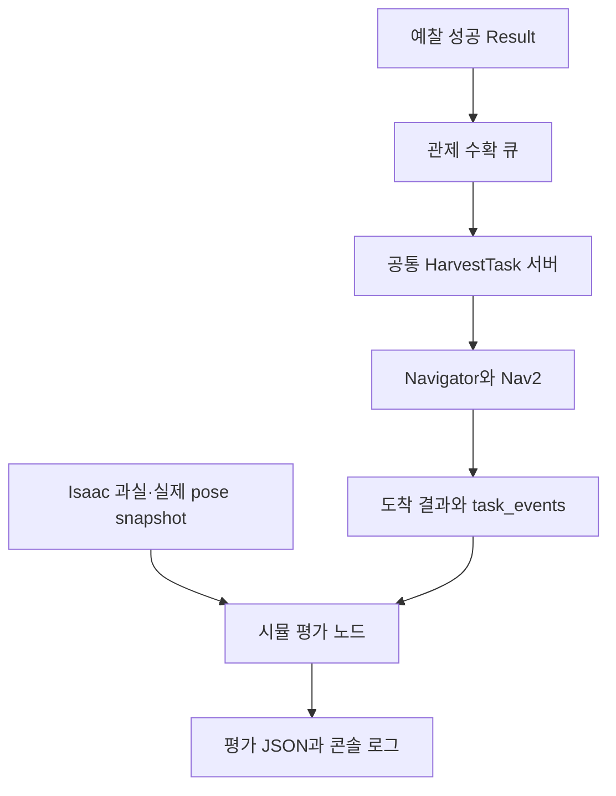

# 농작물 수확 로봇 — 현재 상태 인수인계

<!-- HARVEST_CURRENT_20261009 -->
> **현재 실물 기준 — 2026-10-09**
> - 공용 지도 `maps/many_farm`, map_id `many_farm_v1`.
> - `route_then_follow` + `approach_planner=graph`: 진입·작업 모두 그래프 다익스트라 → FollowPath. Route Server는 실행하지 않는다.
> - 11번 정밀 도착·정지 후 작업 목표로 이동한다. lifecycle 확인 대상은 amcl, controller_server, planner_server, bt_navigator다.
> - 사용자 로봇 빌드·설치 검사 PASS. 14번 주행 성공 사례가 있으나 반복 시험의 충돌 예측 중단과 진입점 부근 회전 문제는 미해결이다.
> - 태그 보정 효과·실측 정확도 검증 완료가 아니다. 카메라 종료 -11과 AMCL 시각 경고도 남아 있다.
> - 11번 진입 전용 HarvestApproach 제어기를 추가했다. 오프라인 연결·기하 검사는 통과했으며 로봇 적용 후 재주행 검증은 아직 하지 않았다.
> - 아래 날짜별 기록의 미실행·이전 구조 설명은 작성 당시 상태이며 현재 실행 안내는 이 기준을 따른다.


- 작성 기준일: 2026-10-06, Asia/Seoul.
- 저장소: https://github.com/Robot3FinalProject/main
- 기준 브랜치: `main`.
- 확인한 코드 커밋: `068b42eb0ebe54b3b57cffe254a20b2f9e3b202e` (2026-10-06 11:19:12 KST).
- 아래 파일 경로는 모두 저장소 안의 `farm_project/` 기준이다. 사용자 작업 경로는 `~/main/farm_project`다.
- 최초 작성은 위 커밋의 정적 대조·기존 로그 검토였다. 이후 사용자 요청에 따른 로컬 미커밋 과실/오른팔 물리·좌표 구현과 이번 GPU Isaac 시험 결과를 §15에 추가했다. 이전 검토 절의 “미실행”은 해당 작성 단계의 기록이며 최신 적용 상태는 §15와 연결 보고서를 따른다. 실물 로봇 시험은 하지 않았다.
- 2026-10-06 이번 검토에서 `git fetch origin` 성공 후 `HEAD...origin/main`의 앞섬/뒤처짐은 `0/0`이었다. 코드 HEAD와 원격 main은 동일하다. 기존 인계 패키지와 이번 문서 수정은 미커밋·원격 미반영 상태다.

## 1. 프로젝트 목적과 현재 구현 범위

전체 목표는 **예찰 → 수확 → 운송 → 분류**를 관제로 연결하고, 실물과 Isaac Sim에서 공통 로봇 업무 코드를 사용하는 것이다. 현재 대상 작물은 파프리카(bell pepper)다. 9월 10일의 토마토 기획 문서 두 개는 초기 목표·역할 분담의 참고 자료이며, 현재 작물·메시지·실행 상태를 나타내는 문서가 아니다.

사용자 담당은 시뮬 환경·로봇·센서 구현, 합성 비전 데이터 생성, 실물 담당자 소스 통합, 반복 시험 및 Sim-to-Real 비교다. 관제 통신규약과 업무 FSM을 시뮬 파트에서 임의로 재정의하지 않는다.

| 구성 | 확인한 현재 상태 | 완료로 해석하면 안 되는 범위 |
|---|---|---|
| 예찰 | Burger, 상태 기반 `scout_new`, RGB-D/YOLO, 과실 등록·Window 생성, ScoutArea 서버 | 최신 규약으로 전체 예찰·수확 연계가 재검증된 것은 아님 |
| 수확 | VicPinky 이동 시험, 공통 `harvest_robot` 서버, Nav2 목표 이동 | 로봇팔 파지·분리·적재는 실행하지 않음 |
| 수확 물리 기반 | 288개 과실9g·줄기 물리, 오른팔/박스 설정, 오른팔 기준 Goal 구현 및 GPU 기초시험 | 학습 정책 실행·그리퍼 파지/적재·새 좌표 실제 Nav2 주행은 미검증(§15) |
| 수확 평가 | Isaac 과실 정답과 도착 시 작업 박스 안의 개수 비교 | 실제 수확 성공 수량·IK 도달 가능성·충돌 회피 판정이 아님 |
| 운송·분류 | 전체 프로젝트 목표 및 별도 팀 파트 | 이 통합 저장소의 transport/sorting launch는 오류를 내는 미구현 스텁 |
| 관제 | 외부 관제와 공통 인터페이스, 임시 예찰 명령 클라이언트 | `control/scripts/send_scout_area.py`가 수확 큐까지 실행하지는 않음 |
| 실물 연결 | 예찰의 실물 프로파일·기존 장치 연결 코드, 수확 공통 서버 구조 | 수확 real 장치 bringup과 `harvest_real.yaml`은 준비되지 않음 |

전체 시뮬 실행은 `farm_sim_runtime all.launch.py`다. `farm_bringup all.launch.py`는 미구현 스텁이므로 혼동하지 않는다. 최신 시뮬 실행 절차는 [시뮬 실행·로그 가이드](../sim/docs/RUN_GUIDE_20261006.md)를 사용한다.

## 2. 코드 구조와 수정 경계

| 위치 | 책임 |
|---|---|
| `control/` | 현재는 임시 관제 테스트 클라이언트 등. 외부 관제 프로그램 전체와 동일하지 않음 |
| `robot/ros_ws/src/scout_robot/scout_new/` | 현행 예찰 Node·Mission·Communication·StateController·States |
| `robot/ros_ws/src/scout_robot/scout_robot/` | 예찰 계산·워커·기존 서버 및 호환 코드. 기존 서버와 새 서버 중복 실행 금지 |
| `robot/ros_ws/src/harvest_robot/harvest_robot/` | 공통 수확 Action 서버·계약·이동 미션·상태 제어 |
| `robot/ros_ws/src/farm_navigation/` | 공통 그래프 계획·Nav2 요청·위치 조회·정지 및 도착 확인 |
| `robot/ros_ws/src/farm_interfaces/` | ROS 메시지·액션·서비스 형식 |
| `robot/ros_ws/src/farm_bringup/` | 환경 선택 및 로봇·주행·모니터링 launch |
| `robot/config/`, `robot/models/` | 실물 설정 및 공유 모델. 시뮬 조정을 이유로 임의 변경하지 않음 |
| `sim/ros_ws/src/farm_sim_config/` | 시뮬 지도·그래프·장치·Nav2·비전·예찰 설정 |
| `sim/ros_ws/src/farm_sim_devices/` | 가상 장치, 센서·구동·ROS 연결, scene truth |
| `sim/ros_ws/src/farm_sim_runtime/` | Isaac 단독/다중 로봇 실행, station 배치, 시뮬 launch |
| `sim/ros_ws/src/farm_sim_harvest/` | 수확 평가 노드. 공통 수확 업무 코드를 복제하지 않음 |
| `sim/assets/`, `sim/tools/`, `sim/tests/`, `sim/runs/` | 시뮬 자산·도구·시험·실행 결과 |

`AGENTS.md`와 `sim/AGENTS.md`의 기존 승인 규칙을 따른다. 공통 미션·주행·메시지 변경은 구체적인 변경안과 실물 영향을 제시하고 승인받아야 한다. 최초 인수인계 문서 작성 승인과 이후 §15의 sim 물리·좌표 구현 요청을 구분하며 공통 업무 변경으로 확대하지 않는다.

## 3. 현행 주행·지도·배치

공통 `Navigator`는 현재 선택된 설정에 따라 동작한다. 시뮬 예찰과 수확은 모두 **자체 RouteGraph 계획 → Path 생성 → Nav2 FollowPath/RPP → 정지·도착 오차 확인**을 사용한다. 수확 Node는 `follow_path`가 아닌 모드를 거절한다. Window의 XY·yaw로 이동한다는 설명이 `NavigateToPose`를 사용한다는 뜻은 아니다. Nav2 Route Server의 `ComputeRoute` 전환은 현행 구현으로 기록하지 않는다.

- 원본: `sim/ros_ws/src/farm_sim_config/config/task.yaml`, `sim/ros_ws/src/farm_sim_config/maps/scout_harvest.geojson`.
- 파생 설정·역할별 그래프 생성: `sim/tools/rebuild_route_data.py`; 검사: `sim/tools/validate_route_data.py`.
- 데이터에서 확인: 8개 물리 베드, 16개 Section, Section당 5개 관측점으로 총 80개 관측점.
- Section은 `SEC01`~`SEC16`; 물리 USD의 `Bed_XX`와 같은 번호라고 가정하지 않는다. 예: `SEC01`의 평가 대상은 `/World/Vegetation/Bed_02`다.
- Segment 예: `SEC01_G01`. 실물의 `SEC_01` 등은 해당 환경 설정의 실제 키를 사용한다. sim/real 이름을 일괄 치환하지 않는다.
- 지도: `sim/ros_ws/src/farm_sim_config/maps/count_test_farm_map.yaml`, map ID `farm_map_v1`, 해상도 0.05 m/pixel, origin 약 `[-8.075, -15.075, 0]`.
- 실물 예찰은 `robot/config/environments/scout_real.yaml`, map ID `many_farm_v1`, `robot/config/maps/many_farm/`를 사용한다. 시뮬 지도와 섞지 않는다.

이번에 GeoJSON 점·엣지로 계산한 **약연결 성분**은 다음과 같다. 방향을 무시한 연결성 확인이며, 모든 방향의 경로·장애물·실제 주행 성공을 검증한 결과는 아니다.

| 그래프 | 노드 | 방향 엣지 항목 | 약연결 성분 |
|---|---:|---:|---:|
| `scout_harvest.geojson` | 227 | 516 | 1 |
| `graph.geojson` (예찰) | 211 | 452 | 1 |
| `harvest_graph.geojson` | 143 | 260 | 1 |

따라서 과거의 ‘16개 비연결 성분’ 설명은 복원 전 기록이다.

| 로봇 | station 노드 | X, Y (m) | yaw (rad) |
|---|---:|---|---:|
| `scout_01` | 8001 | -5.0, 13.25 | -1.5707963267948966 |
| `harvest_01` | 8002 | -2.0, 13.25 | -1.5707963267948966 |

station 원본과 AMCL 초기 pose를 일치시킨다. `station_spawn.json`의 운송·분류 station은 `DESIGN_PROPOSAL`이고 yaw가 null이므로 실행 완료된 로봇 배치로 취급하지 않는다. 수확 자산의 논리 주행 프레임은 자산 축과 180도 차이가 있다(`control_frame_yaw_rad=π`); 박스 좌표·바퀴 부호를 월드 축과 혼동하지 않는다.

## 4. 2026-10-06 관제 통신 계약

정의 원본은 `robot/ros_ws/src/farm_interfaces/`, 반영 배경은 [PROTOCOL-20261006-014](changes/PROTOCOL-20261006-014.md)다. 아래는 확인한 필드이며, 이후 규약 변경 시 실제 `.action`/`.msg`를 다시 확인한다.

### ScoutArea

- Action: `/scout_01/scout_area`, 형식: `farm_interfaces/action/ScoutArea`.
- Goal: `robot_id`, `task_id`, **`section_id` 단일 값**, `map_id`, `frame_id`, `crop_type`, `target_ripeness`, `timestamp`.
- 현재 예찰 서버는 `frame_id=map`, `crop_type=PAPRIKA`, `target_ripeness=RIPE`와 설정의 robot/map/section을 검사한다.
- Result: `robot_id`, `task_id`, `result_code`, `section_id`, `completed_segment_count`, `harvest_task_count`, `total_expected_count`, **`harvest_tasks[]`**, `error_code`, `error_message`, `timestamp`.
- Feedback: `robot_id`, `task_id`, `phase`, `section_id`, `segment_id`, `completed_segment_count`, `segment_expected_count`, `harvest_tasks[]`, `timestamp`.
- 수확 작업 등록은 **성공 Result의 최종 목록** 기준이다. Feedback은 진행 정보이며, `SECTION_COMPLETE`를 작업 큐 등록 신호로 사용하지 않는다.
- 실패·취소 Result는 마지막 저장 성공 시점의 부분 목록을 포함할 수 있다. 보관하되 자동 수확 전송은 보류한다.
- `section_ids[]`, `completed_section_ids`, `completed_section_count`를 현재 ROS 계약에 다시 넣지 않는다. 내부 `survey.json`에 과거 분석 필드가 남는 것은 별개다.

### HarvestTask

공유 `HarvestTask.msg`는 **`task_id`, `window_id`, `goal_pose`, `expected_count` 네 필드**다. `section_id`, `segment_id`, `sequence`는 현재 이 ROS 메시지의 필드가 아니다.

- Action: `/harvest_01/harvest_task`, 형식: `farm_interfaces/action/HarvestTask`.
- Goal: `robot_id`, `map_id`, 중첩 `harvest_task`, `timestamp`.
- Result: `robot_id`, `task_id`, `window_id`, `result_code`, `expected_count`, `harvested_count`, `failed_count`, `error_code`, `error_message`, `timestamp`.
- Feedback: `robot_id`, `task_id`, `success_count`, `failed_count`, `timestamp`. `phase`, `progress_ratio`, `detected_count` 등은 없음.
- `goal_pose`는 `frame_id`, `position{x,y,z}`(m), `yaw`(rad)를 갖는 `RobotPose`다.
- 현재 완료 정책은 `ARRIVAL_ONLY_NO_HARVEST`: 도착·방향·정지를 확인하면 `SUCCESS`, `harvested_count=0`, `failed_count=0`. 요청의 `expected_count`는 유지한다.
- 한 번에 한 작업만 수락하고, 현재 서버 프로세스에서 성공한 같은 `task_id`는 다시 거절한다. 재시작을 넘는 영구 중복 방지를 보장하는 것은 아니다.
- `window_id`는 비어 있지 않은 식별자로 그대로 전달한다. `SEC01_G01_W01`은 명명 예시이며 세션 접두사가 붙은 실제 ID를 잘라내거나 새로 만들지 않는다.

`RobotStatus.msg`, `GetHarvestTasks.srv`의 정의가 존재하는 것과 발행기·서비스 서버의 운영은 다르다. 최신 반영 기록상 예찰·수확 상태 발행기는 별도 구현이 필요하고, 현재 Result 기반 흐름은 GetHarvestTasks를 호출하지 않는다.

## 5. 비전·환경 설정

사용 환경 기준은 Ubuntu 24.04.4, ROS 2 Jazzy, Isaac Sim 5.1.0, RTX 4070 SUPER 12GB다. 사용자 제공 개발환경 기록이며 이번에 설치 환경을 직접 점검한 결과는 아니다.

| 항목 | 현재 파일에서 확인한 값 |
|---|---|
| 시뮬 장면 | `sim/assets/envs/output/farm_with_plants_v5.usd` |
| 시뮬 예찰 모델 | `robot/models/scout/yolo11_seg_2class_synth_and_sim_v2.0.pt` |
| 시뮬 모델 설정 | `sim/ros_ws/src/farm_sim_config/config/scout_vision.json` |
| 시뮬 실시간 예찰 카메라 | `scout_fleet.json`: 640×384, 설정 FPS 15, 공유메모리 `farm_scout_01_rgbd` |
| 시뮬 추론 최대 FPS 설정 | 15.0. 실제 달성 FPS를 확인한 수치는 아님 |
| 실물 카메라 설정 | `robot/config/vision/scout_real.json`: 1280×720, 설정 FPS 6 |
| 실물 모델 설정 | `model_yolo11_seg_ver1.2.pt`, 기존 외부 worker 경로. 시뮬 모델로 자동 교체되지 않음 |
| 데이터셋 생성 설정 | `sim/config/scout_dataset.json`: 1280×720, seed 930, 과실 회전 최대 30도, 후처리 활성화 |
| 수확 카메라 | `harvest.json`에서 disabled; 현재 수확 평가는 카메라 재탐지를 사용하지 않음 |

실시간 영상, 합성 데이터셋, 실물 D435 설정을 같은 해상도·FPS·노이즈 조건으로 설명하지 않는다. 현행 시뮬 추론 설정에는 추가 노이즈/블러를 넣지 않는다고 명시되어 있으며 데이터셋 후처리와 구분한다.

장면 USD는 Git에서 LFS로 관리한다. 이번 로컬 파일은 `PXR-USDC` 헤더의 실제 바이너리 객체이며 크기는 2,795,738 bytes다. 파일 존재·헤더만 확인했고 USD 참조·기하·Isaac 로딩은 검증하지 않았다. 새 PC에서는 포인터 텍스트만 받은 상태인지 확인한다. 이 인수인계 ZIP은 USD·모델 파일을 포함하지 않는다.

## 6. 수확 작업 박스 평가와 로그



위 관제 큐는 연동 계약상 필요한 역할이다. 현재 임시 예찰 클라이언트에 자동 수확 큐가 구현되어 있다는 뜻은 아니다. 정답 snapshot은 평가로만 흐르며 공통 제어·YOLO 입력으로 주입하지 않는다.

- 공통 서버 진단 이벤트: `/harvest_01/task_events`, `std_msgs/String`, RELIABLE/TRANSIENT_LOCAL, depth 100.
- 평가 노드: `sim/ros_ws/src/farm_sim_harvest/farm_sim_harvest/audit_node.py`.
- 평가 설정: `sim/ros_ws/src/farm_sim_config/config/harvest_audit.json`.
- **결과 파일: `sim/runs/harvest_motion/<평가세션>/<task_id>_<event_id>.json`.**
- 정답 snapshot: `sim/runs/runtime/harvest_scene.json`.
- 콘솔: `workspace audit: ...`; 파일 기록 실패는 `시뮬 과실 평가/로그 실패: ...`로 출력.
- 평가 노드는 `farm_sim_runtime harvest.launch.py`가 추가한다. 공통 `farm_bringup harvest.launch.py`만 실행하면 이 평가 노드가 붙지 않는다.

작업 박스는 논리 `base_footprint`에서 중심 `[-0.19, 0.435, 0.828]` m, 크기 `[0.35, 0.10, 0.45]` m다. 빨강·노랑 과실의 월드 AABB 중심을 박스에 포함하는지 검사하고 초록 과실은 별도 제외 개수로 기록한다. 팔의 실제 관절 가동 범위를 계산한 결과가 아니다.

주요 평가 필드: `evaluation.status`, `expected_count`, `actual_in_workspace`, `count_delta`(실제-예상), `repeated_gt_ids`, `matched_fruits`, `ignored_green_count`. `repeated_gt_ids`는 같은 평가 노드와 scene session에서 앞서 센 과실의 재등장이다. 과실을 제거하거나 실제로 수확하지 않는다. 수량 차이만으로 어느 열매가 YOLO 미검출됐는지까지 확정할 수는 없다.

평가 상태는 `OK`, `SKIPPED_NOT_ARRIVED`, `UNAVAILABLE`을 구분한다. snapshot은 기록 후 0.5초 이내, 도착 시각 대비 -0.25~+0.5초 범위여야 한다. 늦은 과거 이벤트 재수신 등으로 평가가 불가능할 수 있다. 평가 실패가 이미 성공한 수확 Action 결과를 바꾸지는 않는다.

다른 로그 위치는 [실행 가이드의 로그 표](../sim/docs/RUN_GUIDE_20261006.md#5-결과와-로그)를 참고한다.

## 7. 검증 상태와 인수 시 주의할 사항

| 항목 | 확인 수준 | 해석 |
|---|---|---|
| 소스·설정·메시지·launch 구성 | 이번 로컬 HEAD와 미커밋 문서 정적 대조 | 현행 코드가 무엇인지 확인한 근거 |
| 그래프 규모·약연결성·관측점 수 | 이번에 JSON/YAML 계산 | 실제 로봇 주행 성공을 뜻하지 않음 |
| 고정 캐스터 마찰 보정 | 10/6 적용 기록 및 사용자 ‘수확 로봇 이동 정상’ 보고 | 이동 불능이 해결됐다는 사용자 확인. 새 통합 주행 시험을 수행한 것은 아님 |
| 예찰 SEC01 성공·작업 8개/예상 12개 | 기존 `sim/runs/scout_survey/c1167c0c9631/survey.json` 열람 | 구형 `section_ids` Goal을 사용한 과거 로그. 최신 단일 Section 계약 E2E 합격 근거로 쓰지 않음 |
| 실물 4·6·8번 주행·최종 예찰 실패 | 10/2 예찰 인수인계 기록 | 팀원의 당시 시험 결과. 이번 직접 검증 아님 |
| 과거 단위/구성 검사 | 개별 변경 문서에 결과 존재 | 해당 변경 당시 기록. 이번에 모든 검사를 재실행한 것은 아님 |
| 최신 규약 colcon·생성 메시지·관제→예찰→수확 | 이번 미실행 | 사용자 환경에서 확인 후 결과 문서 갱신 필요 |

현재 이어서 확인할 항목:

1. 최신 farm_interfaces로 로봇·관제를 모두 재빌드한 뒤 성공 Result 기반 수확 작업 전달 확인.
2. `harvest:=true` 실행에서 수확 이동과 audit JSON 생성 확인. ‘움직인다’와 ‘예상/실제 수량이 일치한다’를 별도 기록.
3. 관제의 RobotStatus 필수 여부와 상태 발행기 구현 범위 조율.
4. 실물 수확 장치·프로파일 인수 및 실물 비전 모델 경로/버전 결정.
5. 서로 다른 Segment의 중복 과실 등록, 위치추정 오차에 따른 Window 누락 재현. 과거 주요 관심 이슈이며 현행 발생률은 미확인.
6. 교통 제어·도킹·운송·분류의 통합 범위 결정. 데이터에 공용 경로가 있다고 교통 제어가 구현된 것은 아님.

## 8. 과거 문서를 읽을 때의 우선 확인

- `docs/SUMMARY_인수인계서.md`는 10/2의 예찰 인수인계로 보존한다. 전체 프로젝트 최신 상태로 단독 사용하지 않는다.
- `docs/RUN_GUIDE_20261002.md`의 일부 스텁 설명과 기본 구역 설명은 변경 전 내용이다. 현행 임시 클라이언트 기본값은 `SEC01`이다.
- 10/2 수확 문서의 구형 Goal 필드 예시보다 10/6의 실제 `.action`/`.msg` 정의를 확인한다.
- 10/6의 일부 과거 패치 문서에도 `harvest:=true` 없는 전체 실행 예시가 있다. 수확 시험은 새 실행 가이드를 사용한다.
- 본 문서도 고정된 기준 커밋의 요약이다. 이후 변경은 [Codex 작업·공유 절차](CODEX_HANDOFF.md)에 따라 갱신한다. 업무 의도와 구현이 충돌하면 [결정 기록](DECISIONS.md)에 차이를 남기고 사용자에게 확인한다.


## 9. 이번 로컬 검토의 Git 상태와 보존 범위

- 검토일: 2026-10-06 KST. Git 루트는 `/home/ysy/main`, 프로젝트는 그 아래 `farm_project/`다.
- 브랜치 `main`, HEAD 및 fetch 후 `origin/main`: `068b42eb0ebe54b3b57cffe254a20b2f9e3b202e`. CODEX_HANDOFF의 기준 코드와 동일하다.
- 원격: `origin`, `https://github.com/Robot3FinalProject/main.git`. `git rev-list --left-right --count HEAD...origin/main` 결과 `0 0`; 커밋 기준 차이가 없다. 작업 트리 문서는 별도다.
- 시작 시 기존 수정: `AGENTS.md`, `README.md`, `sim/docs/CHANGELOG.md`.
- 시작 시 미추적: `docs/CODEX_HANDOFF.md`, `docs/DECISIONS.md`, `docs/HANDOFF_SOURCES_20261006.json`, 이 문서, `sim/docs/RUN_GUIDE_20261006.md`, `backups/codex_handoff_before_20261006_114034.tar.gz`.
- 이번 변경: 기존 상태 문서 내용을 유지하면서 로컬 확인 결과·실행 요약·충돌 근거를 보강하고 `sim/docs/CHANGELOG.md`에 문서 검토를 추가했다. 사용자 요청은 문서 작업만 승인한다. 실행 코드·설정·시험·모델·USD 변경 없음.
- fetch는 원격 추적 정보 조회이며 pull/merge를 수행하지 않았다. commit/push도 수행하지 않았다. 다른 작업자의 문서와 백업을 삭제·이동하지 않았다.

## 10. 현재 코드에 맞춘 실행 요약

아래 명령은 소스와 대조한 실행 절차이며 이번에 실행한 명령이 아니다. 비전용 robot_venv를 활성화하고 Isaac Python 실제 경로를 설정한다. 빌드 도구와 의존성 설치 여부는 이번에 검증하지 않았다.

```bash
cd /home/ysy/main/farm_project
source /opt/ros/jazzy/setup.bash
export FARM_ISAAC_PYTHON="$HOME/isaac/env_isaaclab/bin/python3.11"
export FARM_VISION_PYTHON="$VIRTUAL_ENV/bin/python"
bash scripts/build.sh sim
source scripts/env.sh sim
python robot/ros_ws/src/farm_interfaces/examples/verify_interfaces.py
ros2 launch farm_sim_runtime all.launch.py \
  project_root:="$PWD" isaac_python:="$FARM_ISAAC_PYTHON" \
  vision_python:="$FARM_VISION_PYTHON" harvest:=true device:=0
```

별도 관제 터미널도 동일 인터페이스 install을 source한다. 예찰 요청은 `python control/scripts/send_scout_area.py --section SEC01 SEC02`; 수확 이동 시험은 실행 가이드의 `harvest_smoke_goal.py` 예시를 사용한다. 외부 관제 자동 큐 연결은 이 클라이언트가 제공하지 않는다.

실물 예찰은 ROS 환경에서 `bash scripts/build.sh real`, `source scripts/env.sh real` 후 다음처럼 실행한다. 비전 Python은 실제 D435/worker 환경으로 지정해야 한다.

```bash
ros2 launch farm_bringup scout.launch.py mode:=real project_root:="$PWD" \
  environment_config:=robot/config/environments/scout_real.yaml
ros2 launch farm_bringup rviz.launch.py mode:=real project_root:="$PWD" \
  environment_config:=robot/config/environments/scout_real.yaml
```

두 launch는 각 터미널에서 실행한다. 실물 Nav2 초기 pose는 인계 문서상 수동 지정이 필요하다. 실물 수확 launch 기본 `mode=real, devices=true`는 명시적 미구현 오류다. `devices=false`와 외부 실물 드라이버·실물 환경 설정을 준비하는 경계가 있을 뿐, 저장소에 완성된 실물 수확 프로파일이 있다는 의미는 아니다.

## 11. 기존 실행 산출물에서 확인한 증거

이번에는 로그 파일을 읽었으며 재실행하지 않았다. 로그 파일명·내부 UTC timestamp를 사용하고 파일 수정 시각이나 세션 이름의 사전순을 최신 실행 순서로 해석하지 않는다.

| 산출물 | 기존 결과와 이번 확인 | 한계 |
|---|---|---|
| `sim/runs/scout_survey/c1167c0c9631/survey.json` | SEC01 SUCCESS, 구형 배열 Goal. 작업 수와 예상 합계는 보고서 필드에 저장 | 최신 프로토콜 적용 이후 실행 증거가 아님 |
| `sim/runs/harvest_motion/aa9781127777/`의 JSON | 2026-10-06 09:55:37 KST, SUCCESS, 수확 0, 평가 OK, 예상/실제 1/1, 차이 0 | 단일 이동·박스 평가. 전체 예찰→관제→수확 연동·팔 작업 증거가 아님 |
| `sim/runs/harvest_motion/523dd253fcb4/`의 JSON | 2026-10-06 10:21:28 KST, SUCCESS, 수확 0, 평가 OK, 예상/실제 1/1, 차이 0 | 실행 커밋·생성 인터페이스 버전과의 연결 근거 부족 |
| `sim/runs/harvest_motion/`의 나머지 JSON | 총 8건 중 6건 FAILED/NAVIGATION_FAILED, 평가 SKIPPED_NOT_ARRIVED | 이전 실패 기록 보존. 현재 실패율이나 패치 후 회귀율로 해석하지 않음 |
| `sim/docs/changes/CASTER-FIX-20261006-013-applied.jsonl` | APPLY 기록의 after SHA-256과 현재 수확 USD SHA-256 일치 (`2fcbce1c…f14fa1`) | 패치 적용 파일 식별 확인. PhysX 접촉력·실물 동역학 검증 아님 |

## 12. 오래된 설명과 현재 코드의 차이

| 오래된 문서·설명 | 현재 근거 | 이번 판단 |
|---|---|---|
| `sim/docs/INTEGRATION_REVIEW_20261002.md` §3·§4.2의 128노드/112엣지·16성분, BED ID·FOV 자동 관측·NavigateToPose | `task.yaml`, 3개 GeoJSON, `scout_runtime.yaml`; 변경 이력 SIM-DATA-003/SIM-NAV-005 | 복원 전 기록. 현재 8베드/16Section/80관측점, 역할별 연결 그래프, FollowPath/RPP |
| 같은 검토서 §4.4의 수확 README만 존재·launch 미구현 | `robot/ros_ws/src/harvest_robot/`, `farm_bringup/launch/harvest.launch.py`; HARVEST-COMMON-009 | 공통 수확 이동 서버 구현 완료. real 장치·팔 작업은 미완료 |
| HARVEST-SIM-008의 시뮬 내부 업무 서버 | HARVEST-COMMON-009, `farm_sim_harvest`의 audit/evaluation, 공통 harvest 서버 | 이관 후 책임 분리가 현행. 과거 위치로 복원하지 않음 |
| 인수 검토서 §4.3 및 10/2 인계서의 배열 Goal·SECTION_COMPLETE 작업 전달 | `farm_interfaces/action/ScoutArea.action`, `scout_new/scout_communication.py`, PROTOCOL-014 | 단일 Section Goal·성공 Result 최종 목록 기준. 과거 보고서 내부 배열은 ROS 계약 근거가 아님 |
| 10/2 수확 예시의 Section/Segment/sequence 필드 | `farm_interfaces/msg/HarvestTask.msg`, `harvest_robot/contract.py` | 현재 네 필드만 전달. 수신 Window ID 보존 |
| `farm_bringup/launch/all.launch.py`의 “현재 scout 경로 점검만 지원” 오류 문구 | 해당 launch는 여전히 오류 스텁. 실제 예찰 서버·수확 조합은 별도 launch에 구현 | 이 오류는 공통 all의 미구현을 뜻한다. 프로젝트 전체 기능 설명으로 확대하면 부정확 |
| CASTER-FIX-013·PROTOCOL-014의 `harvest:=true` 없는 all 실행 예시 | `farm_sim_runtime/launch/all.launch.py`: harvest 기본 false | 수확 시험에는 true 명시. 최신 RUN_GUIDE_20261006 사용 |
| 기존 인계 패키지의 “PC 변경 확인 불가·USD 포인터만 확인” | 이번 git status, 로컬 USD 헤더/크기 | 이번 로컬 검토에서는 작업 트리와 실제 바이너리 존재 확인. 과거 검토 제한은 당시 기록으로 보존 |

## 13. 이번 검증과 바로 이어서 할 작업

직접 수행한 확인은 `git status --short`, 브랜치/HEAD/원격 조회, `git fetch origin`, 커밋 차이 계산, 관련 문서·소스 정적 대조, Python 3 표준 라이브러리 GeoJSON 약연결성 계산, YAML 관측점 집계, 기존 JSON 로그 열람, USD 헤더·크기·패치 SHA-256 비교다. 그래프 수치와 관측점 수는 §3과 일치했다. 문서 링크 존재 및 문서 변경 범위를 종료 시 확인한다. 기존 프로토콜 기록의 6개/9개 검사와 이력의 371개 경로 검사는 이번에 재실행하지 않았다.

미실행: colcon 빌드, 생성 메시지/CDR 왕복 검사, ROS 네트워크, Isaac/PhysX, D435, 실물 주행, 최신 규약 전체 E2E. 이번 정적 확인에 별도 런타임 로그는 생성하지 않았다. 과거 로그 위치는 §6·§11에 기록했다.

다음 작업은 최신 동일 인터페이스로 관제와 로봇을 빌드하고, 단일 SEC01 성공 Result의 원본 Task를 수확 서버에 전달하는 통합 시험이다. 코드 SHA·프로파일·모델·ROS_DOMAIN_ID·실행 명령·Goal/Result·survey/audit 로그를 함께 남겨 현행 코드와 결과를 연결한다. 이후 중복 과실/Window 누락 재현, 상태 발행 계약 조율, 실물 수확 장치 인수를 진행한다. 구현 변경이 필요하면 해당 공통 파일·실물 영향·검증안을 제시하고 기존 승인 절차를 따른다.

문서 복원은 기존 내용과 비교해 이번 보강만 되돌린다. 시작 때 있던 미커밋 인계 문서 전체를 HEAD로 reset하면 기존 작업이 없어지므로 사용하지 않는다. 이번 문서와 이력은 commit/push하지 않았으며 원격에는 반영되지 않았다.

## 14. 로봇팔 Teacher 전체 묶음 수령 — 2026-10-06 추가

이 절은 수령 당시 기록이다. 이후 사용자 구현 요청에 따른 현재 적용 상태는 §15를 따른다.

- 사용자 요청으로 `main/robotarm/harvest_teacher_9g.tar.gz`를 검토했다. 자료 전체 수신 후 한 번에 작업하기로 하여 설정만 먼저 적용하는 이전 제안은 보류했다. 운영 sim/공통/실물 코드는 아직 변경하지 않았다.
- 직접 확인: 외부 archive SHA256 일치, manifest 2,148개 파일 해시 일치, Teacher 정책4개+각 run.json 해시 일치, 기존 인계 문서4개와 동일. 실행 소스·로봇/과실/박스·USD/cache·YOLO·환경 정보·과거 평가 원본·실물 참고 도구를 확보했다.
- 검토용 추출: `sim/runs/robotarm/received_20261006_143434/manyfarm_robotarm/`. 소스 기준 `abe9e13357e1be549500712b62c5582649d444ab`와 현재 수정본이며, 10/1 당시 미커밋 소스 전체를 복원한 묶음은 아니다.
- 원본 평가 직접 집계: 빨강 실패2/성공1, 노랑 성공2/실패1. 총3/6 성공이며 실패 플래그는 부적격분리2+분리 후 보유 전 낙하1. 새 수신 PC 물리 실행 결과가 아니다.
- 코드 검토로 실제480Hz/정책20Hz 및 physics step별40ms 분리 누적 확인. 추가 발견: 캐시 경로 치환 시 converter hash 불일치로 받은 USD 재생성 경로, 복귀 물리25ms와 제어50ms 계산 불일치. 통합 전 보완·시험 필요.
- 전달 current USD는 차체/바퀴 고정의 평가용이므로 농장 주행 USD를 통째 교체하지 않는다. 박스 바닥 collision 자산은 확보했지만 기존 캐스터 저마찰 보정과 농장 오른팔 기하 정합을 별도로 유지해야 한다.
- 현 Isaac 주요 버전/commit은 일치, 비전 환경 일부 버전은 다르다. 설치·prepare·변환·새 ROS/PhysX/정책 실행은 하지 않았다. 수확 ActionServer 연결도 아직 없다.
- 상세 대상/증거/후속 작업: [로봇팔 묶음 수령 검토](../sim/docs/ROBOTARM_BUNDLE_RECEIPT_20261006.md). 이번 문서 보강은 미커밋·원격 미반영이며 기존 인계 내용과 구분한다.

## 15. 농장 과실·오른팔 물리 및 수확 이동 좌표 — 2026-10-06

이 절은 최초 적용 기록이다. 현재 운용 주기·과실 활성화는 아래 §18을 따른다.

사용자가 전체 묶음 기반 적용을 요청하고 Teacher 크기 통일을 선택했다. 시작 기준 커밋은 `068b42eb0ebe54b3b57cffe254a20b2f9e3b202e`이며 아래 구현은 이후 §16의 재검증과 커밋·푸시 요청 대상으로 확정됐다. 세부 검증·명령·제약은 [물리 적용 보고서](../sim/docs/ROBOTARM_PHYSICS_20261006.md)를 따른다.

- 농장 288개 과실(3색×96): 기존 위치·회전·색상·ID를 보존하며 폭70mm/높이75mm,9g rigid body·충돌·접촉·줄기 결합/분리 물리를 적용한다. source에서 직접 복제한 줄기 response5의 수치 결과를 대조했다. 새 자산은 `sim/assets/fruit/teacher_9g/`에 있어 받은 runs 폴더가 없어도 동작한다.
- 오른팔6축: 전달 drive gain·토크/속도 한도·HOME, 집게 접촉재질, 박스 바닥4타일을 적용한다. 주행 USD·바퀴·캐스터·왼팔은 교체하지 않는다. 원본 USD 저장 없이 실행 session layer로 구성한다.
- `task.yaml`의16구역을 오른팔 장착점 `[.19,.185,.713]`과 작업중심 `[.19,.500,.838]`에 맞췄다. 예찰 Window에서 생성하는 Goal 및 audit/영상 crop을 함께 동기화한다. 기존 graph의 짧은 연결을 사용하며 노드·엣지는 변경하지 않는다.
- 수확 경로 goal 연결한계9cm, 최종 도착2cm/.05rad, Nav2 내부허용1.5cm/.04rad. 기존보다 주행방향−38cm·베드 반대방향−6.5cm 목표가 바뀌므로 이전 위치 도착으로 성공 처리하지 않는다.
- `robotarm_physics.json`을 단독/통합 Isaac 실행에 연결했다.480Hz마다 외력을 갱신하고60Hz 렌더를 별도 수행한다. 정책 기준20Hz는 명세이며 정책 실행을 활성화하지 않는다. 예찰 단독 scene에 수확 로봇이 있으면 동일 물리/HOME를 적용하고, 없는 로봇을 단독 실행에서 추가하지 않는다.
- ROS 공통 업무는 여전히 이동 완료 후 수확0개를 반환한다(D-006). 학습 정책 추론·현장 재탐지·실제 파지/박스 적재·공통 FSM 변경은 아직 적용하지 않았다. 원본 평가3/6은 받은 과거 결과다.
- 검증: 관련 오프라인 검사, USD 정적 검사,371개 경로와48개 새 Goal 연결 검사, sim 패키지3개 빌드 및 GPU Isaac 물리 검증을 수행했다. 최종 수치·실행 로그는 연결된 보고서에 기록한다. 실제 Nav2 정밀 정지·전체 예찰→수확 E2E·학습정책 적재와 실물 시험은 미실행이다.
- 실행 로그: `sim/runs/robotarm/physics_smoke_gpu_20261006/`, 실제 실행별 설정/분리 기록은 `sim/runs/robotarm/physics/<session>/`. 중간 실패와 최종 결과를 구분한다. 원격 commit/push는 하지 않았다.

## 16. 로봇팔 물리 재검증 및 게시 요청 — 2026-10-06

- 사용자가 테스트 후 커밋·푸시를 요청했다. 이번 sim 구현·설정·필수 자산·관련 기록을 대상으로 하며 공통 `robot/`, `control/`, `scripts/` 실행 코드는 변경하지 않았다. 시작 시 별도로 있던 AGENTS/README 등 문서 변경과 수신 archive·백업은 보존한다.
- 새 분리 진단은 원시 인장력과 clamp 후 힘, 힘/후크/최대변위 분리 조건을 구분한다. 물성·힘 한도·분리 규칙은 그대로다. GUI 검사 도구는 선택 과실을 바라보고0.1N 유지와3N 분리를 자동 검증한다.
- 직접 확인: 단위·USD62개(skip0),371경로,sim3패키지 빌드. GPU에서288과실2초 유지,0.1N·1초 및 회복0.5초 유지,3N으로41.667ms 지속 후 분리·0.90448m 낙하.15개 check와 종료코드0 확인.
- 주의할 실제 동작: 같은 과실은0.5N에서도25mm 후크 조건으로 분리됐다. 개별 힘 한도2.3901N 아래에서도 거리 조건이 작동한다. “2~3N 미만에서 무조건 유지”하는 모델이 아니다. 외력 두 호출이 합산되는 것도 별도GPU 검사로 확인했다.
- 적용한 것은35g 원 학습 체크포인트에 대해 전달된9g **평가 환경**의 물성·수식이며, 정책 추론은 아직 실행하지 않는다. 새Nav2 주행·정밀 도착·그리퍼 실제 수확·실물 시험은 후속 범위다.
- [직접 확인 명령과 상세 결과](../sim/docs/ROBOTARM_PHYSICS_20261006.md#10-인장력-확인-방법과-커밋-전-재검증), [버전 관리 검증 요약](../sim/docs/changes/ROBOTARM_PHYSICS_VALIDATION_20261006.json). 원본 로그는 `sim/runs/robotarm/precommit_20261006/`다.
- 이 기록이 포함된 구현 커밋과 `origin/main`의 일치 여부로 게시 상태를 확인한다. 문서 자신의 미래 커밋 SHA는 기재하지 않는다.


## 17. GUI 검사 자동 종료와 프레임 저하 분석 — 2026-10-06

- 기준코드`1666a23bf47dc7f0e8a6f2dfafbc1d41e190f6cd`. 사용자가 만든 `manual_physics_check.json`은15개 검사 모두 통과했다. GUI 검사기는 정해진 검사 후 결과를 저장하고 창을 닫도록 설계되어 있다.
- 이번 PC GUI 직접 계측:현재288동적 과실480Hz8.30FPS, 추가 상태 진단 생략8.27FPS, 과실 고정 대조군480Hz22.22FPS/60Hz89.52FPS. 준비30/측정120프레임의 정지 구간이며 fleet/정책 실행 성능이 아니다.60Hz 대조군은 초기 reset 때문에 카메라높이8.05mm 차이가 있다.
- 현재 조건의 frame120.44ms 중 물리실행/결과동기화100.63ms(83.5%)가 주 병목이다. 실제CPU PhysX/NumPy이며 GPUDynamicsfalse, GPU평균11.9%. 전역60→480Hz와288개 동적 과실을 함께 고려해야 한다.
- runtime sceneCCD=true 확인으로 기존 false 설명을 정정했다. Teacher의 sceneCCDfalse와 차이가 있으며 전체 물리 환경 완전 동등 재현으로 보지 않는다. 이번 분석은 실행 설정이나 물성을 바꾸지 않았다.
- [상세 조건·한계·후속 개선](../sim/docs/ROBOTARM_PHYSICS_20261006.md#11-gui-자동-종료와-프레임-저하-실측--2026-10-06). 원본 성능 자료는 ignored `sim/runs/robotarm/perf_20261006/`에 있다. 운영/공통/실물 코드 변경 없음. 이번 분석 문서 갱신은 미커밋·원격 미반영이다.

## 18. 동적 물리 주기·수확 주변 과실 활성화 — 2026-10-06

- 사용자 “물리주기도 동적으로 … 수확중 수확로봇 인근 …” 승인에 따라 sim 실행/장치/설정만 변경했다. 기준 main/1666a23bf47dc7f0e8a6f2dfafbc1d41e190f6cd 이후 미커밋. 공통 업무·실물·원본 USD는 보존했다.
- 유휴60Hz, 수확 활동 중480Hz. 실제 오른팔 장착점 반경0.8m(유지1.0m)의 과실만 동적/줄기 계산한다. 여러 활동은 합집합이며 한 로봇 종료가 다른 로봇 활동을 끄지 않는다. 분리 과실은 영역 밖이어도 동적 유지,0.6초 정지 후 저주기 복귀한다. 박스 성공 판정/상대 고정은 미구현이다.
- 프레임60Hz와 내부 물리1~8tick을 분리해 시뮬 시간 연속성, clock60/상태30/라이다10/RGB-D15Hz를 유지한다. 같은 PhysicsScene에서는 고주기가 전역 적용되므로 다른 로봇의 계산 부하·수치 응답까지 독립되는 것은 아니다.
- 현재 실제 팔 FSM이 없으므로 이동 SUCCESS를 수확 활동으로 추정하지 않는다. 내부 set_activity API와 `/harvest_01/sim/harvest_activity` Bool heartbeat를 제공했다. 실제 정책 시작/종료 연결은 후속이다.
- 직접 검증: 단위/USD107개(skip0), sim3패키지 빌드, 실제 ROS bridge13항목 통과. GPU 선택 활성19항목 및 기존 전체288개 기준물리15항목 통과. 3개 활성 상태에서3N 분리/41.667ms 누적/0.20714m 하강 후60Hz 복귀, 비활성 과실·앵커·원본 USD 보존.
- 실제 예찰+수확 fleet6초에서60→480→60Hz/360프레임/1,200tick, 상태로봇별180개/RGB-D89개/시각 대응 정상. 고정60Hz 대조군은360tick이며 동일 센서 수를 확인했다. **동일0.08m/s 주행 명령에서 실제 월드 최종 위치가 약2.6cm 달랐다.** 고주기에서 바퀴 속도 응답이 달라지므로 동시 주행 무영향으로 보지 않는다. Nav2 폐루프 도착 오차·정책 성능·다수 수확로봇 GPU·운송로봇·실물 시험은 미실행이다.
- [구현·명령·검증 한계](../sim/docs/ADAPTIVE_HARVEST_PHYSICS_20261006.md), [버전 관리 검증 요약](../sim/docs/changes/ADAPTIVE_PHYSICS_VALIDATION_20261006.json). 원본 로그 `sim/runs/robotarm/adaptive_20261006/`. 다음은 동시 Nav2 주행 평가와 정책 연결 후60/120/240/480Hz 수확 성능 비교다. 독립 시험 세트별 주기가 필요하면 별도 Isaac 인스턴스로 분리한다.
- 문서/설정/구현은 로컬에 적용하고 sim 설치 패키지를 빌드했다. 이번 변경은 커밋·푸시하지 않았다. 기존 AGENTS/README·인수 자료·백업은 보존했다.

## 19. 도착 후 Teacher 순차 수확 적용 검토 — 2026-10-06

- 사용자 요청: 도착/정지 후 주변 과실을 활성화하고 Teacher에 좌표를 제공, 과실별 실제 안착/낙하 Feedback, 대상 처리 후 Result. 추가 확정은 현재 정차 위치의 빨강·노랑 각1회, 일반 실패 후 다음 대상, 녹색·차체 추가 이동 제외다. sim Teacher 정답 입력은 명시 승인 범위이며 공통 비전/실물에 확대하지 않는다.
- 개발에 필요한 정책·run.json·소스는 확보했다. 이번 직접 CPU 검사에서4개 hash/run hash 일치, 공식ActorCritic strict load·정규화 복원·82차원 합성입력→6차원 유한/결정적출력 확인. 현재 torch2.7.0+cu128/rsl-rl-lib3.1.2/isaaclab0.54.2다. 새 GPU 정책수확·학습을 실행한 것은 아니다.
- 전달 Teacher는 좌표 외 관절/TCP/접촉/분리/보유/박스 상태가 필요하다. 원본은 새 scene/physics step을 소유하고 첫 실패에서batch중단·다음assign거절·미수집분리과실복귀거절이 있어 현 농장World에 그대로 연결할 수 없다.82차원 관측/접촉,20Hz관절출력,실제안착,실패후물리복귀 어댑터가 필요하다.
- 정적FK에서 팔/박스는 강체좌표변환으로 일치한다. 반면 농장 root최소간격132.77mm,18cm미만34쌍/66개, 기울기중앙23.76°/최대41.17°로 전달검증배치와 다르다.0.8m물리반경은도달인증이아니다. 오프라인174정지후보/288root 중 연속근거리조건통과는고유53개(빨강18/노랑20/녹색15)이며실제Nav2/수확성공개수가아니다.
- [구현 검토·추가 확인 요청안](../sim/docs/TEACHER_HARVEST_INTEGRATION_REVIEW_20261006.md), [공통 파일·내부 타입 구체안](../sim/docs/proposals/HARVEST_ARM_COMMON_CONTRACT_20261006.md). 외부HarvestTask필드는유지하고공통Window실행기·후보조회/PickFruit를추가하는안과부분실패Result의미는사용자확인대기다. 공통소스/새타입등록/운영팔제어는아직변경하지않았다.
- 검토산출물은 `sim/runs/robotarm/policy_integration_review_20261006/`, 버전관리요약은 `sim/docs/changes/TEACHER_INTEGRATION_REVIEW_20261006.json`. 기존 미커밋 동적물리/사용자문서/원본묶음은보존했다. 이번검토문서도커밋·푸시하지않았다.


## 20. 시뮬 Teacher 실행과 공통 도착 후 대기 연결 — 2026-10-06

- 최신 사용자 확인은 “대부분은 sim 전용, 공통은 도착하자마자 result를 내는 부분을 sim 팔에 연결”하는 좁은 범위다(D-017). §19의 공통 후보조회/PickFruit/Window 실행기 제안은 채택하지 않았다. 외부 HarvestTask와 farm_interfaces는 유지한다. 공통 harvest_robot5개 파일은 이동/정지 후 내부 Action 요청·피드백·결과·취소 전달만 담당한다.
- sim에 실제 PhysX pose/접촉 측정,82D Teacher 상태, 전달4정책+run/hash,20Hz 관절 명령, 지역 물리 활성화, 현재 정차 빨강/노랑 각1회, 실제 복귀·안착 판정·누적 결과를 연결했다. 원본World를 중복 생성하거나 과실/관절 reset으로 성공을 만들지 않는다. `harvest_task.json`은 ARRIVAL_THEN_ARM, 장치 harvest_arm은 enabled다.
- **연결 구현과 수확 성능을 구분한다. 현재 실제 농장 과실3개 시험에서 적재 성공은0개다.** yellow1개 ENTRY시간 초과, red2개 bad_detach/낙하 후 실제 복귀·실패1 반환. 후보 전체 처리의 SUCCESS가 수확 성공을 의미하지 않는다. 최종 smoke는 정책 실행·후보ID·로그/수량·정지·프로세스 code0 정합을 통과했다. 실제 정책10회 후 취소 시험도 정지확인CANCELED/수량0/0/code0로 통과했다. --require-harvest 성공 기준은 미달이다.
- 직접 검증: 단위/USD178개 중176통과/실ROS2개skip, 실제ROS/UDP 별도2개통과, 공통1+sim3패키지 빌드. Teacher36개에는 실제4정책CPU·물리관측/state17+policy9+device10이 포함된다. 원본vendor5해시/kernel7AST일치. actual401샘플 원본FK 최대.2921mm/.052412°,400정책sample CPU재생 stage/status차이0.
- 원본 identity 과실배치와 농장 pose/연속위치·이웃·이동차체가 다르다. 큰좌표변환 오류근거는 찾지 못했지만 실패의 단독원인을 확정하거나 정책이 농장환경에 검증됐다고 보지 않는다. 다음은 원본/농장 조건 비교와 실제안착성능 확보, 그뒤 최신예찰/Nav2 포함E2E다. 실물·카메라모델·새학습·다수수확로봇·바구니상대고정은 미실행이다.
- [구현·실행·중간실패 및 최종검증](../sim/docs/TEACHER_HARVEST_RUNTIME_20261006.md), [공통변경 상세](changes/HARVEST_ARM_HOOK_20261006.md), [담당자 검토요청안](../sim/docs/TEACHER_FARM_EVALUATION_REQUEST_20261006.md). 원본로그 sim/runs/robotarm/teacher_integration_20261006 및 teacher/<session>/<job>. 요청안은 실제 전송하지 않았다.
- 기준main/1666a23 이후 미커밋·원격미반영. 기존 사용자AGENTS/README/인수문서/백업/원본묶음은 보존했다. 원본농장USD SHA256은1d9887539611d65ec9c284a810bcd0b8015493db0158147c7188b414f95395e7로 유지된다.

## 21. 임시 시뮬 관제 CLI — 2026-10-07

- 사용자 요청으로 `sim/tools/temporary_control.py` 추가. launch와 별도로 켜서 Section 입력→예찰 성공 Result→수확 작업 순차 요청→최종 수량까지 출력한다. 기존 관제/공통/실물 코드는 수정하지 않았다.
- 원본 작업 ID·Window ID·목표·예상 수량 보존. 예찰 실패/취소 부분 목록 제외, 수확 FAILED/CANCELED 시 큐 중단, Ctrl+C 자기 작업 취소와 종료 대기. 정지 미확인 시 추가 요청 차단. 로그 `sim/runs/temporary_control/*.jsonl`.
- 직접 검사: ROS 메시지 기반 단위검사6개 및 CLI 로딩. 실제 Action 네트워크/Isaac/Nav2 통합 사이클은 미실행. §20의 적재0/3 및 Window와 Teacher 근거리 조건 차이는 그대로다.
- 실행: [시뮬 가이드 §7](../sim/docs/RUN_GUIDE_20261006.md#7-임시-시뮬-관제로-한-사이클-실행--2026-10-07). 기준1666a23 이후 미커밋, 원격 미반영. 임시 파일은 운영 launch에 등록하지 않아 추후 삭제 가능하다.

## 22. RViz FollowPath 추종 표시 — 2026-10-07

- sim RViz3종에 `/scout_01/received_global_plan`(초록), `/harvest_01/received_global_plan`(주황)을 해당 로봇별로 추가했다. GeoJSON 기반 FollowPath를 처리하는 RPP의 변환/가지치기 구간이며 전체 Goal Path 보존 표시는 아니다. 기존 planner plan은 비활성화, route marker는 유지.
- 설치된 RPP 토픽 이름과 YAML 설정 확인. 실제 화면/이동 시험 미실행. RViz 설정 재로드로 적용, 로봇/Isaac 재시작 불필요. 공통 소스·주행 설정 변경 없음. 미커밋·원격 미반영.

## 23. 수확 베드 접근 경로 불일치 — 2026-10-07

- 현재16개Section 정차선은 기존 harvest graph보다60mm 옆에 있다. 실제SEC01 첫수확6로그에서 마지막60mm 구간/목표 yaw가90도 차이남을 확인. 재요청24.512m 우회도 실제 계획 기록이다.
- [구체 수정안](../sim/docs/proposals/HARVEST_PARALLEL_APPROACH_20261007.md): 오른팔 기준 sim 수확 주행선 정렬 + 공통 선택적 진입/방향 검사·이미 도착 재측정. AGENTS 공통 사전 승인 대기. 실행 코드는 아직 변경하지 않았으며 모든 abort 원인을 확정한 것은 아니다.
- 분석 sim/runs/navigation_review_20261007/geometry.json. 실제 신규 주행 미검증, 미커밋·원격 미반영.

## 24. 수확 평행 접근 승인·적용 — 2026-10-07

- §23 제안에 사용자 “수정해” 승인. sim 수확 주행선을 오른팔 정차선으로 정렬하고 공통 farm_navigation 선택 기능을 sim harvest에서만 활성화. 진입 정렬→평행 주행, 다른 구간 전 정방향 이탈, 이미 도착 재측정. 좁은 구간 자세 불량/지나친 목표는 복구 필요로 중단.
- 신규7검사·371경로 연결·farm_navigation build PASS. 기존 예찰도착검사9PASS/1구형fixture ERROR. 실제 새 Isaac 주행과 진입 회전 공간은 미검증. 운용 launch 재시작 후 station 출발 첫 Goal 재전송이 다음 확인이다.
- [구현/검증/한계](changes/HARVEST_PARALLEL_APPROACH_20261007.md). 기존 정책 적재성능 문제와 별개. 미커밋·원격 미반영.

## 25. 수확 진입 회전·제동 보정 — 2026-10-07

- 사용자 “해결해”에 따라 sim 수확 바퀴에 encoder 속도PI·제동 적용. 저속정렬0.06rad/s, 각가속0.1, Nav2 yaw gate0.01, 최종 허용0.05 유지. 공통/실물/원본USD 변경 없음. 기존 평행접근은 유지.
- 실제 Isaac 양방향 목표각도 후정지 오차0.00510/0.00932rad PASS,code0. servo4+평행7검사 및371경로/3패키지build PASS. Nav2 진입 전체·관제E2E·480Hz 동시주행은 아직 미검증. [상세](../sim/docs/HARVEST_BRAKING_20261007.md).
- 시험 도구는 UDP/카메라/평가 snapshot까지 격리했다. 중간 공유 snapshot 충돌 및 실패 비교 결과는 최종PASS와 구분한다. 현재 작업폴더에 적용·빌드 완료, 운영 all launch 재시작 필요. 미커밋·원격 미반영.

## 26. 실제 Nav2 코너 회전 시작 실패 — 2026-10-07

- 사용자18:06 Nav2 ABORTED는 Failed to make progress. 실제구동기록에서첫코너전(-1.998,11.838)근처 제자리, 각명령약±.005rad/s 반복 확인. §25 고정속도시험은 Nav2가속제한 피드백을 검증하지 못했다.
- sim RPP.max_angular_accel을.10→1.2로수정, 정렬속도.06유지. 런타임 param set가능. 설정/371경로검사 PASS. 실제 Nav2 재시험은 미실행. 미커밋·원격미반영.


## 실물 카메라 실행 파일 내재화 — 2026-10-08

- 기준: feat/apriltag-localization / 591a72cbdd2ec50eb16bc4c0a5f13715b0e2ed92. 사용자 승인: 외부 실행 파일을 Git에 포함하고 PC에서 Git 관리·로봇으로 오프라인 동기화. main 변경은 요청하지 않음.
- robot/tools/tag_camera에 실물 캡처 3개 파일, robot/config/cameras에 검증된 PCWEB400 캘리브레이션을 포함했다. harvest_tag_capture.yaml은 프로젝트 내부 script/calibration을 사용한다. capture_session은 명시적인 기존 workspace 설정도 지원한다.
- 촬영·검출·보정·이동 알고리즘 변경 없음. 캡처 진입점의 경로·CLI만 변경했고 OpenCV 드라이버·TrialIO는 전달본과 바이트 동일하다. 기본 결과는 runs/harvest_tag, /runs/는 Git 제외.
- 기존 ~/vicpinky_ws는 유지한다. v2.0.0 aa98a1c3135160335e92f2a1721e9d3b9d6e09b9 및 sllidar 34300099fadfc772965962dec837bf436706188f, 현장 패치·적용 후 파일 해시를 robot/config/robots/vicpinky에 기록했다. 현재 드라이버에 패치를 재적용하지 않았다.
- 직접 검증: 신규 오프라인 검사 6개 PASS, 캘리브레이션 SHA256 일치, 드라이버 패치 2개 역적용/재적용 및 첨부 파일 바이트 일치. 실제 로봇 재빌드·카메라·Nav2/주행은 이 변경에 대해 미실행이다.
- [배포·검증·복원 절차](changes/REAL_RUNTIME_BUNDLE_20261008.md). 인터넷 없는 로봇에서는 git pull/apt/pip 설치를 수행하지 않는다. PC 소스와 로봇 소스의 변경 비교 후 동기화하며 build/install/log/runs/.git는 복사하지 않는다.

## 실물 실행 별칭 Git 이관 — 2026-10-08

- 기준: feat/apriltag-localization / d4674aa 이후 작업.
- robot/config/robots/vicpinky/shell.bash에 기존 bringup/navigation 별칭을 분리했다. 지도 경로는 파일 위치에서 project_root 기준으로 계산한다.
- 사용자 로봇 출력으로 .bashrc의 Git 설정 연결과 새 셸의 두 별칭을 확인했다. ROS·드라이버 환경 로딩은 기존 위치에 유지한다.
- 과거 로그 함수는 원래부터 뒤의 unset으로 비활성화돼 있었다. 해당 함수와 중복 별칭을 제거했으며 diagnostics는 현재 bringup의 로그 의존성이 아니다.
- 카메라 수신·검출과 설정 복원은 사용자 로그로 확인됐다. detector/rectify 종료 -11은 미해결이며 주행·보정은 미검증이다.
- 잠금 경로, 기존 카메라 두 폴더, apriltag_ws는 아직 유지한다.
- 상세: changes/REAL_RUNTIME_BUNDLE_20261008.md. 이번 셸 설정·문서 변경은 미커밋이며 원격 반영을 확인하지 않았다.

## AprilTag 잠금 경로 전환 — 2026-10-08

- 앞선 잠금 경로 유지 상태를 갱신한다. 사용자 요청으로 과거 시험 코드 재사용을 종료하고 Git 실행 기준으로 전환한다.
- 보정 잠금은 project_root/runs/locks/<robot_id>_tag_correction.lock이다. 로봇 설치본의 변경 소스 연결을 확인했으며 실제 보정 실행은 미검증이다.
- 기존 폴더·옛 잠금 파일은 아직 남아 있다. 상세는 changes/REAL_RUNTIME_BUNDLE_20261008.md의 잠금 경로 전환 절을 따른다.
- 이번 코드·문서 변경은 미커밋이며 원격 반영하지 않았다.

## 기존 AprilTag 폴더 정리 완료 — 2026-10-08

- 사용자 로봇 출력으로 /home/vic/apriltag_ws 및 /home/vic/manyfarm_experiments 삭제를 확인했다. 앞선 보류·미삭제 기록을 대체하는 최신 상태다.
- 삭제 전 관련 프로세스 검색 결과는 없었다. PC 전체 백업은 유지하며, 예찰·드라이버 폴더는 변경하지 않았다.
- 실행 기준은 Git 이식본이며 보정 잠금은 project_root/runs/locks를 사용한다. 과거 코드로 복원하려면 PC 백업에서 필요한 파일을 먼저 복구해야 한다.
- Git 카메라 수신은 확인됐지만 종료 -11은 미해결이다. 이번 잠금 변경 후 실제 보정·좌표 이동 통합 실행은 아직 검증하지 않았다.

## AprilTag 의존성 선언 및 설치 정보 갱신 — 2026-10-08

- 기준: feat/apriltag-localization / d4674aa 이후 미커밋 변경. 사용자 AprilTag 의존성 정리 요청 범위다.
- farm_tag_localization/package.xml에 직접 사용하는 sensor_msgs, apriltag_msgs, ament_index_python을 명시했다.
- 패키지 README의 외부 카메라 실행본 설명을 Git 내부 코드·설정 기준으로 갱신했다.
- 사용자 PC의 XML 구문 검사와 git diff --check에서 오류 출력이 없었고, 두 파일의 로봇 전송을 확인했다.
- 사용자 로봇에서 단일 패키지 colcon build --symlink-install 성공: 1 package finished [2.49s].
- 같은 패키지의 기존 install이 underlay 환경에 포함됐다는 경고가 있었으며 빌드 오류는 없었다.
- 패키지 다운로드·실제 보정·좌표 이동 시험은 하지 않았다. 카메라 종료 -11은 미해결이다.
- 예찰·주행·보정 계산 변경 없음. 복원은 이번 의존성 선언·README 변경만 되돌린 뒤 해당 패키지를 다시 빌드한다.


## AprilTag 실행 연결 검토 — 2026-10-08

- 기준 feat/apriltag-localization / aa18b2c, 사용자 전체 검토·다른 코드 보존 요청. 이번 수정 미커밋·원격 미반영.
- 충돌 2곳 결합(사용자 적용본과 동일), Route Server 빈 배열 제거, 실물 Nav2 종료 기준 4cm/2.5도(미션5cm/3도 유지), 캡처 종료 실패 전파 및 사전 검사 추가.
- 예찰·공통 farm_navigation 소스·팔/시뮬 알고리즘 불변. sim 기록의 기존 충돌 표시 미수정.
- 직접 오프라인 72검사 및 사전 검사 PASS. 설치 ROS/실물 재검증 미실행. detector/rectify -11은 미해결.
- 상세 대상·검증·복원·다음 실행: docs/changes/APRILTAG_RUNTIME_REVIEW_20261008.md.


## ComputeRoute 설치 메시지 호환 — 2026-10-08 후속

- 사용자 로봇에서 두 패키지 빌드 성공. 설치 사전 검사에서 ComputeRoute.Result에 error_msg가 없는 것을 확인했다. 실제 필드는 planning_time/path/route/error_code이고 Feedback은 비어 있다.
- route_server.py는 status와 error_code로 실패를 판정·보고하며 error_msg는 존재할 때만 추가한다. 성공 경로 처리와 오류 거절은 유지한다. 검사도 필수 필드를 path/error_code로 맞췄다.
- 이전 가짜 응답에만 있던 error_msg를 제거하고 실제 필드 형식으로 검사했다. 태그42개·수확31개 오프라인 검사 PASS. 실물 재기동·ComputeRoute 호출은 아직 미검증이다.
- 예찰·공통 farm_navigation·팔 코드 변경 없음. 이번 파일만 백업에서 복원 가능. 미커밋·푸시 없음.


## 수확 작업 FollowPath 전환 — 2026-10-08

- 사용자 scout_new 기준 재확인 후 “지금 확인한 사항대로 코드 다시 수정” 승인. 이전 미적용 corridor 패치는 사용하지 않는다.
- 실물 harvest_real.json은 route_then_follow. 진입 ComputeRoute+FollowPath 유지, 작업·출구는 공통 RouteGraph Dijkstra/path_builder/Nav2Client FollowPath 재사용.
- harvest node·launch 조건·section 입력 검사 연결 수정. 기존 route_then_pose는 명시적 이전 환경 호환, graph_only와 시뮬 설정은 유지. 새 C++ planner/BT/10cm 이탈 제한 추가 없음.
- 예찰·공통 farm_navigation·지도·graph·20cm 명목 배치·Nav2/보정 계산·속도·팔 정책·메시지 변경 없음.
- 직접 오프라인 수확41개 + 태그44개 검사 및 정적 검사 PASS. ROS 빌드/Action/실물 검증 미실행. 태그 보정 후 흔들림·시간 보상 경고·카메라 종료 -11 해결 완료로 주장하지 않는다.
- aa18b2c 조회본에 이전 runtime/ComputeRoute 호환 수정이 적용된 작업본 기준. PC/로봇 직접 적용·commit/push 없음. 상세 docs/changes/HARVEST_FOLLOW_PATH_20261008.md. 복원은 백업의 이번 파일만 사용한다.

## 공용 실물 지도·그래프와 14번 주행 연결 — 2026-10-09

- 사용자 승인: 최근 Confluence 지도/그래프 명세와 예찰 적용본에 수확을 맞추고 14번까지 시험 준비. 예찰 소스/설정은 변경하지 않는다.
- 기준: feat/apriltag-localization에 사용자 적용한 harvest_follow_path_fix 이후 수정본. PC 현재 HEAD/미커밋 상태를 직접 조회한 것은 아니며 적용 시 대상 해시를 검사한다.
- 실물 예찰이 읽는 maps/many_farm의 지도·전체 21노드/46엣지를 수확도 직접 참조한다. 지도 바이트는 기존 수확 지도와 동일. 그래프는 300cm 기준으로 변경되며 x=1.188, 14=(1.188,-4.02). 과거 x=1.198/13번 종료 시험과 구분한다.
- map_id는 실제 scout_real.yaml의 many_farm_v1을 따른다. 수확 환경·장치·작업·보정 설정만 동기화한다. 문서의 farm_map_v1 표기와 차이는 상세 보고서에 남겼다.
- approach_planner=graph로 진입도 기존 공통 RouteGraph의 선분 투영/다익스트라→FollowPath를 사용. Route Server 미사용이며 해당 노드/관리자를 띄우지 않는다. 기존 명시적 route_server 환경은 유지한다.
- 진입11번 완료/정지→작업14번의 단계 구조는 유지한다. 예찰·farm_navigation·Nav2 설정·태그 좌표/카메라/외부파라미터·보정 계산·실물 드라이버·시뮬 실행 설정 변경 없음.
- 오프라인 수확48/AprilTag46 PASS, 모든 노드쌍441 및 방향엣지 중간점→11/14 92개 연결 검사 포함. 로봇 ROS 빌드/실제14번 주행/회전 여유·20cm 실측 유지·보정 효과는 미검증. 종료 -11과 AMCL 시각 경고는 별도 미해결.
- 상세: docs/changes/HARVEST_SHARED_MAP_20261009.md. 원복은 적용 도구의 runs/review_backups/shared_map_* 백업에서 이번 파일만 복구한다. commit/push·로봇 동기화·실제 이동은 하지 않았다.

## 수확 11번 진입 제어 분리 — 2026-10-09

- 기준: feat/apriltag-localization / 9fefb4828e18215282cdf262d7d7a83a0f9244ef. 사용자 “그렇게하자”로 진입 접근 제어만 수정 승인.
- 실물 harvest_real.json의 approach_controller_id=HarvestApproach. SECTION_APPROACH만 선택하고 WINDOW_MOVE/SECTION_EXIT는 기존 RPP다. 설정이 없는 기존 환경은 기존 controller_id를 사용한다.
- 추가 프로파일은 기존 RPP에 고정 곡률 참조 0.4m와 마지막 선분 방향 연장을 적용한다. Path/목표 좌표를 연장하지 않는다. 공통 Navigator/Nav2Client의 기존 controller_id 전달을 사용한다.
- 11번 정밀 도착·정지, Nav2 4cm/2.5도 및 미션 5cm/3도, 충돌 검사·costmap·footprint·태그 계산·지도·그래프는 그대로다. 실측 차체 옆면–화단 벽 20cm 기준을 새 중심 간격으로 치환하지 않았다.
- 수확 56개·AprilTag 46개 오프라인 검사와 check_runtime PASS. 녹화 경로 340개에 대한 Jazzy 참조점 계산 비교 완료. 실제 ROS 제어기/실물 재주행은 미실행이다.
- 이 변경은 진입 끝점에서 반대 방향으로 돌아가는 계산 원인을 줄이는 수정이다. 충돌 예측 실패 전체·태그 정확도·종료 -11 해결 완료로 해석하지 않는다.
- 상세: docs/changes/HARVEST_ENTRY_CONTROL_20261009.md. 복원은 approach_controller_id 키 제거로 기존 RPP 선택 후 수확 노드를 재시작한다. 문서/코드 전체 복원은 저장소 밖 적용 백업의 이번 파일만 사용한다. commit/push·로봇 동기화·실행은 자동 수행하지 않는다.

## 2026-10-09 실물 적용 후 확인

이 절은 앞선 실물 재주행 미검증 기록 이후의 확인 결과다.

- 사용자 로봇 출력에서 harvest_robot 빌드와 check_runtime.py --ros 통과를 확인했다.
- 실행 중 HarvestApproach 등록 및 고정 곡률 lookahead 설정 적용을 확인했다.
- 작업 graph_test_5286d38532614b4aa6a641ff1a3a228e는 many_farm_v1의 SEC_01에서 14번 목표까지 SUCCESS로 종료했다.
- 사용자 관찰상 11번 진입의 흔들림과 불필요한 회전이 감소했다. 단일 주행 결과이며 반복 재현성은 아직 확인하지 않았다.
- 제공된 bag과 작업 이벤트 분석에서 11번 도착 오차는 약 1.56cm/0.93도, 14번은 약 2.21cm/1.24도였다. AMCL/TF 기준 오차이며 실제 벽 간격 실측값이 아니다.
- 태그 보정 요청 10회와 AMCL 수신을 확인했다. 10회 모두 TF 시각 경고가 남았으며 보정 정확도 검증 완료로 간주하지 않는다.
- 작업 끝부분 회전과 카메라 종료 -11은 해결 완료로 판정하지 않았다.
- PC RViz 설정에 Actual FollowPath와 Local costmap 표시를 추가했다.
- 분석 자료: harvest_entry_success_20261009_174834.tar.gz.
- 다음 단계: 코드·파라미터를 유지하고 유사한 출발 위치와 방향에서 14번 목표 주행을 2회 더 기록·비교한다.
