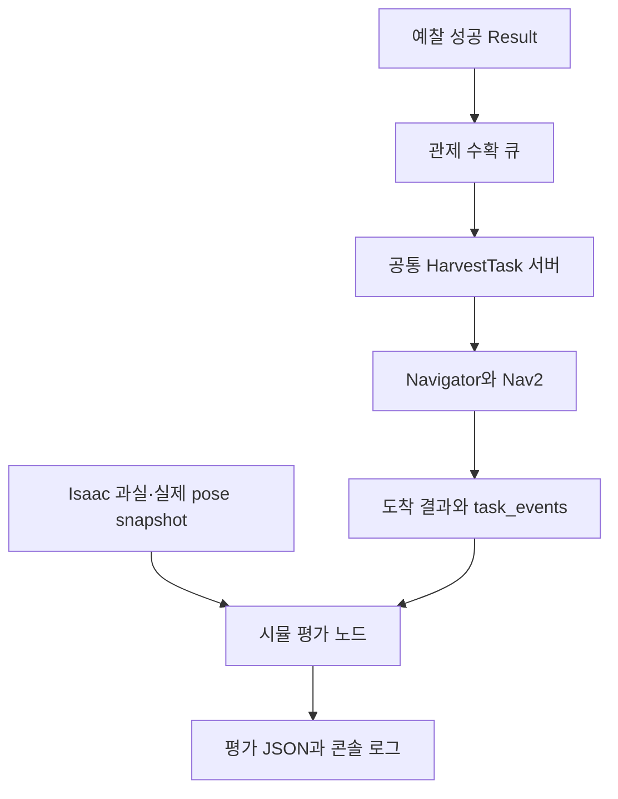

# 농작물 수확 로봇 — 현재 상태 인수인계

> 최신 주행 통합: **2026-10-13, §37**. AprilTag 전달본을 반영했으며 아래 날짜별 절의 인수 대기·미구현 표기는 작성 당시 기록이다. 현재 실행 조건과 이번 검증은 §37 및 연결 문서를 우선 확인한다.

- 작성 기준일: 2026-10-06, Asia/Seoul.
- 저장소: https://github.com/Robot3FinalProject/main
- 기준 브랜치: `main`.
- 확인한 코드 커밋: `068b42eb0ebe54b3b57cffe254a20b2f9e3b202e` (2026-10-06 11:19:12 KST).
- 아래 파일 경로는 모두 저장소 안의 `farm_project/` 기준이다. 사용자 작업 경로는 `~/main/farm_project`다.
- 최초 작성은 위 커밋의 정적 대조·기존 로그 검토였다. 이후 사용자 요청에 따른 로컬 미커밋 과실/오른팔 물리·좌표 구현과 이번 GPU Isaac 시험 결과를 §15에 추가했다. 이전 검토 절의 “미실행”은 해당 작성 단계의 기록이며 최신 적용 상태는 §15와 연결 보고서를 따른다. 실물 로봇 시험은 하지 않았다.
- 2026-10-06 이번 검토에서 `git fetch origin` 성공 후 `HEAD...origin/main`의 앞섬/뒤처짐은 `0/0`이었다. 코드 HEAD와 원격 main은 동일하다. 기존 인계 패키지와 이번 문서 수정은 미커밋·원격 미반영 상태다.

## 1. 프로젝트 목적과 현재 구현 범위

전체 목표는 **예찰 → 수확 → 운송 → 분류**를 관제로 연결하고, 실물과 Isaac Sim에서 공통 로봇 업무 코드를 사용하는 것이다. 현재 대상 작물은 파프리카(bell pepper)다. 9월 10일의 토마토 기획 문서 두 개는 초기 목표·역할 분담의 참고 자료이며, 현재 작물·메시지·실행 상태를 나타내는 문서가 아니다.

사용자 담당은 시뮬 환경·로봇·센서 구현, 합성 비전 데이터 생성, 실물 담당자 소스 통합, 반복 시험 및 Sim-to-Real 비교다. 관제 통신규약과 업무 FSM을 시뮬 파트에서 임의로 재정의하지 않는다.

| 구성 | 확인한 현재 상태 | 완료로 해석하면 안 되는 범위 |
|---|---|---|
| 예찰 | Burger, 상태 기반 `scout_new`, RGB-D/YOLO, 과실 등록·Window 생성, ScoutArea 서버 | 최신 규약으로 전체 예찰·수확 연계가 재검증된 것은 아님 |
| 수확 | VicPinky 이동 시험, 공통 `harvest_robot` 서버, Nav2 목표 이동 | 로봇팔 파지·분리·적재는 실행하지 않음 |
| 수확 물리 기반 | 288개 과실9g·줄기 물리, 오른팔/박스 설정, 오른팔 기준 Goal 구현 및 GPU 기초시험 | 학습 정책 실행·그리퍼 파지/적재·새 좌표 실제 Nav2 주행은 미검증(§15) |
| 수확 평가 | Isaac 과실 정답과 도착 시 작업 박스 안의 개수 비교 | 실제 수확 성공 수량·IK 도달 가능성·충돌 회피 판정이 아님 |
| 운송·분류 | 전체 프로젝트 목표 및 별도 팀 파트 | 이 통합 저장소의 transport/sorting launch는 오류를 내는 미구현 스텁 |
| 관제 | 외부 관제와 공통 인터페이스, 임시 예찰 명령 클라이언트 | `control/scripts/send_scout_area.py`가 수확 큐까지 실행하지는 않음 |
| 실물 연결 | 예찰 프로파일 및 인수한 수확 real 장치·주행·태그 프로파일/bringup | 수확 단일 주행 성공은 담당자 기록이며 이번 PC에서 실물 재검증하지 않음(§37) |

전체 시뮬 실행은 `farm_sim_runtime all.launch.py`다. `farm_bringup all.launch.py`는 미구현 스텁이므로 혼동하지 않는다. 최신 시뮬 실행 절차는 [시뮬 실행·로그 가이드](../sim/docs/RUN_GUIDE_20261006.md)를 사용한다.

## 2. 코드 구조와 수정 경계

| 위치 | 책임 |
|---|---|
| `control/` | 현재는 임시 관제 테스트 클라이언트 등. 외부 관제 프로그램 전체와 동일하지 않음 |
| `robot/ros_ws/src/scout_robot/scout_new/` | 현행 예찰 Node·Mission·Communication·StateController·States |
| `robot/ros_ws/src/scout_robot/scout_robot/` | 예찰 계산·워커·기존 서버 및 호환 코드. 기존 서버와 새 서버 중복 실행 금지 |
| `robot/ros_ws/src/harvest_robot/harvest_robot/` | 공통 수확 Action 서버·계약·이동 미션·상태 제어 |
| `robot/ros_ws/src/farm_navigation/` | 공통 그래프 계획·Nav2 요청·위치 조회·정지 및 도착 확인 |
| `robot/ros_ws/src/farm_interfaces/` | ROS 메시지·액션·서비스 형식 |
| `robot/ros_ws/src/farm_bringup/` | 환경 선택 및 로봇·주행·모니터링 launch |
| `robot/config/`, `robot/models/` | 실물 설정 및 공유 모델. 시뮬 조정을 이유로 임의 변경하지 않음 |
| `sim/ros_ws/src/farm_sim_config/` | 시뮬 지도·그래프·장치·Nav2·비전·예찰 설정 |
| `sim/ros_ws/src/farm_sim_devices/` | 가상 장치, 센서·구동·ROS 연결, scene truth |
| `sim/ros_ws/src/farm_sim_runtime/` | Isaac 단독/다중 로봇 실행, station 배치, 시뮬 launch |
| `sim/ros_ws/src/farm_sim_harvest/` | 수확 평가 노드. 공통 수확 업무 코드를 복제하지 않음 |
| `sim/assets/`, `sim/tools/`, `sim/tests/`, `sim/runs/` | 시뮬 자산·도구·시험·실행 결과 |

`AGENTS.md`와 `sim/AGENTS.md`의 기존 승인 규칙을 따른다. 공통 미션·주행·메시지 변경은 구체적인 변경안과 실물 영향을 제시하고 승인받아야 한다. 최초 인수인계 문서 작성 승인과 이후 §15의 sim 물리·좌표 구현 요청을 구분하며 공통 업무 변경으로 확대하지 않는다.

## 3. 현행 주행·지도·배치

공통 `Navigator`는 선택된 설정에 따라 동작한다. 시뮬 예찰은 **자체 RouteGraph 계획 → Path 생성 → Nav2 FollowPath/RPP → 정지·도착 오차 확인**을 사용한다. 2026-10-13 수확은 같은 graph/FollowPath를 진입·작업·이탈 단계로 연결하고 작업 구간 안의 정방향 중간 출발을 지원한다(§37). 전달 `route_server` 대안도 코드에 있지만 현재 실물/시뮬 프로파일은 graph를 선택한다. Window XY·yaw로 이동한다는 설명이 `NavigateToPose`를 사용한다는 뜻은 아니다.

- 원본: `sim/ros_ws/src/farm_sim_config/config/task.yaml`, `sim/ros_ws/src/farm_sim_config/maps/scout_harvest.geojson`.
- 파생 설정·역할별 그래프 생성: `sim/tools/rebuild_route_data.py`; 검사: `sim/tools/validate_route_data.py`.
- 데이터에서 확인: 8개 물리 베드, 16개 Section, Section당 5개 관측점으로 총 80개 관측점.
- Section은 `SEC01`~`SEC16`; 물리 USD의 `Bed_XX`와 같은 번호라고 가정하지 않는다. 예: `SEC01`의 평가 대상은 `/World/Vegetation/Bed_02`다.
- Segment 예: `SEC01_G01`. 실물의 `SEC_01` 등은 해당 환경 설정의 실제 키를 사용한다. sim/real 이름을 일괄 치환하지 않는다.
- 지도: `sim/ros_ws/src/farm_sim_config/maps/count_test_farm_map.yaml`, map ID `farm_map_v1`, 해상도 0.05 m/pixel, origin 약 `[-8.075, -15.075, 0]`.
- 실물 예찰은 `robot/config/environments/scout_real.yaml`, map ID `many_farm_v1`, `robot/config/maps/many_farm/`를 사용한다. 시뮬 지도와 섞지 않는다.

이번에 GeoJSON 점·엣지로 계산한 **약연결 성분**은 다음과 같다. 방향을 무시한 연결성 확인이며, 모든 방향의 경로·장애물·실제 주행 성공을 검증한 결과는 아니다.

| 그래프 | 노드 | 방향 엣지 항목 | 약연결 성분 |
|---|---:|---:|---:|
| `scout_harvest.geojson` | 227 | 516 | 1 |
| `graph.geojson` (예찰) | 211 | 452 | 1 |
| `harvest_graph.geojson` | 143 | 260 | 1 |

따라서 과거의 ‘16개 비연결 성분’ 설명은 복원 전 기록이다.

| 로봇 | station 노드 | X, Y (m) | yaw (rad) |
|---|---:|---|---:|
| `scout_01` | 8001 | -5.0, 13.25 | -1.5707963267948966 |
| `harvest_01` | 8002 | -2.0, 13.25 | -1.5707963267948966 |

station 원본과 AMCL 초기 pose를 일치시킨다. `station_spawn.json`의 운송·분류 station은 `DESIGN_PROPOSAL`이고 yaw가 null이므로 실행 완료된 로봇 배치로 취급하지 않는다. 수확 자산의 논리 주행 프레임은 자산 축과 180도 차이가 있다(`control_frame_yaw_rad=π`); 박스 좌표·바퀴 부호를 월드 축과 혼동하지 않는다.

## 4. 2026-10-06 관제 통신 계약

정의 원본은 `robot/ros_ws/src/farm_interfaces/`, 반영 배경은 [PROTOCOL-20261006-014](changes/PROTOCOL-20261006-014.md)다. 아래는 확인한 필드이며, 이후 규약 변경 시 실제 `.action`/`.msg`를 다시 확인한다.

### ScoutArea

- Action: `/scout_01/scout_area`, 형식: `farm_interfaces/action/ScoutArea`.
- Goal: `robot_id`, `task_id`, **`section_id` 단일 값**, `map_id`, `frame_id`, `crop_type`, `target_ripeness`, `timestamp`.
- 현재 예찰 서버는 `frame_id=map`, `crop_type=PAPRIKA`, `target_ripeness=RIPE`와 설정의 robot/map/section을 검사한다.
- Result: `robot_id`, `task_id`, `result_code`, `section_id`, `completed_segment_count`, `harvest_task_count`, `total_expected_count`, **`harvest_tasks[]`**, `error_code`, `error_message`, `timestamp`.
- Feedback: `robot_id`, `task_id`, `phase`, `section_id`, `segment_id`, `completed_segment_count`, `segment_expected_count`, `harvest_tasks[]`, `timestamp`.
- 수확 작업 등록은 **성공 Result의 최종 목록** 기준이다. Feedback은 진행 정보이며, `SECTION_COMPLETE`를 작업 큐 등록 신호로 사용하지 않는다.
- 실패·취소 Result는 마지막 저장 성공 시점의 부분 목록을 포함할 수 있다. 보관하되 자동 수확 전송은 보류한다.
- `section_ids[]`, `completed_section_ids`, `completed_section_count`를 현재 ROS 계약에 다시 넣지 않는다. 내부 `survey.json`에 과거 분석 필드가 남는 것은 별개다.

### HarvestTask

공유 `HarvestTask.msg`는 **`task_id`, `window_id`, `goal_pose`, `expected_count` 네 필드**다. `section_id`, `segment_id`, `sequence`는 현재 이 ROS 메시지의 필드가 아니다.

- Action: `/harvest_01/harvest_task`, 형식: `farm_interfaces/action/HarvestTask`.
- Goal: `robot_id`, `map_id`, 중첩 `harvest_task`, `timestamp`.
- Result: `robot_id`, `task_id`, `window_id`, `result_code`, `expected_count`, `harvested_count`, `failed_count`, `error_code`, `error_message`, `timestamp`.
- Feedback: `robot_id`, `task_id`, `success_count`, `failed_count`, `timestamp`. `phase`, `progress_ratio`, `detected_count` 등은 없음.
- `goal_pose`는 `frame_id`, `position{x,y,z}`(m), `yaw`(rad)를 갖는 `RobotPose`다.
- 현재 완료 정책은 `ARRIVAL_ONLY_NO_HARVEST`: 도착·방향·정지를 확인하면 `SUCCESS`, `harvested_count=0`, `failed_count=0`. 요청의 `expected_count`는 유지한다.
- 한 번에 한 작업만 수락하고, 현재 서버 프로세스에서 성공한 같은 `task_id`는 다시 거절한다. 재시작을 넘는 영구 중복 방지를 보장하는 것은 아니다.
- `window_id`는 비어 있지 않은 식별자로 그대로 전달한다. `SEC01_G01_W01`은 명명 예시이며 세션 접두사가 붙은 실제 ID를 잘라내거나 새로 만들지 않는다.

`RobotStatus.msg`, `GetHarvestTasks.srv`의 정의가 존재하는 것과 발행기·서비스 서버의 운영은 다르다. 최신 반영 기록상 예찰·수확 상태 발행기는 별도 구현이 필요하고, 현재 Result 기반 흐름은 GetHarvestTasks를 호출하지 않는다.

## 5. 비전·환경 설정

사용 환경 기준은 Ubuntu 24.04.4, ROS 2 Jazzy, Isaac Sim 5.1.0, RTX 4070 SUPER 12GB다. 사용자 제공 개발환경 기록이며 이번에 설치 환경을 직접 점검한 결과는 아니다.

| 항목 | 현재 파일에서 확인한 값 |
|---|---|
| 시뮬 장면 | `sim/assets/envs/output/farm_with_plants_v5.usd` |
| 시뮬 예찰 모델 | `robot/models/scout/yolo11_seg_2class_synth_and_sim_v2.0.pt` |
| 시뮬 모델 설정 | `sim/ros_ws/src/farm_sim_config/config/scout_vision.json` |
| 시뮬 실시간 예찰 카메라 | `scout_fleet.json`: 640×384, 설정 FPS 15, 공유메모리 `farm_scout_01_rgbd` |
| 시뮬 추론 최대 FPS 설정 | 15.0. 실제 달성 FPS를 확인한 수치는 아님 |
| 실물 카메라 설정 | `robot/config/vision/scout_real.json`: 1280×720, 설정 FPS 6 |
| 실물 모델 설정 | `model_yolo11_seg_ver1.2.pt`, 기존 외부 worker 경로. 시뮬 모델로 자동 교체되지 않음 |
| 데이터셋 생성 설정 | `sim/config/scout_dataset.json`: 1280×720, seed 930, 과실 회전 최대 30도, 후처리 활성화 |
| 수확 카메라 | `harvest.json`에서 disabled; 현재 수확 평가는 카메라 재탐지를 사용하지 않음 |

실시간 영상, 합성 데이터셋, 실물 D435 설정을 같은 해상도·FPS·노이즈 조건으로 설명하지 않는다. 현행 시뮬 추론 설정에는 추가 노이즈/블러를 넣지 않는다고 명시되어 있으며 데이터셋 후처리와 구분한다.

장면 USD는 Git에서 LFS로 관리한다. 이번 로컬 파일은 `PXR-USDC` 헤더의 실제 바이너리 객체이며 크기는 2,795,738 bytes다. 파일 존재·헤더만 확인했고 USD 참조·기하·Isaac 로딩은 검증하지 않았다. 새 PC에서는 포인터 텍스트만 받은 상태인지 확인한다. 이 인수인계 ZIP은 USD·모델 파일을 포함하지 않는다.

## 6. 수확 작업 박스 평가와 로그



위 관제 큐는 연동 계약상 필요한 역할이다. 현재 임시 예찰 클라이언트에 자동 수확 큐가 구현되어 있다는 뜻은 아니다. 정답 snapshot은 평가로만 흐르며 공통 제어·YOLO 입력으로 주입하지 않는다.

- 공통 서버 진단 이벤트: `/harvest_01/task_events`, `std_msgs/String`, RELIABLE/TRANSIENT_LOCAL, depth 100.
- 평가 노드: `sim/ros_ws/src/farm_sim_harvest/farm_sim_harvest/audit_node.py`.
- 평가 설정: `sim/ros_ws/src/farm_sim_config/config/harvest_audit.json`.
- **결과 파일: `sim/runs/harvest_motion/<평가세션>/<task_id>_<event_id>.json`.**
- 정답 snapshot: `sim/runs/runtime/harvest_scene.json`.
- 콘솔: `workspace audit: ...`; 파일 기록 실패는 `시뮬 과실 평가/로그 실패: ...`로 출력.
- 평가 노드는 `farm_sim_runtime harvest.launch.py`가 추가한다. 공통 `farm_bringup harvest.launch.py`만 실행하면 이 평가 노드가 붙지 않는다.

작업 박스는 논리 `base_footprint`에서 중심 `[-0.19, 0.435, 0.828]` m, 크기 `[0.35, 0.10, 0.45]` m다. 빨강·노랑 과실의 월드 AABB 중심을 박스에 포함하는지 검사하고 초록 과실은 별도 제외 개수로 기록한다. 팔의 실제 관절 가동 범위를 계산한 결과가 아니다.

주요 평가 필드: `evaluation.status`, `expected_count`, `actual_in_workspace`, `count_delta`(실제-예상), `repeated_gt_ids`, `matched_fruits`, `ignored_green_count`. `repeated_gt_ids`는 같은 평가 노드와 scene session에서 앞서 센 과실의 재등장이다. 과실을 제거하거나 실제로 수확하지 않는다. 수량 차이만으로 어느 열매가 YOLO 미검출됐는지까지 확정할 수는 없다.

평가 상태는 `OK`, `SKIPPED_NOT_ARRIVED`, `UNAVAILABLE`을 구분한다. snapshot은 기록 후 0.5초 이내, 도착 시각 대비 -0.25~+0.5초 범위여야 한다. 늦은 과거 이벤트 재수신 등으로 평가가 불가능할 수 있다. 평가 실패가 이미 성공한 수확 Action 결과를 바꾸지는 않는다.

다른 로그 위치는 [실행 가이드의 로그 표](../sim/docs/RUN_GUIDE_20261006.md#5-결과와-로그)를 참고한다.

## 7. 검증 상태와 인수 시 주의할 사항

| 항목 | 확인 수준 | 해석 |
|---|---|---|
| 소스·설정·메시지·launch 구성 | 이번 로컬 HEAD와 미커밋 문서 정적 대조 | 현행 코드가 무엇인지 확인한 근거 |
| 그래프 규모·약연결성·관측점 수 | 이번에 JSON/YAML 계산 | 실제 로봇 주행 성공을 뜻하지 않음 |
| 고정 캐스터 마찰 보정 | 10/6 적용 기록 및 사용자 ‘수확 로봇 이동 정상’ 보고 | 이동 불능이 해결됐다는 사용자 확인. 새 통합 주행 시험을 수행한 것은 아님 |
| 예찰 SEC01 성공·작업 8개/예상 12개 | 기존 `sim/runs/scout_survey/c1167c0c9631/survey.json` 열람 | 구형 `section_ids` Goal을 사용한 과거 로그. 최신 단일 Section 계약 E2E 합격 근거로 쓰지 않음 |
| 실물 4·6·8번 주행·최종 예찰 실패 | 10/2 예찰 인수인계 기록 | 팀원의 당시 시험 결과. 이번 직접 검증 아님 |
| 과거 단위/구성 검사 | 개별 변경 문서에 결과 존재 | 해당 변경 당시 기록. 이번에 모든 검사를 재실행한 것은 아님 |
| 최신 규약 colcon·생성 메시지·관제→예찰→수확 | 이번 미실행 | 사용자 환경에서 확인 후 결과 문서 갱신 필요 |

현재 이어서 확인할 항목:

1. 최신 farm_interfaces로 로봇·관제를 모두 재빌드한 뒤 성공 Result 기반 수확 작업 전달 확인.
2. `harvest:=true` 실행에서 수확 이동과 audit JSON 생성 확인. ‘움직인다’와 ‘예상/실제 수량이 일치한다’를 별도 기록.
3. 관제의 RobotStatus 필수 여부와 상태 발행기 구현 범위 조율.
4. 실물 수확 장치·프로파일 인수 및 실물 비전 모델 경로/버전 결정.
5. 서로 다른 Segment의 중복 과실 등록, 위치추정 오차에 따른 Window 누락 재현. 과거 주요 관심 이슈이며 현행 발생률은 미확인.
6. 교통 제어·도킹·운송·분류의 통합 범위 결정. 데이터에 공용 경로가 있다고 교통 제어가 구현된 것은 아님.

## 8. 과거 문서를 읽을 때의 우선 확인

- `docs/SUMMARY_인수인계서.md`는 10/2의 예찰 인수인계로 보존한다. 전체 프로젝트 최신 상태로 단독 사용하지 않는다.
- `docs/RUN_GUIDE_20261002.md`의 일부 스텁 설명과 기본 구역 설명은 변경 전 내용이다. 현행 임시 클라이언트 기본값은 `SEC01`이다.
- 10/2 수확 문서의 구형 Goal 필드 예시보다 10/6의 실제 `.action`/`.msg` 정의를 확인한다.
- 10/6의 일부 과거 패치 문서에도 `harvest:=true` 없는 전체 실행 예시가 있다. 수확 시험은 새 실행 가이드를 사용한다.
- 본 문서도 고정된 기준 커밋의 요약이다. 이후 변경은 [Codex 작업·공유 절차](CODEX_HANDOFF.md)에 따라 갱신한다. 업무 의도와 구현이 충돌하면 [결정 기록](DECISIONS.md)에 차이를 남기고 사용자에게 확인한다.


## 9. 이번 로컬 검토의 Git 상태와 보존 범위

- 검토일: 2026-10-06 KST. Git 루트는 `/home/ysy/main`, 프로젝트는 그 아래 `farm_project/`다.
- 브랜치 `main`, HEAD 및 fetch 후 `origin/main`: `068b42eb0ebe54b3b57cffe254a20b2f9e3b202e`. CODEX_HANDOFF의 기준 코드와 동일하다.
- 원격: `origin`, `https://github.com/Robot3FinalProject/main.git`. `git rev-list --left-right --count HEAD...origin/main` 결과 `0 0`; 커밋 기준 차이가 없다. 작업 트리 문서는 별도다.
- 시작 시 기존 수정: `AGENTS.md`, `README.md`, `sim/docs/CHANGELOG.md`.
- 시작 시 미추적: `docs/CODEX_HANDOFF.md`, `docs/DECISIONS.md`, `docs/HANDOFF_SOURCES_20261006.json`, 이 문서, `sim/docs/RUN_GUIDE_20261006.md`, `backups/codex_handoff_before_20261006_114034.tar.gz`.
- 이번 변경: 기존 상태 문서 내용을 유지하면서 로컬 확인 결과·실행 요약·충돌 근거를 보강하고 `sim/docs/CHANGELOG.md`에 문서 검토를 추가했다. 사용자 요청은 문서 작업만 승인한다. 실행 코드·설정·시험·모델·USD 변경 없음.
- fetch는 원격 추적 정보 조회이며 pull/merge를 수행하지 않았다. commit/push도 수행하지 않았다. 다른 작업자의 문서와 백업을 삭제·이동하지 않았다.

## 10. 현재 코드에 맞춘 실행 요약

아래 명령은 소스와 대조한 실행 절차이며 이번에 실행한 명령이 아니다. 비전용 robot_venv를 활성화하고 Isaac Python 실제 경로를 설정한다. 빌드 도구와 의존성 설치 여부는 이번에 검증하지 않았다.

```bash
cd /home/ysy/main/farm_project
source /opt/ros/jazzy/setup.bash
export FARM_ISAAC_PYTHON="$HOME/isaac/env_isaaclab/bin/python3.11"
export FARM_VISION_PYTHON="$VIRTUAL_ENV/bin/python"
bash scripts/build.sh sim
source scripts/env.sh sim
python robot/ros_ws/src/farm_interfaces/examples/verify_interfaces.py
ros2 launch farm_sim_runtime all.launch.py \
  project_root:="$PWD" isaac_python:="$FARM_ISAAC_PYTHON" \
  vision_python:="$FARM_VISION_PYTHON" harvest:=true device:=0
```

별도 관제 터미널도 동일 인터페이스 install을 source한다. 예찰 요청은 `python control/scripts/send_scout_area.py --section SEC01 SEC02`; 수확 이동 시험은 실행 가이드의 `harvest_smoke_goal.py` 예시를 사용한다. 외부 관제 자동 큐 연결은 이 클라이언트가 제공하지 않는다.

실물 예찰은 ROS 환경에서 `bash scripts/build.sh real`, `source scripts/env.sh real` 후 다음처럼 실행한다. 비전 Python은 실제 D435/worker 환경으로 지정해야 한다.

```bash
ros2 launch farm_bringup scout.launch.py mode:=real project_root:="$PWD" \
  environment_config:=robot/config/environments/scout_real.yaml
ros2 launch farm_bringup rviz.launch.py mode:=real project_root:="$PWD" \
  environment_config:=robot/config/environments/scout_real.yaml
```

두 launch는 각 터미널에서 실행한다. 실물 Nav2 초기 pose는 인계 문서상 수동 지정이 필요하다. 실물 수확 launch 기본 `mode=real, devices=true`는 명시적 미구현 오류다. `devices=false`와 외부 실물 드라이버·실물 환경 설정을 준비하는 경계가 있을 뿐, 저장소에 완성된 실물 수확 프로파일이 있다는 의미는 아니다.

## 11. 기존 실행 산출물에서 확인한 증거

이번에는 로그 파일을 읽었으며 재실행하지 않았다. 로그 파일명·내부 UTC timestamp를 사용하고 파일 수정 시각이나 세션 이름의 사전순을 최신 실행 순서로 해석하지 않는다.

| 산출물 | 기존 결과와 이번 확인 | 한계 |
|---|---|---|
| `sim/runs/scout_survey/c1167c0c9631/survey.json` | SEC01 SUCCESS, 구형 배열 Goal. 작업 수와 예상 합계는 보고서 필드에 저장 | 최신 프로토콜 적용 이후 실행 증거가 아님 |
| `sim/runs/harvest_motion/aa9781127777/`의 JSON | 2026-10-06 09:55:37 KST, SUCCESS, 수확 0, 평가 OK, 예상/실제 1/1, 차이 0 | 단일 이동·박스 평가. 전체 예찰→관제→수확 연동·팔 작업 증거가 아님 |
| `sim/runs/harvest_motion/523dd253fcb4/`의 JSON | 2026-10-06 10:21:28 KST, SUCCESS, 수확 0, 평가 OK, 예상/실제 1/1, 차이 0 | 실행 커밋·생성 인터페이스 버전과의 연결 근거 부족 |
| `sim/runs/harvest_motion/`의 나머지 JSON | 총 8건 중 6건 FAILED/NAVIGATION_FAILED, 평가 SKIPPED_NOT_ARRIVED | 이전 실패 기록 보존. 현재 실패율이나 패치 후 회귀율로 해석하지 않음 |
| `sim/docs/changes/CASTER-FIX-20261006-013-applied.jsonl` | APPLY 기록의 after SHA-256과 현재 수확 USD SHA-256 일치 (`2fcbce1c…f14fa1`) | 패치 적용 파일 식별 확인. PhysX 접촉력·실물 동역학 검증 아님 |

## 12. 오래된 설명과 현재 코드의 차이

| 오래된 문서·설명 | 현재 근거 | 이번 판단 |
|---|---|---|
| `sim/docs/INTEGRATION_REVIEW_20261002.md` §3·§4.2의 128노드/112엣지·16성분, BED ID·FOV 자동 관측·NavigateToPose | `task.yaml`, 3개 GeoJSON, `scout_runtime.yaml`; 변경 이력 SIM-DATA-003/SIM-NAV-005 | 복원 전 기록. 현재 8베드/16Section/80관측점, 역할별 연결 그래프, FollowPath/RPP |
| 같은 검토서 §4.4의 수확 README만 존재·launch 미구현 | `robot/ros_ws/src/harvest_robot/`, `farm_bringup/launch/harvest.launch.py`; HARVEST-COMMON-009 | 공통 수확 이동 서버 구현 완료. real 장치·팔 작업은 미완료 |
| HARVEST-SIM-008의 시뮬 내부 업무 서버 | HARVEST-COMMON-009, `farm_sim_harvest`의 audit/evaluation, 공통 harvest 서버 | 이관 후 책임 분리가 현행. 과거 위치로 복원하지 않음 |
| 인수 검토서 §4.3 및 10/2 인계서의 배열 Goal·SECTION_COMPLETE 작업 전달 | `farm_interfaces/action/ScoutArea.action`, `scout_new/scout_communication.py`, PROTOCOL-014 | 단일 Section Goal·성공 Result 최종 목록 기준. 과거 보고서 내부 배열은 ROS 계약 근거가 아님 |
| 10/2 수확 예시의 Section/Segment/sequence 필드 | `farm_interfaces/msg/HarvestTask.msg`, `harvest_robot/contract.py` | 현재 네 필드만 전달. 수신 Window ID 보존 |
| `farm_bringup/launch/all.launch.py`의 “현재 scout 경로 점검만 지원” 오류 문구 | 해당 launch는 여전히 오류 스텁. 실제 예찰 서버·수확 조합은 별도 launch에 구현 | 이 오류는 공통 all의 미구현을 뜻한다. 프로젝트 전체 기능 설명으로 확대하면 부정확 |
| CASTER-FIX-013·PROTOCOL-014의 `harvest:=true` 없는 all 실행 예시 | `farm_sim_runtime/launch/all.launch.py`: harvest 기본 false | 수확 시험에는 true 명시. 최신 RUN_GUIDE_20261006 사용 |
| 기존 인계 패키지의 “PC 변경 확인 불가·USD 포인터만 확인” | 이번 git status, 로컬 USD 헤더/크기 | 이번 로컬 검토에서는 작업 트리와 실제 바이너리 존재 확인. 과거 검토 제한은 당시 기록으로 보존 |

## 13. 이번 검증과 바로 이어서 할 작업

직접 수행한 확인은 `git status --short`, 브랜치/HEAD/원격 조회, `git fetch origin`, 커밋 차이 계산, 관련 문서·소스 정적 대조, Python 3 표준 라이브러리 GeoJSON 약연결성 계산, YAML 관측점 집계, 기존 JSON 로그 열람, USD 헤더·크기·패치 SHA-256 비교다. 그래프 수치와 관측점 수는 §3과 일치했다. 문서 링크 존재 및 문서 변경 범위를 종료 시 확인한다. 기존 프로토콜 기록의 6개/9개 검사와 이력의 371개 경로 검사는 이번에 재실행하지 않았다.

미실행: colcon 빌드, 생성 메시지/CDR 왕복 검사, ROS 네트워크, Isaac/PhysX, D435, 실물 주행, 최신 규약 전체 E2E. 이번 정적 확인에 별도 런타임 로그는 생성하지 않았다. 과거 로그 위치는 §6·§11에 기록했다.

다음 작업은 최신 동일 인터페이스로 관제와 로봇을 빌드하고, 단일 SEC01 성공 Result의 원본 Task를 수확 서버에 전달하는 통합 시험이다. 코드 SHA·프로파일·모델·ROS_DOMAIN_ID·실행 명령·Goal/Result·survey/audit 로그를 함께 남겨 현행 코드와 결과를 연결한다. 이후 중복 과실/Window 누락 재현, 상태 발행 계약 조율, 실물 수확 장치 인수를 진행한다. 구현 변경이 필요하면 해당 공통 파일·실물 영향·검증안을 제시하고 기존 승인 절차를 따른다.

문서 복원은 기존 내용과 비교해 이번 보강만 되돌린다. 시작 때 있던 미커밋 인계 문서 전체를 HEAD로 reset하면 기존 작업이 없어지므로 사용하지 않는다. 이번 문서와 이력은 commit/push하지 않았으며 원격에는 반영되지 않았다.

## 14. 로봇팔 Teacher 전체 묶음 수령 — 2026-10-06 추가

이 절은 수령 당시 기록이다. 이후 사용자 구현 요청에 따른 현재 적용 상태는 §15를 따른다.

- 사용자 요청으로 `main/robotarm/harvest_teacher_9g.tar.gz`를 검토했다. 자료 전체 수신 후 한 번에 작업하기로 하여 설정만 먼저 적용하는 이전 제안은 보류했다. 운영 sim/공통/실물 코드는 아직 변경하지 않았다.
- 직접 확인: 외부 archive SHA256 일치, manifest 2,148개 파일 해시 일치, Teacher 정책4개+각 run.json 해시 일치, 기존 인계 문서4개와 동일. 실행 소스·로봇/과실/박스·USD/cache·YOLO·환경 정보·과거 평가 원본·실물 참고 도구를 확보했다.
- 검토용 추출: `sim/runs/robotarm/received_20261006_143434/manyfarm_robotarm/`. 소스 기준 `abe9e13357e1be549500712b62c5582649d444ab`와 현재 수정본이며, 10/1 당시 미커밋 소스 전체를 복원한 묶음은 아니다.
- 원본 평가 직접 집계: 빨강 실패2/성공1, 노랑 성공2/실패1. 총3/6 성공이며 실패 플래그는 부적격분리2+분리 후 보유 전 낙하1. 새 수신 PC 물리 실행 결과가 아니다.
- 코드 검토로 실제480Hz/정책20Hz 및 physics step별40ms 분리 누적 확인. 추가 발견: 캐시 경로 치환 시 converter hash 불일치로 받은 USD 재생성 경로, 복귀 물리25ms와 제어50ms 계산 불일치. 통합 전 보완·시험 필요.
- 전달 current USD는 차체/바퀴 고정의 평가용이므로 농장 주행 USD를 통째 교체하지 않는다. 박스 바닥 collision 자산은 확보했지만 기존 캐스터 저마찰 보정과 농장 오른팔 기하 정합을 별도로 유지해야 한다.
- 현 Isaac 주요 버전/commit은 일치, 비전 환경 일부 버전은 다르다. 설치·prepare·변환·새 ROS/PhysX/정책 실행은 하지 않았다. 수확 ActionServer 연결도 아직 없다.
- 상세 대상/증거/후속 작업: [로봇팔 묶음 수령 검토](../sim/docs/ROBOTARM_BUNDLE_RECEIPT_20261006.md). 이번 문서 보강은 미커밋·원격 미반영이며 기존 인계 내용과 구분한다.

## 15. 농장 과실·오른팔 물리 및 수확 이동 좌표 — 2026-10-06

이 절은 최초 적용 기록이다. 현재 운용 주기·과실 활성화는 아래 §18을 따른다.

사용자가 전체 묶음 기반 적용을 요청하고 Teacher 크기 통일을 선택했다. 시작 기준 커밋은 `068b42eb0ebe54b3b57cffe254a20b2f9e3b202e`이며 아래 구현은 이후 §16의 재검증과 커밋·푸시 요청 대상으로 확정됐다. 세부 검증·명령·제약은 [물리 적용 보고서](../sim/docs/ROBOTARM_PHYSICS_20261006.md)를 따른다.

- 농장 288개 과실(3색×96): 기존 위치·회전·색상·ID를 보존하며 폭70mm/높이75mm,9g rigid body·충돌·접촉·줄기 결합/분리 물리를 적용한다. source에서 직접 복제한 줄기 response5의 수치 결과를 대조했다. 새 자산은 `sim/assets/fruit/teacher_9g/`에 있어 받은 runs 폴더가 없어도 동작한다.
- 오른팔6축: 전달 drive gain·토크/속도 한도·HOME, 집게 접촉재질, 박스 바닥4타일을 적용한다. 주행 USD·바퀴·캐스터·왼팔은 교체하지 않는다. 원본 USD 저장 없이 실행 session layer로 구성한다.
- `task.yaml`의16구역을 오른팔 장착점 `[.19,.185,.713]`과 작업중심 `[.19,.500,.838]`에 맞췄다. 예찰 Window에서 생성하는 Goal 및 audit/영상 crop을 함께 동기화한다. 기존 graph의 짧은 연결을 사용하며 노드·엣지는 변경하지 않는다.
- 수확 경로 goal 연결한계9cm, 최종 도착2cm/.05rad, Nav2 내부허용1.5cm/.04rad. 기존보다 주행방향−38cm·베드 반대방향−6.5cm 목표가 바뀌므로 이전 위치 도착으로 성공 처리하지 않는다.
- `robotarm_physics.json`을 단독/통합 Isaac 실행에 연결했다.480Hz마다 외력을 갱신하고60Hz 렌더를 별도 수행한다. 정책 기준20Hz는 명세이며 정책 실행을 활성화하지 않는다. 예찰 단독 scene에 수확 로봇이 있으면 동일 물리/HOME를 적용하고, 없는 로봇을 단독 실행에서 추가하지 않는다.
- ROS 공통 업무는 여전히 이동 완료 후 수확0개를 반환한다(D-006). 학습 정책 추론·현장 재탐지·실제 파지/박스 적재·공통 FSM 변경은 아직 적용하지 않았다. 원본 평가3/6은 받은 과거 결과다.
- 검증: 관련 오프라인 검사, USD 정적 검사,371개 경로와48개 새 Goal 연결 검사, sim 패키지3개 빌드 및 GPU Isaac 물리 검증을 수행했다. 최종 수치·실행 로그는 연결된 보고서에 기록한다. 실제 Nav2 정밀 정지·전체 예찰→수확 E2E·학습정책 적재와 실물 시험은 미실행이다.
- 실행 로그: `sim/runs/robotarm/physics_smoke_gpu_20261006/`, 실제 실행별 설정/분리 기록은 `sim/runs/robotarm/physics/<session>/`. 중간 실패와 최종 결과를 구분한다. 원격 commit/push는 하지 않았다.

## 16. 로봇팔 물리 재검증 및 게시 요청 — 2026-10-06

- 사용자가 테스트 후 커밋·푸시를 요청했다. 이번 sim 구현·설정·필수 자산·관련 기록을 대상으로 하며 공통 `robot/`, `control/`, `scripts/` 실행 코드는 변경하지 않았다. 시작 시 별도로 있던 AGENTS/README 등 문서 변경과 수신 archive·백업은 보존한다.
- 새 분리 진단은 원시 인장력과 clamp 후 힘, 힘/후크/최대변위 분리 조건을 구분한다. 물성·힘 한도·분리 규칙은 그대로다. GUI 검사 도구는 선택 과실을 바라보고0.1N 유지와3N 분리를 자동 검증한다.
- 직접 확인: 단위·USD62개(skip0),371경로,sim3패키지 빌드. GPU에서288과실2초 유지,0.1N·1초 및 회복0.5초 유지,3N으로41.667ms 지속 후 분리·0.90448m 낙하.15개 check와 종료코드0 확인.
- 주의할 실제 동작: 같은 과실은0.5N에서도25mm 후크 조건으로 분리됐다. 개별 힘 한도2.3901N 아래에서도 거리 조건이 작동한다. “2~3N 미만에서 무조건 유지”하는 모델이 아니다. 외력 두 호출이 합산되는 것도 별도GPU 검사로 확인했다.
- 적용한 것은35g 원 학습 체크포인트에 대해 전달된9g **평가 환경**의 물성·수식이며, 정책 추론은 아직 실행하지 않는다. 새Nav2 주행·정밀 도착·그리퍼 실제 수확·실물 시험은 후속 범위다.
- [직접 확인 명령과 상세 결과](../sim/docs/ROBOTARM_PHYSICS_20261006.md#10-인장력-확인-방법과-커밋-전-재검증), [버전 관리 검증 요약](../sim/docs/changes/ROBOTARM_PHYSICS_VALIDATION_20261006.json). 원본 로그는 `sim/runs/robotarm/precommit_20261006/`다.
- 이 기록이 포함된 구현 커밋과 `origin/main`의 일치 여부로 게시 상태를 확인한다. 문서 자신의 미래 커밋 SHA는 기재하지 않는다.


## 17. GUI 검사 자동 종료와 프레임 저하 분석 — 2026-10-06

- 기준코드`1666a23bf47dc7f0e8a6f2dfafbc1d41e190f6cd`. 사용자가 만든 `manual_physics_check.json`은15개 검사 모두 통과했다. GUI 검사기는 정해진 검사 후 결과를 저장하고 창을 닫도록 설계되어 있다.
- 이번 PC GUI 직접 계측:현재288동적 과실480Hz8.30FPS, 추가 상태 진단 생략8.27FPS, 과실 고정 대조군480Hz22.22FPS/60Hz89.52FPS. 준비30/측정120프레임의 정지 구간이며 fleet/정책 실행 성능이 아니다.60Hz 대조군은 초기 reset 때문에 카메라높이8.05mm 차이가 있다.
- 현재 조건의 frame120.44ms 중 물리실행/결과동기화100.63ms(83.5%)가 주 병목이다. 실제CPU PhysX/NumPy이며 GPUDynamicsfalse, GPU평균11.9%. 전역60→480Hz와288개 동적 과실을 함께 고려해야 한다.
- runtime sceneCCD=true 확인으로 기존 false 설명을 정정했다. Teacher의 sceneCCDfalse와 차이가 있으며 전체 물리 환경 완전 동등 재현으로 보지 않는다. 이번 분석은 실행 설정이나 물성을 바꾸지 않았다.
- [상세 조건·한계·후속 개선](../sim/docs/ROBOTARM_PHYSICS_20261006.md#11-gui-자동-종료와-프레임-저하-실측--2026-10-06). 원본 성능 자료는 ignored `sim/runs/robotarm/perf_20261006/`에 있다. 운영/공통/실물 코드 변경 없음. 이번 분석 문서 갱신은 미커밋·원격 미반영이다.

## 18. 동적 물리 주기·수확 주변 과실 활성화 — 2026-10-06

- 사용자 “물리주기도 동적으로 … 수확중 수확로봇 인근 …” 승인에 따라 sim 실행/장치/설정만 변경했다. 기준 main/1666a23bf47dc7f0e8a6f2dfafbc1d41e190f6cd 이후 미커밋. 공통 업무·실물·원본 USD는 보존했다.
- 유휴60Hz, 수확 활동 중480Hz. 실제 오른팔 장착점 반경0.8m(유지1.0m)의 과실만 동적/줄기 계산한다. 여러 활동은 합집합이며 한 로봇 종료가 다른 로봇 활동을 끄지 않는다. 분리 과실은 영역 밖이어도 동적 유지,0.6초 정지 후 저주기 복귀한다. 박스 성공 판정/상대 고정은 미구현이다.
- 프레임60Hz와 내부 물리1~8tick을 분리해 시뮬 시간 연속성, clock60/상태30/라이다10/RGB-D15Hz를 유지한다. 같은 PhysicsScene에서는 고주기가 전역 적용되므로 다른 로봇의 계산 부하·수치 응답까지 독립되는 것은 아니다.
- 현재 실제 팔 FSM이 없으므로 이동 SUCCESS를 수확 활동으로 추정하지 않는다. 내부 set_activity API와 `/harvest_01/sim/harvest_activity` Bool heartbeat를 제공했다. 실제 정책 시작/종료 연결은 후속이다.
- 직접 검증: 단위/USD107개(skip0), sim3패키지 빌드, 실제 ROS bridge13항목 통과. GPU 선택 활성19항목 및 기존 전체288개 기준물리15항목 통과. 3개 활성 상태에서3N 분리/41.667ms 누적/0.20714m 하강 후60Hz 복귀, 비활성 과실·앵커·원본 USD 보존.
- 실제 예찰+수확 fleet6초에서60→480→60Hz/360프레임/1,200tick, 상태로봇별180개/RGB-D89개/시각 대응 정상. 고정60Hz 대조군은360tick이며 동일 센서 수를 확인했다. **동일0.08m/s 주행 명령에서 실제 월드 최종 위치가 약2.6cm 달랐다.** 고주기에서 바퀴 속도 응답이 달라지므로 동시 주행 무영향으로 보지 않는다. Nav2 폐루프 도착 오차·정책 성능·다수 수확로봇 GPU·운송로봇·실물 시험은 미실행이다.
- [구현·명령·검증 한계](../sim/docs/ADAPTIVE_HARVEST_PHYSICS_20261006.md), [버전 관리 검증 요약](../sim/docs/changes/ADAPTIVE_PHYSICS_VALIDATION_20261006.json). 원본 로그 `sim/runs/robotarm/adaptive_20261006/`. 다음은 동시 Nav2 주행 평가와 정책 연결 후60/120/240/480Hz 수확 성능 비교다. 독립 시험 세트별 주기가 필요하면 별도 Isaac 인스턴스로 분리한다.
- 문서/설정/구현은 로컬에 적용하고 sim 설치 패키지를 빌드했다. 이번 변경은 커밋·푸시하지 않았다. 기존 AGENTS/README·인수 자료·백업은 보존했다.

## 19. 도착 후 Teacher 순차 수확 적용 검토 — 2026-10-06

- 사용자 요청: 도착/정지 후 주변 과실을 활성화하고 Teacher에 좌표를 제공, 과실별 실제 안착/낙하 Feedback, 대상 처리 후 Result. 추가 확정은 현재 정차 위치의 빨강·노랑 각1회, 일반 실패 후 다음 대상, 녹색·차체 추가 이동 제외다. sim Teacher 정답 입력은 명시 승인 범위이며 공통 비전/실물에 확대하지 않는다.
- 개발에 필요한 정책·run.json·소스는 확보했다. 이번 직접 CPU 검사에서4개 hash/run hash 일치, 공식ActorCritic strict load·정규화 복원·82차원 합성입력→6차원 유한/결정적출력 확인. 현재 torch2.7.0+cu128/rsl-rl-lib3.1.2/isaaclab0.54.2다. 새 GPU 정책수확·학습을 실행한 것은 아니다.
- 전달 Teacher는 좌표 외 관절/TCP/접촉/분리/보유/박스 상태가 필요하다. 원본은 새 scene/physics step을 소유하고 첫 실패에서batch중단·다음assign거절·미수집분리과실복귀거절이 있어 현 농장World에 그대로 연결할 수 없다.82차원 관측/접촉,20Hz관절출력,실제안착,실패후물리복귀 어댑터가 필요하다.
- 정적FK에서 팔/박스는 강체좌표변환으로 일치한다. 반면 농장 root최소간격132.77mm,18cm미만34쌍/66개, 기울기중앙23.76°/최대41.17°로 전달검증배치와 다르다.0.8m물리반경은도달인증이아니다. 오프라인174정지후보/288root 중 연속근거리조건통과는고유53개(빨강18/노랑20/녹색15)이며실제Nav2/수확성공개수가아니다.
- [구현 검토·추가 확인 요청안](../sim/docs/TEACHER_HARVEST_INTEGRATION_REVIEW_20261006.md), [공통 파일·내부 타입 구체안](../sim/docs/proposals/HARVEST_ARM_COMMON_CONTRACT_20261006.md). 외부HarvestTask필드는유지하고공통Window실행기·후보조회/PickFruit를추가하는안과부분실패Result의미는사용자확인대기다. 공통소스/새타입등록/운영팔제어는아직변경하지않았다.
- 검토산출물은 `sim/runs/robotarm/policy_integration_review_20261006/`, 버전관리요약은 `sim/docs/changes/TEACHER_INTEGRATION_REVIEW_20261006.json`. 기존 미커밋 동적물리/사용자문서/원본묶음은보존했다. 이번검토문서도커밋·푸시하지않았다.


## 20. 시뮬 Teacher 실행과 공통 도착 후 대기 연결 — 2026-10-06

- 최신 사용자 확인은 “대부분은 sim 전용, 공통은 도착하자마자 result를 내는 부분을 sim 팔에 연결”하는 좁은 범위다(D-017). §19의 공통 후보조회/PickFruit/Window 실행기 제안은 채택하지 않았다. 외부 HarvestTask와 farm_interfaces는 유지한다. 공통 harvest_robot5개 파일은 이동/정지 후 내부 Action 요청·피드백·결과·취소 전달만 담당한다.
- sim에 실제 PhysX pose/접촉 측정,82D Teacher 상태, 전달4정책+run/hash,20Hz 관절 명령, 지역 물리 활성화, 현재 정차 빨강/노랑 각1회, 실제 복귀·안착 판정·누적 결과를 연결했다. 원본World를 중복 생성하거나 과실/관절 reset으로 성공을 만들지 않는다. `harvest_task.json`은 ARRIVAL_THEN_ARM, 장치 harvest_arm은 enabled다.
- **연결 구현과 수확 성능을 구분한다. 현재 실제 농장 과실3개 시험에서 적재 성공은0개다.** yellow1개 ENTRY시간 초과, red2개 bad_detach/낙하 후 실제 복귀·실패1 반환. 후보 전체 처리의 SUCCESS가 수확 성공을 의미하지 않는다. 최종 smoke는 정책 실행·후보ID·로그/수량·정지·프로세스 code0 정합을 통과했다. 실제 정책10회 후 취소 시험도 정지확인CANCELED/수량0/0/code0로 통과했다. --require-harvest 성공 기준은 미달이다.
- 직접 검증: 단위/USD178개 중176통과/실ROS2개skip, 실제ROS/UDP 별도2개통과, 공통1+sim3패키지 빌드. Teacher36개에는 실제4정책CPU·물리관측/state17+policy9+device10이 포함된다. 원본vendor5해시/kernel7AST일치. actual401샘플 원본FK 최대.2921mm/.052412°,400정책sample CPU재생 stage/status차이0.
- 원본 identity 과실배치와 농장 pose/연속위치·이웃·이동차체가 다르다. 큰좌표변환 오류근거는 찾지 못했지만 실패의 단독원인을 확정하거나 정책이 농장환경에 검증됐다고 보지 않는다. 다음은 원본/농장 조건 비교와 실제안착성능 확보, 그뒤 최신예찰/Nav2 포함E2E다. 실물·카메라모델·새학습·다수수확로봇·바구니상대고정은 미실행이다.
- [구현·실행·중간실패 및 최종검증](../sim/docs/TEACHER_HARVEST_RUNTIME_20261006.md), [공통변경 상세](changes/HARVEST_ARM_HOOK_20261006.md), [담당자 검토요청안](../sim/docs/TEACHER_FARM_EVALUATION_REQUEST_20261006.md). 원본로그 sim/runs/robotarm/teacher_integration_20261006 및 teacher/<session>/<job>. 요청안은 실제 전송하지 않았다.
- 기준main/1666a23 이후 미커밋·원격미반영. 기존 사용자AGENTS/README/인수문서/백업/원본묶음은 보존했다. 원본농장USD SHA256은1d9887539611d65ec9c284a810bcd0b8015493db0158147c7188b414f95395e7로 유지된다.

## 21. 임시 시뮬 관제 CLI — 2026-10-07

- 사용자 요청으로 `sim/tools/temporary_control.py` 추가. launch와 별도로 켜서 Section 입력→예찰 성공 Result→수확 작업 순차 요청→최종 수량까지 출력한다. 기존 관제/공통/실물 코드는 수정하지 않았다.
- 원본 작업 ID·Window ID·목표·예상 수량 보존. 예찰 실패/취소 부분 목록 제외, 수확 FAILED/CANCELED 시 큐 중단, Ctrl+C 자기 작업 취소와 종료 대기. 정지 미확인 시 추가 요청 차단. 로그 `sim/runs/temporary_control/*.jsonl`.
- 직접 검사: ROS 메시지 기반 단위검사6개 및 CLI 로딩. 실제 Action 네트워크/Isaac/Nav2 통합 사이클은 미실행. §20의 적재0/3 및 Window와 Teacher 근거리 조건 차이는 그대로다.
- 실행: [시뮬 가이드 §7](../sim/docs/RUN_GUIDE_20261006.md#7-임시-시뮬-관제로-한-사이클-실행--2026-10-07). 기준1666a23 이후 미커밋, 원격 미반영. 임시 파일은 운영 launch에 등록하지 않아 추후 삭제 가능하다.

## 22. RViz FollowPath 추종 표시 — 2026-10-07

- sim RViz3종에 `/scout_01/received_global_plan`(초록), `/harvest_01/received_global_plan`(주황)을 해당 로봇별로 추가했다. GeoJSON 기반 FollowPath를 처리하는 RPP의 변환/가지치기 구간이며 전체 Goal Path 보존 표시는 아니다. 기존 planner plan은 비활성화, route marker는 유지.
- 설치된 RPP 토픽 이름과 YAML 설정 확인. 실제 화면/이동 시험 미실행. RViz 설정 재로드로 적용, 로봇/Isaac 재시작 불필요. 공통 소스·주행 설정 변경 없음. 미커밋·원격 미반영.

## 23. 수확 베드 접근 경로 불일치 — 2026-10-07

- 현재16개Section 정차선은 기존 harvest graph보다60mm 옆에 있다. 실제SEC01 첫수확6로그에서 마지막60mm 구간/목표 yaw가90도 차이남을 확인. 재요청24.512m 우회도 실제 계획 기록이다.
- [구체 수정안](../sim/docs/proposals/HARVEST_PARALLEL_APPROACH_20261007.md): 오른팔 기준 sim 수확 주행선 정렬 + 공통 선택적 진입/방향 검사·이미 도착 재측정. AGENTS 공통 사전 승인 대기. 실행 코드는 아직 변경하지 않았으며 모든 abort 원인을 확정한 것은 아니다.
- 분석 sim/runs/navigation_review_20261007/geometry.json. 실제 신규 주행 미검증, 미커밋·원격 미반영.

## 24. 수확 평행 접근 승인·적용 — 2026-10-07

- §23 제안에 사용자 “수정해” 승인. sim 수확 주행선을 오른팔 정차선으로 정렬하고 공통 farm_navigation 선택 기능을 sim harvest에서만 활성화. 진입 정렬→평행 주행, 다른 구간 전 정방향 이탈, 이미 도착 재측정. 좁은 구간 자세 불량/지나친 목표는 복구 필요로 중단.
- 신규7검사·371경로 연결·farm_navigation build PASS. 기존 예찰도착검사9PASS/1구형fixture ERROR. 실제 새 Isaac 주행과 진입 회전 공간은 미검증. 운용 launch 재시작 후 station 출발 첫 Goal 재전송이 다음 확인이다.
- [구현/검증/한계](changes/HARVEST_PARALLEL_APPROACH_20261007.md). 기존 정책 적재성능 문제와 별개. 미커밋·원격 미반영.

## 25. 수확 진입 회전·제동 보정 — 2026-10-07

- 사용자 “해결해”에 따라 sim 수확 바퀴에 encoder 속도PI·제동 적용. 저속정렬0.06rad/s, 각가속0.1, Nav2 yaw gate0.01, 최종 허용0.05 유지. 공통/실물/원본USD 변경 없음. 기존 평행접근은 유지.
- 실제 Isaac 양방향 목표각도 후정지 오차0.00510/0.00932rad PASS,code0. servo4+평행7검사 및371경로/3패키지build PASS. Nav2 진입 전체·관제E2E·480Hz 동시주행은 아직 미검증. [상세](../sim/docs/HARVEST_BRAKING_20261007.md).
- 시험 도구는 UDP/카메라/평가 snapshot까지 격리했다. 중간 공유 snapshot 충돌 및 실패 비교 결과는 최종PASS와 구분한다. 현재 작업폴더에 적용·빌드 완료, 운영 all launch 재시작 필요. 미커밋·원격 미반영.

## 26. 실제 Nav2 코너 회전 시작 실패 — 2026-10-07

- 사용자18:06 Nav2 ABORTED는 Failed to make progress. 실제구동기록에서첫코너전(-1.998,11.838)근처 제자리, 각명령약±.005rad/s 반복 확인. §25 고정속도시험은 Nav2가속제한 피드백을 검증하지 못했다.
- sim RPP.max_angular_accel을.10→1.2로수정, 정렬속도.06유지. 런타임 param set가능. 설정/371경로검사 PASS. 실제 Nav2 재시험은 미실행. 미커밋·원격미반영.

## 27. 480Hz 수확 시험 GUI — 2026-10-08

- 사용자 요청으로 `python3 sim/tools/harvest_test_ui.py` 독립 GUI 추가. `Place robot`은 기존 정차선·팔 근거리·바닥 footprint를 만족하는 빨강/노랑 과실 위치로 시험 배치, `Harvest (480 Hz)`는 실제 정지/HOME 후 기존 Teacher를 실행한다. 주기·활성 과실·적재/실패 표시와 중지 버튼 제공. [실행·제한·기록](../sim/docs/HARVEST_TEST_UI_20261008.md).
- 기준 main/7d9ae40ec8e0d0bebf0e0552f8a6ee85ddfc9bc3 이후 미커밋. 초기 작업폴더 clean. sim 도구/런타임/UI·읽기 전용 API/시험·문서만 수정. 원본USD/정책/공통/실물/운영설정 변경 없음. ROS/colcon 불필요. 포트·snapshot 독립 및 외부 UDP 명령 차단.
- 직접 검사75개 PASS(skip0). 실제 Isaac5.1 GUI seed713 SEC10의 정책400회/주변5개/480Hz·실제복귀·정지/60Hz 복귀/종료0 확인. **실제 적재0/실패1(target_timeout)**이며 성능 개선으로 해석하지 않는다. 최종 창에서 팔/과실/바구니와 영문 패널을 시각 확인했고 GUI를 열어 두었다.
- 실제 통합·화면 증거 `sim/runs/harvest_test_ui/validation_20261008/`. 다양한 위치의 수확 성공률·Nav2 주행·사용자 수동 클릭·동시운영은 이번 미검증. 배치는 주행 성공이나 IK/모든 장애물 회피 보장이 아니다. 다음은 UI 관찰 및 기존 Teacher 농장 적재 성능 개선이다.
- 문서 갱신 완료, 커밋·푸시/원격 재조회 미실행.

## 28. 과실 충돌·중력 시각화 — 2026-10-08

- 사용자 후속 요청으로 공식 PhysX GUI 메뉴(Show By Type > Physics > Colliders)를 활성화하고 시험 UI에 충돌 표시·Physics only 관찰·선택 과실 상태/힘/접촉력 패널을 추가했다. [확인법과 모델 설명](../sim/docs/HARVEST_PHYSICS_INSPECTION_20261008.md).
- 현재 줄기는 connector native joint가 아니라 world 앵커 spring + 최초 랜덤 자세 복원 토크다. 대기중부착과실은고정. 이 모델에서는 중력이 켜져도 완전히 수직으로 돌아가지 않는다. 줄기 물성·원본USD·Teacher는 변경하지 않았다.
- 실제 팔 없는8초관찰: 선택9g 과실이10.788mm 하강/8.360°회전, mgZ -0.088290N과 줄기Fz +0.088290N 평형. 480Hz·주변5개, collider1/1, 안정후60Hz/0활성, 종료0. GUI 표시확인 및98PASS/1USDskip. 모든 접촉형상·파지성능을 보장하는 검증은 아니다.
- 로그 sim/runs/harvest_test_ui/physics_inspection_20261008. 기존 사용자창 보존, 최종 새진단창 열어둠. 7d9ae40 이후 미커밋·원격 미반영. 다음은 Harvest 중 두손가락 접촉/형상 대조와 필요 시 실제 connector 줄기 모델 설계다.

## 29. 로봇암팀 진단 회신 자료 — 2026-10-08

- 사용자 제공 `main/robotarm/SIM_TEAM_TEACHER_DIAGNOSTIC_REQUEST_KR.md`에 맞춰 전달본/모델해시·환경·독립재현·농장실패 연속로그를 확보했다. [회신 본문·실행·한계](../sim/docs/TEACHER_DIAGNOSTIC_REPLY_20261008.md), 산출물 `sim/runs/robotarm/receiver_diagnostic_20261008/TEACHER_DIAGNOSTIC_REPLY_20261008.tar.gz`.
- 새해제본2148개검증, 전달4정책/run.json불변. 실제독립480Hz/20Hz red182/yellow183각5회: 적재7/10. 송신10개trace1069tick와SHA256까지일치. 영상/YOLO제외진단이며원본카메라경로E2E가아니다.
- farm opt-in `--teacher-diagnostic-trace`로82D3종/실제rawaction·최종명령·PhysXtarget·dt/접촉/과실·초기~복귀/정지·USD/PhysX값추가. 제어/정책/물성은불변. headless노랑400tick timeout/빨강42tick bad_detach, 실제적재0/2, 복귀·정지및종료0. 60+2개검사PASS.
- 빨강에는양손물리접촉이있지만0.25초파지확인전총변위이탈(46.790mm/41.667ms)로분리됐다. 노랑은접근실패. farm자기충돌false/solver32·1과전달true/12·4, 초기랜덤과실자세·주행차체차이를회신검토항목으로기록했으며단독원인확정/보정은하지않았다.
- 이번GUI2회는World초기render에서nativeSIGSEGV로정책시작전종료, 별도실행오류로그보존. 이번viewport영상·동일초기조건farm대조·Nav2/실물은미실행. 이전§27/28GUI통과기록을이번재현으로표시하지않는다.
- 기존미커밋변경과robotarm원본보존. 문서/회신묶음작성, 발송·커밋·푸시·원격재조회없음. 다음은담당자에게묶음을전달하고동일초기조건의관측→명령→접촉비교조건을확정하는일이다.

## 30. AprilTag 배치·수확 카메라 — 2026-10-08

- 사용자 요청으로8개bed·16면에15개씩240개 태그를 sim 런타임에 배치했다. 사용자 확정: **각 면ID100~114 반복, `(section_id, tag_id)`로 식별**. 활성 구간 없는 ID 단독 map 보정은 허용하지 않는 인수 조건이다. 검은경계50mm/피치564mm/중심높이264mm, 종이64×69mm/중심높이261.5mm. [적용·검증·실행](../sim/docs/APRILTAG_INTEGRATION_20261008.md).
- 수확 URDF optical 링크 및 USD 런타임 카메라 추가. 논리 주행축↔자산축 yawπ를 반영해 실제 왼쪽을 본다. PCWEB400 추정 장착값/K/D,1280×720·10Hz 설정. 기존 sim bringup에서 `/harvest_01/apriltag_camera/image_raw`와 `camera_info` 연결. 예찰 카메라 장착값·공통/실물 소스·주행 경로는 유지했다.
- 19개 검사/실제USD240개·16벽/3패키지build/371경로 검사 PASS. 실제Isaac 정차 렌더ID104 검출 및RGB공유메모리 전달/K/D 확인. Kit 종료는120초timeout(code124), 결과 저장/검출 성공과 정상 종료를 구분한다. 최종 반복ID 배치의USD검사는 재실행했고 SEC01의 검증 영상은 동일하다. 로그 `sim/runs/apriltag_20261008/`.
- 로컬 인수본에서 태그 검출·공용 주행 보정 코드가 발견되지 않았다. [담당자 요청서](../sim/docs/APRILTAG_NAVIGATION_REQUEST_20261008.md) 작성, 외부 발송 없음. 실제DDS영상수신/연속주기·주행보정·실물USB는 미검증/인수대기. 실물harvest 장치bringup도 기존 미구현 상태다.
- 기준 main/450bf5f + 기존미커밋보존. 이번변경 미커밋·원격미반영, 원격재조회없음.

## 31. 농장 파프리카 랜덤 기울기 제거 — 2026-10-08

- 사용자 요청으로 기존 `sim/tools/randomize_pepper_rotation.py`를 실제Isaac에서적용했다. `sim/config/scout_dataset.json`의 최대각30→0°, seed734유지. 원본맵자동백업후저장.
- 288개추가XYZ회전=0, 실제world-Z기울기모두0°, 위치/원래회전연산/ID보존. 원래yaw는유지하며Teacher의identity과실과모든자세가완전히같은것은아니다. 전기울기는0.964~41.171°.
- 실행/전후검증 `sim/runs/pepper_rotation_zero_20261008/result.json`, 백업 `sim/assets/envs/output/farm_with_plants_v5.usd.before_rotation_20261008_142400_041527`. 기존켜진시뮬은재로드전까지이전배치이며새실행은0도맵사용. 수확성능개선은별도재시험필요. 실물/공통/정책/물성변경·커밋·푸시없음.

- 0도맵 별도UI 시작은기존초기화SIGSEGV(-11)로종료했다(`gui_result.json`). 현재열린운영창에는소급반영되지않으므로재시작필요. 맵파일저장/288개0도검증은완료·종료0이다.

## 32. 수확 시험 UI 시작 오류 수정 — 2026-10-08

- `python3 sim/tools/harvest_test_ui.py` 시작 종료를 수정했다. PhysX 충돌 메뉴 확장을 World/장치 초기화 후 활성화하고, layers 확장이 바꾸는 USD edit target을 원래 session으로 복원한다. 이전 native 초기 render 종료 및 뒤이어 확인된60Hz 요청/480Hz 실제값 불일치를 해결했다.
- 실제GUI3초/180tick 및14초/4200tick 정상종료0,60→480→60Hz·주변5과실 활성/해제 확인. 새 일반 시험창 실행 및 화면 확인 완료. 관련39개 검사PASS. 별도 경로 기하48개 subtest 실패는 남아 있으며 run_sim 실제GUI/수확성공률은 이번 미검증.
- 로그·화면·수정파일묶음 `sim/runs/harvest_ui_startup_fix_20261008/`. 0도맵/정책/물성/공통/실물 변경 없음. main/450bf5f 이후 미커밋 보존, 문서 갱신·커밋/푸시 없음. 다음은 열린 UI에서 배치·수확 비교 시험이다.


## 33. 학습 오른팔 충돌·물성 정렬 — 2026-10-08

- 사용자 지적으로 이전 검증에서 convexHull/convexDecomposition 차이를 놓친 것을 확인하고, 전달 current_robot을 기준으로 수정했다. [세부 항목·실행 결과](../sim/docs/HARVEST_PHYSICS_INSPECTION_20261008.md)의 추가 정정 절 참고.
- 전달 메시15개/여섯 몸체 질량·COM·관성, 집게카메라0.180kg 합성, 자기충돌true/solver12·4, GPU/TGS 접촉설정/재질, 팔 접촉센서4링크를 적용. 원본USD 대신 세션override, 런타임 기준자산은 sim/assets에 고정SHA256으로 보관. 차체/왼팔·바퀴 구동 구조와 정책/성공 기준 유지.
- 실제 독립·농장USD/PhysX115항목 일치, 단위·USD56PASS, GUI 대기/480Hz/60Hz복귀·종료0. 수확은 seed713 SEC10 노랑0/1, arm_collision 후 복귀2.779N접촉 안전정지. 물성정렬과 수확성공을 구분한다. 최종 배치·물리 관찰 GUI 열어둠.
- 학습 고정베이스와 농장 이동차체/장애물/과실배치 차이는 남는다. 로그/전달묶음 sim/runs/arm_physics_alignment_20261008. 다음은 실패시 팔 자기접촉과 학습 관측/과실자세 차이를 통제 비교하는 일이다. main/450bf5f 이후 미커밋·문서갱신, 커밋·푸시·외부발송 없음.


## 34. 과실 물리 위치와 화면 표시 불일치 수정 — 2026-10-08

- 사용자 “화면의 과실은 초기 위치인데 로그는 적재 성공” 관찰을 재현했다. custom matrix xform 고정 상태에서 PhysX pose만 움직이고 USD/Fabric root·mesh가 정지했다. 초기 배치와 고정 처리를 표준 translate/orient/scale로 변경했다. 내부 성공만으로 화면 운반까지 확인했다고 한 해석을 정정한다.
- 독립 통제 이동·낙하 시험23sample 물리/표시 최대오차0.550647m→0.000590m(root0m), 최종GUI5초/종료0, 관련43검사PASS. 새 일반GUI에서 주변5과실480Hz→60Hz·화면 확인. 이번 수정 후 전체 수확은 재시험하지 않았다.
- [상세·적용·복원](../sim/docs/HARVEST_PHYSICS_INSPECTION_20261008.md)의 마지막 절, 증거/묶음 sim/runs/fruit_render_sync_20261008. 원본맵·마찰·정책·성공기준/공통·실물 변경 없음. main/450bf5f 이후 기존 미커밋 보존, 문서갱신·커밋/푸시/발송 없음. 다음은 열린 수정GUI에서 실제 운반 확인이다.

## 35. 수확 UI 성능 병목 분리 — 2026-10-08

- 최초480Hz 적용부터 최신 병목 분리까지의 보고서 작성 자료: [종합 Markdown](../sim/docs/HARVEST_OPTIMIZATION_REPORT_MATERIAL_20261008.md). 원격에서 확인할 핵심 계측 JSON도 함께 보존했다. raw 실행 로그는 기존처럼 Git 제외다.

- 사용자 요구는 예찰·수확·운송·선별팔 동시 운용이다. 이전 예찰/선별팔 정적화는 철회했고 현재97동적강체/3관절계를 유지한다. 네 로봇 동시 미션 구현·성능 검증과는 구분한다. UI 중간tick USD 쓰기 생략만 유지한다.
- Nsight CUDA/NVTX428tick 직접 추적: USD 쓰기 없는 `fetch_results`17.84ms 중 CUDA 커널15.92ms, GPU→CPU 복사는 전체평균0.062ms/tick. 주병목은 적은 관절계에 대한 GPU 솔버 실행이다. CPU 호출의 대기시간을 CPU 계산 병목으로 해석하지 않는다.
- 같은 카메라1280×720·센서OFF 대기: 현재GPU29.80FPS/물리23.82ms, 같은 장면CPU50.23FPS/물리5.64ms. 원본 맵 Nav2형 대조59.56FPS(60cap)/물리1.81ms. 원본43동적/29convex vs 현재97동적+288고정과실/4829convex, GPU backend·5Hz전체좌표 기록도 추가됐다. 실제 Nav2 주행과 과거70FPS의 정확한 재현은 미실행.
- GPU는 활성 몸체의 solver 반복 최대값을 사용해 실제32/4로 실행됐다. 수확팔12/4 등115항목 속성 일치만으로 전체 학습 환경 동일성을 판정할 수 없다. 임의로 다른 로봇 solver 설정을 낮추지 않았다.
- CPU480Hz 격리 수확13.01FPS, 적재0/1·복귀접촉 실패/실제정지·종료0. backend 기본값과 물성/정책은 유지했다. 다음 판단은 Hz 완화보다 CPU480Hz 관측·접촉·성공률 회귀 비교 우선이다. [상세 측정·재현·한계](../sim/docs/HARVEST_TEST_UI_20261008.md), 로그 `sim/runs/physx_bottleneck_20261008/`. 이번 작업은 진단 도구·문서만 추가, 커밋·푸시 없음.


## 36. 예찰 장착 URDF 수정본 — 2026-10-13

- 기준 main/a393f1a 및 사용자 제공 10/9 기준 PDF. sim scout URDF 두 변형에 장착 기구와 D435/파이캠 TF를 추가한 전달 패치. 기둥620mm, RGB 렌즈(-49,55,595)mm, 파이캠(-32,63,117)mm.
- 정적 좌표·구조 확인만 완료. 상세 CAD 없는 부품은 시각화 근사, 추가 질량/관성 미정. 원격·사용자 PC 적용 및 Isaac USD/실시간 센서 연결은 미완료. [구현 범위·후속 인계](../sim/docs/SCOUT_URDF_MOUNT_20261013.md).


### 36.1 USD 세션 연결 및 원격 반영 요청 — 2026-10-13

- 사용자 후속 “usd까지 반영한다음 커밋푸쉬해”에 따라 장착 텍스트 USD, sim scout 두 프로파일, 단독/fleet 진입점, 추가 TF 연결을 구현했다. §36의 USD 연결 미완료는 이전 전달 단계다.
- OpenUSD26.8 독립 stage 검사4PASS 및 Python 구문PASS. 실제 원본은 Git LFS 포인터만 확인되어 농장 binary 합성/Isaac5.1/PhysX/렌더/ROS DDS/주행은 미검증이다. 원본 USD를 재저장하지 않고 런타임 세션에서 참조·카메라 변환을 적용한다. 상세는 연결 보고서 최상단 절.
- main/a393f1a 기반 작업. 사용자 PC 미커밋 변경은 미확인. 커밋·푸시 결과는 Git 기록으로 확인하며 사용자 PC pull/빌드/재시작을 수행한 것으로 해석하지 않는다.

### 36.2 로컬 main 병합과 TF 수신 호환 — 2026-10-13

- 사용자 후속 요청으로 `62a80ed81dfe8b3ddbecf2786aa39237ef1ead1e`를 로컬 main에 fast-forward했다. 원격 heads 직접 조회 결과 이 커밋은 별도 작업 브랜치가 아닌 origin/main이었다. 사용자가 “아니요, main에 예찰 변경만 반영”으로 확인하여 브랜치 삭제·AprilTag 브랜치 병합은 하지 않았다.
- 병합 전에는 URDF 두 개와 정적 검증 JSON만 이미 일치했고, USD 장착 레이어·scout 단독/fleet 프로파일·런타임 센서 연결은 빠져 있었다. 16개 대상 파일을 반영하고 기존 AprilTag 수정·문서 이력 및 별도 삭제 상태를 보존했다. 충돌한 세 문서는 양쪽 이력을 유지했으며 이미 게시된 예찰 D-022를 보존하고 로컬 AprilTag 결정을 D-023으로 변경했다.
- 새 장착 TF4개 때문에 기존 정확히3개를 기대하던 `farm_sim_devices/ros_adapter.py`가 예찰 상태 패킷 전체를 거절하는 문제를 수정했다. `scout_mount_asset`을 선택한 경우에만 정확한 이름/namespace의 추가4개를 수락하며 누락·중복·임의 TF 거절과 수확 로봇의 기존 계약은 유지한다.
- 직접 검사: TF 수신11개·fleet 진입점2개·OpenUSD 장착4개 PASS, sim config/devices/runtime 3패키지 재빌드 PASS. Isaac 내장 OpenUSD24.5로 실제 농장 binary USD에 세션 장착을 합성해 D435 렌즈 `[-0.049,0.055,0.595]m` 및 하향1도, 추가 TF4개와 원본 레이어 보존을 확인했다. Kit/PhysX·주행·ROS 전체 E2E는 이번 재실행하지 않았다.
- 기록·병합 전 파일 사본: `sim/runs/scout_merge_20261013/`. main HEAD는62a80ed로 원격 main과 같고, 기존 AprilTag 변경과 이번 수신 호환 수정/기록은 미커밋이다. 새 commit/push 없음. 실행 중인 sim은 새 overlay를 source한 뒤 재시작해야 새 장착을 사용한다.

## 37. AprilTag 주행 인수본 통합 — 2026-10-13

- 사용자 요청으로 전달 `bf10fcd`의 120개 변경 파일을 SHA-256 확인 후 현재 `main/a393f1a` 기반에 반영했다. 기존 사용자 문서·예찰 URDF 수정 및 별도 삭제 상태를 보존했다. 작업은 미커밋·원격 미반영이며 원격 최신 상태를 재조회하지 않았다. [공통 변경·담당자 이력 병합](changes/APRILTAG_HANDOFF_INTEGRATION_20261013.md).
- 공통 수확은 구간 진입→작업 이동→이탈, 조건부 중간 출발, 관제 호환·상태 보고와 선택적 태그 보정을 지원한다. 시뮬은 자체 graph/FollowPath 기반 `route_then_follow`를 16구간에 연결했다. 실물 `ARRIVAL_ONLY_NO_HARVEST`와 시뮬 `ARRIVAL_THEN_ARM`을 구분하며 기존 팔 정책·수량·취소 계약을 유지한다. TF 복구는 전달 성공 설정처럼 OFF다.
- 태그 영상은 실제 `image_proc`/`apriltag_ros`를 거쳐 공통 관측기→라이다 시각 동기 AMCL로 전달한다. 시뮬 240개 태그·지도·카메라·TF를 별도 등록했고 실물 픽셀 편향은 적용하지 않는다. 반복 ID는 구간을 포함해 선택하며 진입/이탈 중 보정하지 않는다. 실제 ROS 검사에서 카메라 수신 QoS 불일치와 태그 등록 x/z축 반전을 찾아 수정했다.
- 직접 확인: 공통 5개 및 시뮬 3개 패키지 빌드, 공통 회귀검사 123개, 태그 회귀검사 65개, 시뮬 관련 23개(공통 평행 접근7개 포함), 시뮬 경로 371개 검사 통과. 실제 ROS AMCL 22개 검사와 태그 포함 launch 기동(보정/AMCL READY, 기동 오류 없음, 종료0)을 확인했다. launch 기동 시험은 Isaac 센서·주행 Goal 없는 독립 검사다.
- 실제 Isaac에서 240태그·1280×720 RGB 렌더 및 공유메모리 전달을 확인했다. 영상 저장 후 Kit 종료 대기로 제한 시간 종료124가 발생했으므로 정상 종료 성공으로 기록하지 않는다. 기존 메뉴 종료 오류도 로그에 남아 있다. 렌더 결과와 전체 폐루프 주행 성공을 구분한다.
- 새 렌더의 ID104를 실제 ROS 정류→검출→Journal→공통 관측기로 재생해 10/10프레임을 채택했다. 좌표축 수정 후 해당 정차 장면의 기준 pose 대비 약1.44mm·0.171° 차이를 확인했다. 한 장면의 광학 검증이며 이동 중 정확도나 전체 구간 성능이 아니다. 이 재생 시험의 `image_proc`/`apriltag_ros`는 SIGINT 종료 시 -11로 끝났으며 인계서에도 있던 종료 오류가 남아 있다. 모든 시험 프로세스는 정리했다.
- 로그: `sim/runs/apriltag_integration_20261013/`의 `common_tests.log`, `common_build.log`, `sim_build.log`, `amcl/results.json`, `launch_smoke_result.json`, `render/`, `isaac_render.log`, `detector/`. 초기 실패와 수정 후 결과를 함께 보존한다.
- 정식 ROS 검출 패키지 설치는 관리자 암호가 필요해 수행하지 못했다. 이번 시험은 ROS 바이너리를 sim/runs 아래에 임시로 풀어 실행했으며 시스템에 설치한 것으로 기록하지 않는다. [시뮬 적용·설치·실행 안내](../sim/docs/APRILTAG_INTEGRATION_20261013.md)의 설치 후 새 overlay를 source하고 `tag_correction:=true`로 실행한다. 기본값은 OFF다.
- 남은 실제 확인: 이동 중 태그 적용의 위치 오차, 16구간 전환, Nav2→팔 수확까지 이어지는 전체 E2E 및 실물 재시험. 담당자의 단일 실물 성공 기록을 이번 시뮬 성공으로 확대하지 않는다.

- 원본 정리(2026-10-13): 전달 폴더 120개 파일의 반영 대상 존재, SHA-256 및 Git `bf10fcd` 원본 일치, 실행 symlink 의존성 없음을 확인하고 사용자 요청으로 전달 폴더를 삭제했다. `sim/runs/apriltag_integration_20261013/SOURCE_HANDOFF.md`와 `source_cleanup.json` 보존.
- 주행 시험: `sim/runs/navigation_smoke_20261013/harvest_runtime.yaml`과 관련 파일을 준비했다. 기존 수확 설정에서 완료 정책만 `ARRIVAL_ONLY_NO_HARVEST`로 변경하여 팔 동작 없이 시험한다. 운영 기본 `ARRIVAL_THEN_ARM` 유지. 환경 로딩·수확 launch 조립(태그 OFF)·SEC01 Goal 생성 확인, 실제 주행은 실행하지 않았다. 태그 ON 실행 전 시스템 `apriltag_ros`/`image_proc` 설치가 필요하다.


### 수확 진입 경계 오류 — 2026-10-13 (공통 변경 승인 대기)

- 사용자 시험 `smoke_7616aba8822b` 로그에서 SEC01 진입 `(-6.015,10.7)`에 실제 `(-6.01767356,10.71018813)`로 도착했다. 오차 0.010533m는 허용 0.02m 이내라 ARRIVED지만, `CorridorNavigator._plan_current()`의 시작점 앞 무오차 경계 검사에서 WINDOW_MOVE가 즉시 실패했다. 태그 보정의 원인 여부를 추측하지 않으며 확인된 직접 원인은 두 판정 기준의 불일치다.
- 최소 제안: `robot/ros_ws/src/harvest_robot/harvest_robot/corridor_navigation.py`의 작업 경로 시작 검사에서 기존 구간 내부 또는 진입점 반경 `arrival_tolerance_m` 이내를 허용한다. 목표 구간, 종료 경계, 전방·횡오차·방향 검사, 진입 생략 조건은 유지한다. 양 환경 공통 영향 때문에 AGENTS의 명시 확인 전 실제 소스에는 적용하지 않았다.
- 산출물: `sim/runs/corridor_entry_review_20261013/proposal.patch`, `corridor_navigation.py.proposed`, `verification.json`. 원래 실패를 실제 기록 좌표로 재현했고 수정안의 정상 연결 및 2cm 초과/횡오차/끝점 초과/후방 목표/방향 오류 거절·진입 생략 조건 유지 8개 오프라인 확인을 통과했다. 실제 ROS/Isaac 재주행은 하지 않았다.
- 승인 후 적용·관련 회귀검사·빌드·재시작 후 동일 목표 재시험이 다음 단계다. 실행 코드/설정 변경 없음, commit/push 없음. 제안 취소 시 산출물만 폐기하면 된다.


## 38. 예찰 PiCam과 공통 AprilTag 주행 보정 — 2026-10-13

- 승인: 사용자가 “예찰도 apriltag 기준으로 주행보정 … 동일 개념의 주행 시스템을 공유”하도록 요청했다. 공통 코드 변경을 포함한 직접 승인 범위에서 적용했다. 기준 `main/62a80ed`, 기존 미커밋 변경 보존, 이번 commit/push 없음.
- 공통 연결: `farm_navigation/tag_control.py`에 보정 권한 신호를 두고 두 로봇이 재사용한다. 수확 import 호환 경로 유지. ScoutNode의 `tag_correction`과 관측 이동 상태를 연결해 진입 완료 후 해당 구역 이동에서만 활성화하고 접근/이탈/정지 관측·완료/실패/취소 때 해제한다. 기존 공통 Navigator/Nav2, 업무 FSM과 관제 메시지는 유지한다.
- 시뮬 센서: 예찰 USD PiCam optical 프레임에 실제 Camera를 생성해 별도 RGB/CameraInfo/공유메모리로 연결했다. D435 과실 영상은 유지한다. 단독/fleet 모두 동작하며 장착 TF를 중복 생성하지 않는다. USD 원본 대신 세션 레이어를 사용한다.
- 시뮬 연결: `farm_sim_runtime/tag_localization.py`가 두 로봇의 정류·검출·기록을 공통 조립한다. `all.launch.py tag_correction:=true`는 선택한 예찰·수확 모두에 적용되고 두 로봇이 같은 `farm_tag_localization`/`farm_tag_amcl`을 사용한다. namespace·보정 권한·캡처 폴더는 각각 분리한다. 실행 중인 Isaac/ROS는 재시작해야 한다.
- 자산: 동일 240개 구역 태그 지도와 계산 코드를 사용한다. PiCam URDF 외부변환, 명시적인 시뮬 pinhole 광학, 약1.1m 관측 거리와 약48px 태그 조건은 예찰 프로파일로 분리했다. 실물 PiCam 교정값이 아니며 수확 자산은 기존 SHA와 일치한다.
- 확인: 공통4·시뮬3패키지 빌드, 수확82·현행 예찰 통신6·예찰 보정수명5·시뮬 태그/카메라26·공통 launch9 검사 PASS. OpenUSD 장착7검사 PASS. 구형 `tests/test_scout_state_flow.py`는 30개 중20오류: 기존 HEAD의 `section_id` 계약에 옛 fixture가 `section_ids`를 보내는 불일치이며 이번 범위에서 변경하지 않았다.
- 실제 Isaac PiCam 1280×720 렌더·공유메모리 전달과 ROS 정류→검출→Journal→공통 관측기 5/5프레임 수신/채택을 확인했다. 초기 배치가 아니라 RGB와 함께 받은 CameraParams로 촬영 시점 좌표를 비교했다. 해당 정차 장면은 횡방향 약3.72cm·진행방향7.16cm·yaw3.41° 오차로, 시험의 축별5cm 정확도 조건을 **실패**했다. 검출 해상도 축소 해제(decimate1)로 개선되지 않았다. 작은 정면 태그의 자세 추정 민감도가 확인됐으나 이동 중 성능·전체 원인은 추가 검증 대상이다. 정밀 주행 성공으로 기록하지 않는다.
- 종료 제한: Isaac은 영상/메타데이터 저장 후 종료 대기로 timeout124. ROS 검출기도 SIGINT 시 -11 또는 종료 대기로 시험 소유 프로세스만 강제 종료한 기록이 있다. 정상 종료 시험으로 기록하지 않는다. 실물·폐루프 실제 주행은 실행하지 않았다.
- 기록: `sim/runs/shared_tag_navigation_20261013/`의 빌드/회귀 로그, 초기·촬영시점 렌더, ROS replay 결과 및 [검증 요약](../sim/docs/changes/SHARED_TAG_NAVIGATION_20261013.json). 실행 안내는 [시뮬 통합 안내](../sim/docs/APRILTAG_INTEGRATION_20261013.md).
- 남은 작업: 예찰 실제 카메라 교정 및 관측 모델/정면 소형 태그 정확도 개선, 이동 중 보정 평가. 기존 수확 진입 허용오차 수정은 여전히 별도 제안 상태이며 이번 변경에 적용하지 않았다.


## 39. 수확 출발 조건·태그 미검출 원본 대조 — 2026-10-13

- 사용자 추가 확인 요청: 실물 성공본은 별도 출발 조건을 제거했다고 전달받았으며, 시뮬 중단 직전에는 SEC01 태그가 카메라에 보이지 않았음. 최신 실패 `smoke_7c647822d87c`와 전달 커밋 `bf10fcd`를 대조했다. 원격 재조회·실물 접속은 하지 않았다.
- 원본 확인: `corridor_navigation.py`와 공통 `parallel_approach.py`는 전달 원본과 바이트 일치. 원본에도 구간 내부·방향·횡오차·전방 목표 검사가 남아 있다. 태그 응답/READY/검출을 기다리지 않는 동작은 원본과 현재 모두 같다. 담당자가 전달 뒤 별도 변경한 실물 실행본이 있는지는 미확인이다.
- 통합 설정 차이: 실물은 작업 허용구간10→14, 진입11번으로 시작 경계보다1m 안쪽이다. 시뮬은 진입20102번을 작업 허용구간 시작점에도 사용했다. 이 때문에 진입 도착 오차 범위의 위치가 구간 밖으로 분류된다. 조건 제거 코드 누락으로 확인된 문제가 아니라 시뮬 구간 설정이 원본의 전제를 재현하지 못한 문제다. 최근 도착 기록상 시작점 직전5.985mm·횡오차6.030mm·방향0.648°였다(실패 판정 시각보다 약41ms 앞의 도착 기록).
- 실제 구조: 진입과 작업 모두 FollowPath 경로를 사용하고 태그 관측이 AMCL 위치를 보정한다. 작업 단계 전환은 태그 검출 성공을 기다리지 않는다. 이번 실패는 작업 경로 생성 중 발생했고 태그 보정 요청/적용은0회다.
- 영상 확인: 검출 journal `sim/runs/apriltag/9462dccc81d049669fbb3a35950747d2/`에서 도착 시각83.354171s 전후1초의8프레임 모두 검출0. 앞선 접근 중7회 검출은 구역 미확정으로 제외됐다. 반복ID이므로 해당 검출을 SEC01로 단정하지 않는다.
- 기하 확인: SEC01 수확 진입y10.7, bed시작y10.0, 첫태그y9.968로 첫태그는 진행방향0.732m 앞이다. 측면 카메라의1280폭 화면에 첫태그 중심은 진입목표에서u3509px, 도착기록 위치에서u3363px로 시야 밖. 계획 직선 기준 약0.598m 이동 후 전체 태그가 화면에, 약0.662m 후 보정ROI에 들어온다. 이는 정적 투영이며 실제 RGB/가림/월드 정답 재렌더 검증은 아니다.
- 임시2cm 진행축 허용 수정은5개 신규 검사·수확87개·sim설정3개 및 빌드를 통과했으나, 사용자 원본 대조 요청에 따라 `sim/runs/corridor_entry_fix_20261013/`에 제안 패치/검사를 보관하고 소스·운영/시험 설정을 적용 전으로 복원했다. 출발 조건 완화는 현재 적용하지 않았다.
- 권장 후속: 원본처럼 진입점이 작업 허용구간 안에 놓이도록 시뮬 구간 정의를 먼저 맞춘다(SEC01은 기존 그래프의 진입 전 직선노드9002가 후보). 태그 관측 전 약0.6m 구간의 의미와 작업 시작 시 태그 가시성 요구는 별도로 정해야 한다. 현재 진입점에 단순 검출대기를 넣으면 태그가 시야 밖이라 대기 상태에 머물 수 있다.
- 근거: `sim/runs/harvest_abort_audit_20261013/{source_and_detection_audit.json,camera_geometry.json,camera_geometry.py}`. 운영 코드/설정의 최종 변경 없음, 문서/검사 산출물만 추가. 실물·시뮬 주행 명령 및 commit/push 없음.

## 40. 실물 방식에 맞춘 시뮬 작업 구간 — 2026-10-13

- 승인: 사용자 “실물이랑 맞춰 실물방식을 무조건 따라가”. 전달 `bf10fcd`의 공통 주행 코드와 검사를 유지하고, 진입점이 작업 허용 구간 내부에 놓이도록 시뮬 설정을 수정했다. 실물 장치의 전달 이후 변경은 여전히 미확인이다. 기준 `main/62a80ed`, 기존 미커밋 변경 보존.
- 변경: `sim/tools/rebuild_route_data.py`가 진입점에 연결된 기존 직선 직전 노드를 허용 구간 시작으로 선택한다. 16개 구역의 진입/이탈 목표·방향·그래프는 그대로다. 실물은 시작→진입 간격1m, 시뮬은 기존 그래프에 따라0.8m 또는1.3m다. SEC01은 허용9002(y11.5)→진입20102(y10.7)→이탈20100(y1.3)이며 x=-6.015다.
- 적용: 운영 `sim/ros_ws/src/farm_sim_config/config/harvest_task.json`과 사용 중인 `sim/runs/navigation_smoke_20261013/harvest_task.json`에 반영했다. 각각 기존 팔 실행/이동 전용 완료 정책을 유지한다. 공통·실물 코드/설정, 횡오차·각도·전방 검사와 임계값은 이번에 변경하지 않았다. §37~39의 출발 허용오차 수정안은 적용하지 않는다.
- 태그 흐름: 전달본처럼 검출 대기 없이 작업 이동을 시작하고 유효한 관측이 들어올 때 보정한다. SEC01 진입 시 태그가 시야 밖인 배치는 유지되며, 약0.6m 이동 뒤 보이기 시작한다는 정적 기하 결과와 실제 이동 중 검출/보정 검증은 구분한다.
- 직접 검증: 설정/원본 주행 회귀6개 PASS(16구역 진입 전1cm 허용, 두 실제 실패 좌표의 기존 오류 재현 및 수정 설정 통과, 횡오차·각도·후진·외곽 경계 거절 유지). 경로 데이터371개 계획 검사 PASS, `farm_sim_config` 빌드 PASS. 실제 Isaac 재주행은 미실행.
- 산출물: `sim/runs/harvest_start_alignment_20261013/`의 검사·빌드 로그와 진입점/허용 구간 비교 그림. 다음은 수확 ROS launch 재시작 후 기존 SEC01 Goal 재시험, 작업 이동 중 실제 태그 검출·보정 확인이다. 문서 갱신 완료, commit/push 없음.

## 41. 주행 중 약17FPS 조사 — 2026-10-13

- 사용자 요청은 원인 확인과 조치 목록이다. 운영 코드/설정 변경·시뮬 재실행은 하지 않았다. main/62a80ed 이후 기존 미커밋 변경을 보존했다. 호스트 프로세스/GPU를 직접 조회했으나 해당 실행은 이미 종료돼 당시 자원 점유율은 측정하지 못했다.
- 확인 대상:17:20:51~17:28:07(KST) `run_fleet.py --fleet-config .../harvest_fleet.json`, session `298ffb11e69e4a8cbaba7634ba963954`. 예찰/수확 ROS·태그 검출2개·RViz가 실행됐다. 주행 진단에서 안정 구간111.733sim초/391.479wall초=RTF0.2854, 루프 구조상17.1248FPS로 사용자 관찰과 일치한다. 직접 렌더 프로파일이 아니라 시각 기록에서 환산한 값이다.
- 물리: activity 기록은60Hz·활성 과실0으로 유지됐다.480Hz 수확 활성화가 원인은 아니다. 다만 teacher 물성 연결이 `teacher_arm_alignment.py`에서 GPU dynamics/GPU broadphase를 켜므로 주행만 해도 전체 관절계/충돌 장면 물리 비용이 남는다. 이전10/8 센서OFF 정차 비교는 GPU29.80FPS(물리23.82ms), CPU50.23FPS(물리5.64ms)였으나 이번17FPS 실행의 구간별 시간으로 해석하지 않는다.
- 충돌형상: 이번 Kit 로그에 베드 가장자리16개와 선별대 입구1개의 `ConvexMesh not GPU compatible, fall back to CPU`가 기록됐다. GPU물리 설정에서도 일부 형상이 CPU 경로를 사용한다. 이 비용의 비중은 미확인이고 베드와 가까운 주행 조건상 충돌 경계를 보존하는 자산 개선만 후보로 둔다.
- 센서: fleet은 예찰 D435 RGB-D640×384/15Hz, 예찰·수확 태그RGB1280×720/각10Hz를 상시 생성한다. 설치 Isaac Camera의 frequency는 렌더 후 데이터 취득 빈도를 거르며 render product 자체의 생성/갱신 중지를 보장하지 않는다. `tag_correction=false`도 ROS검출만 끄며 장치 설정의 센서 렌더는 유지한다. 실제 렌더 비용은 추가 계측 대상이다.
- 추가 비용: `run_fleet.py`가5simHz로 전체 과실 경계·좌표를 재계산/JSON기록한다. RGB-only 태그도 프레임당3.69MB 미사용 depth를 생성하고 RGB-D 공유메모리 경로에서 복사한다. 일반fleet에는 `frame_timings` 파일 기록이 없어 현재 physics/render/post의 정확한 비중은 미확인이다.
- 태그 품질: 저널까지 도달한 결과는 예찰3.40Hz/최대2.3sim초 공백, 수확4.32Hz/최대1.3sim초 공백으로 설정10Hz보다 낮다. raw/CameraInfo 동기 경고가 반복된다. 원본센서속도·DDS손실·소비지연은 아직 분리하지 못했다. 태그 저널은 JSON만 저장하므로 영상파일 저장 병목으로 기록하지 않는다.
- 조치 후보: 일반 주행 physics/render/post 계측 → 동일 조건 CPU물리 비교 → 실제 불필요한 센서 render product/뷰포트 중지 또는 갱신 빈도 제어 → 평가용 전체 과실 snapshot 필요 시 수집 → RGB-only 미사용depth 복사 제거 → 영상/CameraInfo 단계별 Hz·QoS·큐 점검. CPU전환은 바퀴·접촉·수확 회귀, 센서 조절은 촬영시각/TF·보정정확도 검증이 필요하다. 태그 해상도/물리Hz/충돌정밀도부터 낮추는 것은 우선 조치로 권하지 않는다.
- 근거: `sim/runs/drive_performance_audit_20261013/evidence.json`, 해당 session의 주행/물리/태그 기록,10/8 `idle_comparisons.json`, 설치 Isaac5.1 Camera 소스. 다음은 현재 fleet의 구간별 계측과 한 항목씩 비교 실행이다. 조사·문서만 반영, commit/push 없음.


## 42. 주행 성능 개선 적용 — 2026-10-14

- 승인: 성능 조사 후 사용자 “우선순위대로 진행해”. 기준 main/62a80ed 및 기존 미커밋 변경 보존. 이번 commit/push 없음.
- 구현: 시뮬 `run_fleet.py`/`run_sim.py`와 `isaac.launch.py`/`all.launch.py`에 선택적 `physics_device:=cpu|gpu`를 추가했다. 기본 `profile`은 기존 물리 설정을 유지한다. 일반 fleet의 `performance_log`로 물리·렌더·센서·평가 시간을 기록한다. headless 실행에서는 viewport 갱신을 끄고 실제 센서 렌더는 유지한다.
- 공통 최적화: 사전 제안한 RGB-only 낭비 제거 범위에서 `farm_common/rgbd_shm.py`에 명시적 unavailable 깊이 생략 및 선택적 RGB-only 읽기를 추가했다. 기존 공유메모리 버전/레이아웃과 기본 RGB-D API는 유지한다. `camera_sim.py`/`camera_ros.py`만 새 선택 경로를 사용하며 실제 RGB-D 소비자는 그대로다. 로봇 주행·FSM·실물 설정은 변경하지 않았다.
- 직접 Isaac 비교: 두 로봇/같은 자산/60Hz 물리, 수확0.08m/s 짧은 직선 이동, 예찰 정차, ROS/Nav2 없이 각14sim초 중2~13초 계측. 변경 후 GPU17.66FPS, CPU29.05FPS, CPU+headless36.23FPS. CPU+예찰D435 OFF34.73FPS는 비교만 했고 운영 설정에 적용하지 않았다. 정상 카메라3개 설정에서는14sim초 동안 D435209·예찰태그139·수확태그139프레임을 유지했다.
- 병목: GPU→CPU 물리 시간이34.93→5.49ms/frame. RGB-only 최적화 단독은 센서3.75→3.29ms, 전체17.57→17.66FPS로 효과가 작다. 각 조건1회 시험이므로 반복 통계나 실제 Nav2 부하에서 같은 FPS를 보장하지 않는다.
- 철회/보류: 카메라 렌더 예약 실험은 영상0프레임 회귀로 전부 철회했다. 평가 snapshot은 도착 평가의0.5초 freshness 조건 때문에 단순 중지/감속하지 않았다. 충돌체 단순화는 베드 간격·접촉 영향 검증 전이라 적용하지 않았다. 태그 해상도/주기·충돌 자산·주행 조건은 유지한다.
- 확인: RGB-D 호환 포함 관련36검사 PASS, farm_common/farm_sim_devices/farm_sim_runtime 빌드 PASS, launch 인자 조회 PASS. bounded Isaac 실행은 계산 완료 후 app.close 대기로 소유 프로세스를 종료(-15); 정상 종료 검증으로 기록하지 않는다. 팔 수확/접촉·실물 검증은 미실행이므로 CPU는 명시 선택 옵션으로 제공한다.
- 증거: `sim/runs/drive_optimization_20261014/` 및 [계측 요약](../sim/docs/changes/DRIVE_PERFORMANCE_20261014.json). 실제 Nav2 추가 시험 결과는 아래 후속 기록을 따른다.

- CPU 실제 Nav2 시험: 격리 ROS_DOMAIN_ID195, 카메라3개/태그ON/RVizOFF, 동일 SEC01 fraction0.313/expected0/팔OFF 목표. 실제28.26FPS(시작10sim초 이후), 진입점 도착 후 위치8.7mm는 통과했지만 방향0.1069rad가0.05rad를 넘어 ABORTED. 작업 이동/태그 보정은 미진입(보정 요청0). 태그 결과는 수확373프레임 중5프레임 검출, 정차 예찰264프레임 중검출0. 기존 영상/CameraInfo 동기 경고도 남았다. CPU E2E 성공으로 기록하지 않는다. `e2e_cpu/{goal.log,result_summary.json,launch.log}`. 런치 전달 추가 검사5개 PASS(기존4+신규1).

- GPU 동일 Nav2 비교: 같은 SEC01 목표/카메라3개/태그ON/RVizOFF에서 **SUCCEEDED**. 진입 정렬→작업 이동을 완료했고 수확 태그 보정 요청4/적용4회를 확인했다. 실제17.38FPS, 태그 결과 수확502프레임 중42프레임 검출, 정차 예찰725프레임 중검출0. 팔OFF 시험이며 예찰 업무 주행과 수확 접촉은 검증하지 않았다. CPU의 도착 방향 실패와 차이가 있으므로 성능만 보고 기본 전환하지 않는다. 단일 비교만으로 차이의 세부 원인(물리/위치 추정/타이밍)을 확정하지 않는다. 두 ROS launch는 종료코드0, 일부 자식 종료 경고는 launch.log 확인. `e2e_gpu/{goal.log,result_summary.json,launch.log}`.

- GPU 유지+headless 추가 비교:18.64FPS(화면ON17.66), 센서3개 프레임 유지. 물리 변경 없이 얻는 개선은 약5.5%로 제한적이다. 현재 권장 선택은 기존 물리 유지와 필요할 때 `rviz:=false headless:=true`; CPU는 주행 차이 원인 검증 후 판단한다. 종료 시 기존 tag/image_proc -11 및 Isaac SIGTERM(-15) 문제가 남아 있어 ROS launch 부모0을 모든 자식 정상 종료로 해석하지 않는다.


## 43. CPU/GPU 주행 결과 반복 확인 — 2026-10-14

- 요청: “cpu gpu 물리연산 주행 결과차이가 우연인지 확인해”. §42의 CPU1회 실패/GPU1회 성공을 검증하기 위해 동일 SEC01 fraction0.313/expected0/팔OFF 목표를 각2회 추가했다. 순서는 GPU→CPU→CPU→GPU, 매회 Isaac/ROS 새 실행, 카메라3개·태그ON·RVizOFF·화면ON·물리60Hz·기존 지도/자산/제어/허용치 유지. 첫 GPU 준비 시 액션 발견 실패(Goal 미수락)는 제외하고 보존했다. 이후 격리 도메인91~94로 완료했다. 추가 구독기 없이 기존 drive diagnostics/task audit를 분석했다.
- **수정된 판단: CPU만 실패하는 문제가 아니다.** 신규 반복은 CPU1성공/1실패, GPU1성공/1실패로 같았다. 기존 포함 CPU1/3 성공, GPU2/3 성공이며 각각3회는 성공률 우열이나 동등성을 확정할 표본이 아니다. 무작위 seed/ROS 타이밍을 고정한 순수 물리 비교가 아니므로 backend 인과를 분리했다고 주장하지 않는다.

| 실행 | 결과 | 진입 위치 오차 mm | 진입 방향 오차 ° | FPS |
|---|---|---:|---:|---:|
| CPU 기존1 | 실패 | 8.68 | 6.124 | 28.26 |
| CPU 추가2 | 성공 | 6.54 | 0.828 | 27.97 |
| CPU 추가3 | 실패 | 6.53 | 6.504 | 27.76 |
| GPU 기존1 | 성공 | 12.92 | 0.365 | 17.38 |
| GPU 추가2 | 성공 | 5.55 | 1.912 | 17.32 |
| GPU 추가3 | 실패 | 6.80 | 7.314 | 17.12 |

- 실패3회는 모두 Nav2 성공 반환 후 정지·도착 재검사에서 진입 방향 허용0.05rad(2.865°) 초과였다. 위치는0.02m 이내. 실제 차체 yaw 오차도 CPU6.288°/6.670°, GPU7.368°로 기록돼 위치 추정 로그만의 오류가 아니다. 정렬 막판 입력 각속도가 CPU 약−0.22/−0.21rad/s, GPU−0.30rad/s까지 커진 뒤 0명령에서도 회전이 이어졌다. 원인 후보는 공통 정렬/바퀴 속도 제어와 정지 응답·폐루프 타이밍이며 정확한 발생 원인은 아직 분리하지 않았다.
- 성공한 신규 GPU/CPU는 진입→작업 목표 전체 SUCCEEDED, 실제 태그 보정 각각7회/11회. 예찰은 정차, 팔/접촉 및16구역 검증은 미실행. 성능 차이(CPU 약28/GPU 약17FPS)는 반복 확인됐지만 GPU 선택만으로 과회전 실패를 해결하지 못한다.
- 다음: backend를 원인으로 단정하거나 허용치를 풀기 전에 정렬 말기 명령·실제 바퀴/차체 회전·정지 응답을 분리 분석한다. 필요하면 CPU 실행을 GPU와 같은 wall FPS로 제한한 비교로 타이밍 효과를 분리한다. 이번 요청은 검증이므로 운영 코드/설정/기본 backend 변경 없음.
- 기록: `sim/runs/drive_repeat_20261014/{protocol.json,results.json,run.py,analyze.py}` 및 각 실행의 goal/launch/frames/motion 기록. [반복 검증 요약](../sim/docs/changes/DRIVE_BACKEND_REPEAT_20261014.json)에 도착 오차와 정지 전후 실제 자세 샘플을 보존했다. 미사용 observer 및 제외한 기동 시도도 보존한다. 모든 시험 프로세스 종료 확인. 부모 launch 종료0과 기존 자식 종료 오류(-11/-15)는 구분한다. main/62a80ed 미커밋 변경 보존, commit/push 없음.

## 44. 진입 정렬 6~7° 과회전 분석 — 2026-10-14

- 요청: “6도 이상의 오차는 허용범위 밖인거같은데 원인 분석해봐”. 기존 6회 Nav2 기록과 격리 고정 회전 6조건을 분석했다. **최종 허용 0.05rad(2.865°)를 넘는 실제 과회전**이며 상위 도착 검사의 ABORTED는 정상이다. 운영 코드·설정·USD·허용치 변경 없음, 기존 미커밋 변경 보존, commit/push 없음.
- 확인된 실패 경로: 저속 회전이 잘 진행되지 않는 동안 시뮬 바퀴 PI 보정이 누적 → 실제 회전 속도 상승 → Nav2 RPP의 측정 속도 기반 감속 제한으로 큰 명령 유지 → 회전 중 목표 방향 통과 시 Nav2 성공 → 제동 중 추가 회전 → 정지 후 도착 재검사 실패. 저속 저항을 만드는 정확한 물성·접촉 원인은 아래 범위까지 좁혔으나 미확정이다.
- 제어 근거: 설치 Nav2 1.3.12의 `rotate_to_heading_angular_vel=0.06`은 하드 상한이 아니다. RPP는 측정 odom 각속도 ± `max_angular_accel/controller_frequency`(1.2/20=0.06) 범위로 명령을 제한한다. 따라서 측정 −0.36이면 명령 −0.30이 가능하다. 현재 SimpleGoalChecker는 위치·방향만 검사하고 정지 속도는 검사하지 않는다. 상위 Navigator는 이후 0.8sim초 정지 확인 및 동일 시각 TF의 최종 허용치 검사를 수행한다.
- GPU 추가3의 실제 기록: 입력 −0.06rad/s인데 바퀴 기본 목표 ±0.1565rad/s에 PI 적용 목표가 약±1.99까지 누적됐다. 이후 입력 −0.300/odom −0.378rad/s까지 상승했다. 첫 기록된 0명령에서도 odom −0.252rad/s(14.46°/s), 실제 방향 −92.87°였으며 −97.64°까지 4.77° 더 회전했다. 목표는 −90°다. 0명령에서 PI 적분은 초기화되고 역방향 제동 목표가 출력되므로 “정지 후 적분이 남았다”는 원인으로 기록하지 않는다. 기존 로그는 약1wall초 간격이므로 정확한 0명령 시작 시각은 미확정이다.
- 격리 시험: ROS/Nav2 없이 카메라3개·60Hz 물리·새 PI 상태에서 −0.06rad/s를8sim초 명령(이상 회전27.50°)했다. 기본 스테이션 방향−90°에서는 CPU23.57°/GPU26.41° 회전했다. 실패 직전 방향−71.03°로 배치하면 진입 위치에서CPU0.80°, 같은 방향의 스테이션에서도CPU0.69°에 그치며 적분이2.0 상한에 도달했다. 각 조건1회이며 실제 접근 접촉 이력을 재현한 것은 아니다. 이 시험은 최초 저속 응답 저하와 포화를 재현했고 원래 Nav2 과회전 전체를 재현한 시험은 아니다.
- 분리 결과: PI를 끄면 기본 스테이션에서도 CPU1.61°/GPU0.09°만 회전해 단순 제거는 해결책이 아니다. 바퀴 명령 계산은 world yaw를 참조하지 않고 USD 연결 양쪽 회전축도 일치해 명백한 좌표축 혼동은 찾지 못했다. caster 무마찰 설정은 이미 적용되어 있다. 정적 차체/바퀴 충돌 경계에서 베드 접촉 후보가 없고 스테이션의 방향만 바꿔도 저속 문제가 발생하므로 베드 위치만의 문제로 볼 수 없다. 실제 바퀴 구동력·접촉력과 solver 응답의 세부 분리는 남아 있다.
- 제외 근거: 기존6회 정지 시점 map 추정과 실제 차체 yaw 차이는 최근접 샘플에서 최대0.184°(시각 차이 최대0.134sim초)다. 실패3회 태그 보정은0회이므로 이번6~7°를 TF 착시나 AprilTag 보정으로 설명할 근거가 없다. CPU/GPU 모두 실패하며 wall 제어/물리 시간 비율은 변동 요인으로 남는다.
- 다음: 허용치를 유지하고 시뮬 바퀴의 방향별 저속 응답을 실제 구동력·지면 접촉력으로 계측한 뒤 PI 포화와 제동 응답을 함께 수정 검증한다. 방향별 저속/정지 시험 후 동일 SEC01 Nav2 반복 검증이 필요하다. GoalChecker 교체만으로 구동 원인이 해결되지 않으며 공통 사전 검사가 SimpleGoalChecker만 허용하므로 단순 설정 변경 대상으로 취급하지 않는다.
- 기록: [분석 요약](../sim/docs/changes/ROTATION_OVERSHOOT_ANALYSIS_20261014.json), [실패 추적 그래프](../sim/docs/changes/ROTATION_OVERSHOOT_20261014.png), `sim/runs/rotation_root_cause_20261014/`의 per-frame trace·조건별 manifest·dynamics/pose 분석. 격리6회 모두14sim초 계산 완료 후 기존 app.close 대기로 SIGTERM(-15); 정상 종료 검증은 아니다. 시험 프로세스 잔류 없음. 문서/JSON 검증만 수행하며 실행 코드 회귀검사·실물 시험은 이번 분석 범위에 없다.

## 45. 검증 방향 확정과 과회전 회귀 보존 — 2026-10-14

- 사용자 “그래 그 방향성으로 가야지”에 따라 D-027을 기록했다. §44의 다음 작업은 시뮬 PI 수정부터 확정하는 대신 실물 응답과 시뮬 모델의 정합, 공통 제어의 감속·정지 완료 계약을 분리 검증하는 방향으로 보완한다. 실물에서도 같은 실패가 가능한지 열린 문제로 유지한다.
- `sim/tests/test_recorded_arrival_overshoot.py`에 기존CPU/GPU 성공3·실패3의 도착 기록을 사용한 공통 Navigator 종료 경계 회귀를 추가했다. Nav2 성공 반환 후 정지 확인→동일 시각 pose 검사 순서, 실제 실패 자세 거절, 성공 대조군 통과, 실패 직후 새 이동 우회 차단을 확인한다. 공통 로직을 복사하지 않으며 테스트 안에서만 Nav2/odom/TF I/O를 대체한다. 물리 궤적·Nav2 제어기를 재실행한 시험은 아니다.
- 직접 검증: `source /opt/ros/jazzy/setup.bash` 후 `python3 -m unittest sim.tests.test_recorded_arrival_overshoot -v` 1검사/6기록조건 PASS. 위치2cm·방향0.05rad 최종 기준을 유지한다. PASS는 현재 실패 차단을 보존한 결과이며 과회전 해결을 뜻하지 않는다.
- 검토 결과: 공통 Navigator는 진입뿐 아니라 CorridorNavigator의 좁은 작업 이동에도 적용된다. 기존 D-018과 경로 검사는 구간 내 자동 회전을 금지하고, 현재 지도에는 회전 가능 공간이 검증된 영역 정보가 없다. 정지 후 자동 재정렬을 전역으로 추가하지 않는다. 정지를 포함한 Nav2 도착 판정은 검토 후보이며 그것만으로 구동 과회전 해결을 주장하지 않는다.
- 다음 검증: 실물과 같은 단위/시각으로 명령속도·odom속도·정지 후 잔류 회전량을 비교하고, 확인된 응답 범위의 지연·포화·제동 편차에서 공통 제어를 평가한다. 실물 계측 자료는 이번에 확보하지 않았고 수치 범위를 임의 확정하지 않았다. 기존 실패 로그/설정과 모델은 유지한다.
- 기준 main/62a80ed 및 미커밋 변경 보존. 이번 운영 코드/설정·물성·허용치 변경 없음, Isaac/실물 추가 실행 없음. 문서·분석 요약의 후속 방향과 시뮬 회귀시험만 반영. commit/push 없음.


## 46. 공통 진입 제어기의 정지 명령과 도착 판정 수정 — 2026-10-14

후속 정정: 아래는 당시 실행 결과다. 잔여 오차를 다음 이동 차단 조건으로 유지한 판단과 별도 종단 제어가 필요하다는 설명은 사용자 재지시에 따라 §47에서 정정했다.

- 승인/목표: 사용자 “아니그래서 어떻게 조치할거야 일단 해결은 해야될거아니야”에 따라 D-027의 공통 제어 개선을 실행했다. main/62a80ed 및 기존 미커밋 변경을 보존했다. 시뮬 물성·바퀴 PI·센서 조건·최종 허용치는 조정하지 않았다. 실물 로컬 프로파일도 같은 코드를 선택하지만 실제 장비 배포·주행은 하지 않았다.
- 해결한 제어 문제: 기존 SimpleGoalChecker는 회전 중 목표각 통과만으로 성공할 수 있었다. StoppedGoalChecker만 바꾸면 RPP의 XY 도착 latch 또는 목표 근처의 계속되는 회전 명령 때문에 완료되지 않는 조건을 실제 반복 시험에서 확인했다. 설정만 바꾼 후보의 단회 성공으로 해결을 확정하지 않았다.
- 최종 구현: 새 공통 farm_nav2_controller의 SettlingRegulatedPurePursuitController가 기존 RPP의 경로·속도 규제·충돌 검사를 먼저 실행하고, 최종 목표 XY와 yaw가 기존 checker 허용치 안이면 0속도를 명령한다. 진입의 StoppedGoalChecker는 위치·방향·선속도≤0.005m/s·각속도≤0.02rad/s를 함께 확인한다. 진입 controller와 checker의 stateful=false로 제동 중 위치가 벗어나면 기존 경로 추종을 계속할 수 있게 한다. 기존 공통 MotionMonitor의 원본 odom 기반0.8초 정지 확인과 최종 pose 검사는 그대로다.
- 적용 범위: SECTION_APPROACH에만 새 controller/checker를 사용한다. 작업·이탈은 기존 RPP와 SimpleGoalChecker 및 공통 정지 후 검사를 유지한다. 작업까지 unlatch하면 끝점을 지나친 뒤 복귀 회전할 수 있고, Stopped checker만 작업에 확대하면 실제 끝점 회전 반복이 생겨 두 확대 적용을 철회했다. 새 Goal/Spin/후진 복구를 추가하지 않는다. 기존 작업 RPP의 모든 회전을 연속 차단했다는 뜻은 아니다.
- 공통 연결: farm_navigation/arrival.py와 nav2_client.py는 StoppedGoalChecker 사전검사, 실제 정지 한계와 속도 masking 검사를 지원하며 Simple 호출을 유지한다. harvest_robot/node.py는 선택적 approach_goal_checker_id를 처리하고 생략 시 기존 checker를 선택한다. farm_bringup/package.xml에 plugin 의존성을 추가하고 실물 check_runtime.py의 연결·설치 검사를 갱신했다.
- 설정/호환: sim nav2_harvest.yaml/harvest_task.json, real vicpinky/nav2.yaml/harvest/harvest_real.json에서 진입 controller/checker를 선택한다. 실물 Nav2 4cm/2.5°·최종5cm/3°, 시뮬 Nav2 1.5cm/0.01rad·최종2cm/0.05rad는 각각 유지한다. 복수 checker로 인해 기존 NavigateToPose/ThroughPoses의 빈 checker ID가 실패하지 않도록 기본 Nav2 1.3.12 BT에 기존 일반 checker ID만 명시한 환경별 XML4개를 사용한다. 공통 scout_navigation.launch.py는 XML 경로를 선택한 YAML 기준으로 해석하며 기존 BT의 나머지 동작은 유지한다.
- 직접 Isaac 검증: 최종 제어기 구성으로 SEC01/fraction0.313/expected_count0, 카메라3개·태그ON·GUI·RVizOFF·60Hz 물리·팔OFF에서 CPU/GPU 각1회 진입 정렬 완료. 전체 HarvestTask 결과는 별도로 구분한다. cpu_brake_01 전체결과 FAILED: 진입 6.85mm/0.279°, 작업 도착 26.82mm/0.426°; gpu_brake_01 전체결과 SUCCESS: 진입 6.87mm/0.221°, 작업 도착 11.31mm/0.778°. 위 값은 정지 후 map 오차이며 최근접 실제 world 비교값도 JSON에 기록했다. runtime에서 새 plugin 로드와 진입/작업 checker 선택을 확인했다. GPU에서 기존 NavigateToPose와 NavigateThroughPoses를 현재 자세 목표로 각각 실행해 SUCCESS와 정지를 확인했고, 최대 위치 변화는0.001mm 미만이었다.
- 남은 작업 단계 문제: CPU 최종 시험의 작업 Nav2 성공 뒤 정지 확인 중 AprilTag 보정도 적용되었으며 최종 map 위치 오차26.82mm로 실패했다. 마지막 태그 요청의 진행축 변화는각0.3mm수준으로, 전체 오차를 태그만의 원인이라고 단정하지 않는다. 실제 world 최근접 위치 오차도21.01mm여서 추정·제동 영향을 분리해야 한다. 전진26.427mm/횡4.554mm/차체각0.426°이며 원래 목표로 바로 연결하는 경로는9.777°로 기존2.865° 한계를 넘는다. 실제 기존 straight_plan 재생에서도 거절됐다. 진입 과회전과 별개이고 태그 동결·허용치 확대·실패 뒤 범용 재시도로 숨기지 않는다. 안전하게 작업 도착까지 개선하려면 구간 방향 전진만 허용하는 종단 제어를 별도로 설계·검증해야 한다. 전체 주행 문제가 모두 해결됐다는 뜻이 아니다.
- 후보/회귀 기록: 설정만 변경한 선행 CPU/GPU 성공 사례도 보존했지만 이후 진입 반복 회전 및 작업 끝점 반복 회전이 확인돼 최종안으로 채택하지 않았다. 취소한 유효 시험과 배치/AMCL 불일치의 무효 시험을 구분한다. 별도 CPU −71° 새 배치 시험의5.33mm/0.467° 도착은 설정 후보의 제한된 시험이며 최종 plugin 전체 주행 성공과 혼합하지 않는다.
- 오프라인 검증: 시뮬/BT24개, 공통 navigation10개, 실물 프로파일/진입·작업 연결38개, runtime 회귀4개, C++ plugin10개 PASS(합계86). 실물 정적 runtime 검사5그룹 PASS. farm_navigation/harvest_robot/farm_nav2_controller/farm_bringup/farm_sim_config 빌드 PASS. 전체 geometry의 짧은 연결선48 subcase 실패는 HEAD의 기존 시험에서도 동일하게 재현되어 이번 변경과 무관한 기존 그래프 문제로 남겼다.
- 한계/다음: 이 수정은 목표 자세에서 정지 명령을 내리는 공통 제어 보완이다. 목표 범위 밖에서는 기존 RPP이므로 예측 제동 제어나 모든 과회전 제거가 아니다. 실제 로봇의 Nav2 버전·odom 잡음·제동 응답은 현장 확인이 필요하다. 시뮬 방향별 저속 물리 응답의 원인과 실물 정합도 미해결이다. 제한된 반복으로 실패율/모든 구간을 검증했다고 주장하지 않는다. 팔 수확은 제외했고 Isaac 종료 시 SIGTERM 승격도 별도다. 실물에는 해당 아키텍처에서 새 공통 패키지를 빌드한 뒤 개방 공간의 저속 정지부터 검증해야 한다.
- 근거/복원: [수정 검증 JSON](../sim/docs/changes/STOPPED_ARRIVAL_FIX_20261014.json), sim/runs/rotation_fix_20261014/의 raw log·manifest·before 백업. 원래 파일에 다른 작업이 누적되어 있으므로 이번 diff만 역적용한다. 문서·설정·코드 로컬 반영, commit/push 없음.

## 47. 종료 오차의 다음 이동 차단 제거 — 2026-10-14

- 승인/정정: 사용자 “어제 작업종료 오차로인해 다음주행 시작조건 막는거 빼라고했잖아”. 이전 지시를 놓치고 유지한 추가 실패 처리를 제거했다(D-029). 기준 main/62a80ed, 기존 미커밋 변경 보존.
- 변경: 공통 `farm_navigation/navigator.py`에서 최종 정지 후 위치·각도 초과, 평행 접근의 도착 재측정·진입·이탈 후 초과를 예외 대신 경고로 기록한다. 원본 측정값과 `accepted=false`를 보존하며 정상 종료 후 정지 확인 플래그를 해제한다. 실제 예찰 `scout_new`와 수확 후속 처리에는 이 진단값을 재차 거절하는 조건이 없다.
- 전후: Nav2 완료→정지→잔여 오차로 INTERRUPTED/다음 이동 잠금 → Nav2 완료→정지→오차 기록/ARRIVED/다음 이동 가능. 기존 이미 도착한 상태의 Nav2 생략 분기도 정지 후 잔차를 기록한다. Nav2 실패·취소, 정지 미확인, TF 오류는 기존대로 실패 처리한다. 진입 제동 개선, 새 경로의 구간·방향·전방 검사, 물성·센서·허용 수치는 그대로다. 실물·시뮬 공통 적용이며 구형 미사용 survey_server는 변경하지 않았다.
- 실제 기록 재생: 기존 CPU/GPU 도착 6건에서 기준 초과 측정값을 보존하면서 다음 요청이 실행됨을 확인했다. 특히 CPU 작업 종료 26.82mm 잔차를 실제 `CorridorNavigator`와 `StagedNavigation`에 재생해 30cm 앞 다음 Window가 재진입 없이 실행되는지 검증했다. 같은 이전 목표로 재시도하는 연결각 9.777° 거절과 정상 다음 목표 이동을 혼동한 §46의 “별도 종단 제어가 필요하다”는 설명을 철회한다. 물리 정확도 개선과 완료/출발 차단 제거는 구분한다.
- 직접 검증: 기록 재생·평행 접근 11개, 공통 navigation/config 14개, 수확 단계 18개로 총43개 PASS. 실제 실행·정지·TF 실패 후에는 정리 전 다음 요청을 계속 거절하는 대조 검사도 포함한다. `farm_navigation` 빌드 PASS 및 런타임 import가 수정 소스를 읽는 것 확인. 명령: `source scripts/env.sh sim` 후 `python3 -m unittest sim.tests.test_recorded_arrival_overshoot sim.tests.test_parallel_approach -v`, 각 기존 패키지 test discover.
- 범위/다음: 이번은 기록 기반 제어 흐름 회귀이며 Isaac 물리나 실물 재주행은 하지 않았다. 과거 FAILED 로그를 실제 SUCCESS로 다시 기록하지 않는다. ROS 런치 재시작 후 기존 수확 목표와 다음 Window를 실행해 현장 흐름을 확인하면 된다. 로그/수정 전 백업은 `sim/runs/arrival_gate_removal_20261014/`. 공통 운영 변경은 해당 Navigator diff만 역적용 가능하다. 문서 갱신, commit/push 없음.

## 48. 예찰 CPU 주행의 Nav2 105 조사 — 2026-10-14

후속: §49에서 태그 보정 전 동일 실패를 재현하고 RPP 상태 고정 문제를 수정했다. 아래는 수정 전 조사 기록이다.

- 요청: 사용자 예찰 실패 로그 확인. `3917fe5a2e43`/`SCOUT_4be949fd6d31_001`, SEC01 두 관측 완료 뒤 세 번째 목표(-6.655,6.0,-pi/2)에서 실패. 14:15:37.907 KST controller_server가 `Failed to make progress`를 기록했다. 설치 FollowPath 정의의105는 FAILED_TO_MAKE_PROGRESS다. 실제 실행 인자를 조회해 CPU·태그ON·RVizON을 확인했다. 사용자 프로세스/설정 변경이나 새 이동 요청은 하지 않았다.
- 확인: 127.971~135.404 sim초 동안 전진 명령0, 위치 최대 변화0.0183mm, 회전 명령 -0.1314~+0.1782rad/s. 이 구간 명령 수신 간격은 최대0.1001wall초로 단순 명령 단절이 아니다. world 목표 거리23.71mm인 반면 태그 요청 직전 map 추정 목표 거리는36.64~54.36mm였다. 목표각 부근에서 미세 회전 명령과 거의 정지한 바퀴 응답도 관측됐다.
- 직접 조회: RPP.stateful=true, 도착 XY3cm, progress 이동10cm/10sim초. 설치 버전과 같은 Nav2 1.3.12 소스에서 RPP는 XY 범위에 한 번 들어가면 회전 모드를 유지한다. 태그 보정 중 추정 위치가 범위를 벗어나도 전진을 재개하지 않는 조건이 로그와 부합하는 최우선 가설이다. 내부 latch와 매 제어주기의 GoalChecker 입력은 미기록이므로 정확한 전환 순간을 직접 확인했다고 주장하지 않는다. 태그/AMCL 보정70회 적용을 확인했지만 CPU 고유 문제·태그 위치 정확도·저속 물리 응답 기여는 아직 분리하지 못했다.
- 기존 수정과 관계: 실패는 Nav2 자체가 반환한 것으로 §47의 정지 후 추가 오차 검사를 실행하기 전이다. 앞선 두 도착도 기존 측정 기준을 통과했다. 예찰은 기존 built-in RPP이며 §46의 수확 진입 plugin은 선택하지 않는다. nav2_scout.yaml은 HEAD 대비 diff가 없다. 수확 시험 결과를 예찰 CPU 전체 주행 검증으로 확대해서 해석하지 않는다.
- 다음 조치 대상: CPU와 도착 기준을 유지하고 보정 후 현재 위치에 맞게 경로 추종을 재개하는 제어 조건을 재현 검증한다. progress 시간만 늘리거나105를 성공으로 바꾸는 처리는 하지 않는다. 이번은 로그/소스/실행 파라미터 조사이며 운영 코드 변경·재주행은 미실행. [분석 JSON](../sim/docs/changes/SCOUT_PROGRESS_FAILURE_20261014.json)에 시각·명령·추정/실제 좌표와 근거 경로를 보존했다. commit/push 없음.


## 49. 예찰 RPP 도착 상태 고정 수정과 CPU 전체 예찰 검증 — 2026-10-14

- 요청/승인: 사용자 “원인 확인 - 조치 - 보고”. 실물에서도 생길 수 있는 공통 제어 문제를 수정하며 CPU·기존 허용치·태그 보정을 유지했다. 기준 main/62a80ed, 기존 미커밋 변경 보존, commit/push 없음.
- 원인: 설치 Nav2 1.3.12 RPP의 `stateful=true`는 목표 XY 안에 한번 들어가면 현재 추정 위치가 다시 밖으로 나가도 목표각 회전/전진0을 유지한다. CPU 통제 재현에서69.071sim초 목표29.71mm로 진입한 뒤70~75초에는30.655mm로3cm 밖인데 회전 상태를 유지했고105로 실패했다. 경로각1.297°는 경로 정렬 시작각0.3rad보다 작아 일반 경로 회전으로 설명되지 않는다. 이번은 첫 촬영점·태그 적용0회에서도 재현됐다. 따라서 §48의 태그 보정은 가능한 유발 조건이며 태그만의 오류가 아니다. 정확한 TF/GoalChecker 시간차와 위치 변동 원인은 확정하지 않았다.
- 최소 변경: `sim/ros_ws/src/farm_sim_config/config/nav2_scout.yaml`, `robot/config/robots/burger/nav2.yaml`의 기존 RPP에 `stateful: false`만 추가했다. 매번 현재 위치로 도착 회전/경로 추종을 선택한다. 두 YAML mapping을 수정 전과 비교해 다른 설정이 그대로임을 확인했다. GoalChecker·도착3cm/3°·진행10cm/10sim초·속도·PI·물성·태그 보정은 유지한다. 수확의 좁은 작업 주행에 전역 재접근을 추가하지 않으며 D-029 종료 잔차 비차단 정책도 유지한다.
- 실제 CPU 시험: 원래 station/AMCL 배치, 예찰·수확 서버ON(수확은 정차), 카메라3개·RViz·GUI·태그ON을 유지하고 별도 ROS domain/UDP/SHM/출력 경로로 순차 실행했다. 수정 전 `scout_fix_fc6ac15e82b4`는 첫 관측 전105/ABORTED. 수정 후 `scout_fix_02b822c1e51f`/`55a1b64406f8`는 SEC01 5개 관측 전부 ARRIVED, 미션 SUCCESS/SUCCEEDED, error NONE. AprilTag 보정129회가 실제 적용됐고 진행 실패0회였다. 정답 pose는 제어에 넣지 않았다.
- 정확도/한계: 수정 후 정지 후 map 거리25.13~40.32mm, yaw0.616~2.487°가 원본 기록에 남는다. 네 번째 정지 후40.32mm와 Nav2 내부3cm 판정은 측정 시점/위치 추정이 다르며 새로운 거절 조건을 만들지 않는다. 이번 수정은 도착 상태 고정으로 전진을 못 하는 문제를 제거하는 것으로 위치 정확도 인증이 아니다. 수정 후 실행에서 목표 근처 회전→전진 재전환은 별도 관측되지 않아, 해당 분기의 효과는 설치 RPP 직접 회귀시험으로 확인하고 전체 주행 성공과 구분한다. 전후 각1회이며 실패율 통계·16구역·실물 주행 검증은 아니다.
- 검사: 기존 C++ 시험에 설치 원본 RPP 전환 함수를 직접 호출하는 대조2개를 추가했다. true는25mm→30.66/48mm에서 회전 유지, false는25mm→30.66/36.64/54.36mm에서 추종 재개. C++12개 및 종료 비차단/수확 단계/태그 통합 Python14개, 합계26개 PASS. farm_nav2_controller/farm_sim_config 빌드 PASS, 설치 시뮬 설정=소스 확인. 추가 CLI 파라미터 조회는 도메인 발견 실패로 미확인, 선택 config/manifest로 적용 경로를 확인했다.
- 실행 상태/다음: 검증을 위해 기존 실패 런치를 종료했고 시험 런치도 종료했다. 시험 잔여 프로세스가 없음을 호스트에서 확인했다. 미션 성공 후 Isaac 정리에는 SIGTERM 승격(-15)이 필요했고 launch 종료0과 구분한다. 원래 CPU 런치를 다시 시작하면 수정된 설정을 읽는다. 실물 로컬 프로파일에도 같은 수정이 있지만 실제 배포/주행은 하지 않았다. 물성·태그 정확도 및 장시간 안정성은 별도 검증 대상이다.
- 기록/복원: [검증 JSON](../sim/docs/changes/SCOUT_PROGRESS_FIX_20261014.json), `sim/runs/scout_progress_fix_20261014/{baseline,fixed}/`의 goal/launch/survey/controller_trace와 수정 전 설정 백업. 이번 두 설정 추가와 신규 시험만 역적용하고 누적 변경은 유지한다. 관련 문서 갱신 완료, commit/push 없음.


## 50. 수확 작업 목표의 회전 반복과 도착 상태 불일치 수정 — 2026-10-14

- 요청/범위: 사용자 예찰 완료 후 fraction0.313 수확 목표에서 도착 처리 없이 회전 진동 보고. 기존 원인 확인·조치·CPU 검증 지시에 따라 조사했다. main/62a80ed 및 미커밋 변경 보존, commit/push 없음.
- 원본 로그: `smoke_3b593251674c`/`a29f45127e19`의 SECTION_APPROACH는 ARRIVED(13.50mm/0.196°)였다. 이후 WINDOW_MOVE 중 정체했고 사용자가 취소해 CANCELED로 끝났다. Nav2 실패105 반환이나 정지 후 잔차 거절이 아니다. 405~437sim초 전진0·회전−0.06~+0.06rad/s, 실제 world 목표 거리32.75~33.80mm. CPU·태그ON·RVizON은 원래 프로세스 인자로 확인했다.
- 원인 근거: 마지막 태그 요청 직전 map 목표 거리11.34mm로 XY15mm 안, 방향 오차2.23°로 yaw0.01rad 밖이었다. 보정 뒤 map 거리26.47mm로 밖으로 이동했다. 작업 RPP.stateful=true는 XY 도착을 기억해 전진0/목표각 회전을 유지하지만 시뮬 SimpleGoalChecker.stateful=false는 매번 XY를 다시 검사한다. 실물 vicpinky의 general_goal_checker는 이미true다. 사용자 실행의 내부 checker/latch 매주기 값은 미기록이므로 정확한 전환 시각을 직접 관측했다고 주장하지 않는다. 설치 Nav2 SimpleGoalChecker에 기록 XY와 허용내 yaw를 재생해 false의 미완료/true의 완료 및 새 Goal 초기화·yaw 기준 유지7개 assertion을 확인했다.
- 최소 조치: `sim/ros_ws/src/farm_sim_config/config/nav2_harvest.yaml`의 `goal_checker.stateful`만false→true로 변경했다. 실물과 동일하게 XY 도착을 확인한 뒤 방향 정렬을 마친다. 기존 기본 checker를 사용하는 작업·이탈에 적용하며, 진입 전용 StoppedGoalChecker=false와 HarvestApproach는 그대로다. YAML mapping 비교로 다른 값이 같음을 확인했다. 공통 PID/제어 코드·실물 프로파일·센서·물리·허용 수치·timeout 변경 없음. 목표를 지나 뒤돌아오는 재접근이나 추가 출발 조건도 넣지 않았다. D-029의 정지 후 잔차 비차단은 유지한다.
- CPU 직접 검증: 원래 station/AMCL 배치, 카메라3개·GUI·RViz·태그ON, 예찰 서버ON/정차, 팔OFF로 `0.313 → 0.35`를 연속 요청했다. 두 HarvestTask 모두SUCCESS/SUCCEEDED, error NONE. 두 번째는 SECTION_RESUME→WINDOW_MOVE로 진행했고 진입점으로 돌아가지 않았다. 태그 보정11회 적용, Nav2 진행 실패0회. runtime parameter query로 goal_checker.stateful=true를 직접 확인했다. 이번 실행에서 예찰 미션은 다시 수행하지 않았다.
- 도착 측정:0.313 정지 후 map 거리16.20mm/방향0.411°(횡2.32mm/진행16.03mm), 0.35는15.48mm/1.192°(횡3.20mm/진행15.14mm). Nav2 도착 시점과 상위 정지 후 측정은 다르다. 위치 도착 이력 유지가 잔여 위치 오차를 제거하는 것은 아니며 정밀도 보증으로 확대하지 않는다. 실물 주행·전체16구역·장시간 반복은 미실행, CPU 연속두목표1회 검증이다.
- 검사: 공통 종료 잔차/수확 단계/Stopped checker 회귀20개 PASS, 설치 SimpleGoalChecker 재생7 assertions PASS, farm_sim_config 빌드 PASS. 직접 checker 실행 코드는 시험 전용 `sim/runs/harvest_arrival_fix_20261014/checker_probe/`이며 운영 로직 복사/대체가 아니다.
- 실행/기록: 원래 취소된 런치와 시험을 종료했다. CPU 런치를 다시 시작해야 적용된다. 미션 성공 후 종료 중 Isaac은SIGTERM(-15), 예찰 apriltag_node는-11을 기록했으며 주행 결과와 구분한다. [검증 JSON](../sim/docs/changes/HARVEST_ARRIVAL_STATE_FIX_20261014.json), `sim/runs/harvest_arrival_fix_20261014/`의 원본 설정 백업·시험manifest·goal/trace/audit에 근거를 보존한다. 복원은 이번 stateful 한 항목과 주석만 역적용하고 다른 누적 변경을 보존한다.


## 51. 실물·시뮬 주행 동등성 감사와 설명 정정 — 2026-10-14

- 사용자: 다시 베드 접근 전에 주행 실패했으며, 추가 작업 전에 실물/시뮬의 차이·이유·불가피성 확인을 요구했다. 이번은 코드/설정·이력·최신 로그 감사만 수행했다. 주행 코드·운영 설정 변경, 시뮬 재주행, 실물 조회/배포, commit/push 없음. 감사 JSON 및 현행 문서만 갱신했다. 기준main/62a80ed, 기존 미커밋 변경 유지.
- 결론 정정: 공통 Navigator/Nav2Client/StagedNavigation과 Nav2 RPP를 사용한다는 사실이 동일한 주행 동작을 보장하지 않는다. 시작/도착/실패 조건, 끝점 추종 및 속도 설정이 다르므로 “맵·구동부만 다르다”는 설명은 틀렸다. 환경 YAML의 값도 실행 정책이다. 이를 사전에 검증하지 않고 공통이라고 설명하고 개별 성공으로 전체 해결을 암시한 것은 통합·검증의 오류다.
- 수확 주요 차이: real vs sim Nav2 도착4cm/2.5° vs1.5cm/0.573°, 새 작업 시작 횡한계5cm vs2cm, 진도시간20 vs120ROS초, Goal timeout300 vs600wall초. 진입/작업 끝점 고정곡률0.4m/선분연장은 전달본real에 이미 있으나sim에 미설정. real작업은HarvestWork, sim은RPP를 선택한다. 속도0.10 vs0.12m/s, 회전0.10 vs0.06rad/s, 경로 정렬 전환6° vs22.918°, smoother CLOSED_LOOP vsOPEN_LOOP 및 가감속도 다르다. 전부 Isaac이 강제하는 차이가 아니다.
- 출발 검사 설명 정정: §47/D-029는 이전 완료의 잔차를 이유로 잠그는 처리를 제거했다. 새 경로의 구간/전방/현재방향/횡오차/연결선각 검사(`corridor_navigation.py`, `parallel_approach.py`)는 남아 있고 arrival_tolerance_m를 새 출발 횡한계에도 사용한다. 따라서 같은 잔여 오차가 새 경로 검사에서 다시 출발을 막을 수 있으며, 특히 현재2cm vs5cm로 양 환경 판정이 다르다. “도착 오차는 출발에 전혀 영향이 없다” 또는 “출발 조건이 모두 없다”고 말할 수 없다.
- 유래: 10/06~10/08 sim도착/회전/진도 설정이 남은 채10/13 전달bf10fcd의 진입·작업 끝점 추종 정책과 선택이 동등하게 반영되지 않았다. 이는 필요한 환경 차이가 아니라 통합 누락이다. §50의statefultrue 수정은 하나의 불일치만 제거했다. 10/14의SettlingRPP/Stopped는 우리 작업으로 양쪽 로컬real/sim프로파일에 추가했으나실물 배포 미실행이다. 현재 local real파일과 담당자 성공 당시 실물 검증본/장비 실행값을 동일시하지 않는다.
- 예찰: 핵심controller/GoalChecker/smoother/시작·종료값은 현재 양쪽 일치한다. 그러나 AMCL갱신0.25m/0.2rad vs0.05m/0.05rad, 충돌반경·관측범위·voxel레이어는 다르다. 기본real scout환경에는tag_localization_config가 없고 공통launch가tag ON에서 이를 요구하므로 실물 예찰태그 연결은 미완료다. “공통 태그 코드가 있다”와 “실물까지 구성/배포/검증됐다”를 구분한다.
- 구동·태그: 상위 조향은 공통 RPP지만 하위 바퀴 PI는 공통이 아니다. 시뮬 수확은 WheelVelocityServo(kp=1, ki=4, 보정 상한2rad/s), 실물은 외부 vicpinky/TurtleBot3 드라이버와 펌웨어를 쓴다. 어댑터 분리는 필요하지만 실물 저속·제동 응답과의 정합은 입증되지 않았다. 수확 태그 보정 계산과 AMCL 연결은 공통이며 기본 pixel bias는 양쪽 OFF다. 시뮬은 반복 태그 ID/section 제약으로 작업 단계만 보정하고, 실물 고유 태그는 미션 중 시야 조건에 따라 보정 가능하다. 중복 ID 식별은 필요하나 단계별 보정 허용까지 동일하다고 할 수 없다.
- 최신 실패: controller_server3647712의 첫 Goal(1791958660.801wall초)에서 Reached가 없고, 1791959028.851에 취소됐다. `drive_diagnostics/1e13df1b0bb6449db092bd4d7f9c9623/harvest_01.jsonl`에서 진입점 부근(-6.04,10.717)의 회전 지속을 확인했다. 해당 실행 태그 보정은0회이며 WINDOW_MOVE 이전 진입 정렬 문제다. §50의 작업점 도착 수정 검증으로 이번 실패까지 해결했다고 할 수 없다. 이번 감사는 근본원인 확정/수정 시험이 아니다.
- 기준: 지도·태그 배치·실측 센서 보정·드라이버/namespace/시계는 환경에 따라 달라질 수 있다. 시작/완료/실패·끝점 추종 정책은 공통 기준을 따라야 하고, 속도/충돌 여유/AMCL/하위 PI 차이는 장치 실측 근거와 검증이 필요하다. 권고는 전달 실기 검증본과 이후 공통 수정을 분리해 기준을 명확히 한 뒤 정책을 정렬하는 것이다. 현재 real 프로파일을 그대로 복사하거나 물성부터 조정하는 작업은 이번에 수행하지 않았다.
- 근거: [전체 차이/경로/설정 해시 감사 JSON](../sim/docs/changes/NAVIGATION_SIM_REAL_AUDIT_20261014.json). 주행용 navigation_smoke 프로파일은 팔 OFF만 별도이며 현재 sim Nav2를 그대로 사용하므로 숨겨진 별도 주행 설정 차이가 아니다. 상세 차이를 확인한 상태이며 동등성 정렬/재검증은 아직 미실행이다.

## 52. 같은 구현 파일을 사용하는 실물·시뮬 통합 — 2026-10-14

- 승인/기준: 사용자 “똑바로 통합해” 및 후속 “같은 코드를 … 동일한 파일”, “설정값은 … 바꿀 수 있어야”, “공통 코드는 sim에 없고” 지시. 코드 복사·설정값 변경 금지 방식으로 해석했던 초기 편집을 정정했다. 기준 `main/62a80ed`와 기존 미커밋 변경 보존, commit/push 없음. 설계는 D-032다.
- 공통 실행: `robot/ros_ws/src/farm_navigation/`의 경로·주행·시작/종료/실패 처리, `harvest_robot/`의 수확 단계, `farm_tag_localization/`의 검출 연결/관측/Journal, `farm_tag_amcl`의 보정을 양쪽에서 재사용한다. `scripts/env.sh real`과 `sim`을 별도 셸에 적용해 주요 9개 모듈의 실제 import 원본 경로와 SHA가 동일함을 확인했다(`sim/runs/shared_navigation_20261014/import_paths.json`). sim 전용 태그 파일은 공통 호출 wrapper만 남았다.
- 설정 데이터: `robot/config/navigation/{scout,harvest}_{nav2,navigation}.yaml`, `harvest_task.yaml`, 공통 BT XML을 한 원본으로 둔다. 기존 실물/시뮬 Nav2 파일은 공통 파일 참조와 TF/센서/초기 배치 데이터다. `shared_nav2`의 선택적 `overrides`, 환경 `navigation`, 수확 작업 로컬 설정을 공통 기본값 위에 병합하므로 속도·허용치·시간 등은 데이터로 변경할 수 있다. 중첩 객체 병합·리스트/스칼라 교체·원본 불변 검사를 통과했다. 지도 생성기도 명시적인 로컬 주행 설정을 삭제하지 않는다.
- 태그: 정류/검출/기록 launch, 검출 기본값·메시지 변환을 공통 파일로 추출했다. 실물 USB 장치 입력과 Isaac ROS 입력이 이 구현을 호출한다. 수확 관측모델은 `robot/config/localization/common_observation_model.json`을 참조하며 예찰 센서 조건 등은 `shared_model_file + overrides`로 지정한다. 수확 단계의 구역 전달을 pose 기반 구역선택 옵션과 분리해 두 환경이 같은 before_move 경로를 사용한다. 반복 ID는 공통 관측기가 구역 없이는 추측하지 않으며 고유 ID와의 차이는 태그 지도 데이터에서 발생한다.
- 기본값 변경은 별도로 구분한다. 수확은 전달 `bf10fcd` RPP/SimpleGoalChecker·진입/작업 끝점 선분연장으로 정렬했고 Nav2 도착4cm/2.5°, 전진0.10m/s, smoother CLOSED_LOOP, 진행 제한20ROS초, 상위 Goal 제한300wall초가 현재 공통 기본값이다. 이전 실험 Settling/Stopped 구현은 보존하지만 기본 실행에서 선택하지 않는다. D-029 종료 잔차 비차단과 예찰 RPP.stateful=false는 유지한다. 설정의 공통화가 정밀도/전체 주행 성공을 보증하지 않는다.
- 환경 차이: 지도/구역/태그 배치·카메라 보정·TF/namespace·시계·장치 입력/출력은 환경 파일/어댑터가 소유한다. 실제 예찰 PiCam 교정/태그 등록/드라이버 연결 자료가 없어 실물 연결 준비 파일은 `configured:false`로 명시했다. 실제 모터 드라이버·펌웨어는 이 저장소 밖이며 검증된 소스를 확보하지 못했다. Isaac 휠 PI와 실물 모터 응답까지 동일 구현/동등 응답이라고 주장하지 않는다. 이번 작업은 해당 PI·물성·실물 펌웨어를 변경하지 않았다.
- 오프라인 검증: 공통4·sim3 패키지 빌드 PASS. 공통 주행20·수확90·태그80·sim 통합32·launch9 검사 PASS. 추가 수확 motion/평행 접근/Stopped 호환/구간 fixture41개 및 371개 경로 검사 PASS(일부 중복). 실물 USB 설정은 실제 capture command→`--plan`까지 ID/크기/검출 override 전달을 확인했고 카메라는 구동하지 않았다. 실물 장치 실행/배포는 미실행이다.
- CPU 직접 검증: 기존 station/지도/카메라3개, GUI/RViz/태그ON·팔OFF, 격리 domain127·UDP/SHM으로 예찰 SEC01→수확0.313→0.35를 실행해 모두 SUCCESS/SUCCEEDED. 예찰5개 관측 완료, 태그 보정122회. 수확은 진입→작업 후 두 번째 목표에서 재진입 없이 SECTION_RESUME→WINDOW_MOVE, 보정9회. 실행 중 Nav2 parameter service로 예찰stateful=false, 수확공통RPP/Simple/끝점연장/4cm2.5°/CLOSED_LOOP를 직접 확인했다. 물리 backend는 CPU, 측정 평균26.67FPS다. 예찰/수확 순차 전체1회이며 반복 안정성·전체16구역·실물 동등성 검증은 아니다.
- 오차 구분: 정지 후 map 추정 기준 예찰 횡오차 최대7.84mm, 진행오차 최대69.79mm, yaw 최대2.997°다. 수확0.313 작업점은 진행−19.23mm/횡−4.20mm/yaw−0.460°, 0.35는 진행−33.02mm/횡−12.94mm/yaw+0.032°. 부호는 목표 진행방향/왼쪽 기준이며 map 추정값을 실제 위치로 동일시하지 않는다. 별도 Isaac 정답 최근접 샘플에서 수확 작업점 횡오차는13.66/14.35mm이며 시각차0.133/0.083초를 기록했다. 정답은 평가에만 사용했다. 이번 성공을 허용 횡오차 인증으로 확대하지 않는다.
- 종료/한계: Goal 실행은 모두 성공했으나 정리 중 예찰·수확 apriltag_node와 수확 rectify_node는−11, Isaac은 SIGTERM−15를 기록했다. 정상 종료 완료로 보고하지 않는다. 이미지 동기 경고도 남았으며 태그 보정 성공과 별도다. 시험 런치/Isaac 잔여 프로세스 없음은 호스트 조회로 확인했다. [검증 JSON](../sim/docs/changes/SHARED_NAVIGATION_CODE_20261014.json), `sim/runs/shared_navigation_20261014/cpu_e2e/{manifest,analysis,runtime_parameters}.json`에 실행 입력·결과·도착값·종료 상태를 보존한다.
- 적용: 사용 중인 `sim/runs/navigation_smoke_20261014/harvest_runtime.yaml`과 팔OFF 작업 파일도 같은 공통 설정 참조로 갱신했다. 재시작한 launch가 새 코드를 읽는다. 재현 입력과 로그는 `sim/runs/shared_navigation_20261014/`, 설정값 변경 예시는 아래와 같다. 공통 구현/기본값 수정은 양쪽에 반영되고 이 명시적 override는 해당 환경에만 반영된다.

```yaml
# 예: 환경 Nav2 descriptor에서 속도 데이터만 변경
shared_nav2: robot/config/navigation/harvest_nav2.yaml
bindings:  # 기존 파일의 프레임·센서·초기 배치 값을 유지
  # ...
overrides:
  controller_server:
    ros__parameters:
      HarvestWork:
        desired_linear_vel: 0.08
```
