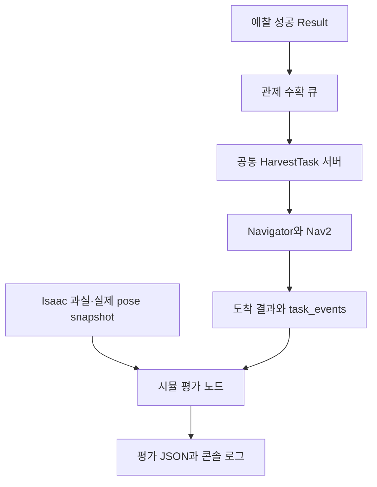

## 2026-10-22 수확 인계 컴포넌트 연결 (별도 수정본)

사용자의 컴포넌트 조합 설계 및 진행 요청을 근거로 구현했다. 상태별 공통값 변경 대신 시작 시 전용 controller/저속 Spin 객체를 구성한다. 관제 window 좌표를 사용하고 기존 TransferMission의 TRANSPORT_CLEAR 이후 복귀한다. 다음 window는 다음 관제 목표로 받는다.

기준 커밋: 4b5c5b13605216d1b8b163ea988805572a6a908a. 대상: harvest_robot 연결/런타임/시험, farm_bringup의 선택적 출력 라우팅, vicpinky 전용 설정, 점검 도구. handoff_config 기본값은 빈 값으로 기존 실행을 유지한다. 시뮬에서는 새 기능 선택을 거부한다. 공통 Navigator/StationReverse 알고리즘은 변경하지 않았다.

직접 검증: 오프라인 64+58개 통과 및 정적 컴파일. 로그: 전달 패키지 component_checks.log, regression_checks.log. 실제 ROS/실물 주행은 미실행이다. 사용자 PC 적용 및 commit/push는 미실행. 실제 장치 서비스와 TF/odom/명령 라우팅 확인이 남았다. 변경 전 파일은 패키지 baseline에 보관하며 적용 도구는 기존 파일 비교 및 백업 후 변경한다. 상세 및 되돌리기: docs/changes/HARVEST_HANDOFF_COMPONENT_INTEGRATION_20261022.md.

# 농작물 수확 로봇 — 현재 상태 인수인계

## 2026-10-21 복귀 단독 시험 보존 및 커밋 준비

기준 PC HEAD: `8df5f8eab87d450c675587b0be38ed85e3866a2e`. 사용자 제공 PC 소스와 로봇 `harvest_align_resume_tgm2zr8q/candidate`를 대조하여 누락된 실행 코드를 보존했다. 이번 변경은 검증 후보를 저장소로 옮기는 작업이며 제어 수치·완료 허용오차를 추가 변경하지 않는다. 커밋은 사용자가 VS Code에서 수행한다.

- 실물 후진 이탈 성공: 위치 오차 4.17mm, 정지 확인 완료. 기록 `1792558359276249505/1792558365404338213_arc.json`.
- 실물 방향 조정 성공: 위치 오차 5.56mm, 방향 오차 0.248도, 입력 시각 오류 없음. 기록 `1792560526521819101/1792560533286982755_arc.json`.
- 충돌 계산을 별도 프로세스로 분리하고 현재 입력과 유효한 기하 조건으로 결과를 검증한다. 계산 시간은 진단값이며 50ms 초과만으로 주행을 차단하지 않는다. 충돌·unknown·센서 단절·속도·정지 검사는 유지한다.
- 전진 복귀는 Nav2 성공 후 정지했으나 최종 방향 오차 1.91도가 기존 1도 기준을 넘어 실패 판정됐다. 위치 오차 1.77mm. 기록 `1792560666951148110/1792560672778478081_arc.json`. 성공으로 바꾸지 않는다.
- 같은 사이클의 벽 정렬은 관측 만료로 실패했다. 이전 벽 정렬 성공과 구분한다. 전체 연속 실물 주행 및 관제 연동 완료가 아니다.
- 다음 작업: 과한 완료 조건 검토와 초기 위치→12번→후진 곡선→벽 정렬→후진 이탈→방향 조정→전진 복귀→14번 연속 실행 연결.
- 이번 패키지 적용은 PC 소스만 변경하며 로봇 설치·이동·Git stage/commit/push는 하지 않는다. 백업은 Downloads에 저장한다.


## 최신 확인 상태 — 2026-10-21 KST

이 절은 아래 과거 기록의 “미반영/미검증/미커밋” 이후 확인된 결과다. 과거 기록은 당시 검증 범위를 남기기 위해 유지한다.

- 코드 커밋: `5d47a230699fa80551aad35cd5875a2fc87318a7`, 브랜치 `feat/harvest-handoff-real-20261018`. GitHub 반영 확인. 코드·설정·테스트·문서 79개이며 로그/빌드/설치 산출물은 해당 커밋에 포함되지 않았다.
- PC: 관련 회귀 26개, 실제 ROS 타입 16개, 독립 설치 및 실제 ROS 모의 FollowPath/파라미터/정지 odom 계약 검사 통과. 기록: `/home/eunbi/Downloads/harvest_preflight_check_zVeZWN`.
- 로봇: 16개 변경 항목 적용, 회귀 26개·ROS 타입 16개 및 독립 ROS 계약 검사 통과. 운영 `install/farm_navigation` 빌드 후 실제 import 파일과 소스 해시 일치 확인. 당시 검사에서는 실제 이동하지 않았다.
- 로봇 배포 기록: `/home/vic/Downloads/harvest_common_robot_TJWw1P`. 배포 전 PC 백업: `/home/eunbi/Downloads/harvest_common_robot_5Tg82O/robot_before.tar.gz` (체크섬 확인).
- 이후 공통 Navigator를 사용하는 벽 접근 실물 실행 성공: `SUCCEEDED`, `navigation.status=ARRIVED`, `accepted=true`, `cleanup_stopped=true`, `ros_cleanup_complete=true`, `baseline_unchanged=true`.
- 실물 기록: `/home/vic/vmany/main/farm_project/runs/wall_alignment/1792515109507469094/result.json`. 계획: `1792515066706348113/result.json` (동일 wall_alignment 폴더).
- 최종 관측 거리 0.4357192517535471m, 목표 0.4325m 대비 +3.219mm (허용 ±5mm). 보정 기준 각도 오차 -0.004926108427052628rad, 약 -0.282° (허용 ±0.5°).
- 최대 전진 명령 0.02m/s, odom 최대 전진속도 0.020808379895475848m/s. 속도 감시 이벤트 없음. 시작 시 TF 과거 시각 조회 실패 1건이 기록됐으며 이후 관측 및 완료 판정은 통과했다. TF 오류가 완전히 제거됐다고 기록하지 않는다.
- 성공 기준 유지: 연속 P·순차 정렬, target_angle=0.04276056667386108rad, 각도 허용오차 0.5°, 최대 전진 0.02m/s. 펄스 미사용. 곡선 충돌 검사·footprint 축소 없음.
- 최신 보존: `/home/eunbi/Downloads/harvest_common_success_dbLWxY`. `pc_source.tar.gz`, `robot_success.tar.gz` 모두 체크섬 확인. PC 소스/미추적 파일/Git diff 및 로봇 소스/설정/대상 설치본/이번 벽 계획·실행 기록 포함.
- 검증 범위: 이번 출력으로 공통 구조 적용 후 벽 접근의 실제 실행을 확인했다. 같은 재시험의 후진 곡선 상세 결과는 이 기록에 제공되지 않았으므로 별도의 신규 성공 수치를 만들지 않는다. 이전 곡선 성공 보존 기록은 유지한다. 물리 외부 측정 각도와 라이다 판정 각도는 구분한다.
- 전체 인계 FSM·팔/배출 연동·윈도우 복귀의 실물 통합 완료를 뜻하지 않는다. 본 갱신은 문서만 변경하며 커밋은 사용자가 VS Code에서 수행한다.


## 실물 인계 차체 회전 시험 준비 — 2026-10-19

- 사용자 승인: behavior_server 최소/최대 회전속도 0.1rad/s, 가속도 1.0rad/s²를 실물 override에 추가. 기존 주행 설정을 참고한 시험 후보이며 실물 Spin 검증 전이다. 같은 behavior_server의 다른 동작에도 영향 가능.
- robot/tools/transfer/spin_trial.py는 공통 farm_navigation.SpinClient를 재사용한다. left +90도와 right -90도는 별도 명령. 팔·배출·전체 인계 미션을 호출하거나 완료를 모의하지 않는다.
- 실제 확인 endpoint /harvest_01/spin 사용. 활성 상태·속도 설정·최근 odom과 1초 정지를 검사한다. 시험 관측용 정지 기준은 0.005m/s, 0.01rad/s, 요청 제한시간 40초다. 운영 인계 허용치로 확정하지 않는다.
- right는 성공한 left 기록과 종료 자세 연속성(5cm,0.1rad)을 검사한다. 실측 회전각/이동량/복원 오차를 기록하며 Action 성공과 정밀도 합격은 구분한다. odom 기반 측정이므로 외부 실측을 대신하지 않는다.
- 도구끼리 중복 실행은 잠금으로 막는다. 공통 미션 소유권을 획득하는 도구는 아니므로 관제·다른 터미널의 이동 요청을 중단한 차체 단독 시험에만 사용한다. 팔은 접힌 상태여야 한다. 오류 시 자기 Spin만 취소하고 정지 확인을 시도한다. Ctrl+C는 물리 비상정지가 아니다.
- 실물 local 0.02m·footprint·지도·태그·통신·수확 프로파일 보존. 시뮬 및 공통 실행 코드 변경 없음.
- 시작 절차 수정: AMCL active 직후 초기 위치를 발행해야 한다. 모든 Nav2 노드 active를 기다린 후 초기 위치를 발행하면 global costmap TF 대기로 시작이 실패할 수 있다. /tmp/init_station_newmap.py 존재 여부를 런치 전에 확인한다.
- 검증: Python 구문/CLI, YAML 차이 확인, 패치 적용 검사. ROS 도구 실행·실물 회전은 아직 미실행. 결과는 후속 기록한다.
- 복원: 추가한 실물 behavior_server override 제거 후 런치 재시작. 공통 기본값으로 되돌아가므로 Spin 시험을 이어서 실행하지 않는다. 사용자 VS Code 커밋 방식 유지.

## 실물 성공 보존 — 2026-10-18 18:56 KST

- 사용자 보존 승인. 실물 local costmap resolution=0.02m를 이번 성공 기준으로 보존한다. 공통 코드·시뮬 설정은 추가 변경하지 않는다.
- 기록: runs/tag_bias_trial/20261018_185412_684309_on, 전달 원본 harvest_resolution002_trial.tar.gz.
- 목표 14번 (3.576, -0.035, yaw=0), graph_test_c7a18b04f61f4de6ababec0a4d547375. 18:55:17 수락 후 18:56:57 SUCCESS / SUCCEEDED / NONE. 코너 통과 후 목표 도착.
- 실제 bag costmap 해상도 0.02m 확인. costmap 419개, published_footprint 1068개 기록. 태그 관측 70회, 보정 요청/적용 각 7회.
- 이전 실패 기록 20261018_183455_478769_on과 비교 가능한 저장 입력은 real nav2.yaml local resolution 0.025→0.02만 다르다. footprint/padding·지도·태그·주행 설정 보존.
- 이번 검증은 공통 코드 기반 실물 주행·태그 보정 1회 성공이다. 반복 안정성·팔 수확·인계 물리 동작 완료로 확대 해석하지 않는다. 이전 코너 실패의 단일 원인이 해상도라고 확정하지 않는다.
- 복구 기준은 이번 백업의 코드와 설정을 대조하여 선택 적용한다. 과거 0.025m 성공본과 통합 전 로봇 전체 백업도 삭제하지 않는다.
- 문서 패치 제공 상태이며 사용자 PC 적용/백업 완료는 출력으로 확인한다. 자동 commit/push 없음. 커밋은 사용자 VS Code에서 진행한다.

## REAL-LOCAL-RESOLUTION-TRIAL-20261018 — 실물 코너 정지 비교 시험

- 사용자 승인: local costmap 0.025→0.02m 시험. 기존 성공값 0.025m를 새 성공값으로 대체 확정한 것은 아니다.
- 대상: robot/config/robots/vicpinky/nav2.yaml의 local resolution만 변경. 공통 정책, global costmap, 지도, footprint/padding, 속도, 태그, CycloneDDS/Zenoh 설정은 유지한다. 시뮬 동작 변경 없음.
- trial.py에는 local costmap/costmap 및 published_footprint 기록만 추가한다. 목표 생성·주행 순서는 유지한다.
- 사용자 제공 결과: 공통 코드 로봇 빌드 10개 패키지 성공, 관제 연결 및 PoseProgressChecker/scan 구독 확인. 18:37 주행은 코너에서 Nav2 106으로 실패했다. launch.log에 collision ahead 기록. 실행 local resolution은 0.025m였으므로 기존 해상도 누락은 아니다.
- 실패 기록: runs/tag_bias_trial/20261018_183455_478769_on. 정지 후 costmap은 실패 순간 자료가 아니므로 원인을 확정하지 않는다.
- 오프라인 검증: 설정 로더 병합·기존 보존 수치·목표 생성 검사, 기록 토픽 추가/파이썬 구문 검사, 패치 적용 검사. 0.02m 실제 주행 결과는 대기.
- 다음: 런치 재시작 후 resolution=0.02 확인, 실제 원래 출발 위치로 복귀한 뒤 올바른 초기 위치 설정, 기존 성공 순서로 Zenoh 연결, 동일 경로 1회 비교. 설정 변경만으로 해결을 보장하지 않는다.
- 복원: local resolution을 0.025로 복구 후 런치 재시작. 기록 토픽은 유지 가능. 커밋은 사용자 VS Code에서 수행하며 원격 반영하지 않았다.

## 현재 실물 적용 준비

- 사용자 승인: 성공 보존본 대조 후 시험 목표 방향과 실물 costmap 센서 연결 수정.
- trial.py 방향 기준 13→12: 10/14 그래프의 실제 12→14 엣지를 사용한다.
- vicpinky Nav2 override의 local voxel/global obstacle scan.topic을 기존 /scan_filtered로 복원한다. 실물 launch가 /harvest_01/scan_filtered로 remap한다.
- 공통 PoseProgressChecker는 유지한다. 지도·태그·속도·footprint·허용치와 시뮬 설정은 변경하지 않는다.
- 정적 검증과 실물 구동은 구분한다. 상세 및 복원: docs/changes/HARVEST_FIELD_PRESERVATION_20261018.md (프로젝트 루트 기준).

> 2026-10-16 팔 없이 즉시 완료 원인: **§67**. 실행 명령이 이전 이동 전용 프로파일을 선택했다. 해당 프로파일을 현행 수확 작업 설정에 연결했으며 이미 실행 중인 서버에는 런치 재시작이 필요하다.

> 2026-10-16 수확105 수정: **§66**. 평평한 바퀴 충돌 단면이 저속 회전을 막는 것을 대조 시험으로 확인하고 둥근 타이어 단면을 적용했다. 보정 상한2rad/s·원래 이득 유지. 실제 Nav2 정렬/이동3개와 Teacher 팔 Action2/2 성공. 전체 농장 연속 수확·실물 검증은 별도다.

> 2026-10-16 수확 액션 연결 확인: **§63**. 기본 수확 액션은 정차 후60Hz Teacher 팔 작업과 실측 결과를 기다린다. 근처 과실 물리를 유지하며 카메라 정책 교체 경계도 명시했다.

> 최신 팔 통합: **2026-10-16, §62**. 60Hz Teacher r2 적용,480Hz 실행 폐기. 주행 사용자 확인은 §61이며 아래 과거 시점의 미구현/480Hz 설명과 구분한다.

> 최신 주행 통합: **2026-10-13, §37**. AprilTag 전달본을 반영했으며 아래 날짜별 절의 인수 대기·미구현 표기는 작성 당시 기록이다. 현재 실행 조건과 이번 검증은 §37 및 연결 문서를 우선 확인한다.

- 작성 기준일: 2026-10-06, Asia/Seoul.
- 저장소: https://github.com/Robot3FinalProject/main
- 기준 브랜치: `main`.
- 확인한 코드 커밋: `068b42eb0ebe54b3b57cffe254a20b2f9e3b202e` (2026-10-06 11:19:12 KST).
- 아래 파일 경로는 모두 저장소 안의 `farm_project/` 기준이다. 사용자 작업 경로는 `~/main/farm_project`다.
- 최초 작성은 위 커밋의 정적 대조·기존 로그 검토였다. 이후 사용자 요청에 따른 로컬 미커밋 과실/오른팔 물리·좌표 구현과 이번 GPU Isaac 시험 결과를 §15에 추가했다. 이전 검토 절의 “미실행”은 해당 작성 단계의 기록이며 최신 적용 상태는 §15와 연결 보고서를 따른다. 실물 로봇 시험은 하지 않았다.
- 2026-10-06 이번 검토에서 `git fetch origin` 성공 후 `HEAD...origin/main`의 앞섬/뒤처짐은 `0/0`이었다. 코드 HEAD와 원격 main은 동일하다. 기존 인계 패키지와 이번 문서 수정은 미커밋·원격 미반영 상태다.

## 1. 프로젝트 목적과 현재 구현 범위

전체 목표는 **예찰 → 수확 → 운송 → 분류**를 관제로 연결하고, 실물과 Isaac Sim에서 공통 로봇 업무 코드를 사용하는 것이다. 현재 대상 작물은 파프리카(bell pepper)다. 9월 10일의 토마토 기획 문서 두 개는 초기 목표·역할 분담의 참고 자료이며, 현재 작물·메시지·실행 상태를 나타내는 문서가 아니다.

사용자 담당은 시뮬 환경·로봇·센서 구현, 합성 비전 데이터 생성, 실물 담당자 소스 통합, 반복 시험 및 Sim-to-Real 비교다. 관제 통신규약과 업무 FSM을 시뮬 파트에서 임의로 재정의하지 않는다.

| 구성 | 확인한 현재 상태 | 완료로 해석하면 안 되는 범위 |
|---|---|---|
| 예찰 | Burger, 상태 기반 `scout_new`, RGB-D/YOLO, 과실 등록·Window 생성, ScoutArea 서버 | 최신 규약으로 전체 예찰·수확 연계가 재검증된 것은 아님 |
| 수확 | 공통 `harvest_robot` 서버·Nav2 이동, 시뮬 정차 후60Hz Teacher 오른팔 수확(§62) | 실물 팔·Student 및 이번 주기 변경 후 전체 Nav2 연계 재검증은 미실행 |
| 수확 물리 기반 | 288개 과실9g·response6·단일 박스 바닥, 물리60Hz/정책20Hz/렌더30Hz 및 실제 파지·적재 GPU 시험(§62) | 독립26/32를 농장 전체/실물 성능으로 인증하지 않음 |
| 수확 평가 | Isaac 과실 정답과 도착 시 작업 박스 안의 개수 비교 | 실제 수확 성공 수량·IK 도달 가능성·충돌 회피 판정이 아님 |
| 운송·분류 | 전체 프로젝트 목표 및 별도 팀 파트 | 이 통합 저장소의 transport/sorting launch는 오류를 내는 미구현 스텁 |
| 관제 | 외부 관제와 공통 인터페이스, 임시 예찰 명령 클라이언트 | `control/scripts/send_scout_area.py`가 수확 큐까지 실행하지는 않음 |
| 실물 연결 | 예찰 프로파일 및 인수한 수확 real 장치·주행·태그 프로파일/bringup | 수확 단일 주행 성공은 담당자 기록이며 이번 PC에서 실물 재검증하지 않음(§37) |

전체 시뮬 실행은 `farm_sim_runtime all.launch.py`다. `farm_bringup all.launch.py`는 미구현 스텁이므로 혼동하지 않는다. 최신 시뮬 실행 절차는 [시뮬 실행·로그 가이드](../sim/docs/RUN_GUIDE_20261006.md)를 사용한다.

## 2. 코드 구조와 수정 경계

| 위치 | 책임 |
|---|---|
| `control/` | 현재는 임시 관제 테스트 클라이언트 등. 외부 관제 프로그램 전체와 동일하지 않음 |
| `robot/ros_ws/src/scout_robot/scout_new/` | 현행 예찰 Node·Mission·Communication·StateController·States |
| `robot/ros_ws/src/scout_robot/scout_robot/` | 예찰 계산·워커·기존 서버 및 호환 코드. 기존 서버와 새 서버 중복 실행 금지 |
| `robot/ros_ws/src/harvest_robot/harvest_robot/` | 공통 수확 Action 서버·계약·이동 미션·상태 제어 |
| `robot/ros_ws/src/farm_navigation/` | 공통 그래프 계획·Nav2 요청·위치 조회·정지 및 도착 확인 |
| `robot/ros_ws/src/farm_interfaces/` | ROS 메시지·액션·서비스 형식 |
| `robot/ros_ws/src/farm_bringup/` | 환경 선택 및 로봇·주행·모니터링 launch |
| `robot/config/`, `robot/models/` | 실물 설정 및 공유 모델. 시뮬 조정을 이유로 임의 변경하지 않음 |
| `sim/ros_ws/src/farm_sim_config/` | 시뮬 지도·그래프·장치·Nav2·비전·예찰 설정 |
| `sim/ros_ws/src/farm_sim_devices/` | 가상 장치, 센서·구동·ROS 연결, scene truth |
| `sim/ros_ws/src/farm_sim_runtime/` | Isaac 단독/다중 로봇 실행, station 배치, 시뮬 launch |
| `sim/ros_ws/src/farm_sim_harvest/` | 수확 평가 노드. 공통 수확 업무 코드를 복제하지 않음 |
| `sim/assets/`, `sim/tools/`, `sim/tests/`, `sim/runs/` | 시뮬 자산·도구·시험·실행 결과 |

`AGENTS.md`와 `sim/AGENTS.md`의 기존 승인 규칙을 따른다. 공통 미션·주행·메시지 변경은 구체적인 변경안과 실물 영향을 제시하고 승인받아야 한다. 최초 인수인계 문서 작성 승인과 이후 §15의 sim 물리·좌표 구현 요청을 구분하며 공통 업무 변경으로 확대하지 않는다.

## 3. 현행 주행·지도·배치

공통 `Navigator`는 선택된 설정에 따라 동작한다. 시뮬 예찰은 **자체 RouteGraph 계획 → Path 생성 → Nav2 FollowPath/RPP → 정지·도착 오차 확인**을 사용한다. 2026-10-13 수확은 같은 graph/FollowPath를 진입·작업·이탈 단계로 연결하고 작업 구간 안의 정방향 중간 출발을 지원한다(§37). 전달 `route_server` 대안도 코드에 있지만 현재 실물/시뮬 프로파일은 graph를 선택한다. Window XY·yaw로 이동한다는 설명이 `NavigateToPose`를 사용한다는 뜻은 아니다.

- 원본: `sim/ros_ws/src/farm_sim_config/config/task.yaml`, `sim/ros_ws/src/farm_sim_config/maps/scout_harvest.geojson`.
- 파생 설정·역할별 그래프 생성: `sim/tools/rebuild_route_data.py`; 검사: `sim/tools/validate_route_data.py`.
- 데이터에서 확인: 8개 물리 베드, 16개 Section, Section당 5개 관측점으로 총 80개 관측점.
- Section은 `SEC01`~`SEC16`; 물리 USD의 `Bed_XX`와 같은 번호라고 가정하지 않는다. 예: `SEC01`의 평가 대상은 `/World/Vegetation/Bed_02`다.
- Segment 예: `SEC01_G01`. 실물의 `SEC_01` 등은 해당 환경 설정의 실제 키를 사용한다. sim/real 이름을 일괄 치환하지 않는다.
- 지도: `sim/ros_ws/src/farm_sim_config/maps/count_test_farm_map.yaml`, map ID `farm_map_v1`, 해상도 0.05 m/pixel, origin 약 `[-8.075, -15.075, 0]`.
- 실물 예찰은 `robot/config/environments/scout_real.yaml`, map ID `many_farm_v1`, `robot/config/maps/many_farm/`를 사용한다. 시뮬 지도와 섞지 않는다.

이번에 GeoJSON 점·엣지로 계산한 **약연결 성분**은 다음과 같다. 방향을 무시한 연결성 확인이며, 모든 방향의 경로·장애물·실제 주행 성공을 검증한 결과는 아니다.

| 그래프 | 노드 | 방향 엣지 항목 | 약연결 성분 |
|---|---:|---:|---:|
| `scout_harvest.geojson` | 227 | 516 | 1 |
| `graph.geojson` (예찰) | 211 | 452 | 1 |
| `harvest_graph.geojson` | 143 | 260 | 1 |

따라서 과거의 ‘16개 비연결 성분’ 설명은 복원 전 기록이다.

| 로봇 | station 노드 | X, Y (m) | yaw (rad) |
|---|---:|---|---:|
| `scout_01` | 8001 | -5.0, 13.25 | -1.5707963267948966 |
| `harvest_01` | 8002 | -2.0, 13.25 | -1.5707963267948966 |

station 원본과 AMCL 초기 pose를 일치시킨다. `station_spawn.json`의 운송·분류 station은 `DESIGN_PROPOSAL`이고 yaw가 null이므로 실행 완료된 로봇 배치로 취급하지 않는다. 수확 자산의 논리 주행 프레임은 자산 축과 180도 차이가 있다(`control_frame_yaw_rad=π`); 박스 좌표·바퀴 부호를 월드 축과 혼동하지 않는다.

## 4. 2026-10-06 관제 통신 계약

정의 원본은 `robot/ros_ws/src/farm_interfaces/`, 반영 배경은 [PROTOCOL-20261006-014](changes/PROTOCOL-20261006-014.md)다. 아래는 확인한 필드이며, 이후 규약 변경 시 실제 `.action`/`.msg`를 다시 확인한다.

### ScoutArea

- Action: `/scout_01/scout_area`, 형식: `farm_interfaces/action/ScoutArea`.
- Goal: `robot_id`, `task_id`, **`section_id` 단일 값**, `map_id`, `frame_id`, `crop_type`, `target_ripeness`, `timestamp`.
- 현재 예찰 서버는 `frame_id=map`, `crop_type=PAPRIKA`, `target_ripeness=RIPE`와 설정의 robot/map/section을 검사한다.
- Result: `robot_id`, `task_id`, `result_code`, `section_id`, `completed_segment_count`, `harvest_task_count`, `total_expected_count`, **`harvest_tasks[]`**, `error_code`, `error_message`, `timestamp`.
- Feedback: `robot_id`, `task_id`, `phase`, `section_id`, `segment_id`, `completed_segment_count`, `segment_expected_count`, `harvest_tasks[]`, `timestamp`.
- 수확 작업 등록은 **성공 Result의 최종 목록** 기준이다. Feedback은 진행 정보이며, `SECTION_COMPLETE`를 작업 큐 등록 신호로 사용하지 않는다.
- 실패·취소 Result는 마지막 저장 성공 시점의 부분 목록을 포함할 수 있다. 보관하되 자동 수확 전송은 보류한다.
- `section_ids[]`, `completed_section_ids`, `completed_section_count`를 현재 ROS 계약에 다시 넣지 않는다. 내부 `survey.json`에 과거 분석 필드가 남는 것은 별개다.

### HarvestTask

공유 `HarvestTask.msg`는 **`task_id`, `window_id`, `goal_pose`, `expected_count` 네 필드**다. `section_id`, `segment_id`, `sequence`는 현재 이 ROS 메시지의 필드가 아니다.

- Action: `/harvest_01/harvest_task`, 형식: `farm_interfaces/action/HarvestTask`.
- Goal: `robot_id`, `map_id`, 중첩 `harvest_task`, `timestamp`.
- Result: `robot_id`, `task_id`, `window_id`, `result_code`, `expected_count`, `harvested_count`, `failed_count`, `error_code`, `error_message`, `timestamp`.
- Feedback: `robot_id`, `task_id`, `success_count`, `failed_count`, `timestamp`. `phase`, `progress_ratio`, `detected_count` 등은 없음.
- `goal_pose`는 `frame_id`, `position{x,y,z}`(m), `yaw`(rad)를 갖는 `RobotPose`다.
- 현재 완료 정책은 `ARRIVAL_ONLY_NO_HARVEST`: 도착·방향·정지를 확인하면 `SUCCESS`, `harvested_count=0`, `failed_count=0`. 요청의 `expected_count`는 유지한다.
- 한 번에 한 작업만 수락하고, 현재 서버 프로세스에서 성공한 같은 `task_id`는 다시 거절한다. 재시작을 넘는 영구 중복 방지를 보장하는 것은 아니다.
- `window_id`는 비어 있지 않은 식별자로 그대로 전달한다. `SEC01_G01_W01`은 명명 예시이며 세션 접두사가 붙은 실제 ID를 잘라내거나 새로 만들지 않는다.

`RobotStatus.msg`, `GetHarvestTasks.srv`의 정의가 존재하는 것과 발행기·서비스 서버의 운영은 다르다. 최신 반영 기록상 예찰·수확 상태 발행기는 별도 구현이 필요하고, 현재 Result 기반 흐름은 GetHarvestTasks를 호출하지 않는다.

## 5. 비전·환경 설정

사용 환경 기준은 Ubuntu 24.04.4, ROS 2 Jazzy, Isaac Sim 5.1.0, RTX 4070 SUPER 12GB다. 사용자 제공 개발환경 기록이며 이번에 설치 환경을 직접 점검한 결과는 아니다.

| 항목 | 현재 파일에서 확인한 값 |
|---|---|
| 시뮬 장면 | `sim/assets/envs/output/farm_with_plants_v5.usd` |
| 시뮬 예찰 모델 | `robot/models/scout/yolo11_seg_2class_synth_and_sim_v2.0.pt` |
| 시뮬 모델 설정 | `sim/ros_ws/src/farm_sim_config/config/scout_vision.json` |
| 시뮬 실시간 예찰 카메라 | `scout_fleet.json`: 640×384, 설정 FPS 15, 공유메모리 `farm_scout_01_rgbd` |
| 시뮬 추론 최대 FPS 설정 | 15.0. 실제 달성 FPS를 확인한 수치는 아님 |
| 실물 카메라 설정 | `robot/config/vision/scout_real.json`: 1280×720, 설정 FPS 6 |
| 실물 모델 설정 | `model_yolo11_seg_ver1.2.pt`, 기존 외부 worker 경로. 시뮬 모델로 자동 교체되지 않음 |
| 데이터셋 생성 설정 | `sim/config/scout_dataset.json`: 1280×720, seed 930, 과실 회전 최대 30도, 후처리 활성화 |
| 수확 카메라 | `harvest.json`에서 disabled; 현재 수확 평가는 카메라 재탐지를 사용하지 않음 |

실시간 영상, 합성 데이터셋, 실물 D435 설정을 같은 해상도·FPS·노이즈 조건으로 설명하지 않는다. 현행 시뮬 추론 설정에는 추가 노이즈/블러를 넣지 않는다고 명시되어 있으며 데이터셋 후처리와 구분한다.

장면 USD는 Git에서 LFS로 관리한다. 이번 로컬 파일은 `PXR-USDC` 헤더의 실제 바이너리 객체이며 크기는 2,795,738 bytes다. 파일 존재·헤더만 확인했고 USD 참조·기하·Isaac 로딩은 검증하지 않았다. 새 PC에서는 포인터 텍스트만 받은 상태인지 확인한다. 이 인수인계 ZIP은 USD·모델 파일을 포함하지 않는다.

## 6. 수확 작업 박스 평가와 로그



위 관제 큐는 연동 계약상 필요한 역할이다. 현재 임시 예찰 클라이언트에 자동 수확 큐가 구현되어 있다는 뜻은 아니다. 정답 snapshot은 평가로만 흐르며 공통 제어·YOLO 입력으로 주입하지 않는다.

- 공통 서버 진단 이벤트: `/harvest_01/task_events`, `std_msgs/String`, RELIABLE/TRANSIENT_LOCAL, depth 100.
- 평가 노드: `sim/ros_ws/src/farm_sim_harvest/farm_sim_harvest/audit_node.py`.
- 평가 설정: `sim/ros_ws/src/farm_sim_config/config/harvest_audit.json`.
- **결과 파일: `sim/runs/harvest_motion/<평가세션>/<task_id>_<event_id>.json`.**
- 정답 snapshot: `sim/runs/runtime/harvest_scene.json`.
- 콘솔: `workspace audit: ...`; 파일 기록 실패는 `시뮬 과실 평가/로그 실패: ...`로 출력.
- 평가 노드는 `farm_sim_runtime harvest.launch.py`가 추가한다. 공통 `farm_bringup harvest.launch.py`만 실행하면 이 평가 노드가 붙지 않는다.

작업 박스는 논리 `base_footprint`에서 중심 `[-0.19, 0.435, 0.828]` m, 크기 `[0.35, 0.10, 0.45]` m다. 빨강·노랑 과실의 월드 AABB 중심을 박스에 포함하는지 검사하고 초록 과실은 별도 제외 개수로 기록한다. 팔의 실제 관절 가동 범위를 계산한 결과가 아니다.

주요 평가 필드: `evaluation.status`, `expected_count`, `actual_in_workspace`, `count_delta`(실제-예상), `repeated_gt_ids`, `matched_fruits`, `ignored_green_count`. `repeated_gt_ids`는 같은 평가 노드와 scene session에서 앞서 센 과실의 재등장이다. 과실을 제거하거나 실제로 수확하지 않는다. 수량 차이만으로 어느 열매가 YOLO 미검출됐는지까지 확정할 수는 없다.

평가 상태는 `OK`, `SKIPPED_NOT_ARRIVED`, `UNAVAILABLE`을 구분한다. snapshot은 기록 후 0.5초 이내, 도착 시각 대비 -0.25~+0.5초 범위여야 한다. 늦은 과거 이벤트 재수신 등으로 평가가 불가능할 수 있다. 평가 실패가 이미 성공한 수확 Action 결과를 바꾸지는 않는다.

다른 로그 위치는 [실행 가이드의 로그 표](../sim/docs/RUN_GUIDE_20261006.md#5-결과와-로그)를 참고한다.

## 7. 검증 상태와 인수 시 주의할 사항

| 항목 | 확인 수준 | 해석 |
|---|---|---|
| 소스·설정·메시지·launch 구성 | 이번 로컬 HEAD와 미커밋 문서 정적 대조 | 현행 코드가 무엇인지 확인한 근거 |
| 그래프 규모·약연결성·관측점 수 | 이번에 JSON/YAML 계산 | 실제 로봇 주행 성공을 뜻하지 않음 |
| 고정 캐스터 마찰 보정 | 10/6 적용 기록 및 사용자 ‘수확 로봇 이동 정상’ 보고 | 이동 불능이 해결됐다는 사용자 확인. 새 통합 주행 시험을 수행한 것은 아님 |
| 예찰 SEC01 성공·작업 8개/예상 12개 | 기존 `sim/runs/scout_survey/c1167c0c9631/survey.json` 열람 | 구형 `section_ids` Goal을 사용한 과거 로그. 최신 단일 Section 계약 E2E 합격 근거로 쓰지 않음 |
| 실물 4·6·8번 주행·최종 예찰 실패 | 10/2 예찰 인수인계 기록 | 팀원의 당시 시험 결과. 이번 직접 검증 아님 |
| 과거 단위/구성 검사 | 개별 변경 문서에 결과 존재 | 해당 변경 당시 기록. 이번에 모든 검사를 재실행한 것은 아님 |
| 최신 규약 colcon·생성 메시지·관제→예찰→수확 | 이번 미실행 | 사용자 환경에서 확인 후 결과 문서 갱신 필요 |

현재 이어서 확인할 항목:

1. 최신 farm_interfaces로 로봇·관제를 모두 재빌드한 뒤 성공 Result 기반 수확 작업 전달 확인.
2. `harvest:=true` 실행에서 수확 이동과 audit JSON 생성 확인. ‘움직인다’와 ‘예상/실제 수량이 일치한다’를 별도 기록.
3. 관제의 RobotStatus 필수 여부와 상태 발행기 구현 범위 조율.
4. 실물 수확 장치·프로파일 인수 및 실물 비전 모델 경로/버전 결정.
5. 서로 다른 Segment의 중복 과실 등록, 위치추정 오차에 따른 Window 누락 재현. 과거 주요 관심 이슈이며 현행 발생률은 미확인.
6. 교통 제어·도킹·운송·분류의 통합 범위 결정. 데이터에 공용 경로가 있다고 교통 제어가 구현된 것은 아님.

## 8. 과거 문서를 읽을 때의 우선 확인

- `docs/SUMMARY_인수인계서.md`는 10/2의 예찰 인수인계로 보존한다. 전체 프로젝트 최신 상태로 단독 사용하지 않는다.
- `docs/RUN_GUIDE_20261002.md`의 일부 스텁 설명과 기본 구역 설명은 변경 전 내용이다. 현행 임시 클라이언트 기본값은 `SEC01`이다.
- 10/2 수확 문서의 구형 Goal 필드 예시보다 10/6의 실제 `.action`/`.msg` 정의를 확인한다.
- 10/6의 일부 과거 패치 문서에도 `harvest:=true` 없는 전체 실행 예시가 있다. 수확 시험은 새 실행 가이드를 사용한다.
- 본 문서도 고정된 기준 커밋의 요약이다. 이후 변경은 [Codex 작업·공유 절차](CODEX_HANDOFF.md)에 따라 갱신한다. 업무 의도와 구현이 충돌하면 [결정 기록](DECISIONS.md)에 차이를 남기고 사용자에게 확인한다.


## 9. 이번 로컬 검토의 Git 상태와 보존 범위

- 검토일: 2026-10-06 KST. Git 루트는 `/home/ysy/main`, 프로젝트는 그 아래 `farm_project/`다.
- 브랜치 `main`, HEAD 및 fetch 후 `origin/main`: `068b42eb0ebe54b3b57cffe254a20b2f9e3b202e`. CODEX_HANDOFF의 기준 코드와 동일하다.
- 원격: `origin`, `https://github.com/Robot3FinalProject/main.git`. `git rev-list --left-right --count HEAD...origin/main` 결과 `0 0`; 커밋 기준 차이가 없다. 작업 트리 문서는 별도다.
- 시작 시 기존 수정: `AGENTS.md`, `README.md`, `sim/docs/CHANGELOG.md`.
- 시작 시 미추적: `docs/CODEX_HANDOFF.md`, `docs/DECISIONS.md`, `docs/HANDOFF_SOURCES_20261006.json`, 이 문서, `sim/docs/RUN_GUIDE_20261006.md`, `backups/codex_handoff_before_20261006_114034.tar.gz`.
- 이번 변경: 기존 상태 문서 내용을 유지하면서 로컬 확인 결과·실행 요약·충돌 근거를 보강하고 `sim/docs/CHANGELOG.md`에 문서 검토를 추가했다. 사용자 요청은 문서 작업만 승인한다. 실행 코드·설정·시험·모델·USD 변경 없음.
- fetch는 원격 추적 정보 조회이며 pull/merge를 수행하지 않았다. commit/push도 수행하지 않았다. 다른 작업자의 문서와 백업을 삭제·이동하지 않았다.

## 10. 현재 코드에 맞춘 실행 요약

아래 명령은 소스와 대조한 실행 절차이며 이번에 실행한 명령이 아니다. 비전용 robot_venv를 활성화하고 Isaac Python 실제 경로를 설정한다. 빌드 도구와 의존성 설치 여부는 이번에 검증하지 않았다.

```bash
cd /home/ysy/main/farm_project
source /opt/ros/jazzy/setup.bash
export FARM_ISAAC_PYTHON="$HOME/isaac/env_isaaclab/bin/python3.11"
export FARM_VISION_PYTHON="$VIRTUAL_ENV/bin/python"
bash scripts/build.sh sim
source scripts/env.sh sim
python robot/ros_ws/src/farm_interfaces/examples/verify_interfaces.py
ros2 launch farm_sim_runtime all.launch.py \
  project_root:="$PWD" isaac_python:="$FARM_ISAAC_PYTHON" \
  vision_python:="$FARM_VISION_PYTHON" harvest:=true device:=0
```

별도 관제 터미널도 동일 인터페이스 install을 source한다. 예찰 요청은 `python control/scripts/send_scout_area.py --section SEC01 SEC02`; 수확 이동 시험은 실행 가이드의 `harvest_smoke_goal.py` 예시를 사용한다. 외부 관제 자동 큐 연결은 이 클라이언트가 제공하지 않는다.

실물 예찰은 ROS 환경에서 `bash scripts/build.sh real`, `source scripts/env.sh real` 후 다음처럼 실행한다. 비전 Python은 실제 D435/worker 환경으로 지정해야 한다.

```bash
ros2 launch farm_bringup scout.launch.py mode:=real project_root:="$PWD" \
  environment_config:=robot/config/environments/scout_real.yaml
ros2 launch farm_bringup rviz.launch.py mode:=real project_root:="$PWD" \
  environment_config:=robot/config/environments/scout_real.yaml
```

두 launch는 각 터미널에서 실행한다. 실물 Nav2 초기 pose는 인계 문서상 수동 지정이 필요하다. 실물 수확 launch 기본 `mode=real, devices=true`는 명시적 미구현 오류다. `devices=false`와 외부 실물 드라이버·실물 환경 설정을 준비하는 경계가 있을 뿐, 저장소에 완성된 실물 수확 프로파일이 있다는 의미는 아니다.

## 11. 기존 실행 산출물에서 확인한 증거

이번에는 로그 파일을 읽었으며 재실행하지 않았다. 로그 파일명·내부 UTC timestamp를 사용하고 파일 수정 시각이나 세션 이름의 사전순을 최신 실행 순서로 해석하지 않는다.

| 산출물 | 기존 결과와 이번 확인 | 한계 |
|---|---|---|
| `sim/runs/scout_survey/c1167c0c9631/survey.json` | SEC01 SUCCESS, 구형 배열 Goal. 작업 수와 예상 합계는 보고서 필드에 저장 | 최신 프로토콜 적용 이후 실행 증거가 아님 |
| `sim/runs/harvest_motion/aa9781127777/`의 JSON | 2026-10-06 09:55:37 KST, SUCCESS, 수확 0, 평가 OK, 예상/실제 1/1, 차이 0 | 단일 이동·박스 평가. 전체 예찰→관제→수확 연동·팔 작업 증거가 아님 |
| `sim/runs/harvest_motion/523dd253fcb4/`의 JSON | 2026-10-06 10:21:28 KST, SUCCESS, 수확 0, 평가 OK, 예상/실제 1/1, 차이 0 | 실행 커밋·생성 인터페이스 버전과의 연결 근거 부족 |
| `sim/runs/harvest_motion/`의 나머지 JSON | 총 8건 중 6건 FAILED/NAVIGATION_FAILED, 평가 SKIPPED_NOT_ARRIVED | 이전 실패 기록 보존. 현재 실패율이나 패치 후 회귀율로 해석하지 않음 |
| `sim/docs/changes/CASTER-FIX-20261006-013-applied.jsonl` | APPLY 기록의 after SHA-256과 현재 수확 USD SHA-256 일치 (`2fcbce1c…f14fa1`) | 패치 적용 파일 식별 확인. PhysX 접촉력·실물 동역학 검증 아님 |

## 12. 오래된 설명과 현재 코드의 차이

| 오래된 문서·설명 | 현재 근거 | 이번 판단 |
|---|---|---|
| `sim/docs/INTEGRATION_REVIEW_20261002.md` §3·§4.2의 128노드/112엣지·16성분, BED ID·FOV 자동 관측·NavigateToPose | `task.yaml`, 3개 GeoJSON, `scout_runtime.yaml`; 변경 이력 SIM-DATA-003/SIM-NAV-005 | 복원 전 기록. 현재 8베드/16Section/80관측점, 역할별 연결 그래프, FollowPath/RPP |
| 같은 검토서 §4.4의 수확 README만 존재·launch 미구현 | `robot/ros_ws/src/harvest_robot/`, `farm_bringup/launch/harvest.launch.py`; HARVEST-COMMON-009 | 공통 수확 이동 서버 구현 완료. real 장치·팔 작업은 미완료 |
| HARVEST-SIM-008의 시뮬 내부 업무 서버 | HARVEST-COMMON-009, `farm_sim_harvest`의 audit/evaluation, 공통 harvest 서버 | 이관 후 책임 분리가 현행. 과거 위치로 복원하지 않음 |
| 인수 검토서 §4.3 및 10/2 인계서의 배열 Goal·SECTION_COMPLETE 작업 전달 | `farm_interfaces/action/ScoutArea.action`, `scout_new/scout_communication.py`, PROTOCOL-014 | 단일 Section Goal·성공 Result 최종 목록 기준. 과거 보고서 내부 배열은 ROS 계약 근거가 아님 |
| 10/2 수확 예시의 Section/Segment/sequence 필드 | `farm_interfaces/msg/HarvestTask.msg`, `harvest_robot/contract.py` | 현재 네 필드만 전달. 수신 Window ID 보존 |
| `farm_bringup/launch/all.launch.py`의 “현재 scout 경로 점검만 지원” 오류 문구 | 해당 launch는 여전히 오류 스텁. 실제 예찰 서버·수확 조합은 별도 launch에 구현 | 이 오류는 공통 all의 미구현을 뜻한다. 프로젝트 전체 기능 설명으로 확대하면 부정확 |
| CASTER-FIX-013·PROTOCOL-014의 `harvest:=true` 없는 all 실행 예시 | `farm_sim_runtime/launch/all.launch.py`: harvest 기본 false | 수확 시험에는 true 명시. 최신 RUN_GUIDE_20261006 사용 |
| 기존 인계 패키지의 “PC 변경 확인 불가·USD 포인터만 확인” | 이번 git status, 로컬 USD 헤더/크기 | 이번 로컬 검토에서는 작업 트리와 실제 바이너리 존재 확인. 과거 검토 제한은 당시 기록으로 보존 |

## 13. 이번 검증과 바로 이어서 할 작업

직접 수행한 확인은 `git status --short`, 브랜치/HEAD/원격 조회, `git fetch origin`, 커밋 차이 계산, 관련 문서·소스 정적 대조, Python 3 표준 라이브러리 GeoJSON 약연결성 계산, YAML 관측점 집계, 기존 JSON 로그 열람, USD 헤더·크기·패치 SHA-256 비교다. 그래프 수치와 관측점 수는 §3과 일치했다. 문서 링크 존재 및 문서 변경 범위를 종료 시 확인한다. 기존 프로토콜 기록의 6개/9개 검사와 이력의 371개 경로 검사는 이번에 재실행하지 않았다.

미실행: colcon 빌드, 생성 메시지/CDR 왕복 검사, ROS 네트워크, Isaac/PhysX, D435, 실물 주행, 최신 규약 전체 E2E. 이번 정적 확인에 별도 런타임 로그는 생성하지 않았다. 과거 로그 위치는 §6·§11에 기록했다.

다음 작업은 최신 동일 인터페이스로 관제와 로봇을 빌드하고, 단일 SEC01 성공 Result의 원본 Task를 수확 서버에 전달하는 통합 시험이다. 코드 SHA·프로파일·모델·ROS_DOMAIN_ID·실행 명령·Goal/Result·survey/audit 로그를 함께 남겨 현행 코드와 결과를 연결한다. 이후 중복 과실/Window 누락 재현, 상태 발행 계약 조율, 실물 수확 장치 인수를 진행한다. 구현 변경이 필요하면 해당 공통 파일·실물 영향·검증안을 제시하고 기존 승인 절차를 따른다.

문서 복원은 기존 내용과 비교해 이번 보강만 되돌린다. 시작 때 있던 미커밋 인계 문서 전체를 HEAD로 reset하면 기존 작업이 없어지므로 사용하지 않는다. 이번 문서와 이력은 commit/push하지 않았으며 원격에는 반영되지 않았다.

## 14. 로봇팔 Teacher 전체 묶음 수령 — 2026-10-06 추가

이 절은 수령 당시 기록이다. 이후 사용자 구현 요청에 따른 현재 적용 상태는 §15를 따른다.

- 사용자 요청으로 `main/robotarm/harvest_teacher_9g.tar.gz`를 검토했다. 자료 전체 수신 후 한 번에 작업하기로 하여 설정만 먼저 적용하는 이전 제안은 보류했다. 운영 sim/공통/실물 코드는 아직 변경하지 않았다.
- 직접 확인: 외부 archive SHA256 일치, manifest 2,148개 파일 해시 일치, Teacher 정책4개+각 run.json 해시 일치, 기존 인계 문서4개와 동일. 실행 소스·로봇/과실/박스·USD/cache·YOLO·환경 정보·과거 평가 원본·실물 참고 도구를 확보했다.
- 검토용 추출: `sim/runs/robotarm/received_20261006_143434/manyfarm_robotarm/`. 소스 기준 `abe9e13357e1be549500712b62c5582649d444ab`와 현재 수정본이며, 10/1 당시 미커밋 소스 전체를 복원한 묶음은 아니다.
- 원본 평가 직접 집계: 빨강 실패2/성공1, 노랑 성공2/실패1. 총3/6 성공이며 실패 플래그는 부적격분리2+분리 후 보유 전 낙하1. 새 수신 PC 물리 실행 결과가 아니다.
- 코드 검토로 실제480Hz/정책20Hz 및 physics step별40ms 분리 누적 확인. 추가 발견: 캐시 경로 치환 시 converter hash 불일치로 받은 USD 재생성 경로, 복귀 물리25ms와 제어50ms 계산 불일치. 통합 전 보완·시험 필요.
- 전달 current USD는 차체/바퀴 고정의 평가용이므로 농장 주행 USD를 통째 교체하지 않는다. 박스 바닥 collision 자산은 확보했지만 기존 캐스터 저마찰 보정과 농장 오른팔 기하 정합을 별도로 유지해야 한다.
- 현 Isaac 주요 버전/commit은 일치, 비전 환경 일부 버전은 다르다. 설치·prepare·변환·새 ROS/PhysX/정책 실행은 하지 않았다. 수확 ActionServer 연결도 아직 없다.
- 상세 대상/증거/후속 작업: [로봇팔 묶음 수령 검토](../sim/docs/ROBOTARM_BUNDLE_RECEIPT_20261006.md). 이번 문서 보강은 미커밋·원격 미반영이며 기존 인계 내용과 구분한다.

## 15. 농장 과실·오른팔 물리 및 수확 이동 좌표 — 2026-10-06

이 절은 최초 적용 기록이다. 현재 운용 주기·과실 활성화는 아래 §18을 따른다.

사용자가 전체 묶음 기반 적용을 요청하고 Teacher 크기 통일을 선택했다. 시작 기준 커밋은 `068b42eb0ebe54b3b57cffe254a20b2f9e3b202e`이며 아래 구현은 이후 §16의 재검증과 커밋·푸시 요청 대상으로 확정됐다. 세부 검증·명령·제약은 [물리 적용 보고서](../sim/docs/ROBOTARM_PHYSICS_20261006.md)를 따른다.

- 농장 288개 과실(3색×96): 기존 위치·회전·색상·ID를 보존하며 폭70mm/높이75mm,9g rigid body·충돌·접촉·줄기 결합/분리 물리를 적용한다. source에서 직접 복제한 줄기 response5의 수치 결과를 대조했다. 새 자산은 `sim/assets/fruit/teacher_9g/`에 있어 받은 runs 폴더가 없어도 동작한다.
- 오른팔6축: 전달 drive gain·토크/속도 한도·HOME, 집게 접촉재질, 박스 바닥4타일을 적용한다. 주행 USD·바퀴·캐스터·왼팔은 교체하지 않는다. 원본 USD 저장 없이 실행 session layer로 구성한다.
- `task.yaml`의16구역을 오른팔 장착점 `[.19,.185,.713]`과 작업중심 `[.19,.500,.838]`에 맞췄다. 예찰 Window에서 생성하는 Goal 및 audit/영상 crop을 함께 동기화한다. 기존 graph의 짧은 연결을 사용하며 노드·엣지는 변경하지 않는다.
- 수확 경로 goal 연결한계9cm, 최종 도착2cm/.05rad, Nav2 내부허용1.5cm/.04rad. 기존보다 주행방향−38cm·베드 반대방향−6.5cm 목표가 바뀌므로 이전 위치 도착으로 성공 처리하지 않는다.
- `robotarm_physics.json`을 단독/통합 Isaac 실행에 연결했다.480Hz마다 외력을 갱신하고60Hz 렌더를 별도 수행한다. 정책 기준20Hz는 명세이며 정책 실행을 활성화하지 않는다. 예찰 단독 scene에 수확 로봇이 있으면 동일 물리/HOME를 적용하고, 없는 로봇을 단독 실행에서 추가하지 않는다.
- ROS 공통 업무는 여전히 이동 완료 후 수확0개를 반환한다(D-006). 학습 정책 추론·현장 재탐지·실제 파지/박스 적재·공통 FSM 변경은 아직 적용하지 않았다. 원본 평가3/6은 받은 과거 결과다.
- 검증: 관련 오프라인 검사, USD 정적 검사,371개 경로와48개 새 Goal 연결 검사, sim 패키지3개 빌드 및 GPU Isaac 물리 검증을 수행했다. 최종 수치·실행 로그는 연결된 보고서에 기록한다. 실제 Nav2 정밀 정지·전체 예찰→수확 E2E·학습정책 적재와 실물 시험은 미실행이다.
- 실행 로그: `sim/runs/robotarm/physics_smoke_gpu_20261006/`, 실제 실행별 설정/분리 기록은 `sim/runs/robotarm/physics/<session>/`. 중간 실패와 최종 결과를 구분한다. 원격 commit/push는 하지 않았다.

## 16. 로봇팔 물리 재검증 및 게시 요청 — 2026-10-06

- 사용자가 테스트 후 커밋·푸시를 요청했다. 이번 sim 구현·설정·필수 자산·관련 기록을 대상으로 하며 공통 `robot/`, `control/`, `scripts/` 실행 코드는 변경하지 않았다. 시작 시 별도로 있던 AGENTS/README 등 문서 변경과 수신 archive·백업은 보존한다.
- 새 분리 진단은 원시 인장력과 clamp 후 힘, 힘/후크/최대변위 분리 조건을 구분한다. 물성·힘 한도·분리 규칙은 그대로다. GUI 검사 도구는 선택 과실을 바라보고0.1N 유지와3N 분리를 자동 검증한다.
- 직접 확인: 단위·USD62개(skip0),371경로,sim3패키지 빌드. GPU에서288과실2초 유지,0.1N·1초 및 회복0.5초 유지,3N으로41.667ms 지속 후 분리·0.90448m 낙하.15개 check와 종료코드0 확인.
- 주의할 실제 동작: 같은 과실은0.5N에서도25mm 후크 조건으로 분리됐다. 개별 힘 한도2.3901N 아래에서도 거리 조건이 작동한다. “2~3N 미만에서 무조건 유지”하는 모델이 아니다. 외력 두 호출이 합산되는 것도 별도GPU 검사로 확인했다.
- 적용한 것은35g 원 학습 체크포인트에 대해 전달된9g **평가 환경**의 물성·수식이며, 정책 추론은 아직 실행하지 않는다. 새Nav2 주행·정밀 도착·그리퍼 실제 수확·실물 시험은 후속 범위다.
- [직접 확인 명령과 상세 결과](../sim/docs/ROBOTARM_PHYSICS_20261006.md#10-인장력-확인-방법과-커밋-전-재검증), [버전 관리 검증 요약](../sim/docs/changes/ROBOTARM_PHYSICS_VALIDATION_20261006.json). 원본 로그는 `sim/runs/robotarm/precommit_20261006/`다.
- 이 기록이 포함된 구현 커밋과 `origin/main`의 일치 여부로 게시 상태를 확인한다. 문서 자신의 미래 커밋 SHA는 기재하지 않는다.


## 17. GUI 검사 자동 종료와 프레임 저하 분석 — 2026-10-06

- 기준코드`1666a23bf47dc7f0e8a6f2dfafbc1d41e190f6cd`. 사용자가 만든 `manual_physics_check.json`은15개 검사 모두 통과했다. GUI 검사기는 정해진 검사 후 결과를 저장하고 창을 닫도록 설계되어 있다.
- 이번 PC GUI 직접 계측:현재288동적 과실480Hz8.30FPS, 추가 상태 진단 생략8.27FPS, 과실 고정 대조군480Hz22.22FPS/60Hz89.52FPS. 준비30/측정120프레임의 정지 구간이며 fleet/정책 실행 성능이 아니다.60Hz 대조군은 초기 reset 때문에 카메라높이8.05mm 차이가 있다.
- 현재 조건의 frame120.44ms 중 물리실행/결과동기화100.63ms(83.5%)가 주 병목이다. 실제CPU PhysX/NumPy이며 GPUDynamicsfalse, GPU평균11.9%. 전역60→480Hz와288개 동적 과실을 함께 고려해야 한다.
- runtime sceneCCD=true 확인으로 기존 false 설명을 정정했다. Teacher의 sceneCCDfalse와 차이가 있으며 전체 물리 환경 완전 동등 재현으로 보지 않는다. 이번 분석은 실행 설정이나 물성을 바꾸지 않았다.
- [상세 조건·한계·후속 개선](../sim/docs/ROBOTARM_PHYSICS_20261006.md#11-gui-자동-종료와-프레임-저하-실측--2026-10-06). 원본 성능 자료는 ignored `sim/runs/robotarm/perf_20261006/`에 있다. 운영/공통/실물 코드 변경 없음. 이번 분석 문서 갱신은 미커밋·원격 미반영이다.

## 18. 동적 물리 주기·수확 주변 과실 활성화 — 2026-10-06

- 사용자 “물리주기도 동적으로 … 수확중 수확로봇 인근 …” 승인에 따라 sim 실행/장치/설정만 변경했다. 기준 main/1666a23bf47dc7f0e8a6f2dfafbc1d41e190f6cd 이후 미커밋. 공통 업무·실물·원본 USD는 보존했다.
- 유휴60Hz, 수확 활동 중480Hz. 실제 오른팔 장착점 반경0.8m(유지1.0m)의 과실만 동적/줄기 계산한다. 여러 활동은 합집합이며 한 로봇 종료가 다른 로봇 활동을 끄지 않는다. 분리 과실은 영역 밖이어도 동적 유지,0.6초 정지 후 저주기 복귀한다. 박스 성공 판정/상대 고정은 미구현이다.
- 프레임60Hz와 내부 물리1~8tick을 분리해 시뮬 시간 연속성, clock60/상태30/라이다10/RGB-D15Hz를 유지한다. 같은 PhysicsScene에서는 고주기가 전역 적용되므로 다른 로봇의 계산 부하·수치 응답까지 독립되는 것은 아니다.
- 현재 실제 팔 FSM이 없으므로 이동 SUCCESS를 수확 활동으로 추정하지 않는다. 내부 set_activity API와 `/harvest_01/sim/harvest_activity` Bool heartbeat를 제공했다. 실제 정책 시작/종료 연결은 후속이다.
- 직접 검증: 단위/USD107개(skip0), sim3패키지 빌드, 실제 ROS bridge13항목 통과. GPU 선택 활성19항목 및 기존 전체288개 기준물리15항목 통과. 3개 활성 상태에서3N 분리/41.667ms 누적/0.20714m 하강 후60Hz 복귀, 비활성 과실·앵커·원본 USD 보존.
- 실제 예찰+수확 fleet6초에서60→480→60Hz/360프레임/1,200tick, 상태로봇별180개/RGB-D89개/시각 대응 정상. 고정60Hz 대조군은360tick이며 동일 센서 수를 확인했다. **동일0.08m/s 주행 명령에서 실제 월드 최종 위치가 약2.6cm 달랐다.** 고주기에서 바퀴 속도 응답이 달라지므로 동시 주행 무영향으로 보지 않는다. Nav2 폐루프 도착 오차·정책 성능·다수 수확로봇 GPU·운송로봇·실물 시험은 미실행이다.
- [구현·명령·검증 한계](../sim/docs/ADAPTIVE_HARVEST_PHYSICS_20261006.md), [버전 관리 검증 요약](../sim/docs/changes/ADAPTIVE_PHYSICS_VALIDATION_20261006.json). 원본 로그 `sim/runs/robotarm/adaptive_20261006/`. 다음은 동시 Nav2 주행 평가와 정책 연결 후60/120/240/480Hz 수확 성능 비교다. 독립 시험 세트별 주기가 필요하면 별도 Isaac 인스턴스로 분리한다.
- 문서/설정/구현은 로컬에 적용하고 sim 설치 패키지를 빌드했다. 이번 변경은 커밋·푸시하지 않았다. 기존 AGENTS/README·인수 자료·백업은 보존했다.

## 19. 도착 후 Teacher 순차 수확 적용 검토 — 2026-10-06

- 사용자 요청: 도착/정지 후 주변 과실을 활성화하고 Teacher에 좌표를 제공, 과실별 실제 안착/낙하 Feedback, 대상 처리 후 Result. 추가 확정은 현재 정차 위치의 빨강·노랑 각1회, 일반 실패 후 다음 대상, 녹색·차체 추가 이동 제외다. sim Teacher 정답 입력은 명시 승인 범위이며 공통 비전/실물에 확대하지 않는다.
- 개발에 필요한 정책·run.json·소스는 확보했다. 이번 직접 CPU 검사에서4개 hash/run hash 일치, 공식ActorCritic strict load·정규화 복원·82차원 합성입력→6차원 유한/결정적출력 확인. 현재 torch2.7.0+cu128/rsl-rl-lib3.1.2/isaaclab0.54.2다. 새 GPU 정책수확·학습을 실행한 것은 아니다.
- 전달 Teacher는 좌표 외 관절/TCP/접촉/분리/보유/박스 상태가 필요하다. 원본은 새 scene/physics step을 소유하고 첫 실패에서batch중단·다음assign거절·미수집분리과실복귀거절이 있어 현 농장World에 그대로 연결할 수 없다.82차원 관측/접촉,20Hz관절출력,실제안착,실패후물리복귀 어댑터가 필요하다.
- 정적FK에서 팔/박스는 강체좌표변환으로 일치한다. 반면 농장 root최소간격132.77mm,18cm미만34쌍/66개, 기울기중앙23.76°/최대41.17°로 전달검증배치와 다르다.0.8m물리반경은도달인증이아니다. 오프라인174정지후보/288root 중 연속근거리조건통과는고유53개(빨강18/노랑20/녹색15)이며실제Nav2/수확성공개수가아니다.
- [구현 검토·추가 확인 요청안](../sim/docs/TEACHER_HARVEST_INTEGRATION_REVIEW_20261006.md), [공통 파일·내부 타입 구체안](../sim/docs/proposals/HARVEST_ARM_COMMON_CONTRACT_20261006.md). 외부HarvestTask필드는유지하고공통Window실행기·후보조회/PickFruit를추가하는안과부분실패Result의미는사용자확인대기다. 공통소스/새타입등록/운영팔제어는아직변경하지않았다.
- 검토산출물은 `sim/runs/robotarm/policy_integration_review_20261006/`, 버전관리요약은 `sim/docs/changes/TEACHER_INTEGRATION_REVIEW_20261006.json`. 기존 미커밋 동적물리/사용자문서/원본묶음은보존했다. 이번검토문서도커밋·푸시하지않았다.


## 20. 시뮬 Teacher 실행과 공통 도착 후 대기 연결 — 2026-10-06

- 최신 사용자 확인은 “대부분은 sim 전용, 공통은 도착하자마자 result를 내는 부분을 sim 팔에 연결”하는 좁은 범위다(D-017). §19의 공통 후보조회/PickFruit/Window 실행기 제안은 채택하지 않았다. 외부 HarvestTask와 farm_interfaces는 유지한다. 공통 harvest_robot5개 파일은 이동/정지 후 내부 Action 요청·피드백·결과·취소 전달만 담당한다.
- sim에 실제 PhysX pose/접촉 측정,82D Teacher 상태, 전달4정책+run/hash,20Hz 관절 명령, 지역 물리 활성화, 현재 정차 빨강/노랑 각1회, 실제 복귀·안착 판정·누적 결과를 연결했다. 원본World를 중복 생성하거나 과실/관절 reset으로 성공을 만들지 않는다. `harvest_task.json`은 ARRIVAL_THEN_ARM, 장치 harvest_arm은 enabled다.
- **연결 구현과 수확 성능을 구분한다. 현재 실제 농장 과실3개 시험에서 적재 성공은0개다.** yellow1개 ENTRY시간 초과, red2개 bad_detach/낙하 후 실제 복귀·실패1 반환. 후보 전체 처리의 SUCCESS가 수확 성공을 의미하지 않는다. 최종 smoke는 정책 실행·후보ID·로그/수량·정지·프로세스 code0 정합을 통과했다. 실제 정책10회 후 취소 시험도 정지확인CANCELED/수량0/0/code0로 통과했다. --require-harvest 성공 기준은 미달이다.
- 직접 검증: 단위/USD178개 중176통과/실ROS2개skip, 실제ROS/UDP 별도2개통과, 공통1+sim3패키지 빌드. Teacher36개에는 실제4정책CPU·물리관측/state17+policy9+device10이 포함된다. 원본vendor5해시/kernel7AST일치. actual401샘플 원본FK 최대.2921mm/.052412°,400정책sample CPU재생 stage/status차이0.
- 원본 identity 과실배치와 농장 pose/연속위치·이웃·이동차체가 다르다. 큰좌표변환 오류근거는 찾지 못했지만 실패의 단독원인을 확정하거나 정책이 농장환경에 검증됐다고 보지 않는다. 다음은 원본/농장 조건 비교와 실제안착성능 확보, 그뒤 최신예찰/Nav2 포함E2E다. 실물·카메라모델·새학습·다수수확로봇·바구니상대고정은 미실행이다.
- [구현·실행·중간실패 및 최종검증](../sim/docs/TEACHER_HARVEST_RUNTIME_20261006.md), [공통변경 상세](changes/HARVEST_ARM_HOOK_20261006.md), [담당자 검토요청안](../sim/docs/TEACHER_FARM_EVALUATION_REQUEST_20261006.md). 원본로그 sim/runs/robotarm/teacher_integration_20261006 및 teacher/<session>/<job>. 요청안은 실제 전송하지 않았다.
- 기준main/1666a23 이후 미커밋·원격미반영. 기존 사용자AGENTS/README/인수문서/백업/원본묶음은 보존했다. 원본농장USD SHA256은1d9887539611d65ec9c284a810bcd0b8015493db0158147c7188b414f95395e7로 유지된다.

## 21. 임시 시뮬 관제 CLI — 2026-10-07

- 사용자 요청으로 `sim/tools/temporary_control.py` 추가. launch와 별도로 켜서 Section 입력→예찰 성공 Result→수확 작업 순차 요청→최종 수량까지 출력한다. 기존 관제/공통/실물 코드는 수정하지 않았다.
- 원본 작업 ID·Window ID·목표·예상 수량 보존. 예찰 실패/취소 부분 목록 제외, 수확 FAILED/CANCELED 시 큐 중단, Ctrl+C 자기 작업 취소와 종료 대기. 정지 미확인 시 추가 요청 차단. 로그 `sim/runs/temporary_control/*.jsonl`.
- 직접 검사: ROS 메시지 기반 단위검사6개 및 CLI 로딩. 실제 Action 네트워크/Isaac/Nav2 통합 사이클은 미실행. §20의 적재0/3 및 Window와 Teacher 근거리 조건 차이는 그대로다.
- 실행: [시뮬 가이드 §7](../sim/docs/RUN_GUIDE_20261006.md#7-임시-시뮬-관제로-한-사이클-실행--2026-10-07). 기준1666a23 이후 미커밋, 원격 미반영. 임시 파일은 운영 launch에 등록하지 않아 추후 삭제 가능하다.

## 22. RViz FollowPath 추종 표시 — 2026-10-07

- sim RViz3종에 `/scout_01/received_global_plan`(초록), `/harvest_01/received_global_plan`(주황)을 해당 로봇별로 추가했다. GeoJSON 기반 FollowPath를 처리하는 RPP의 변환/가지치기 구간이며 전체 Goal Path 보존 표시는 아니다. 기존 planner plan은 비활성화, route marker는 유지.
- 설치된 RPP 토픽 이름과 YAML 설정 확인. 실제 화면/이동 시험 미실행. RViz 설정 재로드로 적용, 로봇/Isaac 재시작 불필요. 공통 소스·주행 설정 변경 없음. 미커밋·원격 미반영.

## 23. 수확 베드 접근 경로 불일치 — 2026-10-07

- 현재16개Section 정차선은 기존 harvest graph보다60mm 옆에 있다. 실제SEC01 첫수확6로그에서 마지막60mm 구간/목표 yaw가90도 차이남을 확인. 재요청24.512m 우회도 실제 계획 기록이다.
- [구체 수정안](../sim/docs/proposals/HARVEST_PARALLEL_APPROACH_20261007.md): 오른팔 기준 sim 수확 주행선 정렬 + 공통 선택적 진입/방향 검사·이미 도착 재측정. AGENTS 공통 사전 승인 대기. 실행 코드는 아직 변경하지 않았으며 모든 abort 원인을 확정한 것은 아니다.
- 분석 sim/runs/navigation_review_20261007/geometry.json. 실제 신규 주행 미검증, 미커밋·원격 미반영.

## 24. 수확 평행 접근 승인·적용 — 2026-10-07

- §23 제안에 사용자 “수정해” 승인. sim 수확 주행선을 오른팔 정차선으로 정렬하고 공통 farm_navigation 선택 기능을 sim harvest에서만 활성화. 진입 정렬→평행 주행, 다른 구간 전 정방향 이탈, 이미 도착 재측정. 좁은 구간 자세 불량/지나친 목표는 복구 필요로 중단.
- 신규7검사·371경로 연결·farm_navigation build PASS. 기존 예찰도착검사9PASS/1구형fixture ERROR. 실제 새 Isaac 주행과 진입 회전 공간은 미검증. 운용 launch 재시작 후 station 출발 첫 Goal 재전송이 다음 확인이다.
- [구현/검증/한계](changes/HARVEST_PARALLEL_APPROACH_20261007.md). 기존 정책 적재성능 문제와 별개. 미커밋·원격 미반영.

## 25. 수확 진입 회전·제동 보정 — 2026-10-07

- 사용자 “해결해”에 따라 sim 수확 바퀴에 encoder 속도PI·제동 적용. 저속정렬0.06rad/s, 각가속0.1, Nav2 yaw gate0.01, 최종 허용0.05 유지. 공통/실물/원본USD 변경 없음. 기존 평행접근은 유지.
- 실제 Isaac 양방향 목표각도 후정지 오차0.00510/0.00932rad PASS,code0. servo4+평행7검사 및371경로/3패키지build PASS. Nav2 진입 전체·관제E2E·480Hz 동시주행은 아직 미검증. [상세](../sim/docs/HARVEST_BRAKING_20261007.md).
- 시험 도구는 UDP/카메라/평가 snapshot까지 격리했다. 중간 공유 snapshot 충돌 및 실패 비교 결과는 최종PASS와 구분한다. 현재 작업폴더에 적용·빌드 완료, 운영 all launch 재시작 필요. 미커밋·원격 미반영.

## 26. 실제 Nav2 코너 회전 시작 실패 — 2026-10-07

- 사용자18:06 Nav2 ABORTED는 Failed to make progress. 실제구동기록에서첫코너전(-1.998,11.838)근처 제자리, 각명령약±.005rad/s 반복 확인. §25 고정속도시험은 Nav2가속제한 피드백을 검증하지 못했다.
- sim RPP.max_angular_accel을.10→1.2로수정, 정렬속도.06유지. 런타임 param set가능. 설정/371경로검사 PASS. 실제 Nav2 재시험은 미실행. 미커밋·원격미반영.

## 27. 480Hz 수확 시험 GUI — 2026-10-08

- 사용자 요청으로 `python3 sim/tools/harvest_test_ui.py` 독립 GUI 추가. `Place robot`은 기존 정차선·팔 근거리·바닥 footprint를 만족하는 빨강/노랑 과실 위치로 시험 배치, `Harvest (480 Hz)`는 실제 정지/HOME 후 기존 Teacher를 실행한다. 주기·활성 과실·적재/실패 표시와 중지 버튼 제공. [실행·제한·기록](../sim/docs/HARVEST_TEST_UI_20261008.md).
- 기준 main/7d9ae40ec8e0d0bebf0e0552f8a6ee85ddfc9bc3 이후 미커밋. 초기 작업폴더 clean. sim 도구/런타임/UI·읽기 전용 API/시험·문서만 수정. 원본USD/정책/공통/실물/운영설정 변경 없음. ROS/colcon 불필요. 포트·snapshot 독립 및 외부 UDP 명령 차단.
- 직접 검사75개 PASS(skip0). 실제 Isaac5.1 GUI seed713 SEC10의 정책400회/주변5개/480Hz·실제복귀·정지/60Hz 복귀/종료0 확인. **실제 적재0/실패1(target_timeout)**이며 성능 개선으로 해석하지 않는다. 최종 창에서 팔/과실/바구니와 영문 패널을 시각 확인했고 GUI를 열어 두었다.
- 실제 통합·화면 증거 `sim/runs/harvest_test_ui/validation_20261008/`. 다양한 위치의 수확 성공률·Nav2 주행·사용자 수동 클릭·동시운영은 이번 미검증. 배치는 주행 성공이나 IK/모든 장애물 회피 보장이 아니다. 다음은 UI 관찰 및 기존 Teacher 농장 적재 성능 개선이다.
- 문서 갱신 완료, 커밋·푸시/원격 재조회 미실행.

## 28. 과실 충돌·중력 시각화 — 2026-10-08

- 사용자 후속 요청으로 공식 PhysX GUI 메뉴(Show By Type > Physics > Colliders)를 활성화하고 시험 UI에 충돌 표시·Physics only 관찰·선택 과실 상태/힘/접촉력 패널을 추가했다. [확인법과 모델 설명](../sim/docs/HARVEST_PHYSICS_INSPECTION_20261008.md).
- 현재 줄기는 connector native joint가 아니라 world 앵커 spring + 최초 랜덤 자세 복원 토크다. 대기중부착과실은고정. 이 모델에서는 중력이 켜져도 완전히 수직으로 돌아가지 않는다. 줄기 물성·원본USD·Teacher는 변경하지 않았다.
- 실제 팔 없는8초관찰: 선택9g 과실이10.788mm 하강/8.360°회전, mgZ -0.088290N과 줄기Fz +0.088290N 평형. 480Hz·주변5개, collider1/1, 안정후60Hz/0활성, 종료0. GUI 표시확인 및98PASS/1USDskip. 모든 접촉형상·파지성능을 보장하는 검증은 아니다.
- 로그 sim/runs/harvest_test_ui/physics_inspection_20261008. 기존 사용자창 보존, 최종 새진단창 열어둠. 7d9ae40 이후 미커밋·원격 미반영. 다음은 Harvest 중 두손가락 접촉/형상 대조와 필요 시 실제 connector 줄기 모델 설계다.

## 29. 로봇암팀 진단 회신 자료 — 2026-10-08

- 사용자 제공 `main/robotarm/SIM_TEAM_TEACHER_DIAGNOSTIC_REQUEST_KR.md`에 맞춰 전달본/모델해시·환경·독립재현·농장실패 연속로그를 확보했다. [회신 본문·실행·한계](../sim/docs/TEACHER_DIAGNOSTIC_REPLY_20261008.md), 산출물 `sim/runs/robotarm/receiver_diagnostic_20261008/TEACHER_DIAGNOSTIC_REPLY_20261008.tar.gz`.
- 새해제본2148개검증, 전달4정책/run.json불변. 실제독립480Hz/20Hz red182/yellow183각5회: 적재7/10. 송신10개trace1069tick와SHA256까지일치. 영상/YOLO제외진단이며원본카메라경로E2E가아니다.
- farm opt-in `--teacher-diagnostic-trace`로82D3종/실제rawaction·최종명령·PhysXtarget·dt/접촉/과실·초기~복귀/정지·USD/PhysX값추가. 제어/정책/물성은불변. headless노랑400tick timeout/빨강42tick bad_detach, 실제적재0/2, 복귀·정지및종료0. 60+2개검사PASS.
- 빨강에는양손물리접촉이있지만0.25초파지확인전총변위이탈(46.790mm/41.667ms)로분리됐다. 노랑은접근실패. farm자기충돌false/solver32·1과전달true/12·4, 초기랜덤과실자세·주행차체차이를회신검토항목으로기록했으며단독원인확정/보정은하지않았다.
- 이번GUI2회는World초기render에서nativeSIGSEGV로정책시작전종료, 별도실행오류로그보존. 이번viewport영상·동일초기조건farm대조·Nav2/실물은미실행. 이전§27/28GUI통과기록을이번재현으로표시하지않는다.
- 기존미커밋변경과robotarm원본보존. 문서/회신묶음작성, 발송·커밋·푸시·원격재조회없음. 다음은담당자에게묶음을전달하고동일초기조건의관측→명령→접촉비교조건을확정하는일이다.

## 30. AprilTag 배치·수확 카메라 — 2026-10-08

- 사용자 요청으로8개bed·16면에15개씩240개 태그를 sim 런타임에 배치했다. 사용자 확정: **각 면ID100~114 반복, `(section_id, tag_id)`로 식별**. 활성 구간 없는 ID 단독 map 보정은 허용하지 않는 인수 조건이다. 검은경계50mm/피치564mm/중심높이264mm, 종이64×69mm/중심높이261.5mm. [적용·검증·실행](../sim/docs/APRILTAG_INTEGRATION_20261008.md).
- 수확 URDF optical 링크 및 USD 런타임 카메라 추가. 논리 주행축↔자산축 yawπ를 반영해 실제 왼쪽을 본다. PCWEB400 추정 장착값/K/D,1280×720·10Hz 설정. 기존 sim bringup에서 `/harvest_01/apriltag_camera/image_raw`와 `camera_info` 연결. 예찰 카메라 장착값·공통/실물 소스·주행 경로는 유지했다.
- 19개 검사/실제USD240개·16벽/3패키지build/371경로 검사 PASS. 실제Isaac 정차 렌더ID104 검출 및RGB공유메모리 전달/K/D 확인. Kit 종료는120초timeout(code124), 결과 저장/검출 성공과 정상 종료를 구분한다. 최종 반복ID 배치의USD검사는 재실행했고 SEC01의 검증 영상은 동일하다. 로그 `sim/runs/apriltag_20261008/`.
- 로컬 인수본에서 태그 검출·공용 주행 보정 코드가 발견되지 않았다. [담당자 요청서](../sim/docs/APRILTAG_NAVIGATION_REQUEST_20261008.md) 작성, 외부 발송 없음. 실제DDS영상수신/연속주기·주행보정·실물USB는 미검증/인수대기. 실물harvest 장치bringup도 기존 미구현 상태다.
- 기준 main/450bf5f + 기존미커밋보존. 이번변경 미커밋·원격미반영, 원격재조회없음.

## 31. 농장 파프리카 랜덤 기울기 제거 — 2026-10-08

- 사용자 요청으로 기존 `sim/tools/randomize_pepper_rotation.py`를 실제Isaac에서적용했다. `sim/config/scout_dataset.json`의 최대각30→0°, seed734유지. 원본맵자동백업후저장.
- 288개추가XYZ회전=0, 실제world-Z기울기모두0°, 위치/원래회전연산/ID보존. 원래yaw는유지하며Teacher의identity과실과모든자세가완전히같은것은아니다. 전기울기는0.964~41.171°.
- 실행/전후검증 `sim/runs/pepper_rotation_zero_20261008/result.json`, 백업 `sim/assets/envs/output/farm_with_plants_v5.usd.before_rotation_20261008_142400_041527`. 기존켜진시뮬은재로드전까지이전배치이며새실행은0도맵사용. 수확성능개선은별도재시험필요. 실물/공통/정책/물성변경·커밋·푸시없음.

- 0도맵 별도UI 시작은기존초기화SIGSEGV(-11)로종료했다(`gui_result.json`). 현재열린운영창에는소급반영되지않으므로재시작필요. 맵파일저장/288개0도검증은완료·종료0이다.

## 32. 수확 시험 UI 시작 오류 수정 — 2026-10-08

- `python3 sim/tools/harvest_test_ui.py` 시작 종료를 수정했다. PhysX 충돌 메뉴 확장을 World/장치 초기화 후 활성화하고, layers 확장이 바꾸는 USD edit target을 원래 session으로 복원한다. 이전 native 초기 render 종료 및 뒤이어 확인된60Hz 요청/480Hz 실제값 불일치를 해결했다.
- 실제GUI3초/180tick 및14초/4200tick 정상종료0,60→480→60Hz·주변5과실 활성/해제 확인. 새 일반 시험창 실행 및 화면 확인 완료. 관련39개 검사PASS. 별도 경로 기하48개 subtest 실패는 남아 있으며 run_sim 실제GUI/수확성공률은 이번 미검증.
- 로그·화면·수정파일묶음 `sim/runs/harvest_ui_startup_fix_20261008/`. 0도맵/정책/물성/공통/실물 변경 없음. main/450bf5f 이후 미커밋 보존, 문서 갱신·커밋/푸시 없음. 다음은 열린 UI에서 배치·수확 비교 시험이다.


## 33. 학습 오른팔 충돌·물성 정렬 — 2026-10-08

- 사용자 지적으로 이전 검증에서 convexHull/convexDecomposition 차이를 놓친 것을 확인하고, 전달 current_robot을 기준으로 수정했다. [세부 항목·실행 결과](../sim/docs/HARVEST_PHYSICS_INSPECTION_20261008.md)의 추가 정정 절 참고.
- 전달 메시15개/여섯 몸체 질량·COM·관성, 집게카메라0.180kg 합성, 자기충돌true/solver12·4, GPU/TGS 접촉설정/재질, 팔 접촉센서4링크를 적용. 원본USD 대신 세션override, 런타임 기준자산은 sim/assets에 고정SHA256으로 보관. 차체/왼팔·바퀴 구동 구조와 정책/성공 기준 유지.
- 실제 독립·농장USD/PhysX115항목 일치, 단위·USD56PASS, GUI 대기/480Hz/60Hz복귀·종료0. 수확은 seed713 SEC10 노랑0/1, arm_collision 후 복귀2.779N접촉 안전정지. 물성정렬과 수확성공을 구분한다. 최종 배치·물리 관찰 GUI 열어둠.
- 학습 고정베이스와 농장 이동차체/장애물/과실배치 차이는 남는다. 로그/전달묶음 sim/runs/arm_physics_alignment_20261008. 다음은 실패시 팔 자기접촉과 학습 관측/과실자세 차이를 통제 비교하는 일이다. main/450bf5f 이후 미커밋·문서갱신, 커밋·푸시·외부발송 없음.


## 34. 과실 물리 위치와 화면 표시 불일치 수정 — 2026-10-08

- 사용자 “화면의 과실은 초기 위치인데 로그는 적재 성공” 관찰을 재현했다. custom matrix xform 고정 상태에서 PhysX pose만 움직이고 USD/Fabric root·mesh가 정지했다. 초기 배치와 고정 처리를 표준 translate/orient/scale로 변경했다. 내부 성공만으로 화면 운반까지 확인했다고 한 해석을 정정한다.
- 독립 통제 이동·낙하 시험23sample 물리/표시 최대오차0.550647m→0.000590m(root0m), 최종GUI5초/종료0, 관련43검사PASS. 새 일반GUI에서 주변5과실480Hz→60Hz·화면 확인. 이번 수정 후 전체 수확은 재시험하지 않았다.
- [상세·적용·복원](../sim/docs/HARVEST_PHYSICS_INSPECTION_20261008.md)의 마지막 절, 증거/묶음 sim/runs/fruit_render_sync_20261008. 원본맵·마찰·정책·성공기준/공통·실물 변경 없음. main/450bf5f 이후 기존 미커밋 보존, 문서갱신·커밋/푸시/발송 없음. 다음은 열린 수정GUI에서 실제 운반 확인이다.

## 35. 수확 UI 성능 병목 분리 — 2026-10-08

- 최초480Hz 적용부터 최신 병목 분리까지의 보고서 작성 자료: [종합 Markdown](../sim/docs/HARVEST_OPTIMIZATION_REPORT_MATERIAL_20261008.md). 원격에서 확인할 핵심 계측 JSON도 함께 보존했다. raw 실행 로그는 기존처럼 Git 제외다.

- 사용자 요구는 예찰·수확·운송·선별팔 동시 운용이다. 이전 예찰/선별팔 정적화는 철회했고 현재97동적강체/3관절계를 유지한다. 네 로봇 동시 미션 구현·성능 검증과는 구분한다. UI 중간tick USD 쓰기 생략만 유지한다.
- Nsight CUDA/NVTX428tick 직접 추적: USD 쓰기 없는 `fetch_results`17.84ms 중 CUDA 커널15.92ms, GPU→CPU 복사는 전체평균0.062ms/tick. 주병목은 적은 관절계에 대한 GPU 솔버 실행이다. CPU 호출의 대기시간을 CPU 계산 병목으로 해석하지 않는다.
- 같은 카메라1280×720·센서OFF 대기: 현재GPU29.80FPS/물리23.82ms, 같은 장면CPU50.23FPS/물리5.64ms. 원본 맵 Nav2형 대조59.56FPS(60cap)/물리1.81ms. 원본43동적/29convex vs 현재97동적+288고정과실/4829convex, GPU backend·5Hz전체좌표 기록도 추가됐다. 실제 Nav2 주행과 과거70FPS의 정확한 재현은 미실행.
- GPU는 활성 몸체의 solver 반복 최대값을 사용해 실제32/4로 실행됐다. 수확팔12/4 등115항목 속성 일치만으로 전체 학습 환경 동일성을 판정할 수 없다. 임의로 다른 로봇 solver 설정을 낮추지 않았다.
- CPU480Hz 격리 수확13.01FPS, 적재0/1·복귀접촉 실패/실제정지·종료0. backend 기본값과 물성/정책은 유지했다. 다음 판단은 Hz 완화보다 CPU480Hz 관측·접촉·성공률 회귀 비교 우선이다. [상세 측정·재현·한계](../sim/docs/HARVEST_TEST_UI_20261008.md), 로그 `sim/runs/physx_bottleneck_20261008/`. 이번 작업은 진단 도구·문서만 추가, 커밋·푸시 없음.


## 36. 예찰 장착 URDF 수정본 — 2026-10-13

- 기준 main/a393f1a 및 사용자 제공 10/9 기준 PDF. sim scout URDF 두 변형에 장착 기구와 D435/파이캠 TF를 추가한 전달 패치. 기둥620mm, RGB 렌즈(-49,55,595)mm, 파이캠(-32,63,117)mm.
- 정적 좌표·구조 확인만 완료. 상세 CAD 없는 부품은 시각화 근사, 추가 질량/관성 미정. 원격·사용자 PC 적용 및 Isaac USD/실시간 센서 연결은 미완료. [구현 범위·후속 인계](../sim/docs/SCOUT_URDF_MOUNT_20261013.md).


### 36.1 USD 세션 연결 및 원격 반영 요청 — 2026-10-13

- 사용자 후속 “usd까지 반영한다음 커밋푸쉬해”에 따라 장착 텍스트 USD, sim scout 두 프로파일, 단독/fleet 진입점, 추가 TF 연결을 구현했다. §36의 USD 연결 미완료는 이전 전달 단계다.
- OpenUSD26.8 독립 stage 검사4PASS 및 Python 구문PASS. 실제 원본은 Git LFS 포인터만 확인되어 농장 binary 합성/Isaac5.1/PhysX/렌더/ROS DDS/주행은 미검증이다. 원본 USD를 재저장하지 않고 런타임 세션에서 참조·카메라 변환을 적용한다. 상세는 연결 보고서 최상단 절.
- main/a393f1a 기반 작업. 사용자 PC 미커밋 변경은 미확인. 커밋·푸시 결과는 Git 기록으로 확인하며 사용자 PC pull/빌드/재시작을 수행한 것으로 해석하지 않는다.

### 36.2 로컬 main 병합과 TF 수신 호환 — 2026-10-13

- 사용자 후속 요청으로 `62a80ed81dfe8b3ddbecf2786aa39237ef1ead1e`를 로컬 main에 fast-forward했다. 원격 heads 직접 조회 결과 이 커밋은 별도 작업 브랜치가 아닌 origin/main이었다. 사용자가 “아니요, main에 예찰 변경만 반영”으로 확인하여 브랜치 삭제·AprilTag 브랜치 병합은 하지 않았다.
- 병합 전에는 URDF 두 개와 정적 검증 JSON만 이미 일치했고, USD 장착 레이어·scout 단독/fleet 프로파일·런타임 센서 연결은 빠져 있었다. 16개 대상 파일을 반영하고 기존 AprilTag 수정·문서 이력 및 별도 삭제 상태를 보존했다. 충돌한 세 문서는 양쪽 이력을 유지했으며 이미 게시된 예찰 D-022를 보존하고 로컬 AprilTag 결정을 D-023으로 변경했다.
- 새 장착 TF4개 때문에 기존 정확히3개를 기대하던 `farm_sim_devices/ros_adapter.py`가 예찰 상태 패킷 전체를 거절하는 문제를 수정했다. `scout_mount_asset`을 선택한 경우에만 정확한 이름/namespace의 추가4개를 수락하며 누락·중복·임의 TF 거절과 수확 로봇의 기존 계약은 유지한다.
- 직접 검사: TF 수신11개·fleet 진입점2개·OpenUSD 장착4개 PASS, sim config/devices/runtime 3패키지 재빌드 PASS. Isaac 내장 OpenUSD24.5로 실제 농장 binary USD에 세션 장착을 합성해 D435 렌즈 `[-0.049,0.055,0.595]m` 및 하향1도, 추가 TF4개와 원본 레이어 보존을 확인했다. Kit/PhysX·주행·ROS 전체 E2E는 이번 재실행하지 않았다.
- 기록·병합 전 파일 사본: `sim/runs/scout_merge_20261013/`. main HEAD는62a80ed로 원격 main과 같고, 기존 AprilTag 변경과 이번 수신 호환 수정/기록은 미커밋이다. 새 commit/push 없음. 실행 중인 sim은 새 overlay를 source한 뒤 재시작해야 새 장착을 사용한다.

## 37. AprilTag 주행 인수본 통합 — 2026-10-13

- 사용자 요청으로 전달 `bf10fcd`의 120개 변경 파일을 SHA-256 확인 후 현재 `main/a393f1a` 기반에 반영했다. 기존 사용자 문서·예찰 URDF 수정 및 별도 삭제 상태를 보존했다. 작업은 미커밋·원격 미반영이며 원격 최신 상태를 재조회하지 않았다. [공통 변경·담당자 이력 병합](changes/APRILTAG_HANDOFF_INTEGRATION_20261013.md).
- 공통 수확은 구간 진입→작업 이동→이탈, 조건부 중간 출발, 관제 호환·상태 보고와 선택적 태그 보정을 지원한다. 시뮬은 자체 graph/FollowPath 기반 `route_then_follow`를 16구간에 연결했다. 실물 `ARRIVAL_ONLY_NO_HARVEST`와 시뮬 `ARRIVAL_THEN_ARM`을 구분하며 기존 팔 정책·수량·취소 계약을 유지한다. TF 복구는 전달 성공 설정처럼 OFF다.
- 태그 영상은 실제 `image_proc`/`apriltag_ros`를 거쳐 공통 관측기→라이다 시각 동기 AMCL로 전달한다. 시뮬 240개 태그·지도·카메라·TF를 별도 등록했고 실물 픽셀 편향은 적용하지 않는다. 반복 ID는 구간을 포함해 선택하며 진입/이탈 중 보정하지 않는다. 실제 ROS 검사에서 카메라 수신 QoS 불일치와 태그 등록 x/z축 반전을 찾아 수정했다.
- 직접 확인: 공통 5개 및 시뮬 3개 패키지 빌드, 공통 회귀검사 123개, 태그 회귀검사 65개, 시뮬 관련 23개(공통 평행 접근7개 포함), 시뮬 경로 371개 검사 통과. 실제 ROS AMCL 22개 검사와 태그 포함 launch 기동(보정/AMCL READY, 기동 오류 없음, 종료0)을 확인했다. launch 기동 시험은 Isaac 센서·주행 Goal 없는 독립 검사다.
- 실제 Isaac에서 240태그·1280×720 RGB 렌더 및 공유메모리 전달을 확인했다. 영상 저장 후 Kit 종료 대기로 제한 시간 종료124가 발생했으므로 정상 종료 성공으로 기록하지 않는다. 기존 메뉴 종료 오류도 로그에 남아 있다. 렌더 결과와 전체 폐루프 주행 성공을 구분한다.
- 새 렌더의 ID104를 실제 ROS 정류→검출→Journal→공통 관측기로 재생해 10/10프레임을 채택했다. 좌표축 수정 후 해당 정차 장면의 기준 pose 대비 약1.44mm·0.171° 차이를 확인했다. 한 장면의 광학 검증이며 이동 중 정확도나 전체 구간 성능이 아니다. 이 재생 시험의 `image_proc`/`apriltag_ros`는 SIGINT 종료 시 -11로 끝났으며 인계서에도 있던 종료 오류가 남아 있다. 모든 시험 프로세스는 정리했다.
- 로그: `sim/runs/apriltag_integration_20261013/`의 `common_tests.log`, `common_build.log`, `sim_build.log`, `amcl/results.json`, `launch_smoke_result.json`, `render/`, `isaac_render.log`, `detector/`. 초기 실패와 수정 후 결과를 함께 보존한다.
- 정식 ROS 검출 패키지 설치는 관리자 암호가 필요해 수행하지 못했다. 이번 시험은 ROS 바이너리를 sim/runs 아래에 임시로 풀어 실행했으며 시스템에 설치한 것으로 기록하지 않는다. [시뮬 적용·설치·실행 안내](../sim/docs/APRILTAG_INTEGRATION_20261013.md)의 설치 후 새 overlay를 source하고 `tag_correction:=true`로 실행한다. 기본값은 OFF다.
- 남은 실제 확인: 이동 중 태그 적용의 위치 오차, 16구간 전환, Nav2→팔 수확까지 이어지는 전체 E2E 및 실물 재시험. 담당자의 단일 실물 성공 기록을 이번 시뮬 성공으로 확대하지 않는다.

- 원본 정리(2026-10-13): 전달 폴더 120개 파일의 반영 대상 존재, SHA-256 및 Git `bf10fcd` 원본 일치, 실행 symlink 의존성 없음을 확인하고 사용자 요청으로 전달 폴더를 삭제했다. `sim/runs/apriltag_integration_20261013/SOURCE_HANDOFF.md`와 `source_cleanup.json` 보존.
- 주행 시험: `sim/runs/navigation_smoke_20261013/harvest_runtime.yaml`과 관련 파일을 준비했다. 기존 수확 설정에서 완료 정책만 `ARRIVAL_ONLY_NO_HARVEST`로 변경하여 팔 동작 없이 시험한다. 운영 기본 `ARRIVAL_THEN_ARM` 유지. 환경 로딩·수확 launch 조립(태그 OFF)·SEC01 Goal 생성 확인, 실제 주행은 실행하지 않았다. 태그 ON 실행 전 시스템 `apriltag_ros`/`image_proc` 설치가 필요하다.


### 수확 진입 경계 오류 — 2026-10-13 (공통 변경 승인 대기)

- 사용자 시험 `smoke_7616aba8822b` 로그에서 SEC01 진입 `(-6.015,10.7)`에 실제 `(-6.01767356,10.71018813)`로 도착했다. 오차 0.010533m는 허용 0.02m 이내라 ARRIVED지만, `CorridorNavigator._plan_current()`의 시작점 앞 무오차 경계 검사에서 WINDOW_MOVE가 즉시 실패했다. 태그 보정의 원인 여부를 추측하지 않으며 확인된 직접 원인은 두 판정 기준의 불일치다.
- 최소 제안: `robot/ros_ws/src/harvest_robot/harvest_robot/corridor_navigation.py`의 작업 경로 시작 검사에서 기존 구간 내부 또는 진입점 반경 `arrival_tolerance_m` 이내를 허용한다. 목표 구간, 종료 경계, 전방·횡오차·방향 검사, 진입 생략 조건은 유지한다. 양 환경 공통 영향 때문에 AGENTS의 명시 확인 전 실제 소스에는 적용하지 않았다.
- 산출물: `sim/runs/corridor_entry_review_20261013/proposal.patch`, `corridor_navigation.py.proposed`, `verification.json`. 원래 실패를 실제 기록 좌표로 재현했고 수정안의 정상 연결 및 2cm 초과/횡오차/끝점 초과/후방 목표/방향 오류 거절·진입 생략 조건 유지 8개 오프라인 확인을 통과했다. 실제 ROS/Isaac 재주행은 하지 않았다.
- 승인 후 적용·관련 회귀검사·빌드·재시작 후 동일 목표 재시험이 다음 단계다. 실행 코드/설정 변경 없음, commit/push 없음. 제안 취소 시 산출물만 폐기하면 된다.


## 38. 예찰 PiCam과 공통 AprilTag 주행 보정 — 2026-10-13

- 승인: 사용자가 “예찰도 apriltag 기준으로 주행보정 … 동일 개념의 주행 시스템을 공유”하도록 요청했다. 공통 코드 변경을 포함한 직접 승인 범위에서 적용했다. 기준 `main/62a80ed`, 기존 미커밋 변경 보존, 이번 commit/push 없음.
- 공통 연결: `farm_navigation/tag_control.py`에 보정 권한 신호를 두고 두 로봇이 재사용한다. 수확 import 호환 경로 유지. ScoutNode의 `tag_correction`과 관측 이동 상태를 연결해 진입 완료 후 해당 구역 이동에서만 활성화하고 접근/이탈/정지 관측·완료/실패/취소 때 해제한다. 기존 공통 Navigator/Nav2, 업무 FSM과 관제 메시지는 유지한다.
- 시뮬 센서: 예찰 USD PiCam optical 프레임에 실제 Camera를 생성해 별도 RGB/CameraInfo/공유메모리로 연결했다. D435 과실 영상은 유지한다. 단독/fleet 모두 동작하며 장착 TF를 중복 생성하지 않는다. USD 원본 대신 세션 레이어를 사용한다.
- 시뮬 연결: `farm_sim_runtime/tag_localization.py`가 두 로봇의 정류·검출·기록을 공통 조립한다. `all.launch.py tag_correction:=true`는 선택한 예찰·수확 모두에 적용되고 두 로봇이 같은 `farm_tag_localization`/`farm_tag_amcl`을 사용한다. namespace·보정 권한·캡처 폴더는 각각 분리한다. 실행 중인 Isaac/ROS는 재시작해야 한다.
- 자산: 동일 240개 구역 태그 지도와 계산 코드를 사용한다. PiCam URDF 외부변환, 명시적인 시뮬 pinhole 광학, 약1.1m 관측 거리와 약48px 태그 조건은 예찰 프로파일로 분리했다. 실물 PiCam 교정값이 아니며 수확 자산은 기존 SHA와 일치한다.
- 확인: 공통4·시뮬3패키지 빌드, 수확82·현행 예찰 통신6·예찰 보정수명5·시뮬 태그/카메라26·공통 launch9 검사 PASS. OpenUSD 장착7검사 PASS. 구형 `tests/test_scout_state_flow.py`는 30개 중20오류: 기존 HEAD의 `section_id` 계약에 옛 fixture가 `section_ids`를 보내는 불일치이며 이번 범위에서 변경하지 않았다.
- 실제 Isaac PiCam 1280×720 렌더·공유메모리 전달과 ROS 정류→검출→Journal→공통 관측기 5/5프레임 수신/채택을 확인했다. 초기 배치가 아니라 RGB와 함께 받은 CameraParams로 촬영 시점 좌표를 비교했다. 해당 정차 장면은 횡방향 약3.72cm·진행방향7.16cm·yaw3.41° 오차로, 시험의 축별5cm 정확도 조건을 **실패**했다. 검출 해상도 축소 해제(decimate1)로 개선되지 않았다. 작은 정면 태그의 자세 추정 민감도가 확인됐으나 이동 중 성능·전체 원인은 추가 검증 대상이다. 정밀 주행 성공으로 기록하지 않는다.
- 종료 제한: Isaac은 영상/메타데이터 저장 후 종료 대기로 timeout124. ROS 검출기도 SIGINT 시 -11 또는 종료 대기로 시험 소유 프로세스만 강제 종료한 기록이 있다. 정상 종료 시험으로 기록하지 않는다. 실물·폐루프 실제 주행은 실행하지 않았다.
- 기록: `sim/runs/shared_tag_navigation_20261013/`의 빌드/회귀 로그, 초기·촬영시점 렌더, ROS replay 결과 및 [검증 요약](../sim/docs/changes/SHARED_TAG_NAVIGATION_20261013.json). 실행 안내는 [시뮬 통합 안내](../sim/docs/APRILTAG_INTEGRATION_20261013.md).
- 남은 작업: 예찰 실제 카메라 교정 및 관측 모델/정면 소형 태그 정확도 개선, 이동 중 보정 평가. 기존 수확 진입 허용오차 수정은 여전히 별도 제안 상태이며 이번 변경에 적용하지 않았다.


## 39. 수확 출발 조건·태그 미검출 원본 대조 — 2026-10-13

- 사용자 추가 확인 요청: 실물 성공본은 별도 출발 조건을 제거했다고 전달받았으며, 시뮬 중단 직전에는 SEC01 태그가 카메라에 보이지 않았음. 최신 실패 `smoke_7c647822d87c`와 전달 커밋 `bf10fcd`를 대조했다. 원격 재조회·실물 접속은 하지 않았다.
- 원본 확인: `corridor_navigation.py`와 공통 `parallel_approach.py`는 전달 원본과 바이트 일치. 원본에도 구간 내부·방향·횡오차·전방 목표 검사가 남아 있다. 태그 응답/READY/검출을 기다리지 않는 동작은 원본과 현재 모두 같다. 담당자가 전달 뒤 별도 변경한 실물 실행본이 있는지는 미확인이다.
- 통합 설정 차이: 실물은 작업 허용구간10→14, 진입11번으로 시작 경계보다1m 안쪽이다. 시뮬은 진입20102번을 작업 허용구간 시작점에도 사용했다. 이 때문에 진입 도착 오차 범위의 위치가 구간 밖으로 분류된다. 조건 제거 코드 누락으로 확인된 문제가 아니라 시뮬 구간 설정이 원본의 전제를 재현하지 못한 문제다. 최근 도착 기록상 시작점 직전5.985mm·횡오차6.030mm·방향0.648°였다(실패 판정 시각보다 약41ms 앞의 도착 기록).
- 실제 구조: 진입과 작업 모두 FollowPath 경로를 사용하고 태그 관측이 AMCL 위치를 보정한다. 작업 단계 전환은 태그 검출 성공을 기다리지 않는다. 이번 실패는 작업 경로 생성 중 발생했고 태그 보정 요청/적용은0회다.
- 영상 확인: 검출 journal `sim/runs/apriltag/9462dccc81d049669fbb3a35950747d2/`에서 도착 시각83.354171s 전후1초의8프레임 모두 검출0. 앞선 접근 중7회 검출은 구역 미확정으로 제외됐다. 반복ID이므로 해당 검출을 SEC01로 단정하지 않는다.
- 기하 확인: SEC01 수확 진입y10.7, bed시작y10.0, 첫태그y9.968로 첫태그는 진행방향0.732m 앞이다. 측면 카메라의1280폭 화면에 첫태그 중심은 진입목표에서u3509px, 도착기록 위치에서u3363px로 시야 밖. 계획 직선 기준 약0.598m 이동 후 전체 태그가 화면에, 약0.662m 후 보정ROI에 들어온다. 이는 정적 투영이며 실제 RGB/가림/월드 정답 재렌더 검증은 아니다.
- 임시2cm 진행축 허용 수정은5개 신규 검사·수확87개·sim설정3개 및 빌드를 통과했으나, 사용자 원본 대조 요청에 따라 `sim/runs/corridor_entry_fix_20261013/`에 제안 패치/검사를 보관하고 소스·운영/시험 설정을 적용 전으로 복원했다. 출발 조건 완화는 현재 적용하지 않았다.
- 권장 후속: 원본처럼 진입점이 작업 허용구간 안에 놓이도록 시뮬 구간 정의를 먼저 맞춘다(SEC01은 기존 그래프의 진입 전 직선노드9002가 후보). 태그 관측 전 약0.6m 구간의 의미와 작업 시작 시 태그 가시성 요구는 별도로 정해야 한다. 현재 진입점에 단순 검출대기를 넣으면 태그가 시야 밖이라 대기 상태에 머물 수 있다.
- 근거: `sim/runs/harvest_abort_audit_20261013/{source_and_detection_audit.json,camera_geometry.json,camera_geometry.py}`. 운영 코드/설정의 최종 변경 없음, 문서/검사 산출물만 추가. 실물·시뮬 주행 명령 및 commit/push 없음.

## 40. 실물 방식에 맞춘 시뮬 작업 구간 — 2026-10-13

- 승인: 사용자 “실물이랑 맞춰 실물방식을 무조건 따라가”. 전달 `bf10fcd`의 공통 주행 코드와 검사를 유지하고, 진입점이 작업 허용 구간 내부에 놓이도록 시뮬 설정을 수정했다. 실물 장치의 전달 이후 변경은 여전히 미확인이다. 기준 `main/62a80ed`, 기존 미커밋 변경 보존.
- 변경: `sim/tools/rebuild_route_data.py`가 진입점에 연결된 기존 직선 직전 노드를 허용 구간 시작으로 선택한다. 16개 구역의 진입/이탈 목표·방향·그래프는 그대로다. 실물은 시작→진입 간격1m, 시뮬은 기존 그래프에 따라0.8m 또는1.3m다. SEC01은 허용9002(y11.5)→진입20102(y10.7)→이탈20100(y1.3)이며 x=-6.015다.
- 적용: 운영 `sim/ros_ws/src/farm_sim_config/config/harvest_task.json`과 사용 중인 `sim/runs/navigation_smoke_20261013/harvest_task.json`에 반영했다. 각각 기존 팔 실행/이동 전용 완료 정책을 유지한다. 공통·실물 코드/설정, 횡오차·각도·전방 검사와 임계값은 이번에 변경하지 않았다. §37~39의 출발 허용오차 수정안은 적용하지 않는다.
- 태그 흐름: 전달본처럼 검출 대기 없이 작업 이동을 시작하고 유효한 관측이 들어올 때 보정한다. SEC01 진입 시 태그가 시야 밖인 배치는 유지되며, 약0.6m 이동 뒤 보이기 시작한다는 정적 기하 결과와 실제 이동 중 검출/보정 검증은 구분한다.
- 직접 검증: 설정/원본 주행 회귀6개 PASS(16구역 진입 전1cm 허용, 두 실제 실패 좌표의 기존 오류 재현 및 수정 설정 통과, 횡오차·각도·후진·외곽 경계 거절 유지). 경로 데이터371개 계획 검사 PASS, `farm_sim_config` 빌드 PASS. 실제 Isaac 재주행은 미실행.
- 산출물: `sim/runs/harvest_start_alignment_20261013/`의 검사·빌드 로그와 진입점/허용 구간 비교 그림. 다음은 수확 ROS launch 재시작 후 기존 SEC01 Goal 재시험, 작업 이동 중 실제 태그 검출·보정 확인이다. 문서 갱신 완료, commit/push 없음.

## 41. 주행 중 약17FPS 조사 — 2026-10-13

- 사용자 요청은 원인 확인과 조치 목록이다. 운영 코드/설정 변경·시뮬 재실행은 하지 않았다. main/62a80ed 이후 기존 미커밋 변경을 보존했다. 호스트 프로세스/GPU를 직접 조회했으나 해당 실행은 이미 종료돼 당시 자원 점유율은 측정하지 못했다.
- 확인 대상:17:20:51~17:28:07(KST) `run_fleet.py --fleet-config .../harvest_fleet.json`, session `298ffb11e69e4a8cbaba7634ba963954`. 예찰/수확 ROS·태그 검출2개·RViz가 실행됐다. 주행 진단에서 안정 구간111.733sim초/391.479wall초=RTF0.2854, 루프 구조상17.1248FPS로 사용자 관찰과 일치한다. 직접 렌더 프로파일이 아니라 시각 기록에서 환산한 값이다.
- 물리: activity 기록은60Hz·활성 과실0으로 유지됐다.480Hz 수확 활성화가 원인은 아니다. 다만 teacher 물성 연결이 `teacher_arm_alignment.py`에서 GPU dynamics/GPU broadphase를 켜므로 주행만 해도 전체 관절계/충돌 장면 물리 비용이 남는다. 이전10/8 센서OFF 정차 비교는 GPU29.80FPS(물리23.82ms), CPU50.23FPS(물리5.64ms)였으나 이번17FPS 실행의 구간별 시간으로 해석하지 않는다.
- 충돌형상: 이번 Kit 로그에 베드 가장자리16개와 선별대 입구1개의 `ConvexMesh not GPU compatible, fall back to CPU`가 기록됐다. GPU물리 설정에서도 일부 형상이 CPU 경로를 사용한다. 이 비용의 비중은 미확인이고 베드와 가까운 주행 조건상 충돌 경계를 보존하는 자산 개선만 후보로 둔다.
- 센서: fleet은 예찰 D435 RGB-D640×384/15Hz, 예찰·수확 태그RGB1280×720/각10Hz를 상시 생성한다. 설치 Isaac Camera의 frequency는 렌더 후 데이터 취득 빈도를 거르며 render product 자체의 생성/갱신 중지를 보장하지 않는다. `tag_correction=false`도 ROS검출만 끄며 장치 설정의 센서 렌더는 유지한다. 실제 렌더 비용은 추가 계측 대상이다.
- 추가 비용: `run_fleet.py`가5simHz로 전체 과실 경계·좌표를 재계산/JSON기록한다. RGB-only 태그도 프레임당3.69MB 미사용 depth를 생성하고 RGB-D 공유메모리 경로에서 복사한다. 일반fleet에는 `frame_timings` 파일 기록이 없어 현재 physics/render/post의 정확한 비중은 미확인이다.
- 태그 품질: 저널까지 도달한 결과는 예찰3.40Hz/최대2.3sim초 공백, 수확4.32Hz/최대1.3sim초 공백으로 설정10Hz보다 낮다. raw/CameraInfo 동기 경고가 반복된다. 원본센서속도·DDS손실·소비지연은 아직 분리하지 못했다. 태그 저널은 JSON만 저장하므로 영상파일 저장 병목으로 기록하지 않는다.
- 조치 후보: 일반 주행 physics/render/post 계측 → 동일 조건 CPU물리 비교 → 실제 불필요한 센서 render product/뷰포트 중지 또는 갱신 빈도 제어 → 평가용 전체 과실 snapshot 필요 시 수집 → RGB-only 미사용depth 복사 제거 → 영상/CameraInfo 단계별 Hz·QoS·큐 점검. CPU전환은 바퀴·접촉·수확 회귀, 센서 조절은 촬영시각/TF·보정정확도 검증이 필요하다. 태그 해상도/물리Hz/충돌정밀도부터 낮추는 것은 우선 조치로 권하지 않는다.
- 근거: `sim/runs/drive_performance_audit_20261013/evidence.json`, 해당 session의 주행/물리/태그 기록,10/8 `idle_comparisons.json`, 설치 Isaac5.1 Camera 소스. 다음은 현재 fleet의 구간별 계측과 한 항목씩 비교 실행이다. 조사·문서만 반영, commit/push 없음.


## 42. 주행 성능 개선 적용 — 2026-10-14

- 승인: 성능 조사 후 사용자 “우선순위대로 진행해”. 기준 main/62a80ed 및 기존 미커밋 변경 보존. 이번 commit/push 없음.
- 구현: 시뮬 `run_fleet.py`/`run_sim.py`와 `isaac.launch.py`/`all.launch.py`에 선택적 `physics_device:=cpu|gpu`를 추가했다. 기본 `profile`은 기존 물리 설정을 유지한다. 일반 fleet의 `performance_log`로 물리·렌더·센서·평가 시간을 기록한다. headless 실행에서는 viewport 갱신을 끄고 실제 센서 렌더는 유지한다.
- 공통 최적화: 사전 제안한 RGB-only 낭비 제거 범위에서 `farm_common/rgbd_shm.py`에 명시적 unavailable 깊이 생략 및 선택적 RGB-only 읽기를 추가했다. 기존 공유메모리 버전/레이아웃과 기본 RGB-D API는 유지한다. `camera_sim.py`/`camera_ros.py`만 새 선택 경로를 사용하며 실제 RGB-D 소비자는 그대로다. 로봇 주행·FSM·실물 설정은 변경하지 않았다.
- 직접 Isaac 비교: 두 로봇/같은 자산/60Hz 물리, 수확0.08m/s 짧은 직선 이동, 예찰 정차, ROS/Nav2 없이 각14sim초 중2~13초 계측. 변경 후 GPU17.66FPS, CPU29.05FPS, CPU+headless36.23FPS. CPU+예찰D435 OFF34.73FPS는 비교만 했고 운영 설정에 적용하지 않았다. 정상 카메라3개 설정에서는14sim초 동안 D435209·예찰태그139·수확태그139프레임을 유지했다.
- 병목: GPU→CPU 물리 시간이34.93→5.49ms/frame. RGB-only 최적화 단독은 센서3.75→3.29ms, 전체17.57→17.66FPS로 효과가 작다. 각 조건1회 시험이므로 반복 통계나 실제 Nav2 부하에서 같은 FPS를 보장하지 않는다.
- 철회/보류: 카메라 렌더 예약 실험은 영상0프레임 회귀로 전부 철회했다. 평가 snapshot은 도착 평가의0.5초 freshness 조건 때문에 단순 중지/감속하지 않았다. 충돌체 단순화는 베드 간격·접촉 영향 검증 전이라 적용하지 않았다. 태그 해상도/주기·충돌 자산·주행 조건은 유지한다.
- 확인: RGB-D 호환 포함 관련36검사 PASS, farm_common/farm_sim_devices/farm_sim_runtime 빌드 PASS, launch 인자 조회 PASS. bounded Isaac 실행은 계산 완료 후 app.close 대기로 소유 프로세스를 종료(-15); 정상 종료 검증으로 기록하지 않는다. 팔 수확/접촉·실물 검증은 미실행이므로 CPU는 명시 선택 옵션으로 제공한다.
- 증거: `sim/runs/drive_optimization_20261014/` 및 [계측 요약](../sim/docs/changes/DRIVE_PERFORMANCE_20261014.json). 실제 Nav2 추가 시험 결과는 아래 후속 기록을 따른다.

- CPU 실제 Nav2 시험: 격리 ROS_DOMAIN_ID195, 카메라3개/태그ON/RVizOFF, 동일 SEC01 fraction0.313/expected0/팔OFF 목표. 실제28.26FPS(시작10sim초 이후), 진입점 도착 후 위치8.7mm는 통과했지만 방향0.1069rad가0.05rad를 넘어 ABORTED. 작업 이동/태그 보정은 미진입(보정 요청0). 태그 결과는 수확373프레임 중5프레임 검출, 정차 예찰264프레임 중검출0. 기존 영상/CameraInfo 동기 경고도 남았다. CPU E2E 성공으로 기록하지 않는다. `e2e_cpu/{goal.log,result_summary.json,launch.log}`. 런치 전달 추가 검사5개 PASS(기존4+신규1).

- GPU 동일 Nav2 비교: 같은 SEC01 목표/카메라3개/태그ON/RVizOFF에서 **SUCCEEDED**. 진입 정렬→작업 이동을 완료했고 수확 태그 보정 요청4/적용4회를 확인했다. 실제17.38FPS, 태그 결과 수확502프레임 중42프레임 검출, 정차 예찰725프레임 중검출0. 팔OFF 시험이며 예찰 업무 주행과 수확 접촉은 검증하지 않았다. CPU의 도착 방향 실패와 차이가 있으므로 성능만 보고 기본 전환하지 않는다. 단일 비교만으로 차이의 세부 원인(물리/위치 추정/타이밍)을 확정하지 않는다. 두 ROS launch는 종료코드0, 일부 자식 종료 경고는 launch.log 확인. `e2e_gpu/{goal.log,result_summary.json,launch.log}`.

- GPU 유지+headless 추가 비교:18.64FPS(화면ON17.66), 센서3개 프레임 유지. 물리 변경 없이 얻는 개선은 약5.5%로 제한적이다. 현재 권장 선택은 기존 물리 유지와 필요할 때 `rviz:=false headless:=true`; CPU는 주행 차이 원인 검증 후 판단한다. 종료 시 기존 tag/image_proc -11 및 Isaac SIGTERM(-15) 문제가 남아 있어 ROS launch 부모0을 모든 자식 정상 종료로 해석하지 않는다.


## 43. CPU/GPU 주행 결과 반복 확인 — 2026-10-14

- 요청: “cpu gpu 물리연산 주행 결과차이가 우연인지 확인해”. §42의 CPU1회 실패/GPU1회 성공을 검증하기 위해 동일 SEC01 fraction0.313/expected0/팔OFF 목표를 각2회 추가했다. 순서는 GPU→CPU→CPU→GPU, 매회 Isaac/ROS 새 실행, 카메라3개·태그ON·RVizOFF·화면ON·물리60Hz·기존 지도/자산/제어/허용치 유지. 첫 GPU 준비 시 액션 발견 실패(Goal 미수락)는 제외하고 보존했다. 이후 격리 도메인91~94로 완료했다. 추가 구독기 없이 기존 drive diagnostics/task audit를 분석했다.
- **수정된 판단: CPU만 실패하는 문제가 아니다.** 신규 반복은 CPU1성공/1실패, GPU1성공/1실패로 같았다. 기존 포함 CPU1/3 성공, GPU2/3 성공이며 각각3회는 성공률 우열이나 동등성을 확정할 표본이 아니다. 무작위 seed/ROS 타이밍을 고정한 순수 물리 비교가 아니므로 backend 인과를 분리했다고 주장하지 않는다.

| 실행 | 결과 | 진입 위치 오차 mm | 진입 방향 오차 ° | FPS |
|---|---|---:|---:|---:|
| CPU 기존1 | 실패 | 8.68 | 6.124 | 28.26 |
| CPU 추가2 | 성공 | 6.54 | 0.828 | 27.97 |
| CPU 추가3 | 실패 | 6.53 | 6.504 | 27.76 |
| GPU 기존1 | 성공 | 12.92 | 0.365 | 17.38 |
| GPU 추가2 | 성공 | 5.55 | 1.912 | 17.32 |
| GPU 추가3 | 실패 | 6.80 | 7.314 | 17.12 |

- 실패3회는 모두 Nav2 성공 반환 후 정지·도착 재검사에서 진입 방향 허용0.05rad(2.865°) 초과였다. 위치는0.02m 이내. 실제 차체 yaw 오차도 CPU6.288°/6.670°, GPU7.368°로 기록돼 위치 추정 로그만의 오류가 아니다. 정렬 막판 입력 각속도가 CPU 약−0.22/−0.21rad/s, GPU−0.30rad/s까지 커진 뒤 0명령에서도 회전이 이어졌다. 원인 후보는 공통 정렬/바퀴 속도 제어와 정지 응답·폐루프 타이밍이며 정확한 발생 원인은 아직 분리하지 않았다.
- 성공한 신규 GPU/CPU는 진입→작업 목표 전체 SUCCEEDED, 실제 태그 보정 각각7회/11회. 예찰은 정차, 팔/접촉 및16구역 검증은 미실행. 성능 차이(CPU 약28/GPU 약17FPS)는 반복 확인됐지만 GPU 선택만으로 과회전 실패를 해결하지 못한다.
- 다음: backend를 원인으로 단정하거나 허용치를 풀기 전에 정렬 말기 명령·실제 바퀴/차체 회전·정지 응답을 분리 분석한다. 필요하면 CPU 실행을 GPU와 같은 wall FPS로 제한한 비교로 타이밍 효과를 분리한다. 이번 요청은 검증이므로 운영 코드/설정/기본 backend 변경 없음.
- 기록: `sim/runs/drive_repeat_20261014/{protocol.json,results.json,run.py,analyze.py}` 및 각 실행의 goal/launch/frames/motion 기록. [반복 검증 요약](../sim/docs/changes/DRIVE_BACKEND_REPEAT_20261014.json)에 도착 오차와 정지 전후 실제 자세 샘플을 보존했다. 미사용 observer 및 제외한 기동 시도도 보존한다. 모든 시험 프로세스 종료 확인. 부모 launch 종료0과 기존 자식 종료 오류(-11/-15)는 구분한다. main/62a80ed 미커밋 변경 보존, commit/push 없음.

## 44. 진입 정렬 6~7° 과회전 분석 — 2026-10-14

- 요청: “6도 이상의 오차는 허용범위 밖인거같은데 원인 분석해봐”. 기존 6회 Nav2 기록과 격리 고정 회전 6조건을 분석했다. **최종 허용 0.05rad(2.865°)를 넘는 실제 과회전**이며 상위 도착 검사의 ABORTED는 정상이다. 운영 코드·설정·USD·허용치 변경 없음, 기존 미커밋 변경 보존, commit/push 없음.
- 확인된 실패 경로: 저속 회전이 잘 진행되지 않는 동안 시뮬 바퀴 PI 보정이 누적 → 실제 회전 속도 상승 → Nav2 RPP의 측정 속도 기반 감속 제한으로 큰 명령 유지 → 회전 중 목표 방향 통과 시 Nav2 성공 → 제동 중 추가 회전 → 정지 후 도착 재검사 실패. 저속 저항을 만드는 정확한 물성·접촉 원인은 아래 범위까지 좁혔으나 미확정이다.
- 제어 근거: 설치 Nav2 1.3.12의 `rotate_to_heading_angular_vel=0.06`은 하드 상한이 아니다. RPP는 측정 odom 각속도 ± `max_angular_accel/controller_frequency`(1.2/20=0.06) 범위로 명령을 제한한다. 따라서 측정 −0.36이면 명령 −0.30이 가능하다. 현재 SimpleGoalChecker는 위치·방향만 검사하고 정지 속도는 검사하지 않는다. 상위 Navigator는 이후 0.8sim초 정지 확인 및 동일 시각 TF의 최종 허용치 검사를 수행한다.
- GPU 추가3의 실제 기록: 입력 −0.06rad/s인데 바퀴 기본 목표 ±0.1565rad/s에 PI 적용 목표가 약±1.99까지 누적됐다. 이후 입력 −0.300/odom −0.378rad/s까지 상승했다. 첫 기록된 0명령에서도 odom −0.252rad/s(14.46°/s), 실제 방향 −92.87°였으며 −97.64°까지 4.77° 더 회전했다. 목표는 −90°다. 0명령에서 PI 적분은 초기화되고 역방향 제동 목표가 출력되므로 “정지 후 적분이 남았다”는 원인으로 기록하지 않는다. 기존 로그는 약1wall초 간격이므로 정확한 0명령 시작 시각은 미확정이다.
- 격리 시험: ROS/Nav2 없이 카메라3개·60Hz 물리·새 PI 상태에서 −0.06rad/s를8sim초 명령(이상 회전27.50°)했다. 기본 스테이션 방향−90°에서는 CPU23.57°/GPU26.41° 회전했다. 실패 직전 방향−71.03°로 배치하면 진입 위치에서CPU0.80°, 같은 방향의 스테이션에서도CPU0.69°에 그치며 적분이2.0 상한에 도달했다. 각 조건1회이며 실제 접근 접촉 이력을 재현한 것은 아니다. 이 시험은 최초 저속 응답 저하와 포화를 재현했고 원래 Nav2 과회전 전체를 재현한 시험은 아니다.
- 분리 결과: PI를 끄면 기본 스테이션에서도 CPU1.61°/GPU0.09°만 회전해 단순 제거는 해결책이 아니다. 바퀴 명령 계산은 world yaw를 참조하지 않고 USD 연결 양쪽 회전축도 일치해 명백한 좌표축 혼동은 찾지 못했다. caster 무마찰 설정은 이미 적용되어 있다. 정적 차체/바퀴 충돌 경계에서 베드 접촉 후보가 없고 스테이션의 방향만 바꿔도 저속 문제가 발생하므로 베드 위치만의 문제로 볼 수 없다. 실제 바퀴 구동력·접촉력과 solver 응답의 세부 분리는 남아 있다.
- 제외 근거: 기존6회 정지 시점 map 추정과 실제 차체 yaw 차이는 최근접 샘플에서 최대0.184°(시각 차이 최대0.134sim초)다. 실패3회 태그 보정은0회이므로 이번6~7°를 TF 착시나 AprilTag 보정으로 설명할 근거가 없다. CPU/GPU 모두 실패하며 wall 제어/물리 시간 비율은 변동 요인으로 남는다.
- 다음: 허용치를 유지하고 시뮬 바퀴의 방향별 저속 응답을 실제 구동력·지면 접촉력으로 계측한 뒤 PI 포화와 제동 응답을 함께 수정 검증한다. 방향별 저속/정지 시험 후 동일 SEC01 Nav2 반복 검증이 필요하다. GoalChecker 교체만으로 구동 원인이 해결되지 않으며 공통 사전 검사가 SimpleGoalChecker만 허용하므로 단순 설정 변경 대상으로 취급하지 않는다.
- 기록: [분석 요약](../sim/docs/changes/ROTATION_OVERSHOOT_ANALYSIS_20261014.json), [실패 추적 그래프](../sim/docs/changes/ROTATION_OVERSHOOT_20261014.png), `sim/runs/rotation_root_cause_20261014/`의 per-frame trace·조건별 manifest·dynamics/pose 분석. 격리6회 모두14sim초 계산 완료 후 기존 app.close 대기로 SIGTERM(-15); 정상 종료 검증은 아니다. 시험 프로세스 잔류 없음. 문서/JSON 검증만 수행하며 실행 코드 회귀검사·실물 시험은 이번 분석 범위에 없다.

## 45. 검증 방향 확정과 과회전 회귀 보존 — 2026-10-14

- 사용자 “그래 그 방향성으로 가야지”에 따라 D-027을 기록했다. §44의 다음 작업은 시뮬 PI 수정부터 확정하는 대신 실물 응답과 시뮬 모델의 정합, 공통 제어의 감속·정지 완료 계약을 분리 검증하는 방향으로 보완한다. 실물에서도 같은 실패가 가능한지 열린 문제로 유지한다.
- `sim/tests/test_recorded_arrival_overshoot.py`에 기존CPU/GPU 성공3·실패3의 도착 기록을 사용한 공통 Navigator 종료 경계 회귀를 추가했다. Nav2 성공 반환 후 정지 확인→동일 시각 pose 검사 순서, 실제 실패 자세 거절, 성공 대조군 통과, 실패 직후 새 이동 우회 차단을 확인한다. 공통 로직을 복사하지 않으며 테스트 안에서만 Nav2/odom/TF I/O를 대체한다. 물리 궤적·Nav2 제어기를 재실행한 시험은 아니다.
- 직접 검증: `source /opt/ros/jazzy/setup.bash` 후 `python3 -m unittest sim.tests.test_recorded_arrival_overshoot -v` 1검사/6기록조건 PASS. 위치2cm·방향0.05rad 최종 기준을 유지한다. PASS는 현재 실패 차단을 보존한 결과이며 과회전 해결을 뜻하지 않는다.
- 검토 결과: 공통 Navigator는 진입뿐 아니라 CorridorNavigator의 좁은 작업 이동에도 적용된다. 기존 D-018과 경로 검사는 구간 내 자동 회전을 금지하고, 현재 지도에는 회전 가능 공간이 검증된 영역 정보가 없다. 정지 후 자동 재정렬을 전역으로 추가하지 않는다. 정지를 포함한 Nav2 도착 판정은 검토 후보이며 그것만으로 구동 과회전 해결을 주장하지 않는다.
- 다음 검증: 실물과 같은 단위/시각으로 명령속도·odom속도·정지 후 잔류 회전량을 비교하고, 확인된 응답 범위의 지연·포화·제동 편차에서 공통 제어를 평가한다. 실물 계측 자료는 이번에 확보하지 않았고 수치 범위를 임의 확정하지 않았다. 기존 실패 로그/설정과 모델은 유지한다.
- 기준 main/62a80ed 및 미커밋 변경 보존. 이번 운영 코드/설정·물성·허용치 변경 없음, Isaac/실물 추가 실행 없음. 문서·분석 요약의 후속 방향과 시뮬 회귀시험만 반영. commit/push 없음.


## 46. 공통 진입 제어기의 정지 명령과 도착 판정 수정 — 2026-10-14

후속 정정: 아래는 당시 실행 결과다. 잔여 오차를 다음 이동 차단 조건으로 유지한 판단과 별도 종단 제어가 필요하다는 설명은 사용자 재지시에 따라 §47에서 정정했다.

- 승인/목표: 사용자 “아니그래서 어떻게 조치할거야 일단 해결은 해야될거아니야”에 따라 D-027의 공통 제어 개선을 실행했다. main/62a80ed 및 기존 미커밋 변경을 보존했다. 시뮬 물성·바퀴 PI·센서 조건·최종 허용치는 조정하지 않았다. 실물 로컬 프로파일도 같은 코드를 선택하지만 실제 장비 배포·주행은 하지 않았다.
- 해결한 제어 문제: 기존 SimpleGoalChecker는 회전 중 목표각 통과만으로 성공할 수 있었다. StoppedGoalChecker만 바꾸면 RPP의 XY 도착 latch 또는 목표 근처의 계속되는 회전 명령 때문에 완료되지 않는 조건을 실제 반복 시험에서 확인했다. 설정만 바꾼 후보의 단회 성공으로 해결을 확정하지 않았다.
- 최종 구현: 새 공통 farm_nav2_controller의 SettlingRegulatedPurePursuitController가 기존 RPP의 경로·속도 규제·충돌 검사를 먼저 실행하고, 최종 목표 XY와 yaw가 기존 checker 허용치 안이면 0속도를 명령한다. 진입의 StoppedGoalChecker는 위치·방향·선속도≤0.005m/s·각속도≤0.02rad/s를 함께 확인한다. 진입 controller와 checker의 stateful=false로 제동 중 위치가 벗어나면 기존 경로 추종을 계속할 수 있게 한다. 기존 공통 MotionMonitor의 원본 odom 기반0.8초 정지 확인과 최종 pose 검사는 그대로다.
- 적용 범위: SECTION_APPROACH에만 새 controller/checker를 사용한다. 작업·이탈은 기존 RPP와 SimpleGoalChecker 및 공통 정지 후 검사를 유지한다. 작업까지 unlatch하면 끝점을 지나친 뒤 복귀 회전할 수 있고, Stopped checker만 작업에 확대하면 실제 끝점 회전 반복이 생겨 두 확대 적용을 철회했다. 새 Goal/Spin/후진 복구를 추가하지 않는다. 기존 작업 RPP의 모든 회전을 연속 차단했다는 뜻은 아니다.
- 공통 연결: farm_navigation/arrival.py와 nav2_client.py는 StoppedGoalChecker 사전검사, 실제 정지 한계와 속도 masking 검사를 지원하며 Simple 호출을 유지한다. harvest_robot/node.py는 선택적 approach_goal_checker_id를 처리하고 생략 시 기존 checker를 선택한다. farm_bringup/package.xml에 plugin 의존성을 추가하고 실물 check_runtime.py의 연결·설치 검사를 갱신했다.
- 설정/호환: sim nav2_harvest.yaml/harvest_task.json, real vicpinky/nav2.yaml/harvest/harvest_real.json에서 진입 controller/checker를 선택한다. 실물 Nav2 4cm/2.5°·최종5cm/3°, 시뮬 Nav2 1.5cm/0.01rad·최종2cm/0.05rad는 각각 유지한다. 복수 checker로 인해 기존 NavigateToPose/ThroughPoses의 빈 checker ID가 실패하지 않도록 기본 Nav2 1.3.12 BT에 기존 일반 checker ID만 명시한 환경별 XML4개를 사용한다. 공통 scout_navigation.launch.py는 XML 경로를 선택한 YAML 기준으로 해석하며 기존 BT의 나머지 동작은 유지한다.
- 직접 Isaac 검증: 최종 제어기 구성으로 SEC01/fraction0.313/expected_count0, 카메라3개·태그ON·GUI·RVizOFF·60Hz 물리·팔OFF에서 CPU/GPU 각1회 진입 정렬 완료. 전체 HarvestTask 결과는 별도로 구분한다. cpu_brake_01 전체결과 FAILED: 진입 6.85mm/0.279°, 작업 도착 26.82mm/0.426°; gpu_brake_01 전체결과 SUCCESS: 진입 6.87mm/0.221°, 작업 도착 11.31mm/0.778°. 위 값은 정지 후 map 오차이며 최근접 실제 world 비교값도 JSON에 기록했다. runtime에서 새 plugin 로드와 진입/작업 checker 선택을 확인했다. GPU에서 기존 NavigateToPose와 NavigateThroughPoses를 현재 자세 목표로 각각 실행해 SUCCESS와 정지를 확인했고, 최대 위치 변화는0.001mm 미만이었다.
- 남은 작업 단계 문제: CPU 최종 시험의 작업 Nav2 성공 뒤 정지 확인 중 AprilTag 보정도 적용되었으며 최종 map 위치 오차26.82mm로 실패했다. 마지막 태그 요청의 진행축 변화는각0.3mm수준으로, 전체 오차를 태그만의 원인이라고 단정하지 않는다. 실제 world 최근접 위치 오차도21.01mm여서 추정·제동 영향을 분리해야 한다. 전진26.427mm/횡4.554mm/차체각0.426°이며 원래 목표로 바로 연결하는 경로는9.777°로 기존2.865° 한계를 넘는다. 실제 기존 straight_plan 재생에서도 거절됐다. 진입 과회전과 별개이고 태그 동결·허용치 확대·실패 뒤 범용 재시도로 숨기지 않는다. 안전하게 작업 도착까지 개선하려면 구간 방향 전진만 허용하는 종단 제어를 별도로 설계·검증해야 한다. 전체 주행 문제가 모두 해결됐다는 뜻이 아니다.
- 후보/회귀 기록: 설정만 변경한 선행 CPU/GPU 성공 사례도 보존했지만 이후 진입 반복 회전 및 작업 끝점 반복 회전이 확인돼 최종안으로 채택하지 않았다. 취소한 유효 시험과 배치/AMCL 불일치의 무효 시험을 구분한다. 별도 CPU −71° 새 배치 시험의5.33mm/0.467° 도착은 설정 후보의 제한된 시험이며 최종 plugin 전체 주행 성공과 혼합하지 않는다.
- 오프라인 검증: 시뮬/BT24개, 공통 navigation10개, 실물 프로파일/진입·작업 연결38개, runtime 회귀4개, C++ plugin10개 PASS(합계86). 실물 정적 runtime 검사5그룹 PASS. farm_navigation/harvest_robot/farm_nav2_controller/farm_bringup/farm_sim_config 빌드 PASS. 전체 geometry의 짧은 연결선48 subcase 실패는 HEAD의 기존 시험에서도 동일하게 재현되어 이번 변경과 무관한 기존 그래프 문제로 남겼다.
- 한계/다음: 이 수정은 목표 자세에서 정지 명령을 내리는 공통 제어 보완이다. 목표 범위 밖에서는 기존 RPP이므로 예측 제동 제어나 모든 과회전 제거가 아니다. 실제 로봇의 Nav2 버전·odom 잡음·제동 응답은 현장 확인이 필요하다. 시뮬 방향별 저속 물리 응답의 원인과 실물 정합도 미해결이다. 제한된 반복으로 실패율/모든 구간을 검증했다고 주장하지 않는다. 팔 수확은 제외했고 Isaac 종료 시 SIGTERM 승격도 별도다. 실물에는 해당 아키텍처에서 새 공통 패키지를 빌드한 뒤 개방 공간의 저속 정지부터 검증해야 한다.
- 근거/복원: [수정 검증 JSON](../sim/docs/changes/STOPPED_ARRIVAL_FIX_20261014.json), sim/runs/rotation_fix_20261014/의 raw log·manifest·before 백업. 원래 파일에 다른 작업이 누적되어 있으므로 이번 diff만 역적용한다. 문서·설정·코드 로컬 반영, commit/push 없음.

## 47. 종료 오차의 다음 이동 차단 제거 — 2026-10-14

- 승인/정정: 사용자 “어제 작업종료 오차로인해 다음주행 시작조건 막는거 빼라고했잖아”. 이전 지시를 놓치고 유지한 추가 실패 처리를 제거했다(D-029). 기준 main/62a80ed, 기존 미커밋 변경 보존.
- 변경: 공통 `farm_navigation/navigator.py`에서 최종 정지 후 위치·각도 초과, 평행 접근의 도착 재측정·진입·이탈 후 초과를 예외 대신 경고로 기록한다. 원본 측정값과 `accepted=false`를 보존하며 정상 종료 후 정지 확인 플래그를 해제한다. 실제 예찰 `scout_new`와 수확 후속 처리에는 이 진단값을 재차 거절하는 조건이 없다.
- 전후: Nav2 완료→정지→잔여 오차로 INTERRUPTED/다음 이동 잠금 → Nav2 완료→정지→오차 기록/ARRIVED/다음 이동 가능. 기존 이미 도착한 상태의 Nav2 생략 분기도 정지 후 잔차를 기록한다. Nav2 실패·취소, 정지 미확인, TF 오류는 기존대로 실패 처리한다. 진입 제동 개선, 새 경로의 구간·방향·전방 검사, 물성·센서·허용 수치는 그대로다. 실물·시뮬 공통 적용이며 구형 미사용 survey_server는 변경하지 않았다.
- 실제 기록 재생: 기존 CPU/GPU 도착 6건에서 기준 초과 측정값을 보존하면서 다음 요청이 실행됨을 확인했다. 특히 CPU 작업 종료 26.82mm 잔차를 실제 `CorridorNavigator`와 `StagedNavigation`에 재생해 30cm 앞 다음 Window가 재진입 없이 실행되는지 검증했다. 같은 이전 목표로 재시도하는 연결각 9.777° 거절과 정상 다음 목표 이동을 혼동한 §46의 “별도 종단 제어가 필요하다”는 설명을 철회한다. 물리 정확도 개선과 완료/출발 차단 제거는 구분한다.
- 직접 검증: 기록 재생·평행 접근 11개, 공통 navigation/config 14개, 수확 단계 18개로 총43개 PASS. 실제 실행·정지·TF 실패 후에는 정리 전 다음 요청을 계속 거절하는 대조 검사도 포함한다. `farm_navigation` 빌드 PASS 및 런타임 import가 수정 소스를 읽는 것 확인. 명령: `source scripts/env.sh sim` 후 `python3 -m unittest sim.tests.test_recorded_arrival_overshoot sim.tests.test_parallel_approach -v`, 각 기존 패키지 test discover.
- 범위/다음: 이번은 기록 기반 제어 흐름 회귀이며 Isaac 물리나 실물 재주행은 하지 않았다. 과거 FAILED 로그를 실제 SUCCESS로 다시 기록하지 않는다. ROS 런치 재시작 후 기존 수확 목표와 다음 Window를 실행해 현장 흐름을 확인하면 된다. 로그/수정 전 백업은 `sim/runs/arrival_gate_removal_20261014/`. 공통 운영 변경은 해당 Navigator diff만 역적용 가능하다. 문서 갱신, commit/push 없음.

## 48. 예찰 CPU 주행의 Nav2 105 조사 — 2026-10-14

후속: §49에서 태그 보정 전 동일 실패를 재현하고 RPP 상태 고정 문제를 수정했다. 아래는 수정 전 조사 기록이다.

- 요청: 사용자 예찰 실패 로그 확인. `3917fe5a2e43`/`SCOUT_4be949fd6d31_001`, SEC01 두 관측 완료 뒤 세 번째 목표(-6.655,6.0,-pi/2)에서 실패. 14:15:37.907 KST controller_server가 `Failed to make progress`를 기록했다. 설치 FollowPath 정의의105는 FAILED_TO_MAKE_PROGRESS다. 실제 실행 인자를 조회해 CPU·태그ON·RVizON을 확인했다. 사용자 프로세스/설정 변경이나 새 이동 요청은 하지 않았다.
- 확인: 127.971~135.404 sim초 동안 전진 명령0, 위치 최대 변화0.0183mm, 회전 명령 -0.1314~+0.1782rad/s. 이 구간 명령 수신 간격은 최대0.1001wall초로 단순 명령 단절이 아니다. world 목표 거리23.71mm인 반면 태그 요청 직전 map 추정 목표 거리는36.64~54.36mm였다. 목표각 부근에서 미세 회전 명령과 거의 정지한 바퀴 응답도 관측됐다.
- 직접 조회: RPP.stateful=true, 도착 XY3cm, progress 이동10cm/10sim초. 설치 버전과 같은 Nav2 1.3.12 소스에서 RPP는 XY 범위에 한 번 들어가면 회전 모드를 유지한다. 태그 보정 중 추정 위치가 범위를 벗어나도 전진을 재개하지 않는 조건이 로그와 부합하는 최우선 가설이다. 내부 latch와 매 제어주기의 GoalChecker 입력은 미기록이므로 정확한 전환 순간을 직접 확인했다고 주장하지 않는다. 태그/AMCL 보정70회 적용을 확인했지만 CPU 고유 문제·태그 위치 정확도·저속 물리 응답 기여는 아직 분리하지 못했다.
- 기존 수정과 관계: 실패는 Nav2 자체가 반환한 것으로 §47의 정지 후 추가 오차 검사를 실행하기 전이다. 앞선 두 도착도 기존 측정 기준을 통과했다. 예찰은 기존 built-in RPP이며 §46의 수확 진입 plugin은 선택하지 않는다. nav2_scout.yaml은 HEAD 대비 diff가 없다. 수확 시험 결과를 예찰 CPU 전체 주행 검증으로 확대해서 해석하지 않는다.
- 다음 조치 대상: CPU와 도착 기준을 유지하고 보정 후 현재 위치에 맞게 경로 추종을 재개하는 제어 조건을 재현 검증한다. progress 시간만 늘리거나105를 성공으로 바꾸는 처리는 하지 않는다. 이번은 로그/소스/실행 파라미터 조사이며 운영 코드 변경·재주행은 미실행. [분석 JSON](../sim/docs/changes/SCOUT_PROGRESS_FAILURE_20261014.json)에 시각·명령·추정/실제 좌표와 근거 경로를 보존했다. commit/push 없음.


## 49. 예찰 RPP 도착 상태 고정 수정과 CPU 전체 예찰 검증 — 2026-10-14

- 요청/승인: 사용자 “원인 확인 - 조치 - 보고”. 실물에서도 생길 수 있는 공통 제어 문제를 수정하며 CPU·기존 허용치·태그 보정을 유지했다. 기준 main/62a80ed, 기존 미커밋 변경 보존, commit/push 없음.
- 원인: 설치 Nav2 1.3.12 RPP의 `stateful=true`는 목표 XY 안에 한번 들어가면 현재 추정 위치가 다시 밖으로 나가도 목표각 회전/전진0을 유지한다. CPU 통제 재현에서69.071sim초 목표29.71mm로 진입한 뒤70~75초에는30.655mm로3cm 밖인데 회전 상태를 유지했고105로 실패했다. 경로각1.297°는 경로 정렬 시작각0.3rad보다 작아 일반 경로 회전으로 설명되지 않는다. 이번은 첫 촬영점·태그 적용0회에서도 재현됐다. 따라서 §48의 태그 보정은 가능한 유발 조건이며 태그만의 오류가 아니다. 정확한 TF/GoalChecker 시간차와 위치 변동 원인은 확정하지 않았다.
- 최소 변경: `sim/ros_ws/src/farm_sim_config/config/nav2_scout.yaml`, `robot/config/robots/burger/nav2.yaml`의 기존 RPP에 `stateful: false`만 추가했다. 매번 현재 위치로 도착 회전/경로 추종을 선택한다. 두 YAML mapping을 수정 전과 비교해 다른 설정이 그대로임을 확인했다. GoalChecker·도착3cm/3°·진행10cm/10sim초·속도·PI·물성·태그 보정은 유지한다. 수확의 좁은 작업 주행에 전역 재접근을 추가하지 않으며 D-029 종료 잔차 비차단 정책도 유지한다.
- 실제 CPU 시험: 원래 station/AMCL 배치, 예찰·수확 서버ON(수확은 정차), 카메라3개·RViz·GUI·태그ON을 유지하고 별도 ROS domain/UDP/SHM/출력 경로로 순차 실행했다. 수정 전 `scout_fix_fc6ac15e82b4`는 첫 관측 전105/ABORTED. 수정 후 `scout_fix_02b822c1e51f`/`55a1b64406f8`는 SEC01 5개 관측 전부 ARRIVED, 미션 SUCCESS/SUCCEEDED, error NONE. AprilTag 보정129회가 실제 적용됐고 진행 실패0회였다. 정답 pose는 제어에 넣지 않았다.
- 정확도/한계: 수정 후 정지 후 map 거리25.13~40.32mm, yaw0.616~2.487°가 원본 기록에 남는다. 네 번째 정지 후40.32mm와 Nav2 내부3cm 판정은 측정 시점/위치 추정이 다르며 새로운 거절 조건을 만들지 않는다. 이번 수정은 도착 상태 고정으로 전진을 못 하는 문제를 제거하는 것으로 위치 정확도 인증이 아니다. 수정 후 실행에서 목표 근처 회전→전진 재전환은 별도 관측되지 않아, 해당 분기의 효과는 설치 RPP 직접 회귀시험으로 확인하고 전체 주행 성공과 구분한다. 전후 각1회이며 실패율 통계·16구역·실물 주행 검증은 아니다.
- 검사: 기존 C++ 시험에 설치 원본 RPP 전환 함수를 직접 호출하는 대조2개를 추가했다. true는25mm→30.66/48mm에서 회전 유지, false는25mm→30.66/36.64/54.36mm에서 추종 재개. C++12개 및 종료 비차단/수확 단계/태그 통합 Python14개, 합계26개 PASS. farm_nav2_controller/farm_sim_config 빌드 PASS, 설치 시뮬 설정=소스 확인. 추가 CLI 파라미터 조회는 도메인 발견 실패로 미확인, 선택 config/manifest로 적용 경로를 확인했다.
- 실행 상태/다음: 검증을 위해 기존 실패 런치를 종료했고 시험 런치도 종료했다. 시험 잔여 프로세스가 없음을 호스트에서 확인했다. 미션 성공 후 Isaac 정리에는 SIGTERM 승격(-15)이 필요했고 launch 종료0과 구분한다. 원래 CPU 런치를 다시 시작하면 수정된 설정을 읽는다. 실물 로컬 프로파일에도 같은 수정이 있지만 실제 배포/주행은 하지 않았다. 물성·태그 정확도 및 장시간 안정성은 별도 검증 대상이다.
- 기록/복원: [검증 JSON](../sim/docs/changes/SCOUT_PROGRESS_FIX_20261014.json), `sim/runs/scout_progress_fix_20261014/{baseline,fixed}/`의 goal/launch/survey/controller_trace와 수정 전 설정 백업. 이번 두 설정 추가와 신규 시험만 역적용하고 누적 변경은 유지한다. 관련 문서 갱신 완료, commit/push 없음.


## 50. 수확 작업 목표의 회전 반복과 도착 상태 불일치 수정 — 2026-10-14

- 요청/범위: 사용자 예찰 완료 후 fraction0.313 수확 목표에서 도착 처리 없이 회전 진동 보고. 기존 원인 확인·조치·CPU 검증 지시에 따라 조사했다. main/62a80ed 및 미커밋 변경 보존, commit/push 없음.
- 원본 로그: `smoke_3b593251674c`/`a29f45127e19`의 SECTION_APPROACH는 ARRIVED(13.50mm/0.196°)였다. 이후 WINDOW_MOVE 중 정체했고 사용자가 취소해 CANCELED로 끝났다. Nav2 실패105 반환이나 정지 후 잔차 거절이 아니다. 405~437sim초 전진0·회전−0.06~+0.06rad/s, 실제 world 목표 거리32.75~33.80mm. CPU·태그ON·RVizON은 원래 프로세스 인자로 확인했다.
- 원인 근거: 마지막 태그 요청 직전 map 목표 거리11.34mm로 XY15mm 안, 방향 오차2.23°로 yaw0.01rad 밖이었다. 보정 뒤 map 거리26.47mm로 밖으로 이동했다. 작업 RPP.stateful=true는 XY 도착을 기억해 전진0/목표각 회전을 유지하지만 시뮬 SimpleGoalChecker.stateful=false는 매번 XY를 다시 검사한다. 실물 vicpinky의 general_goal_checker는 이미true다. 사용자 실행의 내부 checker/latch 매주기 값은 미기록이므로 정확한 전환 시각을 직접 관측했다고 주장하지 않는다. 설치 Nav2 SimpleGoalChecker에 기록 XY와 허용내 yaw를 재생해 false의 미완료/true의 완료 및 새 Goal 초기화·yaw 기준 유지7개 assertion을 확인했다.
- 최소 조치: `sim/ros_ws/src/farm_sim_config/config/nav2_harvest.yaml`의 `goal_checker.stateful`만false→true로 변경했다. 실물과 동일하게 XY 도착을 확인한 뒤 방향 정렬을 마친다. 기존 기본 checker를 사용하는 작업·이탈에 적용하며, 진입 전용 StoppedGoalChecker=false와 HarvestApproach는 그대로다. YAML mapping 비교로 다른 값이 같음을 확인했다. 공통 PID/제어 코드·실물 프로파일·센서·물리·허용 수치·timeout 변경 없음. 목표를 지나 뒤돌아오는 재접근이나 추가 출발 조건도 넣지 않았다. D-029의 정지 후 잔차 비차단은 유지한다.
- CPU 직접 검증: 원래 station/AMCL 배치, 카메라3개·GUI·RViz·태그ON, 예찰 서버ON/정차, 팔OFF로 `0.313 → 0.35`를 연속 요청했다. 두 HarvestTask 모두SUCCESS/SUCCEEDED, error NONE. 두 번째는 SECTION_RESUME→WINDOW_MOVE로 진행했고 진입점으로 돌아가지 않았다. 태그 보정11회 적용, Nav2 진행 실패0회. runtime parameter query로 goal_checker.stateful=true를 직접 확인했다. 이번 실행에서 예찰 미션은 다시 수행하지 않았다.
- 도착 측정:0.313 정지 후 map 거리16.20mm/방향0.411°(횡2.32mm/진행16.03mm), 0.35는15.48mm/1.192°(횡3.20mm/진행15.14mm). Nav2 도착 시점과 상위 정지 후 측정은 다르다. 위치 도착 이력 유지가 잔여 위치 오차를 제거하는 것은 아니며 정밀도 보증으로 확대하지 않는다. 실물 주행·전체16구역·장시간 반복은 미실행, CPU 연속두목표1회 검증이다.
- 검사: 공통 종료 잔차/수확 단계/Stopped checker 회귀20개 PASS, 설치 SimpleGoalChecker 재생7 assertions PASS, farm_sim_config 빌드 PASS. 직접 checker 실행 코드는 시험 전용 `sim/runs/harvest_arrival_fix_20261014/checker_probe/`이며 운영 로직 복사/대체가 아니다.
- 실행/기록: 원래 취소된 런치와 시험을 종료했다. CPU 런치를 다시 시작해야 적용된다. 미션 성공 후 종료 중 Isaac은SIGTERM(-15), 예찰 apriltag_node는-11을 기록했으며 주행 결과와 구분한다. [검증 JSON](../sim/docs/changes/HARVEST_ARRIVAL_STATE_FIX_20261014.json), `sim/runs/harvest_arrival_fix_20261014/`의 원본 설정 백업·시험manifest·goal/trace/audit에 근거를 보존한다. 복원은 이번 stateful 한 항목과 주석만 역적용하고 다른 누적 변경을 보존한다.


## 51. 실물·시뮬 주행 동등성 감사와 설명 정정 — 2026-10-14

- 사용자: 다시 베드 접근 전에 주행 실패했으며, 추가 작업 전에 실물/시뮬의 차이·이유·불가피성 확인을 요구했다. 이번은 코드/설정·이력·최신 로그 감사만 수행했다. 주행 코드·운영 설정 변경, 시뮬 재주행, 실물 조회/배포, commit/push 없음. 감사 JSON 및 현행 문서만 갱신했다. 기준main/62a80ed, 기존 미커밋 변경 유지.
- 결론 정정: 공통 Navigator/Nav2Client/StagedNavigation과 Nav2 RPP를 사용한다는 사실이 동일한 주행 동작을 보장하지 않는다. 시작/도착/실패 조건, 끝점 추종 및 속도 설정이 다르므로 “맵·구동부만 다르다”는 설명은 틀렸다. 환경 YAML의 값도 실행 정책이다. 이를 사전에 검증하지 않고 공통이라고 설명하고 개별 성공으로 전체 해결을 암시한 것은 통합·검증의 오류다.
- 수확 주요 차이: real vs sim Nav2 도착4cm/2.5° vs1.5cm/0.573°, 새 작업 시작 횡한계5cm vs2cm, 진도시간20 vs120ROS초, Goal timeout300 vs600wall초. 진입/작업 끝점 고정곡률0.4m/선분연장은 전달본real에 이미 있으나sim에 미설정. real작업은HarvestWork, sim은RPP를 선택한다. 속도0.10 vs0.12m/s, 회전0.10 vs0.06rad/s, 경로 정렬 전환6° vs22.918°, smoother CLOSED_LOOP vsOPEN_LOOP 및 가감속도 다르다. 전부 Isaac이 강제하는 차이가 아니다.
- 출발 검사 설명 정정: §47/D-029는 이전 완료의 잔차를 이유로 잠그는 처리를 제거했다. 새 경로의 구간/전방/현재방향/횡오차/연결선각 검사(`corridor_navigation.py`, `parallel_approach.py`)는 남아 있고 arrival_tolerance_m를 새 출발 횡한계에도 사용한다. 따라서 같은 잔여 오차가 새 경로 검사에서 다시 출발을 막을 수 있으며, 특히 현재2cm vs5cm로 양 환경 판정이 다르다. “도착 오차는 출발에 전혀 영향이 없다” 또는 “출발 조건이 모두 없다”고 말할 수 없다.
- 유래: 10/06~10/08 sim도착/회전/진도 설정이 남은 채10/13 전달bf10fcd의 진입·작업 끝점 추종 정책과 선택이 동등하게 반영되지 않았다. 이는 필요한 환경 차이가 아니라 통합 누락이다. §50의statefultrue 수정은 하나의 불일치만 제거했다. 10/14의SettlingRPP/Stopped는 우리 작업으로 양쪽 로컬real/sim프로파일에 추가했으나실물 배포 미실행이다. 현재 local real파일과 담당자 성공 당시 실물 검증본/장비 실행값을 동일시하지 않는다.
- 예찰: 핵심controller/GoalChecker/smoother/시작·종료값은 현재 양쪽 일치한다. 그러나 AMCL갱신0.25m/0.2rad vs0.05m/0.05rad, 충돌반경·관측범위·voxel레이어는 다르다. 기본real scout환경에는tag_localization_config가 없고 공통launch가tag ON에서 이를 요구하므로 실물 예찰태그 연결은 미완료다. “공통 태그 코드가 있다”와 “실물까지 구성/배포/검증됐다”를 구분한다.
- 구동·태그: 상위 조향은 공통 RPP지만 하위 바퀴 PI는 공통이 아니다. 시뮬 수확은 WheelVelocityServo(kp=1, ki=4, 보정 상한2rad/s), 실물은 외부 vicpinky/TurtleBot3 드라이버와 펌웨어를 쓴다. 어댑터 분리는 필요하지만 실물 저속·제동 응답과의 정합은 입증되지 않았다. 수확 태그 보정 계산과 AMCL 연결은 공통이며 기본 pixel bias는 양쪽 OFF다. 시뮬은 반복 태그 ID/section 제약으로 작업 단계만 보정하고, 실물 고유 태그는 미션 중 시야 조건에 따라 보정 가능하다. 중복 ID 식별은 필요하나 단계별 보정 허용까지 동일하다고 할 수 없다.
- 최신 실패: controller_server3647712의 첫 Goal(1791958660.801wall초)에서 Reached가 없고, 1791959028.851에 취소됐다. `drive_diagnostics/1e13df1b0bb6449db092bd4d7f9c9623/harvest_01.jsonl`에서 진입점 부근(-6.04,10.717)의 회전 지속을 확인했다. 해당 실행 태그 보정은0회이며 WINDOW_MOVE 이전 진입 정렬 문제다. §50의 작업점 도착 수정 검증으로 이번 실패까지 해결했다고 할 수 없다. 이번 감사는 근본원인 확정/수정 시험이 아니다.
- 기준: 지도·태그 배치·실측 센서 보정·드라이버/namespace/시계는 환경에 따라 달라질 수 있다. 시작/완료/실패·끝점 추종 정책은 공통 기준을 따라야 하고, 속도/충돌 여유/AMCL/하위 PI 차이는 장치 실측 근거와 검증이 필요하다. 권고는 전달 실기 검증본과 이후 공통 수정을 분리해 기준을 명확히 한 뒤 정책을 정렬하는 것이다. 현재 real 프로파일을 그대로 복사하거나 물성부터 조정하는 작업은 이번에 수행하지 않았다.
- 근거: [전체 차이/경로/설정 해시 감사 JSON](../sim/docs/changes/NAVIGATION_SIM_REAL_AUDIT_20261014.json). 주행용 navigation_smoke 프로파일은 팔 OFF만 별도이며 현재 sim Nav2를 그대로 사용하므로 숨겨진 별도 주행 설정 차이가 아니다. 상세 차이를 확인한 상태이며 동등성 정렬/재검증은 아직 미실행이다.

## 52. 같은 구현 파일을 사용하는 실물·시뮬 통합 — 2026-10-14

- 승인/기준: 사용자 “똑바로 통합해” 및 후속 “같은 코드를 … 동일한 파일”, “설정값은 … 바꿀 수 있어야”, “공통 코드는 sim에 없고” 지시. 코드 복사·설정값 변경 금지 방식으로 해석했던 초기 편집을 정정했다. 기준 `main/62a80ed`와 기존 미커밋 변경 보존, commit/push 없음. 설계는 D-032다.
- 공통 실행: `robot/ros_ws/src/farm_navigation/`의 경로·주행·시작/종료/실패 처리, `harvest_robot/`의 수확 단계, `farm_tag_localization/`의 검출 연결/관측/Journal, `farm_tag_amcl`의 보정을 양쪽에서 재사용한다. `scripts/env.sh real`과 `sim`을 별도 셸에 적용해 주요 9개 모듈의 실제 import 원본 경로와 SHA가 동일함을 확인했다(`sim/runs/shared_navigation_20261014/import_paths.json`). sim 전용 태그 파일은 공통 호출 wrapper만 남았다.
- 설정 데이터: `robot/config/navigation/{scout,harvest}_{nav2,navigation}.yaml`, `harvest_task.yaml`, 공통 BT XML을 한 원본으로 둔다. 기존 실물/시뮬 Nav2 파일은 공통 파일 참조와 TF/센서/초기 배치 데이터다. `shared_nav2`의 선택적 `overrides`, 환경 `navigation`, 수확 작업 로컬 설정을 공통 기본값 위에 병합하므로 속도·허용치·시간 등은 데이터로 변경할 수 있다. 중첩 객체 병합·리스트/스칼라 교체·원본 불변 검사를 통과했다. 지도 생성기도 명시적인 로컬 주행 설정을 삭제하지 않는다.
- 태그: 정류/검출/기록 launch, 검출 기본값·메시지 변환을 공통 파일로 추출했다. 실물 USB 장치 입력과 Isaac ROS 입력이 이 구현을 호출한다. 수확 관측모델은 `robot/config/localization/common_observation_model.json`을 참조하며 예찰 센서 조건 등은 `shared_model_file + overrides`로 지정한다. 수확 단계의 구역 전달을 pose 기반 구역선택 옵션과 분리해 두 환경이 같은 before_move 경로를 사용한다. 반복 ID는 공통 관측기가 구역 없이는 추측하지 않으며 고유 ID와의 차이는 태그 지도 데이터에서 발생한다.
- 기본값 변경은 별도로 구분한다. 수확은 전달 `bf10fcd` RPP/SimpleGoalChecker·진입/작업 끝점 선분연장으로 정렬했고 Nav2 도착4cm/2.5°, 전진0.10m/s, smoother CLOSED_LOOP, 진행 제한20ROS초, 상위 Goal 제한300wall초가 현재 공통 기본값이다. 이전 실험 Settling/Stopped 구현은 보존하지만 기본 실행에서 선택하지 않는다. D-029 종료 잔차 비차단과 예찰 RPP.stateful=false는 유지한다. 설정의 공통화가 정밀도/전체 주행 성공을 보증하지 않는다.
- 환경 차이: 지도/구역/태그 배치·카메라 보정·TF/namespace·시계·장치 입력/출력은 환경 파일/어댑터가 소유한다. 실제 예찰 PiCam 교정/태그 등록/드라이버 연결 자료가 없어 실물 연결 준비 파일은 `configured:false`로 명시했다. 실제 모터 드라이버·펌웨어는 이 저장소 밖이며 검증된 소스를 확보하지 못했다. Isaac 휠 PI와 실물 모터 응답까지 동일 구현/동등 응답이라고 주장하지 않는다. 이번 작업은 해당 PI·물성·실물 펌웨어를 변경하지 않았다.
- 오프라인 검증: 공통4·sim3 패키지 빌드 PASS. 공통 주행20·수확90·태그80·sim 통합32·launch9 검사 PASS. 추가 수확 motion/평행 접근/Stopped 호환/구간 fixture41개 및 371개 경로 검사 PASS(일부 중복). 실물 USB 설정은 실제 capture command→`--plan`까지 ID/크기/검출 override 전달을 확인했고 카메라는 구동하지 않았다. 실물 장치 실행/배포는 미실행이다.
- CPU 직접 검증: 기존 station/지도/카메라3개, GUI/RViz/태그ON·팔OFF, 격리 domain127·UDP/SHM으로 예찰 SEC01→수확0.313→0.35를 실행해 모두 SUCCESS/SUCCEEDED. 예찰5개 관측 완료, 태그 보정122회. 수확은 진입→작업 후 두 번째 목표에서 재진입 없이 SECTION_RESUME→WINDOW_MOVE, 보정9회. 실행 중 Nav2 parameter service로 예찰stateful=false, 수확공통RPP/Simple/끝점연장/4cm2.5°/CLOSED_LOOP를 직접 확인했다. 물리 backend는 CPU, 측정 평균26.67FPS다. 예찰/수확 순차 전체1회이며 반복 안정성·전체16구역·실물 동등성 검증은 아니다.
- 오차 구분: 정지 후 map 추정 기준 예찰 횡오차 최대7.84mm, 진행오차 최대69.79mm, yaw 최대2.997°다. 수확0.313 작업점은 진행−19.23mm/횡−4.20mm/yaw−0.460°, 0.35는 진행−33.02mm/횡−12.94mm/yaw+0.032°. 부호는 목표 진행방향/왼쪽 기준이며 map 추정값을 실제 위치로 동일시하지 않는다. 별도 Isaac 정답 최근접 샘플에서 수확 작업점 횡오차는13.66/14.35mm이며 시각차0.133/0.083초를 기록했다. 정답은 평가에만 사용했다. 이번 성공을 허용 횡오차 인증으로 확대하지 않는다.
- 종료/한계: Goal 실행은 모두 성공했으나 정리 중 예찰·수확 apriltag_node와 수확 rectify_node는−11, Isaac은 SIGTERM−15를 기록했다. 정상 종료 완료로 보고하지 않는다. 이미지 동기 경고도 남았으며 태그 보정 성공과 별도다. 시험 런치/Isaac 잔여 프로세스 없음은 호스트 조회로 확인했다. [검증 JSON](../sim/docs/changes/SHARED_NAVIGATION_CODE_20261014.json), `sim/runs/shared_navigation_20261014/cpu_e2e/{manifest,analysis,runtime_parameters}.json`에 실행 입력·결과·도착값·종료 상태를 보존한다.
- 적용: 사용 중인 `sim/runs/navigation_smoke_20261014/harvest_runtime.yaml`과 팔OFF 작업 파일도 같은 공통 설정 참조로 갱신했다. 재시작한 launch가 새 코드를 읽는다. 재현 입력과 로그는 `sim/runs/shared_navigation_20261014/`, 설정값 변경 예시는 아래와 같다. 공통 구현/기본값 수정은 양쪽에 반영되고 이 명시적 override는 해당 환경에만 반영된다.

```yaml
# 예: 환경 Nav2 descriptor에서 속도 데이터만 변경
shared_nav2: robot/config/navigation/harvest_nav2.yaml
bindings:  # 기존 파일의 프레임·센서·초기 배치 값을 유지
  # ...
overrides:
  controller_server:
    ros__parameters:
      HarvestWork:
        desired_linear_vel: 0.08
```


## 53. 예찰·수확 105 반복 실패 로그 진단 — 2026-10-15

- 요청/기준: 사용자 예찰·수확 errorcode105 반복 중단 보고. main/66b828796c20db2b45777f282a0203b873bbfcb1 기준 기존 로그와 현재 코드·설정만 조회했다. 운영 소스·설정·프로세스 변경 및 신규 주행 시험은 하지 않았다.
- 확정: 설치 FollowPath.action의105는 FAILED_TO_MAKE_PROGRESS다. 공통 SimpleProgressChecker는 예찰10cm/10ROS초, 수확10cm/20ROS초이며 제자리 회전은 위치 진행에 포함하지 않는다. wall시간과 시뮬ROS시간을 구분한다.
- 예찰: SEC02 `2f6ff3fb0803`, `04254d65b012` 모두105. 경로 마지막 선분은 남향이나 목표 yaw는 북향이다. 재시도 경로 전체길이66.49mm는 진행반경100mm보다 짧다. drive `bead7c86fab64c44833c50bbf51fd733` 재시도에서 실제 yaw가 약−129°→−171°로 회전하는 도중 종료됐다. 앞선 실행에서는 목표 근처 전진/회전 전환도 관측됐다. 회전 진행을 인정하지 않는 판정과 도착 제어 전환을 나누어 검증해야 한다.
- 수확: `104a9ede41c4` TASK005의 WINDOW_MOVE에서105. drive `046980a90a214244adc25a86bed4aa15` 마지막 구간에서 실제 차체 yaw가 약−81° 부근에 머물고 전진/회전 명령과 응답이 진동했다. 922.238sim초 명령−0.06775rad/s, odom응답−0.01193rad/s, 우측 휠 목표−0.17671rad/s/보정후−2.17671rad/s/측정+0.32009rad/s다. 명령 최신성33.96ms·누적수신8535/거절0으로 해당 샘플의 통신 단절 근거는 없다. 휠 보정 포화·물리 응답·상위 전환의 인과관계는 아직 미확정이다.
- 다음: 예찰은 각도 진행을 포함하는 기존 PoseProgressChecker 후보를 짧은 경로/180° 회전/실제 정체에 대조 검증한다. 수확은 같은 작업 입력에서 cmd_vel_nav→smoother→휠목표/응답과 map pose를 동시 기록해 진동 원인을 분리한다. 공통 정책 변경안은 검증 후 기존 승인 규칙에 따라 제시한다. 단순 timeout 연장이나105 성공 변환은 적용하지 않았다.
- 근거: [추출 JSON](../sim/docs/changes/PROGRESS_105_DIAGNOSIS_20261015.json). 기존 로그 분석만 수행했으며 해결 완료·회귀 통과·실물 검증을 주장하지 않는다. 문서/진단 JSON만 미커밋, 원격 반영 없음.


## 54. 공통 진행 판정에 회전 포함 — 2026-10-15

- 승인: 사용자 “공통코드면 수정해 회전도 진행 판정에 포함돼야지”. 반복105 로그 진단에 이어 예찰·수확 공통 Nav2 설정 두 파일만 수정했다. 기준 main/66b8287, 이전 진단 문서와 외부 미커밋 변경 보존.
- 변경: robot/config/navigation/scout_nav2.yaml 및 harvest_nav2.yaml의 progress_checker.plugin을 nav2_controller::SimpleProgressChecker에서 기존 설치된 PoseProgressChecker로 변경하고 required_movement_angle=0.1rad(약5.7°)를 지정했다. 기준 자세에서 10cm 이동 또는0.1rad 회전하면 진행 기준을 갱신한다. 기존 시간제한 예찰10ROS초/수확20ROS초, 목표 도착 기준, 제어기, 속도는 그대로다. 각도 문턱은 작은 방향 잡음을 진행으로 오인하지 않도록 명시했다.
- 경로/영향: 실물 burger/vicpinky 및 sim scout/harvest descriptor가 동일 공통 파일을 읽는다. 종료는 Nav2 내부 진행 검사 실패에서105가 만들어지고 farm_navigation/nav2_client.py의 _execute_once가 이를 예외로 전달하는 구조다. 실패 전달 코드를 성공 처리로 바꾸지 않았다. 기존 Nav2 제공 플러그인을 사용해 새 구현/의존성은 없다.
- 직접 검증: 설치 Nav2 공유 라이브러리의 check()에 입력/기준시각을 주입한 오프라인 C++92 assertions PASS. 기존 Simple의 회전 실패와 Pose의 진행 인정 대조, 양방향180° 회전, 회전 후 정체, 위치 진행, 작은 잡음, +/-pi 경계를 검사했다. 공통 설정 기존 pytest6개 PASS. 환경4개 최종 병합값을 확인했고 HEAD 대비 plugin/angle 외 설정 동일 확인 PASS. 원본/명령/결과: sim/runs/progress_checker_20261015/{probe.cpp,CMakeLists.txt,build.log,result.json}.
- 적용/한계: 공통 YAML을 다음 launch 때 읽으므로 코드 재빌드는 필요 없다. 실행 중 Nav2의 플러그인 선택은 바뀌지 않으며 해당 로봇 Nav2 launch 재시작이 필요하다. 현재 프로세스 재시작·새 Isaac 미션·실물 주행은 하지 않았다. PoseProgressChecker는 기준 자세 대비 변화를 보므로 목표 방향 수렴이나 큰 왕복 진동까지 보증하지 않는다. 수확 휠 응답 진동은 별도 미해결이다. 새 주행 완료를 주장하지 않는다.
- 기록/복원: D-033, sim/docs/CHANGELOG.md. 두 공통 YAML의 plugin을 SimpleProgressChecker로 돌리고 required_movement_angle 및 설명 주석을 제거하면 이번 운영 변경만 복원된다. 사용자 후속 지시로 공통 회전 진행 수정과 해당 기록의 커밋·푸시를 승인받았다.


## 55. 회전 진행 수정 후 수확 SEC02 진입105 분석 — 2026-10-15

- 요청/범위: 사용자 “예찰은 이제 괜찮은데 수확에서 계속 뜨는105 … 분석”. 기준 main/8cfcc3f. 기존 로그·코드만 분석했으며 운영 코드/설정/실행 프로세스는 변경하지 않았다.
- 최신 실패: 수확4d6ae4e8a92e_SEC02_TASK001, 12:19:23→12:22:12 KST, session0210f57b1e9a. SECTION_APPROACH 목표(-3.985,1.3,+90°)까지 가는16.535m 경로 도중 실제(-3.000,9.269,−82.925°) 부근에서 정체했다. 작업점 도착이나 최종180° 회전 단계가 아니다. 앞선12:14:24→12:17:15 session4fe485021162도 동일 작업/진입 구간에서(-2.989,9.296,−82.406°) 부근에 정체했다.
- 적용 확인: controller_server_992033_1792034298336.log:21에서 nav2_controller::PoseProgressChecker 생성 확인. 해당 generated YAML은 거리0.1m/각도0.1rad/시간20ROS초다. 따라서 회전 진행 수정 미적용이라는 설명은 맞지 않는다.
- 실측: 앞선 drive a5b08ca6cf2c45abb43047ac43055480의413.354~427.438sim초25샘플에서 위치분포 직경0.321mm, yaw범위0.0409°. 회전명령−0.05335~−0.04626rad/s가 계속 전달됐지만 평균 odom 각속도−0.000724rad/s, 휠 PI 보정은25/25샘플에서 최소한 한쪽이±2rad/s 상한이었다. 최신 drive06d40de821d74033a73879f30d073a3a의113.321~129.988sim초29샘플에서는 위치분포13.390mm/yaw범위2.071°, 보정상한13/29샘플, 평균 odom 각속도+0.000516rad/s다. 최신은 전진/회전 명령 및 응답이 진동하는 형태다. world와 wheel odom 모두 작은 변화만 기록됐다.
- 제외/미확정: 두 정체 구간 명령 age최대69.6/60.0ms로0.5초 timeout보다 작고 거절0이다. 최신 수확 tag journal은 observation83개지만 보정 요청/적용0회여서 이번 실패를 AprilTag 보정으로 설명할 근거가 없다. 처음 TF 대기는 액션 시작 전이며 반환코드는 TF_ERROR가 아니라105다. 순간 joint velocity API는 PI가 사용하는 관절 각도차 피드백과 다르므로 그 차이만으로 센서 오류를 단정하지 않는다.
- 해석/후속: 현재105는 회전 중임을 무시한 판정보다는 실제 차체/odom 정체에 부합한다. 공통 RPP→CLOSED_LOOP smoother→sim BaseSim→WheelVelocityServo→PhysX 경로에서 저속 회전 응답을 우선 조사한다. 휠 보정 포화는 확정이나 충돌/접촉 마찰/PI 또는 상위 전환의 인과는 미확정이다. 다음에는 같은 구간에서 원본 cmd_vel_nav·smoother 출력·매프레임 각도차 피드백·보정량·휠/캐스터/차체 접촉력을 동시 기록해 접촉 원인과 제어 원인을 분리하는 것이 우선이다. timeout 연장/PI gain 변경/검사기 추가 변경을 근거 없이 적용하지 않았다.
- 검증/산출물: 원본JSON/JSONL 파싱·통계 추출, 실제 plugin 생성 로그·실행 YAML·코드 경로 대조. [분석 JSON](../sim/docs/changes/HARVEST_PROGRESS_105_20261015.json), 재현용 집계 sim/runs/harvest_progress_105_20261015/analyze.py. 로그는 wall1초마다 표본이며 모든 제어주기나 접촉력은 기록하지 않는다. 새 Isaac 재현/실물 시험 없음. 문서·분석만 미커밋/원격 미반영.


## 56. 최신 수확105 원인: 왼팔 카메라와 고정 과실 접촉 — 2026-10-15

- 요청/기준: 사용자 “원인 찾아내”. main/8cfcc3f와 기존 미커밋 진단 문서를 보존했다. 운영 소스/설정/자산 및 사용자의 기존 Isaac/ROS 프로세스는 수정·재시작하지 않았다. 이번은 격리 물리 시험과 분석이다.
- 직접 원인: 최신 두 SEC02 진입 실패 위치에서 /World/harvest_robot/arm_1_wrist_camera_link/collisions/mesh_0/box가 /World/Vegetation/Bed_04/Fruits/Pepper_0003_yellow/Collision과 접촉한다. 과실 중심은 약(-2.4991,9.4681,0.9905)m이다. 직진 중 접촉으로 방향이 틀어지고, 원래 방향으로 돌아가려는 회전이 다시 과실에 막힌다. 그래서 회전 명령·휠 PI 출력이 있어도 진전이 없어105가 발생한다. 단순 저속 명령 크기나 회전 진행 누락으로 설명할 문제가 아니다.
- 원본 조건: 최신/직전 scene06d40de8/a5b08ca6의 activity.jsonl 모두 active_fruit_count0/물리60Hz다. harvest_physics.prepare_frame은 수확 activity가 있을 때만 영역 중심을 제공하고, fruit_attachment.initialize/set_active는 비활성 과실을 kinematic으로 둔다. 충돌은 유지되므로 비수확 주행 중 해당 과실은 밀려나는9g 동적 물체가 아니라 위치가 고정된 장애물로 작용한다.
- 통제 시험: 원래 설정의 수확 로봇과 농장 씬을 별도 포트25610/25690·snapshot·메모리 세션으로 CPU 실행했다. 실패 자세(-2.989,9.296,−82.4°)에서2~12sim초 −0.05rad/s를 동일 입력. baseline은−0.304°만 회전, 해당 과실 충돌 하나만 제외하면−22.727°. baseline은 이후−0.1/−0.2rad/s로 높여도 거의 제자리다. PI/물리/진행 기준을 바꾸지 않고 접촉만 바꾼 차이다. 모든 world pose는 평가용이며 공통 제어에 주입하지 않았다.
- 자연 접근 대조: (-3.015,10.0,−90°)에서2~12sim초0.1m/s·회전0 입력. 원본은8.254sim초 카메라와 같은 과실의 비영접촉 impulse가 처음 나타나고,10초 yaw−77.52°,12초−69.22°로 틀어졌다. 해당 과실 충돌만 제외하면12초 방향 변화−0.327°로 직진 유지. 이후 더 진행한 원본 시험에서는 다른 팔·박스와 다른 과실 접촉도 기록됐다. 따라서 모든 장애물을 이 과실 하나로 일반화하지 않는다.
- 추가 결함: 왼팔 손목 카메라 mount collider와 wrist 두 collider가 약22~27mm 자체 관통하며 큰 내부 접촉 impulse가 기록됐다. teacher_arm_alignment.py가 오른팔 학습 물리 적용 중 articulation 전체의 자기충돌을 켠다. mount collider만 제외하고 과실은 유지한 역대조는 같은10초−6.493°로 개선되나 이후 회전은 여전히 제한됐다. 자체 충돌은 별도 개선 대상이며, 과실 접촉과 함께 작용한다. 순간 휠속도 API 차이를 센서 오류로 해석하지 않았다. sleep 상태는 유효시험에서 관측되지 않았다.
- 검증/한계: 유효5개 물리 시험 각22sim초 완료. 카메라/lidar/ROS/Nav2/팔 정책은 실행하지 않았고 수확 로봇만 사용했다. 기존 configure_robot·initialize_arm_home·차체 PI는 재사용했다. 최초 mount 시험은 instance proxy 편집 오류로 물리 시작 전 실패해 근거에서 제외했고 새 폴더에서 수정 재실행했다. baseline 종료0, 다른 시험은 일부 앱 종료 중SIGTERM−15가 필요했다. 새 Nav2 E2E/실물 검증·운영 수정 완료를 주장하지 않는다.
- 조치 방향: 충돌을 전역 해제하거나 timeout/PI만 높이지 않는다. 주행 중 전체 팔·카메라의 이동 공간과 과실 접촉/비활성 물리 처리를 먼저 맞추고, 겹치는 내부 mount collision 형상 또는 정당한 내부 pair filtering을 별도로 수정·검증해야 한다. 과실을 동적으로 활성화하는 수정의 효과는 아직 시험하지 않았다.
- 근거/정리: [원인·대조시험 JSON](../sim/docs/changes/HARVEST_CONTACT_ROOT_CAUSE_20261015.json), sim/runs/harvest_root_cause_20261015/{prepare.py,run.py,analyze.py,analysis.json}와 case별run_probe.py/trace.jsonl/contacts.jsonl/stdout.log. 운영 변경 없음, 분석 문서/시험만 미커밋·푸시 없음. 시험 자료만 삭제하면 이번 진단 산출물을 복원할 수 있다.

## 57. 양팔 접힘 주행 / 수확 시 오른팔만 전개 — 2026-10-15

- 승인/범위: 사용자 “양팔: 주행 중 접고 수확할 때 오른팔만 펼침”. main/8cfcc3f 기준 미커밋 시뮬 전용 수정이다. 공통 미션·Nav2·실물 설정·원본 USD는 변경하지 않았다. 기존 사용자 프로세스 및 다른 미커밋 파일은 보존했다.
- 자세/초기화: robotarm_physics.json에 작업 HOME과 별도 travel_pose를 둔다. 좌우 각6축은 [0,-1.6,1.2,-1.5,0.0487963268,1.1]rad다. 관절 한계 및 실제 접촉을 확인해 한계까지 무리하게 접지 않았다. robotarm_asset_setup이 세션 레이어의 drive 목표를 적용하고 initialize_arm_travel/run_fleet이 시작 시 양팔을 배치한다. 기존 initialize_arm_home 및 Teacher 작업 HOME은 그대로다. 시험 UI의 정지 재배치 HOME 기능도 보존한다.
- 왼팔 수정: 기존 카메라 마운트와 인접 wrist의 CAD 겹침은 자세만 바꾸어 제거되지 않았다. mount–wrist body 쌍만 FilteredPairs로 제외한다. 오른팔 고정 body 합성에서 제외되는 인접 접촉과 맞춘 조치이며, 과실/차체/비인접 팔 접촉·전역 자기충돌은 유지한다. 왼팔의 기존 drive는 접힘 유지 중 속도 진동으로 정지 판정을 실패시켜 같은 서보인 오른팔의 기존 SI stiffness/damping/effort/velocity 설정을 적용했다. 정지 허용치와 timeout은 늘리지 않았다.
- 장치 전환: ArmSession은 정차 확인→DEPLOYING→기존 HOME에서 후보 선택/수확/과실별 HOME 복귀→STOWING→실측 정지→완료 순서다. PhysicalReturn의 기존 속도 제한·2N 접촉 감시·경유점/전체 timeout을 재사용한다. 시작 배치 외 관절 순간이동은 없다. 왼팔은 전환 중 접힌 목표를 계속 유지한다. run_fleet은 busy이거나 양팔 실제 위치오차0.1rad/관절속도0.5rad/s 미만 조건을 만족하지 않으면 차체 명령을0으로 차단한다.
- 취소/실패: 측정 자세를 유지하며 정지한다. 펼쳐진 상태이면 safe_stopped(실측 정지)와 별개로 주행 차단 및 지역 물리 활성화를 유지하고 새 작업도 차단한다. 접기 실패를 성공으로 보고하지 않으며 접힘 확인 전 다음 주행을 허용하지 않는다. 임의로 취소 후 접는 동작을 재개하지 않는다.
- 오프라인 검증: pytest test_arm_session/test_teacher_device/test_harvest_test_ui 45개 PASS. 새 전개→수확 시도→접힘/빈 후보/취소/접촉 latch/접힘 정체 회귀 포함. 설치 Isaac USD/PhysX 스키마로 test_robotarm_asset_setup 4개 PASS(원본 레이어 불변, 작업 HOME 보존, 주행 목표, 인접 pair만 제외, 외부 collider 유지). 초기 스키마 미등록으로 skip/error였던 실행은 근거에서 제외하고 등록 후 실제 실행했다.
- 실제 Isaac CPU 검증: transition_v2에서2.02초 전개 시작→7.92초 HOME→8.02초 접기 시작→13.97초 접힘 확인→14.22초 SUCCESS,22초까지 주행 준비 유지. 빈 후보를 지정한 전환 시험이며 실제 과실 수확 성공 시험은 아니다. 왼팔 최대 목표 오차0.0134rad. travel_final은 기존 접촉 접근 위치에서0.1m/s 직진10초에1.009m 진행·방향 변화−0.041°,−0.05rad/s 회전8초에−13.679°.2초 이후 접힘 판정 누락0회, 왼팔 최대 오차0.01425rad. 두 최종 시험에서 팔 관련 비영 접촉 impulse(>1e-5Ns) 없음. 과실 충돌을 끄지 않았다.
- 한계/적용: 새 Nav2 전체 미션/180도 회전/실제 과실 수확 E2E/실물은 미검증이다.22sim초 시험 완료 후 Isaac 종료 지연으로 runner가SIGTERM(-15) 정리했다. 실시간 운영 프로세스는 유지했으며 다음 Isaac 시작 시 소스·설정을 읽어 적용된다. 기존 회전 진행 검사 커밋과 달리 이번 팔 변경은 커밋·푸시하지 않았다.
- 근거/복원: sim/docs/changes/HARVEST_ARM_TRAVEL_20261015.json, sim/runs/arm_stow_20261015/{analysis.json,analyze.py,pytest.log,usd_tests.log}와 case별 원본 trace/contacts/stdout. 적용 파일8개와 상세 hash는 보고서에 있다. 이번 diff만 되돌리면 기존 오른팔 HOME 시작 방식으로 복원된다. travel_pose 설정 제거 시 기존 HOME 초기화/세션 동작으로 호환된다.

## 58. 박스 간섭 높이의 과실·커넥터 Z만 재배치 — 2026-10-15

- 사용자 승인: “수확 박스에 걸릴만한 파프리카만…파프리카랑 커넥터 같이 Z값만”, 최저 안전 Z부터 기존 최대 Z 사이로 재배치. 실행 씬 `sim/assets/envs/output/farm_with_plants_v5.usd`만 수정했다. 이전 팔 변경과 별도이며 실물·공통 코드·물리/충돌 설정은 변경하지 않았다.
- 산정: USD 실제 box_* 충돌체 정점/크기를 world 변환해 상단0.701m(차체 접지 높이 포함0.7013m)를 얻었다. runtime Teacher 과실 collider의 기준점 대비 최저 Z는−0.0375m. 여유0.05m를 더하고 cm 단위 올림해 과실 root 최저0.79m로 정했다. 시각용 bbox의 extent 대신 실제 충돌 기하를 사용했다.
- 변경: 총288개 중 root Z<0.79m인98개만0.79~기존 최대1.0792028165m 안에 배정했다. 실제 새 값0.7923013479~1.0786220344m. 다른190개는 그대로다. 각 과실과 같은 번호 Connectors/Stem_NNNN을 동일 ΔZ만큼 이동했다. X/Y·회전·scale·색상·ID·커넥터 mesh/길이는 유지한다. 높이는 고정 seed와 가능한 Z 구간을 이용해 이동 과실의 새로운 collider AABB 겹침이 없도록 선택했다.
- 검증: 저장 후288개 runtime collider를 다시 합성해 전체 최저 하단0.7548013464m, 박스 상단과 최소 간격0.0535013414m 확인. 신규 과실 간 AABB 겹침0. root layer 변경294개 속성이 대상 과실 translate98개와 커넥터 translate/order196개뿐임을 비교했다. 기존 씬의 다른 prim/속성은 유지한다.
- 실제 CPU 격리시험: 이전 박스 접촉 접근 자세에서22sim초 실행. 직진12초 약1.21m로 실패 지점을 지나고 박스–과실 접촉0회. 초기 배치 순간 기존 높은 Pepper_0003_yellow와 접힌 팔의 접촉은 별도 잔존하며 이 과실은 이번 Z 대상이 아니다. 따라서 모든105 또는 전체 Nav2/수확 미션 해결로 확대 해석하지 않는다. 앱 종료 지연으로 시험 완료 후SIGTERM 정리했다.
- 적용/근거/복원: 기존 실행 씬은 재시작/다시 열어야 반영된다. 커밋·푸시하지 않았다. `sim/docs/changes/FRUIT_BOX_CLEARANCE_20261015.json`에98쌍의 전후 높이와 검증을 기록했다. 원본 백업은 `sim/runs/fruit_height_20261015/farm_with_plants_v5.before.usd`, 계산·변경·검증 도구와 원본 로그도 같은 폴더다. 복원은 이 백업을 원래 씬 경로로 복사한다. 기존 과거 생성 산출물/v1~v4 및 배치 생성기의 설정은 수정하지 않았다.

## 59. 最新 수확 응답시간 초과: 실시간300초 Goal 제한 — 2026-10-15

- 사용자 “이번에뜬 응답시간 초과는 뭔지” 요청으로 최신 efcec6418865 수확 보고서와 ba5b812c 구동 로그 및 controller_server_1533429 로그를 대조했다. 코드/설정/실행 변경은 없다.
- 14:03:08 KST FollowPath 수락,14:08:08 클라이언트 취소,14:08:13 실패 보고다. 공통 harvest_navigation.yaml goal_timeout_s=300을 Nav2Client._execute_once의 결과 대기에 사용하며 _wait는 time.monotonic 실시간으로 잰다. 같은 _wait 오류 문구를 사용해 실제 주행 완료 제한도 “Nav2 응답 시간 초과”로 표시한다. 이번은105/팔 timeout이 아니다.
- 실제 명령 구간299.330wall초 동안125.750sim초 진행(RTF0.4201).16.535m 경로는0.1m/s에서 회전·감속 없이도165.35sim초,현재 속도비로 약394wall초가 필요하다. 취소 직전(-2.988,4.431)m에서0.1m/s로 계속 전진했고 명령 age0.024초였다. Nav2는 실패를 먼저 낸 것이 아니라 클라이언트의 취소에 응답했다.
- 권장 수정: 공통 주행 실행 완료 제한을 ROS 시간으로 계산하고 연결/응답/취소 watchdog은 monotonic 시간으로 유지한다. 단순히 모든 timeout을 늘리거나 통신 watchdog까지 시뮬 시간으로 바꾸지 않는다. 공통 코드 변경은 이번 진단에서 미적용이며 별도 승인 범위다. 근거 sim/docs/changes/HARVEST_GOAL_TIMEOUT_20261015.json. 문서만 미커밋/원격 미반영.

## 60. 공통 주행 완료 제한의 sim/real 시계 분리 — 2026-10-15

- 승인: §59의 원인/수정 제안에 이어 사용자 “sim이랑 real이랑 서로 다른 시간대를 쓰도록 조정” 요청. 기준 main/8cfcc3f 및 기존 미커밋 작업 보존. 시간대(timezone)가 아니라 경과시간 기준을 수정했다.
- 변경: 공통 farm_navigation/nav2_client.py가 기존 노드 ROSClock의 ros_time_is_active(use_sim_time)를 사용한다. sim 주행 완료 제한은 /clock 초, real은 time.monotonic 초다. FollowPath/NavigateToPose 결과 대기와 TF 복구를 포함한 전체 주행 제한에 동일 적용했다. goal_timeout_s=300 값과 새 설정/의존성 추가 없음. 예찰·수확 공통 클라이언트 사용 경로에 적용된다.
- 유지: 파라미터 응답·Goal 수락·서버 준비·취소 승인/종료 및 TF 복구 watchdog은 실시간이다. sim pause는 주행 실행 제한만 소모하지 않고 check의 취소/종료 확인은 계속한다. sim 시계 역행은 오류로 보고하고 pending Goal을 보존해 기존 취소 정리 경로를 따른다. 실행 제한 문구를 “Nav2 주행 완료 시간 초과”로 바꿔 통신 응답 제한과 구분했다.
- 검증: 가상 시계 실행 경로12개 및 공통 navigation·수확 follow_work·goal checker 회귀 합계59 PASS. 저속0.42배 sim의200sim초 완료가300wall초를 넘어도 성공,300sim초 제한 유지,400wall초 pause 뒤 재개,real300wall초 제한,sim pause 중 응답/취소 제한,관제 취소·시계 역행,TF 전체 예산·NavigateToPose를 검사했다. 설치된 실제 rclpy ROSClock/TimeSource API의 활성화·정지·진행 선택도 직접 확인했다. 기존 수확 시험의 시계 더블에 실물 비활성 플래그를 보완했다.
- 적용/한계: 설치 build 모듈이 수정 원본을 가리키는 symlink임을 확인했다. 실행 중 노드는 유지했으며 해당 주행 호출 로봇 노드 재시작 후 반영된다. 새 Isaac 전체 미션/실물 하드웨어 주행은 미실행. 실행 중 sim↔real 전환용 기능은 아니다. 커밋·푸시 없음.
- 근거/복원: docs/changes/NAVIGATION_EXECUTION_CLOCK_20261015.json, sim/runs/navigation_clock_20261015/pytest.log, D-035. 이번 Nav2Client/NavigationSettings 주석 및 시험 diff만 되돌리면 기존 모든 실시간 대기로 복원된다.

## 61. 사용자 주행 확인 및 기준 상태 커밋 — 2026-10-15

- 사용자가 예찰부터 수확까지 주행이 정상 동작함을 확인하고 현재 상태의 커밋·푸시를 요청했다. 이는 사용자 E2E 확인이며 별도의 실물 검증을 뜻하지 않는다.
- §53~60의 진단·팔 주행 자세·과실 높이·주행 시간 기준 변경을 함께 기준 상태로 기록한다. 프로젝트 외 기존 삭제 파일과 새 프로토콜 PDF는 이 기준 변경에서 제외한다. 이후 스테이션 복귀 기능은 별도 변경으로 구현한다.


## 62. 60Hz Teacher r2 적용과480Hz 폐기 — 2026-10-16

- 승인: 사용자 전달 자료와 “그렇게 적용하고480hz는 폐기하자”. 기준 `main@7b0e1a4fa71b77250447df857b23b4dbd260c388` 위 미커밋 변경이다. 공통/실물 소스는 수정하지 않았으며 사용자 기존 루트 README 삭제를 유지했다. commit/push·원격 조회는 수행하지 않았다.
- 인수: `robotarm_teacher_60hz/harvest_teacher_60hz_20261013_r2.tar.gz` SHA256 `5149682ac79ee6ea7f1ee7e2273bf1898c6645fc2da21a83efe55c30cff16752`, 내부1438개 파일 SHA 일치. r2는 앞선60Hz r1의 실행/모델/자산을 유지한 설명 보강본이다.
- 적용: `sim/assets/robotarm_teacher/{DEPLOYMENT.json,actors,harvest_training.urdf}`, `sim/.../farm_sim_devices/{teacher_policy.py,teacher_state.py,_teacher_vendor/}`. 정규화 포함82입력 JIT와 원본 파지·당김·Cartesian 운반·정지·저속 열기·조건부 시간 연장 계산을 연결했다. `sim/tools/import_teacher60.py`로 원본 계산을 추출하고 `PROVENANCE.json`에 기록한다. 학습/독립 scene 생성·reset은 농장 실행에 포함하지 않는다. 비활성 pressure goal0의 identity 처리와 측정값 초기화/구동기 전달은 어댑터가 담당한다.
- 물리: `robotarm_physics.json`, scout/scout_fleet/harvest 프로파일, `physics_schedule.py`, `stem_physics.py`, `fruit_attachment.py`, `robotarm_asset_setup.py`. 유휴/수확60Hz, 정책20Hz, 렌더 요청30Hz. response6 힘·토크는 매 물리 tick, 원본 단계 계산은3tick마다 수행한다. 손가락 마찰2.2(나머지 그립1.0), 전달 오른팔 질량/COM/관성·충돌체, 단일 박스 바닥·실제 구동 속도 제한을 적용했다. old entry/pull/transport/place 체크포인트·staged_teacher/kernel 및 주기 전환을 제거하고480Hz 요청을 거절한다.
- 농장: 시뮬 정답 pose/접촉을 쓰는 Teacher이며 낮은 과실 우선, 실제 HOME 복귀 후 다음 목표를 선택한다. 과실 사이 scene reset/관절 순간이동/그리퍼 강제 부착 없이 적재를 보존하고 이탈을 검사한다. 기존 전개·접힘을 유지했다. PhysX 잔류 qd 때문에 최종 정지가 거절된 사례는 실측 연속 q 변화<.05rad/s, SDK qd<.5rad/s, 명령 오차<.035rad 및 기존 정지 dwell·차체 정지를 함께 확인하도록 보완했다. 실제 이동/센서 오류 거부 회귀시험도 통과했다.
- 이번 직접 독립 GPU 시험: `sim/runs/teacher60/standalone_gpu_20261016/evaluation.json`에서26/32. 전달본과 초기 샘플 및 각 시험 성공/실패/timeout/원인이 일치했다. `replay_v2_comparison.json`의 동일 측정 궤적239정책tick에서 모든 단계 flag 일치, 최종 관절 목표 최대 차이4.06e-6rad, gain/velocity cap 차이0. 이는 한 성공 궤적의 제어 계산 비교이며 농장 전체 성능 인증이 아니다.
- 이번 직접 농장 GPU 시험: `farm_single_final/result.json` 1/1, `farm_two_final/result.json` 2/2 실제 적재·물리 복귀·접힘·안전 정지 PASS. 처음3개 후보인 `farm_three_final/result.json`은 최상단 과실이 안정 후 학습 높이 상한을 벗어나 후보2개가 되어 fixture 불일치(적재2/2)로 FAIL했다. 범위를 넓히지 않고 다른 베드의 기존 과실3개 fixture로 검증했다. `farm_three_sec13/result.json`은3개 후보를 확인했으나 첫 과실 적재 후 실제 복귀 중 `NON_TARGET_DETACHED`로 안전 정지하여 FAIL(1개 적재, 뒤2개 미시도)했다. sim28.8167초에 Pepper_0015_yellow가 인장1.33mm/전체40.646mm/인장력0N 조건으로 분리됐다. 즉 제공 모델의 전체 변위 분리 조건이 발동했다. 동시 손가락 접촉은 기록됐지만 상대 충돌체는 이 로그만으로 확정하지 않는다. 밀집3개 복귀 간섭 해결/3개 연속 성공은 미완료다. `farm_three_sec13/failure_summary.json`과 session `7f50c8e93ebb4bbca2f7f6572239b3ba`의 원본 진단을 보존했다.
- 오프라인/빌드: 관련108개+84subtests PASS(`pytest_final.log`); 과실 활성화/배치17개+9subtests PASS, USD 필요3개는 일반 Python에서 skip 후 Isaac USD로 별도 검사했다. 팔/바닥 USD11개 PASS, 과실 USD/활성화19개 PASS(`pytest_fruit_usd.xml`). `farm_sim_config/farm_sim_devices/farm_sim_runtime`3패키지 colcon build PASS(`build.log`). 전체 pytest는 ROS/Isaac 모듈 환경을 분리해야 하므로 전체 통과로 표기하지 않는다.
- 로그: 위 상대 경로는 `sim/runs/teacher60/` 기준. 각 result의 `teacher_log_dir`, `sim/runs/robotarm/{teacher,physics,diagnostics}/`에 설정·실측 과실/앵커/COM/관성·힘/토크/분리·정책 입력/출력·최종 명령·단계·결과를 저장한다. 새 작업은 `artifact_sha256.json`에 실제 로드한 DEPLOYMENT/URDF/actor SHA도 남긴다. 이번 headless 시험은 영상 없음.
- 적용/한계: 소스·설정·설치본 빌드 완료. 기존 사용 중인 Isaac/ROS 세션은 종료하지 않았으며 새 구성은 재시작부터 적용된다. 실행은 `python3 sim/tools/harvest_test_ui.py` 또는 현행 fleet launch. [실행 가이드 §8](../sim/docs/RUN_GUIDE_20261006.md) 참고. 실측2.5N/60~80mm, 실물, Student, 이번60Hz 변경 후 전체 주행·예찰 연계는 미검증이다. response6은25mm 인장/40mm 전체 이동 등의 유지 조건이며 측면 이동 분리 한계가 있다.
- 다음: 밀집3개 배치의 복귀 접촉 쌍·경로를 진단한 후3개 순차 시험을 재검증한다. 기존 실행 재시작 후 공통 주행→정지→수확 전체 연계도 별도로 확인한다. 복원은 이 변경의 sim 소스·설정·자산을 한 묶음으로 이전 기준에 되돌려 재빌드하며 새 제어기와480Hz 파일을 섞지 않는다.


## 63. 수확 Action의60Hz Teacher 팔 실행과 주변 과실 물리 — 2026-10-16

- 요청: “60hz 티쳐 로봇 모델 기반으로 로봇팔 움직임까지 수확작업 액션에 연결”, 이후 팔 카메라 기반 모델로 교체, 작업 중 근처 파프리카만 물리 적용. 기준은 §62의 미커밋 통합 상태다. 공통 수확 코드는 이미 해당 연결을 갖고 있어 복제/변경하지 않고 실제 ROS 실행을 검증했다.
- 실행 경로: 외부 `/harvest_01/harvest_task` → 공통 `HarvestMission`의 주행·정차 완료 → `ArmActionClient` → 내부 `/harvest_01/sim/harvest_arm` → sim `ArmRosServer`/UDP → `ArmSession` → `TeacherDevice`·`TeacherController`. 기본 `harvest_task.json`의 `ARRIVAL_THEN_ARM`과 `harvest.json`의 `harvest_arm.enabled=true`를 사용한다. 오른팔 전개·낮은순 수확·실측 HOME 복귀·다음 과실·팔 접힘·정지를 마쳐야 작업 완료를 반환한다. 예상 수량을 성공 수량으로 사용하지 않는다.
- 변경: `sim/.../farm_sim_runtime/fleet_config.py::validate_harvest_action`, `launch/harvest.launch.py`에 팔 OFF/endpoint 불일치/국소 물리 OFF 사전 거부를 연결했다. 명시적 이동 전용 시험은 호환을 보존한다. `sim/tools/check_teacher_action.py`는 실제 ROS 클라이언트·서버와 Isaac를 사용하며 단순 UDP 직송/정책 대역이 아니다. `check_teacher_harvest.py`의 요청 ID 검사를 일반화했다. 기존 sim 통신시험 fixture는 현재 공통 ActionHandoff와 작업 중 취소 시점을 반영했다.
- 물리 유지: 팔 활동 시 실제 장착점 주변0.8m를 활성화, 유지 반경1.0m로 경계 진동을 막는다. 멀리 있는 부착 과실은 고정하며 줄기 계산은 활성 과실에만 수행한다. 작업 종료 후 정지한 부착 과실은 다시 고정하지만 분리·박스 적재 과실은 계속 동적으로 유지한다. scene reset·재부착·과실 간 적재 삭제 없음. 물리60/정책20/렌더30Hz 유지.
- 직접 GPU+ROS 시험: 공통 `ArmActionClient` → 실제 `SimRosAdapter` 팔 Action → Isaac Teacher 경로로2개 연속 실제 적재, 복귀·접힘·정지 및 ROS `SUCCESS/harvested_count=2/failed_count=0` 확인. 전체288개 중 활성 개수는0→4→2였다. `sim/runs/harvest_test_ui/20261016T030740_k15vur6e/action_result.json`, 실행 로그 `sim/runs/teacher60_action/two.log`. 초기 검증기의 UDP 전용 고정 task_id 비교 오류는 실제 ROS 요청 ID 인자로 수정하여 동일 원본 로그를 재검사했다(`action_result_initial.json` 보존).
- 취소 직접 시험: 전개 중 2초 후 취소는 실측 정지와 ROS `CANCELED` 확인(`sim/runs/harvest_test_ui/20261016T031840_aslk2s0j/action_result.json`). 접촉 중 10초 후 취소는 `CANCEL_UNCONFIRMED/safe_stopped=false`이며 클라이언트도 실패로 전달했다(`20261016T031358_vhlnpm4r/action_result.json`). 취소 후 팔꿈치 hold 오차 약0.049rad가 허용0.035rad를 넘었다. 당시 팔 stiffness는 이미 기본25이므로 단순 gain 복원 누락을 원인으로 단정하지 않는다. 정지 판정·원본 정책은 완화하지 않았고 접촉 중 정지 제어는 미해결이다. 검증기의 전개 중 취소/정책 미실행 조건과 cancel_after_s 기록도 수정 후 동일 원본 로그를 재검사했다. 최초 보고서 보존, 집계 `sim/runs/teacher60_action/verification_summary.json`.
- 오프라인: 액션/실제 수량 전달/취소/지역 활성화/세션·fleet 최종62개 PASS(`sim/runs/teacher60_action/final_tests.log`). 기본 harvest launch setup이 실제 설정으로2개 launch action을 생성함을 확인. sim3패키지 build PASS. `sim/runs/teacher60_action/{unit,launch_tests,build}.log`.
- 카메라 모델 교체 경계: 상위 HarvestTask 메시지·미션 완료/취소·수량 계약과 물리 활성화는 유지한다. 현재 정답 목표/접촉 관측을 만드는 `TeacherDevice`와 정책/단계 실행 `TeacherController`가 sim 팔 장치 쪽 교체 지점이며 `run_fleet.py`에서 조립한다. 카메라 모델은 이 관측·대상 선정·제어 구현을 대체해야 한다. Teacher 입력을 그대로 주거나 `.pt` 경로만 바꾸어 Student로 간주하지 않는다. Student 어댑터/추론은 아직 구현하지 않았다.
- 한계/실행: 이번 실제 시험은 내부 팔 ROS Action부터이며 Nav2는 실행하지 않았다(초기 fixture 정차). 외부 액션의 주행 후 팔 호출 및 실제 수량 전달은 기존 공통 코드와 단위시험으로 확인했다. §62의3개 밀집 배치 복귀 중 비목표 분리 문제는 남아 있다. 기본 fleet/harvest launch 재시작부터 적용한다. 이전 `sim/runs/`의 팔 OFF 이동 전용 설정은 자동 수정하지 않는다. 실물 변경·commit/push 없음.

- 전달: `sim/runs/teacher60_action/teacher60_action_changes.tar.gz`는 §62의60Hz 통합과 이번 액션 연결 검증 변경을 합친 누적 파일 패치다. `PATCH_README.txt`의 적용 명령을 따른다. 현재 workspace에는 이미 반영돼 있다.

## 64. 60Hz 수확105: 저속 회전의 바퀴 보정 포화 — 2026-10-16

- 요청: 사용자 “왜 안움직였냐고 … 그걸 확인해야지”. §63 이후 사용자가 실행한 session `ba44e34943ad4546ac775ee711a01554`의 실제 구동 로그와 수확 controller 로그를 대조하고 격리 Isaac 시험으로 원인을 분리했다. 운영 소스·설정·공통 코드·자산은 변경하지 않았다.
- 실제 적용: 12:22 실행은 `--physics-device cpu`, 물리60Hz. `controller_server_138414_1792120955661.log:21`에 PoseProgressChecker 생성 확인. 회전 진행 검사 미적용으로 발생한 실패가 아니다. 이 실행은12:49에 사용자 측에서 종료됐으며 시험에서 해당 프로세스를 중단하지 않았다.
- 12:44 실패 직전: 실제 위치 약(-5.6879,11.4399)m/yaw−158.5°. 827.983~843.550sim초25샘플에서 회전명령+0.04427~+0.05413rad/s가 계속 들어왔지만 위치 분포0.941mm/yaw범위0.111°에 머물렀다. 명령 age최대72.5ms, 수신6033/거절0. 바퀴 보정은25/25샘플에서±2rad/s 상한이었다. 12:47 실패 직전도24샘플 중23개 포화, 위치분포0.104mm/yaw범위0.322°였다.
- 확인된 실패 경로: 명령은 정상 전달됐지만 접지 상태에서 바퀴·차체의 저속 회전 추종이 무너져 진행 검사105가 발생했다. `max_correction_rad_s=2` 포화는 이 추종 실패의 증상이며, 상한 부족 자체를 근본 원인으로 단정한 이전 설명을 정정한다. 이 값은 실제 바퀴 속도나 토크 제한이 아니라 속도 목표의 PI 보정 상한이다. 상한 확대 시험의 성공만으로 물리 모델이 정상이라고 판단할 수 없다.
- 통제 시험: 새 scene의 실패 자세에서2~12sim초 +0.05rad/s 동일 명령(기대28.648°). 기본0.919°, 자기충돌 OFF0.918°, GPU0.744°, wheel drive damping625→2500은0.933°, acceleration→force drive0.938°. **보정 상한만2→20 변경은26.448°**로 회복. 실제 최대 바퀴 목표는2.906rad/s였으므로20이 필요한 최소값이라는 의미가 아니다. solver12/4→64/16은12.205°, 바퀴 마찰0.1/min 결합은19.868°로 개선했다. 모든 유효 시험에서 로봇 외부 접촉은 GroundPlane뿐이었다. 과실·농장 장애물 접촉이나 내부 자기충돌이 해당 재현의 원인은 아니다.
- 한계: 12:39 작업점 근처 방향 진동은 별도이며 위 두 정체와 동일 원인으로 확정하지 않는다. 새 scene 정체 자세 비교이므로 전체 Nav2 경로/적재 상태/양방향 회전 회귀는 미실행이다. 보정 상한 확대는 지연 후 급회전·잔류 오차가 있어 운영 기본값으로 적용하지 않았다. 다음은60Hz 바퀴 구동의 마찰 이탈·적분 포화·실측 회전 추종을 함께 조정하고 주행/정지/적재 상태로 검증하는 것이다.105 timeout 연장이나 실패 무시는 해결책으로 적용하지 않는다.
- 원본·재현: `sim/runs/harvest_105_20261016/{analysis.json,analyze.py}`와 case별 `command.json`, `run_probe.py`, `trace.jsonl`, `contacts.jsonl`. 유효8개 시험은14sim초까지 기록 완료 후 앱 종료 지연을 runner가SIGTERM 정리했다. 최초 low_wheel_friction 시험은 USD instance proxy 편집 오류로 실패했고 수정한v2만 비교에 사용했다. 운영 변경·commit/push 없음. 진단 기록 패치: `sim/runs/harvest_105_20261016/diagnosis_records.tar.gz`.


## 65. 저속 회전: 무부하·접지와 구동 후보 분리 — 2026-10-16

- 승인/범위: 사용자 sim 전용 접촉·구동 진단 방향 승인. 현재 미커밋 통합본(기준 HEAD `7b0e1a4`)에서 별도 포트27610/27690, 시험용 fleet/config/실행 사본으로 수행했다. 이번 진단에서 운영 코드·USD·설정과 공통/실물 파일은 변경하지 않았다.
- 시험: CPU 물리60Hz, 원래 농장/Teacher 팔/실패 자세. PI를 제거하고 차체 회전 +0.05rad/s(2~6초), 정지(6~8초), −0.05rad/s(8~12초), 정지(12~14초). 기대 회전은 각 방향 약11.46°. 바퀴 목표 크기0.1304136rad/s. 관절 위치 차분으로 속도를 확인한다(기록 positions는 제어 부호가 적용돼 raw target과 반대 부호).
- 확인: 무중력·바닥 충돌 제거한 airborne_v2의 양 바퀴는 약0.1304165rad/s로 정확히 추종한다. 원래 접지 ground는 정방향4초 약0.067°만 회전한다. 따라서 공중 명령 변환은 정상이며 접지 조건에서 추종이 무너진다. 캐스터 마찰은 원래0/min 결합이어서 캐스터 마찰0 재설정도 차이가 없다.
- 접촉 분리: 바퀴 원통 충돌 폭만50mm→0.1mm로 줄인 narrow_contact는 같은 작은 속도 목표로 약6.99° 회전한다. 반지름·질량·관성·마찰은 유지했다. 폭을 없애는 운영 수정은 아니다. 실제 타이어 접촉 패치 모델 확인이 필요하다.
- 질량 분리: 원래 각 바퀴 질량0.05kg, 축 관성0.00017015624kg·m². 차체 전체 질량 약73.97kg. 바퀴 질량과 관성을 함께20배로 한 mass_one도 약0.548°에 그쳐 질량만 바꾸는 것으로 해결되지 않았다. 사용자 확인으로 공개 공식 사양은6.5인치 바퀴와150W DC 기어드 모터이며 바퀴 질량·감속비·출력축 토크/RPM은 미기재다.150W의 모터별 기준도 불명확하므로 토크를 역산하지 않는다.50g은 현재 sim값이지 실측값으로 확정하지 않는다. 임의값을 운영에 넣지 않았다.
- 구동 후보: implicit drive를 force 모드·유한 최대3Nm·실행 damping5Nm·s/rad로 바꾼 force_soft도 약0.07° 정체. 기존 PI를 더한 force_soft_pi는 약0.97°. 직접 ±2Nm는 크게 회전하나 속도 제어가 아니므로 해결로 채택하지 않는다. 직접 토크 PI(kp5/ki20/상한3Nm) 후보는 정방향7.67°/역방향−5.78°, 정지 구간−1.84°/+2.46° 잔류 이동과 좌우 불균형으로 탈락했다. measured_joint_efforts는 solver의 축 투영 힘이며 모터 구동 토크라고 해석하지 않는다.
- solver 분리: 원래 물리값과 PI 제거 상태에서 articulation 반복만128/64로 높인 solver_high도 정방향0.347°/역방향−0.608°에 머물렀다. 반복 수 증가만으로 기본 속도 명령 추종을 복원하지 못했다.
- 관성 민감도: 양 바퀴 관절 armature만0→0.01kg·m²로 한 진단도 정방향4.009°/역방향−3.146°로 개선되지만 기대±11.46°에 못 미친다. 숫자는 실물 모터의 환산 관성이 아니며 운영 적용 근거로 사용하지 않는다.
- 결론/남은 일: 보정 상한 포화는 증상이다. 접촉 폭·마찰·solver와 속도 drive의 상호작용까지 좁혔지만 단일 물리 속성 오류나 검증된 운영 수정은 확정하지 못했다. 실제 타이어/모터 사양을 기준으로 sim 모델을 보정하고 저속 양방향·직진·정지·적재 상태 및 실제 Nav2 경로를 다시 검증해야 한다. 그 전에는105 해결 완료로 보고하지 않는다. 실물 응답 검증도 미실행이다.
- 산출물: `sim/runs/wheel_drive_20261016/{prepare.py,run.py,analyze.py,analysis.json}` 및 각 case의 실제 실행 사본·설정·trace/contact/stdout. case 수정은 실행 사본에 있으므로 prepare.py만 다시 실행하면 개별 변경이 재현되지 않는다. airborne 최초 시도는 scene 조회 실패로 제외, wheel_contact는 실제 충돌 속성 적용 확인이 없어 근거에서 제외했다. 완료된 시험은14sim초 기록 후 앱 종료 지연으로 소유 프로세스만SIGTERM 정리했다. commit/push 없음.


## 66. 수확105: 바퀴 충돌 단면 원인 확인과 sim 수정 — 2026-10-16

- 승인/기준: 사용자 “진행해 … 원인을 … 설명해” 요청. HEAD `7b0e1a4` 기반 기존 미커밋60Hz 통합본을 보존했다. 이번 운영 수정은 sim 바퀴 자산과 sim 속도 보정 코드이며 공통/실물·Nav2 진행 검사 변경 없음.
- 확인된105 원인: 기존 바퀴 충돌체가 폭50mm 전체에서 같은 반지름인 단단한 원통이었다. 실제 접촉 기록은50mm 떨어진 양쪽 끝점에 하중을 지지하는 접촉을 보인다. 기존 외형 메시의 타이어는 둥근 단면(외측 프로파일 원호 반지름 약24.52mm, 적합 RMS 약3.3µm)이다. 평평한 넓은 접촉선과 현행60Hz 구동/접촉 solver의 조합이 저속 회전 추종을 막았다. 실제 마찰 토크 자체를 직접 측정했다고 주장하지 않는다.
- 원인 대조: 같은 실패 자세·60Hz·kp1/ki4·보정 상한2rad/s·+0.05rad/s 4초에서 원래 원통0.970°, 같은 평평한 단면을21개로 나눈 대조군0.953°, 둥근 단면10.425°(기대11.459°). 충돌체 개수 증가만으로 회복되지 않았다. 정지 적분 수정만 넣고 평평한 바퀴를 유지해도0.969°로 정체했다. 질량 변경·상한 확대가 필요한 최소 수정이라는 설명을 배제한다.
- 상한 확대가 움직이게 한 이유:2rad/s는 실제 바퀴 속도/토크 제한이 아니라 속도 목표의 보정 상한이다. 기존 접촉 저항 속에서 목표를 크게 증폭해 drive가 더 강하게 회전시키도록 했을 때 이탈한 결과다. 기존 시험의 실제 최대 목표는2.906rad/s이며 실제 바퀴가 그 속도로 회전한 뜻이 아니다. 이 우회값을 정상 물리 모델의 근거로 채택하지 않았다.
- 자산 수정: `sim/assets/robots/harvest_count_test/harvest_robot.usd`의 좌우 바퀴 충돌 부분만 수정. 원래 외경165mm/전체 폭50mm와 중심·질량50g·관성·마찰·drive·캐스터를 유지하고, 약25mm 원호 단면을21개 native 원통(축방향 약2.38mm)으로 근사한다. 원래 넓은 원통 collider만 비활성화한다. 회전 방향을 convex 다각형으로 근사한 후보는 면에 걸리는 불안정이 있어 탈락했다. 외형 인스턴싱은 보존했고 바퀴 이외 authored USD가 원본과 완전히 동일함을 검사했다. 실물 타이어 변형/접촉폭을 보정한 모델이라는 뜻은 아니다.
- 정지 유지 보완: `wheel_servo.py`는 원래0 명령인 매 tick에 적분을 지웠다. 주행→정지 전환에서 기존 주행 적분만 지우고, 정지 유지 중에는 실제 바퀴 속도 오차의 적분을 계속해 외란을 보상하도록2줄 수정했다. 원래 kp1/ki4/상한2/dt1÷60을 유지한다. kp8 후보는 팔 전개 BASE_MOVING으로 탈락해 원복했다. 원래 제어기 대조는 Nav2는 성공했으나 두 번째 과실에서 Cached FK 오류와 최종 정지 미확인으로 실패했다. 이 FK 오류의 단일 근본 원인을 적분 초기화로 확정하지 않는다. 최종 조합은 실제 팔 Action 적재/복귀/정지 회귀를 통과했다.
- 검증: `test_wheel_servo.py`5개 통과(정지 유지 중 지속 외란 적분 검사 추가), USD 범위 검사 통과, 최종 조합46sim초 전후진·양방향 저속/중속/미세 회전 측정.0.5m 전후진 실제0.491/0.493m. 중속 급정지 최대 이동 약4.2cm, 최대 추가 회전 약3.4° 후 되돌아2초 뒤 약1.1~1.2°다. 개방루프2° 피크 목표에는 미달하므로 정밀 제동 완료로 표시하지 않는다. 실제 Nav2 폐루프는 정체 위치의 양방향20° 정렬과 같은 통로0.5m 이동3/3 SUCCEEDED(error_code0), 기존 PoseProgressChecker/진행 기준 유지. 최종 SHA 자산의 Teacher 팔 Action(`20261016T055803_ysjvgqiz/action_result.json`)은67.75sim초에 실제2개 적재·양팔 복귀·safe_stopped까지 성공했으며 물리 활성 과실 수는0→4→2로 국소 활성화·적재 보존을 유지했다.
- 범위/남은 일: 주행 검증과 팔 Action 검증은 각각 실행했으며 전체 농장 경로+연속 수확을 하나의 외부 미션으로 완주한 결과가 아니다. §62~63의 밀집3개 복귀/접촉 단계 취소 문제와 실물 응답 정합은 별도다. 공개 모터150W로 토크를 추정하거나50g을 실측값으로 확정하지 않았다. 향후 카메라 정책 전환 계약·60/20/30Hz·주변 과실 물리 정책은 유지했다.
- 파일/재현: `sim/tools/rebuild_harvest_tire_collisions.py`는 원본을 보존하고 같은 자산 디렉터리의 별도 출력으로 충돌체를 생성한다. `sim/runs/wheel_contact_20261016/`에 실제 case별 설정/실행 사본/trace/contact, `analysis.json`, `visual_profile.json`, `cause_comparison.png`, `asset_verification.json`, `verification_final.json`, `applied.json`과 Nav2/Teacher 결과를 보관했다. 이전 실험의 시행착오는 최종 설정과 구분한다. bounded14/46초 시험은 기록 완료 후 앱 종료 지연으로 소유 프로세스만SIGTERM 정리했다.
- 복원/반영: `before_apply/{harvest_robot.usd,wheel_servo.py}`를 각각 원래 sim 자산/소스로 복사하면 이번 운영 수정을 되돌릴 수 있다. 이전60Hz 통합과 사용자 변경을 되돌리지 않는다. commit/push 없음. 변경 파일 패치와 적용 명령은 이번 응답에 제공한다.


## 67. 팔 작업 없이 완료: 이동 전용 프로파일 실행 — 2026-10-16

- 사용자 “주행은 해결됐어 … 로봇팔 수확작업 안했는데 바로 완료” 확인 요청. 실제 host 프로세스1039692의 실행 인자는 `harvest_environment_config:=sim/runs/navigation_smoke_20261014/harvest_runtime.yaml`이었다. 수확 서버1039802의 `/tmp/launch_params_8tifliiq`에서도 해당 환경 경로를 확인했다.
- 실제 로그: `/home/ysy/.ros/log/python3_1039802_1792130682552.log:3`에 `HarvestTask 완료 정책: ARRIVAL_ONLY_NO_HARVEST`. 해당 프로파일은 자체 `harvest_task.json`의 이동 전용 완료 정책을 읽고 있었다. 현행 원본 `sim/ros_ws/src/farm_sim_config/config/harvest_task.json`은 이미 `ARRIVAL_THEN_ARM`이다.
- 실행 경로: 공통 HarvestNode는 시작할 때 정책을 읽어 ARRIVAL_THEN_ARM일 때만 arm_client를 생성한다. 이동 전용에서는 arm_client=None이고 HarvestMission이 이동 결과를 반환한다. 따라서 이 실행은 팔 요청/결과를 기다리지 않고 도착 직후 완료한 것이다. Teacher 모델 실패나 팔 작업 성공 결과가 아니다.
- 최소 수정: 실제 사용 중인 sim 호환 프로파일 `sim/runs/navigation_smoke_20261014/harvest_runtime.yaml`의 harvest_config 참조 한 줄을 현행 원본 작업 파일로 변경했다. 이동 전용 작업 JSON 자체는 이전 시험 증거로 보존했다. 공통 소스·실물 변경 없음. 정상 신규 실행에는 canonical harvest_runtime.yaml을 명시한다.
- 검증: 공통 load_environment로 실제 수정 경로를 다시 읽어 ARRIVAL_THEN_ARM/arm enabled true/physics60Hz 확인. `sim/runs/harvest_completion_20261016/verification.json`에 기록했다. 해당 구성의 팔 연결은 §63/§66에서 이미 직접 검증했다. 이번 실행 중 서버의 재시작/Goal 재전송/완주 재검증은 하지 않았으며 현재 실행 정책은 메모리에 남아 있다. 실행 중 사용자 작업을 중단하지 않았다.
- 반영/다음: 런치를 재시작하고 시작 로그에 ARRIVAL_THEN_ARM을 확인해야 변경이 반영된다. 원본/로그 백업은 같은 runs에 있으며 참조 한 줄 또는 harvest_runtime_before.yaml로 복원 가능하다. 문서/설정 미커밋, 원격 미반영.


## 68. 수확 프레임 저하 계측과 불필요한 계산·대기 감소 — 2026-10-16

- 승인/범위: 사용자 “수확은 잘돼 … 12프레임 … 잡을 수 있는 것” 및 “수확 중에 주로 떨어짐”. 기준7b0e1a4 위 기존 미커밋 작업 보존. sim의 scene_truth.py, run_fleet.py, teacher_policy.py, check_teacher_action.py와 새 test_scene_truth_cache.py만 성능 작업으로 변경했다. 공통/실물 변경, 모델 교체, 물리 solver·접촉값·카메라 품질/주기 변경 없음.
- 가설/직접 계측: CPU 물리60Hz는 고정 dt이며 실시간60tick/s 보장이 아니다. 원본 전체 센서 fleet의 Python profile에서 평가용 SceneTruth.capture20회가0.886초를 썼다.288개 과실의 mesh/points와 경계를 매 평가마다 재계산했다. 실제 수확 profile에서는 PhysX fetch_results가27.319/37.525초로 가장 컸고 팔 단계 계산3.218초가 추가됐다. 이 수치는 별도 headless 시험이며 기존 사용자 GUI도 동시에 실행 중이다. 실제 GUI의12fps와 직접 대응시키지 않는다.
- 최소 변경: 과실 로컬 경계/기하 유효성만 캐시하고 매 평가에 현재 world transform을 적용한다. geometry/visibility 편집·resync는 USD notice로 무효화하며 종료 시 구독 해제. 실시간 pacing은 무거운 렌더 다음 tick에 이미 늦은 시간을 추가 sleep하지 않도록 bounded deadline을 쓴다. 모든 물리 tick·연결 외력60Hz/정책20Hz/렌더 요청30Hz, 가까운 과실 물리 활성화 방식과 평가 발행 주기를 보존한다. 일반 ROS Action도 performance_log에 실제 팔 stage/status를 기록하며 검증 도구에서 --performance-log를 전달할 수 있다.
- 원본→캐시→캐시+pacing 비교: 각4sim초/240physics tick/120render 호출, canonical2로봇 전체 센서 headless CPU. 초기1sim초 제외 렌더 처리량20.56→23.60→26.28fps. 평가 비용의 tick당 평균3.831→0.665→0.657ms. 실제288개 ID/complete/AABB가 원본과 정확히 일치(max abs error0). 실제 USD 이동/회전·child/points/mesh 편집·missing geometry·visibility4시험 PASS, physics_schedule4시험 PASS. 전체 수확 성능과 실제 GUI 개선은 별도 결과를 확인해야 한다.
- 제외 후보/한계: 카메라 render-product 갱신 억제는 영상 수가 감소해 폐기했다. 단독 CPU 추론 벤치에서는 Torch16→1스레드 절감이 호출당0.02~0.04ms로 작았으나 실제 Isaac 수확에서는 팔 단계 평균7.614→4.700ms로 줄었다. CPU Teacher 생성 시 intra-op threads=1을 설정한다(해당 프로세스의 Torch 전역 설정이며 GPU Teacher에는 적용하지 않음). 실제 관측1,649개(pull653/grasp653/transport343)에서 정책 출력 최대 절대 차이0. 기존 모델·20Hz 제어 유지. 향후 다른 모델은 이 설정의 성능을 재평가해야 한다. 수확 중 가장 큰 PhysX 비용은 solver/접촉/근처 과실 범위를 바꾸지 않고 유지했다. profile용 single fixture는 Cached FK differs from actual TCP by over2mm→CANCEL_UNCONFIRMED로 실패했으며 성공으로 집계하지 않는다. 동일2과실 fixture 원본/캐시+pacing은 모두2/2 SUCCESS·양팔 접힘·safe_stopped=true이며 주요 단계 sim 시각도 일치했다. 초기1sim초/두 번째 과실 등을 섞지 않고 공통 첫 POLICY 구간8~23sim초900tick에서 원본13.38→캐시+pacing14.26→추가 단일 스레드15.55 렌더fps(+16.2%). 해당 수확 비교는 카메라off·진단traceon·headless이고 사용자 GUI도 동시 실행 중이므로 GUI12fps가15.55가 된다는 보장은 아니다. PhysX 평균22.734→23.287→23.341ms로 잔존 병목이며, CPU 스레드 변경이 물리 계산을 줄였다는 뜻은 아니다. 단일 스레드도2/2 SUCCESS·양팔 접힘·safe_stopped=true를 확인했다(최종71.8167sim초, 활성 과실0→4→2). 정책 출력 동등성이 전체 물리 궤적의 bitwise 일치를 보장하지는 않는다. 동일2과실 작업의 실시간 길이는 원본140.37초/캐시+pacing129.21초/단일 스레드130.50초였다. 단일 스레드 시험은 수확 완료까지70.73sim초가 소요되어 나머지66.68sim초보다 길었으며, 프레임 비용 비교와 총 작업 완료 시간은 구분한다.
- 증거/반영: sim/runs/performance_20261016의 frames.jsonl, loop.pstats, idle_summary.json, bounds_verification.json, thread_benchmark.json, teacher_action.log(2/2SUCCESS), harvest_profile.log 및 후속2과실 A/B. 기존 사용자 GUI/ROS는 중단하지 않았다. 변경은 다음 Isaac 시작 때 적용된다. teacher_policy_before_threads.py에서 이번 threads diff만 복원 가능하다. scene_truth_before.py와 run_fleet_before_pacing.py는 이번 작업 전 소스 백업이며 후자는 truth.close()만 이미 포함하므로 복원 시 해당 호출도 제거한다. commit/push 없음.

- 최종 소스 확인: CPU Teacher 생성 후 intra-op=1인 최종 전체 센서 fleet4sim초/240tick/120render 실행은25.40 렌더fps였고 원본과 카메라 출력58/39/39 및 telemetry120/120이 동일했다. 최종 소스 Teacher 정책 기존5시험 PASS(실제 JIT 로딩/단계/취소/주기/저속 놓기); nativeUSD4+schedule4와 합계13 PASS. 앞의26.28fps는 threads 변경 전 캐시+pacing 시험이며 최종25.40과 차이가 있으므로 반복 시험 편차와 구분한다. bounded 센서 시험은 완료 기록 뒤 SDK 종료 지연으로 소유 프로세스만 SIGTERM 정리했다. 수확 A/B3개는 모두 passed=true. 최종 기록은 harvest_summary.json, thread_output_equivalence.json, final_sensor_verification.json이며 패치는 performance_fix_20261016.tar.gz.


## 69. 현재 작업 상태 커밋·원격 반영 승인 — 2026-10-16

- 사용자 “이 상태로 한번 커밋 푸시하자”에 따라 기준7b0e1a4 이후 현재 작업트리의60Hz Teacher 전환/480Hz 제거, 수확 Action·국소 물리, 바퀴 접촉 수정과 수확 성능 개선을 함께 커밋 대상으로 확정했다. 기존 루트 README 삭제도 현재 상태에 포함한다. 실행 로그·백업·전달 압축은 기존 ignore 정책대로 로컬에 보존한다.
- 원격 조회: git fetch origin 성공, 준비 시점 HEAD와 origin/main은7b0e1a4로 동일(ahead0/behind0). 기존 검증 결과는 §63~68에 기록했으며 이번 게시 요청을 이유로 사용자 GUI/ROS를 재시작하거나 물리 시험을 반복하지 않았다. 최종 커밋 SHA와 push 결과는 Git 이력 및 작업 응답에서 확인한다.

## 70. 실물 수확 로직을 공통 구조에 통합 — 2026-10-18

- 사용자 파일별 계획 승인 후 main 2a397da 기반으로 실물 afdcc05 설정·지도·태그 bias·인계를 선택 통합했다. 공통 미션/주행을 유지하고 실물값은 override 및 선택 설정으로 표현한다.
- 인계는 공통 ActionHandoff의 비선점 예약을 사용한다. 실행 중 수확/복귀를 거절하고 실패·미확인 저널은 차단한다. 기존 작업↔복귀 동작은 유지한다.
- 완료된 오프라인 테스트 묶음 133개 통과. pixel_bias 8개 통과/실제 영상 solve 1개 cv2 부재로 미실행. 태그 전체 suite는 ROS/부분 체크아웃 의존성 제한으로 미통과. colcon/ROS/Isaac/실물 시험 미실행.
- 원본 브랜치와 실행 장치는 유지하며 별도 integration/shared-real-harvest-20261018 브랜치로 제공한다. 상세 파일표·설정 위치·검증 한계는 docs/changes/HARVEST_COMMON_REAL_INTEGRATION_20261018.md.


## 71. 실물 수확 Zenoh 통신 설정 정합 — 2026-10-18

- 사용자 승인으로 통합 fb5c61a 기반 새 작업 브랜치 feat/harvest-handoff-real-20261018에 trial.bash의 source 이후 CycloneDDS/Domain77/LOCALHOST 및 DDS 잔존 변수 해제를 반영한다.
- 사용자 10/16 관제 성공 절차(런치→초기 위치→브리지)를 보존한다. 주행·지도·태그·공통 FSM·시뮬 변경 없음.
- bash 구문 및 잔존 환경변수 정리 실행 검증 통과. ROS/관제/실물 재시험 미실행. 로컬 PC 접근 불가 및 로봇 SSH Network is unreachable로 로컬 전환은 미완료다.
- 실행 명령과 한계: docs/changes/HARVEST_ZENOH_RUNTIME_20261018.md. 로컬 미커밋 변경 비교 후 새 브랜치 전환이 다음 단계다.


## 72. 공통 수확 성공량 누적 — 2026-10-18

- 사용자 1단계 승인, 기준 8466ac1의 부분 작업본에서 구현. 10/18 사용자 PC 패치 적용 및 관련29개 통과 로그 확인. 로봇 적용 및 원격 commit/push는 미수행.
- 좌표별 팔 실적의 성공 증가분만 전체 적재량으로 합산하고 기존 호출 필요 Status에 연결. 인계 물리 완료 시 초기화.
- 기존 외부 Topic 입력은 선택 설정으로 보존. 실물/시뮬 프로파일은 arm_feedback 선택, 운영 임계값과 팔/인계 활성화는 미확정 상태 유지.
- 관련 오프라인 29개 통과. ROS/Isaac/실물 미실행. 재시작 적재량 복구는 미구현.
- 상세 파일·적용·검증 한계: docs/changes/HARVEST_LOAD_COMMON_20261018.md.


## 73. 공통 팔 Action 연결의 환경 제한 해제 — 2026-10-18

- 사용자 2단계 PC 코드·모의 시험 승인. 기준8466ac1 + PC 적용 완료된 1단계 패치. 원격 main2a397da/통합fb5c61a/작업8466ac1 후속 변경 없음 확인.
- 공통 ArmActionClient를 완료 정책과 명시 endpoint로 선택. 실물 모드 금지와 Status 이동 전용 제한 해제. 실제 실물 설정은 이동 전용으로 보존하여 장치 호출 자동 활성화 없음.
- 팔 작업 중 HARVESTING, 팔 서버 미연결 시 ready=false. 실패/취소 후 접힘 미확인은 다음 작업·인계·복귀 차단. 성공/실패 수량 및 기존 결과 전달 보존.
- PC 오프라인43개 통과(설정/미션6, Status8, 팔 클라이언트/통신11, 집계/인계18). ROS 빌드·실제 DDS/Zenoh·Isaac·Jetson·로봇 시험 미실행.
- 새 상세 docs/changes/HARVEST_ARM_COMMON_STAGE2_20261018.md. 사용자 PC 2단계 적용 및43개 통과 로그 확인, 원격 미반영. 로봇에는 공통 통합 자체가 미배포일 수 있어 추후 전체 차이 대조 필요.


## 74. 공통 인계 제자리 정·역회전 연결 — 2026-10-18

- 사용자3단계 PC 범위 승인. 기준8466ac1 + 적용 완료1·2단계. 준비 왼쪽90도/복원 오른쪽90도, 오차 보정 이동·추가 회전 금지.
- 공통 SpinClient 및 RotatingTransferDevices 추가. 기존5개 서비스 방식 보존, 새 방식은 명시 설정으로 선택. 비차체 복원 성공 및 운송 이격 후 반대각 회전.
- 원래 위치·방향, 정지 확인과 실패/취소 시 자신의 Goal 종료 확인 연결. 팔/적재함 미설정은 여전히 인계 거절. 실물/시뮬 운영 설정·주행값·지도·태그·Zenoh 변경 없음.
- 오프라인62개 PASS, ROS 빌드/실제 통신/Isaac/실물 미실행. 운영 Spin 주소·회전 제한시간·허용 오차·비차체 장치 계약은 확인 대기. 새 방식은 비활성 유지.
- 상세 docs/changes/HARVEST_ROTATION_COMMON_STAGE3_20261018.md. 사용자 PC 적용 및62개 통과 로그 확인, 원격 미반영. 다음 단계는 박스 Action 연결 설계다.


## 75. Jetson 배출 Action 단일 요청 설계 — 2026-10-18

- 사용자 확정: 한 번 요청하면 Jetson이 열기·배출·닫기까지 담당. 전체 성공 Result 이후 TRANSFER_COMPLETE, 운송 이격 이후 역회전. 별도 닫기 명령을 중복 요청하지 않는다.
- 새 장치 어댑터의 discharge는 배출 Action, restore_devices는 해당 인계의 배출·닫힘 완료 증거 확인으로 연결할 계획. 기존 Trigger 방식은 보존한다.
- 실제 Action 타입/주소/필드·완료 판정·취소/복구 계약 미정. 이번에는 설계 문서만 갱신했으며 런타임 코드/설정 변경 없음.4단계 구현 완료로 표시하지 않는다.
- 상세 docs/changes/HARVEST_DISCHARGE_ACTION_STAGE4_DESIGN_20261018.md. 문서 패치 검사 통과; 코드 시험 반복 없음. 로봇/원격 미반영.


## 76. 배출 결과 판정과 PC 모의 검증 — 2026-10-18

- 기준: 작업8466ac1 + 사용자 PC 적용1~3단계 및4단계 설계. 원격 작업8466ac1/통합fb5c61a/main2a397da 후속 변경 없음 조회 확인. PC 현재 파일 자체는 원격 접근 없이 제공 로그 기준이다.
- 사용자 승인으로 discharge_result.py와 test_discharge_result.py 추가. 새 모듈은 운영 런치에 아직 연결하지 않았다. 단일 인계별 증거, 재전송 차단, 실패/취소 시 증거 폐기, 복원 전 전체 성공 판정 책임만 구현했다.
- Result 필드: transfer_id/discharge_complete/error_code/error_message. closed 제외. 감지 방식·AI 사용·실제 wire 타입/주소/오류 코드 매핑은 보류.
- 이번 직접 실행: 새13개 + 기존 공통 회전12개 =25개 PASS. 새 시험은 실제 TransferMission/RotatingTransferDevices와 모의 장치를 조합한다. 실제 DDS/Zenoh/ROS Action·Jetson·Isaac·로봇 시험 및 ROS 빌드 미실행.
- PC 적용용 증분 패치 제공, 사용자 PC에서의 이번 적용/시험은 아직 확인 전. 운영 설정·주행·지도·태그 변경 없음. commit/push/배포 미수행.
- 다음: Action wire 형식·주소·오류 코드와 취소/정지 계약 확정 후 실제 클라이언트/장치 어댑터 및 설정 선택 연결. 이번 모의 통과를 해당 구현 완료로 해석하지 않는다.


## 77. 배출 Result 복수 오류 배열로 변경 — 2026-10-18

- 사용자 로그로 직전4단계 모의 패치 PC 적용 및13+12개 PASS, diff 검사 통과 확인.
- 후속 승인으로 discharge_complete 제거, 단일 error_code를 error_codes 배열로 변경. Result는 transfer_id/error_codes/error_message만 사용한다. 76절의 이전 필드 구성은 D-046으로 대체된다.
- discharge_result.py: error_free 외부 bool도 제거하고 배열 자체를 검사한다. 성공+빈 배열+현재 ID 일치만 복원 증거 생성. 배열 아닌 빈 문자열/None 등은 성공으로 오인하지 않는다.
- test_discharge_result.py: 배출 실패/닫기 실패/복수 실패/성공 상태와 오류의 모순/취소/시간초과 등15개 직접 실행 PASS. 변경은 결과 판정에 한정되어 직전 통과한 공통 회전12개 전체는 이번에 반복하지 않았다.
- 이번 증분 패치의 사용자 PC 적용은 아직 확인 전. ROS 빌드·실제 Action 통신·Jetson·Isaac·실물 미검증. 운영 연결/환경 설정 변경 및 commit/push/로봇 배포 없음.


## 78. 공통 배출 ROS Action 클라이언트·장치 연결 — 2026-10-18

- 사용자 로그로4단계 errors 패치 적용 및15개 PASS 확인. 후속 승인으로 Discharge.action, 공통 클라이언트/장치 어댑터/설정 조립과 PC 시험 서버 추가.
- 기준8466ac1 + PC 적용1~4단계 미커밋 변경. 원격 작업8466ac1/통합fb5c61a/main2a397da 후속 변경 없음 조회 확인. PC 실제 파일은 사용자 로그 기준, 로봇은 미접속.
- Goal transfer_id, Feedback phase, Result transfer_id/error_codes/error_message. 전체 성공은 ID 일치+SUCCEEDED+빈 오류 배열. 실제 감지·AI 여부와 취소 물리 처리는 보류.
- 명시 discharge_mode=action + nav2_spin 조합만 새 방식 선택. 서비스 기본값 보존. 실제 프로파일은 수정하지 않아 기존 장치 호출 방식 유지, 장치 미설정은 거절 유지.
- 공통 TransferMission/회전 알고리즘 변경 없음. 새 어댑터는 prepare_arm/stop 서비스와 배출 Action을 조합. 복원은 현재 인계 성공 증거만 검사하고 닫기 명령 재전송 없음. 취소 terminal은 물리 정지 확인이 아니며 명시 stop 서비스 응답도 필요.
- 직접 오프라인57개 PASS: 새 client12, 결과15, 회전12, 적재/기존 인계18. Python 구문·Bash 구문 검사 통과. ROS 미설치로 ROS 빌드 및 실제 송수신4개 시나리오는 아직 미실행. Jetson/Isaac/실물·Zenoh 기기간 통신 미검증.
- 사용자 2026-10-18 17:47 KST 제공 로그로5단계 PC 적용, 오프라인57개, diff 검사, farm_interfaces 빌드 및 실제 ROS 송수신4개 시나리오 PASS 확인. 이전 항목의 ROS 미실행은 작성 환경 기준이며 PC에서는 후속 검증 완료.
- PC 로그: /home/eunbi/harvest_stage5_ros_zdqlxg/ros_smoke.log. 인터페이스1개 패키지 빌드이며 전체 harvest_robot/Nav2 빌드나 실물 검증은 아니다.
- 상세 HARVEST_DISCHARGE_ACTION_STAGE5_20261018.md. 담당자 전달 기준: docs/JETSON_ARM_COMMUNICATION_HANDOFF_20261018.md. 문서 작성 완료, 담당자에게 직접 전송하지 않음. 원격 commit/push 및 로봇 배포 없음.


## 79. 시뮬 담당자 코드 인계 및 커밋 준비 — 2026-10-18

- 사용자 로그로5단계 결과/Jetson 인계 문서 패치 적용·diff 검사 통과 확인.
- 사용자 요청으로 SIM_HARVEST_COMMUNICATION_HANDOFF_20261018.md 추가. 공통 모듈 재사용, 시뮬 장치/설정 책임, 현재 비활성 상태와 미검증 범위를 분리했다.
- 전체1~5단계 변경을8466ac1 기준 증분 패치/변경 파일/해시 목록으로 준비. 사용자 PC 실행용 도구는 파일 내용과 브랜치/기준 HEAD/기존 staging을 검사한 뒤 이번 파일만 커밋하고 Git bundle·format-patch·코드 스냅샷을 생성한다.
- 현재 기록 시점 실제 PC 커밋은 실행 전이며 커밋 해시는 생성 후 전달 ZIP의 COMMIT.txt로 확인한다. 원격 push·로봇 배포는 수행하지 않는다. 문서/패키징만 변경되어 코드 시험 반복 없음.

## ARC-ISOLATED-TRIAL-20261019 — 기존 주행 유지 곡선 시험

- 사용자 승인: 기존 주행 서버를 변경하지 않고 공통 곡선 플러그인을 별도 서버로 시험한다. 반경 0.10m 후진 왼쪽 90도. 운영 미션에는 연결하지 않는다.
- 기존 nav2.yaml·BT·지도·태그·드라이버 불변. 독립 서버는 기존 costmap 실행 수치를 복사하고 별도 토픽에 출력한다. execute에서만 검사 후 기존 smoother로 전달한다. 시뮬 기본 동작 변경 없음.
- 오프라인 36개 시험 통과. 독립 ROS 서버/물리 곡선은 아직 미검증. 이번 격리를 기존 106 실패 원인 해결로 기록하지 않는다.
- 상세/파일/검증/복원: docs/changes/HARVEST_ARC_ISOLATED_TRIAL_20261019.md (farm_project 기준). 미커밋 전달본, 자동 commit/push 없음.

## ARC-SUCCESS-PRESERVED-20261019 — 후진 곡선 실물 성공 보존

- 기존 주행 유지 + 독립 controller로 반경0.10m 후진 왼쪽90도 성공. 첫 실행 로그/정지/기존 파라미터 불변 확인, 재시험 동일 동작은 사용자 확인. 두 번째 수치는 백업 결과에서 별도 확인.
- 근거·실행·수치·설계·미검증·복원: docs/changes/HARVEST_ARC_SUCCESS_20261019.md (farm_project 기준).
- PC/로봇 소스·설치본·완료 시험·주행 입력 백업: /home/eunbi/harvest_arc_success_20261019_vtUw5K; BACKUP_RESULT.json과 파일별 SHA256 기록.
- 복귀 곡선·실제 도킹/인계·후속 주행 검증은 아직 미완료. 다음 단계는 보존 확인 이후. 자동 commit/push 없음.


## WALL_REFERENCE_CAPTURE_20261020 — 2026-10-20

- 사용자 승인: 이동 없는 라이다 기준 수집·공통 벽 추정 준비. 신규 파일만 추가.
- 기존 설치 PoseProvider/MotionMonitor 재사용. 기존 후진 곡선·Nav2·지도·태그·FSM·Jetson 설정 변경 없음.
- 원격 작업 기준 6f21119, main e735dc9, 통합 fb5c61a. PC 미커밋 파일 보존.
- 오프라인 14개 및 정적 검사 통과. ROS 실수집·Isaac·실물 전진은 미검증.
- 벽 후보는 자동 주행 목표로 승인하지 않음. 실제 기준 자세/벽 선택은 수집 후 확인.
- 상세: docs/changes/HARVEST_WALL_REFERENCE_20261020.md. 자동 커밋·배포 없음.


### WALL_CAPTURE_OPTIONAL_CONTEXT_20261020

- 초기 위치 없는 정지 측정을 위해 map TF/footprint를 선택 입력으로 수정. 필수 scan/센서 TF/odom/정지 확인 유지.
- map/footprint 조회 대기는 각각20ms 설정. 미수집 이유를 기록하며 가짜 외곽 간격을 만들지 않는다.
- 실제 배포 수집기 main을 모의 ROS로 실행한16개 시나리오 통과(5개 test method). 기존 벽 분석14개 통과.
- 실제 ROS/DDS/실물 수집은 미검증. Nav2 활성화나 주행 준비 완료를 의미하지 않는다.
- 기존 곡선/주행/설정/런치 변경 없음. 상세 HARVEST_WALL_CAPTURE_FIX_20261020.md.


### HARVEST_ARC_MONITOR_FIX_20261020

- 사용자 승인: 곡선 시험 측정속도 순간/지속 초과 구분 및 공통 MotionMonitor 연결.
- 기존 곡선/명령gate/Nav2/주행/지도/태그 불변. 공통 새 감시 모듈과 시험별 정책 추가.
- 오프라인21개 및 정적 비교 통과. 실제 ROS·실물 재시험 미실행.
- 정책·근거·한계·파일 범위: docs/changes/HARVEST_ARC_MONITOR_FIX_20261020.md.


## 공통 벽 정렬 제어기 추가 — 2026-10-20

- 사용자 별도 제어기 구현 승인. wall_reference/TF/MotionMonitor/Nav2Client/측정 감시 공통 모듈 재사용.
- 목표 중심–벽0.4325m/정면0rad, 실물 시험값은 별도 JSON. 기존 주행·지도·태그·후진곡선 코드/설정 수정 없음.
- 새 Nav2 벽 제어기/완료 판정기 및 독립 시험 어댑터. 운영 FSM·복원 연결은 미구현.
- 직접 검증: Python14개, C++33개 assertion, 실제 라이다164프레임 재생. ROS/실물 실행 성공을 의미하지 않음.
- PC 새 패키지 빌드·configure 검사부터 진행. 로봇 배포/이동/자동 커밋 없음.
- 상세 파일/후보값/남은 검증/복원: docs/changes/HARVEST_WALL_ALIGNMENT_COMMON_20261020.md (farm_project 기준).
- 복원 방향은 곡선 시작 전 방향벡터, 위치 목표는 윈도우 좌표. 실제 출발 자세도 저장하며 현재 위치추정값을 덮어쓰지 않는다.


## 벽 정렬 PC ROS 빌드·로딩 확인 — 2026-10-20

- 사용자 실행 출력 확인: farm_wall_controller colcon build 성공, CTest 1개 실패0, WallController/WallGoalChecker configure 후 inactive 확인.
- PC 빌드: /home/eunbi/harvest_wall_pc_9xD536, 로딩 로그: /home/eunbi/harvest_wall_load_9quz5wa6/controller.log.
- Python14개·C++33 assertion 통과. Action Goal·차체 이동은 없었다.
- 아직 ROS 접근 완료/취소/충돌 차단 및 실물 벽 접근은 미검증. 로봇 배포 결과는 다음 출력으로 구분한다.


## 벽 관측 시각 진단 보완 — 2026-10-20

- 새 벽 시험 관측기/실행기만 보완. 구독 큐 최신 1개, 단계별 시각 기록, plan 지속 관측, 중복 종료 처리.
- 0.3초 기준 및 기존 주행·곡선·지도·태그·제어 설정 유지. Python 단위 9개 통과; ROS/실물 보완 효과 미검증.
- docs/changes/HARVEST_WALL_TIMING_20261020.md 참고.


## 벽 계산·종료 순서 개선 — 2026-10-20

- 새 벽 시험 관측기/실행기만 보완. 벽 후보 일괄 계산 및 후보 재사용, 콜백 종료 확인 후 연결 객체 제거.
- 0.3초 기준 및 기존 주행·곡선·지도·태그·제어 설정 유지. 벽 결과 369개 비교 및 종료 4개 검사 통과; ROS/실물 보완 효과 미검증.
- docs/changes/HARVEST_WALL_PERFORMANCE_20261020.md 참고.


## 벽 종료 API 호환 수정 — 2026-10-20

- 새 벽 시험 관측기/실행기만 보완. 실제 shutdown 함수 서명에 맞는 인자 선택.
- 0.3초 기준 및 기존 주행·곡선·지도·태그·제어 설정 유지. 종료 API 호환 6개 검사 통과; ROS/실물 보완 효과 미검증.
- docs/changes/HARVEST_WALL_SHUTDOWN_COMPAT_20261020.md 참고.


## 벽 실제 속도 전달 기록 — 2026-10-20

- 새 벽 시험 관측기/실행기만 보완. 실제 속도 전달 단계와 모터 입력 토픽 및 odom 동시 기록.
- 0.3초 기준 및 기존 주행·곡선·지도·태그·제어 설정 유지. 실제 전달 콜백 4개 검사 통과; ROS/실물 보완 효과 미검증.
- docs/changes/HARVEST_WALL_COMMAND_TRACE_20261020.md 참고.


## 벽 제어 최소 속도 보완 — 2026-10-20

- 공통 벽 제어 최소 속도 선택형 파라미터 추가. 기본 0으로 기존 동작 유지; Vic Pinky 벽 시험에만 설정.
- 기존 주행·곡선·지도·태그·드라이버 보존. C++ 44 assertion 및 정수 RPM 모형 648조건 통과. ROS/실물 보완 효과 미검증.
- docs/changes/HARVEST_WALL_MINIMUM_20261020.md 참고.


## 벽 정렬 후 접근 선택 옵션 — 2026-10-20

- 공통 벽 제어 sequential_alignment 옵션 추가. 기본 false로 기존 동작 유지; Vic Pinky 벽 시험에서만 true.
- 기존 주행·곡선·지도·태그·드라이버 보존. C++ 108 assertion 통과. 정렬 후 정지 상태 0.5초 유지 후 접근, 접근 중 각도 이탈 시 정지 후 재정렬. ROS/실물 효과 미검증.
- docs/changes/HARVEST_WALL_SEQUENTIAL_20261020.md 참고.


## 곡선 사전 검사 정확한 셀 비교 — 2026-10-20

- 공통 arc_clearance의 사각형 셀 직접 비교 및 연속 구간 적응 검사. footprint·패딩·경로·실행 중 Nav2 충돌 검사 유지.
- 실측 실패 재현/새 검사 통과, 3mm 접근 변형 차단, 단위 검사 12개 통과. ROS·실물 효과 미검증.
- docs/changes/HARVEST_ARC_CLEARANCE_EXACT_20261020.md 참고.


## 벽 시험 콜백 종료 순서 보완 — 2026-10-20

- 벽 시험 및 관측기만 단일 콜백 실행기로 전환. spin 중단·스레드 join 후 실행기와 객체 제거. 콜백 예외는 실패로 보고.
- 주행/곡선/벽 제어값 변경 없음. 단위 검사 8개 통과. ROS 종료 반복 검사는 패키지 실행 로그로 별도 판정하며 실물 정렬 성공은 미검증.
- docs/changes/HARVEST_WALL_LIFECYCLE_20261020.md 참고.


## 벽 정렬 전용 각도 보정 — 2026-10-20

- target_angle 기본 0rad, Vic Pinky 벽 시험 +2.45도. C++ 제어/완료 판정과 Python 시작/최종 판정에 동일 적용.
- 실측 폭 50cm, 왼쪽 16cm/오른쪽 13.3cm와 라이다 -0.636도에 근거한 시험값. TF/주행/곡선/속도/허용오차 유지. 실물 효과 미검증.
- docs/changes/HARVEST_WALL_ANGLE_OFFSET_20261020.md 참고.


## 벽 정렬 미세 회전 — 2026-10-20

- 사용자 승인: 선택형 짧은 회전→정지 확인→새 관측 재판단. Vic 시험만 활성화, 각도 허용오차 0.3도, 보정 2.45도 유지.
- 오프라인 공통 C++ 및 구동 지연 모형 검증. 실물 성공 미확인. docs/changes/HARVEST_WALL_FINE_20261020.md 참고.


## 벽 정렬 연속 P 복원 — 2026-10-20

- 사용자 승인: 펄스 제거, 보정 2.45도 유지. 연속 P/순차 정렬/허용오차 0.5도로 복원. 정확한 곡선 충돌검사 수정본 보존.
- 오프라인 공통 C++ 회귀검증. 실물 성공 미확인. docs/changes/HARVEST_WALL_CONTINUOUS_RESTORE_20261020.md 참고.


## 벽 정렬 성공 보존 및 접근 속도 시험 — 2026-10-20

- 성공: 연속 P·보정 +2.45도·허용각도 ±0.5도, 거리오차 +3.39mm/보정각도오차 -0.0094도. 사용자 자연스러운 동작 확인. 물리 각도 정밀도와 라이다 판정은 구분.
- 원본 보존: /home/eunbi/harvest_wall_success_20261020_KVfEUy
- 사용자 승인: 벽 시험 max_linear만 0.01→0.02m/s. 회전/곡선/공통 로직 불변. 속도감시 0.025m/s 유지. 새 속도 실물 성공 미확인.


## 2026-10-20 공통 실행 정리

사용자가 확인한 0.02m/s 벽 접근 성공본을 현 실물 기준으로 보존했다. 곡선·벽 시험을 기존 Navigator/build_path/preflight에 연결했으며 실물 재검증은 미실행이다.
상세 파일·검증 한계·복원 방법: `changes/HARVEST_COMMON_EXECUTION_20261020.md`. commit/push 없음.


## 2026-10-21 PC ROS preflight 수정

사용자 PC의 독립 설치·실제 ROS 타입 검사까지 통과했으나, WallGoalChecker에 일반 checker의 미선언 xy_goal_tolerance 등을 함께 요청하여 실제 ROS 계약 검사가 실패했다. 오프라인 대역이 누락 항목을 None으로 돌려주는 방식이어서 이를 놓쳤다. plugin 종류를 먼저 읽고 Simple/Stopped의 기존 키 또는 wall_alignment.*만 조회하도록 수정했다. 필수 벽 키가 없는 경우의 실패는 유지한다. 테스트 대역에 미선언 항목 전체 실패를 반영하여 수정 전 오류를 재현하고 수정 후 공통 주행/명시적 경로 26개를 통과했다. 일반 Simple/Stopped 검사와 허용오차 초과 거절도 확인했다. PC 실제 ROS 재검사는 전달 스크립트에서 수행하며 이 수정본의 실물 검증은 미완료다. 제어기·주행 수치·FSM 변경 없음. 원본/로그/독립 빌드 경로는 Downloads 하위다.


## 2026-10-21 윈도우 복귀 기반 구현(로컬, 미배포)

사용자 승인으로 기존 곡선 플러그인에 전진 우회전 역경로를 추가하고 harvest_robot.transfer_restore에 기준 저장/역원호/재진입 검사/공통 Navigator 완료 판정 연결부를 구현했다. 윈도우 2cm·저장 방향 1°는 초기 기준이다. 기존 벽/후진 설정·FSM은 유지한다. Python 172개, 양방향 C++ 이상 궤적 60개, 기존 후진 명령 동등성 4,545조건 및 벽 861 assertion 통과. ROS 빌드/실물 복귀 미검증. 벽 이탈·재진입 보정·운영 호출은 미연결이며 전체 복귀 완료로 취급하지 않는다. 원본/빌드/로그는 Downloads 하위. commit/push 없음. 상세: docs/changes/HARVEST_WINDOW_RESTORE_BASE_20261021.md.


## 복귀 플러그인 격리 ROS 검사 준비 — 2026-10-21

사용자 PC에서 복귀 기반 farm_arc_controller 빌드 및 CTest 2개가 통과했다. 실제 동적 로딩과 FollowPath 실행은 아직 검증 전이다.
기존 CommandGate에 direction 인자를 추가한다. 기본 reverse_left의 범위와 호출은 유지하며, 명시적인 forward_right에서만 속도 부호를 대칭으로 검사한다. 속도 상한, 시간 초과, 충돌 시 차단, 종료 차단은 유지한다.
검사 도구는 PC 전용 domain 95 / localhost / 고유 namespace에서 실제 controller_server와 공통 gate를 사용한다. TF와 odom은 이상 평면 모델이며 모터 속도 발행은 없다. 기존 후진 좌회전, 역경로 전진 우회전, Goal 취소 후 0 출력, 잘못된 경로 거절과 종료를 검사한다. 장애물 충돌 실험 및 하드웨어 성능을 입증하는 검사는 아니다.
벽 정렬 설정과 제어기, 곡선 충돌검사 및 주행 설치본은 변경하지 않는다. 복귀 기준 저장, 벽 이탈/재진입 실행, 전체 미션 연결은 후속 작업이다. 커밋은 사용자가 VS Code에서 진행한다.


## 전진 우회전 단독 실물 시험 준비 — 2026-10-21

사용자 PC에서 실제 Nav2 플러그인의 후진 좌회전/전진 우회전, 취소·정지, 변형 경로 차단과 정상 종료가 확인되었다. odom은 이상 모델이며 실물 시험은 아직 아니다.
기존 arc_isolated/arc_trial에 --return-from을 추가한다. 새 후진 성공 기록의 원호를 역순으로 사용하며, 부팅 ID 및 odom publisher GID, 설정 해시, 곡선 설정과 경로를 확인한다. 오래된 기록과 재시작한 odom 기록은 거절한다.
복귀 시작 자세는 기존 endpoint 8mm 및 방향 1도 이내여야 한다. 복귀만 임시 goal checker를 0.5도로 설정하고 정지 후 출발점 8mm/1도를 판정한다. 기본 후진 profile과 벽 정렬은 유지한다. 공통 Navigator/Nav2Client/MotionMonitor/CommandGate 및 check_grid/check_motion을 재사용한다.
실측 속도 감시는 부호만 반전해 동일 한도를 사용한다. 역경로와 현재 시작 자세를 기존 footprint·costmap으로 검사하며 Nav2 실시간 충돌 검사도 유지한다. 판정 실패 시 자동 자세 복원이나 충돌 임계 완화는 없다.
단독 시험은 후진 곡선 직후 벽 접근을 하지 않은 상태에서 복귀한다. 벽 이탈/재진입과 전체 미션 연결은 후속 단계다. 백업·빌드·기록은 Downloads에 저장하며, 준비 스크립트는 실제 이동을 실행하지 않는다.


## 복귀 전체 순서 검증 후보 — 2026-10-21 패키지명

사용자 승인: 코드와 검증 준비 후 실물 실행. 기존 보존 스냅샷에서 후보를 작성했으며 최신 원격 Git 대조·커밋·로봇 적용은 하지 않았다.
출발 기준 저장 → 기존 후진 좌회전 → 기존 벽 정렬 → StationReverse 기반 RPP 후진 → 기존 SpinClient를 통한 재진입 방향 맞춤 → 기존 ArcController 전진 우회전 순서다.
공통 Navigator/Nav2Client/MotionMonitor와 정지 확인을 재사용한다. 새로운 모터 제어기와 펄스는 추가하지 않는다. 벽 성공 설정과 곡선 충돌 검사 원본은 유지한다.
동일 cycle/odom 세션·직전 성공 결과 해시·정지 이후 자세·단계 순서를 확인한다. 재시작/실패/진행 중 기록은 자동 재시도하지 않는다. 출발 시점 map/odom 자세를 저장하며 마지막 위치는 저장한 map 자세 기준 2cm/1도다. 그래프 윈도우 도착 판정과는 별개인 시험 기준이다.
RPP 후진의 중간 방향 허용은 15도이며 뒤따르는 Spin 재진입 기준은 1도다. 벽 정렬 0.5도 기준은 유지된다.
직접 수행: Python 단위/회귀 및 구문 검사. 실제 ROS, 실제 장치, 전체 실행 도구 E2E는 미실행. 격리 ROS 검사도 실제 벽 제어 단계 대신 이상 모델 위치를 설정하므로 전체 미션 E2E로 표현하지 않는다.
이번 배포물은 Downloads 안에서 후보를 빌드·검사하는 용도다. 기존 소스/설치본을 적용하지 않으며 실물 실행 래퍼는 차단한다. 되돌리기는 후보 폴더 삭제만으로 충분하다. 다음 단계는 PC ROS 검사 결과 확인 후 전체 실행 경로 검증이다.

수정 기록 — 2026-10-21: PC에서 ROS Python 경로 덮어쓰기와 실제 StationReverse 플러그인 계약 불일치가 발견되어 ROS 동작 검사는 시작되지 않았다. ROS 환경 경로를 보존하며, 기존 farm_nav2_controller::ReverseRegulatedPurePursuitController를 선택한다. 기존 C++ 구현은 수정하지 않는다. 회전 속도는 격리 후진 gate 범위에 맞춰 0.03rad/s로 설정한다. 두 플러그인 패키지를 독립 빌드하고 로딩 prefix를 검사한다. 전달하는 station_reference.json을 직접 사용하는 설정 생성/오류 플러그인 차단 회귀 3개를 추가했다. ROS 결과는 여전히 미확인이다.

2026-10-21 v3: 사용자 PC의 v2 결과는 후진/회전/복귀/취소/잘못된 경로/후진 충돌까지 통과했으나 기본 Spin에서 비영 명령 후 충돌 중단으로 전체 실패했다. 기본 Spin 자체를 수정하거나 무출력 통과로 간주하지 않는다. 기존 check_grid를 alignment_clearance로 재사용해 회전 요청 전과 전달 전 남은 회전 footprint를 검사한다. 기존 SpinClient를 실제 ROS 정상 회전 검사에 사용한다. 장애물 사전 거절과 사전 검사 우회 고장 주입에서 실제 모델에 전달되는 비영 명령 0회를 별도로 요구한다. 원본 Spin 비영 명령 수를 숨기지 않고 기록한다. 9개 PC ROS 검사는 아직 미실행이며 전체 실행 도구 E2E/실물 배포는 보류다. 데이터 갱신 사이의 장애물 변화까지 무조건 방지한다고 주장하지 않는다.


## v4 footprint 좌표 입력 수정 — 2026-10-21 패키지
사용자 PC의 v3는 기존 후진 좌회전과 RPP 후진 뒤 ‘중심 대칭 사각 footprint 확인 실패’로 중단했다. 전체 성공으로 취급하지 않는다.
원인 후보를 코드로 재현했다: world footprint의 발행 시각과 현재 자세가 다른 상태로 역변환하면, 2mm 이동 또는 0.004rad 회전만으로 같은 오류가 발생한다. 사용자 로그에는 두 입력의 원시 시각/좌표가 없어 현장 실패의 시차를 확정한 것은 아니다.
회전 검사에서 costmap의 차체 좌표 footprint 및 padding으로 현재 자세의 형상을 구성한다. 발행 polygon은 시각·frame·크기 일치 검사에 계속 사용한다. 점간 거리 비교만으로 과거의 위치·방향과 현재 자세를 섞지 않고 동일 형상인지 확인한다. 설정/발행 형상 크기 불일치는 차단한다. arc_clearance/check_grid와 사각형 허용 오차, 장애물/unknown 차단은 변경하지 않았다.
실행 후보와 PC ROS checker 모두 같은 alignment_footprint/alignment_clearance를 호출한다. 실제 costmap 파라미터를 조회하여 검사 설정과 대조한다. 실행 후보는 odom/footprint 기준 frame이 다르면 공통 PoseProvider로 평면 원점/축 일치를 확인하며 다른 회전 중심을 추정해 통과시키지 않는다.
직접 검증: 기존 오류 재현 3조건, 발행 자세 지연 조합 200조건의 정상/장애물/unknown 검사, padding 영역 접촉 차단, 형상 변경 차단, 실제 checker 콜백을 추출한 실행 검사, 기존 회귀·구문 검사. ROS Jazzy가 이 작업 환경에 없어서 v4 실제 ROS 9항목은 미실행이다. 사용자 PC에서 그 검사를 수행하도록 패키지를 제공한다. 전체 도구 E2E 및 실물 복귀는 미검증이며 실물 실행 래퍼는 계속 차단한다. 기존 프로젝트/설치본 수정, 로봇 접속, commit/push는 하지 않았다.


## 실제 실행 도구 연결 검사 준비 — 2026-10-21
사용자 PC에서 v4의 실제 ROS 9개 검사가 통과했다. 후진/재진입 Spin/전진 복귀와 충돌 전달 차단 및 정상 종료가 확인되었다. 모델 odom이며 실물·전체 실행 도구 E2E는 아니다.
실제 arc_trial.py의 릴레이·watchdog와 restore_sequence.main 호출 경계를 추가 검사한다. 벽 이후 retreat 선택, 단계별 plan/execute 명령, 기록 변경·잘못된 cycle·실패·정지 미확인 시 다음 요청 차단을 확인한다. 하위 프로세스 응답을 대역으로 주입하는 순서 검사와 실제 ROS를 구분한다.
arc_trial.py의 기존 속도 전달 검사에 6축 유한성 검사를 추가한다. 사용하지 않는 축의 NaN도 0 출력 후 차단한다. 기존 공통 Navigator/Nav2Client/PoseProvider/MotionMonitor/SpinClient와 충돌/속도/정지 기준은 유지한다.
새 PC 검사에서는 복사한 모듈 함수 대신 후보 arc_trial.py를 별도 프로세스로 실행한다. 새 departure plan/execute로 세션·map/odom 기준을 기록한 후 벽 종료 자세 fixture, retreat plan/execute, align plan/execute, return plan/execute 및 장애물 plan 거절의 9항목을 요청한다. 기존 v4 C++ 소스가 동일할 때만 통과한 독립 설치본을 재사용한다.
범위 제한: 검사 노드가 모의 odom/TF와 이상 명령 적분을 제공한다. velocity_smoother 노드는 timeout 파라미터 계약 대역이며 실제 smoother/드라이버 시험이 아니다. wall 단계와 arc_isolated 감독 프로세스는 이번 ROS 검사에서 실행하지 않는다. 순서 관리 도구의 프로세스 경계는 오프라인으로 검사한다. 따라서 전체 복귀 E2E/실물 검증 완료로 표시하지 않는다.
직접 수행한 검증은 패키지 OFFLINE_VERIFICATION.json 참조. 새 실제 runtime ROS 검사는 사용자 PC에서 수행해야 하며 이 환경에는 ROS가 없다. 설치본/사용자 Git 소스 적용·로봇 접속·커밋 없음. 모든 산출물은 Downloads 하위. 실물 실행 래퍼의 차단은 유지한다.


## 전체 실행 연결 검사 후보 — 2026-10-21 패키지

사용자 PC의 실제 arc_trial.py 별도 프로세스 9항목이 통과했다. 성공 기록은 /home/eunbi/Downloads/harvest_restore_runtime_check_xHZnQV이며 runtime SHA256은 ae9a8c0b98ece07e4ee0a0f1104dbb9de705d259b87b2ccf6bb719d57a0de97f다. 벽 종료 fixture와 smoother 파라미터 대역을 사용한 결과이므로 전체 연결/실물 결과로 확대하지 않는다.

사용자 ‘준비해’ 승인으로 Downloads 후보에서 실제 restore_sequence.py → arc_isolated 감독/벽 실행 → 기존 Navigator/Controller → 실제 velocity_smoother 연결 검사를 준비했다. 기본 실물 Bash의 domain 77 및 설치 경로는 그대로 유지한다. 명시 HARVEST_PC_CHECK=1에서는 domain 95/localhost/FastDDS, Downloads 후보·독립 플러그인 설치 경로와 Python 모듈 위치를 확인하고 사전 로딩 환경을 사용한다. PC에서 실물 domain으로 빠지는 것을 막는다. 실물 restore_sequence.bash 차단은 유지한다.

검사 순서: departure/wall/retreat/align/return 각 plan/execute 10항목 및 footprint 장애물 departure plan 거절 1항목. 기존 상태/증명 파일을 실제 순서 도구가 생성한다. 벽 종료 위치를 강제 설정하지 않고 이상 평면 환경의 LaserScan을 기존 WallTracker/WallController가 처리한다. 실제 CLOSED_LOOP velocity_smoother 출력을 이상 모델에 적분한다. 지도·TF는 PC 검사 전용이며 실물 지도/모터 성능을 검증하는 것이 아니다.

기존 성공 후보/상세 결과를 새 검사 폴더의 preserved_success에 복사하고 파일 해시를 기록한다. 이전 v4와 두 C++ 패키지 소스 일치 시 독립 설치본을 재사용하며 벽 플러그인만 새 Downloads 설치본으로 빌드한다. 기존 제어기, arc_trial, 공통 주행 코드, 충돌/속도/정지 기준과 성공 벽 설정은 변경하지 않았다.

직접 수행: 오프라인 회귀 238개 PASS, Bash/Python 구문 검사, 성공 핵심 5파일 해시 보존, 실제 wrapper의 잘못된 domain 진입 차단. 실제 ROS 전체 연결은 이 환경에 Jazzy가 없어 미실행이다. 사용자 PC 실행 결과 전에는 완료로 간주하지 않는다. 프로젝트 적용/로봇 접속/실물 이동/커밋/원격 Git 검증 없음. 후보 삭제로 되돌릴 수 있다.


## 출발 기준 TF 시각 수정 — 2026-10-21

사용자 “확인하고 확실하게 고쳐와서 말해” 승인. 독립 Downloads 후보만 변경한다. 정지 확인 시각이 TF 버퍼보다 45.223ms 이른 실물 plan 실패를 확인했다. PoseProvider.lookup_available_pair는 기존 lookup을 재사용하여 진행하는 odom 표본 중 map/odom을 같은 시각에 조회할 수 있는 표본을 선택한다. TF가 지연될 때 최신 표본만 추격하지 않도록 유효 기간 내 표본을 보관한다. 시각 역행, 오래된 표본, 정지 상실, 다른 Action, TF 누락은 실패한다. 출발 경로 원점도 저장한 odom 자세와 일치시킨다. 기존 lookup/current 및 도착 판정 호출, 컨트롤러, 충돌/정지/속도 기준은 불변이다. 최신 TF 두 개를 독립 조회하는 대체 동작은 없다.

로컬 검증은 대역 TF 버퍼 및 기존 회귀이며 실제 ROS/실물 결과가 아니다. 배포 전 PC Jazzy tf2 Buffer 검사, 로봇 적용 후 설치 위치 및 무이동 departure plan 검사를 요구한다. 해당 결과가 나오기 전 실물 해결 완료로 표시하지 않는다. Git 커밋/푸시 없음. 원본 및 진입 도구 해시는 Downloads 백업으로 보존한다.


## 2026-10-23 수확 인계 지연 재조사 (PC 확인, 로봇 인증 대기)

HEAD `4b5c5b13605216d1b8b163ea988805572a6a908a` 및 기존 미커밋 변경 기준. PC에는 body_trial/locking/window/transfer_sequence 일부가 없으며 최신 현장본으로 간주하지 않는다. SSH 서버 접속 후 인증 거절로 로봇 현재 소스·설치본·patch state는 미확인이다. Downloads의 최신 capture를 직접 읽어 odom 만료 실패를 확인했지만 긴 runtime lock 점유를 원인으로 확정하지 않았다. fixed 적용 없음.

사용자 요청에 따라 `robot/tools/transfer/handoff_diagnostics/`에 읽기 전용 수집·외부 관측·내부 계측 제안 생성 도구를 추가했다. 운영 코드/설정 변경 없음. 이번 오프라인 검사 6개와 ROS 메시지 import 통과, 실기/DDS 미검증. 전체 인계 완료·팔 시험 완료 아님. 상세 호출/잠금 표, 변경·원복·로그·후속 절차: [HANDOFF_DELAY_AUDIT_20261023](changes/HANDOFF_DELAY_AUDIT_20261023.md). Git commit/push 없음.


## 2026-10-23 직접 로봇 수정·실기 확인 후속

로봇 SSH 접근 확인. fixed 위 수확 전용 입력 계측 및 선택형 전용 TF node/executor를 적용·빌드했다. 주행용·상태용 TF buffer는 독립 유지한다. 같은 시각 외부 TF는 최신인데 기존 buffer만 약2.95초 오래된 증거를 확보했고, 전용 문맥의 이번 이동 구간 최대 age는 약0.077초였다. 허용시간·공통 PoseProvider·충돌 조건 변경 없음.

PC→Zenoh→HarvestTask window 이동 1회는 일반 controller의 collision ahead/status6/error106으로 실패했다. 사용자 실제 정지 확인. window 미도착이므로 body enter/restore 미호출, 전체 인계 미완료/팔 미시험. 수정 소스 동시성20·계측3·기존 인계64 검사 및 무동작 ROS TF 문맥 검사 통과. 원본 백업/원복/실기 로그는 [상세 기록](changes/HANDOFF_DELAY_AUDIT_20261023.md). PC 운영 소스를 로봇본으로 덮어쓰지 않았다. commit/push 없음.

## 2026-10-23 17:53 코너 비교 이동 후 상태

카메라만 복구하고 기존 정지 위치에서 1회 window 이동: SECTION_APPROACH/WINDOW_MOVE/최종 Action SUCCESS. 위치오차2.13cm, yaw오차0.01224rad. 속도 명령과 odom에서 전진·회전 복합 동작 확인. 해상도/footprint 수정 없음. 현재 window 위치이며 스테이션 초기 좌표를 보내면 안 된다. body enter/restore 미실행, 팔 미시험. 태그 보정 적용은 확인되지 않았고 control 거절 이벤트가 있어 별도 조사 필요. 상세 증거·bag 종료 한계는 docs/changes/HANDOFF_DELAY_AUDIT_20261023.md의 최신 절. commit/push 없음.

## 2026-10-23 18:00 인계 시험 후 상태

body enter 1회: 동일 시각 TF/경로 준비 통과, 인계 controller goal 수신 및 실제 회전 후 곡선 속도 입력 시간 초과로 RECOVERY_REQUIRED. controller 취소 성공·실측 속도0·사용자 정지 확인. 현재 map=(1.10706,-.04465),yaw=.62728rad, ERROR/ready=false. window 도착 당시 자세와 다르므로 자동 restore/enter/initialpose 금지. 원인 후보는 fixed 검사 후 속도 승인 공백이며 raw 속도 미수집으로 확정하지 않음. 상세 증거/단계 시각/계측 한계: docs/changes/HANDOFF_DELAY_AUDIT_20261023.md. 팔 미시험, 전체 인계 미완료, commit/push 없음.

### 2026-10-23 정지 유지 오프라인 후속

현장 fixed의 snapshot identity 변경 거절로 정상20Hz 명령/최신 odom 상태에서도 .3초 승인 공백 오류가 발생할 수 있음을 실제 메서드 오프라인 주입으로 재현. 실기 원인 확정은 아님. 출력 수신/거절/승인/expiry 계측 v2를 별도 준비, 제어 AST 동일 및 곡선·벽·정지 회귀6개 PC/로봇 통과. 운영 미적용, 재시작/이동 없음. 기존 RECOVERY_REQUIRED 유지. 상세: docs/changes/HANDOFF_DELAY_AUDIT_20261023.md.


### 2026-10-23 성공 독립 시험 대비 구조 대조
공통 Navigator 사용 후 독립 곡선·벽 정렬 실기 성공 원본을 확인했다. 성공 설정 대비 곡선 관련25개/주요 costmap8개는 동일하며 전체 서버 설정은 차이가 있다. fixed의 검사 중 센서 객체 변경 거절은 이전 출력 경로에 없던 조건이고 승인 공백을 만들 수 있다. 실제 실패 직전 연속 거절 여부는 raw 기록 누락으로 미확정이다. 상세는 docs/changes/HANDOFF_DELAY_AUDIT_20261023.md의 마지막 절 참고. 이번에는 읽기 비교·증거 보존·문서만 추가. 운영 코드/프로세스/위치 변경 없음, 전체 인계 미완료, commit/push 없음.


### 2026-10-23 센서 갱신 출력 수정 후보 검증 완료
사용자 승인으로 현재 현장 원본 기준 departure/return/retreat의 객체 동일성 거절을 최신 입력 유효성 재검사로 변경한 별도 수정본을 작성했다. 취소·정지·epoch/소유권 검사는 유지. PC/로봇 회귀20개, 로봇 격리 빌드 및 기존 인계64개 통과. window/align/wall 보호는 기존 유지하며 전체 시퀀스 해결은 미확인. 운영 소스/설치본에는 미적용, 프로세스 재시작·이동 없음. 산출물 sensor_commit_fix_v1 및 적용/원복 경계는 HANDOFF_DELAY_AUDIT_20261023.md 마지막 절. 기존 핫픽스11개/patch state 보존 확인, commit/push 없음.


### 2026-10-23 18:39 KST 운영 적용 완료
사용자 승인으로 sensor_commit_fix_v1을 로봇 소스·운영 install에 적용/빌드하고 수확 노드만 PID51504→85474 단독 재시작했다. AMCL/Nav2/드라이버/Zenoh 유지. 기존 핫픽스·state 보존 및 설치본 전체 백업 완료. body IDLE, 일반 ready=true이나 window 기준은 소실되어 재도착 필요. 현재 x1.107109,y-.044614,yaw.627572, odom0. 이동/초기위치/enter/restore 요청 없음. 자동 스테이션 복귀 미설정. 단독 PID85474는 원래 launch 자식이 아니므로 다음 전체 종료 시 별도로 정상 종료할 것. 상세 백업/원복/로그는 HANDOFF_DELAY_AUDIT_20261023.md 마지막 절. 전체 인계 실기 미완료, commit/push 없음.


### 2026-10-23 18:44 window 재확보 실패 — 정지 유지
사용자 승인1회 요청은 수락됐으나 이동 전 APPROACH_RECOVERY_REQUIRED(body_heading,path_heading)로 실패했다. corridor 내부에서 현재 약36° 자세가 직선 접근 계약과 맞지 않아 SECTION_APPROACH로 우회되지 않았다. 위치 동일/odom0, window 기준 미확보. PC는 최신 상태 미수신으로 전송 전 종료, 실제1회 Action은 로봇 로컬에서 전송(Zenoh ON). PC 통신 정상 검증 아님. 상세 HANDOFF_DELAY_AUDIT_20261023.md 마지막 절. 재이동·인계 enter 없음.


### 2026-10-23 현재 자세 복구 후보 준비(미실행)
현재 자세에서 시계방향35.96°회전→6.11cm후진→window14cm전방 접근 후보를 계산했다. 실제 snapshot에서 회전/후진 footprint 검사 및 후진 자세의 기존 straight_plan 통과. 동적 안전/실기 검증 아님. IDLE에서 부분 복구할 기존 서비스가 없으므로 단일 출력/취소 보호를 갖춘 명시적 연결 및 검증 후에만 실행 가능. 안전 설정 변경·이동 없음. 상세 HANDOFF_DELAY_AUDIT_20261023.md 및 recovery_plan_v1/RECOVERY_PLAN.md.


### 2026-10-23 부분 복구 실행 연결 후보 완료
사용자 승인으로 recovery_connection_v1에 opt-in start/stop/status 서비스 및 정확한 복구 토큰/취소 commit 검사를 구현했다. 약36°를 기존15° 제한 내12°씩3회 정지 검증 후 후진, 최종 work._plan_current 통과 시 READY_FOR_WINDOW만 보고. window 성공 모사 없음. 정지 미확인은 소유권 유지. 신규23+기존64=87개 및 출력22개, 보존 grid preflight/격리 빌드 통과. 운영은 기존 PID85474/센서 commit 수정본 유지, 복구 후보 미적용·이동 없음. align 승인 고갈 가능성·실기 미검증은 남음. 상세 HANDOFF_DELAY_AUDIT_20261023.md 및 recovery_connection_v1/IMPLEMENTATION_NOTE.md.


### 2026-10-23 19:14 스테이션 재주행 중단
사용자 스테이션 재배치 후 기존 initialpose 설정 및 정지 scan/map 정합 확인. 일반 window 이동1회는 시작 후 약.9초 제자리 회전(v0,w.1)에서 collision ahead/status6/error106으로 중단. window 기준 미확보/인계 미실행. 최종 odom0, 스테이션 부근 자세 유지. 복구 후보 미적용, 센서 commit 운영본 유지. 실패 순간 costmap/예측 arc/속도 bag 확보, 반복 이동 없음. 상세 HANDOFF_DELAY_AUDIT_20261023.md 마지막 절.


### 2026-10-23 19:21 일반 local costmap 정지 초기화 비교
사용자 수동 재배치/costmap 잔상 제안 확인. 실패 당시 회전 footprint 충돌 셀과 실제 scan 차이 확인 후, IDLE/odom0에서 일반 local costmap만1회 초기화하고6초 재생성 비교. 셀254→253, 동일 회전 경로 오프라인 충돌→통과. 잔존 정보 영향 근거 확보, 비상정지 자체 원인은 미확정. 초기위치 재발행/재이동/인계 없음. 상세 HANDOFF_DELAY_AUDIT_20261023.md 마지막 절.


### 2026-10-23 19:29 window 재주행 성공
일반 local costmap 초기화 후 사용자 승인1회 이동 최종 SUCCESS. 현재 window 위치(1.15805,-.03114), yaw.01863rad, 목표 오차2.82cm/1.07°, IDLE/odom0 확인. Zenoh ON/요청은 로봇 로컬. 초기위치 재발행·복구 후보 적용·안전 설정 변경 없음. 인계 enter/restore 미실행, 팔 미시험. 근거/한계/로그는 docs/changes/HANDOFF_DELAY_AUDIT_20261023.md 최신 절. 문서·수집 자료만 갱신, commit/push 없음.


### 2026-10-23 19:33 차체 인계 후 정지 유지
사용자 승인 enter/restore 각1회. departure·wall 완료/ENTERED 및 정지 확인 후 restore. retreat와 Spin 제어기는 성공했으나 align 정지 후 재진입 검사 실패: RECOVERY_REQUIRED. 전진 복귀 미시작. odom 재구성 위치오차 약8.77mm(한계8mm), 방향약.70도(한계1도); 정확한 runtime reference 미노출로 재구성 근거임을 구분. map=(1.059564,-.124540),yaw1.648618, odom0 및 사용자 현장 정지 확인. 재진입/초기위치/추가 이동 없음. Zenoh ON, 팔 미시험, 전체 인계 미완료. 안전조건/운영 코드 변경 없음. 상세·로그·잔여 범위: docs/changes/HANDOFF_DELAY_AUDIT_20261023.md 최신 절. commit/push 없음.


### 2026-10-23 복귀 재진입 정책 후보 검증 완료(운영 미적용)
사용자 승인으로 현장 최신본 백업 후 reentry_policy_v1 별도 후보4파일 수정. 재진입 위치는 선택형 설정으로 분리하여 body_trial만10mm, 기존 사용처/출발·최종 곡선8mm/방향·정지·충돌·출력 보호 유지. 현재 자세→원호 시작점 충돌 검사 추가, controller 원형 경로는 불변. PC/로봇 신규18+기존64=82개 및 출력20개 PASS, 로봇 격리 빌드/설치 해시 확인. 보존 costmap/실제 C++ 제어식 이상 모델로 다음 복귀·window 보정 계약 통과했으나 최대 이탈9.55mm로10mm 대비 여유가 작아 실기 성공은 미확정. 운영152파일 및 기존 핫픽스 상태 보존. 재시작/이동 없음, RECOVERY_REQUIRED 정지 상태 유지. 상세·초기 시험 실패·원복 경계는 docs/changes/HANDOFF_DELAY_AUDIT_20261023.md 최신 절. commit/push 없음.


### 2026-10-23 19:55 재진입 정책 적용/재배치 대기
사용자 승인으로 reentry_policy_v1 원본4파일·운영 설치본 백업 후 PID85474 정상 종료,4파일 적용 및 harvest 빌드/설치 해시 일치 확인. 기존 핫픽스 상태/백업 유지. 수확 노드는 아직 미기동, 기존 launch·Zenoh·AMCL/Nav2/드라이버 유지. odom0/cmd_vel_nav publisher0/사용한 Action terminal 확인 후 사용자에게 비상정지 유지하여 스테이션 재배치 안내. 재기동 검사 도구 CHECK_ONLY_OK, 실제 기동/초기위치/이동 없음. 다음은 재배치 확인 후 재기동·정합·costmap 확인·window 재확보. 상세 백업/원복은 docs/changes/HANDOFF_DELAY_AUDIT_20261023.md 최신 절. commit/push 없음.


### 2026-10-23 21:05 수정본 재기동·스테이션 정합 확인
사용자 스테이션 재배치 확인 후 수확 PID129702 재기동, 기존 초기좌표 설정. scan/map 중앙오차6mm/p90 2.17cm, odom300개0, 중첩 그림 확인. 일반/인계 local costmap의 현재 차체 및 +.1rad 회전 검사 통과하여 이번 clear 미실행. cmd_vel_nav/odom publisher각1개, IDLE/ready·body IDLE, 전용TF 유지. 전체 경로/비상정지 해제/실기 이동 안전 보장은 아님. 주행·enter/restore 미요청, window 기준 재확보 필요. 상세 docs/changes/HANDOFF_DELAY_AUDIT_20261023.md 최신 절. commit/push 없음.


### 2026-10-23 21:11 수정본 일반 window 재주행 성공
사용자 승인 단발 window 이동 status4/SUCCESS. 현재(1.156699,-.037115),yaw-.007667rad, 목표 오차2.94cm/.44도, IDLE 및 odom31표본0. PID129702/Zenoh 유지, 요청은 로봇 로컬. bag·외부/내부 계측 마감 보존. body IDLE, enter/restore 미요청. 재진입10mm 수정의 실기 검증은 아직 아님. 초기위치 재발행 금지, 인계 전 안내. 상세 HANDOFF_DELAY_AUDIT_20261023.md 최신 절. commit/push 없음.


### 2026-10-23 21:15 전체 차체 인계 실기1회 완료
사용자 승인 enter/restore 각1회. 적용10mm 재진입 정책·Zenoh ON 상태에서 후진 곡선/벽 정렬/후진 이탈/Spin/전진 복귀/최종 window 도착 검증 COMPLETED. 추가 window 보정 이동은 없었음. 최종(1.184048,-.028186),yaw-.002234, 관제 goal오차7.09mm/.128도; IDLE·최근odom30표본0 별도 확인. bag 재구성 재진입오차6.08mm로 기존8mm 이내여서8~10mm 실기 통과·완화의 인과 효과는 아직 미확인. 팔 NOT_TESTED, 반복신뢰성/PC관제왕복/타로봇 실기 미검증. 현재 body COMPLETED이므로 자동 enter 반복 금지. 로봇 body-reentry-policy-nVLFxOy9 및 PC body_reentry_policy에 로그/분석 저장. 상세 HANDOFF_DELAY_AUDIT_20261023.md 최신 절. commit/push 없음.


### 2026-10-23 21:31 인계 후 그래프14 일반 주행 연속 시험 성공
사용자 요청으로 관제 웹을 직접 조회: #59/25fabab7b348_SEC01_TASK001(표시 목표1.601,-.035)은21:25:15 대기열 등록 후 Action 전송 전. 수확 Action 서버 대기, 인계 수확Status는18:38:38의 이전boot ERROR/CANCEL_UNCONFIRMED에 정체되어 최신 로봇IDLE/ready와 불일치. 지도 위치 수신은 최신이었다. 근본 통신 원인 미확정. 이후 화면에서 해당 작업의 전송 전 취소 및 수확 대기열 일시정지 확인(에이전트가 취소 버튼을 누르지 않음).
사용자 “일단14번 노드로” 승인으로 실제 graph.geojson 노드14=(3.576,-.035) 읽고 yaw0, expected_count0 시험 HarvestTask NODE14_79189ba30dfe_TASK001을 로봇 로컬에서1회 요청. 현재 위치·정지 확인 및 경로 안내 후21:30:03 수락→21:30:43 status4/SUCCESS. 실제 SECTION_RESUME→WINDOW_MOVE→ARRIVED, 현 위치에서 목표까지2.392278m 직선 FollowPath(reverse=false, graph edge_ids=[]); 그래프 전체 경로 추종 시험으로 확대 해석하지 않는다. 도착 판정오차28.060mm/.5154도, 최종Status(3.550325,-.023535),yaw-.009290;21:31 IDLE/ready 및 최근odom30표본 전부0. PID129702/Zenoh 유지, 재시작·초기위치·코드/안전설정 변경·추가 인계 없음.
새 시험 goal의 arrival와SUCCESS 이벤트를 확인. 현재 communication.py의 remember_window→handle.succeed 순서에 근거하여 새 기준 저장 경로 완료를 판단했으며 메모리를 직접 조회한 것은 아니다. body-only 팔 NOT_TESTED. 인계 완료→일반 주행 전환1회는 실기 확인했으나 관제 웹 다음 실제window 전달은 미완료이며 후속 인계 반복 검증도 별도다.
로그: 로봇 runs/handoff_diagnostics/web-next-window-AiZhUerb (bag 정상 마감, 외부 계측), 하위node14/goal.json,action.log,final.json; PC runs/handoff_diagnostics/20261023_review/web_next_window에 웹 관측과 단발 결과 보존. 기존 핫픽스/백업 보존, 문서만 추가, commit/push 없음. 원복할 운영 변경 없음.


### 2026-10-23 실기 성공본 PC 커밋 준비
사용자 승인으로 로봇 실행/설치 출처 대조 후 최신 핫픽스25파일을 PC에 반영. 기존 dirty 원본 및 시험/로그/백업은 /home/eunbi/vmany_artifacts/handoff-success-20261023-commit-prep에 보존. 관련 없는 예찰/Burger 차이 및 기존 추적 시험 보존. 성공 실행의 dedicated TF 환경 선택과 body-only 프로필을 문서화. 이번 PC 오프라인64+18+20검사,4패키지 격리 빌드 통과. 인계→일반주행 실기1회 성공이며 웹 관제 전달/반복/팔 검증은 미완료. 운영 로봇 변경/이동/commit/push/staging 없음. 상세 docs/changes/HANDOFF_SUCCESS_COMMIT_PREP_20261023.md.


### 2026-10-23 수확 FSM 더미 연동 준비 — 미적용
기존 ARRIVAL_THEN_ARM/components+Discharge 설정을 이용한 별도 환경·JSON·실행params 후보 준비(운영 override 동시변경 필요). 실제 통신/미션/상태전환 모듈과 PC더미를 격리 연결하여 주행실패 차단·수확완료·취소후 이동차단 검증, 오프라인63개 통과. 주행/node/handle/window는 시험대역으로 실제 운영FSM 전체·차체 검증 아님. 성공코드/PID/config 유지, 이동·재시작·후보배포 없음. 적용/이동 전 사용자 안내 필요. 외부 fsm_prep_20261023/RESULT.md 및 HANDOFF_DELAY_AUDIT_20261023 최신절 참조. 웹·Jetson확장상태/복구 연동 별도 미완료. commit/push 없음.


### 2026-10-24 PC더미 실제FSM 설정 적용·정지연결 확인
승인된 별도후보3파일 적용, 원본설정/env/소스해시 백업보존. 수확129702→183972 재시작, ARRIVAL_THEN_ARM/전용TF 유지. PC더미122585·전용PCbridge122639/로봇bridge183672 연결, 기존운영bridge172484 그대로. 실제FSM clients 생성/IDLE-ready 및 팔·배출·준비·정지 탐색정상, odom452개0/출력publisher1, 더미작업0. 이동/장치요청없음. 적용유지, 이전window기준은재시작으로소실하므로 이후인계전재확보필요. 웹ready미복구/Jetson확장통신미완료 별도. 원복관리도구 및 근거는 외부 fsm_live_20261024/RESULT.md와 audit최신절. 원본성공코드 불변, commit/push없음.


### 2026-10-24 00:15 실제FSM window수확 성공(PC더미)
사용자승인 스테이션초기위치/정합·costmap확인후 window(1.186,-.035,0)단발이동. SECTION_APPROACH→WINDOW_MOVE→ARM, status4/SUCCESS 수확2/실패0,적재2는PC더미결과. accepted arrival37.65mm/1.71도 및 remember_window→succeed 경로로 새도착기준저장완료판단. 현재(1.148698,-.029448),yaw-.029599,IDLE/ready/odom452개0. 초기위치재발행금지. 인계·배출미요청, 다음인계전안내. 성공코드/PID/설정보존. 로봇fsm-window-20261024/bag 및 PC외부window_fsm_20261024/RESULT.md, audit최신절에근거. 실제팔·Jetson·웹 별도미완료, commit/push없음.


### 2026-10-24 00:24 인계실기보류·웹연결미완료
현재body_trial_enabled=true라운영DockTransfer거절(앞선후보준비누락). false별도프로필후보만준비,미적용. 웹양쪽Action/이벤트readyfalse,수확이전boot상태약20분/운송약24분정체. 로봇직접은최신IDLE/ready/적재2·수확인계서버존재. 주소/이벤트이름은맞지만웹전달미완료. 운송팀코드불변·요청안함,기존계약/연결만점검. 오프라인45PASS,실제인계/이벤트/재시작/이동없음. 외부dock_fsm_preflight_20261024/RESULT.md 및audit최신절. commit/push없음.


### 2026-10-24 로봇 터미널 별칭
~/.bashrc백업후mf_launch/mf_init_station/mf_zenoh/mf_dummy_zenoh/mf_env/mf_status추가. 실제기동/초기위치/이동없음,중복차단검증통과. 현재PC더미+body_trial설정선택이며운영인계/웹미복구는별도. 로봇 Downloads/manyfarm_terminal_20261024/README.md와 PC외부terminal_alias_20261024/README.md에순서·원복·한계. 기존성공코드불변,commit/push없음.


2026-10-24 사용자 요청으로 터미널 별칭을 laun/vinit/zen/dzen/vstat으로 단축했다. 기존 mf_env 유지, 이전 5개 별칭은 source시 해제. 로봇 aliases.before-short-names.bash 백업 및 PC 외부 사본 보존. 구문/별칭조회 통과, 실제 명령 실행·이동 없음. 기존 터미널은 source ~/.bashrc 필요.


### 2026-10-24 사용자 확정 실행·시험 절차
앞으로 실행을 동반한 확인/실기시험은 에이전트가 먼저 장비·터미널별 기동 명령을 순서대로 안내하고, 사용자가 직접 기동하여 웹페이지 연결을 확인했다고 알린 뒤 진행한다. 기존 실행 프로세스와 현재 위치를 확인해 필요한 명령만 안내하며 실행 중인 런치/브리지를 중복 기동하지 않는다. 로봇 별칭은 laun/vinit/zen/dzen/vstat, 기존 터미널 갱신은 source ~/.bashrc. vinit은 실제 스테이션 위치·방향일 때만 포함하며 현재 window에서는 생략한다. PC 더미 서버가 필요한 시험은 PC 측 기동도 별도로 안내한다. 웹 확인 전 자동 기동·재시작·이동·작업 요청은 하지 않는다. 읽기 분석/오프라인 검증은 계속 가능하다. 웹 연결 확인은 인계·운송측 물리 완료 조건을 대신하지 않으며 시험 범위와 이동 전 안내는 유지한다. 이번 합의 기록만 수행, 실행/이동/commit/push 없음.


### 2026-10-24 현재 실행 전부 종료·사용자 기동 대기
승인하에로봇시험20개와PC더미/bridge3개정상종료·잔존0확인. 관제/운송팀유지. 아직새기동/초기위치/이동없음. PC외부restart_terminal_20261024/pc.bash dummy→bridge,로봇laun→스테이션확인후vinit→zen→dzen 순서안내. 사용자웹연결확인후진행. 기존PID/메모리도착기준은현재사용불가. 상세audit최신절/외부README. commit/push없음.


### 2026-10-24 00:49 사용자 재기동 후 무이동 연결 확인
사용자 기동·웹 표시 확인 후 읽기 전용 점검. 수확 PID196363, 허브 bridge196825, 더미 전용 bridge196919. 웹 수확/복귀/DockTransfer ready=true, 수확 transfer_event ready=true. 두 GET 표본에서 수확 boot75bc730f2be04c3f894cfc7e7aac814e 동일, sequence399→402, age0.4초; 로봇 직접 sequence419와 boot 일치. IDLE/ready, task없음, loaded_count0, odom452개에서 x선속도/z각속도 비영0, cmd_vel_nav publisher harvest_motion_server1개. PC 더미 HarvestTask/Discharge/prepare/stop 탐색 모두 true; 장치 서비스나 Goal은 보내지 않았다.
운송측 Action/event ready=false, 상태 약49분 경과로 최신 상태 아님. 현재 handoff_body_trial.json body_trial_enabled=true 및 설치 transfer_communication.accept의 운영 DockTransfer 거절 확인. 따라서 서버 탐색 성공과 인계 요청 수락은 별개다. 인계 전 승인된 별도 FSM 프로필 선택·재기동, 새 window 도착/더미 수확, 운송측 연결 및 DOCK_STABLE/TRANSPORT_CLEAR 전달·물리조건 확인 필요. 웹 일반 대기열 paused=true 유지. vinit 로그의 초기추정 발행은 확인했으나 이번 scan/map 정합 검사는 미실행. 코드/설정/프로세스 변경·이동·이벤트 요청·commit/push 없음. 웹 요약 근거 /tmp/web-readonly-20261024-sanitized.json, 로봇 로그 /home/vic/vmany-terminal-logs/20261024_004225_launch_196303/console.log.


### 2026-10-24 00:53 인계 FSM 프로필 선택 준비(재기동 전)
사용자 승인으로 로봇 Downloads/pc_dummy_dock_fsm_20261024/handoff_fsm.json 생성: 기존 handoff_body_trial.json에서 body_trial_enabled만 true→false. arc/완료/충돌/입력 freshness 등 안전 조건과 성공 코드는 변경하지 않았다. Downloads/manyfarm_terminal_20261024/terminal.py의 laun 인자 및 필수파일 검사만 새 절대경로로 변경. 원본 JSON은 그대로 유지. wrapper/원본profile/aliases/environment/harvest 설정과 SHA256 manifest를 같은 디렉터리 backup-fsm-20261024_005329에 보존. JSON 차이 1키 및 Python AST 검증 완료. 실행 중 프로세스에는 미반영이며 사용자 Ctrl+C 후 laun→vinit→zen→dzen 재기동 예정. PC 더미/전용 bridge는 유지 가능. 사용자 웹 연결 확인 후 적용 상태와 정합을 다시 확인하며 이동/Goal/이벤트 요청은 별도 승인까지 하지 않는다. 원복: 종료된 상태에서 백업 terminal.py를 원래 위치에 복원하면 laun이 원본 body_trial 프로필을 선택한다. commit/push 없음.


### 2026-10-24 00:59 인계 FSM 재기동 후 무이동 확인
사용자 기동·웹 확인 후 실제 parameter handoff_config=/home/vic/Downloads/pc_dummy_dock_fsm_20261024/handoff_fsm.json, handoff_body_trial_enabled=false 및 body_trial 서비스 없음 확인. 새 boot0b3868851fb246178f57e35289c0ba57의 IDLE/ready/적재0, odom443개 비영0. cmd_vel_nav는 harvest_motion_server, odom은 vic_pinky_bringup 각 publisher1개. PC 더미 HarvestTask/Discharge/prepare/stop 탐색 모두 정상.
정지 scan/map624점의 점유셀 거리 중앙16.81mm, p90 26.73mm, 5cm 이내99.84%, 10cm 이내100%. 이는 정지 정합 일관성 표본이며 실물 참위치/전체경로 보증은 아니다. 일반/인계 costmap 수신 freshness 및 footprint 크기 검사 통과, unknown0. 현재 자세와 +0.1rad 가상회전 경로 모두 기존 check_grid 통과(최소여유 약0.180/0.174m); 실제 회전·costmap 초기화 없음. 웹 수확/복귀/인계 Action 및 수확 이벤트 readytrue, 새 boot일치·sequence84→86·age0.1~1.1초. 운송 Action/event false, 상태약59분 전. 새window/더미수확 및 운송 연결·물리이벤트 검증은 여전히 필요. Goal/이벤트/장치서비스 요청·이동·코드설정 변경 없음. 로봇 근거 runs/handoff_diagnostics/fsm-readonly-20261024_0100/{alignment.json,station_checks.json,general_costmap_before.json,handoff_costmap_before.json}. commit/push 없음.


### 2026-10-24 01:03 웹 수확→PC 더미 성공(FSM 프로필)
사용자가 웹에서 전송한 job f2d981c6791b4919bfc0b6af6deb5c89, task TEST_8e2c1cd3e3ff_SEC01_TASK001, window TEST_8e2c1cd3e3ff_SEC01_W001 관찰. 에이전트 별도 이동 Goal 없음. 01:02:20 수락→01:03:24 ROS status4/SUCCESS, expected2/harvested2/failed0. 동일 작업의 PC 더미 journal에 신규 terminal SUCCESS/recovery_required=false 기록 확인. 실제 팔 시험 아님.
실제 설치 communication.py에서 runtime.remember_window(goal, controller.outcome) 이후 handle.succeed()이며 성공 응답 확인: 새 도착 기준 저장 경로 완료로 판단. 내부 window 객체 직접 덤프는 하지 않았고 별도 저장 로그도 없음. 최종 IDLE/ready/load2, pose(1.16958187,-.00450528),yaw-.04942936, odom451개 비영0, cmd_vel_nav publisher1 확인. 인계/배출/운송 이벤트 미요청. 현재 window 위치 유지, 초기위치 재발행 금지. 운송 연결은 이전 점검에서 미완료로 인계 전에 재확인 필요.
로봇 runs/handoff_diagnostics/web-fsm-20261024_010143에 bag/launch.log/final.json 보존, 수집기 SIGINT 정상 종료 및 metadata 생성 확인. Action feedback 등의 embedded message definition 누락 경고가 있어 bag 해석 시 동일 ROS 인터페이스 설치 필요; 웹 결과/더미 journal은 별도 보존. PC Git 밖 /home/eunbi/vmany_artifacts/jetson_dummy_pc_20261023/web_fsm_20261024에 web.jsonl/dummy_journal.json/final.json. 코드·설정 변경/commit/push 없음.


### 2026-10-24 01:37 웹 DockTransfer 진입 전 실패
사용자가 dock_transfer 전송. task DOCK_TEST_ca085300951941dca507d8ab3b92586a / transfer TRANSFER_TEST_a4e66bec76f04285b77b9ac18476c3c1. 웹 expected_count4(직전 적재2와 다름), 01:37:52.8→53.975 FAILED/status6/DEVICE_FAILED, rotate_to_transfer: 경로의 장애물/unknown 셀과 footprint 접촉/겹침. 수량 차이를 이번 오류 원인으로 단정하지 않는다. DOCK_READY 미수신·배출/복귀 미실행, 후속 이벤트 버튼 allowedfalse. 에이전트 이벤트/Goal 없음.
기존 상시 계측에서 build_body 및 동일시각 TF 확보 통과→capture 통과→plan:departure의 guard:departure에서 충돌검사 오류(약157ms)를 확인. 따라서 이동 경로 실행 전 계획 검사 실패이며 통신 미연결/TF조회 실패와 구분한다. 새 window 기준은 build_body를 통과했다. 현재 정지 odom30개, ERROR/readyfalse/load2; 영속 recovery_requiredtrue. 실패 뒤 수집한 일반/인계 costmap은 unknown0, 현재 footprint 및 +0.1rad 가상회전 검사통과(여유약0.101/0.095m). 이 사후 표본은 실패 당시 전체 departure 경로의 충돌 셀을 확정하지 않는다. 초기위치재발행·재전송·costmap clear·안전완화·재시작 없음.
로봇 runs/handoff_diagnostics/web-dock-20261024_0137에 기존 launch/trace/transfer 기록과 사후costmap/footprint/정지검사 보존. 실패는 이번 조회 시작 전에 종료되어 해당 순간 신규 rosbag 없음; 기존 상시 trace를 수집함. PC Git 밖 web_dock_20261024에 웹/정지/transfer 기록 이중 보존. 다음 버튼 누르지 말고 위치 유지 안내. commit/push없음.


### 2026-10-24 웹 인계 departure 충돌 원인 대조
무이동 저장자료 분석: 성공 당시 grid+자세 PASS, 이번 사후grid+자세 FAIL. 서로 grid를 교환해도 성공자세PASS/이번자세FAIL. 방향만 교환은 성공위치PASS, 위치만 교환은 이번위치FAIL; map y+32.61mm 차이만으로 재현. 최초 충돌 경로표본index30/34.18도, lethal셀(145,121),map추정(1.25109,.38695)에서 전방좌측 footprint 모서리 접촉. 성공 manifest3모듈 및 설치본 동일, FSM 프로필은 body_trial_enabled만 변경. 일반 도착5cm/3도 성공과 인계 원호 전체 충돌 통과는 별개. 실패 순간 raw grid 미보존으로 정확한 당시 셀 확정은 불가하며 사후재현과 구분. 코드/안전조건/실행상태 변경없음. 상세audit 최신절과 PC외부web_dock_20261024/offline 자료 참조. 다음은 인계 전용 전체경로 사전검사 및 필요한 시작자세 보정 계획 검토(아직 미구현); 재전송/초기위치/reset하지 않음.


### 2026-10-24 인계 padding 비교 완료·미적용
실제 일반/인계 costmap 모두60×50cm+면당2cm padding=64×54 확인. 기존 충돌 검사 오프라인 비교: 성공자료는64×54/62×52 모두PASS, 이번 실패 후 자료는64×54 FAIL/62×52 PASS. 후보 연속 경로 여유 하한1.66mm로 작으며 저장grid 진입원호만 검증한 결과. 실제 적용/이동/일반주행변경없음. 추후 인계만 변경하려면 인계costmap/runtime형상 선택을 함께 맞춰야 함; 단독 동적padding 변경 금지. 상세audit 및 외부web_dock_20261024/padding_comparison 참조.


### 2026-10-24 인계 padding 후보 준비 완료(미적용)
사용자 승인으로 운영원본백업후 Git밖 handoff_padding_candidate_20261024에3소스+FSM JSON 후보. 선택형 .01padding을 launch/runtime동일전달하여 인계만62×52, 일반64×54 및 안전보호보존. 오프라인15PASS,운영3소스/profile해시원본유지. 적용/빌드/재기동/이동없음. 복구필요기록은그대로이며 적용전별도절차필요. 상세audit최신절및외부README참조. commit/push없음.


### 2026-10-24 인계62×52 로봇실행본적용·미기동
사용자승인으로원본/설치본백업후3소스+FSM JSON적용,2패키지빌드/설치해시·형상검증완료. 일반64×54/안전보호유지. 기존런치종료(수확SIGINT60초지연→SIGTERM종료경고보존),사용자스테이션복귀확인. 실패1건은FAILED기록보존+수동복구근거를남기고recovery_required해제. 새window기준/더미수확필요. 로봇/PC브리지·PC더미유지,사용자laun→vinit→웹확인대기. 실제기동/이동없음. 상세audit최신절/외부배포검증자료참조. PC운영소스는미반영,commit/push없음.


### 2026-10-24 02:05 zen 재시작 후62×52 실제 실행 확인(무이동)
사용자zen재시작/웹확인후GET2회수확상태boot1f03d21959f04981a0ad333e465d557a일치,sequence142→145,age.3~.4초. 웹수확/복귀/DockTransfer와수확TransferEvent readytrue,운송false. 로봇직접IDLE/ready/load0/진행task없음,odom452표본0,PC더미HarvestTask/Discharge/prepare/stop탐색정상. 출력/odom publisher각1개.
실제ROS parameter 일반padding.02/인계.01,handoff_config새FSMprofile/body_trialfalse 확인. published footprint 점간거리로일반64×54/인계62×52검증통과(인계내부형상은설치모듈+선택profile구성검증과대조,메모리직접덤프아님). 최신일반/인계costmap unknown0,현재정지/+0.1rad가상회전검사모두PASS. scan626점의map점유셀거리중앙19.45mm,p90 37.69mm,5cm이내99.36%,10cm이내100%. 정지정합일관성검사이며전체경로안전/실제참위치보장아님.
초기위치재발행/costmapclear/이동/Goal/이벤트/설정변경없음. 재기동으로새window기준/더미수확필요,인계실기미검증. 로봇runs/handoff_diagnostics/padding-live-readonly-20261024와PC외부handoff_padding_candidate_20261024/live_check에근거보존. commit/push없음.


### 2026-10-24 02:11 웹 window 재주행 완료·더미 수확 거절
사용자 웹 재전송 job72f522fe3edb4e9586fb785d9943e0b6, task TEST_8e2c1cd3e3ff_SEC01_TASK001. 02:09:49 수락 후 일반 controller 두 goal 모두 완료(02:10:44.509/48.976). 02:10:50.338 PC더미가 busy/recovery/control로 Goal 거절, 웹 FAILED/status6/ARM_REJECTED, 수확0. 더미 journal은 시험 전후 동일하며 최상위 recovery_required=true가 이미 시험 전부터 존재. 서비스/Action 탐색 성공만 확인하고 더미 업무 준비 상태를 확인하지 않은 사전점검 누락이다. 같은 task/window ID의 과거 SUCCESS도 보존돼 있어 복구 후에도 duplicate ID 거절 조건이 남는다. 실제 거절 로그는 duplicate ID가 아니므로 구분한다.
설치 communication.py는 전체 SUCCESS일 때만 remember_window를 호출하므로 이번 요청은 새 인계 도착 기준 저장 경로에 진입하지 못했다(메모리 직접 덤프 아님). 최종 ERROR/readyfalse/ARM_TRAVEL_NOT_READY/load0, pose(1.175342892,-.010742761),yaw-.033464729. 실패 후 odom152표본 비영0. 웹 harvest queue는 자동 paused=true. 인계/재이동/복구서비스/초기위치 요청 없음; 성공코드·설정 불변. 수집기만 SIGINT 종료.
근거: 로봇 runs/handoff_diagnostics/web-window-padding-20261024_020913의 bag/launch.log/final.json, PC Git 밖 jetson_dummy_pc_20261023/web_window_padding_20261024_020920의 시험 전후 journal/result_web.json. 다음은 더미 복구 및 로봇 ARM_TRAVEL_NOT_READY 해제 계약을 확인하고 기존 이력을 보존한 새 작업 ID 시험 절차 준비. 이번 실패를 62×52 인계 충돌 실패로 해석하지 않는다. commit/push 없음.


### 2026-10-24 02:14 PC 더미 복구 완료·수확 노드 재기동 준비
사용자 복구/중복ID 처리 승인으로 PC177에서 실제 RuntimeStatus의 dummy/비활성/접힘·정지·박스닫힘을 확인하고 원본 journal 백업 후 기존 Recover(DEVICE_AND_LOAD_RECONCILED) 호출. recover/prepare 모두success, IDLE/readytrue/recoveryfalse, records 전후 완전동일 검증. 실제팔 복구 아님; 과거 counts2는 새 적재가 아니다. 기존 task/window 성공ID 보호는 유지, 동일 좌표(1.186,-.035,0)/수량2의 새 DUMMY_RETRY_5a0e47f4e3bd_TASK001/W001 자료 생성·기존ID 비충돌 확인, 미전송. 기존 웹 retry는 같은 ID이므로 다시 보내지 않는다. 관제 현재 기본목표1.6006447과 혼동 금지.
설치 mission.py는 ARM 시작시 arm_travel_readyfalse, 실패후 communication.py가 blockedtrue로 설정하며 이를 해제하는 서비스 없음. 코드/메모리 보호값을 우회하지 않고 수확 노드 재기동 필요를 사용자에게 알림. 재기동/종료/이동은 미실행, PID222078 유지. 로봇 Downloads/harvest_recovery_prepare_20261024_021431에 현재argv/ROS환경/params백업 및 NOT_EXECUTED 계획 보존. 전체AMCL을 유지하는 수확노드 단독 재기동 절차는 다음 단계에서 종료·감독정책 확인 후 진행; 현재window에서 스테이션vinit 금지. PC외부 recovery_20261024_021328에 journal전후/상태/응답/검증/새작업/PROCEDURE 보존. 향후 사전검사는 Action탐색뿐 아니라 더미RuntimeStatus/prepare/ID미사용까지 확인한다. 성공코드/설정/중복방지 변경·commit/push 없음. 로봇 오류 해제와 새window기준 저장은 아직 미완료.


### 2026-10-24 02:18 수확 노드 단독 재기동·웹 미복구
사용자 명시 승인으로 정지/비활성 작업 확인 후 PID222078만 SIGINT 정상종료 확인. 동일 실행argv/백업params SHA/ROS환경으로 PID228333 시작. Nav2 일반222051/인계222066·AMCL222050 및 hubbridge223152/dummybridge202048 유지. 초기위치/Goal/이동 없음. 직접 ROS 상태 새boot c7b0174f16614d1795aa74721ca248be, IDLE/readytrue/load0, ARM_TRAVEL_NOT_READY해제, pose(1.175342892,-.010742761),yaw-.033464729 유지. odom452표본0, 출력publisher1, 더미Action·service탐색정상. PC177 RuntimeStatus readytrue/recoveryfalse/접힘정지닫힘 및 실제prepare success확인. 신규 window기준은 아직 없음.
웹 GET2회에서는 이전boot1f03...의ERROR가51→88초정체, 수확/복귀/인계Action·수확event readyfalse. 수확복구와 웹연결복구는 구분; hubbridge는살아있으나 재시작하지 않음. 사용자 zen터미널 Ctrl+C→source ~/.bashrc→zen 재시작 후 새boot/Action을 다시 확인할 단계. laun/vinit/dzen 재실행금지.
이번 수확 PID228333은 기존 ros2 launch 자식이 아닌 별도 세션이다. 이후 전체 종료 때 기존 laun Ctrl+C만으로 종료된다고 가정하지 말고 이 PID/starttick·명령 확인 후 별도 종료해야 한다. 새 로그 Downloads/harvest_recovery_prepare_20261024_021431/harvest_restart.log 및 started.json, PC외부 recovery_20261024_021328/restart_robot_check.json/restart_web_check.json/after_restart_dummy.json 보존. 초기 검증 도구의 base환경변수누락1회 수정후검증통과, 운영설정변경아님. 코드/설정수정·commit/push없음.


### 2026-10-24 02:19 사용자 zen 재시작 후 웹 연결 복구 확인
읽기 전용 웹 GET2회에서 새boot c7b0174f16614d1795aa74721ca248be 확인, sequence140→142, age0.7→0.5초. 수확/복귀/DockTransfer Action 및 수확TransferEvent readytrue. 직접 ROS와boot일치, IDLE/ready/적재0/task없음, odom453표본 비영0, 출력publisher harvest_motion_server1개 및 더미Action/service탐색정상. 위치·방향 유지. 웹수확대기열 pausedtrue 유지, 운송Action/event false. 연결탐색과실행완료구분. 초기위치/이동/Goal/이벤트/설정변경없음. 새window기준은아직미확보, 기존ID재시도금지·새시험요청자료미전송. PC외부recovery_20261024_021328/zen_reconnected_web.json 및 zen_reconnected_robot.json에근거보존. commit/push없음.


### 2026-10-24 02:21 새 ID 동일 window 재요청 사전검사 차단(미전송)
사용자 새ID 수확 재시험 승인 후 이동 전 현재 상태·실제 로봇설정·설치된 straight_plan을 읽기전용으로 검증. IDLE/ready/odom121표본0, 현재(1.175342892,-.010742761),yaw-.033464729. 동일 목표(1.186,-.035,0)에 forward10.657mm/lateral24.257mm로 path_heading1.156845rad(66.28도)가 설정.087266rad(5도)를 초과, APPROACH_RECOVERY_REQUIRED:path_heading 재현. 위치오차26.49mm/방향1.92도는 일반 도착5cm/3도 안이지만 staged_navigation.resume_current→CorridorNavigator._plan_current에서 먼저경로검사를수행한다. 이동Action/더미수확요청을보내지않았으며새ID미사용·도착기준미저장·인계미실행. 안전조건완화/설정변경/초기위치없음. 근거로봇runs/handoff_diagnostics/same-window-preflight-20261024_022059/preflight.json.
현재코드의무이동도착확인경로가이번수확재개경로에연결되지않음. 추후수정은수확재개시구간/목표/정지/동일시각TF/도착을검사하고성공시이미도착결과를반환하도록검토하되미적용. 이미도착으로임의성공시키거나새기준을주입하지않는다. 실행요청이막힌사실과코드수정필요를사용자에게알림. 기존백업/기록유지,commit/push없음.


### 2026-10-24 02:24 스테이션 수동 이동 전 전체 로봇 실행 종료
사용자 승인으로 정지/비활성 확인 후 별도수확228333과런치222032에SIGINT. 드라이버/Nav2/AMCL/수확 종료 확인 후 잔여 카메라·태그 자식8개에 PID/starttick검증후SIGINT하여 런치포함활성잔존0 확인. SIGKILL없음. 초기프로세스조회도구의공백포함comm 파싱오류는신호전발생했으며수정후재검증수행. 설정3파일SHA불변, 기존로그유지·종료로그사본보존. bringup exit1/route_preview ExternalShutdownException 및 별도수확 Destroyable 종료경고는보존,깨끗한종료로보고하지않음. Zenoh브리지·PC더미는이번종료대상아니므로유지. 초기위치/이동/Goal없음.
근거 로봇 Downloads/station_shutdown_20261024_022321/{processes_before.json,stop_check.json,config_sha_before.json,verification.json,launch_shutdown.log,harvest_shutdown.log}. 이제 사용자에게기존스테이션위치·방향으로수동이동가능안내. 이동후확인전재기동/초기위치발행금지. 다음실기전더미실제ready/prepare와새ID미사용확인필수. 기존기록/설정유지,commit/push없음.


### 2026-10-24 02:26 전체 통신 프로세스 종료 확인
사용자 승인으로 남은 로봇 hubbridge229149/dummybridge202048 및 PC더미130190/전용bridge130248에SIGINT 정상종료, 양측 재조회 잔존0. 기존 로봇런치/별도수확/드라이버도 잔존0 유지. PCjournal/bridge설정/pc.bash 원본백업과전후SHA불변, 로봇bridge설정SHA불변. 기록삭제/재기동/이동/초기위치없음. PC외부full_shutdown_20261024_022542 및 로봇Downloads/station_shutdown_20261024_022321/bridges_*에근거.
사용자기동순서: PC별도터미널 pc.bash dummy→pc.bash bridge, 로봇별도터미널 laun→실제스테이션위치방향확인후vinit→zen→dzen. 모든터미널전경유지. 스테이션이동완료는아직사용자확인전이므로vinit조건명시. 웹표시후ready/prepare/정합/costmap/새ID미사용을확인하고작업전송은그후. Gitcommit/push없음.


### 2026-10-24 02:28 스테이션 전체 재기동 후 무이동 준비 확인
사용자 스테이션이동/기동/웹확인 후 점검. 새수확boot089359b65d864d7ba18df20bfc648356 웹/직접일치, 최신age0.7초, 수확/복귀/DockTransfer/수확event readytrue; 대기열pausedtrue유지. IDLE/ready/load0/task없음. PC더미새boot02fc1a5e89db457b83230c1391021382의RuntimeStatus readytrue/recoveryfalse/접힘정지닫힘, prepare success. 준비한DUMMY_RETRY_5a0e47f4e3bd_TASK001/W001은더미영속기록미사용·웹job없음,목표1.186,-.035,yaw0/수량2확인.
scan628점지도점유거리중앙11.89mm,p90 25.66mm,5cm이내100%,scanage.418초;odom300표본비영0. 일반64×54/인계62×52 published footprint검증,최신costmapunknown0,정지및+0.1rad가상경로검사통과(최소여유하한일반.190/.179m,인계.200/.190m). 실제회전없음,전체경로안전보증아님. 출력/odom publisher각1,body_trial서비스없음. 초기위치재발행/clear/이동/Goal/이벤트/설정변경없음. 로봇runs/handoff_diagnostics/station-restart-check-20261024_022735,PC외부station_restart_check_20261024_022735에근거. 새수확/인계는아직미실행,commit/push없음.


### 2026-10-24 02:31 웹 새 작업 의도와 실제 ID 불일치·중복 거절
사용자는새작업전송이라고알렸으나관제GET의실제job eb3be2705425473e8944769e191718a7은 retry_of72f522fe3edb4e9586fb785d9943e0b6,task/window기존TEST_8e2c1cd3e3ff_SEC01_TASK001/W001동일. 어떤UI조작/생성단계에서재사용됐는지는미확정이며사용자오조작으로단정하지않는다. 02:29:03.259전송→일반controller2회목표완료→02:30:08.010더미 duplicate ID거절,웹ARM_REJECTED/status6/수확0. 이전busy/recovery/control실패와구분. PCjournal시험전후동일,신규완료없음.
최종ERROR/ARM_TRAVEL_NOT_READY/load0,pose(1.182954562,-.014297734),yaw.007390011,odom122표본비영0. 전체성공전remember_window미호출및실패invalidate경로로새인계기준미확보. 에이전트이동/Action/재시작/초기위치/복구호출없음. 새준비ID는여전히미사용. 재전송/인계보류,실제웹생성·선택·ID전달경로읽기분석필요.
로봇runs/handoff_diagnostics/web-new-window-20261024_022903에bag/launch/final,PC외부web_new_window_20261024_022912에web_latest/dummy_before/after/log보존. 수집기구독완료는요청전송직후이므로수락 이전부터의 완전 기록이라고 주장하지 않음. 기존launch/웹타임스탬프로수락확인. 수집기만SIGINT종료,설정/기존기록유지,commit/push없음.


### 2026-10-24 PC 더미 반복 수확 후보 준비·오프라인21개 통과(미적용)
사용자승인범위로Git밖 jetson_dummy_pc_20261023/repeat_harvest_candidate_20261024에원본server/journal백업후후보작성. --allow-repeat-harvest 명시옵션에서만 Trigger repeat_last_harvest 서비스생성,유휴/복구완료시마지막terminal수확ID에300초1회허용. 요청timestamp외payload동일검사,활성중중복/만료/배출반복거절,허용권비영속·stop/recover시취소. 이전record전체는historyappend,최신records/attempt_id와원자저장후수락. 저장실패차단. 무조건동일ID재실행이나기존기록삭제없음.
후보실제메서드AST기반ROS없는오프라인21PASS,20개병렬요청중1개수락/반복이력/취소/정지/복구/저장실패/제어실패검증. ROS환경import/--help정상. DDS/service/Action실기/웹반복미검증. 명시허용구간에같은payload의늦은재전달과의도된새요청구별은프로토콜상보장하지않음. 허용서비스는PC177로만관리,브리지설정불변.
현재실행원본server SHA불변,수확성공코드/실행설정/로봇/PC프로세스재기동·이동없음. 실제운영적용전안내필요. 기존수확노드ARM_TRAVEL_NOT_READY와동일window재개제약은별도남음. 후보README/candidate.diff/tests.log/tests.xml/manifest에기록,원복시history포함journal전체백업필수. commit/push없음.


### 2026-10-24 PC 더미 반복 후보 운영 적용·무이동 통신 검증
사용자승인으로PC더미152623만SIGINT종료,server/pc.bash/journal백업후후보server적용·pc.bash에--allow-repeat-harvest추가. PID156603으로기동,기존journal유지. PC177 가상팔Action직접검증9항목통과:prepare/RuntimeStatus정상,기존ID무허용거절,반복서비스1회허용/중복허용거절,실행중5중복Goal모두거절,동일웹ID1회SUCCESS수확2,완료후재요청거절,이전record정확archive/다른record불변,사후prepare성공. 허용권소비완료. 로봇수확FSM/주행/적재/window기준성공을의미하지않는다. 기존수확코드/로봇설정변경없음.
근거PC외부repeat_live_20261024_023651/{server.py,pc.bash,journal.json,applied.json,launcher.log,result.json,checks.json,journal_after_test.json,RECOVERY_PROCEDURE.md}. 후보21오프라인PASS는앞선별도기록. 현재반복서비스는PC177에서만노출,웹/로봇bridge설정불변.
작업초기수확232327존재확인했으나최종조회에서로봇수확/드라이버/브리지및PC브리지없음,ROSstatus/odom표본0. 에이전트는PC더미152623외신호/재시작안했으며다른프로세스종료원인미확정. 로봇정지속도검증성공으로보고하지않음. 현재더미156603만정상확인,수확복구는절차준비만수행. 로봇실행상태/위치재확인→사용자가선택한스테이션전체재기동절차→더미실제ready/prepare→1회반복허용→웹전송순서검토. 현재window에서vinit금지. 사용자에게현재프로세스부재알림,임의재기동/이동없음. commit/push없음.


### 2026-10-24 02:40 사용자 전체종료/스테이션이동 후 PC더미 잔존 종료
사용자가직접로봇/브리지종료·스테이션이동했다고확인하여앞선프로세스부재맥락확인. 승인하에남은PC더미156603만SIGINT정상종료. PC전체journal백업후바이트불변/과거history1건보존검증. PC더미/브리지및로봇수확/드라이버/런치/컨트롤러/태그관련조회잔존없음. 근거PC외부repeat_shutdown_20261024_024035. pc.bash dummy는--allow-repeat-harvest반영확인. 재기동/이동/초기위치/반복허용없음.
사용자재기동순서PCdummy→PCbridge→로봇laun→스테이션vinit→zen→dzen안내. 사용자웹연결확인후에더미실제ready/prepare·정합/costmap·수확ID확인하고PC반복허용서비스호출예정. 현재는허용권없으며웹작업전송보류. 기존기록/설정유지,commit/push없음.


### 2026-10-24 02:43 웹 동일 작업 1회 반복 허용·수집 시작
사용자기동/웹확인및반복허용승인후무이동검사. PC더미readytrue/recoveryfalse/prepare성공,기존웹TEST_8e2c1cd3e3ff_SEC01_TASK001/W001의ID·좌표1.186,-.035,0·수량2와더미원요청완전일치확인. 02:43:17 KST repeat_last_harvest success로1회허용,유효기간300초(02:48:17경). 에이전트Goal/이동없음. 사용자기존웹57번작업1회재전송대기.
새수확boot1ba12c86ca5746faa244aa8428e4c4ce IDLE/ready/load0,odom301표본0. scan624점중앙27.10mm/p90 42.92mm/5cm이내95.83%/10cm100%,정지정합일관성표본. 일반64×54/인계62×52 footprint검증,최신costmapunknown0,현재자세및+0.1rad가상경로검사PASS(일반.193/.179m,인계.206/.190m). 출력/odom각publisher1. 웹수확Action readytrue/대기열pausedtrue,웹조작없음.
로봇runs/handoff_diagnostics/repeat-ready-20261024_024224에정합/costmap/bag(15분한도PID는recorder.json)수집중,PC외부current-web-repeat-trial이가리키는web_repeat_trial폴더에원journal/웹/prepare/repeat_permit보존. rosbag embedded definition누락경고보존. 전체경로/수확/인계성공미확인. 초기위치/설정변경/commit/push없음.


### 2026-10-24 02:45 동일 웹ID 반복 수확 실기 성공(PC더미)
사용자웹전송jobfd062f1935b2476ab72e3d4ed5ebb8c3,기존TEST_8e2c1cd3e3ff_SEC01_TASK001/W001. 02:43:43수락→SECTION_APPROACH/WINDOW_MOVE→02:44:45.148 SUCCESS/status4/수확2/실패0. 더미명시1회허용정상소비,신규attempt3142dfa0292c49d69f17b456c9143632와terminalSUCCESS/recoveryfalse,history1→2/이전record정확보존검증. 로봇FSM전체성공이며실제팔대신PC더미범위.
실제task_events의arrival acceptedtrue,위치29.947mm/방향.042854rad(2.46도),동일stamp1792777483444898266. 설치communication.py에서remember_window→handle.succeed순서와이번성공결과로새도착기준저장경로완료확인(메모리직접덤프아님). 최종IDLE/ready/load2/task없음,pose1.175381672,-.006764902,yaw-.044919955,odom121표본0/출력publisher1. 인계/배출/운송이벤트/초기위치/재시작없음. 현위치유지·인계버튼보류안내. 인계62×52전체실기는아직미검증.
로봇runs/handoff_diagnostics/repeat-ready-20261024_024224의bag/task_events/final/launch,PC외부web_repeat_trial_20261024_024251의web_monitor/journal전후/task_events/final보존. 수집기만SIGINT정상종료·metadata확인. 기존설정/코드/commit/push변경없음.


### 2026-10-24 02:48 웹 인계62×52 실기 준비·사용자버튼대기
사용자인계시험승인(버튼은사용자)후기존성공window/동일boot1ba12...유지,IDLE/ready/load2/odom정지30표본확인. 일반64×54/인계62×52 footprint와최신costmapunknown0,현재정지및+0.1rad가상경로PASS(인계여유.1266/.1156m). 전체departure경로사전검증은아니며실행중기존guard유지. cmd_vel_nav/odom publisher각1,body_trial서비스없음. 더미RuntimeStatus ready/recoveryfalse/prepare success,Discharge탐색정상. 웹DockTransfer/수확event readytrue,운송false/오래된상태. 이번안내범위는수확인계진입→DOCK_READY이며운송실물완료주장없음.
웹UI문구상현재실행중job없을때다음start_dock은새transfer ID생성. 과거transfer ID는로봇journal에보존돼중복거절되므로전송후새ID확인필수. 수량은현재load2에맞춰2안내. 에이전트웹클릭/Goal/이벤트/이동없음. 후속버튼은DOCK_READY확인뒤별도안내.
로봇runs/handoff_diagnostics/web-dock-62x52-20261024_024737에현재costmap/footprint/정지기록및bag수집시작(PID240851,900초한도),PC외부current-dock-pc이가리키는web_dock_62x52폴더에웹/원journal/더미준비기록보존. 기록정의누락경고는기존과동일보존. 기존코드/설정/commit/push변경없음.


### 2026-10-24 02:49 인계62×52 실기 계획검사 실패
사용자dock_transfer전송새task DOCK_TEST_2264a8ea62be40819b43e5c1f92f4f32/transfer TRANSFER_TEST_198c841110ff41cdb52fc910be349faa/수량2. 02:48:23.502요청→25.061FAILED/status6/DEVICE_FAILED,rotate_to_transfer:경로의장애물/unknown셀과footprint접촉겹침. ID중복아님. 내부trace build_body13.25ms/동일시각TF완료,capture810.60ms완료후plan:departure→guard:departure479.23ms에서충돌검사실패. 인계경로controller실행전실패,DOCK_READY/배출/복귀미수행.
현재ERROR/readyfalse/load2,동일pose유지,사후odom122표본0. PCdummy records/history전후동일·신규배출없음,최상위recoveryfalse→true는실패정리중정지요청과부합(서비스원인추적미완료). 이전허용수확성공기록보존. 이번62×52는현재정지자세통과와달리전체진입계획실패. 원인셀·경로지점은아직재구성전이며추가완화/재시험금지.
로봇runs/handoff_diagnostics/web-dock-62x52-20261024_024737에실패시각bag(costmap/TF/odom/Action),failure_trace.jsonl2493행/launch/transfer/final보존;수집기SIGINT정상종료metadata확인. PC외부current-dock-pc폴더web_latest/journal전후보존. 후속버튼/이벤트/재전송/초기위치/재기동/설정변경없음. 다음은이번실패시점grid+path를과거성공/오프라인후보와대조. commit/push없음.


### 2026-10-24 02:48 실패와 과거 성공의 62×52 교차 재구성
사용자의 동일 위치인데 실패한 이유 확인 요청에 따라 저장된 bag과 설치된 경로/충돌 검사로 오프라인 대조했다. 과거 성공 대비 현재 map 추정 자세는 x +18.999mm, y +30.348mm, yaw -2.151도다. 모두 62×52 형상으로 검사하면 과거 자세+과거 grid PASS(여유 하한21.21mm), 현재 자세+현재 grid FAIL, 과거 자세+현재 grid FAIL, 현재 자세+과거 grid FAIL이었다. 따라서 이번 실패는 자세 차이만으로 설명할 수 없으며 costmap 표현 차이도 판정에 영향을 준다. 실제 물체가 바뀌었다거나 localization 오류라고 확정하지 않는다.
현재 재구성 경로의 첫 접촉 표본은 90도 departure 중 약77.47도(index68/79), 2cm grid 셀(103,118), 값254(lethal)이다. 셀 중심 map 환산 추정은 (1.25187,-0.44943)m. 실제 로봇이 그 지점까지 움직였다는 뜻이 아니라 실행 전 경로 검사 결과다. unknown 때문이라는 해석은 이 표본에 해당하지 않는다.
한계: 사용 grid는 guard 시작166.13ms 전 수집 표본이며 내부에서 사용한 객체의 정확한 복사본은 아니다. 교차 좌표변환은 정지 시 map/odom 자세로 재구성했다. 센서 관측/정합/rolling grid 표현 중 어떤 원인이 grid 차이를 만들었는지는 추가 확인 대상이다. 이전 62×52 후보의 1.66mm 여유 통과는 이전 실패 자료에 한정되며 이번 실기 통과를 보장하지 않았다.
근거: 로봇 runs/handoff_diagnostics/web-dock-62x52-20261024_024737/offline/{failure_snapshot.json,comparison.json}. 코드·설정 변경, 이동, 재시작, commit/push 없음.


### 2026-10-24 성공 코드 대비 통신 연동 변경 감사
연동 직전 백업 수확43개 중41개 현재 해시 일치, 2개 차이는 승인한 인계 padding 전달/처리뿐이다. 로봇 소스·설치본 수확43/공통주행25개 일치. 실제 PID237742 params는 components/현재 FSM profile, dedicated TF 유지. 원호·재진입 설정 동일, 일반 Nav2/지도 원본 PC와 일치. body-only→FSM, 도착완료→팔완료, 준비/배출 연결 및 최근 인계 padding이 실제 차이다. 두 경로 모두 같은 build_body→enter→capture→departure를 사용하며 통신 때문에 다른 원호 생성 코드로 연결된 증거 없음.
진입 직전 현재 자세에서 원호를 생성하며 window 목표 yaw/성공 당시 자세로 미리 정렬하지 않는 구조는 성공 코드부터 존재한다. 일반 도착 허용치5cm/3도는 전체 인계 원호 통과 보장이 아니다. 현재 grid에서도 과거 자세가 실패하므로 자세만 원인으로 단정하지 않는다. 상세/근거/한계는 docs/changes/HANDOFF_DELAY_AUDIT_20261023.md의 성공 시험 이후 통신 연동 변경 추적 절. 코드·설정·이동·재시작·commit/push 없음.


### 2026-10-24 정지 센서·TF 대조: 장애물 셀 잔존 경로로 원인 축소
성공/실패 직전2초 TF·odom자세변화0, TF큰수신공백없음. 성공/현재정적TF동일. 실패bag350grid모두문제셀254, 성공grid같은map영역최근접lethal약34cm밖. 현재문제방향laser는대부분inf이고원본/필터100쌍값동일. 실제inf_is_valid=false에서무응답방향기존셀clearing부족가능성을지지한다. 실패bag과앞선주행bag에scan누락으로최초mark원인미확정;현재관측을과거센서증거로대체하지않는다. scan_filtered publisher2개이나현재100표본중복stamp없음/GID귀속미확인. 세부근거·한계는 docs/changes/HANDOFF_DELAY_AUDIT_20261023.md의 장애물 셀 차이의 센서·TF 대조 절. 로봇cell-sensor-audit-20261024에자료보존. 설정/clear/이동/재시작/commit/push없음.


### 2026-10-24 잔존 셀 해결안 검토(미적용)
드라이버소스는거리0을inf로발행하여무응답을자유공간으로간주할근거없음. inf_is_valid일괄활성/강제clear/TTL삭제보류. 저장scan기하검사에서문제셀통과유효광선은성공20/20scan,현재1/20scan뿐이다(Nav2 voxel재생아님). 유효관측회복→기존clearing→전체경로검사가우선이며,유효관측에도셀잔존시3Dvoxel/clearing_endpoints동시기록으로처리결함검증후최소수정. 불가시셀유지한경로재계획검토. 상세는인계감사문서 잔존 셀 해결 방법 검토 절. 설정/clear/이동/재시작/commit/push없음.


### 2026-10-24 voxel/clearing 동시 수집 결과
25초무이동구독수집완료(odom711표본0/전후params동일). 기존실패셀은현재voxel미점유/layer0/master253으로이미lethal삭제됨. 인근잔존3셀은laser와같은.20~.25m높이층marked유지,236개유효clearing메시지에서통과광선0. 원본/필터236쌍모두해당방향값동일·유효거리0. 다른셀marked→unmarked2433전이관측으로전체지우기기능정지증거없음. 현재는지우기광선부재/관측부족에부합,최초mark및물리무응답원인미확정. 근거로봇voxel-clearing-audit-20261024,상세인계감사문서. 설정/clear/이동/재시작/commit/push없음.


### 2026-10-24 충전 후 스테이션 재시작 준비
사용자가충전완료/기존스테이션위치·방향복귀확인,웹연결후정합·costmap·원본레이저비교요청(이동금지). PC/로봇ps직접조회에서더미·브리지·수확·런치·드라이버·Nav2관련잔존없음. 현재별칭/pc.bash/실제profile확인. 로봇기존실패DOCK_TEST_2264... recovery_required=true로재기동만으로복구안됨확인. 앞선수동복귀기록절차에따라전체transfer.json백업후동일FAILED결과/ID보존하고manual_recovery근거추가·해당record복구래치만false. 로봇runs/handoff_diagnostics/charged-station-restart-20261023T193628Z에전후JSON/SHAreceipt보존. 코드·설정변경/기동/이동없음.
PC더미journal recovery_required=true,records2/history2보존·미수정. 사용자기동후웹확인단계에서더미공식Recover/실제준비상태별도확인필요. 명령순서PCdummy→PCbridge→로봇laun→스테이션vinit→zen→dzen→vstat. 각foreground별도터미널,기존실패를성공처리하지않으며웹작업전송/인계/반복허용은아직금지. 새window기준없음. commit/push없음.


### 2026-10-24 04:39 충전 후 스테이션 정지 점검
사용자 순서대로 기동/웹 표시 확인 후 무이동 상태 조회·구독 수집만 수행. 현재 harvest PID270128/boot af5ac68e53d44b03a38f5511e34bfb13, 일반관제 bridge270566/더미 bridge270640. RobotStatus IDLE/readytrue/load0/현재작업없음. PC더미 boot f46d67cef1684c159f314d596768e0ce, mode dummy/ERROR/readyfalse/recovery_requiredtrue, active ID없음/가상팔정지·접힘·상자닫힘. 이전실패복구래치유지이며Recover/prepare/Action호출안함. 웹GET harvest/harvest_return readytrue(장치업무준비증거아님).
정지정합: scan629점중앙22.23mm/p90 38.66mm,5cm이내97.30%/10cm100%,odom300표본비영0. 추정map(.0793484,-1.1236693),yaw1.52009954rad. 실제참위치정확성보장아님. scan_age .441s는검사종료시선택표본값이고별도bag도착age통계와구분.
일반64×54/인계62×52 published footprint일치,두costmapunknown0. 현재정지및가상+.1rad검사PASS:일반여유하한.190/.179m,인계.200/.190m. 실제회전없음/전체인계경로검증아님. cmd_vel_nav publisher harvest_motion_server1개,odom vic_pinky_bringup1개.
충전전window bag와충전후station bag원본scan비교:236→137표본,각header중복0,약10.10→10.01Hz,전체유효거리84.01→96.04%,이전문제laser각도1.3713rad±2beam구간유효0→100%. header도착age중앙98.72→99.85ms로주기는비슷. 필터전체유효74.81→86.77%. 위치/방향/관측물체·재기동이달라배터리인과확정불가. 현재전압/실제잔량계측없으며battery0은BATTERY_UNAVAILABLE자리값유지.
근거로봇 runs/handoff_diagnostics/charged-station-check-20261024/{bag,alignment.json,station_checks.json,charge_scan_compare.py,charge_scan_compare.json,dummy_status.json} 및원costmap/footprint. PC /tmp/charged-dummy-status.json,/tmp/charged-web-control.json(토큰제거). 이전기록보존. 설정/clear/Recover/반복허용/초기위치/이동/재시작/commit/push없음. 다음업무시험전더미공식복구·준비확인필요. 새window도착기준미확보.


### 2026-10-24 04:41 충전 후 PC더미 복구·같은 웹 작업 1회 허용
사용자승인으로PC공식Recover(DEVICE_AND_LOAD_RECONCILED)호출전journal백업,가상장치정지/접힘/상자닫힘·비활성확인. Recover/prepare success,RuntimeStatus IDLE/readytrue/recoveryfalse. records2/history2 내용전후완전동일확인. 마지막TEST_8e2c1cd3e3ff_SEC01_TASK001/W001(expected2,goal1.186,-.035,0)1회반복허용04:41:19→04:46:19 KST(더미수락기준). 웹마지막성공job fd062f1935b2476ab72e3d4ed5ebb8c3와ID일치. 웹새테스트기본goal1.6006447/count1은다른작업이므로기존동일작업재전송안내. 에이전트주행Action/웹버튼미호출.
PC외부charged_repeat_ready_20261024_044115에journal전후/서비스응답/상태/웹보존. 로봇runs/handoff_diagnostics/charged-web-repeat-20261024_044111에원본scan·TF·인계voxel/clearing포함bag수집시작(900초한도,recorder.json),전체구독확인. 사용자웹전송대기,새window/수확/인계성공아직미확인. 코드·설정변경/commit/push없음.


### 2026-10-24 충전 후 웹 수확 성공·인계 전 대기
웹 job e4186857241a487dac90891043d63911 SUCCESS, PC 더미 수확2/실패0. 새 window accepted=true(위치오차47.395mm/허용50mm) 및 설치 코드의 remember_window→succeed 순서 확인. IDLE/ready/loaded2, 최근 odom30개 정지. 이전 더미 이력 원문 보존, 새 attempt 기록 완료.
충전 전후 window 원본 유효거리84.079→83.899%, 문제 각도 구간0→1.75%로 관측 부족 회복 증거 없음. 현재 costmap에서 이전 문제점 cost97, 62×52 진입 곡선 저장 자료 오프라인 PASS(하한10.87mm). 전후 자세·재기동 조건이 달라 배터리 원인 확정 불가. 전체 인계 실기 성공 아님.
태그 캡처 세션이 주행 전 종료(camera1/rectify-11)되어 이전 태그 보정 조건과 차이 있음. 인계 전 확인 필요. 설정/주행 명령/인계/재시작/commit/push 없음. 상세·로그 경로는 docs/changes/HANDOFF_DELAY_AUDIT_20261023.md의 동일 날짜 웹 window 수확 절.


### 2026-10-24 태그 캡처 종료 조사 정정
최초 종료는 camera의 control_readback_stale(설정 조회 결과 age>3.5초), 이후 감독자 종료 중 detector-9/rectify-11 발생. controls270표본 값 동일/마지막 갱신 간격3.835초. polling1초+조회timeout3초와 stale3.5초 검사 간 불일치 확인; 실제 지연 원인 USB/CPU/GIL 등은 미확정. PC·로봇 관련3스크립트/설정 해시 동일. 충전 전 세션에서도 같은 오류가 반복되어 충전 후에만 생긴 문제라는 해석 정정. 상세는 HANDOFF_DELAY_AUDIT_20261023.md 동일 날짜 태그 캡처 절. 코드·설정/재기동/이동 변경 없음, 수정안과 재시작은 사전 보고 후 진행. commit/push 없음.


### 2026-10-24 태그 조회 지연 후보 준비(운영 미적용)
사용자 승인 범위로 runs/tag_control_candidate_20261024에 백업·두 파일 후보·diff·해시·검증 기록 준비. 조회 stale/timeout 동안 Image/CameraInfo 차단, 정상 확인 이후 새 프레임부터 재개. 기존3.5초 기준과 실제 설정 불일치 종료 보호 유지. 오프라인14개/py_compile 통과, 실제 USB·DDS·보정/종료-11 미검증. PC/로봇 운영본·설정 미변경, 적용/재기동 전 보고 필요. 이동/commit/push 없음. 상세 HANDOFF_DELAY_AUDIT_20261023.md 태그 설정 조회 지연 후보 절.


### 2026-10-24 영상 통신 부하 조사
일부 조회 공백과 avg publish 상승이 겹치지만3.468초 조회공백/발행10ms 사례도 있어 DDS 원인 미확정. avg publish는 DDS뿐 아니라 녹화·상태기록 함수 포함, 조회공백은스케줄링/명령시간미분리. Git2091859(10/08)도이미ROS영상파이프라인사용; 카메라발행/설정조회2파일은HEAD까지diff없음. 상세인계감사문서참조. 운영 변경/재기동/이동 없음. 추가 원인분리는 승인 후 정지캡처 분리계측 필요.


### 2026-10-24 카메라 분리 계측 — 공간 확보 확인 대기
사전 고지한 별도 계측 복사본으로 카메라 단독 실행했으나 최소3GiB 여유 검사에서 영상 시작 전 종료. 현재2.89GiB, 검사 유지. 모든 계측 자식 종료/harvest270128 및 운영 코드·설정 SHA 유지. 기존window bag436MiB를 PC runs/tag_timing_probe_20261024/preserved_logs/bag에 추가 보존·SHA동일 확인. PC사본 보존하며 해당 로봇bag만 제거 후 계속할지 사용자 확인 대기; 아직 삭제없음. 실제 영상 부하 계측 미완료. 주행/보정 요청·commit/push 없음. 상세 인계감사문서 참조.


### 2026-10-24 로봇 대용량 시험자료 PC 보관
사용자 승인 후 종료자료1,180개/3.66GiB를 PC /home/eunbi/vmany_artifacts/robot_storage_archive_20261024에 전수SHA검증 보존하고 로봇동일파일만 제거. 코드·설치·설정·브리지·핫픽스 보존, 여유6.6GiB. 이전 runs 대용량자료는 PC archive 대응경로에서 조회/개별복원. 삭제/검증receipt와 manifest 보존. 카메라 단독 계측 재개, 이동/주행재시작/commit/push없음. 상세 인계감사문서 참조.


### 2026-10-24 카메라 분리 계측 완료
공간확보후카메라만3분계측: 설정최대갱신1.047초,stale미재현. Image ROS발행평균8.48/최대30.42ms,설정조회평균14.30/최대103.25ms. 이전조회만료의DDS원인입증/배제불가. 종료중detector/rectify-11재현(운영중예외없음). 계측자식모두종료,노출복원/운영코드설정SHA동일/harvest270128유지. 상태IDLE/ready/load2,odom453개정지. PC·로봇runs/tag_timing_probe_20261024_retry자료보존. 이동/보정요청/운영후보적용/commit/push없음. 상세인계감사문서참조.


### 2026-10-24 종료 -11 조사
최신시험은카메라정상종료후검출기/rectify SIGINT종료중SIGSEGV. 과거10/16 Apport 코어각60KiB불완전으로전체스택없음; 두고장PC가당시maps밖이라종료중수명/해제경쟁후보이나확정불가. 현재메모리available6.6GiB/swap0/memory PSI0으로현재압박없음,과거조회지연의paging/스케줄링원인은미확정·단편화근거없음. 다음은사전고지후격리영상노드디버거실행으로최신스택확보필요. 이번읽기/오프라인코어조사만,재기동/수정/이동없음. 상세인계감사문서참조.


### 2026-10-24 종료 충돌 gdb 근거 확보
영상노드만60초실행후종료시두SIGSEGV재현. detector/rectify모두종료전libtbb.so.12.11+0x1005c에서충돌,당시TBB매핑제거됨/main thread class_loader→dlclose진행. 해당주소는TBB내dlclose호출바로다음명령. 라이브러리해제와남은실행스레드수명경쟁증거이며조회stale/paging과동일원인확정아님. PC/로봇runs/tag_shutdown_debug_20261024에로그/스택/maps/명령보존. 시험자식모두종료,운영SHA불변/harvest270128유지/보정·이동없음. 패치미적용,commit/push없음. 상세인계감사문서참조.


### 2026-10-24 TBB 종료 순서 후보 준비
PC·로봇runs/tbb_shutdown_candidate_20261024에별도runner(rectify_safe/apriltag_safe). node/executor정리후TBBfinalize성공해야loader해제;직접TBB링크유지,실패exit3. 기존컴포넌트/설정/주행불변. PC순서단위3·합성노드3경로·링크2검사통과,ARM2후보빌드성공. 로봇에서는후보실행/운영적용없음,원본별도백업. 실제영상종료시-11해결은아직미검증/다음사전안내필요. commit/push없음. 상세인계감사문서와후보README참조.


### 2026-10-24 TBB 후보 실제 영상 종료 검증 — 실패
사용자 카메라 전용 실행 승인으로 운영 설정·주행 노드를 유지하고 별도 ARM runner만 선택했다. 원본 카메라/monitor, 기존 rectify/detector 인자·파라미터 그대로 사용했으며 태그 보정 adapter와 이동 요청은 실행하지 않았다. Git 기준 cf870da 및 기존 문서 미커밋 변경 보존.
실제 120.034초 처리: raw/rect/detections 각각944표본, tag100 검출. camera/monitor 종료0. detector는 SIGINT 이후0.266초, rectify0.264초에 각각 exit3: TBB_FINALIZE_FAILED. TBB_FINALIZED/COMPONENT_LIBRARY_RELEASED는 출력되지 않았다. SIGTERM/KILL 없이 전체 종료3.813초(카메라 후1초 대기 포함).
이전 -11과 달리 후보의 실패 보호 경로로 종료했으므로 정상 종료 해결로 인정하지 않는다. 실제 OpenCV/TBB 사용 후 남은 scheduler/arena/참조 소유권은 추가 조사 대상이며 이번 결과만으로 특정 소유자를 확정하지 않는다. finalize 실패를 무시하거나 강제 성공 처리하지 않는다. 합성 시험 통과는 실제 영상 종료 성공을 보장하지 않았음.
운영 카메라 코드3개/설정SHA 전후동일, harvest PID270128 유지, 시험 자식 종료 확인. 읽기 상태 수집15초에서 odom452표본 비영0/IDLE. 카메라 closed=true/fault없음 및 controls 복원 기록 보존. 별도 카메라 후보 시험만 종료했으며 운영 launch 교체·주행 재시작·이동·commit/push 없음.
PC·로봇 runs/tag_tbb_candidate_trial_20261024에 run.py, commands/settings/파라미터, 영상 표본, 로그, receipt.json(종료코드·시간), robot_status.json 보존. PC에는 processes_after.txt도 보존. 후보는 운영 적용하지 않았으며 추가 후보 수정/실행 전 보고한다.


### 2026-10-24 TBB 잔존 arena 추적·v2 후보 오프라인 검증
OpenCV 전역 task_arena가 노드 소멸 뒤 남는 구조 확인. 설치 ARM disassembly와 카메라 없는 remap 대조로 PC/ARM 각각 보존5회 finalize실패, 해제5회 정상종료 재현. v2 후보는 node/executor 정리 후 cv::setNumThreads(0)→TBB finalize→loader 해제, 실패 보호 유지. 양측 합성 OpenCV 노드 SIGINT/SIGTERM/생성실패·순서·링크 검사 통과. 운영원본/설정 SHA·백업 바이트 일치, harvest270128 유지. 카메라 재실행/운영 적용/이동/commit/push 없음. 실제 영상 재검증 전 해결 확정 금지. 근거 runs/tbb_shutdown_candidate_v2_20261024/README.md 및 상세 인계감사문서. 이전 v1과 백업 보존.


### 2026-10-24 TBB v2 실제 영상 종료 시험 통과 (1회)
사용자 카메라 전용 v2 실행 승인. 원본 카메라/monitor 및 영상 설정 그대로, rectify/apriltag 실행 파일만 runs/tbb_shutdown_candidate_v2_20261024/build 후보 선택. 운영 launch/바이너리 교체와 보정 adapter·이동 요청 없음. 기준 cf870da 및 기존 미커밋 변경 보존.
120.035초 실행, raw/rect/detections 각각939표본, tag100 검출. camera/검출기/rectify/monitor 모두SIGINT 종료0. 검출기0.264714초, rectify0.267155초(신호 전송~프로세스 wait 관측의 monotonic 경과). camera0.465257초,monitor1.867278초,전체3.865244초(카메라 후1초 대기 포함). 기존 검출기/rectify4초 제한 내 종료,TERM/KILL없음. 두 로그 모두 OPENCV_ARENA_RELEASED→TBB_FINALIZE_BEGIN→TBB_FINALIZED→COMPONENT_LIBRARY_RELEASED 확인. 이전 원본-11/v1 exit3과 달리 이번 v2 실제 영상 종료 정상.
운영 카메라3스크립트/설정SHA 전후동일, /opt/ros 실행파일2개 원본 백업과 동일, harvest270128/launch270080 유지. 시험 자식모두종료. 영상 중 별도15초 읽기 odom453개 비영0/IDLE 확인(전체120초 연속 odom계측은 아님). 카메라 설정 복원 기록 보존. PC·로봇 runs/tag_tbb_v2_trial_20261024에 commands/settings/후보SHA/영상표본/로그/receipt.json/보존검사 저장,31파일복사SHA일치검증. Git commit/push없음.
이번 한 차례 카메라 종료 시험 통과이며 장시간/반복 종료·주행과 태그보정 통합·control_readback_stale 원인 해결은 별도. 운영 설정은 여전히 원본 실행 파일 사용. 다음 운영 적용은 사전 안내 필요.


### 2026-10-24 v2 종료 처리 운영 경로 반영 — 재기동 대기
사용자 운영 적용·백업·원복 준비 승인. Git cf870da+기존 미커밋 변경 유지. PC/로봇 robot/ros_ws/src/farm_tag_camera_runtime에 실제 시험한 v2 C++/헤더 바이트 그대로 추가, ament 설치용 CMake/package.xml과 설치 선택 검사 추가. 양측 colcon에서 새 패키지만 빌드. 기존 harvest/Nav2/AMCL 패키지는 빌드·재시작하지 않음.
robot/tools/tag_camera/pinky_tag_capture_compare.py가 기존 /opt/ros 실행 파일 대신 ament index의 farm_tag_camera_runtime/{apriltag_safe,rectify_safe}를 선택. 기존 명령 인자/검출·카메라 설정/종료 제한은 불변. 누락·권한 오류 시 시작 전 실패, 자동 원본 fallback 없음. settings.json에 실행 파일 경로·SHA 기록 추가. /opt/ros 바이너리와 기존 v1/v2 후보·백업 보존. 시뮬 ROS 영상 launch 불변.
PC 오프라인 캡처/설정/세션/실행 선택21건 통과. 최초2건은 시험명령 PYTHONPATH에서 ROS 경로를 제외한 ModuleNotFoundError; 환경 수정 후21건 통과. 임시 복사본 원복3건(정상복원/원본상태/추가변경거부) 통과. 로봇 새 env source에서 설치된 두 바이너리 경로 확인, v2 소스동일, 나머지 카메라2파일+trial_io 및 설정SHA 동일, harvest270128유지. 캡처 적용 SHA 2f21f848041b5e2307233387ec33a0ccd74d3c82c961d48abcd88fc0d1450451. 카메라 재기동/이동/commit/push 없음. 운영 경로 실제 재기동 검증은 아직 미수행.
PC/로봇 runs/tag_tbb_v2_deploy_20261024에 capture.before.py/after.py, 빌드·적용 receipt 및 rollback.py 보존. 카메라 종료 상태에서 로봇 터미널 `python3 /home/vic/vmany/main/farm_project/runs/tag_tbb_v2_deploy_20261024/rollback.py`로 실행 선택 원복. PC는 같은 경로의 /home/eunbi 사용. 실행 중 카메라 또는 적용 후 추가변경이 있으면 거부. 새 패키지는 남아도 원본 스크립트가 참조하지 않으며 삭제/기존노드 재기동 불필요. 새 설치만 복사할 때 farm_tag_camera_runtime을 빌드 목록에 명시한다. 원복 도구는 프로세스 시작/종료하지 않는다.


### 2026-10-24 운영 캡처 경로 v2 실영상·종료 검증 통과
사용자 카메라만 재기동/정상종료 검증 승인. 운영 pinky_tag_capture_compare.py를 변경 없이 subprocess 실행, 기존 캘리브레이션·manual_2ms·검출 파라미터 그대로 사용하고 출력 폴더만 별도 지정. 실제 ament 설치 경로 farm_tag_camera_runtime의 apriltag_safe/rectify_safe 선택을 settings.component_runtime 및 commands.json으로 확인. fleet 주행 노드·보정 adapter 재기동/주행 명령 없음.
약2분 시험, raw/rect/detections 각950표본,tag100검출. 운영 부모+camera/detector/rectify/monitor 모두exit0,process_exits.clean_shutdown=true,예기치않은종료없음,SIGINT만 사용. 검출기·rectify 각각 OpenCV arena 해제→TBB_FINALIZED→COMPONENT_LIBRARY_RELEASED 확인. -11/TERM/KILL없음. 운영 스크립트는 수정하지 않고 외부 수집기가 STOPPING/EXIT 출력 수신시각(monotonic)을 기록: 검출기0.264560초,rectify0.265867초,camera0.414579초,monitor0.565077초. 이는 정확한 OS 신호~exit 시각이 아닌 로그 관측 구간이다. 부모 SIGINT 요청~수집 종료2.736272초.
기존 운영 코드3파일/카메라설정 SHA 전후동일, 기존 성공 주행 PID270128/launch270080유지,시험자식 모두 종료. 별도15초 odom455개 비영0/IDLE. 카메라 controls_restored=true. 검출파라미터 이전v2시험과동일. 로그·종료시간·실행해시·표본은 PC/로봇 runs/tag_operational_v2_trial_20261024, 실제 세션 capture/20261024_060235_la99uakv. PC복사32파일SHA일치 확인. 원복백업/도구 유지,commit/push없음.
검증 범위는 운영 캡처 스크립트와 설치 실행파일의 카메라 전용 시작·영상처리·정상종료 1회. 전체launch 재기동·태그보정/주행 통합·장시간 반복·설정조회 stale 원인 해결은 이번 검증에 포함하지 않는다. 현재 카메라는 종료 상태,주행노드는 유지.


### 2026-10-24 카메라→태그 보정 정지 연결 확인
사용자 정지 연결 확인 요청 후 카메라·어댑터가 모두 종료 상태임을 확인하고 재기동 범위를 사전 고지. 운영 tag_capture_session만 기존 environment에 지정된 capture config와 runs/tag_bias_trial/20261023_165950_381707_on/localization.yaml로 잠시 실행. 주행/AMCL 유지, 작업 활성화·보정·initialpose·이동 명령 미발행. 설정/코드 변경 없음.
새세션 runs/harvest_tag/20261024_060658_l_wtlwis,하위20261024_060659_8h_4ce7t:raw/rect/detections418개,tag100검출. 실제어댑터FD17이새detections.jsonl을열었고5초간읽기위치89623→114588로각시점파일끝까지전진. 이전세션재사용아님.
DDSgraph: harvest_motion_server control publisher→adapter/AMCL subscriber, adapter correction publisher→AMCL subscriber, AMCL events publisher→adapter subscriber 확인. AMCL read-only parameters tf_broadcast=true,protocol=scan_sync_v1,robot=harvest_01,map=many_farm_v1 일치. 이는 연결·계약 확인이며 실제 보정 적용 왕복 성공을 의미하지 않음.
35초읽기관측control/correction/events각0,odom1052표본비영0. 어댑터 start/closed 기록 correction_requests=0. 유효작업lease없으면출력을차단하는기존보호를유지했으므로정지대기는정상이며보정성공으로표기하지않음. 영상→관측계산→AMCL 실제적용은유효작업구간에서별도확인필요,이번에는작업신호를인위적으로발행하지않음.
시험후adapter/capture부모및camera/detector/rectify/monitor전부exit0,clean_shutdown=true,-11/강제종료없음. 세션SIGINT→부모종료3.834초. 시험자식종료,기존launch270080/AMCL270098/harvest270128유지. 설정·설치/소스모듈전후SHA동일. 현재카메라·어댑터는시험종료상태. 로그는PC/로봇runs/tag_stationary_link_20261024,로봇원세션도보존;PC에원세션전체추가복사. commit/push없음.


### 2026-10-24 주행 중 태그 보정 시험 준비 — 이동 미실행
사용자 요청에 따라 읽기 조회/오프라인 준비만 수행. 현재 map추정(1.138854,-.029044),yaw-.010128rad(-.58도),IDLE/readytrue/load2/활성작업없음,최근odom30개정지. 일반64x54/인계62x52 footprint일치,정지costmap하한.1104/.1204m,unknown0. 이는실측정합/전체경로안전확정아님. cmd_vel_nav단일harvest_motion_server,odom단일driver. launch270080/harvest270128/AMCL270098/일반bridge270566/더미bridge270640 실행중. PCdummy172229/bridge172290 실행중,최신더미IDLE/readytrue/recoveryfalse. 카메라·보정종료상태.
웹읽기에서수확Action연결,#57기존목표(1.186,-.035)완료와#59 25fabab7b348_SEC01_W001 목표(1.601,-.035)예상1개선택대기확인. 저장작업상세에서정밀목표1.6006447347066082,-.035,yaw0 및 TASK001 ID확보. 현재→#59 직선거리.46183m,저장일반costmap 직선후보검사PASS 하한.10580m. 실제Route/FollowPath계획을획득한것은아님. 더미journal에#59task ID없음,반복허용서비스미호출. #57재전송은거리부족/반복ID보호문제로이번시험선택안함. 웹Goal전송/선택변경없음.
PC/로봇 runs/tag_motion_prepare_20261024에 current check,selected_task_NOT_SENT,straight_candidate_check,사용자용start_camera.bash,추후에이전트구독전용collect.bash 준비. bash syntax통과,두스크립트미실행. start_camera는기존환경과기존보정프로파일로tag_capture_session만실행·로그tee·중복프로세스검사. laun/vinit/zen/dzen/PCdummy 재기동불필요;현재window이므로vinit금지. 사용자카메라기동/웹표시확인뒤최신상태·현장정지가능여부확인과수집시작,이동방향안내후사용자가#59만선택해수확시작할예정. 아직전송하지않음.
성공조건: 실제WINDOW_MOVE 중control lease와동일세션의TAG_CORRECTION_SENT→AMCL tag_correction_applied(발행만으로성공아님),주행완료/새window기준/더미결과를대조. 태그ROI/관측조건부족으로보정0회면주행성공과별도로미검증기록,조건완화/자동반복없음. 코드·설정/기동/이동/commit/push없음.


### 2026-10-24 #59 전송 전 점검 — 기동 보조 스크립트 오류 수정
사용자 카메라기동/웹표시보고후실제프로세스조회에서카메라/어댑터없음확인. 준비한start_camera.bash와collect.bash가set -u 상태에서Jazzy setup을source하여 AMENT_TRACE_SETUP_FILES: unbound variable로중단되는문제재현. 운영영상/TBB코드문제가아니며에이전트제공보조스크립트오류. 원본을양측runs/tag_motion_prepare_20261024/source_env_fix에백업하고source동안만nounset해제,이후복원하도록수정. 기존운영코드/설정불변. bash구문/환경source검증후사용자동일명령재실행필요. 카메라자동재기동/웹전송/이동없음,#59전송보류. 영상기동확인후bag수집을시작해야하며현재수집미시작. commit/push없음.


### 2026-10-24 #59 주행 전 연결 확인·로그 수집 시작
사용자 TAG_ADAPTER_STARTED/현위치유지·이동가능확인후 최신읽기검사. 카메라세션 runs/harvest_tag/20261024_061926_bm7gpkmi/20261024_061927_3iqz3xrc,영상·검출약8~9Hz/tag100/control_readytrue/fault없음. adapter305752와AMCL control/correction/events연결·scan_sync_v1/robot/map계약일치. harvest270128 IDLE/readytrue/현재목표없음/이전window위치유지,관측odom비영0,일반/인계정지costmap통과. PC더미IDLE/readytrue/recoveryfalse.
사용자승인으로구독전용bag수집시작,최대600초/SIGINT종료상한. runs/tag_motion_live_20261024/recorder.json에소유PID/명령,recorder.log에전체요청토픽구독완료확인. control/correction/events,task_events/status,odom/amcl_pose/TF,scan/filter,cmd_vel_nav,일반costmap/footprint포함. 카메라자체검출·보정events기록도계속유지. 점검결과/더미상태PC사본보존.
준비된#59 25fabab7b348_SEC01_W001 예상1개(목표1.600645,-.035,0)만웹에서사용자가한번보내도록안내. 현재대비약46cm앞목표이며실제경로는주행기가결정. 에이전트이동/수확Goal전송없음,아직주행·보정적용성공미확인. 기존코드/설정/안전조건불변,commit/push없음. 사용자가보냈다고알리면같은세션요청·AMCL적용·window도착·더미결과대조,완료후수집기만종료할것.


### 2026-10-24 웹 #59 완료 — 주행/더미 성공, 태그 보정 적용 0회
사용자웹전송후추가Goal없이로그대조. #59 task=25fabab7b348_SEC01_TASK001/window=25fabab7b348_SEC01_W001,event7357b74e8b404edc82c335d600a3516c. 06:21:56 KST SECTION_RESUME→WINDOW_MOVE,FollowPath nav2status4/ARRIVED. 06:22:06.858 도착(1.559834,-.023754,yaw-.015347rad),목표(1.600645,-.035,0),위치오차42.332mm<50mm,방향.879도<약3도,accepted=true. 새arrival request fe76a5fc659f4d6d81eec0761ddfc3f0. 설치communication.py는SUCCESS에서remember_window→handle.succeed 순서 확인(내부메모리를직접조회한것은아님).
06:22:08.555 작업SUCCESS/ARM EXECUTED. PC더미동일ID 영속terminalSUCCESS attempt4f167399130346ceb5ba9657621198bd,수확2/실패0. expected1과결과2의차이는서버--targets기본2,expected_count를상한으로쓰지않는기존더미시나리오이며실물팔수확아님. 최종IDLE/readytrue/활성작업없음/load4,odom451표본비영0.
태그통신은정상: bag control28/AMCL events26(전부tag_control_accepted). correction메시지0/요청0/적용0. 어댑터observation35개selected0. 동일stamp원검출35개와설치본동일SHA roi_accept 재판정: 실제보정ROI 가로60%·세로80%,x[256,1024),y[72,648),네모서리모두내부조건. tag100 11개왼쪽밖,tag101 24개오른쪽밖,상하밖0,통과0. 따라서영상태그검출→작업lease/관측진입은확인됐으나사용가능ROI관측없어보정요청전제외. 단순통신고장이나AMCL거절로해석하지않음. roi60모니터(60%정사각형)와실제ROI구분유지. 향후태그가실제ROI안에들어오는구간/카메라시야를기존기록으로확인해야하며안전/ROI조건변경이나자동재주행없음.
이번수집기306359만SIGINT정상종료,metadata저장. bag_20261024_062041 약57MiB PC/로봇SHA일치(1149ef08a7381b7ac6ad18fc2b9d1741e05690f006c104ca38507a6571aa2298),metadata도일치. PC/로봇 runs/tag_motion_live_20261024에추출events/states/counts/최종상태,PC에더미journal/영상세션사본/roi_analysis보존. 카메라·보정은사용자기동상태계속유지,주행/AMCL/브리지미재시작. 코드·설정·보호변경/이동재요청/commit/push없음. 이번태그보정실적용시험은미성공(0회)이며수확작업성공과구분.


### 2026-10-24 스테이션 재기동 후 #59 태그 주행 재시험 준비
사용자 전체 종료·실제 스테이션 위치/방향 이동 및 별칭 순서 재기동/웹 표시 확인. 기존 성공 코드·설정 변경 및 이동 요청 없음. harvest311315/AMCL311296/camera311318/adapter311606 실행 확인. 정지 odom452표본 비영0, IDLE/readytrue, cmd_vel_nav 소유자 harvest_motion_server 한 개·odom 드라이버 한 개. 현재 map 자세(.085089,-1.119479,1.529215rad), 스테이션 지정값 대비 약23.8mm. 원본scan 동일stamp map TF 비교694끝점: 점유셀 중심거리 중앙37.4mm,5cm내84.87%,10cm내89.77%,p90 216.1mm. 일부 환경/관측 차이가 남으므로 완전 정합·전체경로 안전 증명 아님. 일반64×54/인계62×52 실제 footprint 확인, 현재자세 및 +.1rad 오프라인검사 통과.
카메라 약8Hz/control_readytrue/fault없음, 현재 태그 미검출. harvest→control→AMCL/adapter, adapter→correction→AMCL, AMCL→events→adapter 연결 및 scan_sync_v1 확인. 작업 전 control/correction/events 0회는 작업대기와 구분. PC더미IDLE/readytrue/recoveryfalse, 수확/배출Action과 prepare/stop 서비스 연결. 웹 수확Action 연결·최신위치 수신, #59/#57 완료 목록 읽기만 수행.
사용자 재시험 범위로 #59(25fabab7b348_SEC01_TASK001/W001)만 PC더미 repeat_last_harvest 1회/300초 허용 성공, 기존journal 복사 보존; #57 허용 아님. 06:34:14 KST 허용, 약06:39:14 만료. 사용자 웹 전송 전 상태이며 에이전트 Goal 없음. 06:34:03 구독전용 수집 전체15토픽 연결 완료, 소유timeout PID313447/최대600초. 로봇 runs/tag_station_retest_20261024/bag_20261024_063402 및 PC 동일폴더에 점검/허용/백업 보존. 태그실적용/주행/더미완료는 이번 시험 아직 미검증. commit/push 없음.


### 2026-10-24 #59 스테이션 재시험 — 주행 중 AMCL 보정 1회·window·더미 완료
사용자 웹 #59 전송만 관찰, 추가 이동/인계 요청 없음. 기준 cf870da 및 기존 미커밋 변경 유지. 06:34:50 KST SECTION_APPROACH 시작→06:35:49.730 ARRIVED→WINDOW_MOVE→06:36:01.824 ARRIVED. 두 단계 nav2status4. 새 도착 request3743062914d2446d9d8beef69dbbe09f/plan d345ff727a50490db6edd1ca71f1ef20; 실제(1.581903,-.011735,yaw-.009188rad), 목표(1.600645,-.035,0), 위치오차29.874mm/방향.526도, 기존50mm/.05236rad 조건 accepted=true. SUCCESS 경로 remember_window 호출은 코드 확인이며 메모리 직접조회와 구분.
이번 실제 주행 중 태그100 관측→동일token1639b1e2872a47d1b6e46ebec20de110/producer86ebb25426bb4d0199676992dd9eff7f/sequence1 요청→queued→AMCL tag_correction_applied 확인. 06:35:52.153 적용, scan_stamp1792791352007843075, reason scan_aligned/filter_initialized=true. 보정시점 최근 odom 약.060m/s(직전.0615/직후.0597)로 실제 이동 중 적용 근거 확보. 카메라 검출만/요청 발행만의 성공이 아님.
06:36:03.519 전체SUCCESS/ARRIVAL_THEN_ARM. PC더미 새 attempt312e370f20ce4d96b64dbb642b2b7744 terminalSUCCESS,수확2/실패0,기존#59기록은history보존. expected1/더미결과2는 기존 --targets=2 시나리오이며 실제팔아님. 최종IDLE/readytrue/활성작업없음/load2,정지검사odom453표본비영0,출력소유자1.
남은 문제: SECTION_APPROACH 제어token84c57fc37157468c868ff0615b9f4585는begin1792791290584018999<barrier1792791290585771322(1.752323ms)로AMCL inactive_or_task_begin120회거절. bag앞부분에첫token enable→disable→새token enable이연속됨. task_ended invalidate에서수신현재시각barrier를쓰는코드와전환경쟁가능성은부합하나barrier변경원인직접로그없어확정하지않음. 이후WINDOW_MOVE 새token은수락하여실제적용성공. 전체보정제어경로가무결하다고보고하지않으며안전조건완화/코드변경/재시작없음.
완료정지확인후이번수집기313447만SIGINT종료/metadata작성확인. bag 및 camera세션/launch_snapshot/분석events·상태·적용시점odom·더미journal을PC runs/tag_station_retest_20261024에보존,로봇원본보존. mcap SHA256 080d883f32e6733e49262212d4ac49ba6f7d534379e707d3d4b12b852f925352 및metadata7e5189f3104912b06c0213f37c611497460f7f5c6d468049e8b0040e02351d5d 양측일치. 인계시험미실행;현위치유지,별도진입점검·안내후진행. commit/push없음.


### 2026-10-24 #59 도착 후 웹 인계 시험 준비
사용자 인계 시험 요청. 현재 map(1.581903,-.011735,-.009188rad)/IDLE readytrue/load2,odom452표본비영0;이전인계journal active/recovery_required없음. DockTransfer/TransferEvent 서버 및 PC더미 수확/배출/prepare/stop 연결 확인. 인계62×52 및 일반64×54 현재자세/+0.1rad 오프라인충돌검사통과(인계현재하한.1354m),전체진입경로통과로일반화하지않음. 기존안전조건/성공코드불변. 사용자웹dock_transfer 수동전송대기,DOCK_READY까지확인예정;배출·복귀이벤트/운송로봇동작대행없음. runs/handoff_after_tag_20261024에읽기전용검사와구독수집기PID316724/900초상한기록. 인계Goal은아직보내지않음. commit/push없음.


### 2026-10-24 #59 후 웹 인계 — 곡선 완료, 벽 관측 시각 실패
사용자 dock_transfer 전송. DOCK_TEST_a0aefa4082974daa8159e68436ed031b / TRANSFER_TEST_a2cda2e6d875403796e24584b0cfaa21. 06:40:15.715 KST 시작, 인계controller 06:40:18.084 goal→06:40:32.736 Reached goal(후진곡선). 06:40:35.012 벽정렬goal→06:40:35.069 Wall observation expired / future→abort. 06:40:36.733 journalFAILED/activefalse/recovery_requiredtrue,Actionstatus6. bag의Actionfeedback0개로DOCK_READY미발행확인. 배출/복귀요청없음. 현재ERROR/readyfalse/load2, map(1.432120,-.130576,yaw1.631119). 최근odom61표본비영0 및사용자현장정지확인.
wall_control.hpp의 w.stamp>now 또는 now-w.stamp>observation_age 공통문구조건. 이번로그만으로과거만료/미래시각어느쪽인지·실제차이수치확정못함. 충돌장애물실패로해석하지않으며기준완화/설정변경/재시작/초기위치/재진입없음. 다음이벤트전송보류.
수집기316724만SIGINT정상종료/metadata확인. runs/handoff_after_tag_20261024에bag/launch_snapshot/transfer_after/live_observation/action_events 및costmap을PC사본포함보존. 주행·카메라·브리지유지. Actionfeedback메시지정의bag임베드경고있으나구독완료,PC설치인터페이스로status해석성공;feedback자체는0개. 기존로그/코드/설정불변,commit/push없음. 다음은실패시각센서/벽관측/시각기준추적이며인계성공으로표시하지않음.


### 2026-10-24 사용자 요청: 벽 시간 임계값 조정 후보
사용자 반복 차단 조건 제거 또는 임계값 확대 요청에 따라 실제 로봇 wall/handoff 설정 원본을 runs/wall_timing_candidate_20261024에 보존. 운영소스/설정/프로세스 불변,PC 후보만 작성. 변경2개: controller.observation_age .3→.45초, observation.max_gap_s .3→.45초. dwell .5초와충돌/취소/정지/속도/미래시각거절유지,일반주행변경없음. .45는원인확정후도출한해결값이아닌제한된실험후보이며이번오류가future분기면해결못함. 최대설정속도.02m/s·.05rad/s에서추가150ms는3mm/.0075rad 이동분에해당하나실물안전증명아님.
실제C++헤더와후보설정생성검사: .35/.44초수락/.451초만료/미래1ms거절/기존.3초거절/실측비영속도정지우선/같은stamp반복성공금지확인. 기존C++회귀도실행,로그test.log. ROS부하·실기검증아님. 이전성공코드및핫픽스보존,이번에는적용/재기동/이동없음. 운영적용은Python과controller가같은설정을기동때읽어야하며수확노드만값변경으로불일치시키지않는다. 현재recovery_required유지. 원복은미적용후보불사용,추후배포시원본설정복원필요. commit/push없음.


### 2026-10-24 0.45초 후보 운영 설정 적용·종료 확인
사용자백업유지/실행본적용/종료·재기동절차승인. 종료전ERROR·odom91표본0,실패transfer기록백업. 카메라311318→launch311278→로봇브리지311773/311836 정상종료,자식포함remaining[];PCdummy196592/bridge196652도기록백업후종료remaining[].최종로봇관련프로세스검색없음. 런치종료중harvest Destroyable 경고1회후finished cleanly;정상종료경고문제까지해결됐다고표시하지않음.
공용wall_alignment_trial.json불변. /home/vic/Downloads/pc_dummy_dock_fsm_20261024/wall_alignment_045.json 신규전용후보배치,동폴더handoff_fsm.json의wall_config참조만변경. observation_age/max_gap_s=.45,dwell=.5,padding=.01 유지. 실제설치구성생성기로controller/observer설정오프라인일치검증,노드기동없음/빌드불필요(JSON선택변경). runs/wall_timing_deploy_20261024에로봇·PC원본/배포receipt/검증/종료PID/rollback.py보존. 원복은프로세스부재·afterSHA검증후원래handoff참조복원,신규설정파일미참조로보존.
현재실패journalrecovery_required유지(물리복구전해제하지않음). 사용자에게드라이버종료확인후스테이션재배치가능시점안내. 스테이션위치·방향이동확인받은뒤이번실패원문보존+수동복구기록을추가하고재기동하도록할것. 아직재배치확인/복구해제/재기동/초기위치/이동없음. PC더미도기동후복구상태조회필요. 사용자기동순서PCdummy→PCbridge→로봇laun→vinit→zen→dzen→vstat,웹연결확인후파라미터·정합·costmap·더미·새window기준점검. commit/push없음.


### 2026-10-24 06:56 KST 스테이션 재배치 확인·수동 복구 기록
사용자가 기존 스테이션 위치·방향으로 직접 옮겼음을 확인했다. 로봇 launch/드라이버/수확/controller/카메라/브리지 프로세스가 없는 상태를 확인한 뒤, transfer.json의 DOCK_TEST_a0aefa4082974daa8159e68436ed031b 항목만 수동 복구 처리했다. result_code=FAILED와 active=false 및 다른 기록은 보존하고 recovery_required=false와 manual_recovery 근거/시각을 기록했다. 변경 전후 원본은 PC·로봇 runs/wall_timing_deploy_20261024/manual_recovery/transfer.before.json 및 transfer.after.json에 보존했다. 이는 물리 재배치 후 복구 기록이며 인계 성공 판정이 아니다.
PC 더미 PID204039 및 PC 브리지 PID204098은 이미 실행 중이다. 로봇은 사용자 laun→vinit→zen→dzen→vstat 재기동 대기이며 에이전트가 기동·초기위치 발행·이동하지 않았다. 0.45초 후보 런타임 적용, 정합/costmap, 더미 준비 상태는 기동 후 재확인 필요하다. 초기위치 발행 실패의 정확한 터미널 출력은 확보하지 못했으며, 남아 있던 recovery_required가 수확 노드 ERROR 및 vinit의 IDLE 선행 조건을 막는 코드 경로는 확인했다. commit/push 없음.


### 2026-10-24 0.45초 후보 재기동 후 정지 상태 점검
사용자 순서 기동·웹 표시 확인 후 읽기 전용 점검. 로봇 launch324533/harvest324564/AMCL324543, 후보 파일 수정06:50:54 이후06:58:39 기동. 실제 /harvest_01/handoff/controller_server wall_alignment.observation_age=0.45, dwell=0.5 응답 확인; 최초 WallAlign.observation_age 조회는 잘못된 키로 Parameter not set였으며 실제 선언 키로 재조회했다. observer max_gap_s=0.45는 선택된 JSON과 시작 시 로드 경로 기준 확인이며 Python 내부 메모리 직접 조회는 아니다. AMCL active, 수확 IDLE/ready=true/task 없음/load0, odom444개 비영0. cmd_vel_nav/odom publisher는 각각 harvest_motion_server/vic_pinky_bringup 하나씩.
현재 map(.086064,-1.083511,yaw1.538461rad), 지정 스테이션 대비 위치28.0mm/방향약0.357도. 동일시각 TF 레이저689점 비교 중앙40.6mm, 5cm 이내87.23%,10cm 이내89.40%,p90 222.4mm. 이전 점검과 유사하나 환경 차이를 포함하며 완전 정합 증명 아님. 일반 footprint64×54cm·인계62×52cm, 양 costmap 해상도0.02m/unknown0, 최신 수신 및 현재 자세·+.1rad 오프라인검사 통과. 실제 회전/전체 경로 검증 아님.
PC 더미 runtime_status 5개 수신: ERROR/ready=false/recovery_required=true, active ID 없음, 팔 정지·접힘/박스 닫힘 모델. journal의 기존3건은 모두 terminal SUCCESS/recovery=false이며 최상위 복구 래치만 true로 남음. 래치 발생 시각·원인은 이번 자료로 확정하지 않는다. 로봇에서 arm/discharge Action 및 prepare/stop 서비스 발견은 모두 성공했으나 서비스 실행 준비 완료와 구분한다. 웹 작업은 더미 복구 및 반복 허용 전 보류. 이번 요청은 확인 범위이므로 recover/prepare/repeat/Goal/초기위치/재기동 호출 및 설정변경 없음.
PC·로봇 runs/wall_045_restart_check_20261024에 costmap/footprint/상태 보존, PC에 runtime_params.log/robot_check.log/dummy_status.json/dummy_journal_readonly.json 포함. 코드·설정 변경 및 commit/push 없음.


### 2026-10-24 PC 더미 복구·동일 웹 작업 1회 허용
사용자 명시 승인에 따라 기존 journal을 runs/dummy_recover_045_20261024/journal.before.json으로 백업한 뒤 Recover(DEVICE_AND_LOAD_RECONCILED) 성공, prepare 성공을 확인했다. 새 RuntimeStatus IDLE/ready=true/recovery_required=false/활성 ID 없음, 가상 팔 정지·접힘/박스 닫힘. journal.after.json과 비교하여 records 및 history 내용 동일함을 확인했으며 최상위 복구 래치만 해제했다. 실제 팔 검증이 아닌 PC 더미 통신 모델이다.
repeat_last_harvest 성공: 기존 #59 task25fabab7b348_SEC01_TASK001/window25fabab7b348_SEC01_W001에만1회, 07:02:49~07:07:49 KST 300초 허용. 실행 중 중복 방지 코드 및 기존 성공 코드/설정 불변. 이동·인계 Goal, 재기동, 초기위치 발행 없음. 사용자 웹 전송 대기. 서비스 응답/상태/변경 전후 journal은 위 폴더에 보존. commit/push 없음.


### 2026-10-24 07:05 KST 0.45초 후보 기동 후 #59 window·더미 성공
사용자 웹 #59만 전송, 추가 이동/인계 요청 없음. SECTION_APPROACH ARRIVED(07:04:49), WINDOW_MOVE ARRIVED(07:05:01.962), 두 nav2_status=4. 새 arrival request7e3c78ed9bdc45458031bc79cbec7e0e/plan8f758eca22b8400ba7a3210ca6e89f87, 위치(1.582115,-.008944,yaw-.027477rad), 목표(1.600645,-.035,0), 오차31.973mm/1.574도, 기존50mm/.05236rad 허용조건 accepted=true. 07:05:03.637 전체SUCCESS/ARM EXECUTED.
PC더미 새 attempt d87bf81e80b54a6c83054d5187c59873 terminalSUCCESS, 수확2/실패0/recovery=false, 이전attempt와 구분했다. expected1/결과2는 기존 더미 targets=2 모델이며 실제 팔 수확 아님. 실제 설치 communication.py 성공분기에서 runtime.remember_window(goal,controller.outcome) 이후 handle.succeed 순서를 확인했고 새arrival을 포함한 완료 이벤트와 대조했다. 내부 self.window 메모리를 직접 조회한 것은 아니다. AMCL 로그 TAG_CORRECTION_APPLIED 1회도 확인.
최종 IDLE/readytrue/활성작업없음/load2 및 odom 비영0 확인. 인계 Goal/DOCK_READY/배출/복귀는 이번에 실행하지 않았다. 0.45초 설정의 벽정렬 실기 성공은 아직 미검증. runs/dummy_recover_045_20261024에 구독 상태/완료이벤트/설치 저장계약/런치로그/더미 새journal/최종정지검사를 보존했다. 주행 중간부터 구독하여 전체 주행 bag 수집으로 표시하지 않는다. 코드/설정/재기동/commit/push 없음.
정지 검증 odom 451개, 비영 0개.


### 2026-10-24 07:08 KST 0.45초 인계 시험 수집 준비
사용자 현위치 유지·이동 가능 확인 후 읽기 전용 점검: IDLE/readytrue, 실제 wall_alignment.observation_age=.45, 복구journal active/recovery_required없음. 일반64×54/인계62×52 현재자세 및+.1rad 오프라인충돌검사 통과(인계현재 하한.13427m); 전체경로 통과 보장 아님. PC더미 IDLE/readytrue/recoveryfalse/팔정지·접힘/박스닫힘 모델 및 로봇 arm/discharge Action·prepare/stop 연결 확인.
runs/handoff_045_live_20261024 수집 시작. 최초수집기328910에서숨김Action토픽제외경고확인해해당수집기만SIGINT종료,초기bag보존. --include-hidden-topics 추가한수집기329429/900초상한재기동, wall_observation·raw/filtered scan·TF·odom·costmap·footprint·cmd_vel·DockTransfer feedback/status 포함19토픽구독완료. Action메시지정의bag임베드경고남음(구독완료,설치된인터페이스로역직렬화필요). 기존주행/카메라/브리지재기동없음. 벽관측header와수신시각대조가능하나controller내부가선택한샘플직접계측은아님. 사용자웹dock_transfer전송대기,에이전트Goal없음. DOCK_READY확인전다음이벤트보류. 코드/운영설정/commit/push없음.


### 2026-10-24 07:09 KST 0.45초 인계 실기 — 벽 관측 만료 재현
사용자 웹 dock_transfer 전송: DOCK_TEST_5793582207d24bc4a9beabdafcae85b8 / TRANSFER_TEST_ad18052db4a24695993b24354f03bd89. 07:08:37.999 시작, 후진곡선 goal07:08:40.180→07:08:54.781 Reached. 벽정렬 goal07:08:56.797→07:09:06.498 Wall observation expired / future, 약9.701초 뒤중단. 최종07:09:08.290 FAILED/activefalse/recovery_requiredtrue. Actionstatus1→2→6,feedback0개로DOCK_READY미발행. 사용자현장정지확인,구독최근odom10표본비영0. 재진입/복귀/배출/설정변경없음.
이번에는 wall_observation421개와raw/filteredscan각992개포함bag확보. 오류직전마지막외부벽관측 stamp1792793346044316693,수신1792793346167674992,수신시age.123358초. 오류시각1792793346498081125에서해당stamp age=.453764초로실제.45한계를넘는다. 다음벽관측은오류후.051초수신,수신age.403초;오류직전~직후벽관측수신간격약.381초. 같은시각최신filteredscan은오류.041초전에수신되고headerage는오류시점.151520초. 따라서이번수집은미래stamp보다벽관측업데이트지연에따른만료와부합한다. controller내부선택sample직접로그없으므로동일sample사용확정은아니며,관측계산/TF대기/스케줄링/내부전달중어디인지미확정. 원시레이저전체중단으로단정하지않음. .45확대만으로문제해결안됨,추가완화없음.
소유수집기329429만SIGINT종료,두bag metadata확인및PC사본보존. runs/handoff_045_live_20261024에live.jsonl/transfer_after.json/launch_snapshot.log/bag/timing_analysis.json/analyze.py. 사용자현위치유지,주행/카메라/브리지계속실행. 코드·설정·초기위치·재기동·commit/push없음.


### 2026-10-24 인계 중단 조건 전체 검토·정지 대기 후보
사용자가 벽 관측 외의 불필요한 중단 조건도 제거/조정 요청. 로봇 최신 소스를 runs/handoff_guard_audit_20261024/source에 확보하고 후보 디렉터리만 수정했다. PC runtime은 로봇과 달라 덮어쓰기 금지 유지. 공통 wall_controller/WallTracker 및 harvest runtime 후보5개 파일, 전용JSON과 patch 작성. 벽header만료·수신없음·표본gap·tracker재획득·준비단계 stale pair를 통합 처리하며 default는 기존정책, 후보만 observation_wait=.8초/stable재획득 선택. 충돌/취소/소유권/미래시각/odom/costmap 유효성 유지. 상세 중단조건 표·남은문제는 runs/handoff_guard_audit_20261024/REVIEW.md.
PC Jazzy 공유라이브러리 별도빌드 성공, 기존861assertions/ctest1통과, 새정지대기C++/tracker/runtime분류오프라인검사통과. ROS통합·전체인계·실기미검증; wall/align snapshot 및 상위watchdog 경로가 남아 모든 지연해결로 표시하지않음. 운영소스/설치/실행설정 불변,재기동/이동/commit/push없음. 후보 적용 전 안내 필요.


### 2026-10-24 watchdog·wall/align 후보 v2 통합검사
사용자 후보 보완·통합검증 승인, 운영 적용/재기동/이동 전 안내 유지. 후보 runtime에서 wall 최신 입력 재검증, align 최신 costmap 키·최신 자세 clearance 재검증을 연결했다. 증명 재계산은 실제 controller 입력을 받은 경우 0 출력으로 최대3초 대기하며 기존 .3초 watchdog은 유지한다. Navigator live guard도 취소 가능한 bounded wait로 연결하여 callback 외 경로의 즉시 실패를 보완했다. epoch/취소/정지/소유권/세션·충돌·freshness보호 유지.
실제 메서드/gate/clearance 통합16, guard 경로4, 실제스레드경쟁4 검사 통과. 실패bag→후보C++ Control 199개 재생(max age .502972초) 통과. PC격리loopback domain191 시험토픽 DDS→실제후보메서드/gate 199개 일치, 입력단절시watchdog정지 확인. 기존861assertions/ctest 및기타후보검사통과. 주변Node/센서/시각은harness이며전체Nav2 Action/실물부하 통합검증과구분한다. 모든조건/지연해결이나실기성공으로보고하지않음.
로봇현재원본5파일hash가보관source와일치. 운영소스/설치/설정/프로세스불변,실물이동/재기동/commit/push없음. runs/handoff_guard_audit_20261024/REVIEW.md의v2표·검증한계와candidate.patch/manifest/검사로그참고. 적용전로봇아키텍처빌드·배포·재기동절차준비필요.


### 2026-10-24 정지 대기 v2 로봇 빌드·설치 적용
사용자 기존핫픽스백업/로봇빌드/실행본적용/종료·재기동절차 승인. 적용전odom91개비영0 확인. camera324570,launch324533 및자식,로봇브리지325032/325095 SIGINT종료,선택28개remaining[] 및최종프로세스부재확인. 드라이버종료후사용자에게스테이션재배치가능안내. 아직물리재배치확인없어실패DOCK_TEST_5793582207d24bc4a9beabdafcae85b8의recovery_required=true는유지했다. 실패원문/결과FAILED 보존.
로봇원본5파일hash와후보manifest대조후 source5개+install3패키지 original.tar.gz 백업. PC/로봇SHA256 6cd5f3ff8f408cc4a7a5ef80d5973ce47afd4115c4c6efed46b12f5f8628c509일치. 로봇colcon farm_navigation/farm_wall_controller/harvest_robot 순차빌드27초성공. underlay재선택경고있음;빌드실패아님. 로봇ctest1/1 및새C++정지대기검사통과. 설치Python2개hash후보와일치,설정생성기로 .45/.8/.5 및재획득선택검증.
/home/vic/Downloads/pc_dummy_dock_fsm_20261024/wall_alignment_wait_v2.json신규,기존handoff_fsm.json의wall_config참조만변경. age=.45/observation_wait=.8/dwell=.5/footprint_padding=.01,충돌·취소·정지·소유권보호유지. 실제노드기동없음. PC운영소스덮어쓰기없음. runs/handoff_wait_deploy_20261024에원본/배포receipt/빌드·검증/종료/rollback.py 보존. rollback은프로세스부재·afterhash일치후원본tar/설정복원,후보C++빌드캐시보존이동으로재설치혼입방지;문법검사만수행,실제원복미실행.
PCdummy204039/bridge204098은계속실행중으로중복기동금지. 재배치확인→실패기록보존수동복구→사용자로봇laun→vinit→zen→dzen→vstat 순서. 웹확인후실제파라미터·정합·costmap·더미복구상태확인필요. laun카메라포함. 종료중harvest Destroyable경고후finishedcleanly확인,기존종료경고까지해결했다고표시하지않음. 실기성공미검증/초기위치발행/재기동/이동/commit/push없음.


### 2026-10-24 07:30 KST v2 적용 후 스테이션 수동 복구 확인
사용자 기존 스테이션 위치·방향 재배치 확인. 로봇 harvest/controller/driver/camera 종료 상태 재검증 후 DOCK_TEST_5793582207d24bc4a9beabdafcae85b8 기록의 recovery_required만 false로 변경하고 manual_recovery 근거·시각 추가. active=false/result_code=FAILED 및 다른 기록 보존. 변경 전후 journal을 PC·로봇 runs/handoff_wait_deploy_20261024/manual_recovery에 보존. 사용자 laun→vinit→zen→dzen→vstat 기동 대기. 에이전트 재기동/초기위치/이동 없음. 웹 확인 후 실제 설정·정합·costmap·더미 준비 재점검 필요. commit/push 없음.


### 2026-10-24 07:32 KST v2 재기동 정지 상태 확인
사용자 순서기동·웹표시확인 후 읽기전용점검. 인계controller337741의maps가배포libwall_controller.so를참조하며수확337764포함배포파일최종mtime이후기동. deployment afterhash10항목모두일치. 실제ROS파라미터 wall_alignment.observation_age=.45, observation_wait=.8, dwell=.5 응답확인. 수확기동params파일handoff_config는승인된설정을선택,observer reacquire_after_gap=true는선택파일/설치코드기준확인(내부메모리직접조회아님). AMCL active.
수확IDLE/readytrue/활성작업없음/load0,odom452개비영0. 현재map(.094454,-1.108797,1.542578rad),지정스테이션오차10.27mm/0.593도. 동일시각scan686점의점유셀중심거리중앙4.47mm,p90 36.42mm,5cm이내90.38%;일부환경차이남아완전정합/전체경로안전증명아님. 일반64×54cm/인계62×52cm,해상도각2cm,unknown0,현재및+.1rad오프라인검사통과(실제회전없음).cmd_vel_nav출력소유자1,odom드라이버1.
PC더미RuntimeStatus4개수신,ERROR/readyfalse/recoverytrue/errorEXTERNAL_STOP,활성ID없음/가상팔정지·접힘/박스닫힘. arm/dischargeAction및prepare/stop서비스발견정상이나준비완료아님. 이번은조회요청으로recover/prepare/repeat/작업Goal호출없음. 다음은이력보존더미복구및반복허용후웹시험. runs/handoff_wait_restart_check_20261024에실행경로/hash/선택설정/파라미터/정합/costmap/더미상태보존. 코드·설정·초기위치·재기동·이동·commit/push없음.


### 2026-10-24 v2 #59 반복 준비
사용자 승인으로 PC더미journal.before/after 백업 후 recover/prepare 성공, RuntimeStatus IDLE/readytrue/recoveryfalse 확인. records/history 동일 검증, 기존실행이력보존. #59 task25fabab7b348_SEC01_TASK001/window25fabab7b348_SEC01_W001 1회 반복허용 07:33:45~07:38:45 KST. 실물팔검증아닌더미모델.
로봇구독수집기339493/600초상한 시작,14토픽(작업·상태·태그·TF·scan/filtered·odom·cmd_vel·costmap/footprint·AMCL) 구독완료. runs/window_wait_v2_20261024에수집정보·복구/준비/허용·journal보존. 사용자웹전송대기,에이전트Goal/이동/인계요청없음. 코드/설정/재기동/commit/push없음.


### 2026-10-24 07:35 KST v2 재기동 #59 — 일반 주행 충돌 예측 중단
사용자웹#59전송만관찰. 07:34:54.640 시작→SECTION_APPROACH 일반controller07:35:32.877 RegulatedPurePursuitController detected collision ahead→07:35:34.219 FAILED/NAVIGATION_FAILED(status6,error106). task25fabab7b348_SEC01_TASK001/W001, event72d62abc3f0a467fb346789b1ef6571f,requestdb7114c433fd40f1bdfed5c535907074,plan4394ad661d63476a8929a771913bc7d1. route는동일graphrevision의28/26/14엣지. 현map(.049570,-.111918,yaw1.027691),WINDOW_MOVE미진입/arrival없음/ARM SKIPPED/수확0.
PC더미최근attempt는이전07:05성공d87bf81e80b54a6c83054d5187c59873그대로로이번신규수확실행없음. 새도착기준저장성공으로표시하지않음. 최종IDLE/readytrue/load0이지만작업은실패이며,odom453개비영0확인. 사용자현장정지확인요청,현재응답대기. 재전송/초기위치재설정/인계요청없음. 이번인계용wall후보동작은미진입이므로wall수정실패나원인으로단정하지않음.
수집기339493만SIGINT종료,bag metadata완료및PC사본확보. runs/window_wait_v2_20261024에bag_20261024_073343/launch_snapshot/task_events/live/final_status/journal.after 보존. 코드/설정/충돌조건변경·노드재기동·추가이동·commit/push없음. 다음은동일코너의이전성공과실패costmap/TF/경로/자세비교이며물리장애물유무는아직확정하지않음.


### 2026-10-24 #59 반대 회전 조사·현장 정지 확인
사용자가 실제 정지를 확인하고 이번 변경과 반대 회전의 관계 조사를 요청했다. cmd_vel_nav -0.1→+0.1rad/s 및 odom 각속도 전환을 확인했다. 이전06:34 성공 코너와 다르다. 배포 백업/현재 설치 패키지 비교에서 계획된 인계 변경 외 일반 주행 코드 덮어쓰기 흔적 없음, normal 출력 분기 AST 동일, 현재/이전 성공 일반 controller YAML 값 동일, 일반 프로세스에 수정 wall 라이브러리 미로드 확인.
직전 map→odom 갱신을 같은 odom에 적용하면 map 위치 약23.7mm 차이. 0.1m 전방 경로 원 교점 가정의 방향은 -4.49→+16.56도로 변하며 기존 회전 기준6도를 넘는다. 위치 추정/짧은 lookahead에 따른 회전 선택 변화가 구체적 후보이나 실제 carrot/pruning/TF 조회 시각 기록이 없어 확정하지 않는다. 태그 적용 이벤트 미수집, 이번 수정의 간접 스케줄링 영향도 배제하지 않음.
상세 runs/turn_direction_audit_20261024/REPORT.md 및 diff/파라미터/TF/명령/기하계산 보존. window/더미/새 도착 기준 미완료 유지, 추가 이동·설정 변경·재기동·commit/push 없음.


### 2026-10-24 AMCL 변화·반대 회전 추가 대조
사용자 승인 범위의 기존 bag 분석/오프라인 계산만 수행. 실패 직전 AMCL pose→map/odom 갱신을 확인했고 초기위치/지도 재수신/태그 적용의 같은 시각 증거는 없음. 성공/실패 모두 회전 중2~4초 AMCL 갱신은 기존0.2rad/0.05m 기준과 부합. filtered 레이저 최대수신간격 성공0.134초/실패0.114초로 실패만의 장기수신중단 증거 없음. 실패 AMCL y표준편차127.6mm, 성공 비슷한 방향94.3~104.1mm(실제오차아님).
동일odom에 전후TF만 적용한23.67mm 변화로 RPP 경로각 -4.49→+16.56도, rotate false→true를 오프라인 확인. PC1.3.13/로봇1.3.11 버전차이를 발견하여 로봇 설치 라이브러리의 getLookAheadPoint/shouldRotateToPath 함수로도 재검증, 동일결과. /tmp 별도 계산 프로그램만 빌드하며 노드/DDS생성없음. 실제 pruning/TF조회시각/carrot미수집으로 전체실행 인과확정은 아님; AMCL의 특정 빔/입자 선택 원인은 미확정. runs/turn_direction_audit_20261024/REPORT.md에 결과/한계/증거보존. 운영소스·설정·안전조건·프로세스변경/이동/commit/push없음.


### 2026-10-24 13:42 KST 반대 회전 재시험 준비
사용자 스테이션 재배치·수동 재기동·웹표시 확인 후 읽기 점검. AMCL active, 로봇 IDLE/ready=true, 최근odom30개 정지. map(.082577,-1.107848,yaw1.540982), 스테이션 대비약21.6mm. 레이저685점 지도거리 중앙27.9mm/p90 67.4mm/5cm이내82.77%, 실제환경차이포함. 일반64×54/인계62×52cm·해상도2cm·unknown0, 현재자세/+0.1rad 오프라인검사통과(전체주행보장아님). cmd_vel_nav/odom publisher각1개. 로봇에서arm harvest/discharge Action과prepare/stop 서비스 발견.
PC더미IDLE/readytrue/recoveryfalse,가상장치정지·접힘/닫힘. recover불필요. 기존journal백업 후prepare성공,records/history불변 확인, #59 task25fabab7b348_SEC01_TASK001/window25fabab7b348_SEC01_W001에만1회반복허용13:41:11~13:46:11KST. 실물팔검증아님.
수집기첫명령추가토픽누락을시작후검증에서발견해해당구독수집기442977만SIGINT종료,기록보존. 수정수집기443382/20분상한,bag_20261024_134151에22토픽전체구독확인. 추가cmd_vel_normal/lookahead_point/curvature_lookahead_point/is_rotating_to_heading/received_global_plan/lookahead_collision_arc/particle_cloud/map 포함. 실제비영controller메시지는주행시발행여부확인필요. 근거PC·로봇runs/turn_retest_ready_20261024. 사용자웹#59전송대기. 운영설정/안전조건/주행노드변경·재기동·이동Goal·인계요청·commit/push없음.


### 2026-10-24 13:42 #59 재시험 실패·반대 회전 미재현
사용자 웹 전송13:42:27.104→일반 SECTION_APPROACH13:42:57.537 collision ahead→13:42:58.704 FAILED/NAVIGATION_FAILED(status6,error106). event d3ac2e1ba66a47d69d3b51303a1598c5,request6d350042b57a41858938d9519b81b09b,plan418e85daf75443089d0a67ad3d8d97e4. 사용자 현장 정지 확인, 구독 odom0 및최종IDLE 확인. 위치약(.0334,-.1079,yaw1.048),초기위치/재전송/인계요청없음.
이번 코너13:42:51.8~57.54의 비영 일반 원본명령114개:전진v0,회전w양수0개,마지막w=-.1rad/s. 실제carrot각도-37.27~-18.55도,회전모드true. 이전같은지속반대회전은이번구간미재현이며 오른쪽제자리회전중충돌예측으로중단했다. 이전AMCL변화→반대회전가설이이번충돌원인까지설명한다고볼수없음. 구체적충돌셀은추가분석필요.
WINDOW_MOVE/새arrival미완료,ARM SKIPPED. PCdummy journal records/history가시험전과같아새수확실행없음. 성공으로표시하지않음.수집기443382만SIGINT종료하여bag완결,PC복사보존. 원본명령608/출력605/lookahead608/received_global_plan608/회전모드607/입자22/AMCL23/odom3156 등22토픽실제수신확인. topic_counts/command_evidence/task_events/amcl/analysis/live/launch_snapshot/journal.after_trial을runs/turn_retest_ready_20261024에보존. 주행노드·안전조건·설정변경/재기동/추가이동/commit/push없음.


### 2026-10-24 일반 주행 충돌 입력 교차 재현
사용자최근변경오류의심에따라기존성공자료와이번실행을대조. 이번일반실행YAML전체값이이전성공과동일. 이번costmap/근접odom으로Nav2 footprint함수계산시현재cost253,오른쪽추가0.089rad부터254. 셀119,145(odom .93,.45 / 근접TF map-.380,-.214),왼쪽뒤모서리부근. 성공grid에서대응중심cost253. 성공/실패costmap와map자세교차4조건중실패grid+실패pose만0~-.1rad범위충돌. 자세약15.4mm/2.46도차이. 동일환경변화증거아니며controller내부원자snapshot아닌근접수집자료재현이라는한계명시. 이번반대회전미재현;셀배치/자세차이의센서원인은미확정. 상세runs/turn_retest_ready_20261024/COLLISION_AUDIT.md. 설정/안전조건/운영소스변경·이동·commit/push없음.


### 2026-10-24 코너 종료 대신 전진 곡선 대안 후보
사용자 방향 승인 후 운영파일을보존한별도runs/corner_alternative_candidate_20261024에Corner RPP 후보구현/PC빌드. 정상RPP유지,경로방향맞춤NoValidControl시에만속도규제/각속도·가속제한을따르는전진곡선3개기존충돌검사,전부불가시0출력후재평가/기존progresschecker유지. 취소/TF/최종자세/후진보호유지의도. 실패저장입력에서제자리v0,w-.1은.89초충돌,전진v.02이상+w-.1의1초표본검사통과. PC기존회귀CTest1/1통과는새fallback전체검증아님. 새메서드전체취소/실패/재개통합,실제제동·smoother궤적,진행성,로봇1.3.11호환미검증이므로운영적용준비완료아님. 운영코드/설정/설치본/기동/이동/commit/push없음. 원본hash와한계/후속검증REVIEW.md보존.


### 2026-10-24 전체 실패 승격 정책 조사
사용자 다른불필요종료도조사요청. 현재로봇설치harvest_robot/farm_navigation/farm_common74개Python모듈수집/hash보존,raise/광역catch624개목록(버그수아님),주요종료호출경로분석. 우선후보12개:Nav2실패전파,입력freshness영구래치,측정odom간격래치,명령watchdog래치,wall TF오류영구래치,align5mm이탈,3초재검사기한,window객체변경drop/watchdog결합,이벤트대기timeout,prepare전_begun복구승격,중첩기한,전송전장치준비대기. 실제메서드ROS없는주입으로gate .31초/odom .6초정상후래치/전송전prepare실패recoverytrue 재현. 이미있는TF복구·벽대기·일반도착warning과필수보호는별도구분. 전수실기검증아님. 상세runs/failure_policy_audit_20261024/AUDIT.md/exception_inventory/probe_results. 운영코드·설정·기동·이동·commit/push변경없음.


### 2026-10-24 일시적 실패 대기 1차 후보·운영 미적용
사용자승인으로현재로봇설치코드/선택설정백업,조사기준74개hash일치확인. 별도runs/transient_wait_candidate_20261024/candidate에수확모듈6개변경:명령공백watchdog0출력대기/최신연속정지증거후재개,전송전DeviceNotStarted만FSM재대기,비동기어댑터분류전달,운송이벤트대기기한을장치실행기한과분리. 취소/epoch/owner/실제충돌/센서만료/전송불명보호유지. 일반normal출력AST불변.
실제후보gate/FSM경계23개+실제runtime메서드통합harness18개=41오프라인검사통과. 전체ROS/DDS/실기검증아님. 센서/TF만료래치·odom샘플간격·align5mm/3초등은이번미변경,전체12개개선완료아님. 상세REVIEW.md/patch/hash/tests로그보존. 운영소스/설정/설치본변경·재기동·이동·commit/push없음.


### 2026-10-24 센서·TF 재관측 및 align 보완 후보 — 운영 미적용
사용자 승인으로 1차 후보 위에 2차 후보를 별도 `runs/transient_sensor_candidate_20261024`에 작성했다. 운영 설치 Python 74개를 SSH로 다시 읽어 기존 백업 해시 일치를 확인했다. 입력 과거 만료/TF 부재를 0출력 재관측으로 분리, worker 대기 중 raw 명령 재개 차단, 최신 연속 정지 확인 후 재개, odom 간격만 인계 선택형 대기로 분리했다. 실제 과속·미래/역행·형상·취소·epoch·소유권·충돌 보호는 유지한다. align의 5mm 즉시 실패는 현재 자세 증명 재계산으로 대체하되 고정 원호 끝점 재진입 한계와 16도 한계를 출력 직전에도 검사한다. 전체 장애물 마스크 키에서 갱신 시각을 제외했다.
후보 재관측/벽 관측 대기는 5초로 맞췄으며 센서 유효기간(odom 등 .5초, wall .45초)은 불변. 상위 전체 Action/FSM/Spin/progress 기한은 계속 진행하므로 잔여 기한을 넘는 대기는 여전히 실패할 수 있다. 자동 Goal 재전송 없음. 1차 후보의 장치 생성자에 잘못 전달된 event_timeout_s도 제거하고 실제 signature 검사를 추가했다(운영 미적용 후보 오류).
실제 runtime/FSM/비동기 어댑터와 대역 입력을 연결한 검사 포함 Python 137개, 로봇 동일 헤더 C++ 7개 시나리오 통과. 실제 spawn 충돌 프로세스의 입력 공백/3.15초 계산 후 복구·종료 포함. 전체 ROS/DDS/Nav2 서버·실기·다른 로봇 E2E 검증은 아님. 공통 모듈 2개는 후보에서만 수정했다. 운영 소스/설치/설정·기동·이동·commit/push 변경 없음. 상세 변경·검증 로그·잔여 기한 한계·원복은 후보 REVIEW.md와 verification.json에 보존. 기존 백업·미커밋 변경·1차 후보 보존.


### 2026-10-24 실제 ROS 서버 격리 검증 — 상위 기한 경합 확인
사용자 요청으로 PC domain191/loopback/validation_no_hardware namespace에서 실제 Nav2 ControllerServer·BehaviorServer와 로봇 현재 WallController 소스의 격리 빌드, 후보 runtime/Navigator/SpinClient/TransferMission을 검증했다. 구동기 연결 없음, 고정 자세·시험 관측·빈 costmap 사용. odom/wall/costmap 지연 중 0출력 및 복구 후 동일 Goal 재개, TF 재조회 중0/복구 후 worker 반환, 취소 후 terminal/출력 차단, 실제 spawn 충돌계산 포함 align 지연·재개·취소 확인. 관측 지속 중단은 약5.494초 후106, 고정 자세에서7초 후 관측 중단하면 총10초/대기3초에 progress105 발생. 후보만으로 상위 기한 소진에 따른 종료를 방지하지 못함을 확인했다.
검증용2초 Navigator/FSM/Spin 기한은 각각 timeout/DEVICE_TIMEOUT/Spin701로 종료하고 자기 Goal 정리 및0출력을 확인했다. 운영120초 등을 그대로 경과시킨 시험은 아님. 시험 settle_s=.3/tf_timeout_s=.5 사용, PC Nav2 1.3.13과 로봇1.3.11 차이 명시. 실기/Zenoh/팔/운영 FSM 전체 성공 아님. 후보 추가수정·운영 적용/재기동/이동 없음. 운영 설치 Python74개 백업 해시 및 후보 해시 불변, 검증 프로세스 모두 종료. 상위 기한 정책 보완 또는 한계 수용 전 운영 준비 완료로 표시하지 않는다. 로그/소스/YAML/버전/상세결과는 runs/transient_ros_validation_20261024/REPORT.md 및 run1~3에 보존. commit/push 없음.


## 2026-10-24 인계 정지 대기 실행시간 후보 및 실제 ROS 무구동 검증

사용자 승인 범위: 일시 정지로 progress·상위 FSM이 먼저 만료되지 않도록 후보 보완, 실제 ROS 무구동 검증. 운영 적용·재기동은 승인 범위 밖이며 하지 않았다. 기준 HEAD `cf870da`; 기존 미커밋 변경과 성공 실행본·백업 보존.

`runs/pause_budget_candidate_20261024/REPORT.md`에 변경표·검증·한계를 기록했다. 인계 전용 0 출력 대기 누계로 progress/Spin/wall/차체 상위 기한을 연결하고 실행별 제외 상한 30초, 연속 입력 대기 5초와 취소·정지·충돌 보호를 유지한다. 후보 Python 9개 및 전용 C++ 패키지만 별도 경로에서 변경했다. 일반 주행 설정과 운영 실행본은 변경하지 않았다.

직접 검증: 격리 PC ROS domain191의 실제 Nav2 서버에서 progress 10초를 넘는 관측 대기 후 같은 Goal 완료(10.548초), 상위 FSM 2초를 넘는 관측 대기 후 완료(3.562초), odom 지연 중 Spin 0 출력·복구·취소 확인. 대기가 없으면 progress/FSM/Spin의 원래 제한이 작동했고 지속 벽 관측 단절 5.499초에 중단했다. 초기 시계 계산 결함과 실패 로그도 보존하고 수정 후 재검증했다. Python 143개·C++ 7개 통과. PC Nav2 1.3.13, 로봇 1.3.11 차이가 있어 로봇용 빌드와 전체 실기/FSM 시험은 남았다. 전체 운영 완료·실기 성공으로 해석하지 않는다.

다음 작업: 운영 적용 전에 버전별 빌드·기존 설치본 대조와 사용자 사전 안내. 원복: 후보 overlay 미사용 시 기존 실행본 유지. 시험 프로세스 종료 확인, 로봇 이동/재기동 및 Git commit/push 미수행.


### 2026-10-24 로봇용 pause budget 후보 빌드·플러그인 로드 확인 (운영 미적용)
사용자 승인으로 로봇 Downloads/pause_budget_robot_20261024에서 ARM64/Nav2 1.3.11용 farm_wall_controller 및 farm_navigation/harvest_robot 별도 빌드. ROS init/노드/Goal 없는 pluginlib 생성·해제로 4종 플러그인 로드, 기존 underlay 위 후보 library 경로, 설치 Python import·전용 설정 선택 확인. 사용 API 헤더3종은 PC1.3.13과 동일하나 전체 동작 동등성 검증 아님. 운영 소스/설치/설정250개 전후 불변, 기존 성공 Python74개 해시 일치, 주요 운영 PID 유지. 기존 백업 유지 및 PC 추가 스냅샷 보존.
실제 laun의 run.bash→terminal.py 경로를 확인하여 launch 분기만 후보 overlay 및 handoff JSON을 선택하는 적용 제안 diff를 준비했다. 운영 파일 수정/재기동/이동/commit/push 없음. 적용 전 사용자 안내·승인 및 현재 상태 확인 필요. 원복은 적용 직전 별칭 wrapper 백업 복원+새 터미널 재기동. 상세 빌드·버전·로드·증거·한계·적용 순서: runs/pause_budget_robot_20261024/REPORT.md. 로봇 lifecycle/전체 FSM 실기 검증은 남았다.


### 인계 pause budget 후보 실행 선택 적용 — 2026-10-24
사용자 승인으로 실제 laun wrapper 두 파일만 백업 후 적용. 기존 운영 소스/install/설정250개 불변, 로봇 후보 overlay와 새 handoff JSON 선택. --check 통과/충돌PID없음. 이번 확인 시 양측 실행은 이미 종료되어 종료신호 미전송. 영구 인계 journal 4건 모두 active/recovery false이며 원본 보존. 사용자 스테이션 재배치 확인 대기, 실제 재기동/초기위치/이동 없음. 원복 백업 activation-backup-20261024_183013; 상세 runs/pause_budget_apply_20261024/REPORT.md. commit/push 없음.


### 2026-10-24 pause budget 운영 기동 후 정지 확인
사용자 스테이션재배치·기동·웹표시 확인 후 실제 PID 후보경로/libmaps·파라미터·lifecycle active 확인. progress4종/Spin후보 및wall .45초/대기5초 반영. IDLE/ready,최근정지odom30개,출력·odom단일publisher. 일반/인계2cm grid와64×54/62×52형상유지,현재정지충돌검사통과. 레이저지도689점 중앙1.44cm/p903.16cm. PC더미ready/recoveryfalse 및로봇prepare왕복success(DUMMY_ONLY). 이번이동/재설정/Action실행없음. 상세 runs/pause_budget_restart_check_20261024/REPORT.md. 반복허용·window/인계실기는아직미수행,commit/push없음.


### 2026-10-24 후보 #59 반복 준비
사용자 승인으로 PC 더미 기록 백업 후 ready/prepare 확인, 25fabab7b348 작업 1회 반복 허용(300초). 로봇 구독 전용 bag PID525077/startticks10184311,15분상한,모든토픽 구독·파일증가 확인. runs/pause_budget_window_20261024에 근거 보존. 사용자 웹 전송 대기이며 이동/수확/인계 요청 미전송,도착·더미완료·새기준저장은아직미확인.


### 2026-10-24 18:39 후보 window+PC더미 성공
사용자 #59 웹 요청, task25fabab7b348 SEC01_TASK001. 이번 accepted 도착 위치오차34.83mm/방향1.345도, request cb7e3a995a2e4b6bb26915ee55fbbaaa. PC더미 새attempt7a064d19… SUCCESS수확2,전체SUCCESS,최종IDLE/ready적재2. SUCCESS전 remember_window 저장 호출·실패시invalidate 계약과 이번이벤트로 새기준저장경로확인(메모리직접조회아님). 인계 동일시각map/odom기준은아직미확보. 수집기만종료,인계요청없음. runs/pause_budget_window_20261024/RESULT.md/이벤트/저널보존. 실제팔·전체인계성공아님,commit/push없음.


### 2026-10-24 후보 인계 웹 시험 준비
사용자window위치유지·이동가능확인. 동일PID/IDLEready적재2/정지/현재형상검사통과/더미prepare성공/인계endpoint확인. wall관측은tracker생성전미발행하는구조,진입후검증필요. 수집PID527824 startticks10210120,15분상한/모든토픽구독. runs/pause_budget_handoff_20261024/READY.md에근거. 사용자버튼대기,인계요청·이동·재기동·설정변경없음.


### 2026-10-24 18:45 인계 후보 DOCK_READY 실기 확인
사용자dock_transfer task7974ad4f…/transfer41fffa2d… 진입goal완료→벽정렬goal완료→DOCK_READY feedback18:45:42 수신. TF/벽준비일시대기후재개확인. WAIT_DOCK_STABLE/최근odom30개0/적재2. 다음사용자DOCK_STABLE만안내,배출·복귀아직미수행. bagPID527824 계속수집(15분상한). 상세runs/pause_budget_handoff_20261024/DOCK_READY.md. 에이전트추가명령·설정변경·재기동·commit/push없음.


### 2026-10-24 운송 대기 중 로그 수집 종료 확인
사용자 STABLE 전까지 수집중지요청. PID527824는이미15분상한으로18:56:45정상기록종료,이번조회에서부재확인하여추가종료신호없음. bag_20261024_184145 metadata/mcap완결,로봇원본유지/PC사본보존진행. 운영PID522218/522199/522200유지,이벤트·정지서비스·취소요청없음. WAIT_DOCK_STABLE의새상태조회는이번미실행이므로직전확인상태로만기록. 사용자STABLE전알림후새상태/준비검사와수집재개필요.


### 2026-10-24 운송연동 재시험 전체종료
사용자 스테이션→#59수확→새관제운송인계 재시험 승인. 기존DOCK_TEST7974…의 정확한ActionUUID만취소,return_code0/terminal5(CANCELED)/최근odom30개0 확인. 이동/복귀/배출요청없음. 취소뒤ERROR/recovery_required=true이며성공으로덮어쓰지않음. PC더미도stop에따라전역recovery_required=true. 기존기록전후백업보존.
수확launch522163와자식·드라이버,로봇hubbridge522657/dummybridge522712,PC더미252660/bridge252718를검증한PID/startticks기반SIGINT로종료. 양측remaining0. 수확노드종료시Destroyable경고있으나cleanexit/잔존없음,원인해결주장없음. 관제서버·운송로봇미접근/미변경.
스테이션수동재배치가능안내. 아직사용자재배치확인전이므로복구journal해제/새기동/초기위치발행없음. 사용자재배치확인뒤취소기록보존한수동복구처리와PC더미복구,기동순서안내필요. 기존성공코드/후보선택/백업유지,commit/push없음.


### 2026-10-24 스테이션 재배치 후 복구 표시만 해제
사용자 명시승인/실제스테이션재배치확인/양측종료확인. 로봇 DOCK_TEST7974…의 recovery_required만false 및manual_recovery근거추가,기존CANCELED결과/ID/시각/다른records불변 검증. PC더미는종료중exclusive journal.lock확보후전역recovery_required만false,records/history완전동일. 전후백업runs/transport_restart_20261024/manual_recovery 및manual_recovery_pc. 기존운영소스/install/설정250개해시불변. 후보재빌드/교체/초기위치/기동/이동없음. 다음사용자PC더미→PCbridge→로봇laun까지실행,에이전트IDLE/정지확인후vinit,그뒤zen/dzen. 아직IDLE실행확인전. commit/push없음.


### 2026-10-24 20:18 운송 연동 재시험 #59 준비
사용자 웹 연결 확인 및 동일 작업 1회 반복 승인. 기존 코드·설정·기동 상태 변경 없이 최신 IDLE/ready, 최근 odom30개 정지, 출력/odom 각 단일 publisher 확인. 일반64×54/인계62×52cm 및2cm costmap 유지, 현재 정지 형상 검사 통과(전체 경로 통과 보장 아님). PC더미 이력 백업/records·history 불변 확인 후 prepare 성공 및 #59 task25fabab7b348 1회 반복 허용(20:18:32부터300초). 구독 전용 수집 PID555201/startticks10790370,15분상한,전체14토픽 구독 및mcap생성 확인. 증거 runs/transport_window_retest_20261024. 사용자 웹 전송 대기; 이동·인계 요청/재기동/commit/push 없음. 다음 window 도착·새 더미attempt 완료·새 도착기준 저장 확인 후 인계 사전 안내.


### 2026-10-24 20:22 운송 연동 재시험 window 완료
사용자 #59 웹 요청으로 SECTION_APPROACH/WINDOW_MOVE accepted, 도착오차26.97mm/1.22도. 새 arrival bfe32fc5… 및 PC더미 새attempt c04c6969… SUCCESS수확2/실패0, 최종IDLE/ready/적재2/최근odom30개0. 실행본 SUCCESS전 remember_window 호출과 이번성공 이벤트로 저장경로확인(메모리직접조회 아님). 별도카메라 control_readback_stale 종료1, detector/rectify종료0; 이번태그보정성공아님. 코드·설정·재기동·인계명령변경없음. 수집기만종료하고 로봇원본/PC사본보존. 상세 runs/transport_window_retest_20261024/RESULT.md. 다음인계전안내필요,commit/push없음.


### 2026-10-24 20:51 실제 운송 연동 인계 준비 결과
사용자dock_transfer a64d… 진입·벽정렬 완료, DOCK_READY20:51:03.538 직접수신/관제수신확인. 수확WAIT_DOCK_STABLE/최근odom30개0/적재2. 운송은20:50:07부터대기해20:51:07 DOCK_READY시간초과FAILED,수확보고후약3.87초뿐. 웹실물snapshot에서다음이벤트allowedfalse,DOCK_READY전달기록없음. 운송내부원인은직접미확인. 다음버튼보류안내,강제이벤트/배출/복귀/재기동/코드설정변경없음. 수집563856은15분상한으로계속,초반진입은수집전이라launch로그보완. 상세runs/transport_handoff_retest_20261024/RESULT.md. 전체인계미완료,commit/push없음.


### 2026-10-24 20:55 운송 연동 재시험 종료
사용자 전체종료/재배치후재시험 요청. 현재 수확 인계 a64d… UUID만 CancelGoal, ack0/terminal5(CANCELED)/최근odom31개0 확인. 종료직전ERROR(CANCELED·복구필요),IDLE확인아님. 로봇launch552969와자식·driver,bridge553658/553713,recorder563856 및PCdummy264119/bridge264177 SIGINT 종료,양측selected remaining0/로봇별도ps잔존없음. 수확노드는종료시Destroyable경고후cleanexit. 기존코드/설정/저널취소결과/로그보존,복구표시해제미수행. 관제서버·타팀운송로봇미변경. 근거runs/transport_shutdown_20261024. 사용자스테이션재배치가능,재배치확인후복구처리/재기동/IDLE확인→vinit 순서 필요. commit/push없음.


### 2026-10-24 인계 a64d 재배치 후 복구 표시 해제
사용자 스테이션 위치·방향 재배치 확인 및 명시 승인. 로봇 수확/드라이버 부재 재확인 후 해당 CANCELED 레코드만 recovery_required=false/manual_recovery근거추가,기존결과/ID/시각/다른레코드불변 검증. PC더미 종료확인+exclusive journal.lock으로 전역 recovery_required만false,records/history완전동일 검증. 전후백업runs/transport_shutdown_20261024/manual_recovery 및manual_recovery_pc(로봇백업도PC복사). 코드·설정·초기위치·재기동·이동 변경 없음. 다음 PCdummy→PCbridge→로봇laun 사용자기동,IDLE/정지확인후vinit,이후zen/dzen/vstat. 현재종료상태여서IDLE미확인. commit/push없음.


### 2026-10-24 21:00 재배치 후 #59 재시험 준비
사용자기동·웹표시·vinit성공확인후 read-only검사: 새boot ee021a052ae6421ab32371238464fb66,IDLE/ready/적재0,최근odom29개0,일반64×54/인계62×52 및2cm costmap 유지/현재형상검사통과. scan693점 지도거리중앙2.07cm/p904.46cm. 더미prepare성공/recoveryfalse/기록백업후동일#59 1회반복허용21:00:05부터300초. 구독수집PID568140/startticks11041844,15분상한,전체14토픽구독/mcap생성확인. runs/transport_retry2_window_20261024에보존. 코드·설정·이동요청·인계요청·commit/push없음. 사용자웹전송대기.


### 2026-10-24 21:02 #59/태그/더미 완료
이번웹#59 accepted 도착오차27.89mm/0.659도,새arrival9a8add9f…/event7f1e3b8f…,더미새attemptbb70efb4…SUCCESS수확2/실패0. 동일실행본저장계약+이번이벤트로새window기준저장경로확인(메모리직접조회아님). AMCL21:01:50 TAG_CORRECTION_APPLIED:1 확인. 최종IDLE/ready/적재2/odom30개0. 수집기만종료,로봇원본/PC사본보존. 코드설정·재기동·인계/운송요청없음. 상세runs/transport_retry2_window_20261024/RESULT.md. 인계전양측이벤트순서및수집준비필요,commit/push없음.


### 2026-10-24 21:04 인계 재시험 벽 관측 대기초과
사용자dock_transfer6b4c… 진입완료후wall21:04:20.509시작→28.135 Wall observation wait exceeded.23.479runtime costmap headerage.5319>.5로대기로그,연쇄원인미확정. ERROR/DEVICE_FAILED/DOCK_READY미확인/배출복귀없음. odom31개0+사용자정지확인. bag은실행후수집시작해초반누락,launch/저널보완. 수집기만종료,코드설정/재기동/추가명령없음. runs/transport_retry2_handoff_20261024/RESULT.md 및로그보존. commit/push없음.


### 2026-10-24 센서 정지대기 작업 유지 후보·통합 검증(운영 미적용)
사용자 센서지연 중 정지/작업유지/회복재개 및벽·watchdog·상위FSM 통합검증 승인. runs/sensor_hold_candidate_20261024에 별도후보. 로봇실행선택본백업/설치Python바이트대조일치,기존성공본·백업·미커밋변경보존. 인계전용 명시선택으로센서재관측5초·벽관측5초 실패와정지누계30초제외상한해제;취소/소유권/epoch/충돌/공간/속도/시각보호유지. 상위FSM/body/Nav2/Spin은기존주입시계를통해동일정책사용,일반주행미변경.
Python147/C++wall10/CTest1 통과. 실제PC ROS domain191무구동:wall38초정지중1488개출력0/동일Goal완료,상위FSM2초제한에서도38초대기후완료,wall+costmap/odom각8초동시지연후복구성공,6초대기취소후출력차단. 정상입력무진행FSM2초/progress10초제한유지. 로봇1.3.11빌드/실기/전체FSM미검증,PC1.3.13결과와구분. runtime자체heartbeat단절·프로세스장애까지무조건유지하는수정아님. 운영적용/재기동/이동/commit/push없음. 상세변경표/검증/남은범위/원복은runs/sensor_hold_candidate_20261024/REPORT.md,시험프로세스정리확인.


### 2026-10-24 센서 정지대기 후보 로봇 빌드·플러그인 로드 완료(운영 미적용)
사용자 로봇용 빌드·로드·적용 준비 승인에 따라 /home/vic/Downloads/sensor_hold_robot_20261024 별도 후보에서 3개 패키지 빌드 완료. ARM64/Nav2 1.3.11에서 플러그인 4종 생성·해제 및 실제 로드 경로, Python 설치 경로·정책 선택 확인. ROS 노드/Goal 없이 검사. C++ assertions 10개/CTest 통과, ldd -r 누락·미해결 없음. 운영 관련 비교 파일 468개 해시 및 주요 PID 5개/명령 동일. 기존 성공본·백업·실패 기록 보존, 운영 적용/재기동/이동/복구 해제/commit/push 없음. 운영 wrapper 두 파일 변경 제안과 적용 직전 백업·원복 절차 준비. 실제 lifecycle/인계 실기 미검증. 상세 runs/sensor_hold_robot_20261024/REPORT.md 및 ACTIVATION_PLAN.md. 이전 PC ROS 검증과 이번 로봇 빌드·로드 범위를 구분한다.


### 2026-10-24 21:25 센서 대기 후보 운영 경로 적용·재기동 전
사용자 후보 운영 적용/종료/재기동 안내 승인. 종료 직전 ERROR/DEVICE_FAILED, task 없음, 최근 odom30개 속도0. 실패 인계 DOCK_TEST_6b4c… active=false/recovery_required=true 기록 보존. 런치566901과 자식 총18개 SIGINT 종료 확인(추가 SIGINT로 수확 노드 종료), 잔존 없음. 종료 중 기존 드라이버 context invalid(exit1), sllidar exit-6 기록 보존하며 이번 변경 원인으로 단정하지 않음. PC 더미/브리지 및 로봇 브리지 실행 없음, PC 더미 recovery_required=true.
실행 선택 run.bash/terminal.py 두 파일만 sensor_hold_robot_20261024로 전환. 로봇 원본 백업 /home/vic/Downloads/sensor_hold_robot_20261024/activation-backup-20261024_212510. 이전 비교대상468개 중 해당2개만 변경, 기존 성공 설치본/설정 유지. launch --check 후보 경로/충돌PID없음 확인(실제 기동 아님). 사용자가 스테이션 재배치 후 알려주도록 안내했으며 현재 확인 대기: 복구 표시 미해제, 초기위치 발행/재기동/이동 없음. 상세 runs/sensor_hold_robot_20261024/activation 및 ACTIVATION_PLAN.md. Git stage/commit/push 없음.

스테이션 재배치 사용자 확인 수신 후, 종료 상태를 재확인하여 실패 인계 한 건의 recovery_required만 false로 변경하고 manual_recovery 근거 추가. FAILED 결과/시간/다른 기록 동일 검증. PC 더미는 활성 작업 없음·모든 기록 terminal 확인 후 최상위 recovery_required만 false 변경; history/records 바이트 의미 동일 검증. 양측 원본 백업 보존. 로봇·PC 프로세스 재기동/초기위치/이동 없음. 다음: PC dummy→PC bridge→로봇 laun, 에이전트 IDLE/정지 확인 후 vinit→zen→dzen→vstat. 같은 #59 반복 허용은 기동 후 별도 서비스 준비 필요하며 아직 수행하지 않음.


### 2026-10-24 21:30 후보 실행 후 웹 #59 관찰
사용자가 직접 기동/초기위치/웹 명령. 에이전트는 읽기·경량 구독만 수행. 후보 sensor_hold 설치 경로 및 handoff controller 로드 maps, wall_alignment.wait_until_fresh=true 확인. 초기위치 발행 기록 및 IDLE/ready/odom30개0 확인 뒤 웹 주행 시작.

SECTION_APPROACH와 WINDOW_MOVE 완료. 21:29:59 window accepted, 오차29.086mm/0.005274rad. arrival request29251f4b8db44783b2d5f32663a7b596 및 새 stamp1792844999178232191 이벤트 기록. 이후 ARM_REJECTED: PC 더미21:29:59.208 duplicate ID 실제 로그 확인. 재기동 후 반복 허용권 미설정 상태였으며 새 더미 수확 완료 아님. 최종 ERROR/ARM_TRAVEL_NOT_READY/loaded0, 최근 odom30개0. 같은 작업 반복 허용 서비스 호출/복구/재전송/인계/이동/재기동/설정 변경은 수행하지 않음.

태그 캡처도 code1로 종료 기록. 상세 원인은 아직 미확정이며 이번 더미 duplicate 거절과 구분. 현재 도착 이벤트를 메모리 내부 저장/복구 후 재사용 가능성까지 검증한 것으로 간주하지 않음. 기록: console.log, live.jsonl, latest.json, dummy.log. 인계 진행 전 더미 반복 준비 및 수확 노드 복구 필요.

### 2026-10-24 21:35 중복 ID 실패 후 수확·더미 복구
사용자 다시 시험 가능하도록 복구 승인. 이후 운송측 개입 금지 명시: 관제 읽기 확인 이후 운송 명령/변경 없음. 수확 노드578985만 SIGINT종료 후 동일 인자/환경/후보로582108 재기동, Nav2/AMCL/드라이버 기존PID 유지. 실패 저널/명령/로그 백업, 코드·설정·초기위치/이동 명령 변경없음. PC 더미 공식 recover/prepare 성공, records/history 동일 검증, IDLE/ready/복구false 확인. repeat_last_harvest21:34:53 성공으로 #59 1회300초(21:39:53까지) 허용. 수확 IDLE/ready,odom30개0 확인. 다만 pose 약(1.455,-1.319),yaw1.527로 이전window와 달라 사용자 실제 재배치 여부 질문 대기; 이동 준비완료로 단정하지 않음. 카메라 control_readback_stale 종료 확인, detector/rectify는code0/TBB_FINALIZED. 카메라 복구는 미완료. 수확 재기동으로 이전 메모리 도착기준은 소실, 새 작업 도착기준 필요. 상세 runs/sensor_hold_recovery_20261024.

21:36 사용자 초기스테이션 수동재배치 확인. 기존 vinit IDLE/정지보호 통과후(21:36:21) x.104/y-1.105/yaw87.79 초기추정 발행. 이후IDLE/ready,odom30개0,pose(.09487,-1.11590),yaw1.52543. 레이저-map 끝점687개 median34.06mm/p90 80.78mm/5cm이내75.55%, 전체주행 안전증명 아님. 두 costmap2cm,일반64x54/인계62x52 현재자세검사통과. 일반제자리+.1rad 가상경로는충돌검사실패(실제주행경로아님),안전조건 유지/clear서비스 미호출. 출력publisher/odom 각1. 기존코드설정으로카메라만583295재기동,raw/rect/detect약8Hz/TAG_ADAPTER_RUNNING 확인. 과거control_readback_stale근본원인 수정없어재발가능성남음. #59허용21:39:53까지1회,실제이동명령없음.

### 2026-10-24 21:40 #59 재전송 관찰: 관제 QUEUED
사용자 #59 전송 후 로봇 Goal 수신 없음. 관제 /api/control?environment=real 읽기에서 task59 QUEUED/ready.harvest=false, paused.harvest=false. 로봇 IDLE/ready=true/스테이션 위치/최근odom31개0. 새window도착/더미완료/도착기준 없음. 더미 반복허용21:39:53만료. 재전송/브리지재시작/설정변경/인계 명령 없음. runs/sensor_hold_repeat2_20261024/control.json,latest.json 보존. 수확노드 재기동 이후 관제Action재연결 확인 필요; 재연결 시 대기작업 자동출발 가능하므로 더미반복허용 선행 필요.

### 2026-10-24 21:41 브리지 복구 후 #59 실패
사용자 더미반복허용→브리지복구→대기작업관찰 승인. PC더미recover/prepare/repeat 성공21:41:04(300초). 로봇 관제브리지만579435→585474 동일 인자/환경/바이너리/설정 재시작. 관제ready.harvest=true 복구 및 대기#59 자동시작21:41:19.559. 일반controller Goal21:41:19.651→20.353 detected collision ahead/106, 작업FAILED21.351. SECTION_APPROACH 단계,window도착/더미수확/새도착기준 없음. 더미repeat는소비되지않음(21:46:04만료). 최종IDLE/ready/loaded0/odom31개0. 기존정적검사에서 일반costmap제자리+.1rad 접촉이 있었으나 이번controller 실제검사점과 동일원인인지 미검증. 충돌조건변경/재전송/인계/운송명령 없음. 카메라약8Hz 유지. 실패이벤트5b87baca…및launch.log/web.after.json/robot/live.jsonl 보존. 관찰프로세스585472만종료,운영프로세스유지.

### 2026-10-24 21:44 전체 종료·costmap 메모리 정리
사용자 이전대조 분석을 중단하고 초기위치 재배치/내부정리/costmap정리 요청. 조회 시 기존 메인launch/Nav2/드라이버/PC더미·PC브리지는 이미없음. 남은 별도수확582108/카메라583295/관제브리지585474와 자식10개 SIGINT 종료,잔존없음. 전체controller/behavior/driver/AMCL/velocitysmoother/카메라/bridge 프로세스없음 확인. costmap 프로세스 종료로 이전 휘발성 격자/voxel 상태 소멸,다음기동에서 재생성;지도/설정/충돌보호 변경·로그삭제 없음. PC더미 journal recoveryfalse/미완료없음/row복구없음 확인,원본백업만. 사용자에게 스테이션 재배치 가능 안내. 다음 재기동후 초기위치/새관측costmap 확인 및 같은#59반복허용을 주행 직전에 수행해야함. 이동/초기위치발행/재기동/운송명령없음. 자료 runs/station_clean_restart_20261024.

### 2026-10-24 21:47 완전종료 후 스테이션 재기동 준비 확인
사용자 재배치/수동기동 확인 후 읽기검증 및 더미반복허용 승인. 후보수확587544/런치587515,새boot2381… IDLE/ready/odom29개0. 사용자vinit21:46:11발행기록 확인. 레이저끝점690개 median21.87mm/p90 70.20mm/5cm82.61%. 새일반/인계costmap해상도2cm,형상64x54/62x52,stationary 및+.1rad가상회전 모두통과. 일반최소거리약.210m(이전유지시.018m),lethal454(이전1305);rolling창/좌표다르므로 단순cellcount로잔존원인확정불가. cmd_vel_nav/odom 각단일publisher. 카메라raw/rect/detect약8Hz/adapter기동. 웹ready.harvest=true,paused.harvest=true(사용자웹해제필요),#59과거FAILED/재시도가능. 더미recover/prepare/IDLE검증/이력동일/반복1회성공21:47:30→21:52:30까지. 이동/웹버튼/재시작/설정변경없음. 자료 runs/clean_station_ready_20261024.

### 2026-10-24 21:49 완전재기동 후 #59 성공
사용자웹전송,관찰만수행. SECTION_APPROACH/WINDOW_MOVE 완료,이벤트SUCCESS21:49:15.886/더미새attempt1976d76be6484a11806139c449cadf0a SUCCESS 수확2/실패0(expected1과더미2기존동작구분). 새arrivalrequest79b17b064b5e4934a4b78aa73597a159,plan13ed447738e54c08bf843121d8657d5a,stamp1792846154151270408,accepted true,오차29.106mm/0.02727rad. 실행설치communication 성공콜백remember_window 계약과이번이벤트로새기준저장경로확인(메모리직접조회아님). 최종IDLE/ready/loaded2. AMCL TAG_CORRECTION_APPLIED:1 21:49:04 확인. 인계경량관찰590109 10분제한으로기동,clean_handoff/live.jsonl;인계명령없음,사용자버튼대기. 기존코드설정/안전조건변경/운송개입없음. 자료 runs/clean_station_window_20261024.

### 2026-10-25 재시험 전 잔존 확인
사용자 처음부터 재배치/재기동/#59반복 준비 요청. SSH접근 가능. 로봇 수확/Nav2/AMCL/드라이버/카메라/브리지/관찰/rosbag 및PC더미/브리지/수집 프로세스 잔존없음. 기존sensor_hold_robot_20261024실행선택 유지/launch --check충돌없음. transfer저널 DOCK_TEST_009b429d77ef4237b382964f5ab46c04 active=true/recovery_required=true(2026-10-24 21:52시작) 발견,원본백업. PC더미 recoveryfalse/미완료없음. 사용자에게 스테이션재배치가능 및 확인요청;아직저널복구변경없음. #59반복허용은재기동후메모리서비스로마지막에수행해야함. 기존코드설정/로그삭제/운송조작/초기위치/이동/재기동없음. runs/restart_ready_20261025 자료보존.

2026-10-25 20:52 사용자 스테이션 위치·방향 재배치 확인. 종료 재확인 및 원본SHA동일 확인 후 인계009b… 한건 active/recoveryfalse, resultFAILED 및 manual_recovery 추가. 실제 종료시각/ROS취소응답은 미확인이므로 생성하지 않음. previous_record에 원래 필드 전체 보존,다른행 동일 검증. 로봇백업 /home/vic/Downloads/sensor_hold_robot_20261024/manual-recovery-20261025_205244. 코드설정/PC더미이력/운송측변경없음. 재기동은 사용자 수행,더미반복허용은기동후별도.

### 2026-10-25 20:55 재기동 준비 검사
사용자 정합/costmap/더미/웹확인 및#59반복허용 승인. 새boot e1ddee… IDLE/ready/최근odom23개0. 실행sensor_hold후보3954,초기위치발행20:53:35확인. 레이저694끝점 median29.82mm/p90 58.55mm/5cm86.46%. 일반64x54/인계62x52,2cm costmap현재자세 및+.1rad검사 모두통과(일반여유약16cm);전체경로보장아님. 출력/odom publisher각1. TAG_ADAPTER_STARTED. 웹 Action ready.harvest=true지만 paused.harvest=true 및 수동인계미확정 차단. 어제DOCK_TEST_009b… 관제UNKNOWN 남음,로봇저널복구와관제정리별개. 사용자웹조작원칙에따라관제수정/명령없음. 더미recover/prepare/IDLE/이력보존 검증 및repeat1회성공;유효기간은repeat_last_harvest.json wall_s+300초. 관제미확정정리 전 주행보내지않도록안내. 자료 runs/station_ready_20261025.

### 2026-10-25 21:04 #59 window/더미 성공
관제재개후 사용자#59전송,에이전트구독만. SECTION_APPROACH/WINDOW_MOVE 완료,이번SUCCESS21:04:27.031/수확2실패0(expected1과더미출력2 구분). 더미새attemptdf64c252ca714e7eb38318fe0472fa4c,완료21:04:26.910. 새arrivalf326a7f14bf8496bb10b45cd0f6a1867/plan904683bced3b47aba66aed8a6c6ff50d/stamp1792929864965796828 accepted true,오차28.613mm/0.015325rad. 기존실행설치본의SUCCESS후remember_window계약 및새이벤트로저장경로확인;내부메모리직접조회와구분. 최종IDLE/ready/loaded2,별도인계명령없음. 인계관찰8792 600초제한구독/handoff_20261025,사용자버튼대기. 코드설정/재기동/운송개입없음. runs/window_retry_20261025 기록.

## 2026-10-25 PC 반복 시험 콘솔 후보
- 사용자 요청으로 `robot/tools/trial_console`에 로컬 웹 종료·복구·더미 반복/개수 도구 추가. 기존 관제/수확 성공 코드·설정 변경 및 운영 적용 없음.
- HTTP/저널 경계 검사와 격리 ROS 완료·반복·취소·수량 검증 통과. 실장비 운영 버튼 검증은 남음. 상세: `docs/changes/TRIAL_CONSOLE_20261025.md`.
- 2026-10-26 추가검증: 웹 HTTP→ROS 후보 더미 연결의 완료·취소·반복·수량 검사 통과(domain191). 현재 운영 로봇/더미는 미기동으로 실제 준비 상태 검증은 남음. 운영 원본/설정 변경 및 이동 없음.
- PC 더미 후보 운영 적용(사용자 승인) 및 PC dummy/bridge 기동 완료. 웹 status/서비스 왕복 확인, 이전 복구필요 기록 보존으로 아직 ready=false. 로봇은 미기동, 재배치 확인 대기. 코드/기록/설정 백업 경로와 원복 절차는 TRIAL_CONSOLE_20261025.md.
- 충전 중 PC더미만 복구 승인 후 웹 준비 성공(IDLE/ready=true), 수량3→2 변경 및 직접 조회2 확인. 이전 기록 보존, 로봇 복구 기록 변경 없음. 현재 더미 기본결과2개, 실제 로봇/팔 동작 검증 아님.
- 2026-10-26 벽정렬 Clock reversed: 대기보정 start와 실제시각 비교의 오판 경로를 운영헤더 복사본으로 오프라인 재현. 이번실기 직접분기 미확정. 안전조건/운영코드 변경 없음. WALL_CLOCK_REPRO_20261026.md 참고.
- 벽 시간 보정 후보 작성/오프라인 검증 완료: 실제시각과 active/excluded분리, 진단수치 추가. 신규19/기존대기10/CTest1 및 PC빌드 통과. 운영미적용·로봇용빌드/실기미실시. 후보 runs/wall_clock_candidate_20261026.
- 로봇 ARM 후보 빌드·19/10/CTest1 회귀 및 4종 pluginlib 로드/소멸 검증 완료. 운영 미적용, configure/activate·실기미검증. 기존운영controller/라이브러리 유지. 별도후보 Downloads/wall_clock_candidate_20261026.
- 사용자종료확인후 wall clock 후보 운영경로4파일 적용완료, 추가백업/운영경로plugin로드검증통과. 아직재기동/실기미검증. 이전인계실패복구표시유지,재배치확인후별도복구필요.
- 사용자새기동후 새 wall플러그인 실제로드/초기정합·현재costmap검사확인. 주행준비미완료: PC더미 EXTERNAL_STOP 복구필요, 카메라3GiB여유검사실패(현재2.807GiB). 자동복구/삭제/재기동/이동미실시. runs/wall_clock_ready_20261026.
- 승인된 로그/빌드 PC백업106파일 SHA검증후 로봇원본3경로삭제,여유3.712GiB. 현재로그/실행본/원복백업유지. PC더미복구·준비성공. 카메라잔존없음,사용자카메라단독기동대기. 주행노드불변.

- 2026-10-26 사용자 카메라 재기동 후 영상·검출 지속수신/scan-sync AMCL연결 확인, 더미·로봇IDLE 및 웹차단없음. #59 동일작업 1회 반복허용(300초); 사용자주행전송대기. 주행보정·인계미검증. runs/repeat_ready_20261026.

- 2026-10-26 08:49 재시작 #59: 주행중 AMCL태그보정1회 실제적용, window accepted/오차31.24mm, PC더미수확2개SUCCESS 및새도착기준저장경로확인. 최종IDLE/정지/loaded2. 인계미실시. runs/window59_20261026_0849.

- 2026-10-26 08:58 인계: 곡선진입완료 후 벽정렬 Failed to make progress로실패. TF대기후재개확인,Clock reversed미발생. DOCK_READY미도달/복구필요/odom정지. runs/dock_20261026_0858.


## 2026-10-26 회전 검사 대기·재개 후보 (운영 미적용)

사용자 승인으로 로봇 현장 원본을 백업하고 PC runs/align_recovery_candidate_20261026에 별도 후보 작성. align 영역 밖 costmap 변경의 재검사 무효화 방지, 장애물·정지 자세 변화의 정지 대기, 취소·정지 보호 유지. 공통 arc_clearance 예외 하위형 추가는 후보에만 존재하며 실물·시뮬 원본 미수정. 오프라인 91개 통과, 로봇 빌드·ROS/실기 미검증. 설정·운영 프로세스·이동·commit/push 없음. 상세/백업/원복/로그: docs/changes/ALIGN_RECOVERY_CANDIDATE_20261026.md.


- 2026-10-26 사용자 승인 후 align 후보 ARM64 별도 빌드2패키지·설치모듈9개/entrypoint 로드·오프라인91개 통과. 운영 소스/설치본/설정10파일 추가 백업 및 PC전송SHA확인. 운영 교체·재기동·이동 없음. PC 기존 테스트의 상대경로 직접로드 한계를 정정하고 로봇 후보 설치본으로 재검증. 적용·원복계획 및 초기실패 포함 로그: docs/changes/ALIGN_RECOVERY_CANDIDATE_20261026.md. 실기미검증/commit·push없음.

- 2026-10-26 사용자 종료 확인·적용 승인 후 align 후보 운영 소스4/설치본4 적용 완료. 원본·설정·캐시·런치로그 추가백업/PC전송SHA확인. 운영 모듈9+진입점 로드, 오프라인44개 통과. 설정·복구기록 불변, 재기동·이동 없음/실기미검증. 상세 ALIGN_RECOVERY_CANDIDATE_20261026.md. commit/push 없음.

- 2026-10-26 일반주행 재시도 후보 통합검증: 실제 PC Nav2는106/error_msg빈값 반환, 분류보완. 충돌대기를 전체주행시계에서 제외. 운영 TF복구off/단일출력 계약 유지하도록 수확전용선택·기존runtime zero콜백 분리. 단위18+소유권2, 격리ROS/FSM5시나리오 및 실제Nav2오류1건 확인. 로봇Nav2버전차/ARM빌드/전체노드조립·실기미검증, 운영미적용. 상세 NAVIGATION_COLLISION_RETRY_20261026.md.

- 2026-10-26 재시도 후보 ARM2패키지빌드·모듈11/진입점로드·단위20·격리ROS/FSM5 통과. 로봇Nav2 1.3.11 실제격리controller에서106/빈문구 재현. 운영원본/설정백업·PC전송SHA검증·시험프로세스종료. harvest 전용retry5 설정은제안파일만준비. 운영미적용/재기동·이동없음,전체노드조립·실기미검증. 상세 NAVIGATION_COLLISION_RETRY_20261026.md.

- 2026-10-26 14:47 사용자 승인·잔존프로세스 없음 확인 후 일반주행 retry 후보 소스6/설치6 및 수확전용5회 설정 운영적용. 기존핫픽스/기록 추가백업·PC전송SHA확인. 운영11모듈/진입점로드·수확retry5/공통retry0/TF복구off 확인. 인계설정·복구저널불변. 재기동·이동없음/실기미검증. 상세 NAVIGATION_COLLISION_RETRY_20261026.md.


### 2026-10-26 전진 곡선 대체·지속 대기 후보 (운영 미적용)
사용자 “다시 안멈추게 고쳐와” 요청. 로봇 운영 소스 읽기 백업 후 runs/forward_recovery_candidate_20261026에 별도 후보 작성. 기본 RPP 경로 방향 회전이 막혔을 때 동일 충돌 검사를 통과한 전진 곡선만 선택하는 새 플러그인, 수확 전용 선택형 지속 대기 연결. 횟수 소진/30초 준비 지연으로 종료하지 않되 취소·소유권·기타 오류/실행 제한 유지. 합성 Nav2 costmap 복합1+기존C++12, Python18+4, 격리 Action/실제 Harvest FSM6 시나리오 통과. 지속 대기에서 6회 abort 후7번째 성공, 사용자 취소 전달 확인. PC 빌드 성공; ARM/운영 로드·실물 통과는 미검증. 원본 설정·운영 프로세스·이동·commit/push 변경 없음. 상세 docs/changes/FORWARD_RECOVERY_CANDIDATE_20261026.md. 실제로 막힌 모든 경우에도 계속 움직이는 변경은 아니다.


- 2026-10-26 전진/지속대기 후보 ARM3패키지 빌드 및 로봇 Nav2 1.3.11 검증 완료. 후보 pluginlib3종/설치Python10모듈, C++1+12/Python18+4/격리FSM6 통과. 운영292파일 추가백업·PC전송SHA/내용 검증 및 불변 확인, 운영미적용·재기동/이동없음. 사용자 과도한 변경 지적으로 A(기존 controller 유지·종료 방지 Python4+설정)와 B(새 전진 플러그인 추가)를 명시 분리. 실제 코너 통과·전체노드 기동 미검증. 상세 FORWARD_RECOVERY_CANDIDATE_20261026.md.

- 2026-10-26 사용자 기존 성공 전진·회전 복원/최소 수정 요청으로 새 플러그인 적용 보류. 성공 보존 일반Nav2 설정↔현재 실행값 전체 동일, 성공 runtime baseline↔현재 normal 출력분기 AST 동일 확인. 되돌릴 전진 제거 변경은 미발견. 입력 위치/셀 차이는 있으나 최신실패 controller 내부 기하 기록이 부족해 직접원인·수정완료 미확정. 추가추측수정/운영적용/이동없음. 상세 FORWARD_RECOVERY_CANDIDATE_20261026.md 및 runs/success_motion_compare_20261026.

- 2026-10-26 전진 전환 판단 수집 도구 준비/별도 로봇 Downloads 배치. 기존 코드·설정·프로세스 유지, 수집 미기동. 실제 RPP경로점/회전선택/raw출력·TF/odom/scan/costmap full/update 및 실행params/launch로그 보존. foreground/Ctrl+C/5분·용량한도, CAPTURE_READY 후 사용자웹전송. PC 더미7183/브리지7242/웹7267 실행중, 로봇잔존없음, 위치답변대기. 상세 FORWARD_TRANSITION_CAPTURE_20261026.md.

- 2026-10-26 사용자 재시작 정리 승인 및 스테이션 재배치 확인. 로봇 수확 관련 잔존0/미완료 복구표시0, 저널 전후SHA불변. PC 더미7183/브리지7242 정확한argv확인후SIGINT정상종료·잔존0. 더미저널전후PC백업, records/history동일/recoveryfalse 확인. 미니웹7267 유지. 코드·설정·초기위치·이동·프로세스기동 없음. 근거 runs/restart_cleanup_20261026. 사용자 PC더미→PC브리지→로봇laun 후 IDLE/정지 확인, 이후vinit/zen/dzen. 수집 도구는 아직 미기동.


### 2026-10-26 16시 성공 시험 및 사용자 전체 재시작 준비
기존 운영 코드/설정 그대로 #59 window SUCCESS·PC더미2개 완료. bag에서 코너 전진약 .054m/s+회전 -.111rad/s 전환 확인. 인계 곡선/벽 정렬 완료 후 WAIT_DOCK_STABLE/odom정지 확인, 배출/복귀 미완료. 자료 runs/forward_trial_live_20261026. 사용자 운송측 문제로 전체 재시험 및 스테이션 재배치·종료 요청. 확인한 런치/자식·로봇브리지2·PC더미/브리지 SIGINT 종료, 로봇도구 잔존0 검증. 종료 중 카메라 adapter254/세션exit1 로그 보존(정상종료로 보고하지 않음). 기존 도구로 DOCK_TEST_41a42af980b54373b3aea229f1370b92 복구표시 해제, 원본 previous_record·나머지기록 불변 검증. 로봇 backup console-backup-1793000090681272873 및 PC runs/restart_full_20261026_1615 보존. 더미 recoveryfalse/전기록terminal, 변경불필요. 미니웹7267만 유지. 관제에는 인계Action실행중 차단이 남아 사용자웹정리 필요. 신규 주행/인계 구독 전용 PC전경수집 watch.bash/watch.py 준비, Python컴파일/Bash문법검사 통과; 실제 재기동 후 구독은 미검증. 1시간/5Hz동작표본·상태/Action/rosout 포함, 원본scan/costmap 전체bag 아님. 수집·운영재기동·초기위치·이동은 미실행, 사용자가 시작. 코드/설정·commit/push 변경없음.


### 2026-10-27 로봇 운영 소스 PC 동기화 완료
사용자 인계·복귀 성공/다음 좌표 실패 보고. 로봇 마지막 저널 DOCK_TEST_c5ff0375c7af4e5a88c5748affd06a5d 10/26 22:05 SUCCESS 확인. 운영 overlay 소스와 실기 프로필을 PC에 반영하고 미적용 전진 후보/예찰 변경 제외. 신규 시험코드/자료는 Git 밖 vmany_artifacts/robot_sync_20261027에 보존, 미니웹 운영 도구 유지. 원본 백업·86모듈설치대조·별도PC4패키지빌드·재시도18/벽시각19/CTest1통과. 로봇 코드설정/프로세스/이동 변경없음. 다음 좌표 이동은 미해결이며 전체 운영완료로 확대하지 않음. 상세 [ROBOT_PC_SYNC_20261027](changes/ROBOT_PC_SYNC_20261027.md). 커밋/스테이징/push는 사용자 담당.


### 2026-10-27 로봇 프로젝트 실행 경로 전환 완료
사용자 승인으로 성공 overlay 운영 코드를 로봇 프로젝트에 반영·ARM4패키지빌드하고 laun을 project install/상대경로프로필로 전환. 기존70모듈SHA·모든 생성서버설정 동일, 플러그인4로드/소멸·CTest1 통과. 기존 Downloads 성공본과 변경전src/install/별칭 백업 보존. 다른별칭/브리지/저널 불변. 신규 PC 도우미도 저장소에 포함. 실기기동/이동/commit/push 없음. 디스크여유2.7GiB로 기존카메라3GiB시작검사보다부족, 기록임의삭제없음. 상세 docs/changes/PROJECT_RUNTIME_MIGRATION_20261027.md.

2026-10-27 공간 확보: 과거로그/참조없는CMake중간물 PC해시검증백업후정리, 로봇여유약4.70GiB. 기존성공코드/설정/원복백업불변,프로세스기동없음. 상세 PROJECT_RUNTIME_MIGRATION_20261027.md의공간확보기록.


### 2026-10-27 실물 인계 프로필 주행 방향 허용치 6도
사용자 “허용치가 또 왤케 빡빡하게 되어있어 6도로 바꿔봐” 승인. 기준 HEAD 5ff5b503. robot/config/environments/harvest_handoff_real.yaml의 navigation.heading_tolerance_rad만 0.10471975511965978로 명시했다. 공통 기본값 약3도와 인계 전용 복귀 완료 조건은 보존한다. 이 값은 해당 프로필의 일반 주행 출발·도착·요청 방향 검사에 적용되며, 경로각5도·횡오차·충돌·취소·정지 조건은 변경하지 않는다. 시뮬 및 다른 프로필 영향 없음.
실제 straight_plan 함수로 실패 표본3.03358도는 기존값에서 거절/새값에서 통과, 6도 통과/6.01도 거절을 오프라인 확인했다. 실물 검증은 미실행. 로봇 실행본 배포·재기동·이동·commit/push 없음. 원복은 추가한 환경 override 키와 주석 제거(원본은 기준 커밋에 보존). 복귀 후 다음 이동의 실기 성공은 아직 미확인.

2026-10-27 로봇 적용: 사용자 실행본 적용 승인 후 SSH로 런치/수확/Nav2/드라이버/브리지 잔존 없음 확인. laun의 프로젝트 환경 경로 확인 후 해당 YAML만 PC와 동일하게 반영했다. 원본 백업: /home/vic/vmany-runtime-backups/heading_6deg_20261027_111130/harvest_handoff_real.yaml (receipt.json에 전후 SHA256). 적용 SHA256 1b357280ad9ab8d4b8b1f96eb203ae005274efe17cd837b6c8814fcbd5665f7a. 운영 install의 load_environment 및 NavigationSettings로 0.10471975511965978rad=6도 확인. ROS 노드 기동/재기동/이동 없음. 다음 사용자 laun 기동부터 반영되며 실기 결과 미확인. 원복은 종료 상태에서 위 원본을 동일 환경 YAML로 복원.


### 2026-10-27 복귀 위치 허용치 5cm 후보 (로봇 미적용)
사용자 복귀 위치 허용치 5cm 및 오프라인 검증 승인. robot/config/robots/vicpinky/transfer/handoff_fsm.json의 completion.return_position=0.05만 추가했다. 기존 공통 기본값0.02·복귀 방향3도·재진입 위치0.01·원호 끝점0.008·충돌/취소/정지 코드는 변경하지 않았다. 해당 실물 인계 프로필만 선택 적용, 시뮬 및 다른 프로필 영향 없음. 기존 6도 일반 주행 변경은 보존했다.
원본 PC 백업: /home/eunbi/vmany_artifacts/return_position_5cm_20261027_143416/handoff_fsm.json (backup.json SHA256 포함). 기존 성공 백업/로봇 설정 불변.
직접 검증: 실제 CompletionPolicy/correction_path/measure_arrival 함수로 이번 실패 표본(전방0.0106m,횡오차-0.0304m)과 5cm 경계 정지 완료 허용, 횡방향5.001cm 거절, 5.5cm 전방/1cm 횡오차는 기존 직진 보정 유지, 2cm 횡오차 보정 거절 및 3.1도 방향 거절 확인. 기존 test_transfer_restore 15개와 test_restore_navigation 5개 통과(ROS 환경에서 오프라인 실행, 노드 기동 아님). 실제 정지 실패·TF 실패 등의 기존 회귀 검증과 실제 로봇 시험을 구분한다.
로봇 배포·재빌드·재기동·이동·commit/push 미실행. 5cm 초과는 기존 보정 조건을 사용하며 다음 window 출발 조건도 별도로 유지되므로 모든 위치에서 성공함을 보장하지 않는다. 원복: 추가한 completion.return_position 키 제거 또는 위 원본 복원. 운영 적용 전 사용자에게 알린다.


### 2026-10-27 복귀 정지 후 완료 판정 5cm·6도 후보
사용자 “동작은 그대로 두고 복귀 종료 후 완료 판정만 5cm·6도” 승인. 기준 HEAD 5ff5b503와 기존 미커밋 6도/5cm 설정을 보존했다. handoff_fsm.json에 return_endpoint_position=0.05, return_heading=6도 추가. handoff_planning.py에서 명시 프로필의 정지 후 원호 끝점 판정을 5cm·6도로 선택하고, 최종 map 판정도 기존 return_position/return_heading으로 5cm·6도를 사용한다. 위치·방향 초과 오류에 실제값/한계를 포함한다. 미지정 프로필의 기존 원호 완료 판정은 유지한다.
완료 방향과 실행 중 감시가 공유하던 값을 motion_heading으로 분리하여 원호 monitor와 handoff_window.py의 보정 중 방향 변화 한계는 기존 최대3도를 유지한다. 정지 후 최종 판정에 실행 중 경로 오차1cm를 중복 적용하지 않지만, 실행 중 monitor/C++ controller의 경로·각도 검사와 충돌·소유권·취소·정지 확인은 유지한다. controller/goal checker/서버 설정/경로 계산은 변경하지 않았다. 복귀 방향 기준은 기존 저장 출발 방향이며 구간 방향으로 바꾸지 않았다. 다음 window 출발 검사는 별도다.
백업 및 신규 오프라인 검증: /home/eunbi/vmany_artifacts/return_completion_20261027_144650 (변경 전 파일·check_return_completion.py). 실제 HandoffPlanner.plan 반환 validate/monitor와 RestoreReference.arrival_validator로 신규5개 테스트 통과: 원호 및 map 완료5cm·6도 경계/초과, 실패표본, 비정상값 거절, 충돌·취소 콜백, 기존 실행 중 제한, 경로 동일, 기본 프로필8mm 유지. 기존 test_transfer_restore15개/test_restore_navigation5개 통과. 초기 검증 스크립트의 파일 미닫힘 ResourceWarning은 read_text로 수정 후 재실행했다.
PC 후보만 수정. 로봇 배포·재기동·이동·commit/push 미실행, 실기 성공 미확인. 실행 중 제한은 그대로이므로 모든5cm·6도 표본이 주행 중 허용된다는 뜻은 아니다. 원복은 백업의 두 Python 파일/JSON 복원(기존6도 환경 설정은 별도 보존). 시뮬/다른 프로필은 기본값 유지, 운영 적용 전 사용자에게 알린다.


2026-10-27 로봇 후보 빌드/로드 검증: 사용자 별도 후보 빌드 승인. /home/vic/vmany-candidates/return_completion_20261027_144906에 로봇 harvest_robot 패키지를 복사하고 후보 두 모듈/JSON을 반영, 별도 build/install/log로 colcon 빌드 성공(5.17초). 운영 underlay와 같은 패키지명에 대한 override 경고는 있었으나 설치 경로는 후보로 분리. 후보 install의 node/handoff_planning/handoff_window/handoff_runtime import 및 두 변경 모듈 소스/설치 바이트 동일 확인. ROS 노드 생성 없음.
초기 회귀 discover는 로봇에 테스트가 없어 0개/exit5로 중단했으며 통과로 계산하지 않았다. PC 테스트2파일을 후보 루트에만 복사 후 신규5개+기존20개 모두 통과. 운영 소스/설치 Python 및 설정160파일 해시 불변 확인. PC 증거: /home/eunbi/vmany_artifacts/return_completion_20261027_144650/robot_build/. 원본은 후보 backup/ 및 기존 성공 백업 유지.
운영 적용 대기: 사용자 종료 확인 후 운영 파일을 다시 대조/백업하고 두 Python 파일과 handoff_fsm.json만 반영, 프로젝트 install로 재빌드/로드 확인할 예정. 운영 교체는 아직 없고 laun 경로도 그대로다. 원복은 적용 직전 백업 소스/설정을 복원하여 프로젝트 설치본 재빌드(이번 후보 경로를 laun에 연결하지 않음). 프로세스 기동/종료·재기동·이동·commit/push 없음. 실기 검증 미실행.


2026-10-27 운영 적용 완료: 사용자 laun/zen/dzen 종료 확인 후 SSH 잔존0 및 후보 빌드 이후 운영160파일 불변 확인. /home/vic/vmany-runtime-backups/return_completion_20261027_145454/before.tar.gz에 운영 harvest_robot 소스/설치본·handoff_fsm.json·transfer.json 백업 후 후보 두 Python 소스/설정 반영. 프로젝트 colcon harvest_robot 빌드2.36초 성공. 프로젝트 운영 install에서 주요4모듈 로드, 후보/소스/설치 변경 모듈 바이트 동일, 완료 위치5cm/방향6도 및 실행중 방향3도 유지 확인. 운영 설치본으로 신규5+회귀20 테스트 통과. 운영 변경은 지정 소스2/설치2/설정1뿐이며 저널 SHA256 불변. PC 원복 사본 /home/eunbi/vmany_artifacts/return_completion_20261027_144650/operating_deploy, archive SHA256 5c51fe79ea60fb10847b895347dd1577937c2e2911b1f169c52ce576cc58f9d9 로봇과 일치 확인. 기존 성공 백업 보존. 원복 시 종료 상태에서 before.tar.gz의 해당 소스/설치본/설정만 복원하고 모듈 확인(저널은 기록 보존용이며 자동 복원하지 않음). 최종 관련 프로세스 잔존0. 재기동/초기위치/이동/복구표시 해제/commit/push 미실행, 실기 검증 남음.


### 2026-10-27 성공 기준 고정 및 커밋 준비
사용자 실기 확인과 관제 결과 대조: 15:20:06 인계·복귀 SUCCESS, 15:20:32 다음 #60 수확 SUCCESS. 현재 5cm·6도 완료 판정/일반 주행6도 프로필을 유지하고 추가 동작 변경 없음. PC 수확 운영 파일과 로봇 소스 일치, 설치74모듈 동일. 실제 팔/운송 도킹·이격 미검증(PC 더미·수확 단독). 시험자료와 실행본은 Git 밖 success_freeze_20261027_152308에 보존, 기존 백업 유지. 다른 담당 scout/burger 차이는 미병합. 시뮬 동작 변경 없음. commit/push/스테이징 미수행. 상세: docs/changes/HARVEST_SUCCESS_FREEZE_20261027.md.


## 2026-10-27 별도 운송 통합 워크스페이스 리뷰 수정
사용자 승인으로 통합본의 목표 확보/종료/취소/복구/관측 만료 및 설정 연결 결함을 수정했다. 후진 기준 map yaw=0° 유지. 수확·예찰·공통 주행·지도·모델 불변을 재확인했다. PC 17패키지 빌드, 88개 시험 통과. 로봇 배포·기동·주행 및 sim 변경 없음. 접수 응답 지연 후 늦은 Goal 취소의 terminal 추적 공백과 실물 지도/티칭 검증은 남아 있다. 상세 [리뷰 수정 및 잔여 사항](changes/TRANSPORT_REVIEW_FIXES_20261027.md). Git commit/push 없음.

### 지연 접수 Goal 후속 수정
사용자 승인으로 PrecisionClient의 늦은 접수 Future를 보관하고 accepted 즉시 취소·terminal/stopped까지 추적한다. 대기 중 새 정밀주행/복구 통과 금지, 종료 확인 후 자동 미션 재개 없음. 이전 기록의 접수 지연 추적 공백은 정밀주행에 대해 해소했다. 마커 상대 티칭은 사용자가 정밀주행 가능함을 확인하여 유지. PC17패키지/94시험, 로봇 배포·주행·시뮬 변경 없음. 상세 TRANSPORT_REVIEW_FIXES_20261027.md 후속 항목과 reports/*late_goal_fix.log 참고.


## 2026-10-27 사용자 승인 로봇 별도 배포 완료

로봇 wmany@192.168.0.15의 `/home/wmany/transport_handoff_integration_20261027`에 배포했다. 기존 운영 폴더·별칭 불변, 시뮬레이션 자산 제외. `/home/wmany/transport_handoff_integration_20261027/robot_build`에서 ARM 17패키지 빌드 성공(13분34초). PC/로봇 소스501개 및 빌드소스376개 해시 일치. 정밀주행·운송·기구 브릿지·인터페이스의 import/prefix가 새 통합 경로임을 확인했다. 기존 turtlebot3_ws/device_ws를 하드웨어 underlay로만 사용한다.

로봇 회귀시험90개 통과, launch --show-args 및 real 설정 로드 통과. 전체 시험을 처음 시도했을 때 제외한 sim fixture를 찾는 시험2개가 FileNotFoundError로 실패하여 로그를 보존했다. 해당 PC 전용 묶음4개는 로봇 시험에서 제외했으며 PC94개 통과와 구별한다. scripts/test_robot.sh에 범위를 명시했다. reports/robot_build.log, robot_test.log, robot_test_full_missing_sim.log, robot_verify.log, robot_launch_args.log 참고.

브링업·노드·모터 명령은 실행하지 않았다. 최종 점검에서 운송 브링업/precision_server/transport_node/motion_gate 실행 없음. 사용자 실행: `bash ~/transport_handoff_integration_20261027/scripts/bringup_robot.sh`. 기존 bringup/init/zen 별칭은 바꾸지 않았다. 티칭 및 후진0° 유지. 실물 주행 성공은 아직 확인하지 않았다. Git commit/push 없음.


### 2026-10-27 수확 최신 업데이트와 운송 통합본 게시
사용자 승인으로 48d2d1c의 수확 설정2개·코드2개 및 관련 문서를 별도 운송 통합본에 반영했다. 운송 티칭/속도/후진0° 및 기존 관제 계약 유지. PC98시험·17패키지, 운송로봇 변경패키지 재빌드·94시험, 소스501/빌드376 해시 일치. 로봇 백업: transport_handoff_integration_20261027/backups/before_48d2d1c.tar.gz. 실기기동/이동 없음. 후속 사용자 요청으로 기존 커밋 금지 지시를 변경하여 feature_dongmin 브랜치 게시를 승인받았다. 업로드 worktree는 원본과 분리하고 최신48d2d1c를 부모로 사용한다. main/기존 수확 브랜치는 변경하지 않는다. sim 프로그램·설정 수정 없음(상위 커밋의 sim 문서는 게시 기준에 그대로 보존). 상세 TRANSPORT_REVIEW_FIXES_20261027.md 후속 항목 참고.


### 2026-10-27 OpenCR 덮개 시간 갱신
공유본 stime=1350ms 소스 보관 및 브리지 설명 갱신. 로봇 dump에서 이미1350ms 확인. ROS 동작·시뮬 변경 없음. 재플래시/기구동작 미실행. [상세](changes/OPENCR_UPDATE_20261027.md).
