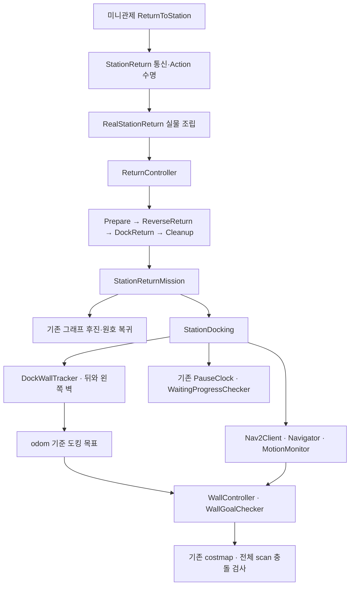

# Vic Pinky 스테이션 복귀·두 벽 도킹 성공 기준 확정 — 2026-10-30

## 승인과 기준

사용자 “지금 너무 잘됐어. 이대로 픽스하고 코드 구조 맞춰서 확정지으면 될것같아” 확인으로 이번 성공 동작을 기준으로 고정한다. 이번 확정 작업은 구조/배포 일치 점검과 기록·PC 백업이며 제어 코드·허용치·속도·관측 조건을 변경하지 않았다. 기존 인계·sim/·다른 담당자 변경을 보존했다.

PC Git 기준: `feat/harvest-handoff-real-20261018`, HEAD `e135cdef9462276cc25d9fa336f084e2dcac72e4` 위 미커밋 구현. 성공 release는 `/home/vic/vmany-runtime-staging/station_docking_two_wall_20261030`이다. commit/push/merge/staging과 원격 최신 상태 조회는 하지 않았다. Git HEAD만으로 이번 성공 구현을 재현할 수 있다고 보지 않는다.

## 확정 컴포넌트 구조



| 책임 | 파일/컴포넌트 | 확정 범위 |
|---|---|---|
| 관제 통신·결과 | farm_common/station_return.py, harvest_robot/station_return_real.py | 기존 Action 계약 유지. 실물 결과 훅으로 도킹·정리 성공 후만 docked=true |
| 상태 전환 | harvest_robot/station_return_states.py | enter는 I/O 예약 후 반환. 완료 큐를 받은 Controller가 exit/enter 관리 |
| 작업 순서 | harvest_robot/station_return_mission.py | 준비→18번 후진 복귀→태그 세션 종료→도킹→정리 |
| 실물 도킹 조립 | harvest_robot/station_docking.py | 설정·관측 수명·출력 소유권·기존 Nav2/정지/대기 시계 연결 |
| 벽 관측·목표 기하 | farm_navigation/wall_observation.py | 실물 설정은 rear+left. 선택 미지정은 기존 세 벽. 인계 WallTracker 로직 유지 |
| 정밀 주행·완료 | farm_wall_controller | 기존 제어기의 기본 OFF 도킹 모드, odom 기반 정지·관측 판정 |
| 환경·측정값 | robot/config/robots/vicpinky/station_docking.yaml | 좌표/측정값/선택 벽/허용치는 설정 책임 |
| 실행·기록 | station_return.launch.py, release/run.bash·record.bash | 도킹 명시 선택. 운영 기동/초기화/주행은 사용자 수행 |

새 Node나 새 범용 업무 실행기를 추가할 필요가 없으며, 이번 확정에서 성공 코드를 재작성하지 않는다. 도킹 조립은 실물 전용이고 공통 확장은 기존 기본 동작을 유지한다. 시뮬 담당자 전달 문서는 이번 범위에 추가하지 않는다.

## 유지할 동작·설정

- 기존 그래프 18번 복귀 경로·방향·후진/원호 제어를 유지하고 도착 뒤 도킹으로 연결한다. 도킹만 실행하는 별도 명령은 없다.
- 관측은 뒤+왼쪽. 오른쪽 측정값은 기록으로 보존하되 목표 계산에서 제외한다. 전체 scan 기반 Nav2 충돌 검사는 오른쪽도 유지한다.
- 측정 기준은 20261029_185143_427562432, 사용자 외곽 간격 뒤22cm/좌25.4cm/우24.6cm 당시 자세다. 수치가 코드의 base 원점-벽 거리와 다름을 유의한다.
- 앞뒤/좌우 각각 ±0.005m, 방향 ±1도. 선속도5mm/s 미만·각속도0.02rad/s 미만과 위치/방향 조건을0.5초 유지하고, 정지 후 재확인·정리 성공 시 docked=true.
- 도킹 선속도 상한0.02m/s·각속도0.05rad/s, 기존 관측0.45초·5프레임·지지율80% 등 유지. 새 정지 조건 추가 없음.
- 이미0출력으로 관측을 기다린 시간은 기존 PauseClock을 통해 진행/실행 시간에서 공제한다. 유효 제어40초·충돌 검사 등은 유지한다.
- `station_return_skip_arm_status: true`는 이번 차체 시험 조건이다. 정상 운영 기본 승인으로 확대하지 않는다. 팔 실제 접힘·정지는 사용자가 확인한다.

## 성공 근거와 범위

2026-10-30 KST task_id `station-return-3df65c32f8d348f4b91bd13b307a477b`:

- 19:38:49.372 복귀 시작, 19:40:15.659 일반 주행 goal 완료.
- 19:40:17.491 도킹 제어 시작, 19:40:33.392 goal 완료(약15.90초).
- 19:40:34.203 정지 후 accepted=true: 앞뒤0.575875mm/좌우0.168082mm/방향0.286571도. 라이다/odom 기준 추정 오차이며 자로 잰 절대 정확도 보증은 아니다.
- 19:40:34.277 미니관제 `ros_status=4, success=true, result_code=SUCCESS, docked=true, error_code=NONE`. 사용자 육안 동작 만족 확인.
- 이후 IDLE/base_stopped=true. 팔 준비는 ARM_NOT_READY로 별개이며 실제 팔 수확·운송 인계 전체 성공으로 확대하지 않는다.
- tag_capture_session code1 종료가 있으므로 이번 성공은 태그 보정 검증이 아니다. 카메라 문제나 기존 직선 추종 문제를 이번에 변경하지 않았다.

이전 PC 검증: Python82개, Nav2 가상 입력의 오차 수렴·충돌·15초 단절 후 재개. 로봇 ARM4패키지 빌드·CTest2 및 설치 기하 검증 통과. 이번 확정 시 추가 주행은 하지 않았고 release manifest155파일 무변경과 PC 주요11파일 일치를 직접 확인했다.

## 증거·백업

- 실물 로그: `/home/vic/vmany-terminal-logs/20261030_193734_launch_790283/console.log`.
- 실물 bag: `/home/vic/vmany/main/farm_project/runs/station_docking_trial/20261030_193831_668247392/bag`.
- PC 성공 자료: `/home/eunbi/vmany_artifacts/station_docking_pc_20261030/run_1938/`. scan_filtered1434, odom4301, dock_target168, raw_nav320, feedback319개 확인. costmap_raw564개, updates0개(증분 수신 성공으로 주장하지 않음).
- PC 고정 사본: `/home/eunbi/vmany_artifacts/station_docking_pc_20261030/success_freeze/`.
  - success_release.tgz: 소스·설치본·설정·실행도구·manifest·빌드로그. SHA256 `16ce749f440dcdadee01364aa8b8101cb21d4dfba93d05e2a2daf836c2f0e420`.
  - runtime_config.tgz: 프로젝트 실물 설정 및 Jetson release 설정·환경 스크립트·dinit 설정. SHA256 `b0007e888a04c9d0097d300356f4eb8a5ce3eb68fe53baf2cf3fb013867a4c41`.
- 로봇에 새 백업 공간을 만들지 않았다. 설치본 보존은 ARM/Jazzy 환경 기준이며 다른 아키텍처로 복사해 실행하는 배포물이 아니다.

## 실행·원복·후속

성공본은 다음 사용자 명령으로 선택한다. 기존 laun 별칭의 대상을 임의로 바꾸지 않았다.

```bash
bash /home/vic/vmany-runtime-staging/station_docking_two_wall_20261030/run.bash
# 별도 로봇 터미널에서 기록
bash /home/vic/vmany-runtime-staging/station_docking_two_wall_20261030/record.bash
```

초기위치는 실제 배치와 일치할 때만 사용한다. 14번에서12번 반대방향으로 실제 배치·IDLE·정지했을 때만 기존 dinit.bash를 사용하며, 현재18번에14번 초기좌표를 보내지 않는다.

실행 의존 순서는 Jazzy→vicpinky_ws→프로젝트 install→jetson_reply_20261027_1741→station_work_curvature_20261029→성공 도킹 release이다. 백업 두 파일만으로 드라이버·수정 Zenoh·전체 underlay까지 자립 재현된다고 보지 않는다.

향후 변경은 별도 적용본에서 검증하고 현재 성공 release를 덮어쓰지 않는다. 되돌릴 때는 사용자가 새 런치를 종료하고 이 성공본 run.bash를 선택한다. 저널·초기위치·관제 대기열을 자동 복원하지 않는다. 팔 상태 생략 해제와 전체 운영 시험, 반복 도킹·실제 간격 검증은 후속 범위다. 사용하지 않는 기존 방향 설정 검사의 제약도 이번 성공값에는 영향 없으며 변경 없이 남겨둔다.
