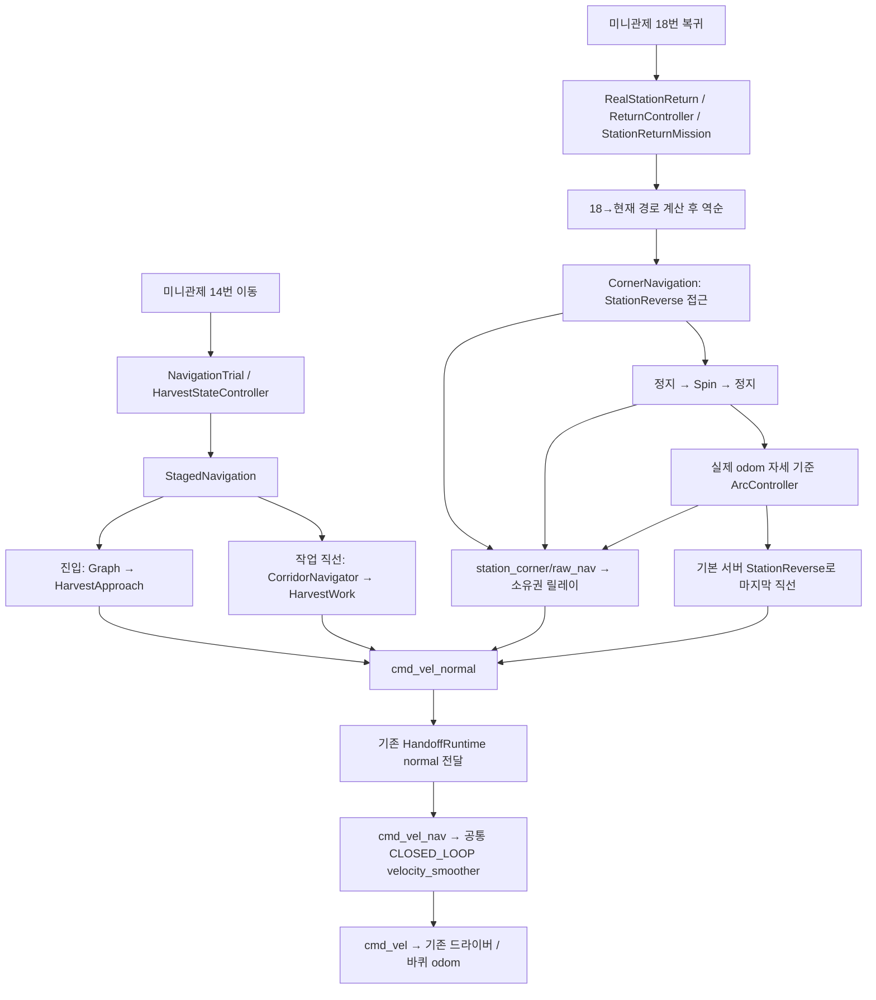

# 전진·후진 전체 연결 비교 — 2026-10-29 16:11 시험

## 기준과 범위

HEAD e135cdef9462276cc25d9fa336f084e2dcac72e4 및 기존 미커밋 상태.
이번 분석은 기존0555 실행본의 시험이다. 신규 station_no_camera 접근 수정은 미사용.
시험 캡처 run_1611/20261029_161141_529276, launch161118_launch_417591.
시험 후에도 같은 PID417635/417668임을 확인하고 두 controller_server의 파라미터를
읽기 조회했다. 캡처 시작 설정과 실행 중 선언된 기본값을 구분하여 대조했다.
기록되지 않은 controller 내부 매주기 pose/carrot, 실제 벽 절대좌표, 영상은 미확인.
코드/설정/로봇프로세스 변경 없음. 이번 문서와 분석 산출물만 작성한다.

## 연결 구조

미니관제 이동 Action 이름은 NavigateToPose이나 실제 내부는 자체 그래프/직선 경로와
FollowPath다. ComputeRoute 또는 Nav2 NavigateToPose가 전체 경로를 수행한 것이 아니다.

## 공통과 차이

|구분|전진|후진|
|---|---|---|
|지도/그래프|many_farm.yaml/pgm, graph.geojson|동일 파일|
|드라이버/odom|기존 차체 드라이버 /harvest_01/odom|같은 발행자|
|LiDAR|동일 센서, scan→scan_filtered|동일 출력 토픽|
|위치 추정|동일 AMCL, map→odom→base|동일; 원호 구간은 odom에 고정|
|업무 PoseProvider/MotionMonitor|node의 공유 인스턴스|같은 객체를 전달받음|
|Nav2 TF 버퍼|기본 controller_server의 버퍼|접근/원호는 별도 server 버퍼; 마지막 직선은 기본server|
|작업 경로|실제 시작점→14번의 직선|실제 시작점→원호 진입점의 직선, 원호, 마지막 직선|
|같은 그래프선 여부|명목 작업선 참조|같은 명목선이나 실제 시작점이 달라 실행선은 완전 동일하지 않음|
|태그 세션|WINDOW_MOVE 단계에서begin, 완료cleanup end|구역을0.2초마다 판별, 같은구역에서는토큰유지,cleanup end|
|태그 모델/외부변환|동일 profile 및 camera TF|동일; u통과순서/보정시점은 반대|
|주행 준비/팔|기존prepare_travel, 시험skip_arm_status|같은시험생략, 실제팔상태를위조하지않음|
|출력|기본server→normal|접근/원호에 소유권 확인 릴레이1단계 추가|
|평활기/최종출력|동일CLOSED_LOOP, 같은cmd_vel|동일|
|재시도|기존충돌재시도5회|동일횟수+후진충돌문자열분류, 원호사전충돌검사도재시도|
|종료|Nav2완료→실제정지→오차기록|동일; 접근/원호는 별도출력차단 추가|

기본server와station_corner server의costmap 설정은 센서 토픽 표기만 다르다.
기본 /scan_filtered는 실행remap으로 /harvest_01/scan_filtered, 전용서버는 같은절대이름.
각각 별도costmap이므로 입력·갱신시점·내부buffer까지 같은인스턴스라는뜻은아니다.

## 모든 RPP 계열 선언값 비교

단위: 선속도m/s, 거리m, 각속도rad/s, 시간s. 이 표는 선언된 값이다.
ArcController는 RPP 파생형이지만 자체command 계산을 사용하므로 아래 RPP감속값이
실제로 적용된다고 해석하지 않는다. arc_max_linear_vel=.05, arc_max_angular_vel=.30.
ReverseRPP도 use_rotate_to_heading=false인데 자체경로방향 회전분기를 실행한다.
stateful=false는 표준RPP의상태분기를 그대로사용한다는뜻이아니다.

|파라미터|전진 진입|전진 작업|후진 접근|후진 마지막 직선|원호|
|---|---|---|---|---|---|
|allow_reversing|false|false|true|true|true|
|approach_velocity_scaling_dist|0.6|0.6|0.6|0.6|0.04|
|cancel_deceleration|3.2|3.2|3.2|3.2|3.2|
|cost_scaling_dist|0.6|0.6|0.6|0.6|0.6|
|cost_scaling_gain|1|1|1|1|1|
|curvature_lookahead_dist|0.1|0.4|0.6|0.6|0.6|
|desired_linear_vel|0.1|0.1|0.1|0.1|0.05|
|inflation_cost_scaling_factor|3|3|3|3|3|
|interpolate_curvature_after_goal|true|true|false|false|false|
|lookahead_dist|0.1|0.4|0.4|0.4|0.04|
|lookahead_time|1.5|1.5|1.5|1.5|1.5|
|max_allowed_time_to_collision_up_to_carrot|1|1|1|1|2|
|max_angular_accel|1|1|1|1|3.2|
|max_lookahead_dist|0.9|0.9|0.9|0.9|0.04|
|max_robot_pose_search_dist|2.495|2.495|2.495|2.495|2.495|
|min_approach_linear_velocity|0.05|0.05|0.006|0.05|0.003|
|min_lookahead_dist|0.3|0.3|0.3|0.3|0.04|
|plugin|Nav2 RPP|Nav2 RPP|ReverseRPP|ReverseRPP|ArcController|
|regulated_linear_scaling_min_radius|0.9|0.9|0.9|0.9|0.9|
|regulated_linear_scaling_min_speed|0.05|0.05|0.006|0.05|0.003|
|rotate_to_heading_angular_vel|0.1|0.1|0.1|0.1|1.8|
|rotate_to_heading_min_angle|0.104719755|0.104719755|0.104719755|0.104719755|0.785|
|stateful|true|true|false|false|false|
|transform_tolerance|0.1|0.1|0.1|0.1|0.1|
|use_cancel_deceleration|false|false|false|false|false|
|use_collision_detection|true|true|true|true|true|
|use_cost_regulated_linear_velocity_scaling|true|true|true|true|true|
|use_fixed_curvature_lookahead|true|true|false|false|false|
|use_regulated_linear_velocity_scaling|true|true|true|true|true|
|use_rotate_to_heading|true|true|false|false|false|
|use_velocity_scaled_lookahead_dist|false|false|false|false|false|

## 서버/완료/진행도/시간 조건

- 제어주기 양쪽20Hz. x속도무시임계 양쪽.001m/s.
- y/각속도무시임계 기본server .0001/.0001, 전용 .001/.001. 차동차체 y는실질미사용.
- failure_tolerance 양쪽0. bond heartbeat 기본.1초/전용0. 제어추종개선설정은아님.
- 전진/마지막후진 goal: stateful=true, 위치.04m, 방향.043633rad(2.5도).
- 후진접근 goal: stateful=false, 위치.04m, 방향pi(위치완료뒤별도Spin).
- 원호 goal: stateful=false, 위치.005m, 방향.04rad(2.29도).
- 일반progress:10cm 또는.1rad 진행,20초. 전용접근/원호progress:1cm 또는.04rad,10초.
- 업무진단허용치:일반.05m/6도,접근.05m/2pi,원호.008m/.05rad.
  Nav2 goal조건과같지않다. 별도validator없는 Navigator는 정지후accepted=false를경고만함.
- 공통주행timeout300초,tf_timeout3초/tf_max_age1초,odom_max_age.5초,
  정지기준.005m/s/.02rad/s,정지유지.8초/정지대기20초. 경로간격.04m.
- 원호는명시적점/heading을유지하여약2mm간격. Spin은전용behavior서버±.03rad/s,
  방향오차.05rad이하면생략. 방향보정후실제정지확인.
- 일반/마지막후진 취소는기존Nav2취소·MotionMonitor. 전용은릴레이차단/0발행을추가.

## costmap과 공통 속도 출력

costmap: odom, base_link, 5×5m, .02m격자, rolling=true,
update10Hz/publish5Hz, footprint60×50cm+각방향2cm padding.
voxel+inflation 사용(StaticLayer 설정은있지만 plugins목록에없음).
voxel z해상도.05m/16칸, mark_threshold0, 높이0~2m,
LaserScan marking/clearing=true, obstacle0~4.5m/raytrace0~5m.
inflation radius.7m/cost_scaling3. 원본지도오류만으로local collision결과를단정하지않는다.

velocity_smoother: 양쪽동일CLOSED_LOOP 20Hz, odom평균창.1초,
max_velocity[.25,0,1],min[-.25,0,-1],accel[1.8,0,2],decel[-1.8,0,-2],
deadband0,scale_velocities=false,velocity_timeout1초.
기존HandoffRuntime normal분기만통과하므로인계원호CommandGate의속도제한이
복귀명령에적용된다고설명하면틀리다. 운송/팔실행은이번차체시험에서미수행.

## 제어식의 실질 차이

표준RPP 1.3.13의 computeVelocityCommands는 fixed_curvature가켜지면 별도곡률선행점을
사용하고, interpolate_curvature_after_goal이면 목표너머도연장한다. 회전판정에도
그점이사용된다. HarvestWork는.4m, HarvestApproach는.1m.
ReverseRPP는computeVelocityCommands를재정의하여일반carrot하나만사용하고목표너머
연장을호출하지않는다. 뒤쪽angle=atan2(-y,-x),6도초과면자체제자리회전,
최종거리내에서는goal_yaw비교,선속도부호는항상음수다. 곡률2y/(x²+y²),
applyConstraints와충돌검사는기존RPP를재사용한다.
따라서긴직선중간에는둘다.4m라곡률식의기본차이는작지만,종점.4m이내는
후진carrot이짧아지며작은횡오차도큰각도/곡률을만드는차이가있다.
단순히후진YAML의fixed_curvature를true로바꾸어도현재custom코드는그분기를사용하지않는다.

참고: https://raw.githubusercontent.com/ros-navigation/navigation2/1.3.13/nav2_regulated_pure_pursuit_controller/src/regulated_pure_pursuit_controller.cpp
로컬설치헤더및사용중ReverseRPP소스와대조했다.

## 이번 기록으로 좁힌 원인

1. **수신 지연 차이는 우선순위가 낮다.** odom중앙전진22.22/후진22.59ms,
   p95 31.06/31.50ms. TF odom→base중앙19.74/20.02ms. 동일센서수신이후
   제어기내부매주기조회까지증명한것은아니다.
2. **태그 거리 모델의 방향별 일관성 차이는 재현됐다.** 이번각10관측에촬영시각
   LiDAR벽적합을대응시켰다(최대시각차약48ms). 태그pose로계산한벽위치를주행X에
   직선적합한잔차RMS: 전진 raw1.376→전체보정.285cm, 후진 raw.958→전체2.423cm.
   방향항만은전진1.313/후진1.030cm. 즉후진악화는거리항과연결된다.
   절대정확도/물리참값/인과비율은아님. 전진개선값으로역방향까지유효하다고볼수없다.
   방향표준편차는전진1.469→.393도,후진1.916→1.007도로개선되어태그전체무효는아님.
   전진태그100→104,각u약850~890→430~600; 후진104→100,u약395~481→748~865.
   후진각태그첫요청Y변화-.28~-1.17cm,두번째+1.58~+2.13cm로반복부호전환.
   전진은모두+.93~+2.08cm. requested값이며실제AMCL점프/물리이동과동일시하지않는다.
3. **같은그래프라도실행선은완전동일하지않다.** 전진은실측시작→14직선,
   후진은실측시작→(.246,-.035)직선. TF기록으로근사한X3m경로Y는
   전진-.0327/후진-.0202m. 후진계획이벽에서멀어지는쪽으로크게꺾인증거는아님.
   입력Path원본은후진에서미발행,정확한계획시각과controller내부pose는추가근거필요.
4. **접근중복정렬은코드/명령으로확인.** 이번후진접근1.45초제자리명령뒤4.54초Spin.
   최신수정에서이를줄였으나이번0555시험에는미적용. 긴직선전체이격의단독설명은아님.
5. **원호시작오차전달은기하학적으로확정.** 실제정지odom에원호를고정하므로
   접근진행거리3.84cm부족이명목출구X+3.48cm로남는다. nominal_exit연결보정없음.
6. **원호말미감속/정지출력의문제가직접관측됐다.** 마지막1초명령v=-.05m/s유지.
   Nav2완료16:15:29.517→rawzero+.0005초→normalzero+.0266초→navzero+.0270초.
   최종cmd_vel은선속도0이나각속도약.15rad/s가수백ms남고,
   |v|<.005/|w|<.02첫시점+.646초(정확한0은+.693초),odom동조건+.821초.
   완료후정지까지odom추가1.54cm/8.18도,원호최종오차1.32cm/6.91도.
   전진작업종료cmd_vel정지조건은+.063초. 같은평활기라도종료입력/측정속도차이가크다.
   이는일반TF수신지연과다르며단독하드웨어고장증거가아니다. CLOSED_LOOP odom평균,
   구동응답과종료각속도를함께봐야한다. bag수신시각기준으로wire시간과같지않다.
7. **완료판정은품질문제를숨길수있다.** 원호accepted=false인데warning후tail진행,
   최종SUCCESS. 성공을원호정밀검증완료로해석하지않는다.

## 다음 원인 검증 — 이번에는 구현하지 않음

직선: 기존전후진관측의u/태그ID/거리/속도/촬영시각을맞춰거리모델검증,
동일직선·동일추정pose를표준RPP/ReverseRPP에입력해출력차이분리.
매주기reverse내부carrot/pose미기록때문에현재기록으로완전재연했다고말하지않는다.
원호: 실제정지시작오차→생성출구오차와Nav2완료→최종cmd_vel→odom정지의연쇄를
별도로재현한다. 허용치완화나전체태그제거부터하지않는다.
카메라OFF는부하+보정입력둘다바뀌므로컨트롤러변경과동시에시험하면원인분리가안된다.
코드/설정/인계/sim 미변경,배포/재기동/주행/commit/push 없음.

## 2026-10-29 추가 주행 없는 상세 분석 — 17:43/17:14 및 16:11 전후진

사용자 요청: 실제 경로·목표점·위치추정·벽거리를 기존기록만으로 상세분석.
이번은 분석스크립트/문서만, 운영소스·설정·배포·주행·프로세스 조작 없음.
기준HEAD e135cdef9462276cc25d9fa336f084e2dcac72e4 및 기존 미커밋상태 보존.
추가자료 run_1740/deep_analysis/(deep1743.py/json,chain1743.py/json,wall_bias1743.json,deep1743.png).

### 기록 사실과 재구성 구분
- 실제 기록: TF/odom/scan_filtered/속도출력/원호points_odom/단계측정/실행설정.
- 후진 FollowPath 입력 Path·매주기 carrot은 미발행. 빈토픽을 실제경로로 간주하지 않음.
- 코드 split_graph_corners가 실측 시작→진입점의 직선을 만든다는 계약과 시작TF로
  접근 경로를 재구성. 2차 시작약(3.551320,-.016556),종점(.246,-.035),진행각-179.6803도.
  시작시각±.2초 TF위치변화 약.016cm, 시작시각선택의 수cm불확실성은 이표본에서관측되지않음.
  다만 실제Action직렬화메시지를복구한것은아님. 재시도/재계획없는해당직선범위에한정.

### 지도상 경로 추종과 벽 이격
2차 mapX .65~3.3m구간 재구성직선대비횡오차RMS1.416cm/최대3.709cm.
1차 동일구간1.183cm/최대3.009cm. 지도상으로도완전추종아님.
밴드별중앙값(경로오차+는벽반대측):
|X구간|2차벽간격|2차경로횡오차|1차벽간격|1차경로횡오차|
|---|---:|---:|---:|---:|
|2.8~3.3|17.94cm|-.31cm|17.05cm|-.60cm|
|1.8~2.3|21.46cm|1.17cm|20.88cm|.82cm|
|.6~1.0|23.71cm|2.28cm|21.43cm|-.69cm|
1차는지도상경로주변에돌아왔어도물리벽간격은늘어난상태로남음.
2차는지도상경로이탈과벽좌표불일치가동시에존재.

정량분해는차체외곽gap이아닌방향보정한base중심→벽의mapY거리와밴드평균을사용.
벽의지도환산Y=W,로봇Y=y,경로Y=p이면 D=W-y=W-p-(y-p).
2차초반→후반 D증가6.074cm = 경로Y기여1.267 + 경로대비Y오차기여2.224 + W변화2.584cm.
1차 D증가4.925cm = 경로기여-.307 + 경로오차기여.299 + W변화4.934cm.
이는좌표관계의분해이지오차원인의인과비율이아니다. W변화에는추정/TF/센서각도/
벽후보형상과분석오차가포함되므로전부AMCL잘못으로이름붙이지않는다.

### 제어 명령 대조
재구성직선과기록된map자세로반경.4m선행점(후진방향 교점)을구해
local_y 및 curvature=2*local_y/.4², angular=linear*curvature를계산했다.
실제raw_nav와동일시각근접대조,|v|>.02m/s/최근cmd.15초이내/원호근접제외:
- 2차353표본,각속도평균절대차 .001306rad/s.
- 예측·실제|angular|>.005인228표본에서부호일치98.25%.
- 1차364표본,평균절대차 .001243rad/s,유효239표본부호일치99.16%.
즉후진부호가반대로뒤집히는계산이나전혀다른경로를추종한다는증거는약함.
원본carrot/제어시각TF가없으므로정확한매주기재연/모든내부분기검증으로확대하지않음.

### 새 공통 단서: 라이다 벽 방향과 주행 방향의 약2도 차이
직선mapX1.3~3.2m,같은벽후보를따라가는구간에서벽normal로차체-벽상대각theta를구하고
odom선속도v로벽수직거리변화 Δd=integral(-v*sin(theta)dt)를예측했다.
실측Δd는각구간처음·끝의라이다벽수직거리차이,발판/차체외곽계산과분리.
기존방향기준으로는거리변화와불일치하며theta에일정bias를더한오프라인모형은다음과같다.
|기록/방향|관측Δd cm|bias없는예측 cm|고정+2도예측 cm|해당구간등가각도|
|---|---:|---:|---:|---:|
|16:11전진|-.137|6.486|-.083|2.017도|
|16:11후진|3.109|-3.257|3.146|1.988도|
|17:11전진|-1.409|5.382|-1.258|2.046도|
|17:14후진|5.261|-1.466|5.191|2.021도|
|17:40전진|1.086|7.817|1.242|2.048도|
|17:43후진|5.619|-.909|5.610|2.003도|
모두1.99~2.05도범위. 고정2도모형의거리변화잔차는위6구간에서약.16cm이내.
이값은분석결과이며운영TF/라이다/주행설정에적용하지않았다.
동일기록계열내검증이며외부물리참값/독립계측으로센서장착오차를입증한것은아님.
평평한같은고정벽가정,라이다각도모델/왜곡·벽선택·차체실제이동방향편차를추가검토해야함.

기록staticTF는base_footprint→base_link yaw0,
base_link→lidar_mount yaw0/x=.185m,
lidar_mount→laser_link yaw180도(3회동일). 현재PC드라이버패치는frame/포트수정만확인.
odom자체교차검증:기록yaw·선속도적분과odom위치차의방향차는4구간약.0006~.0016도,
거리차는후진약.005~.010cm/전진약.26cm. odom내부일관성은있지만물리정확도를입증하지않음.
따라서우선후보는라이다각도기준/TF외부정렬과실제차체주행방향기준의일정차이.
어느한쪽을하드웨어고장또는TF설정오류로확정하거나2도를바로적용하지않는다.
후진의새RPP선택/태그보정OFF와무관하게전후진6구간에공통으로반복됨.
약2도차이는2m이동에서약7cm횡방향차이를만들수있어현재몇cm벽이격규모와맞음.

### 원호 진입 연결
2차접근정지map(.27922585,-.05467531),yaw-.03637877rad에서실제odom기준
원호를고정한다. 당시map자세로반경.2m/90도원호끝을기하환산하면
(.072084,-.247269),명목(.046,-.235)대비(+2.608,-1.227)cm/총2.883cm.
이는원호추종오차전부터물려받는기하차이이며진행중map→odom변화는별도다.
원호정지오차1.14cm/5.91도및완료후추가회전7.12도는별도추종/제동문제로유지.

### 판단과 다음 확인
확인:벽이격실재추정,지도상수cm추종오차,제어명령은재구성RPP와대체로일치,
주행방향-벽방향간약2도공통차이,원호진입오차전달및끝제동추가회전.
미확정:실제장착각/드라이버scan각도처리/실제주행방향중2도차이의발생지점,
후진Path/carrot매주기원본,AMCL·주행응답의개별인과기여.
다음은이미기록된원본scan과필터후scan각도,운영드라이버·URDF의실제각도처리를
읽기대조하는것이우선. 전진/인계/시뮬코드를수정하거나재주행부터요구하지않는다.

추가 원본scan/scan_filtered 대조: 2차 후진 bag의 동일 stamp 페어 전체에서 frame=laser_link, angle_min/increment 동일, 양쪽 유한 거리값 차이0. 필터가 각도 메타데이터를2도회전시킨 증거는 없다. 제외점선택/라이다장치내각도처리까지정상임을뜻하지않는다. scan_compare1743.py/json에전체페어보존.
