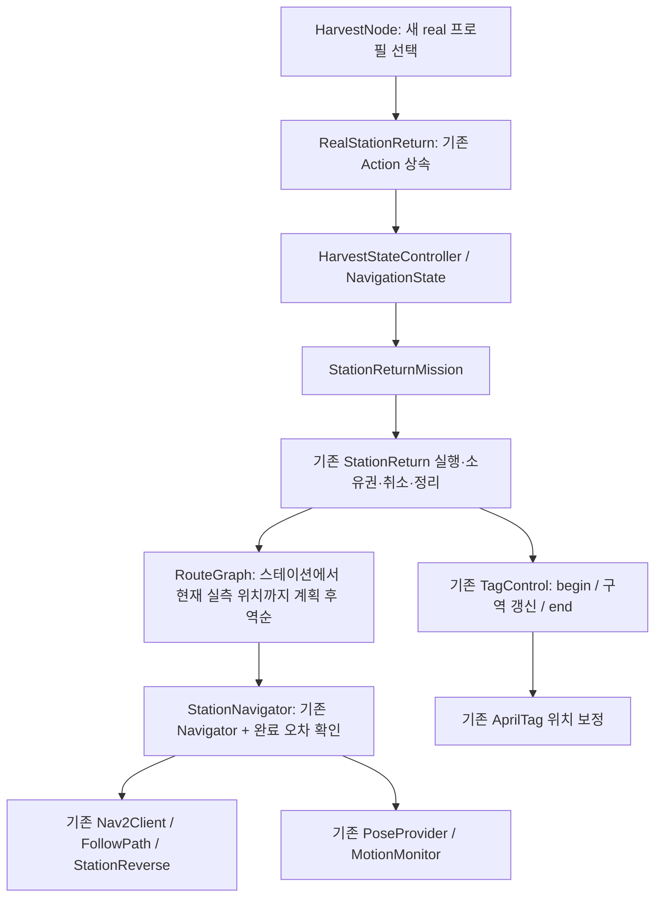
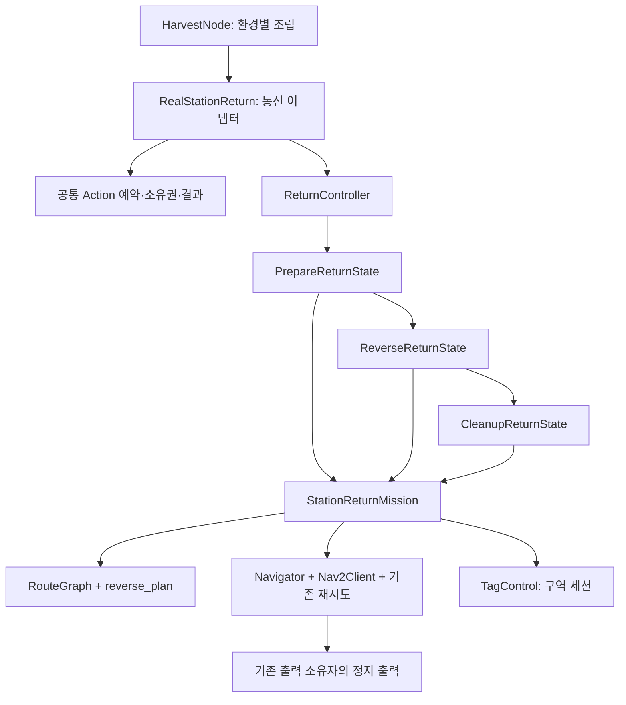
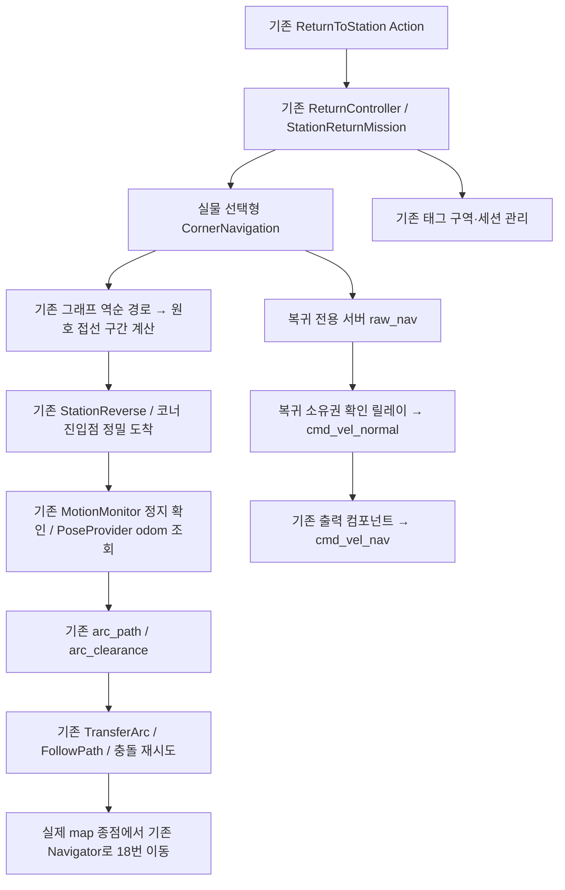

# 실물 Vic Pinky 스테이션 후진 복귀 — PC 구현

- 기준: `e135cdef9462276cc25d9fa336f084e2dcac72e4`, `feat/harvest-handoff-real-20261018`.
- 승인: 사용자 “최소 변경안으로 PC 코드 구현하고 검증까지”, 기존 인계·시뮬 수정 금지, 태그 보정 유지, 스테이션 값 임의 지정 금지, 배포·재기동 금지.
- 기존 미커밋 `docs/CODEX_HANDOFF.md`는 수정하지 않았다. 원격 조회·staging·commit·push 없음.

## 변경 파일과 책임

- `robot/ros_ws/src/harvest_robot/harvest_robot/node.py`: real이며 `station_return_config`가 명시된 경우만 새 어댑터 선택. 그 외 기존 StationReturn 유지.
- `robot/ros_ws/src/harvest_robot/harvest_robot/station_return_real.py`: 기존 StationReturn 상속으로 Action 접수/소유권/선점/취소/Feedback/정리 재사용. HarvestStateController에 미션을 맡겨 State.enter가 반환하고 완료 콜백으로 종결한다. 실물 준비, 태그 구역, 완료 오차만 연결한다.
- `robot/config/environments/harvest_station_return_jetson_real.yaml`: 기존 Jetson 실물 프로필과 같은 장치/인계/태그/주행 파일 참조 + 선택 키 하나.
- `robot/config/robots/vicpinky/station_return.yaml`: station_id/node_id/xy_m/yaw_rad 및 완료 위치·방향 허용치 모두 null. 미설정이면 노드의 다른 기능은 유지하고 복귀 Goal만 거절한다. 일부 값만 입력해도 미설정 취급. 전부 입력한 뒤 기존 load_station이 지도 ID, 노드 좌표 일치, 출발 엣지를 검증한다.
- `robot/ros_ws/src/harvest_robot/test/test_station_return_real.py`: 신규 오프라인 시험.
- 기록: 본 문서, `docs/PROJECT_STATE.md`, `docs/DECISIONS.md`. 사용자 sim 절대 변경 금지에 따라 sim/docs/CHANGELOG.md도 수정하지 않는다.

## 컴포넌트 연결



실제 주행 이력 녹화/재생이 아니라 지정 지도 그래프를 현재 실측 위치 기준으로 다시 계산하고 역순으로 실행한다. 공통 StationReturn, Navigator, 역주행 C++ 플러그인 및 Nav2 설정은 수정하지 않는다. Python 서브클래스 내부에서 부모가 만든 동일 Nav2Client를 완료 검사 Navigator에 연결한다. 공통 객체/시뮬에 monkey patch를 적용하지 않는다. 부모 내부 연결점에 의존하므로 향후 부모 생성자 변경 시 생성 시험을 유지한다.

## 태그 보정과 조건

- 기존 TagControl 시작/종료·heartbeat 유지. 후진 중 0.2초 간격으로 기존 수확 work_corridor_nodes에서 읽은 선분과 **실측 차체 방향**을 대조해 구역 갱신. 후진 속도 때문에 방향을 pi만큼 뒤집지 않는다.
- 구역 밖/모호한 위치에서는 section=None으로 반복 태그 구역을 추정하지 않는다. 주행 실패나 정지 조건으로 사용하지 않는다. 카메라 관측이 실제로 있을 때 기존 보정 노드 정책이 적용되며, 태그가 항상 보인다는 보장은 아니다.
- 구역 판별 허용치는 기존 주행 설정 재사용. 최종 스테이션 허용치와 분리한다.
- 이전 작업 종료·소유권 인수 후 기존 prepare_station_return와 staged_navigation.cancel_nav를 호출해 기존 도착 문맥을 재사용하지 않는다.
- Jetson 연결이 있으면 출발 시 한 번 기존 snapshot의 유효 기간과 device_state_valid/arm_stowed/arm_stopped를 확인한다. 팔 Goal 수락용 ready, 박스 상태, recovery_required 등 추가 조건은 도입하지 않는다. 주행 중 새 감시/정지 정책 없음.
- 기존 Nav2 실패·취소·실제 odom 정지 확인 유지. 정지 후 실측 완료 오차가 명시 허용치 밖이면 FAILED. 자동 재시도/순간 이동/허용치 확대 없음.
- 도착 SUCCESS에도 docked=false. 최종 AprilTag 스테이션 도킹은 이번 구현 범위 밖이다.

## 이번 직접 검증

PC Python 3.12, `/opt/ros/jazzy`와 기존 PC workspace 인터페이스를 로드하고 소스 PYTHONPATH를 우선했다. ROS 노드/실제 DDS Action/운영 프로세스는 기동하지 않았다.

- 신규 15개 통과: 미설정 거절, 명시 허용치/잘못된 허용치, 실물 프로필 참조 보존, Action 서버/Client 각각 한 개, StationReverse 선택, 역순 경로/edge, 태그 구역 진입·이탈, 모호 구역, 허용치 밖 실패, 취소, 주행 실패 정리, 정지 미확인 차단, 인계 선점 거절, 팔 준비 판정.
- 기존 TagControl 1개 + StagedNavigation 18개 통과. 합계 34개.
- diff 공백 검사 통과. sim/·기존 인계/공통 주행/컨트롤러 소스 및 기존 설정 변경 없음.
- 시험은 모의 의존성을 사용하는 오프라인 계약 시험이다. Nav2 물리 후진·AprilTag 실측 보정·새 프로필 ROS launch/빌드/실물 연속 주행 검증이 아니다. 과거 인계 성공을 이번 검증으로 계산하지 않는다.

재현(PC, 프로젝트 루트):
```bash
cd /home/eunbi/vmany/main/farm_project
source /opt/ros/jazzy/setup.bash
source robot/ros_ws/install/local_setup.bash
export PYTHONPATH="$PWD/robot/ros_ws/src/harvest_robot:$PWD/robot/ros_ws/src/farm_common:$PWD/robot/ros_ws/src/farm_navigation:$PYTHONPATH"
python3 -m unittest discover -s robot/ros_ws/src/harvest_robot/test -p test_station_return_real.py -v
python3 -m unittest discover -s robot/ros_ws/src/harvest_robot/test -p test_tag_control.py -v
python3 -m unittest discover -s robot/ros_ws/src/harvest_robot/test -p test_staged_navigation.py -v
```

## 남은 확인과 되돌리기

사용자가 실제 스테이션 노드·차체 방향·완료 허용치를 확정해야 한다. 좌표는 지정 노드와 일치해야 한다. 기존 StationReverse/goal checker 설정과 확정 허용치의 적합성, 실제 지도 전체 역방향 경로·장애물·태그 시야 및 TF 보정, 취소·정지, 복귀 뒤 다음 수확 문맥을 별도 승인된 실물 시험에서 확인한다. 새 Nav2 컨트롤러가 필요한지는 그 증거로 판단하며 현재 성공 인계 제어기는 바꾸지 않는다.

로봇 설치본·실행본은 전혀 변경하지 않았다. 기존 프로필 선택 시 새 어댑터를 사용하지 않는다. PC 원복은 node.py의 이번 선택 분기와 신규 4개 소스/설정/시험 파일만 제거하고 이번 문서 절만 정리한다. CODEX_HANDOFF.md 등 기존 사용자 변경에 git restore를 일괄 적용하지 않는다.

## 후속 — 복귀 목표 18번 지정

사용자가 후진 복귀 목표를 실물 그래프 18번으로 지정했다. station_return.yaml의 node_id=18, xy_m=[0.04600000000000004, -1.12]를 그래프 원문에서 반영했다. 18번은 station_exit이며 18→0, 0→18 방향 엣지를 확인했다. station_id·완료 방향·완료 허용치는 미확정 null이므로 복귀 실행은 아직 비활성이다. 기존 인계·시뮬·그래프·로봇 실행본 변경 없음. PC 설정-그래프 좌표 일치와 미확정 값 보존을 직접 검사했다. 원복 시 이번 node_id/xy_m만 null로 되돌린다.

## 후속 — 완료 방향 확정

사용자가 18번에서 0번을 바라본 채 후진 도착하는 방향을 확인했다. 실물 그래프 두 노드 좌표로 계산한 yaw_rad=1.5707963267948966(+90도)를 PC 설정에 반영했다. station_id·완료 위치/방향 허용치는 여전히 null이다. 좌표 기반 방향 일치 및 미확정 값 보존 검사 통과. 기존 인계·시뮬·그래프 변경과 로봇 배포/재기동 없음. 이번 변경 원복은 yaw_rad만 null로 복원한다.

## 후속 — 관제 문서 대조 및 식별자 반영

승인: 사용자 “그 문서를 따라서 진행하고, 또 확인할거 있는지 알아봐바”. PC station_return.yaml의 station_id만 STATION_HARVEST_01로 확정했다. 노드18·좌표·+90도 방향을 보존했고 완료 허용치는 null이다. 신규 정지조건이나 관제·인계·시뮬 변경 없음. 원복은 이번 station_id만 null로 되돌린다.

근거: [공통 통신 프로토콜](https://robot3final.atlassian.net/wiki/spaces/3/pages/11796484), [복귀 운영 정책](https://robot3final.atlassian.net/wiki/spaces/3/pages/46137352), [10월24일 관제 개발 기록](https://robot3final.atlassian.net/wiki/spaces/3/pages/47808544). Confluence는 읽기만 했다.

추가 대조 결과:

1. 완료 위치(m)·방향(rad) 허용치는 정책에서도 현장 확정 항목이다. 인계 복구의 5cm/6도를 스테이션 값으로 자동 적용하지 않는다.
2. 복귀 Action은 goal.map_id와 환경 many_farm_v1을 직접 비교한다. 기존 수확 설정의 control_aliases에는 farm_map_v1→many_farm_v1이 있으나 복귀 Action에는 적용되지 않는다. 관제가 farm_map_v1을 보내면 현재 복귀는 거절된다. 실제 송신값 확인 또는 실물 복귀 어댑터에서 기존 별칭 재사용이 필요하다. 이번에는 지도/별칭 동작을 변경하지 않았다.
3. 로봇은 도착 시 SUCCESS/NONE/docked=false를 반환한다. 10월24일 문서에도 관제 docked=true 검증이 남아 있다. 현재 실행 관제가 도착 성공을 수용하도록 바뀌었는지는 미확인이다. 가짜 docked=true로 우회하지 않는다.
4. ActionHandoff는 기존 동작 종료·정리 후 소유권을 넘기며 인계 중 복귀 선점을 거절한다. 저전력 복귀 이유는 현재 Action에 없고, 관제의 자동 복귀/배터리 정책·적재함 비움 확인·교통 허가는 이 복귀 어댑터에서 구현하지 않는다. 정책 문서 전체를 구현 완료로 표현하지 않는다.
5. 현재 status는 복귀 소유권에 따라 RETURNING/current_task_id/ready=false를 표시한다. 팔 작업 수락용 ready와 복귀 준비는 별개이며 스테이션 허용치 미확정까지 status.ready가 표현하지는 않는다.
6. PC 관제 Zenoh 설정에서 return_to_station을 deny하지 않음은 정적으로 확인했다. 실제 운영 브리지의 Goal/Feedback/Result/취소 왕복은 미검증이다.

이번 PC 검사: 설정의 합의 ID·노드18·그래프 좌표·방향+90도 및 미확정 허용치 보존 확인, 기존 신규 복귀 시험15개 재실행 통과. 실물/관제 종단 시험·배포·재기동·commit/push 없음.

## 후속 — 운송 기준으로 복귀 지도 ID 확정

사용자 “운송로봇은 스테이션 부분이 끝난 상태이므로 참고해서 맞추라” 요청에 따라 PC 저장 참조 origin/feature_dongmin, 커밋 9686aca의 transport_docking_trial.yaml, destinations/transport_real.yaml, transport_communication.py를 대조했다. 최신 원격 및 운영 설치본을 새로 조회한 것은 아니다.

운송은 환경·목적지 지도 ID가 many_farm_v1이며 _goal에서 요청 map_id와 직접 비교한다. 별칭 변환은 없다. 수확 복귀도 이미 같은 직접 일치 검사이므로 알고리즘/별칭 변환을 추가하지 않는다. 앞 절의 “기존 별칭 재사용이 필요”는 확정 구현안으로 채택하지 않는다. 기존 HarvestTask의 farm_map_v1 별칭 처리는 유지한다.

수확 복귀 요청 기준: robot_id=harvest_01, station_id=STATION_HARVEST_01, map_id=many_farm_v1. 목표 노드18·방향+90도 유지. 완료 허용치는 임의로 정하지 않는다.

PC 모의 Goal 검사 직접 실행: 설정 완료를 가정한 객체에서 many_farm_v1 수락, farm_map_v1 및 unknown 거절, 3개 통과. 실제 Action 발행/차체 명령 없음. 이번 변경은 문서 정정뿐이며 기존 인계/시뮬/운송/실행 코드 변경 없음. 실제 관제 송신값과 도착만으로 SUCCESS/docked=false 수용 여부는 운영 연동 확인 사항으로 남는다. 운송은 정밀 도킹을 완료하고 docked=true를 반환하므로 운송 성공 자체가 수확의 도착 전용 성공 수용을 증명하지는 않는다.

## 후속 — 관제 GitHub 코드 직접 확인

사용자 “확인해봐” 요청으로 GitHub 커넥터에서 Robot3FinalProject/Frontend 기본 main 커밋 ca06c86dd7d8fc82c289be4a834314e25c445aa9를 읽었다. 관제 웹 192.168.0.20:8000은 이번 환경에서 연결 실패하여 실행본 일치는 확인하지 못했다. 셸 GitHub DNS 조회는 실패했지만 커넥터 원격 조회는 성공했다. main 저장소의 운송 feature_dongmin 원격 HEAD도 9686aca909cb52191862ee3500c62fadf7a8ed38임을 확인했다.

- dashboard/backend/control_core.py:374: 복귀 Goal map_id를 self.spec['map_id']에서 생성.
- dashboard/config/environments.yaml: real.control.map_id=farm_map_v1. real.saved_routes.map_id=many_farm_v1과 별도이다.
- dashboard/backend/control_core.py:625–631: ROS SUCCEEDED 결과는 docked is True 및 error_code=NONE 요구.
- dashboard/backend/tests/test_harvest_return.py: SUCCESS/docked=False를 UNKNOWN 처리하는 기존 시험 명시. 시험 소스만 읽었으며 이번에 관제 시험을 실행하지 않았다.

따라서 확인한 GitHub 관제 기준으로는 두 불일치가 있다. farm_map_v1 복귀 Goal은 현재 실물 수확 복귀에서 거절되고, 지도 문제를 해결해도 도착 전용 SUCCESS/docked=false는 관제 UNKNOWN이 된다. 기존 운송 동작 성공은 이 관제 GitHub 버전과 운영 실행본이 동일함을 증명하지 않는다. 앞 절의 운송 map_id 직접 일치 유지 결정은 로봇 간 일치일 뿐 관제 호환 확인이 아니었다.

운송 일반 주행 설정에는 arrival_tolerance_m=0.1, heading_tolerance_rad=0.12가 있지만 이것은 수확 스테이션 도착 허용치 합의가 아니며 정밀 도킹 조건과도 다르다. 수확의 미확정 null을 덮어쓰지 않았다.

필요 조치: 운영 관제 버전 대조 후 복귀 지도 ID를 일치시키고, 관제 담당자가 도착 전용 성공을 docked=false로 수용하도록 정책/판정을 정합화해야 한다. 이번 요청은 확인이므로 실행 코드·관제/인계/시뮬·설정 수정과 배포/재기동/명령 발행 없음.

근거: https://github.com/Robot3FinalProject/Frontend/blob/ca06c86dd7d8fc82c289be4a834314e25c445aa9/dashboard/backend/control_core.py#L625 및 같은 커밋의 dashboard/config/environments.yaml, dashboard/backend/tests/test_harvest_return.py.

## 후속 — farm_map_v1 요청 호환 PC 반영

사용자 “farm_map_v1으로 맞추고 다른 동작에 영향 없다면 수정” 승인으로 station_return_real.py와 해당 시험만 수정했다. node.config의 기존 control_aliases.map_ids를 읽고 accept 검증용 복사본의 map_id만 정규화한다. 원본 ROS Goal/프로필/지도/장치/태그 설정 및 공통 부모 Action은 보존한다. 요청 farm_map_v1은 내부 many_farm_v1로 검증되며, 내부 ID 직접 요청도 유지한다. 알 수 없는 지도·로봇·스테이션 거절 조건을 우회하지 않는다. 기존 인계/시뮬/운송/관제 코드 변경 없음.

설정 파일 자체 변경도 가능하지만 현재 별칭은 이미 실물 수확 JSON에 존재한다. 내부 ID 이름을 전부 바꾸는 작업 대신 기존 수확 작업과 같은 설정을 복귀가 읽도록 연결했다. 설정 복제나 새 지도 이름 하드코딩 없음.

이번 직접 PC 검증: 신규 복귀17개, 기존 TagControl1개, StagedNavigation18개, 총36개 통과. 실제 ReturnToStation.Goal 객체 복사 후 원문 보존·정상 별칭 수락·잘못된 식별자 거절·기존 내부 ID 호환·후진 목표/태그 유지 확인. 실제 DDS/운영 관제/차체 시험은 아님. 코드 diff 공백 검사 통과.

남은 항목: 도착 위치/방향 허용치 확정, 관제 docked=false 도착 성공 수용, 운영 연동 시험. 배포/재기동/commit/push 없음. 원복은 새 어댑터의 _map_aliases 초기화와 accept override 및 추가 시험2개만 제거한다. 기존 사용자 변경과 다른 복귀 구현은 보존한다.

## 최신 — 기존 일반 주행 도착 처리 재사용

승인: 사용자 “그렇게 변경해. 노드 도착은 false가 맞고 도킹은 아직 구현 안한 것”. 기존 성공 인계 및 시뮬 절대 변경 금지 유지.

변경 파일: station_return_real.py, station_return.yaml, test_station_return_real.py 및 PROJECT_STATE/DECISIONS/본 기록. 기준 HEAD e135cdef9462276cc25d9fa336f084e2dcac72e4와 이전 턴의 미커밋 복귀 구현 위에서 수정했다.

- 이전: StationNavigator가 공통 Navigator 완료 후 measurement.accepted=False를 FAILED로 뒤집음. 별도 완료 허용치 null 때문에 목표가 정해져도 복귀 거절.
- 이후: StationNavigator를 제거하고 부모가 생성하는 기존 Navigator를 그대로 사용. completion 설정·필수값 검사·허용치 덮어쓰기를 제거. Nav2 성공 후 실제 odom 정지 확인, 도착 오차 측정/경고 기록은 기존 구현 그대로 유지.
- 기존 실물 일반 주행: general_goal_checker의 4cm/2.5도, 기록용 5cm/6도. 이번 변경은 해당 숫자를 새로 지정하거나 기존 컨트롤러·정지 보호를 완화하지 않는다.
- 목표18/좌표/+90도/STATION_HARVEST_01과 farm_map_v1 별칭 호환·태그 보정 유지. 설정 완료 상태이므로 새 PC 프로필에서는 허용치 미설정에 의한 거절이 없어졌다.
- 노드 도착 성공은 SUCCESS/NONE/docked=false. 도킹 기능을 구현한 것으로 보고하지 않는다. 관제의 docked=true 요구는 별도 연동 문제이며 이번 범위에서 관제를 수정하지 않는다.

직접 검증: 복귀17개 + 기존 태그1개 + staged navigation18개 =36개 통과. 생성 객체가 정확히 공통 Navigator인지, 완성 목표 로드, 기존 주행 설정 보존, accepted=False 진단이 성공을 뒤집지 않고 docked=false 유지, 주행 실패/취소/정지 미확인/태그/별칭 회귀를 확인했다. 모의 오프라인 시험이며 실제 Nav2·관제·차체 시험 아님. diff 공백 검사 통과. 코드 변경 외 로봇 배포·재기동·commit/push 없음.

원복: 이번 삭제한 StationNavigator 및 연결, completion 설정과 검증만 이전 미커밋 버전에서 복원한다. 공통 Navigator/인계 설정은 변경하지 않았으므로 원복 대상이 아니다. 기존 CODEX_HANDOFF 변경은 보존한다. 이전 절의 “허용치 미확정 차단”과 “추가 완료 오차 판정”은 이 승인으로 폐기된 과거 상태다.

## 후속 — 14번 시험 초기위치 dinit PC 준비

사용자가 RViz 대신 별도 dinit, 목표14번·12번 반대 방향을 지정했다. robot/tools/terminal/dinit.py, dinit.json, dinit.bash, dinit_alias.bash를 추가했다. 기존 vinit/launch/보존 release 스크립트와 인계·시뮬 파일은 변경하지 않았다.

실물 graph.geojson에서 좌표를 읽어 x=3.576, y=-0.035, yaw=0rad(+X)로 계산한다. 방향은 12→14 벡터이며 14에서12를 등지는 방향이다. 숫자 좌표를 코드에 고정하지 않는다. 초기 추정 covariance는 기존 vinit과 같은 위치 표준편차5cm·방향3도이며 도착 허용치가 아니다.

실행 시 AMCL active/구독자 확인 후 기존 vinit과 같은 IDLE·실제 odom 정지 검사를 발행 직전에 수행하고 /harvest_01/initialpose를 한 번 발행한다. 주행/복귀/카메라 실행 없음. 실제 로봇이 해당 자세에 있어야 하며 발행만으로 AMCL 수렴을 보장하지 않는다. --check는 ROS import/연결/발행 없이 계산만 한다.

PC 직접 검증: bash dinit.bash --check로 위 좌표/방향 확인, Bash/Python 문법 검사 통과. ROS 발행·실물 미검증. 로봇 배포/별칭 설치/재기동/초기위치 발행/commit/push 없음.

배포 후 로봇 터미널에서만 다음 추가 별칭을 등록할 수 있다(아직 배포 안 됨):
```bash
source /home/vic/vmany/main/farm_project/robot/tools/terminal/dinit_alias.bash
```
그 뒤 사용자가 실제14번·+X 방향 정지를 확인하고 dinit을 실행한다. 현재 실행 안내가 아니라 배포 후 사용 절차다. 원복은 이 신규4파일 및 dinit 별칭만 제거하며 vinit은 유지한다.

## 최신 — 로봇 배포·빌드·무이동 검증 및 실물 시험 절차

승인: 사용자 “그렇게 확인해주고 실물 테스트 어떻게 할지 얘기해줘”. PC 기준 e135cdef9462276cc25d9fa336f084e2dcac72e4 및 미커밋 복귀 구현. 기존 CODEX_HANDOFF.md와 다른 담당자의 WALL_POST_COMPLETION_REVIEW_20261028.md 보존.

실제 비교: release/src/harvest_robot의 기존 Python 소스는 이번 node.py 선택 분기 외 PC와 일치. 로봇 원본 프로젝트 node.py는 다른 버전이라 변경하지 않았다. 공통 station_return/navigator 원본은 PC와 일치했다.

배포10파일:
- release/src/harvest_robot/harvest_robot/node.py, station_return_real.py
- release/config/harvest_station_return_jetson_real.yaml, station_return.yaml (harvest_config와 station_return_config는 release 절대경로 연결)
- release/terminal.py: launch의 환경 YAML 및 존재 검사 경로만 새 프로필로 변경
- /home/vic/Downloads/manyfarm_terminal_20261024/aliases.bash: dinit_alias.bash source만 추가
- 프로젝트 robot/tools/terminal/dinit.py, dinit.json, dinit.bash, dinit_alias.bash 신규

release=/home/vic/vmany-runtime-staging/jetson_reply_20261027_1741. 기존 인계/공통 주행/시뮬/운송/관제 코드와 vinit/zen/dzen 변경 없음. harvest_robot 패키지만 colcon build 성공(3.13초, 기존 underlay override 경고는 별도 release overlay 구조 때문). source/install의 node.py와 새 모듈 바이트 일치 및 실제 import 경로 확인. 환경 로드·목표18(+90도)·14번부터의 역순 그래프 경로 계산 성공. dinit 그래프 계산=(3.576,-0.035,0rad). 백업/배포 manifest 기준95파일 해시 일치. ROS 노드를 생성하지 않은 정적/설치 검증이며 주행 성공 시험이 아니다.

PC 백업: /home/eunbi/vmany_artifacts/robot_backups/station_return_20261028_180818/. before.tar.gz는 기존 release 소스/설정/실행 도우미/별칭 및 참조 공통 코드, deploy.tar.gz는 배포10파일, deployment_manifest.json은 해시, verification.json은 검증 결과. 로봇에 새 백업 공간 없음.

자동 승인 검토가 run.bash launch --check를 실제 기동 위험으로 차단했다. 실행되지 않았고 우회 실행하지 않았다. 스크립트를 읽어 --check의 return 및 새 프로필 경로를 확인했고 모듈 import·설정 로드로 대체 검증했다. 운영 프로세스는 조작하지 않았다. 조회 당시 수확 런치 없음, Jetson 브리지 PID3346 및 부모3312가 전후 동일.

### 사용자 직접 실행 순서

로봇을 실제14번(x=3.576,y=-0.035)m에 놓고12번 반대 방향(+X,0도)으로 정지시킨다. 이미 실행 중인 동일 런치가 있으면 중복 실행하지 않는다. 배출 시험 모드는 off인지 확인하고, Jetson의 최신 device_state_valid/arm_stowed/arm_stopped가 true인지 확인한다.

로봇 터미널1:
```bash
source /home/vic/Downloads/manyfarm_terminal_20261024/aliases.bash
laun
```

로봇 터미널2 (런치의 AMCL/상태 준비 후, 실제14번 자세에서만):
```bash
source /home/vic/Downloads/manyfarm_terminal_20261024/aliases.bash
dinit
```

dinit 발행 완료는 위치 수렴 확인이 아니다. 관제 위치 표시/로봇 위치 추정이 실제14번과 방향에 맞는지 확인한 뒤 진행한다. vinit은 사용하지 않는다. 현재 dzen은 실행 중이므로 중복 기동하지 않는다. 필요 시 관제 연결 zen은 사용자가 별도 터미널에서 실행한다. 첫 직접 복귀 시험에는 관제 연결이 필수는 아니다.

로봇 터미널3, 사용자 직접 복귀 요청:
```bash
source /home/vic/vmany/main/farm_project/robot/tools/terminal/environment.bash
source /home/vic/vmany-runtime-staging/jetson_reply_20261027_1741/install/local_setup.bash
return_trial_id="RETURN_TEST_$(date +%Y%m%d_%H%M%S)"
return_trial_stamp="$(date --iso-8601=seconds)"
ros2 action send_goal /harvest_01/return_to_station farm_interfaces/action/ReturnToStation "{robot_id: harvest_01, task_id: '${return_trial_id}', station_id: STATION_HARVEST_01, map_id: farm_map_v1, timestamp: '${return_trial_stamp}'}" --feedback
```

요청 수락/RETURNING Feedback/최종 Result를 구분한다. 14번에서 그래프를 역순 후진해18번에 도착하고 차체가0번을 바라보며 정지하는지 관찰한다. 기대 결과: ROS SUCCEEDED, result_code=SUCCESS, error_code=NONE, docked=false. 태그가 보이는 구간에서 보정이 실제 반영되는지는 로그/실측 확인 대상이다. 실패·거절이면 오류를 먼저 확인하며 반복 요청으로 덮지 않는다. CLI 종료만으로 로봇 취소가 보장된다고 가정하지 않는다. 취소 시험은 첫 주행 결과 확인 후 별도로 진행한다.

관제 화면이 UNKNOWN을 표시할 수 있는 기존 성공 판정 차이는 로봇 주행 실패와 구분한다. 첫 직접 Action은 관제 대기열에 등록한 작업이 아니므로 관제에서 동시에 수확/복귀 명령을 보내지 않는다.

### 원복

사용자가 관련 운영 프로세스 종료를 확인한 뒤 PC before.tar.gz에서 release/src/harvest_robot/harvest_robot/node.py, release/terminal.py, 기존 aliases.bash만 원위치로 복원한다. 필요 시 신규 모듈/프로필/dinit4파일을 manifest대로 제거하고 harvest_robot 재빌드한다. 기존 프로필/인계 원본 및 저널은 변경되지 않았으므로 저널 복원은 하지 않는다. 기존 PC 미커밋 변경을 일괄 restore하지 않는다. commit/push 없음.


## 2026-10-29 팔 수신 생략 시험 설정 및 로봇 공간 확보

기준: e135cdef9462276cc25d9fa336f084e2dcac72e4 및 기존 미커밋 변경. 사용자 “수신 생략하게 하고 … 필요없는 파일 PC로 옮겨 … 공간 확보” 승인.

00:12:25 복귀는 신규 시작 검사 ARM_TRAVEL_NOT_READY로 주행 전에 실패했다. dzen은00:13:18 시작. dinit14번(3.576,-0.035,0rad) 반영 및 Nav2 활성화는 로그 확인. 별도 태그 카메라는 at_least_3GiB_free_required로 종료했다. 실제 복귀 주행 성공 아님.

변경 파일: 실물 전용 station_return_real.py, harvest_station_return_jetson_real.yaml, test_station_return_real.py. 환경 프로필의 station_return_skip_arm_status=true에서만 복귀 시작의 Jetson snapshot 검사를 생략한다. 기본값 false이며 기존 검사는 보존. 실제 팔 상태/ControlState를 위조하지 않으며 사용자가 실제 팔 접힘·정지를 확인하는 차체 단독 시험용이다. 기존 인계, 공통 주행, sim/ 코드·문서 미수정. 태그 구역 begin/update/end, 실제 정지 확인, 취소 및 소유권 처리는 유지.

PC 오프라인 복귀19+태그1+구간 주행18=38개 통과. 로봇에 harvest_node 실행 없음 확인 후 release의 전용 모듈 소스/설치본과 환경 프로필 총3파일만 반영. Python 소스/설치본 바이트 일치·문법 및 실제 설치 모듈 import·설정값 검증. 순수 Python 파일 배치이며 colcon 재빌드하지 않음. release src/install/config의 나머지 파일 해시 불변. 운영 프로세스 기동·종료·재기동, 초기위치·이동·팔 명령 없음. 실물 주행과 태그 카메라 재기동 성공은 아직 미검증.

PC 보존 경로: /home/eunbi/vmany_artifacts/robot_backups/station_trial_20261029/
- deploy/before.json: 배포 전3파일 base64 원본. verification.json: 적용 해시 및 다른 release 파일 불변 검증.
- past_trials.tar 및 archive_manifest.json: 아래 과거 시험3폴더의46파일, 914758857바이트. 파일별 SHA256으로 archive 내용 일치와 로봇 원본 재검증, 열린 파일/cwd 참조 없음 확인 후 해당 로봇3폴더만 삭제. 원본은 PC에 보존.
- /home/vic/vmany/main/farm_project/runs/pause_budget_handoff_20261024
- /home/vic/vmany/main/farm_project/runs/transport_handoff_retest_20261024
- /home/vic/vmany/main/farm_project/runs/forward_transition_capture/20261026_160117_146286

로봇 여유 공간 약2.92GiB→3.77GiB(4046721024바이트). 카메라3GiB 조건은 그대로 유지하며 정적 용량 확인 통과. 성공기준 런치 로그·현재 오류 로그·저널·운영 소스·기존 백업은 이동하지 않음. 로그가 계속 쌓이면 다시 부족해질 수 있으며 자동 삭제 정책은 추가하지 않았다.

원복: 시험 종료 후 PC와 release 프로필에서 station_return_skip_arm_status=false로 바꾸면 원래 검사 복원(사용자 재시작 필요). 변경 전 파일 복원이 필요하면 deploy/before.json의 정확한3경로만 복원한다. 자료 복원은 PC past_trials.tar의 선택 폴더를 원래 경로에 풀되 공간과 경로 중복을 먼저 확인한다. 저널 복원 없음. commit/push/staging 미수행. 다른 담당자의 jetson_connection.py·test_jetson_connection_ros.py 변경은 보존.


## 2026-10-29 후진 lookahead 단축 및 비교 기록 도구

사용자 “전부 기록하면서 … 경로점 거리는 수정 … 코너에서는 더 크게” 승인. 기준 e135cdef 및 기존 미커밋 상태 유지. 실제 첫 복귀 RETURN_TEST_20261029_011356: Nav2 01:15:14 goal 도달,01:15:15 SUCCESS/NONE. 태그 보정8회 적용, 마지막01:14:33. 사용자 실제 화단 벽 간격 증가 관찰로 전체 정확도 성공으로 확대하지 않는다. 태그 보정 직전8표본은 그래프 y=-.035m 대비 최대약2.2cm 잔차를 추정했으나 실제 벽 거리·전체 궤적 기록이 없어 원인은 미확정. 픽셀 편향 보정 횡방향0.4~3.8cm 및 전진10cm/후진40cm lookahead 차이는 확인한 사실이며 원인 확정 아님.

변경: robot/config/robots/vicpinky/nav2.yaml의 실물 overrides/controller_server/StationReverse/lookahead_dist만0.4→0.1m. 기존 수확 작업선10cm와 맞춘 시험값이며 개선 여부는 미검증. shared_nav2 및 시뮬 파일 불변, 속도/충돌/취소/도착 허용치 변경 없음. 로더 병합 전체 비교에서 해당1값만 차이 확인. 실제 후진 컨트롤러는 use_velocity_scaled_lookahead_dist=false, use_fixed_curvature_lookahead=false여서 별도 curvature 값 변경 불필요.

기존 로봇 forward_transition_capture_20261026 수집기를 재사용해 robot/tools/station_return/collect.py, collect.bash, README.md 준비. 구독 전용 bag, 핵심 상태·레이저·속도·태그 및 선택 진단 토픽, Action feedback/status, 실제 프로세스 파라미터 사본과 태그 상세로그 보존. 후진 RPP의 경로/추종점 토픽 미발행 가능성을 명시하고 실제 메시지 수로 검증해야 함. 전송된 경로가 없으면 그래프 재구성을 실제 경로 기록으로 표시하지 않는다.5분/256MiB 및 디스크 보존 제한은 기록기에만 적용, 주행 정지조건 추가 없음.

PC 설정 병합·도구 문법/help·rosbag 옵션 확인, 로봇 설정/도구3파일 반영과 SHA 확인. PC 백업 /home/eunbi/vmany_artifacts/robot_backups/station_record_20261029/before.json, verification.json, first_trial_logs.tar. 현재 실행 중 controller는 기존40cm이므로 사용자 laun 재시작 후 새10cm 적용. 런치/기록기 시작·종료/재기동·이동/초기위치 미실행, 컴파일 패키지 변경 없어 빌드 불필요. 실제 기록/코너 개선 검증은 다음 시험 대상.

원복: nav2.yaml의 신규 StationReverse/lookahead_dist override3줄만 제거하거나 PC before.json의 해당 설정 파일 복원 후 사용자 재시작. 기록 도구는 사용하지 않으면 운영 영향 없음. 기존 인계·sim·다른 담당자 파일 미수정, commit/push 없음.


## 2026-10-29 10cm 시험 직선 흔들림 분석 및 설정 원복

사용자 주행 후 “곡선은 개선 같으나 직선 엄청 흔들림” 보고 및 분석·해결 요청. 기준 e135cdef 및 미커밋 작업. 기록 20261029_012850_156987은 ready=true/user_stop/exit0/metadata_saved=true. PC /home/eunbi/vmany_artifacts/station_return_analysis_20261029에91MiB 복사, manifest 전파일 SHA256 검증 통과. 로봇 원본 보존.

실행 RETURN_TEST_20261029_012908은 01:29:10 시작→01:31:15 Nav2 목표→01:31:16 SUCCESS. 사용자 관찰대로 성공과 직선 추종 품질을 구분한다. bag odom4243/TF7781/scan_filtered1417/cmd_vel_normal2494/AMCL93개. received_global_plan·lookahead_point는 기록 메시지 없음: 실제 전송 Path/carrot를 직접 기록했다는 주장은 하지 않는다.

오프라인 분석: bag 수신시각 기준 최신 map→odom과 odom→base_footprint를 조합해 추정 자세를 계산. 직선 표본은 x>1.05m, |y+.035|<.15m, |yaw|<.6rad 조건. 직선58.75초/1176제어표본, |linear.x|<.0001 및 |angular.z|>.01인 회전전용 표본36%, 후진/회전 모드전환25회, |angular.z|>.02 표본의 부호반전23회. 추정 횡오차 −2.28~+2.27cm, yaw−12.87~+9.61도. 최초 태그 적용 전에도 모드전환4회. cmd_vel까지 명령이 전달되고 odom 회전 응답도 확인. 이는 물리 벽 거리 실측치가 아니며 TF 비동기/수신시각 조합 한계가 있다.

원인 근거: ReverseRegulatedPurePursuitController는 carrot 방향오차6도 초과 때 linear=0 제자리 정렬, 그 이하에서 후진곡률제어로 전환. lookahead .1m에서는 이상적인 직선/정렬 자세에서도 횡오차 약1.05cm가 전환 문턱이다(.4m에서는4.18cm). 이번 ±2.3cm 추정변동과 태그 업데이트가 해당 문턱을 넘기 쉬워졌다. 짧은 추종점·기존 정렬분기 상호작용이 핵심 악화 요인으로 판단하나 실제 carrot 미기록으로 모든 전환의 직접 분기 재현은 미완료. 태그만의 원인으로 귀속하지 않는다.

즉시 조치: 이번에 추가한 실물 nav2.yaml StationReverse override3줄 제거. PC파일은Git HEAD와 일치, 병합설정 StationReverse40cm/HarvestApproach10cm/충돌검사 유지 검증. 로봇 동일파일 원본 PC nav2_before_rollback.yaml 백업 후 내용/해시 확인해 반영. 실행중 파라미터는10cm 유지, 사용자 재시작 필요. 기존 인계/시뮬/공통 컨트롤러 소스 수정없음. 재빌드/재기동/주행없음. 40cm의 종전 코너 문제까지 해결했다고 보고하지 않는다.

분석 산출물: return_series.npz, return_metrics.npz, return_topic_counts.json, return_oscillation.png, analyze_return_bag.py, return_metrics.py, rollback_verification.txt. 원복을 되돌리는 것은 백업의10cm파일 재적용이지만 이번 흔들림 때문에 권하지 않는다. commit/push 없음.

### 공통 변경 제안 — 아직 미적용·승인 필요

이유: 하나의 lookahead를 전 구간10cm로 바꾸면 직선이 불안정하고40cm 고정은 코너를 넓게 추종할 수 있다. 실물 선택형으로 직선은 기존40cm를 유지하고 경로 굴절점 접근 구간에서만10cm까지 연속적으로 줄이는 계산을 제안한다. 별도 주행 정지조건은 추가하지 않는다.
대상: farm_nav2_controller/include/farm_nav2_controller/reverse_regulated_pure_pursuit_controller.hpp 및 src/reverse_regulated_pure_pursuit_controller.cpp에 기본off인 선택형 설정·기하계산, 해당 패키지 test와CMakeLists에 시험 연결, 실물 robots/vicpinky/nav2.yaml에서만 선택. 최소/최대는 이번 비교한 .1/.4m, 전환 범위·굴절점 판정은 PC 후보검증 결과로 제시 후 적용. 새 런타임 진단은 실제 전달 Path·선택carrot·lookahead·정렬/후진 분기를 남겨 재구성 추측을 없앤다.
공통/시뮬 영향: 선택off의 기존 연산·출력 동일성을 회귀검증하고 sim/ 파일은 수정하지 않는다. 기존 인계는 이플러그인을 사용하지 않는지 생성설정 비교로 재확인. 충돌·취소·정지·도착판정은 유지.
검증: 직선의±1~3cm 위치변동·태그 step·각도오차에서 기존40cm와 명령동일, 두 방향90도코너/굴절점통과 시 lookahead 연속성, 중복점·짧은경로·최종정렬·취소·충돌 회귀. PC C++/격리 Nav2 검증 후 로봇 배포 단계 구분, 다음 실물에서 전송경로/선택점·TF·레이저·속도·태그 기록을 비교. 합성시험은 물리 검증으로 보고하지 않는다. 현재는 제안이며 공통 적용 소스 미수정.


## 2026-10-29 기존 bag의 벽 간격·태그 세션 추가 분석 (재주행 없음)

사용자 “분석해봐” 요청. 기존 PC 복사bag만 사용, 운영코드·설정·프로세스 변경없음. scan_filtered를 bag 정적TF(base→lidar x=.185m, laser yaw=pi 포함)로 base_footprint 변환. 차체 왼쪽 x±.8m/y.2~.8m 점군에 PCA 직선/잔차1.5cm 재선택3회,30점·x-span.7m 이상. 스캔 원본시각에서 동적TF의 위치 및 최단yaw 선형 보간. x>1.05m/|yaw|<.6 직선605스캔(60.33초) 분석. 지도상 pose는 물리 실측이 아니며 맞은편 벽/코너를 제외한 가까운 왼쪽 연속 직선 관측을 사용.

차체 기준점→벽 법선거리 초반0~12초 중앙값42.03cm, 후반45초 이후46.09cm: 약4.1cm 증가. 거리 전체41.64~46.65cm, fit RMS 중앙2.8mm/최대3.9mm(이는 절대센서정확도 의미 아님). x범위±.6/±1m 재계산에서도 초반42.02~42.03cm·후반46.06~46.09cm로 결과 유지. 모델footprint±.3m/±.25m 기준 최근접 간격13.55~21.63cm이나 실물 차체 외곽 실측은 아니므로 사용자20cm 기준과 동일시하지 않는다. 최초40cm 시험은 동등bag없어 간격 수치 비교 불가. 이번10cm 시험에서 확인한 추가이격은약4cm이며 수십cm 증가를 확인한 것은 아님.

레이저 벽 방향 대비 차체 각도 약−13.0~+11.3도: 실제 방향 흔들림 존재. 지도 추정 경로잔차는 약±2.3cm, 관측 벽을 지도에 투영한 y가 약.382~.435m로 변화. 같은 벽의 지도상 위치가 수cm 변하는 불일치가 있어 위치 추정/보정 일관성 점검 필요. 벽 자체 형상·센서 장착/측정오차 가능성을 분리하지 않았으므로 모두 태그편향 또는 AMCL 탓으로 확정하지 않는다.

새 확인: 태그 events에서 요청15/적용8/거절7. 거절7은 전부task_lease_or_token. tag_control_rejected152건은inactive_or_task_begin. bag control에서 SEC_01↔None을 반복하며 토큰을 새로 발급하는 것이 확인됨. 실물 station_return_real._check는 heading_tolerance_rad6도를 넘으면 tag_section=None, 다시 아래면SEC_01로 판단하고 매변경 TagControl.begin을 호출. begin은 enabled=false→새token/enabled=true를 즉시 발행. AMCL invalidate는 종료신호 수신시각을 barrier로 설정하여 새 begin시각이 barrier보다이르면 거절. 실제 로그 한 예 begin1793204975292905000 < barrier1793204975293424600(0.5196ms). 이후 같은begin heartbeat도거절. 이 계약과 빠른 세션 재시작의 충돌은 코드·기록 양쪽에서 확인됨. “태그 보정이계속유지됐다”는표현은 부정확하며 이번8회적용외중간누락존재.

결론: 짧은lookahead/회전정렬 상호작용에 의한 물리흔들림 + 실물복귀 구역선택/세션재시작에 따른태그누락 + 수cm의벽간격증가를 구분. 바로가변lookahead/벽20cm제어를추가하지말고 실물복귀에서작업구간내작은방향흔들림으로태그작업token을재발급하지않도록세션수명을정리하는것이우선수정후보. 실제구역이탈/작업종료시종료·과거token차단계약은유지. 아직구현안적용없음,공통AMCL/TagControl원본수정없음.

PC 산출물: station_return_analysis_20261029의wall_scan_analysis.py,fit_wall_series.py,tag_control_timeline.py,wall_metrics.npy,wall_metrics.png,wall_scans.png. 기존실행시험과이번오프라인분석구분. 재주행불필요,추가원인정량화는40cm비교기록부재한계. commit/push없음.


## 2026-10-29 전진·후진 전체 설정 및 실행 차이 대조

사용자 전체 비교 우선 요청. 소스/운영값 변경 없음. 기준 e135cdef 및 기존 미커밋 상태. 두 번째 시험의 저장된201057_6_params.yaml·2_harvest_task.yaml·launch_before.log와 현재PC/로봇운영소스를 대조했다. 로봇controller는 조회시종료되어 param dump는Node not found; 실시간전체값 조회 성공으로 보고하지 않는다. 로봇설치Nav2버전1.3.11-1noble.20260412.223052. E=시험기동YAML 명시값, D=동일버전 upstream 기본값에서 보충한 예상값(직접실행값덤프아님).

**정정: 이전의 “수확 작업선10cm” 설명은 잘못이다. 시작로그가 진입HarvestApproach/작업HarvestWork/이탈RPP임을 명시한다. 작업선은40cm, 진입만10cm.**

### 컨트롤러 전체 파라미터

| 항목 | 일반/이탈 RPP | 진입 HarvestApproach | 작업선 HarvestWork | 후진 StationReverse(2차시험) |
|---|---|---|---|---|
| plugin | nav2_regulated_pure_pursuit_controller::RegulatedPurePursuitController (E) | nav2_regulated_pure_pursuit_controller::RegulatedPurePursuitController (E) | nav2_regulated_pure_pursuit_controller::RegulatedPurePursuitController (E) | farm_nav2_controller::ReverseRegulatedPurePursuitController (E) |
| desired_linear_vel | 0.1 (E) | 0.1 (E) | 0.1 (E) | 0.1 (E) |
| lookahead_dist | 0.4 (E) | 0.1 (E) | 0.4 (E) | 0.1 (E) |
| min_lookahead_dist | 0.3 (D) | 0.3 (D) | 0.3 (D) | 0.3 (D) |
| max_lookahead_dist | 0.9 (D) | 0.9 (D) | 0.9 (D) | 0.9 (D) |
| lookahead_time | 1.5 (D) | 1.5 (D) | 1.5 (D) | 1.5 (D) |
| rotate_to_heading_angular_vel | 0.1 (E) | 0.1 (E) | 0.1 (E) | 0.1 (E) |
| transform_tolerance | 0.1 (D) | 0.1 (D) | 0.1 (D) | 0.1 (D) |
| use_velocity_scaled_lookahead_dist | false (E) | false (E) | false (E) | false (E) |
| min_approach_linear_velocity | 0.05 (E) | 0.05 (E) | 0.05 (E) | 0.05 (E) |
| approach_velocity_scaling_dist | 0.6 (E) | 0.6 (E) | 0.6 (E) | 0.6 (E) |
| max_allowed_time_to_collision_up_to_carrot | 1.0 (E) | 1.0 (E) | 1.0 (E) | 1.0 (E) |
| use_regulated_linear_velocity_scaling | true (E) | true (E) | true (E) | true (E) |
| use_cost_regulated_linear_velocity_scaling | true (D) | true (D) | true (D) | true (D) |
| cost_scaling_dist | 0.6 (D) | 0.6 (D) | 0.6 (D) | 0.6 (D) |
| cost_scaling_gain | 1.0 (D) | 1.0 (D) | 1.0 (D) | 1.0 (D) |
| inflation_cost_scaling_factor | 3.0 (D) | 3.0 (D) | 3.0 (D) | 3.0 (D) |
| regulated_linear_scaling_min_radius | 0.9 (D) | 0.9 (D) | 0.9 (D) | 0.9 (D) |
| regulated_linear_scaling_min_speed | 0.05 (E) | 0.05 (E) | 0.05 (E) | 0.05 (E) |
| use_fixed_curvature_lookahead | false (D) | true (E) | true (E) | false (E) |
| curvature_lookahead_dist | 0.6 (D) | 0.1 (E) | 0.4 (E) | 0.6 (D) |
| use_rotate_to_heading | true (E) | true (E) | true (E) | false (E) |
| rotate_to_heading_min_angle | 0.10471975511965978 (E) | 0.10471975511965978 (E) | 0.10471975511965978 (E) | 0.10471975511965978 (E) |
| max_angular_accel | 1.0 (E) | 1.0 (E) | 1.0 (E) | 1.0 (E) |
| use_cancel_deceleration | false (D) | false (D) | false (D) | false (D) |
| cancel_deceleration | 3.2 (D) | 3.2 (D) | 3.2 (D) | 3.2 (D) |
| allow_reversing | false (E) | false (E) | false (E) | true (E) |
| max_robot_pose_search_dist | costmap_size_x / 2 (D) | costmap_size_x / 2 (D) | costmap_size_x / 2 (D) | costmap_size_x / 2 (D) |
| interpolate_curvature_after_goal | false (D) | true (E) | true (E) | false (E) |
| use_collision_detection | true (E) | true (E) | true (E) | true (E) |
| stateful | true (D) | true (D) | true (D) | false (E) |

현재 실물 nav2.yaml은10cm override를 제거했으므로 다음기동 후진lookahead=.4m. 첫번째시험 .4m→두번째 .1m→현재파일 .4m. 나머지 값은 동일. FollowPath는등록된기본RPP복사 설정이며 수확단계의settings.controller_id는RPP다. goal_checker의stateful과플러그인의stateful은다른파라미터다.

기본값 출처: [Nav2 1.3.11 ParameterHandler](https://raw.githubusercontent.com/ros-navigation/navigation2/1.3.11/nav2_regulated_pure_pursuit_controller/src/parameter_handler.cpp). min/max lookahead 및 lookahead_time은velocity_scaled=false라현재비활성. 후진curvature_lookahead_dist=.6(D),stateful=false(E)는현재커스텀compute가해당필드를사용하지않음. interpolate_curvature_after_goal은후진compute에서전달하지않으므로단순설정변경만으로전진과같은동작을얻을수없다. use_cancel_deceleration=false는상속cancel()에서즉시취소승인을뜻하며별도정지확인은Navigator가담당.

### NavigationSettings 전체 필드

| 항목 | 일반/이탈 RPP | 진입 | 작업선 | 후진 |
|---|---|---|---|---|
| mode | follow_path | follow_path | follow_path | follow_path |
| map_frame | map | map | map | map |
| base_frame | base_footprint | base_footprint | base_footprint | base_footprint |
| odom_topic | odom | odom | odom | odom |
| navigate_action | navigate_to_pose | navigate_to_pose | navigate_to_pose | navigate_to_pose |
| follow_action | follow_path | follow_path | follow_path | follow_path |
| controller_node | controller_server | controller_server | controller_server | controller_server |
| controller_id | RPP | HarvestApproach | HarvestWork | StationReverse |
| goal_checker_id | general_goal_checker | general_goal_checker | general_goal_checker | general_goal_checker |
| progress_checker_id | progress_checker | progress_checker | progress_checker | progress_checker |
| goal_timeout_s | 300.0 | 300.0 | 300.0 | 300.0 |
| response_timeout_s | 15.0 | 15.0 | 15.0 | 15.0 |
| cancel_timeout_s | 10.0 | 10.0 | 10.0 | 10.0 |
| readiness_timeout_s | 60.0 | 60.0 | 60.0 | 60.0 |
| tf_timeout_s | 3.0 | 3.0 | 3.0 | 3.0 |
| tf_max_age_s | 1.0 | 1.0 | 1.0 | 1.0 |
| arrival_tolerance_m | 0.05 | 0.05 | 0.05 | 0.05 |
| heading_tolerance_rad | 0.10471975511965978 | 0.10471975511965978 | 0.10471975511965978 | 0.10471975511965978 |
| settle_s | 0.8 | 0.8 | 0.8 | 0.8 |
| settle_timeout_s | 20.0 | 20.0 | 20.0 | 20.0 |
| odom_max_age_s | 0.5 | 0.5 | 0.5 | 0.5 |
| stopped_linear_mps | 0.005 | 0.005 | 0.005 | 0.005 |
| stopped_angular_rps | 0.02 | 0.02 | 0.02 | 0.02 |
| max_start_distance_m | 0.1 | 0.2 | 0.1 | 0.1 |
| max_goal_distance_m | 0.02 | 0.02 | 0.02 | 0.02 |
| path_spacing_m | 0.04 | 0.04 | 0.04 | 0.04 |
| parallel_approach | false | false | false | false |
| tf_recovery_enabled | false | false | false | false |
| tf_recovery_timeout_s | 10.0 | 10.0 | 10.0 | 10.0 |
| collision_retry_count | 5 | 5 | 5 | 0 |

이 표는 동일로더/Node 선택분기로 재구성한 설정이며 현재Node조회결과가 아니다. 충돌재시도5회는수확설정으로전진단계에만주입,후진은원본settings이므로0회. 진입max_start_distance=.2m,나머지.1m. 작업선추가제약 work_path_heading_limit=5도/기존lateral5cm/차체heading6도/전방목표; 후진은이진입검사대신역순그래프계획.

### 공통 제어·도착·출력 설정

전부 같은일반controller_server(인계전용server와구분),20Hz. general_goal_checker: SimpleGoalChecker/4cm/2.5도/stateful=true. progress_checker: PoseProgressChecker/.1m/.1rad/20초. 정지후진단5cm/6도, 실제정지선속도.005m/s·각속도.02rad/s/.8초. costmap/footprint/센서/AMCL은동일서버·동일입력이며후진전용벽거리값없음. footprint±.30/±.25m,padding.02m,local해상도.02m/5×5m. velocity_smoother CLOSED_LOOP20Hz,linear상하한±.25m/s/angular±1rad/s,선가감속±1.8m/s²/각가감속±2rad/s²,odom_duration.1초/timeout1초. 공용경로이므로방향만으로서로다른값이선택되지않는다.

### 수치가 같아도 다른 코드 경로

전진은 표준RPP,후진은기존프로젝트의파생플러그인으로computeVelocityCommands를별도로구현한다. 전진작업선은곡률전용점40cm와목표뒤연장을사용하지만후진은같은carrot로정렬/곡률/충돌거리를계산한다. 후진use_rotate_to_heading=false는회전금지가아니며커스텀분기가6도초과시정렬한다. 전진목표정렬은stateful latch를사용하고후진은실제최종점거리/각도를매주기검사한다. 후진은전진방향선택없이부호−1을고정하고약95.7도초과방향불일치를거절한다. 표준RPP의경로/추종점/정렬상태진단publish를후진compute는호출하지않는다. 취소감속은현재off로양쪽상속cancel경로가같으며커스텀감속식차이를이번주행원인으로해석하지않는다. [Nav2 1.3.11 compute 원본](https://raw.githubusercontent.com/ros-navigation/navigation2/1.3.11/nav2_regulated_pure_pursuit_controller/src/regulated_pure_pursuit_controller.cpp).

전진진입은작업진입점까지graph RouteToPose→FollowPath,작업선은현재실측점→목표직선(CorridorNavigator),이탈은graph. 후진은station→현재실측위치를graph계산한뒤점/edge역순,Path 차체heading+pi. 같은graph파일이라도전송점열완전동일을뜻하지않음. Path보간간격은4cm 공통이며lookahead와다른값이다.

태그전진은StagedNavigation 단계시작에서section/token을정하고유지,후진은.2초마다위치·방향으로section을재판별하고변경때begin 재호출. 후진의반복token교체/거절은이미bag확인. 실제팔상태는후진시험프로필에서만수신검사생략; 전진준비/팔수확정책을바꾸지않음.

### 판단과 한계

1. 기존정상작업선40cm를10cm로알고후진을맞춘근거는폐기한다. 40cm복원은작업선거리와일치한다.
2. 앞으로값을맞출때는곡률점·목표뒤연장·정렬분기·태그수명까지비교한다. 단순거리변경이나새제어기추가를먼저결정하지않는다.
3. 저장YAML/동일버전기본값/현재파일을구분했다. 런타임동적변경이없었다는완전한전체덤프는없으며실제바이너리와upstream세부차이가능성은남는다. 로봇/PC node.py·harvest_task.yaml·후진컨트롤러소스SHA 일치확인; 시뮬·인계소스와운영설정미변경. 이번작업은분석/문서만,재주행/재기동/배포/commit/push없음.


## 2026-10-29 운송 구조 참고 복귀 컴포넌트 분리 — PC 구현·시뮬 인계

### 기준과 승인

기준 HEAD `e135cdef9462276cc25d9fa336f084e2dcac72e4`, 브랜치 `feat/harvest-handoff-real-20261018`.
기존 미커밋 실물 복귀·Jetson 변경을 보존했다. 사용자 “운송 구조를 참고해서 수확로직을 후진 복귀로 구현하고 시뮬쪽에는 적용할 수 있게 내용을 전달” 승인으로, 직전 제안의 공통 분리·재시도 연결을 PC에 적용했다.
참고는 첨부 station.zip의 인수인계 문서와 실제 원격 feature_dongmin `366e0c37164c22afdd2f640624b61eef8f0fa6f7`이다. 로컬 추적 ref `9686aca`와 구분했다. 운송 Communication/Controller/NavigationMoveState/DockingState를 확인했으며 운송 파일은 수정하지 않았다. 첨부 문서의 실물 시험 여부와 이번 소스 확인을 혼동하지 않는다.

### 실제 변경 파일과 책임

| 파일 | 변경 |
|---|---|
| `robot/ros_ws/src/farm_common/farm_common/station_return.py` | Action 예약·소유권·Feedback·Result는 유지. 기존 실행을 `_run_mission`, 정리를 `_cleanup_mission`으로 분리. 선택적 `client_factory` 추가. 기본 경로는 기존 시뮬/예찰 계약 유지 |
| `robot/ros_ws/src/farm_navigation/farm_navigation/route.py` | `reverse_plan(RoutePlan)` 추출. 새 plan_id와 역순 점/엣지, 나머지 메타데이터 보존 |
| `robot/ros_ws/src/farm_navigation/farm_navigation/nav2_client.py` | 선택적 `retryable_control_error(str)->bool`. 기존 기본 오류 분류 유지. ABORTED + FollowPath NO_VALID_CONTROL 조건은 공통에서 유지 |
| `robot/ros_ws/src/harvest_robot/harvest_robot/node.py` | 실물 복귀 선택 분기에 기존 retry_count, 후진 오류 분류 factory, 기존 출력 소유자 연결. 기존 전진·인계 연결 보존 |
| `robot/ros_ws/src/harvest_robot/harvest_robot/station_return_real.py` | 부모 execute 전체를 단일 HarvestStateController로 감싸던 구조 제거. 실물 통신 어댑터, 팔 준비, 지도 별칭, 출력 소유권 연결 |
| `robot/ros_ws/src/harvest_robot/harvest_robot/station_return_mission.py` (신규) | 환경을 주입받는 수확 복귀 Mission. 준비·역방향 경로·Navigator 실행·구역 태그 수명·정리 |
| `robot/ros_ws/src/harvest_robot/harvest_robot/station_return_states.py` (신규) | PrepareReturnState → ReverseReturnState → CleanupReturnState. Controller가 완료 큐·상태 세대·전환을 소유 |
| `robot/ros_ws/src/harvest_robot/test/test_station_return_real.py` | 기존 계약에 구성·태그 유지·취소·출력 소유권·기존 공통 진입점 회귀 추가 |
| `robot/ros_ws/src/harvest_robot/test/test_station_return_components.py` (신규) | 단계 순서·오래된 완료·오류 분류·재시도 한도·대기 중 취소 검증 |



State.enter는 I/O를 예약하고 반환한다. 작업 스레드 완료 콜백은 큐에 결과만 넣으며 Action 실행 스레드의 Controller가 exit/enter를 수행한다. 각 요청마다 새 Controller/Mission을 만들고 끝나면 제거한다. 정리 실패는 기존 CANCEL_UNCONFIRMED/blocked로 연결한다. 태그 종료 예외가 있어도 Nav2 취소·정지 정리를 시도한다.

### 유지한 계약과 실제 변경 동작

- 목표·방향·허용치는 기존 station_return.yaml/NavigationSettings에서 읽는다. 노드18·지도별칭·docked=false·차체 단독 시험의 팔 수신 생략 설정을 변경하지 않았다. 최종 AprilTag 도킹은 미구현이다.
- 그래프의 station→현재 실측 위치 계획을 뒤집는다. 실제로 지나온 궤적을 재생하는 기능이 아니다. 경로 계산과 실행을 분리한다.
- 기존 설정 `navigation_collision_retry_count`(현재5)를 후진에도 연결한다. 기존 최소 정지2초/준비 대기30초/전체 실행 예산/취소 검사를 재사용하며 새로운 정지 임계값을 추가하지 않았다.
- 후진 충돌 문구 `Collision on reverse route`, `Collision on reverse heading alignment`를 분류한다. 모든 ABORTED를 재시도하지 않는다. TF·진행 실패·잘못된 방향은 이 분류로 재시도하지 않는다.
- 정지 출력은 기존 handoff_runtime의 lock/publisher를 사용하며 활성 `return/task_id`, 중단·blocked·stopping 및 출력 오류를 확인한다. 기존 `stop_navigation_recovery()`는 work 전용 그대로 두었고 인계 gate/epoch/pause/저널은 변경하지 않았다. 새 publisher는 만들지 않는다.
- 태그는 최초 실제 작업 구역으로 한 번 시작한다. None으로 시작한 직후 구역으로 다시 시작하는 이중 시작을 제거했다. 같은 구역 안에서는 순간 방향 흔들림 때문에 토큰을 교체하지 않는다. 실제 구역 이탈 시 종료하고, 새 구역 시작은 다음 주기에서 수행한다. 태그가 없거나 구역을 못 찾는다고 새 주행 차단을 걸지 않는다.
- 태그 수신기의 관측·방향·유효성 검사는 그대로다. 같은 토큰에 다른 section_id를 넣지 않는다. 실제 구역 전환은 토큰을 새로 발행한다. 종료와 시작을 다른 갱신 주기로 분리하지만 **수신 확인 ACK는 없으므로 DDS 지연에 따른 AMCL barrier 문제까지 해결했다고 보장하지 않는다.** 실물 accepted/rejected 로그 확인이 필요하다.
- 후진 컨트롤러 C++/속도/40cm 추종점/충돌/도착 설정은 수정하지 않았다. 구조·태그 수명 개선이 직선 흔들림 해결을 입증하지 않는다.

### 시뮬 담당자에게 전달할 적용 계약

이번에는 sim/ 파일을 전혀 수정하지 않았다. 기존 `StationReturn` 기본 실행과 기본 Nav2 오류 분류는 유지되며, 시뮬 성공 시 기존 docked=true 의미도 유지했다. 새 단계형 미션은 현재 **실물 복귀 분기에서만 선택**한다.

1. 복사하거나 RealStationReturn의 mode 검사를 우회하지 말고, 수확 패키지의 `StationReturnMission`과 `ReturnController`를 그대로 import하여 환경별 조립부에서 연결한다. 이 두 컴포넌트는 mode/실물 노드 번호/Jetson을 직접 참조하지 않는다.
2. Mission에 시뮬의 graph, station, poses, settings, navigator, corridors, tag_control(없으면 None), 준비 함수와 취소 확인 함수를 제공한다. 준비 함수에 Jetson/실물 팔 상태 검사를 가져오지 않는다. 실제 지도 노드18·방향·카메라 조건을 복사하지 않는다.
3. Action 수명 관리 경계는 `_run_mission()`/`_cleanup_mission()`이다. Controller가 cleanup을 마친 뒤 cleanup_error를 Action 정리부로 전달해야 CANCEL_UNCONFIRMED와 소유권 반납 순서가 보존된다. 기존 서버를 남긴 채 두번째 return_to_station ActionServer를 생성하지 않는다.
4. 후진 재시도를 활성화하려면 `client_factory`에 `Nav2Client(..., retryable_control_error=reverse_control_error)`를 연결한다. Navigator의 기존 recovery_probe와 **해당 환경의 실제 출력 소유자가 제공하는** recovery_stop을 모두 연결한다. 실물 handoff_runtime/publisher를 시뮬에 복제하지 않는다. 기존 시뮬 재시도 설정은 이번에 바꾸지 않았다.
5. 단계 결과/취소/선점, 마지막 정리 실패, 시뮬 시계 정지·역행, 구역 세션, 환경 좌표 및 실제 Isaac 주행을 별도 검증한다. 최종 도킹의 docked 의미를 임의로 실물/시뮬 통일하지 않는다.
6. 기존 시뮬 사용처를 새 방식으로 전환하는 작업과 sim/docs/CHANGELOG 기록은 시뮬 담당자의 후속 변경이다. 이번의 명시적 sim/ 무수정 조건 때문에 변경 관리 기록은 이 공통/실물 문서에 남겼다.

### 이번 직접 검증과 한계

PC Python3.12/ROS Jazzy 인터페이스를 로드하고 소스 PYTHONPATH를 우선했다. ROS 노드/실물 명령은 기동하지 않았다.
- 복귀 계약·컴포넌트35개 + 기존 TagControl1개 + StagedNavigation18개 + 그래프/Navigator10개 = **64개 통과**. 로그 `/tmp/station_component_before/final_tests.log`.
- 기존 test_nav2_execution_clock.py 12개 중10개는 생성자를 생략한 fixture의 `_pause_clock_factory` 누락으로 실패한다. 변경 전 백업 소스에서도 동일10개 실패를 직접 확인했다. 기존 시험/운영 소스를 수정하지 않고 임시 시험 runner에서 누락 필드 기본값 None만 제공하면 변경 전후 각각12개 통과. 원본 통과로 표현하지 않는다. 로그 `clock_before.log`, `clock_after.log`, `clock_fixture_before.log`, `clock_fixture_after.log`는 위 디렉터리에 있다.
- 태그 경계의 실제 AMCL 수신·Nav2 프로세스/설치본·직선/코너 품질·실물 재시도·Isaac 통합은 미검증. 오프라인 가상 시간 재시도와 실제 운용 성공을 구분한다.
- 작업 시작 시 sim/·robot/config·기존 Python 소스 해시를 저장해 보존 확인했다. 기존 인계 코드, 다른 담당자의 Jetson 수정, 운송·관제 및 sim/의 기존 미커밋 변경을 보존했다.

### 배포 상태·되돌리기

PC 소스만 변경. 로봇 접속·배포·재빌드·재기동·Confluence 게시·타 채팅 발송·staging/commit/push 없음. 시뮬 담당자에게 전달할 내용은 이 절이며 실제 전달 완료로 표현하지 않는다.
후속 로봇 적용은 승인 후 farm_common/farm_navigation/harvest_robot 소스와 설치본을 구분하여 수행해야 한다. 현재 로봇 실행본이 이 구현이라고 가정하지 않는다.
이번 수정 전 6개 소스/시험 파일은 `/tmp/station_component_before/robot/ros_ws/src/`에 보존했다(임시 보존본). 되돌릴 때 해당 변경 구간만 대조 복원하고 신규 mission/states/component 시험의 사용을 제거한다. node.py와 station_return_real.py의 이번 이전 미커밋 변경 및 다른 담당자의 변경을 보존하며 전체 git checkout/reset은 사용하지 않는다. 실물 설정·저널은 되돌릴 대상이 아니다.


## 2026-10-29 후진 복귀 컴포넌트 로봇 배포·빌드 완료 — 재기동은 사용자

사용자 “로봇에 적용하고 빌드까지, 재기동은 내가, 팔 상태 생략·14→18 시험” 승인.
기준 PC HEAD e135cdef9462276cc25d9fa336f084e2dcac72e4 및 앞 절의 미커밋 구현.
실제 실행 import 경로를 확인하여 프로젝트 robot/ros_ws의 farm_common/station_return.py,
farm_navigation/nav2_client.py·route.py와 격리 release jetson_reply_20261027_1741의
harvest_robot/node.py·station_return_real.py·station_return_mission.py·station_return_states.py,
총7개 소스만 배포했다. 프로젝트의 사용하지 않는 harvest_robot 소스는 덮어쓰지 않았다.
각 기존 대상은 이전 PC 구현 해시와 일치함을 확인한 후 갱신했다.

PC 백업: /home/eunbi/vmany_artifacts/robot_backups/station_components_20261029_031355/
원본 소스·설치·설정 before.tar.gz(863693 bytes), before_hashes.json, mapping.json,
verification.json, build.log, installed_components_test.log. 로봇에 백업 공간을 만들지 않았다.

직접 확인:
- farm_navigation 2.08초, farm_common 2.11초, release harvest_robot 2.11초 빌드 성공.
- 7개 대상의 PC 원본·로봇 소스·실제 import 설치본 SHA256 모두 일치.
- 백업 목록의 기존 파일 대조: 지정 소스/설치본 및 setuptools SOURCES.txt 외 변경 없음.
  신규 mission/states 소스와 설치본도 PC와 일치. 기존 인계·설정·다른 담당자 Jetson 소스 보존.
- 로봇 설치본으로 모의 I/O 컴포넌트 시험8개 통과. ROS 노드·주행·initialpose 발행 없음.
- laun은 release/config/harvest_station_return_jetson_real.yaml 사용. 팔 상태 생략 true,
  기존 retry_count=5, 태그/카메라 launch 옵션 true를 확인. 설정 자체는 이미 맞아서 변경하지 않음.
- dinit --check: node14, (3.576,-0.035)m, yaw0도(12번을 등짐). 발행 안 함.
- 설치된 RouteGraph/reverse_plan으로 현재14→목표18 경로 계산 성공. 목표(0.046,-1.12)m,
  yaw pi/2(0번 방향), docked=false 계약 유지. 실제 물리 도착·보정·재시도 성공은 미검증.
- 적용 전후 조회한 harvest/ROS launch/Zenoh 운영 프로세스 없음. 재기동·기동·종료 미수행.
- 최종 로봇 여유 공간 약3.6GB. 기록 도구 collect.bash 존재 확인.

사용자는 실제 팔 접힘·정지 및14번/12번 반대 방향 배치 후 기존 laun으로 기동하고,
별도 터미널에서 IDLE·정지 확인 후 dinit, 기록 CAPTURE_READY 후 웹 복귀 요청을 수행한다.
vinit의 스테이션 초기위치는 이 시험에 사용하지 않는다. 카메라를 별도로 중복 기동하지 않는다.
팔 생략은 이 복귀 시험의 시작 검사에 한정되며 전체 Jetson/수확 준비 정책을 해제하지 않는다.
재시도와 태그 applied/rejected, 직선/코너 품질은 사용자 주행 이후 로그로 판단한다.

원복은 사용자 프로세스 종료 확인 후 PC 백업에서 이번7개 대상의 기존 파일을 대조 복원하고,
신규 mission/states 파일과 설치 잔여물을 이번 배포 목록에 한정해 정리한 뒤 동일3패키지를 빌드한다.
설정·다른 담당자 변경·저널을 통째로 복원하지 않는다. commit/push·시뮬 파일 변경·외부 전달 없음.
시뮬 전달 자료는 사용자 요청대로 코드 확정 후 작성하며 앞 절의 적용 계약은 초안이다.


## 2026-10-29 03:21 실물 주행 분석 및 미니관제 복귀 버튼

승인: 사용자 “미니관제 앱에 스테이션 복귀 버튼 추가…주행했으니까 수집된거 확인”. 기준 HEAD e135cdef9462276cc25d9fa336f084e2dcac72e4. 기존 미커밋 구현을 보존했다. 이번에는 PC 도구만 수정하고 로봇 소스/설정·인계·시뮬·관제 코드는 수정하지 않았다.

### 이번 실물 기록

사용자가 수행한 task_id=station-return-20261029-032105. launch 로그 시작03:21:07.786, 종료03:22:31.237 KST, 83.45초, SUCCESS/NONE. COLLISION_RETRY 로그 없음. 실제 재시도 발동 성공은 미검증이다.
로봇 기록 runs/station_return_capture/20261029_031922_367669와 launch 20261029_031857_launch_228207/console.log를 읽기 복사했다. PC /home/eunbi/vmany_artifacts/station_return_analysis_20261029/run_0321/에 보관하고 수집27파일을 로봇 원본 SHA256과 대조했다. 로봇 원본 삭제/프로세스 조작 없음.

- bag: TF10210, odom5563, scan/filtered 각1859, normal cmd1643, 태그 control113, correction9. 실제 received_global_plan/추종점 기록 없음. 아래 경로 비교는 그래프 기준선이며 실제 전송 Path 동일성까지 입증하지 않는다.
- 태그 SEC_01 토큰1개, 시작 약0.894초·종료56.193초. control accepted112회. correction requested/queued/applied 각9회. task_lease_or_token/inactive_or_task_begin 거절 없음. 초기 expired_before_send1건, TF 미래 외삽1건, 픽셀 보정범위 제외2건은 별도로 존재한다. 세션 개선과 모든 영상 관측 성공을 혼동하지 않는다.
- 같은 직선 비교 구간(x>1.05m 등 기존 분석 기준): 33.80초/677명령, 회전전용0%, 후진↔정렬 전환0회, 각속도 부호 반전1회. 이전10cm 시험은 직선약59초/회전전용36%/전환25회였다. 이번에는40cm 복원과 세션 개선을 동시에 적용했으므로 각각의 기여를 분리해 단정하지 않는다.
- 직선의 지도 추정 횡오차 -3.86~+2.94cm, 방향 -3.79~+2.37도. 349개 유효 레이저 벽 평면 적합 RMS 약2.1~3.5mm에서 차체 중심↔벽 거리 약42.6→46.9cm. 설정 footprint(±.30/±.25m)로 환산한 간격은 약16.4→21.1cm, 전체16.1~22.4cm. 실제 외장/팔 포함 외곽을 실측한 값이 아니다. 이 수치는 직선 구간만 해당한다.
- 벽의 지도상 환산 Y가 약4.4cm 범위로 변한다. 물리 벽 간격과 지도 횡오차가 완전히 일치하지 않으므로 위치추정/태그·지도 정합 성분도 남아 있다. 태그 미적용만으로 이번 이탈을 설명할 수 없다.
- 코너에서 TF 추정 위치가 그래프 최근접 선분과 최대20.0cm 떨어짐(시작약57.2초, x=.2487,y=-.2350m). 40cm 추종점으로 꼭짓점을 둥글게 가로지르는 현상과 일치하는 근거이나 실제 carrot 메시지가 없으므로 단일 원인 확정은 아니다. 마지막 명령 시점 추정 x=.0666,y=-1.1071,yaw87.83도이며 물리 정지 자세 실측은 아니다.

판단: 이전 직선 반복 정렬과 태그 토큰 교체는 이번 주행에서 해소됐지만, 직선 벽 간격 증가와 코너 추종 편차는 남았다. 다음 설계는 직선 안정성을 유지한 코너 추종 방식과 위치추정/벽 정합을 분리해 검토한다. 10cm 전역 재적용이나 도착 허용치 완화는 이번에 수행하지 않았다. 분석 스크립트·npz·그림 return_summary.png/wall_metrics.png는 위 PC 산출물 폴더에 있다.

### PC 미니관제 변경

robot/tools/trial_console의 arm_session.py(설정 기반 Goal 생성), arm_agent.py(ReturnToStation Action/복귀 전용 취소/결과 검증), config.json(기존 station YAML·wire map 별칭), static/index.html/app.js(별도 복귀 영역·상태·결과)를 변경했다. 기존 SSH 연결·Action 상태 추적·감사 로그를 재사용한다. 새 반복 발행기나 초기위치/속도 발행은 없다.
목표 번호·station_id는 기존 YAML에서 읽고 새 task_id/timestamp는 PC 서버에서 만든다. 복귀는 팔 ready를 기다리지 않으며 로봇의 시작 준비 정책을 바꾸지 않는다. 콘솔에 미완료 Goal이 있으면 기존 단일 Goal 정책을 따른다. 취소는 해당 연결의 복귀 Goal만 요청한다.
기존 test_console_unit.py/test_arm_agent_ros.py에 회귀를 추가하고 test_station_view.cjs를 추가했다.

직접 검증: 단위10개+격리 ROS7개=17개 통과(11.055초, /tmp/console_station_tests.log).
처음에는 인터페이스 overlay 누락, 이어 sandbox UDP 제한으로 실행되지 않았다. 기존 PC 인터페이스 overlay를 source하고 domain231/loopback 전용으로 재실행해 통과했다. 운영 domain77·실물 명령은 사용하지 않았다.
JS 문법/기존 팔 요약/복귀 요약/초안 UI 검증 통과. 실제 브라우저 클릭·실물 복귀 버튼 왕복은 미검증.

사용자 PC 미니관제 재시작 후 새로고침·로봇 시험 연결을 하면 버튼을 사용할 수 있다. 로봇 laun 재빌드는 필요 없다. 현재8091 운영 서버/시험 연결은 자동 재시작하지 않았다. 취소 접수/연결 종료를 정지 완료로 표시하지 않는다.
원복: 위 도구 변경 구간과 신규 복귀 요약 시험만 제거하고 사용자 PC 서버 재시작. 로봇/저널/인계는 원복 대상 아님. commit/push/시뮬 전달 자료 작성 없음.

## 2026-10-29 팔 없는 시험 위치 이동 및 직선/코너 원인 분리

### 범위와 승인

사용자: “미니관제에 14번으로 주행시키는 버튼…기존 수확좌표 가는것처럼…원인을 나눠서…기존 컴포넌트 재사용…인계랑 시뮬은 건드리지 말고”. 기준 HEAD e135cdef9462276cc25d9fa336f084e2dcac72e4, feat/harvest-handoff-real-20261018, 기존 미커밋 변경 위 PC 구현. 이번에는 공통 주행 라이브러리/컨트롤러·인계·sim/를 수정하지 않았다. sim/docs/CHANGELOG.md 기존 변경도 이번에 덧붙이지 않았다. 로봇 배포/빌드/재기동·실물 주행·commit/push 없음.

### 구현한 이동 버튼

- `robot/tools/trial_console/{arm_session.py,arm_agent.py,config.json,static/index.html,static/app.js}`: 이동 전용 요청/자기 요청 취소/수락·결과 표시. 기존 SSH/감사 로그/Action 클라이언트 수명 재사용. 화면의 복귀 확인과 수동 복구 확인에 중복됐던 stationConfirm ID 분리.
- `robot/ros_ws/src/harvest_robot/harvest_robot/navigation_trial.py` 신규: 실물 시험 프로필에서만 `/harvest_01/trial/navigate_to_pose` Action을 연다. 표준 NavigateToPose는 외부 요청 형식으로만 사용하며 실제 경로 실행은 기존 StagedNavigation의 RouteToPose/FollowPath다. Nav2 NavigateToPose 계획기로 우회하지 않는다.
- `harvest_robot/node.py`: real + navigation_trial_config일 때만 위 컴포넌트를 조립/종료. 다른 환경에서는 생성하지 않는다.
- `harvest_robot/station_return_real.py`: 기존 실물 주행 준비를 공개 메서드 prepare_travel로 재사용. 정책 변경 없음.
- `robot/config/environments/harvest_station_return_jetson_real.yaml`: navigation_trial_config 하나 추가. 값은 기존 robot/tools/terminal/dinit.json. 14번 위치와 12번을 등지는 방향을 그래프에서 읽으며 허용치 신규 지정 없음. dinit 초기좌표 발행 기능은 호출하지 않는다.
- `harvest_robot/test/test_navigation_trial.py`, `test_station_return_real.py`, `trial_console/tests/test_console_unit.py`, `test_arm_agent_ros.py`, `test_move_view.cjs`: 계약/회귀 시험. README 사용 설명 추가.

연결: 미니관제 → 기존 ArmSession/SSH agent → 이동 전용 Action → ActionHandoff(work, 비선점) → HarvestStateController → NavigationTrialMission → 기존 실물 준비 → StagedNavigation(진입/작업선) → Navigator/Nav2Client(태그 before_move·재시도·취소·정지 확인 재사용).
팔 Action/HarvestMission 수확 후반부·수량 갱신·인계 성공 기록은 실행하지 않는다. busy는 실제 작업 동안만 유지하고 정리 후 해제한다. 과거 팔 실패나 blocked를 성공/IDLE로 덮어쓰지 않는다. 기존 차체 시험 프로필의 station_return_skip_arm_status=true를 재사용하므로 Jetson 상태 미수신 자체는 기다리지 않지만, 이전 미완료 팔 작업의 오류를 무시하는 기능은 아니다. 사용자 실제 팔 접힘/정지 확인은 기존 시험 전제다.
Jazzy NavigateToPose.Result에는 NONE=0만 정의되어 있다. 이 시험 서버는 실패를 error_code=1 + error_msg + ROS ABORTED로 표시하고, 취소는 ROS CANCELED로 구분한다. 빈 위치/가짜 남은 시간을 Feedback으로 발행하지 않는다. 웹은 수락·종료 이벤트를 표시한다.

### 이번 직접 검증

- 이동 컴포넌트 오프라인 8개: 실제 그래프/작업구역 매칭, 팔 없는 성공, 다른 목표 거절, 소유권 충돌, 시작 전/진행 중 취소, 준비 실패, 정지 미확인. 통과.
- 기존 복귀 컴포넌트/실물 어댑터 35개 통과.
- 미니관제 단위 11개 + domain231/127.0.0.1 격리 ROS 8개 =19개 통과(14.282초, /tmp/console_station_tests.log). 이동 클라이언트가 팔 ready=false에서도 가짜 이동 서버로 요청하고 CANCELED/성공을 구분하는 왕복 포함. 가짜 서버 시험이며 실물 주행이나 실제 NavigationTrial 노드 전체 launch 시험은 아니다.
- JS 문법, 기존 복귀 표시/팔 초안 표시, 새 이동 화면의 목표·서버 유무·수락·종료·HTML ID 유일성 검사 통과. 실제 브라우저 클릭/물리 이동은 미검증.
- 실패한 초회 단위시험에서 Jazzy UNKNOWN 상수 미존재를 확인해 명시적 시험 오류 코드로 수정했고, 좌표 부동소수점 동일성 검사를 실제 그래프 값 기준으로 수정했다.

새 버튼은 PC 미니관제 재시작 및 새로고침 후 보인다. 실제 사용에는 이번 로봇 컴포넌트/시험 프로필의 별도 배포·빌드·사용자 재기동이 필요하다. 구버전 로봇에 새 Action이 없으면 버튼은 비활성이다. 이전 절의 “로봇 재빌드 불필요”는 복귀 버튼만 해당한다.
원복: 이번 추가 navigation_trial_config·조건부 조립/종료·prepare_travel wrapper·신규 navigation_trial.py 및 move_trial 도구 분기/UI/설정/시험만 제거. 기존 복귀 구현·배포본·인계·저널·사용자 다른 변경은 보존한다.

### 직선과 코너의 추가 분석 (같은 03:21 주행 기록, 신규 재주행 아님)

PC 근거: `/home/eunbi/vmany_artifacts/station_return_analysis_20261029/run_0321/{return_series.npz,return_metrics.npz,wall_metrics.npy}`. 위 절과 같은 데이터의 추가 구간 비교다.

| 구간(시작 후) | 설정 footprint↔벽 간격 중앙값 | 환산 벽 map Y 중앙값 | 차체 map Y 중앙값 |
|---|---:|---:|---:|
| 0~8초 | 16.40cm | 39.26cm | -3.25cm |
| 8~18초 | 18.70cm | 41.27cm | -2.78cm |
| 18~28초 | 21.26cm | 41.90cm | -4.61cm |
| 28~38초 | 21.14cm | 42.82cm | -4.17cm |

직선: 벽 간격 증가를 지도 횡오차만으로 설명할 수 없다. 지도에서 벽 평면도 움직인다. 태그 9회 적용/단일 세션은 확인됐으므로 “태그가 안 들어갔다”는 설명은 맞지 않는다. 다만 적용 사실이 절대 위치의 정확도를 보증하지 않는다. 태그·카메라 외부파라미터·지도 정합, 실제 벽의 기울기/측정 대상 차이를 분리해야 한다. map→odom 변화 자체는 정상 위치 보정에도 생기므로 그 값만으로 태그 오류라고 단정하지 않는다. 현재 컨트롤러는 그래프 경로 추종이며 물리 벽 20cm 유지 폐루프가 아니다.

코너: 41초 (x=.5423,y=-.0462,yaw=.05도), 44초 (.4188,-.0558,3.80도,v=0,w=.1), 50초 (.3912,-.0671,24.30도,v=0,w=.1), 53초 (.3333,-.0994,34.73도,v=0,w=.1), 59초 (.2161,-.2897,58.07도,v=-.1,w=.04). 모서리에 닿기 전에 회전/후진을 번갈아 시작하고 이후 안쪽을 가로지른다. 최대20cm는 그래프 최근접 거리이며 물리 벽 이격20cm라는 뜻은 아니다.
`ReverseRegulatedPurePursuitController`는 한 carrot으로 후진 방향 오차, 6도 회전 분기, 곡률 2y/(x²+y²)를 함께 계산한다. 40cm 앞 점이 코너 다음 선분으로 넘어가면 아직 첫 직선 위에 있어도 회전을 시작할 수 있다. 기록과 일치하는 유력 원인이지만 실제 전송 Path/carrot이 누락되어 유일 원인으로 확정하지 않는다. 각속도 제한/정지 회전 단계와 위치 추정도 함께 대조해야 한다.

### 다음 최소 수정안 — 제안만, 미적용

1. **직선은 40cm와 현재 태그 세션을 유지한다.** 기존 `farm_navigation.wall_reference.scan_points/fit_wall`을 PC 분석 도구에서 호출해 동일 측벽의 거리·각도를 시각별로 산출한다. 전방 벽용 `WallTracker`의 각도 제한을 측벽에 그대로 적용하거나 인계 벽 정렬기를 주행 중 호출하지 않는다. 측정 시각의 TF/태그 관측·보정·AMCL 전후를 맞춰 비교한다. 같은 물리 벽인지와 지도/태그 기준선의 평행·오프셋을 먼저 확정한다. 정합 문제가 확인되면 해당 실물 태그/카메라 설정만 실측 근거로 보정한다. 임의의 20cm 오프셋이나 성공 코드 변경은 하지 않는다. 벽 추종을 별도 요구사항으로 선택할 경우에만 이 측정 컴포넌트를 이용한 제어 입력을 설계한다.
2. **코너는 실물 복귀 경로 실행을 분할하는 안을 우선 검토한다.** `station_return_real.py` 안에 작은 실물 전용 Navigator 어댑터를 두고 기존 RoutePlan의 연속 선분 방향이 바뀌는 꼭짓점에서만 분할한다. 임의 노드 번호·새 좌표·허용치 없음. 첫 직선의 목표를 꼭짓점으로 하여 carrot이 다음 직선을 미리 보지 않게 한다. 중간 목표 yaw는 다음 선분의 후진 차체 방향으로 계산하고, 기존 Reverse RPP의 도착 위치→최종 yaw 정렬을 재사용한 뒤 다음 직선을 실행한다. 별도 cmd_vel/Spin 제어기나 공통 컨트롤러 변경 없이 Navigator→Nav2Client→StationReverse, 기존 재시도·충돌 검사·정지 확인을 재사용한다. 최종 yaw/목표는 기존 station YAML 그대로다. 직선에는 추가 정렬/정지 조건을 넣지 않으며 그래프 코너에서만 명시적으로 방향을 전환한다.
3. 위 코너 안은 연속 곡선 주행에서 **꼭짓점 도착 후 방향 전환**으로 동작이 바뀐다. footprint의 회전 공간과 충돌 검사를 만족하는지 먼저 오프라인 costmap/경로 검토가 필요하다. 그 자리 회전이 불가능하면 이 안을 강행하지 않고, 공간에 맞는 곡선 경로 생성안을 별도로 선택해야 한다. 충돌 보호를 완화하지 않는다.
4. 제안 대상 파일: `harvest_robot/station_return_real.py`(실물 어댑터 조립), `harvest_robot/test/test_station_return_real.py`(실물 경로분할/취소/재시도/최종방향), `robot/tools/station_return/`의 분석/수집 도구(실제 전송 경로와 TF·wall·tag 시간축 기록). `StationReturnMission/ReturnController`, `Navigator`, `Nav2Client`, RPP 플러그인, 태그 세션 컴포넌트, 인계 및 sim 코드는 그대로 재사용한다. 실제 carrot 직접 발행은 플러그인 수정이 필요하므로 별도 공통 변경 승인을 받기 전 구현하지 않는다. 그래프 기반 재구성 carrot을 실제값이라고 표시하지 않는다.
5. 검증 순서: PC에서 직선 경로 불변/90도 꼭짓점 분할/취소·재시도/태그 토큰 유지 확인 → 사용자 승인 후 배포 → 새 이동 버튼으로 팔 없이14번 진입 → 사용자 복귀 요청 → 직선 벽 거리·방향/지도 횡오차와 코너 최근접 거리·회전 안전을 별도로 비교. 성공 Action만으로 벽간격 개선을 판정하지 않는다. 재시도는 이번 주행에서 실제 발동하지 않았으므로 통과 주장 금지.

## 2026-10-29 03:52 14번 이동 기능 로봇 적용·빌드 완료

승인: “14번 이동 기능부터 로봇에 적용하고 빌드…재기동은 내가…인계랑 시뮬…코너 주행 수정은 아직 하지 마”. 기준 HEAD/브랜치 e135cdef9462276cc25d9fa336f084e2dcac72e4 / feat/harvest-handoff-real-20261018, 기존 미커밋 PC 구현을 배포했다.

대상 release `/home/vic/vmany-runtime-staging/jetson_reply_20261027_1741`:
- src/harvest_robot/harvest_robot/node.py: 이동 컴포넌트 조건부 조립·종료만 추가.
- src/harvest_robot/harvest_robot/station_return_real.py: 기존 준비 정책 공개 wrapper만 추가.
- src/harvest_robot/harvest_robot/navigation_trial.py: 새 이동 전용 모듈.
- config/harvest_station_return_jetson_real.yaml: navigation_trial_config 한 항목 추가. 로봇 고유 harvest_config/station_return_config 절대경로 보존.

로봇 dinit.json은 PC와 바이트 일치하여 재배포하지 않았다. 사용하지 않는 프로젝트 harvest_robot 소스는 덮어쓰지 않았다. harvest_robot만 colcon build --packages-select harvest_robot --allow-overriding harvest_robot, 패키지5.48초/전체6.01초 성공. 공통 패키지·인계·시뮬·코너 컨트롤러/주행 설정 수정 없음. 운영 프로세스 시작·종료·재기동 및 초기위치/이동/팔 명령 없음.

직접 검증: 변경 전228파일 해시 목록 대비 변경은 위4파일/설치 Python3파일/egg-info SOURCES.txt뿐, 예상 외 변경0. 세 Python 파일의 소스·설치 해시 일치. 설치 모듈 실제 import 경로 확인, 실물 설정으로14번 (3.576,-.035)m/yaw0rad/SEC_01/팔 상태 수신 생략true 확인. ROS 노드 없이 mock 기반 이동 계약8개를 로봇 설치본에서 실행하여 통과했다. 실제 새 Action 서버 기동·웹 클릭·물리 주행은 사용자 재기동 후 미검증이다.

PC 외부 백업 `/home/eunbi/vmany_artifacts/robot_backups/navigation_trial_20261029_035228/`:
before.tar.gz(기존 release 소스/설치/config), before.json(해시/대상 원문), changes.json(정확한4파일 배포내용), build.log, verification.json, installed_unit_tests.log. 로봇 백업 공간 신규 생성 없음. 배포 전 로봇 여유3.4GB 확인.

원복은 사용자가 운영 프로세스를 종료한 뒤 위 백업에서 수정된 기존3파일(node.py/station_return_real.py/시험YAML)만 복원하고 신규 navigation_trial.py의 source/install 파일을 제거한 뒤 harvest_robot만 재빌드한다. 전체 tar 일괄 복원으로 다른 변경을 덮어쓰지 않는다. 기존 인계/코너/저널은 원복 대상이 아니다.
사용자는 로봇 기존 수확 런치를 재기동하고 PC 미니관제도 재시작/새로고침한 뒤 로봇 시험 연결→14번으로 이동 버튼을 사용한다. 실제 현재 위치와 다른 dinit 초기위치를 보내지 않는다. 운영 domain77 서버 발견/실물 주행 성공으로 빌드 검증을 확대하지 않는다. commit/push 없음.

설치본 시험 초회에는 PC 기준 JSON 경로가 로봇 프로젝트에 없어 구역 매칭1개가 실패했다(나머지7개 통과). 시험 입력의 설정 경로를 실제 release/config/harvest_handoff_jetson_real.json으로 맞춰 재실행했다. 제품 코드 수정 없이8개 모두 통과했으며 initial 로그도 PC 백업에 보존했다.

## 2026-10-29 04:00 사용자 후진 주행 기록 분석

승인: 사용자 “기록하고 주행했어…후진은 오차가 심해보여. 분석해줘”. 기준 커밋 e135cdef9462276cc25d9fa336f084e2dcac72e4 및 현재 미커밋 구현. 분석/문서만 수행했다. 운영 코드·설정·프로세스·인계·sim 변경, 이동 명령, commit/push 없음.

### 기록 범위와 업무 결과

- 로봇 capture `runs/station_return_capture/20261029_035938_907700`, result ready=true/user_stop/exit_code=0/metadata_saved=true.
- PC `/home/eunbi/vmany_artifacts/station_return_analysis_20261029/run_0400/`에27파일65,289,573바이트 복사, 원본 SHA256 전부 대조. 로봇 원본 보존. 동작 중인 console.log는 별도 시점 복사본이다.
- launch `20261029_035703_launch_240272`. 14번 이동 task navigation-trial-e791f2df5cd74baaa324cc63a2d48c4f, 03:59:31.185 SUCCESS. 팔 없는 이동의 실물 완료 로그 확인이며 팔 수확 성공이 아니다.
- 후진 task station-return-ead23a3dbd104c45b59389d9f66b990e, 04:00:00.048~04:01:15.481,75.433초 SUCCESS/NONE. 이 구간 COLLISION_RETRY/ABORT 없음. 도착 성공과 중간 경로 품질은 별개다.
- bag 실제 구독 구간03:59:53.753~04:01:29.457,95.704초. 따라서 앞선14번 전진은 bag에 포함되지 않는다. 같은 회차 전진·후진의 라이다 직접 비교는 불가하다.
- 별도 로그의04:02:45 충돌/재시도는 이번 복귀가 끝난 후04:02:18부터 시작된 다른 주행이다. 이번 후진 재시도 결과로 세지 않았다. 별도 주행은 이 분석 범위 밖이다.

### 직선

같은 이전 분석 조건(x>1.05, |y+.035|<.15, |yaw|<.6):33.75초, 지도상 횡오차 -3.68~+2.19cm, 방향 -3.84~+4.79도. 제자리 정렬0회/정렬↔후진 전환0회, 유효 각속도 부호전환2회. 10cm 설정 때의 직선 반복정렬은 재현되지 않았다.

레이저+센서TF의 동일 측벽 직선 적합 유효335표본, RMS2.1~3.4mm. 차체 중심↔벽43.0~48.5cm. 설정 footprint(반길이.30/반폭.25m)와 벽 간격17.2~23.0cm. 시작0~8초 중앙값18.17cm,8~18초22.24cm,18~28초21.18cm,28~38초21.10cm. 실제 팔/외장 최외곽 실측 간격은 아니다. 벽 기준 방향도 최대 약4.15도까지 기울어 실제 벽에 대한 자세 변화가 존재한다. 지도 궤적만의 시각적 착시는 아니다.

태그: SEC_01 단일토큰57ab88e1b4124b7d8fb16fdfe9726def, 시작+0.134초/종료+54.569초. control accepted109회, correction requested/queued/applied 각각10회. 세션/토큰 거절 없음. pixel_bias_outside_measured_image_range1회는 별도 관측 제외이며10회 적용을 부정하지 않는다.

추가 근거: 태그 적용 주변 ±0.2초에서 물리 벽 거리 변화는 작아도 지도 Y가 바뀐다. +18.51초: mapY -4.74→-7.14cm, 중심↔벽48.26→48.16cm. +32.91초: mapY -3.07→-5.79cm, 중심↔벽47.08→47.09cm. 이 ±0.2초에는 AMCL의 다른 업데이트/이동도 포함되어 태그 하나의 순수 인과효과로 단정하지 않는다. 다만 수cm 위치 추정 변화와 거의 불변인 벽 실측이 공존한다는 증거다.

각 태그100~104에서 두 차례 보정이 들어오며 Y residual이 대체로 음→양으로 바뀐다. 현재 이벤트의 pixel_bias는 이미지u 약396~449px에서 거리+0.46~0.86cm/yaw약4도 보정, u약716~802px에서 거리+2.89~3.55cm/yaw약1.5~2.1도 보정으로 달라진다. 기존 pixel_bias.compensate는 벽 법선 위치와 yaw를 조정한 뒤 odom 시각 보상을 한다. PC 프로필의 provenance는 독립 회차/물리 정확도 미검증이라고 명시한다. 이 항목은 현재 적용된 보정 모델을 재검증할 구체적 후보이며, 모델이 오차의 유일 원인이라고 확정하거나 보정을 즉시 끌 근거는 아니다.

판단: 직선은 벽 간격을 직접 제어하지 않는 그래프 추종에, 수cm 위치 추정 변화와 수도의 조향 응답이 결합한 문제로 좁혀진다. 기존40cm를 일괄10cm로 줄이거나 태그를 무조건 끄는 방법은 근거가 부족하다. 동일측벽/태그·지도 정합 및 보정 모델의 공간별 편향부터 기존 wall_reference 분석 컴포넌트로 검증하고, 확인된 실물 측정 설정만 보정하는 순서를 유지한다.

### 코너

그래프 최근접 거리 최대19.08cm, 시작+57.945초, 추정위치(.2368,-.2272)m. 이전03:21 최대20.00cm와 궤적이 거의 겹친다. 비교 코너 구간(x<1.05,y>-.8)에서 제자리 정렬 명령 비중39.5%, 정렬↔후진 전환18회. tag세션은54.569초에 종료, 마지막 실제 보정은33.894초였으므로 최대 코너 이탈 시각의 태그 직접 적용은 없다.

저장 Nav2 설정의 StationReverse는 lookahead .4m, desired_linear_vel .1m/s, rotate_to_heading_min_angle6도, rotate angular velocity .1rad/s. 플러그인은 같은 carrot으로 방향 정렬과 곡률 계산을 한다. 모서리 도달 전 다음 선분을 향해 정렬→조금 후진→다시 정렬하는 패턴과 일치한다. 같은 설정에서 같은 코너 편차가 반복되어 우연한 태그 미수신보다 경로 추종 구조의 영향이 더 유력하다. 실제 received_global_plan/carrot 토픽은 이번에도 메시지 없음. collision_arc1477개는 충돌 예측 궤적이며 전송경로/목표점으로 바꿔 해석하지 않는다.

마지막 cmd 시점 TF 추정위치(.0546,-1.0817),yaw92.18도. 목표18 (.046,-1.12),yaw90도에 대해 거리약3.93cm/방향2.18도로 기존goal checker4cm/2.5도 안이다. 최종정지 물리자세 실측은 아니며, 이 도착 판정으로 중간19cm 이탈을 성공 품질이라고 보증할 수 없다.

### 다음 변경 판단

이전 제안대로 코너에는 실물 복귀 어댑터에서만 그래프 굴절점별 실행을 분리하여 기존 Navigator/StationReverse의 꼭짓점 도착·방향정렬을 재사용하는 안을 우선 검토한다. 그 자리 회전 공간을 먼저 확인하며 임의 좌표/새 허용치/충돌 완화는 추가하지 않는다. 이번 사용자 지시가 분석이므로 **코너 수정은 적용하지 않았다**. 직선은 별도 정합 문제로 유지하고 태그 설정 변경도 미적용이다.

재현 자료: run_0400/analyze.py, wall_scan.py, fit_wall.py, detail_analysis.py, tag_timeline.py, summary.json, return_series.npz, return_metrics.npz, wall_metrics.npy, comparison.png. 이전 결과는 run_0321. 그래프 거리·TF추정·레이저기반외곽간격·사용자 육안평가를 구분한다. 원복할 운영 변경은 없으며 이번 문서 추가/PC 분석 산출물만 대상이다.

## 2026-10-29 코너 회전 공간 선행 확인·태그 보정 모델 재검증

사용자 승인: “코너부터 기존 컴포넌트 재사용해서 수정…꼭짓점에서 회전할 공간…먼저…직선은 태그 보정 모델…인계랑 시뮬…로봇 배포 아직 하지 마”. 기준 HEAD e135cdef9462276cc25d9fa336f084e2dcac72e4 및 기존 미커밋. 선행 공간 검증에서 꼭짓점 제자리 회전안의 충돌을 확인해 해당 운영 변경을 적용하지 않았다. 대안 원호 방식으로 PC 구현 범위를 바꿀지 사용자에게 질문한 상태이며, 원호 반경·운영 설정을 임의 확정하지 않는다.

### 꼭짓점 회전은 현재 조건에서 적용 불가

04:00 bag의 실제 published_footprint 변 길이 약.64/.54m를 확인했다. 기존 설정의 .60×.50m 외곽과 padding .02m가 적용된 값이다. graph에서18→14 계획을 역순으로 계산해 실제 굴절점(.046,-.035)을 얻었다. 좌표/허용치를 운영 코드에 추가하지 않았다.

첫 보수적 셀 영역 검사는 겹침을 과대 추정할 수 있어, 기존 `farm_navigation.arc_clearance.check_grid`의 정확한 사각 셀 교차와 연속 구간 검사를 재사용해 재검증했다. 04:00:41~04:01:06 구간 local costmap102개 및 정적 map1개 대상:
- 제자리0→90도: 정적 지도에서 충돌, local102개 중10개에서 충돌. 같은 위치의 회전 성공을 보장할 공간이 없다. 초기 보수적검사58/126 수치를 최종 정확한 검사 결과와 혼용하지 않는다.
- 기존 `transfer_arc.arc_pose`로 생성한 반경.10/.20/.30m 원호 후보는 정적1+local102에서 명목 경로 충돌 없음. 각 후보의 그래프 선분 최대 이격은2.93/5.86/8.79cm.
- 0.5도 간격 별도 정확 셀 거리 표본의 최소값은 각각2.33/4.43/5.89cm. 이 값은 표본 최소거리다. check_grid가 반환하는 연속 구간의 보수적 분리 하한(.20m 후보에서 최소약.18cm)과 같은 의미가 아니며 실제 주행 여유로 과장하지 않는다.
- costmap은 기록 시점 자료다. TF 추정 오차/실제 경로 추종 오차/새 장애물을 포함한 물리 검증이 아니다. 특히 기존4cm 도착 허용치/방향오차를 모두 원호 시작 오차로 허용할 수 있다는 결론은 내리지 않았다.

반경20cm 후보는 원호 시작/끝을 꼭짓점으로부터 각 직선20cm 떨어진 지점으로 계산하며 그래프 기준 최대5.86cm를 의도적으로 둥글게 연결한다. 새 측정 노드나 지도 좌표를 만드는 방식은 아니다. 기존 ArcController/원호 계산/clearance를 재사용할 후보이나, 기존 플러그인은1cm 경로편차·약.01m/s 상한·원호 시작 자세 계약이 있어 단순 controller_id 교체만으로 붙일 수 없다. 기존 독립 controller 성공 구성과 station 업무 소유권/시작 접속/재시도/태그 수명 연결을 검증해야 한다. 과거20261019의 인계 원호 성공은 이번 스테이션 코너 성공을 의미하지 않는다. 인계 구현이나 파라미터는 바꾸지 않는다.

결론: 이전에 제안한 꼭짓점 도착→제자리 정렬을 그대로 구현하면 충돌로 멈출 수 있으므로 적용하지 않는다. 보호 조건이나 padding을 완화해서 통과시키지 않는다. 원호 대안의 PC 구현 승인을 질문했고 답변 전 운영 소스를 바꾸지 않았다.

### 태그 모델: 방향 항과 거리 항의 결과가 다름

추가 PC 분석 도구 `robot/tools/station_return/review_tag_bias.py`, README 설명만 추가했다. 기존 `wall_reference.fit_wall`을 그대로 호출하고 촬영시각에 대응하는 scan과 source_raw/source_adjusted를 비교한다. 전방벽 전용 WallTracker를 측벽에 강제 적용하지 않는다. run_0321의9개, run_0400의10개 보정 요청 전부 매칭·벽 적합 성공, 제외0. 같은 벽 위치의 x에 대한 직선 적합 잔차로 벽 기울기를 분리했다.

| 모델 분해 | 03:21 벽Y 잔차 RMS cm | 04:00 벽Y 잔차 RMS cm | 03:21 벽방향 표준편차 도 | 04:00 벽방향 표준편차 도 |
|---|---:|---:|---:|---:|
| 원시 태그 | .916 | .924 | 1.977 | 1.844 |
| 방향만 보정 | .995 | .990 | .928 | 1.006 |
| 거리만 보정 | 2.281 | 2.232 | 1.977 | 1.844 |
| 현재 전체 보정 | 2.363 | 2.301 | .928 | 1.006 |

두 회차 모두 방향 보정은 벽 방향 일관성을 개선하고 거리 보정은 벽 위치 일관성을 악화시킨다. 둘 다 끄는 대안은 근거가 없다. PC 프로필의 map_transfer는 과거계수를90도 지도 전환에 옮겼으며 coefficients_refitted=false/new_map_field_validated=false다. 현재 거리 계수의 영상u 기울기는 +.04866m/정규화u. 이번 두 회차의 방향 보정 후 벽Y를 x와u로 분해한 기울기는 +.03461/+.03279m로, 상대 편향을 없애려면 음의 보상 기울기가 필요하다는 후보가 나온다. 이것은 현재 거리 보정의 부호/계수를 재검증할 구체적 근거이며, 절대 거리 offset이나 태그 실제 배치를 새로 확정한 것은 아니다.

보조 교차 검증: 03:21에서 구한u 기울기 반대 부호만04:00에 적용한 상대 벽Y 잔차 RMS .385cm, 반대방향 교차는 .185cm. 목적은 모델 후보의 회차 간 일관성 확인이다. 표본19개/유사환경2회이며 독립 외부 측정 기준은 없다. 실제 주행 오차 감소율로 해석하거나 이 계수를 운영 설정에 넣지 않았다. 다음은 원시캘리브레이션·wall_normal 부호/지도전환 과정을 대조한 뒤 실물 전용 후보 프로필을 검증하는 단계다. 기존 인계의 태그 모델을 함께 바꾸지 않는다.

### 변경·검증·보존

이번 운영 코드/설정 변경0, 로봇 접속·배포·재기동0, 인계/sim 변경0, commit/push0. PC 추가는 읽기 전용 분석 도구 및 문서다. 분석 도구를 두 실제 기록에서 실행하여 위 비교 결과 확인. 원복은 신규 review_tag_bias.py와 해당 README/문서 추가 구간만 제거하며 기존 주행 코드를 되돌릴 필요가 없다.
PC 재현 자료: `/home/eunbi/vmany_artifacts/station_return_analysis_20261029/corner_tag_review/`의 exact_corner.py/json, corner_margin.py/json, tag_bias_0321.json, tag_bias_0400.json, review_tag_bias.py, corner_review.png. 원본 bag/로봇 파일은 보존했다. 수집 자료의 전진 누락 등 이전 한계도 계속 유효하다.

## 2026-10-29 후진 원호 코너 PC 구현·검증 (로봇 미배포)

### 기준과 승인

- 기준 HEAD `e135cdef9462276cc25d9fa336f084e2dcac72e4`, 브랜치 `feat/harvest-handoff-real-20261018` 및 작업 시작 당시 미커밋 변경을 유지했다. 원격 조회·stage·commit·push 없음.
- 선행 공간 검증에서 꼭짓점 제자리 회전이 충돌하므로 적용하지 않았다. 사용자가 대안 질문에 **“후진 원호 방식으로 PC 구현·검증 진행”**이라고 승인했다.
- 이번 범위는 반경 0.20m 원호, 기존 컴포넌트 재사용, PC 구현·검증이다. 기존 인계 구현·공통 주행 라이브러리·운송·sim/·태그 보정 계수·로봇 파일·운영 프로세스를 이번에 변경하지 않았다. 작업 시작부터 존재하던 이 경로들의 미커밋 차이는 그대로 남아 있다. sim/ 변경 금지에 따라 이 변경은 본 문서와 공통 인계 문서에 기록한다.

### 연결 구조와 변경 파일



새 제어 알고리즘이나 인계 단계 복사본은 만들지 않았다. 추가 책임은 그래프 코너 계산, 기존 실행기 조립, 실물 시험 launch이다.

| 파일 (`robot/ros_ws/src/harvest_robot/` 기준) | 이번 변경 |
| --- | --- |
| `harvest_robot/station_corner_plan.py` 신규 | 그래프 공선점 정리, 직선/원호 접선 분리. 좌표·노드·방향을 하드코딩하지 않는다. 실제 정지 자세에 기존 arc_path를 적용한다. |
| `harvest_robot/station_corner_navigation.py` 신규 | 기존 Navigator/Nav2Client를 정밀 진입·원호에 조합. 실제 odom·최신 costmap/footprint 검사, 출력 전달, 취소·재시도·원호 결과 기록. |
| `harvest_robot/station_corner_config.py` 신규 | 기존 실물 Nav2 설정을 읽어 전용 서버 구성을 생성. 기존 StationReverse 설정, footprint/padding, 기존 원호 profile 재사용. |
| `harvest_robot/station_return_real.py` | 선택형 코너 조립과 close 연결. 기존 Mission/Controller 및 태그 세션 코드는 유지. |
| `launch/station_return.launch.py` 신규 | 기존 farm_bringup 수확 launch를 한 번 포함하고 `/harvest_01/station_corner` 서버를 추가. 원본 환경 YAML은 수정하지 않고 임시 파생 프로필에 반경을 전달. real 전용, tag_correction 기본 true. |
| `setup.py`, `package.xml` | 새 launch 설치와 사용 패키지 의존성 선언. |
| `test/test_station_corner.py` 신규 | 기하·실제 그래프·설정 분리·launch 조립·충돌 재검사·출력 소유권·정리 계약. |
| `test/test_station_return_real.py` | 기존 object.__new__ 시험 fixture에 선택형 코너 기본값 None 추가. 기존 시험 기대값 불변. |

기존 `harvest.launch.py`, 일반 nav2.yaml, 인계 서버/설정, station_return.yaml, 실물 환경 YAML은 이번에 수정하지 않았다. 기존 launch는 기존 동작을 유지한다. **원호 선택에는 새 실물 시험 launch가 필요하며 현재 로봇 laun 별칭은 변경하지 않았다.** 새로운 전용 controller/local costmap 하나가 추가되므로 실물 배포 시 자원 사용 확인은 남아 있다. CPU/ControlState 문제의 확대 조사나 수정은 하지 않았다.

### 동작과 기존 계약 유지

1. Mission이 기존 그래프에서 만든 역순 경로를 사용한다. 현재 14→18 경로는 좌회전 코너 1개다. 코너 접선까지의 직선과 반경 20cm 원호, 이후 직선을 연결한다. 기존 원호 컴포넌트가 지원하지 않는 우회전/90도 초과/너무 짧은 선분은 이동 전 계획에서 오류로 보고한다.
2. 진입점에만 기존 원호용 goal checker(5mm/0.04rad)를 재사용한다. Navigator 진단 허용치는 기존 ArcSpec의 8mm/0.05rad다. 최종 18번 목표·방향·일반 도착 허용치는 변경하지 않는다. 순간 이동이나 성공 덮어쓰기는 없다.
3. 진입 정지 후 측정 시각의 실제 odom 자세로 원호를 생성한다. 명목 목표에 도착했다고 가정해서 원호 시작점을 고정하지 않는다. 원호 중 경로는 odom에 고정하므로 태그 map→odom 보정으로 원호 경로가 순간 이동하지 않는다.
4. 실제 footprint와 costmap으로 기존 arc_clearance를 실행한다. 최신성은 기존 tf_max_age_s/response_timeout_s를 사용한다. 일시 장애물은 기존 collision recovery를 통해 정지·TF 확인 후 재검사한다. 실행 중 Nav2 충돌 검사와 원호 1cm 이탈 검사는 그대로 둔다.
5. 원호 충돌 `Collision on transfer arc`와 기존 후진 충돌만 기존 Nav2 재시도 대상으로 연결한다. 기존 retry_count=5를 각 실행/진입 검사에 적용한다. 무한 재시도나 이탈 오류의 임의 무시는 없다. 취소·정리 실패는 기존 Action 오류 처리에 전달한다.
6. 원호 성공 후 실제 map 위치에서 마지막 직선을 연결하고 원래 18번 목표를 유지한다. `SUCCESS, docked=false`의 기존 계약을 유지한다. 최종 물리 도킹은 여전히 미구현이다.
7. 태그는 기존 StationReturnMission.check가 진입·원호 실행기에서도 호출된다. 같은 작업 구역의 세션 유지/구역 이탈 종료 정책을 변경하지 않는다. 원호 때문에 강제로 태그를 끄거나 토큰을 새로 만들지 않는다. 태그 계수는 수정하지 않았다.
8. 원호 속도는 기존 TransferArc의 **0.01m/s**를 유지한다. 반경 20cm·90도 원호 길이는 약31.4cm로, 이상적인 원호 시간은 약31초다. 전체 후진 속도를 바꾸거나 새 속도값을 정하지 않았다.

### 이번 직접 검증

- Python 단위·회귀 **56개 통과**: 신규 코너13 + 기존 실물 복귀/컴포넌트35 + 팔 없는 이동8. launch 시험 최초 실패는 기본 ROS 로그 폴더의 sandbox 쓰기 제한이었고, ROS_LOG_DIR를 /tmp로 지정한 최종 실행에서 통과했다.
- 기존 원호 C++ 시험 2개 프로그램 통과: 반경10/15/20cm 이상적 정수 RPM 추종과60개 양방향 궤적/28,215 assertions. 실제 바닥·휠 미끄러짐 검증이 아니다.
- 실제 Nav2 서버를 PC **loopback / DOMAIN 231**에서 configure/activate하고 StationReverse/TransferArc와 goal/progress checker preflight 성공. 실물 DOMAIN 77에는 연결하지 않았다.
- 실제 ArcController에 새 생성 경로를 FollowPath로 전송, 합성 odom/TF/scan에서 SUCCESS. 정지 전 최종 오차 위치4.66mm/방향0.02330rad. 이는 PC 합성 운동 모델 시험이다.
- 새 CornerNavigation을 실제 Nav2와 연결해 정밀 진입→정지→odom 기준 원호→최신 costmap/footprint 검사→소유권 릴레이→원호 완료→다음 직선 전달 확인. 정지 후 원호 위치오차4.16mm/방향0.02080rad. 마지막 직선은 mock에 전달한 것이며 전체 실물14→18 성공으로 확대하지 않는다.
- 실제 그래프에서 새 코드가 생성한159점 원호를 과거 기록의 정적지도1개+local102개에 검사: **103/103 충돌 없음**. 이 세분화 경로의 연속 구간 여유 하한 최솟값 약 **4.12cm**. 앞선 9구간 검사 하한 약0.18cm 및 표본 최소 약4.43cm와는 분할 수·계산 의미가 다르다. 명목 경로의 그래프 최대 이격5.86cm는 물리 주행 오차 보장이 아니다.
- harvest_robot PC 격리 build/install 성공 (`/tmp/station_corner_build`, `/tmp/station_corner_install`). 설치 코너 모듈·launch와 소스 내용 일치. 기존 PC workspace 설치본은 덮어쓰지 않았다.
- Python 구문 검사 및 git diff --check 통과. 운영 프로세스 기동·종료·재기동, 로봇 배포·빌드, 웹 명령은 수행하지 않았다. PC 격리 시험용 서버는 시험 종료 시 정리했다.

근거 보관: `/home/eunbi/vmany_artifacts/station_return_analysis_20261029/corner_arc_pc/` (검증 스크립트, 생성 경로103개 지도 결과, ROS 조립 로그, pytest 결과, 빌드 로그).

### 남은 사항과 되돌리기

- **실물 원호·코너 진입 정밀 도착·동적 장애물 재시도·태그와 함께하는14→18 연속 주행은 미검증**이다. 로봇 적용은 별도 요청 이후 진행한다. 특히 진입의 작은 허용치가 실제 차체에서 안정적으로 달성되는지와, 실제 시작/추종 오차가 포함된 차체 여유를 확인해야 한다.
- 직선 벽 이격은 이번 코너 변경으로 해결됐다고 판단하지 않는다. 선행 두 회차 태그19표본 분석에서 거리 보정항의 일관성 악화가 확인됐지만 절대 정답/새 계수는 확정하지 않았다. 모델 검증 결과와 이번 코너 구현을 구분한다.
- 실행 선택 원복: 새 wrapper 대신 기존 harvest.launch.py와 기존 환경 프로필을 사용하면 코너 조립이 생성되지 않는다. 원본 환경 YAML/인계/일반 주행은 그대로다. 현재 로봇은 애초에 미배포여서 원복 조작이 필요 없다.
- 소스 원복은 위 신규 파일 제거와 RealStationReturn의 선택형 연결·패키지 launch 설치/의존성·시험 fixture만 되돌린다. 전체 git checkout/reset으로 기존 미커밋 작업을 지우지 않는다.

## 2026-10-29 복귀용 원호 속도 분리 — PC 적용, 로봇 미배포

### 승인·변경 경계

사용자는 전진 코너 속도를 참고해 복귀용 속도를 분리하고 추종/충돌 PC 검증을 요청했다. 공통 ArcController에 고정된 상한의 인스턴스별 설정 분리가 필요함을 파일·기본값·영향·검증 방법과 함께 질문했고, **“실물 복귀만 별도 값 지정한다는거지? 그렇게해봐”**라고 명시 승인받은 뒤 적용했다. 승인 전에는 /tmp에 제안 diff와 계산 시험만 준비했다.

기준 HEAD/브랜치는 앞 절과 동일하다. 다른 미커밋 변경을 보존했으며 stage/commit/push/원격 조회·로봇 배포/빌드/재기동 없음. 공통 C++의 선택형 설정 경계만 승인 범위로 수정했다. **기존 인계 소스·설정, 시뮬 소스·설정·문서, 태그 계수는 수정하지 않았다.** 기존 31초 설명은 아래 복귀 전용 값으로 대체되며 인계 기본값은 유지한다.

| 대상 파일 | 변경 전 → 후 |
| --- | --- |
| `robot/ros_ws/src/farm_arc_controller/src/arc_controller.cpp` | 고정 선속도 상한0.01m/s·각속도 상한0.15rad/s → 인스턴스별 `arc_max_linear_vel`, `arc_max_angular_vel`. **기본값은 각각0.01/0.15 그대로**. configure에서 읽는 파라미터이며 새 선언은 read_only다. |
| `robot/ros_ws/src/harvest_robot/harvest_robot/station_corner_config.py` | 복귀 전용 서버에만 desired_linear_vel=0.05m/s, arc_max_linear_vel=0.05m/s, arc_max_angular_vel=0.30rad/s 지정. |
| `robot/ros_ws/src/farm_arc_controller/test/test_arc_speed.cpp` 신규, `CMakeLists.txt` | 기존 수학 컴포넌트로 속도·가감속·RPM 양자화·외란 회귀시험 추가. 기존 시험은 유지. |
| `robot/ros_ws/src/harvest_robot/test/test_station_corner.py` | 복귀 전용 값과 원본 trial_profile의 기존0.01m/s/상한 미지정 유지 검증. |

전진 코너 과거 기록 약0.054m/s를 참고해 **복귀 0.05m/s(5cm/s)**를 선택했다. 반경0.20m에서 명목 각속도는0.25rad/s이며 추종 보정 상한은0.30rad/s다. 기존0.15rad/s를 그대로 두면 같은 반경에서 약0.03m/s로 제한되므로 두 상한을 함께 분리했다. 전진 코너와 반경이 달라 각속도를 동일하게 복사하지 않았다. 원호 길이0.314m / 0.05m/s ≈6.28초이며 진입·정지 확인 시간은 별도다.

변경하지 않은 계약: 기존 arc_math 계산, lookahead4cm, 위치 이탈 제한1cm, 충돌 검사 호출/예측 시간2초, 경로159점·반경20cm, 기존 goal/progress checker, 취소·충돌 재시도, 태그 세션·odom 기준 원호, 마지막18번 목표/도착 판정. 새 컨트롤러나 우회 주행·강제 성공·추가 운영 정지 조건은 만들지 않았다.

### 이번 직접 PC 검증

- Python 기존56개 전부 통과. 복귀 전용 서버와 원본 설정 분리 검증 포함.
- CTest **3/3 통과**: 기존 arc_math/arc_return 불변, 새 arc_speed에서4속도×2주기×RPM 적용 여부×3mm 외란 여부=32조건 모두 완료, 기존1cm 이탈 거절 확인. 실물5cm/s 조건의 최대 오차는 외란 없는 경우 약2.33mm 이하,3mm 외란 포함 약5.13mm 이하. 바닥 미끄러짐을 재현한 실험은 아니다.
- **실제 Nav2 / PC loopback DOMAIN231 / 합성 TF·scan·odom**:
  - 복귀5cm/s, 기존 가감속 제한을 적용한 운동 모델: 약6.22초 SUCCESS, 최대추종편차2.00mm, 도착오차4.20mm/0.01350rad, 최대명령 각속도0.27682rad/s.
  - 정수 RPM 양자화까지 적용: 약6.21초 SUCCESS, 최대추종편차1.95mm, 도착오차4.10mm/0.01337rad.
  - 새 상한 파라미터를 지정하지 않은 기본 인스턴스에 desired_linear_vel=0.1을 줘도 실제명령 상한0.01m/s 유지, 약30.97초 SUCCESS. 인계 기본 속도가 바뀌지 않는 것을 확인했다.
  - 현재 footprint 밖이지만 원호 예측 구간에 있는 합성 장애물을 scan으로 주입: **실제 ArcController가 Collision on transfer arc로 ABORTED/NO_VALID_CONTROL(106)**, 최대출력 v=0/w=0. 기존 충돌 검사 유지 확인. PC Nav2 응답 error_msg가 비어 있어 시험 스크립트는 status/code와 서버 로그를 함께 확인했다. 처음 시험 스크립트의 문구 판정 실패는 이 차이 때문이며 최종 시험은 통과했다. 운영 오류 분류 코드는 수정하지 않았다.
- 최종 빌드로 CornerNavigation 조립 실행(정밀 진입→정지→원호 공간 검사→출력 릴레이→5cm/s 원호→정지→다음 직선 전달) 통과. 원호 종료 정지 후 오차4.16mm/0.02079rad. 마지막 직선은 mock 전달이며 전체 실물14→18 성공은 아니다.
- farm_arc_controller + harvest_robot **PC 격리 빌드 성공**, `/tmp/station_speed_build`, `/tmp/station_speed_install`. 기존 PC 설치본/로봇 설치본은 덮어쓰지 않았다. 실제 ROS 시험에 쓴 최초 후보 C++과 승인 후 프로젝트 C++의 내용 일치를 확인했고 최종 빌드로 충돌/조립 시험도 확인했다.
- 기존 기록 지도103개의 원호 여유 검사는 앞 절의 기하 검증이다. 이번 속도 변경은 경로/footprint를 바꾸지 않았으며 이를 새 실물 시험으로 재표현하지 않는다. 속도에 따른 충돌 동작은 위 실제 Nav2 합성 장애물 시험으로 별도 확인했다.

근거: `/home/eunbi/vmany_artifacts/station_return_analysis_20261029/corner_speed_pc/`의 speed별 로그, 충돌 서버 로그, 조립 로그, 계산 시험 결과, 빌드 로그. 모든 운영 장치와 DOMAIN77에는 접근하지 않았다.

### 실물 영향·미검증·원복

실물 복귀 전용 wrapper가 선택한 원호만5cm/s가 된다. 기존 인계·시뮬의 파라미터 미지정 인스턴스는0.01/0.15 기본 상한을 사용한다. 실제 로봇의 바닥/드라이버/지연/미끄러짐과 태그 동시14→18 주행은 아직 검증하지 않았다. 직선 벽 이격의 태그 모델 문제도 그대로 별도 과제다. 실제 인계 및 Isaac 재시험은 수행하지 않았다.

원복은 station_corner_config.py의 복귀 전용 세 값만 제거하면 이전 원호 기본속도로 돌아간다. 공통 변경까지 되돌릴 때는 이번 ArcController configure/멤버/상한 치환과 새 시험 등록만 되돌린다. 기존 미커밋 전체를 reset하지 않는다. 로봇은 미배포라 원복 조작이 필요 없다.

## 2026-10-29 04:55 이후 로봇 원호 복귀 overlay 배포·빌드

사용자 “로봇에 적용하고 빌드까지…기존 인계랑 시뮬은 건드리지 말고 재기동은 내가” 승인으로 적용했다. 기준 HEAD/브랜치 및 PC 미커밋 변경을 유지했다.

- 실행 중 이전 런치 PID240296/수확240358/인계 controller240325를 읽기 확인했다. 해당 프로세스를 종료·재기동하거나 설치 라이브러리를 덮어쓰지 않았다.
- 새 배포 위치: `/home/vic/vmany-runtime-staging/station_corner_20261029_045549`.
- 기존 로봇 release의 harvest_robot와 기존 원호 소스를 기준으로 새 overlay를 조립하고, 승인된 코너3모듈/RealStationReturn/launch/패키징/시험 및 ArcController 상한 분리/시험만 PC 변경분으로 덮어썼다.94개 소스 파일 전송 SHA 일치. 로봇에 Git init/clone/PC 전체 덮어쓰기는 하지 않았다.
- 기존 release `/home/vic/vmany-runtime-staging/jetson_reply_20261027_1741`의 config·원본 소스·설치본·terminal.py/run.bash 및 기존 laun/zen/dzen은 보존했다. 기존 인계 코드와 sim/은 수정하지 않았다. 새 overlay에서 공통 ArcController는 승인된 인스턴스 기본값을 유지하고 복귀만0.05m/s/0.30rad/s를 선택한다.
- source/install/camera/팔 설정의 실제 경로를 구분했다. 로봇 환경 프로필은 base release의 harvest_config/station_return_config 절대경로를 사용한다. PC 환경 YAML을 일괄 덮어쓰지 않았다. 팔 상태 수신 생략true 유지,14번 dinit·18번 목표방향pi/2 확인.

### 배포 파일 및 사용자 진입점

PC `robot/tools/station_return/launch_corner.bash`, `launch_corner.py` 추가/로봇 배치. 기존 environment→base release→새 overlay 순서로 source하고 기존 terminal의 중복 프로세스 검사/동일 launch 잠금 파일을 재사용한다. 원본 도우미를 수정하거나 monkey patch하지 않는다. 기존 HANDOFF_TF_EXECUTOR/HANDOFF_TIMING/INPUT_TRACE 및 `_launch_.../console.log` 로그 구조 유지. 카메라는 기존 공통 수확 launch에 한 번만 포함된다. `--check`는 명령·충돌PID만 출력한다.

`collect.py`에는 새 station_corner raw_nav/received_global_plan/lookahead_collision_arc/costmap/footprint 및 FollowPath feedback/status 구독만 추가했다. 기존 기록 한도·정지 정책은 유지한다. 기록기를 실제 기동하지 않았다. 상세 사용자 명령/14→18 시험 순서는 `robot/tools/station_return/README.md` 최신절이다.

### 공간과 백업

PC 백업: `/home/eunbi/vmany_artifacts/robot_backups/station_corner_20261029_045549/`.
`before.tar`, `before/`, `manifest_before.json`에 실제 로봇 변경 전 소스·설정·도구를 보관했다. 로봇에 백업 디렉터리는 만들지 않았다(새 staging은 실행용 overlay다).

기록 시작 기준3.25GiB보다 낮아, 앞선 사용자 기록 PC 이관·공간 확보 승인 범위로 종료된20261029_012850_156987 및20261029_031922_367669를 PC `moved_closed_captures/`에 이관했다. 종료 metadata/result 존재, 사용 중 FD 없음,54개 파일 SHA256 일치 및 삭제 직전 재확인 후 해당 두 로봇 기록 폴더만 제거했다. 최신035938_907700 기록은 로봇에 유지했다. 빌드 후 여유약3.35GiB, 기록 시작 기준 충족 확인.

### 이번 직접 검증과 남은 검증

- ARM 로봇 farm_arc_controller/harvest_robot 순차 빌드 성공(약26.9초), CTest3/3 통과.
- 새 설치본 Python import 경로/소스 내용 일치, plugin package prefix가 새 overlay임 확인, 공유라이브러리 의존성 누락없음.
- 코너 설치본 오프라인11시험 통과 + 로봇 실제 설정 경로에서14→18 단일원호/목표방향90도 계산 검증. 최초 PC용 fixture 두 개는 로봇의 분리 설정 위치 및 작업 디렉터리 차이로 실패했다. 로봇 위치에 맞춘 독립 그래프 검증과 올바른 cwd로 재실행해 통과했으며 운영 소스 수정으로 우회하지 않았다. PC 전용 launch fixture는 로봇에서 제외했다.
- `launch_corner.bash <overlay> --check` 정상, 기존 실행 충돌PID 표시. `dinit --check`:14번 x3.576/y-0.035/yaw0도. recorder help/문법 검사 통과.
- **운영 재기동·새 ROS 서버 기동·웹 요청·실물 주행·새 bag 수집은 미수행**. 새 기능의 실제 서버 활성/추종·태그·충돌 재시도 실물 검증은 사용자 재기동 이후 남아 있다. 과거 PC 검증과 이번 ARM 빌드/오프라인 검증을 구분한다.

원복: 사용자가 새 런치를 종료하고 기존 laun으로 실행하면 원래 release를 사용한다. 기존 source/install/별칭이 보존되어 있으므로 런타임 소스 복원이 필요 없다. 기록 도구를 원복할 때만 PC before/의 collect.py를 복원한다. commit/push 없음.

배포 후 최종 확인: 백업 기준 기존 소스/설정100개 SHA 대조에서 예상 외 변경0. 설치 launch.setup은 실제 로봇 경로로 구성 객체3개만 생성해 검증했으며 Node 실행은 하지 않았다. 기존 런치240296/수확240358/인계240325 유지 확인. PC 백업에 preserved_sources_audit.json, deployment.json, build.log, LastTest.log 저장. README 갱신은 명시한 사용자 실행 안내 변경이다.


## 2026-10-29 05:16 연결부의 가짜 코너 수정·로봇 적용

기준 HEAD `e135cdef9462276cc25d9fa336f084e2dcac72e4`, 브랜치 `feat/harvest-handoff-real-20261018`, 기존 미커밋 변경 보존. 사용자 “연결부랑 실제 코너 구분…실제 위치 오차…로봇에 적용…재기동은 내가” 승인.

최신 실패 로그 `/home/vic/vmany-terminal-logs/20261029_050740_launch_261294/console.log`: 복귀 요청 후 약0.31초에 RETURN_FAILED/그래프 선분이 원호 접선 길이보다 짧습니다. 수신 위치(3.57196397902015,-0.03514883961595464)를 실제 그래프에 넣어 같은 오류를 PC에서 재현했다. 약0.15mm의 실제 위치→그래프 투영 연결부를 코너로 취급한 결함이다. 팔 수신 또는 사용자 초기화 잘못이 아니다.

변경 파일(모두 harvest_robot): `harvest_robot/station_corner_plan.py`, `station_corner_navigation.py`, `station_return_real.py`, `test/test_station_corner.py`. RealStationReturn의 기존 RouteGraph를 CornerNavigation에 전달한다. 새 split_graph_corners는 선택된 edge_ids와 원본 엣지 방향을 역순으로 해석하여 그래프 본선만 원호 분할한다. 시작/끝 투영은 코너 판별용이며 실제 시작점은 유지한다. 첫 접근은 실측 시작점→원호 진입점으로 기존 StationReverse가 추종하고 마지막 목표도 원래 값 그대로다. 짧은 연결부를 길이 임계값으로 삭제하거나 위치를 초기화하지 않는다. 원호 반경·속도·태그 세션·재시도·충돌 검사·도착허용치 불변. 기존 인계/공통 라이브러리/sim 파일 수정 없음. 사용자 sim 변경 금지에 따라 sim/docs/CHANGELOG.md도 이번에는 수정하지 않았다.

이번 직접 검증:
- PC Python60개 통과: 코너/복귀 컴포넌트/실물 어댑터/시험 이동 회귀. 실측 실패 위치+전후±5cm/±4mm, 좌우±5cm/±1mm/±0.15mm/0 조합 총36개 시작 위치에서 단일 코너·실측 시작점·진입점/방향/목표 유지. 목표 연결부 양쪽 및 코너 없는 경로 보존, 실제 짧은 그래프 코너 거절도 확인. Mock 조립으로 접근→공간 검사→원호→최종 직선 호출 확인.
- 처음 시험 실행은 interface 환경 미설정, 이어 ROS 로그의 읽기전용 홈 문제로 수집/fixture 실패했다. 프로젝트 install 환경과 ROS_LOG_DIR=/tmp를 설정해 최종60개 통과. 운영 소스를 변경해 우회하지 않았다.
- 로봇 새 `/home/vic/vmany-runtime-staging/station_corner_20261029_0516`에 이전 overlay 소스를 복사한 뒤 위4파일만 적용. farm_arc_controller/harvest_robot 빌드 성공46.4초, CTest3/3 통과. 공통 C++ 소스는 이전 승인본 그대로다.
- 로봇 설치본 오프라인15개 통과(36개 위치 하위사례 포함). PC 전용 설정 경로를 사용하는 기존2개 fixture는 제외했고 PC에서 통과했다. 첫 로봇 시험 호출은 빌드 완료 전 setup 파일 부재로 미실행, 빌드 완료 후 재실행하여 통과했다. ROS 노드는 시작하지 않았다.
- PC/로봇 소스/설치본3모듈 SHA 일치. 기존 수확 PID261360 유지, 여유공간 약3.268GiB. 실제 주행/태그 동시 성능/실제 충돌 여유 재시험은 사용자 재기동 후 남아 있다. 과거 Nav2 합성 시험을 이번 신규 검증으로 계산하지 않았다.

PC 백업 `/home/eunbi/vmany_artifacts/robot_backups/station_connector_20261029_0516/before.tar`. 기존 실행 overlay045549와 base release는 보존. 새 실행은 기존 launch_corner.bash 인자만 station_corner_20261029_0516으로 바꾼다. 원복은 사용자가 런치를 종료한 뒤 이전045549 경로를 선택(연결부 결함도 복원됨). 기록/dinit/미니관제 버튼/팔 상태 생략은 기존 그대로. 재기동·주행·commit/push 미수행.


## 2026-10-29 05:19 사용자 실물 시험 실패 분석 (읽기 전용)

사용자 “회전도 반대로…스테이션 반대쪽…멈췄어” 보고 후 기록을 분석했다. 이번에는 코드/설정/배포/재기동/초기위치/주행 명령을 변경하지 않았다. 기준 HEAD와 기존 미커밋 상태 유지.

근거: 로봇 `20261029_051851_launch_265971/console.log`, capture `20261029_051912_844622` (사용자 종료, metadata_saved=true). PC 복사 `/home/eunbi/vmany_artifacts/station_return_analysis_20261029/run_0519/` (원본 로봇 기록 보존). return_series.npz/metrics.npz/failure.png 및 bag에서 직접 산출했다.

- 지도/스테이션 설정 오류가 아니다. PC/로봇 many_farm.yaml·pgm·graph.geojson SHA 일치. 이번과 이전04:00 bag의 /map 모두532×229, 해상도 약0.01m, 원점(-.509,-1.768), 셀 데이터 SHA `6ca7625d5113eb6ce6592353445d873c3d659eb142917096b8af3590e31493b7` 일치. 런치 임시 환경도 many_farm 경로를 참조. 목표18 xy(.046,-1.12)/yaw90도 유지.
- 이번 접근 목표(.246,-.035)/yaw0도는 정상 원호 진입점이다. STATION_CORNER PLANNING만 있고 approach_complete/arc/arc_complete는 없다. 따라서 TransferArc 원호가 반대로 실행된 사건이 아니라 그 앞 StationReverse 정밀 접근이 실패했다.
- 시작 후 약45초 진입점 거리20.6cm,50초 거리1.34cm에서 시계방향 각속도-.1rad/s. 위치 추정(.2578,-.0415),yaw.35도에서 진입점으로 후진하기 위한 차체 방향 오차는 약-29.3도다. 근접 위치 오차를 향해 방향 정렬하도록 기존 제어기가 명령했다.
- 새 서버에서 StationReverse에 transfer_arc_goal xy5mm/yaw.04rad/stateful=false를 조합했지만 속도는 기존 desired.1/min_approach.05m/s다. 위치 gate 진입 약63초/이탈약67초/재진입약94초, 방향 정렬과 위치 추종이 오갔다. 최소거리2.55mm일 때도 방향약-41.3도. 이후 map 추정방향 최소-115.55도, 종료-104.66도. odom 자체도 시작0→종료약-101.58도여서 지도 표시만 반대인 현상이 아니다.
- 마지막 로그1793218868.063에서 Reverse route requires opposite body heading / INVALID_PATH103 / ABORTED. 기존 제어기는 위치 범위 안에서도 최종 방향오차가 pi/2+.1rad를 넘으면 이 오류를 낸다. 기록은 진입점 부근에 머문 채 방향이 크게 틀어진 상황과 일치한다. Controller pose와 분석 TF 샘플 시각 차이로 개별 주기의 정확한 분기를 전부 재현했다고 주장하지 않는다.
- 태그는 동일토큰 SEC_01 세션,8회 적용(시작12.2~35.3초),실패정리94초에 종료. 반대 회전 시작 약50초 직전 새 태그 적용은 없었다. 태그 모델의 기존 거리 편향 문제는 별개로 남는다.

원인 판단: 새 정밀 접근 조립에서5mm 위치 목표와 기존 후진의 근접 목표 방향 정렬/최저속도를 실물 위치 흔들림 조건에 맞게 검증하지 못했다. 이전 연결부 수정60시험은 기하/계약/mock 범위로 이 폐루프 문제를 검증하지 못했다. 접근 상태 전환·감속·기준좌표 처리를 함께 재설계/기록재현해야 하며 지도/18번 좌표 변경이나 오류 차단 해제만으로 해결할 문제가 아니다. 코너 부근 임의 dinit/18번 성공 처리 금지. 동일 설정 단순 재주행을 해결책으로 제시하지 않는다. 기존 인계·sim 미변경, 커밋/push 없음.


## 2026-10-29 접근 감속·위치/방향 단계 분리, 로봇0555 배포

사용자 “기존 컴포넌트 재사용…이번 기록 위치 흔들림까지 재현…로봇 적용…인계/시뮬 금지, 재기동은 내가” 승인. 기준 HEAD e135cdef9462276cc25d9fa336f084e2dcac72e4/feat/harvest-handoff-real-20261018 및 다른 미커밋 작업 보존.

### 구현과 범위
- 변경5파일: harvest_robot/harvest_robot/station_corner_config.py, station_corner_navigation.py, launch/station_return.launch.py, package.xml, test/test_station_corner.py.
- 복귀 전용 StationReverse만 기존 retreat_profile의 min_approach_linear_velocity/regulated_linear_scaling_min_speed=0.006m/s를 재사용한다. 긴 접근의 desired0.1m/s·lookahead0.4m·감속구간0.6m는 기존 값이다.
- 원호 진입 위치 완료는 원본 general_goal_checker의 xy0.04m를 읽어 파생한다.5mm는 원호 자체의 정밀 종료에만 남긴다. 접근용 SimpleGoalChecker yaw=pi는 명시적으로 위치 단계만 완료시키기 위한 값이며, 방향 성공을 주장하지 않는다. Navigator 진단 heading_limit=2pi도 위치 단계에만 적용한다. 이후 별도 방향 정렬·정지 검사를 수행한다.18번 최종 위치/방향/허용치 변경 없음.
- 위치 접근 완료→기존 MotionMonitor의 실제 정지→동일 정지 시각 map/odom 조회→목표 방향과의 차이를 odom에 고정→기존 arc_clearance의 전체 회전 공간 검사→기존 SpinClient/Nav2 Spin→실제 정지 및 기존 ArcSpec.yaw_tolerance(.05rad) 검사→실제 정지 odom에 원호 생성 순서다. 이미 방향 오차 .05rad 이내라면 불필요한 회전을 생략한다.
- Spin 서버 설정은 기존 alignment_parameters를 재사용한 복귀 전용 behavior_server다. 원본 인계 서버는 수정하지 않는다. 최소/최대 회전속도 .03rad/s, 같은 costmap/footprint와 출력 릴레이/소유권을 사용한다. 회전 경로는 시작/중간/끝3자세를 기존 연속 footprint 검사에 전달한다. 인계 재진입의15도 전용 경계는 해당 장소가 아닌 스테이션 접근에 적용하지 않는다. Spin 자체의 각도 계약과 실제 충돌 검사는 유지한다.
- 방향 정렬 중 지도 위치가 흔들려도 위치 접근으로 되돌아가지 않는다. 실패 시 릴레이 차단, 자신의 Spin 취소/실제 정지 확인을 수행한다. 기존 FollowPath·원호 진입 공간 검사의 충돌 재시도/태그 check 연결은 보존. 실행 중 Spin의 충돌 실패는 원호로 진행하지 않고 실패 정리한다.
- 공통 주행/C++/기존 인계/운송/sim 파일 및 태그 계수·스테이션 데이터·일반 운영 설정은 이번에 수정하지 않았다. package.xml에는 신규 real launch의 nav2_behaviors 의존성만 추가했다. sim/변경 금지 지시에 따라 sim/docs/CHANGELOG.md도 이번에는 수정하지 않았다.

### 이번 직접 PC 검증
- Python62개: 위치 오차36사례를 포함한 코너/복귀/실물 어댑터/시험 이동 회귀, 설정 원본 보존, 동일 시각 odom 회전량, 정지 확인/충돌 거절/취소 연결 검증 통과. PC harvest_robot 격리 빌드 통과(/tmp/station_approach_install).
- localhost 전용 ROS_DOMAIN_ID230/231/232에서 실제 Nav2 controller+behavior server를 기동했다. 운영 도메인77은 주행 시험에 사용하지 않았다. 실제0519 bag의 map→odom 시계열을 입력하고 실제 Nav2 명령을 합성 운동/가감속 odom으로 피드백했다. 마지막 직선은 mock으로 전달 확인하며 전체14→18 실물 성공을 뜻하지 않는다.
- 기록44초 부근부터 재현: 접근 약15.05초 완료,0.006m/s까지 감속, 정지 후 방향차 .08478rad(4.86도) 정렬, 원호 종료 오차 약1.70mm/.00150rad. 접근부터 원호 완료까지 약26.63초(전체 주행 시간 아님).
- 흔들림 시계열을16초 뒤로 이동한 스트레스 조건: 접근 약17.86초/정렬각 .33183rad(19.01도), 원호 완료 약38.59초/오차1.70mm/.00150rad. 위치 단계로 되돌아가 반복 정렬하지 않았다.
- 드라이버 바퀴 지름/간격에 따른 정수 RPM 양자화 조건: 접근·정렬·원호 완료 약26.63초, 원호 오차1.72mm/.000275rad, 마지막 접근 명령0.006m/s.
- 같은 입력에 이전5mm/5cm/s 접근 설정을 적용하면 INVALID_PATH103 재현. 약8초에서 실패했으며 실물의94초·115도 전체 궤적을 똑같이 재현한 것은 아니다. 이전 설정 대조 스크립트의 최초 조건은 큰 회전까지 요구해 실패했고, 서버의 실제103 오류 확인 기준으로 수정하여 대조했다(운영 소스 변경 아님).
- 동적 장애물을 정렬 직전 추가: 실제 Nav2 Spin COLLISION_AHEAD703/ABORTED 확인, 원호 호출 없음. 미리 계산한 여유가 있었다고 동적 충돌을 무시하지 않음.
- 실제0519 local costmap180개에서 첫 재현의 정렬/원호 전체 footprint 검사 모두 통과. 연속 여유 하한 정렬 최소.15637m/원호.07792m. 시점 이동 조건은 같은 시간대에서1초 간격34개를 검사해 모두 통과, 정렬.07108m/원호.06241m. 실물 오차/장애물 변화까지 보장하는 수치가 아니다.
- 시험 중 최초 시점 이동 조건은 인계 alignment_path의15도 전용 계약으로 거절되어, 다른 장소에 해당 계약을 재사용하는 대신 기존 연속 충돌 검사에 직접 회전 경로를 전달했다. 초기 RPM 도메인233 시도는 DDS 포트 범위 오류로 기동되지 않았고230에서 재실행했다.

근거: `/home/eunbi/vmany_artifacts/station_return_analysis_20261029/approach_replay_pc/`에 재현 스크립트, 시계열npz, 단계json, Nav2로그, 기록 충돌검사json. 원본0519 bag는 run_0519에 보존했다. 물리 바닥·슬립·실시간 AMCL 전체 동작을 재현한 Isaac/실물 시험은 아니다.

### 로봇 적용·검증·공간·원복

새 overlay `/home/vic/vmany-runtime-staging/station_approach_20261029_0555`. 기존0516 소스94개를 PC before.tar에 보존한 뒤 복사하고 승인된5파일만 변경했다. ARM farm_arc_controller/harvest_robot 빌드18.0초 성공, CTest3/3, 새 설치본 오프라인17개 통과(PC 전용 경로 fixture2개는 PC에서 검증), 설치본 모듈2개 PC/로봇 SHA 일치. 실제 로봇 설정으로 launch 구성 객체4개 생성만 확인했으며 새 노드는 기동하지 않았다. 기존소스94개는 백업과일치, 새소스차이는5파일뿐이다.

PC 백업 `/home/eunbi/vmany_artifacts/robot_backups/station_approach_20261029_0555/`: before.tar/source_audit.json/LastTest.log. 앞서 사용자가 승인한 공간 확보 범위로 종료capture035938_907700,051912_844622,050811_378269 총83파일을 PC run_0400/run_0519/run_0508 사본과 전체SHA 비교하고 열린FD 부재/metadata·완료 기록을 확인한 뒤 로봇 사본만 정리했다. 원본 내용은 PC에 보존, 로봇여유약3.267GiB. 해시/위치는 moved_captures.json/moved_capture_0508.json에 보존.

에이전트는 로봇 운영 프로세스를 시작/종료/재기동하지 않았다. 시작 때 기존수확PID266035를 확인했으나 최종 읽기확인 때 수확프로세스0개였음(종료주체는 확인하지 않음). 신규 배포본 실물 주행은 미검증이며 사용자 실행 대기.

실행은 launch_corner.bash에 위0555경로를 전달한다. 실제14번/12번반대방향/정지 상태에서만 dinit, CAPTURE_READY 후 미니관제 복귀를 보낸다. 오류가 난 코너 위치에서14번 초기좌표를 보내지 않는다. 팔 상태 생략true 유지. 원복은 사용자 종료 후 기존0516경로로 실행(이전 정밀접근 오류도 복원됨). 기존 인계/기본laun 소스·설정·별칭은 유지. 재기동/주행/commit/push 미수행.


## 2026-10-29 06:00 실물 사용자 시험 — 접근/정렬/태그 확인, 원호 문제 잔존

사용자 재기동·기록 주행 후 읽기 전용 분석. task_id=station-return-4dc9c984e7ba4e238804f0f85a258cbf, 콘솔id=1874bf7ba092468cbdad1c74f30ba2a1. 런치 `/home/vic/vmany-terminal-logs/20261029_055953_launch_278713/console.log`, capture `20261029_060011_557687`(user_stop,metadata_saved=true). PC `/home/eunbi/vmany_artifacts/station_return_analysis_20261029/run_0600/`에 전체복사/시계열/metrics/events/분석스크립트/review.png 보존. 로봇 원본은 삭제하지 않았다. 기준 HEAD e135cdef9462276cc25d9fa336f084e2dcac72e4. 이번 코드·설정·배포·프로세스/초기위치 변경 없음.

### 이번 직접 확인
- 전체요청06:00:34.956~06:02:16.936 약101.98초, 최종Action SUCCESS/ros_status4/docked=false. 마지막 map TF 추정(.0434,-1.1036)/yaw88.39도:18번 대비 약1.66cm/1.61도. 물리 도킹 완료나 실제 외곽 실측 오차로 확대하지 않는다.
- 접근 감속은 정상 반영. 시작후40/45/50/55/60초 명령 속력 약5.81/3.08/1.66/.83/.60cm/s, 같은 표본 실제odom 속력 약5.65/3.21/1.87/.97/.38cm/s.60.84초에0명령,61.62초 approach_complete 실제정지 확인. 진입점 잔여거리3.932cm, 방향-8.240도. 위치와 방향을 별도 완료하므로 이때 방향 오차가 남는 것은 예상된 단계다.
- 별도 Spin06:01:36.881~06:01:42.237 약5.36초. 요청+.1438245rad(+8.240도), 정지 후odom 방향-.0938526→+.0551900rad(+8.5395도), 고정방향 대비잔여+.005218rad(+.299도). 위치이동약2.47mm.06:01:43.246 align_complete 후 원호 계획. 위치 접근 단계로 되돌아가거나 이전처럼115도 반대 회전하지 않았다.
- 태그 SEC_01 세션 토큰f90f56a024b34cb88160835e5bbde822 하나. 시작+.335초,보정9회 모두queued/applied(5.27~35.54초),accepted161회,거절/세션재시작 없음. 마지막보정은x약1.04m 부근. 구역 이탈에 따라+80.458초세션 종료. 코너/스테이션에서도 계속 태그 보정을 받았다는 의미는 아니다. 유지 확인과 기존 벽간격/태그 모델 정확도 검증은 별개다.

### 새로 확인된 원호 문제 — 전체 SUCCESS와 구분
-06:01:48.250 원호 FollowPath 시작,06:01:49.158 `arc deviation exceeded`, error_code106/ABORTED. odom근접표본 기준 이탈량약1.094cm, 실제v=-.0467m/s,w=.1923rad/s. 직전명령은약-.0429m/s,+.3rad/s로 각속도 응답이 명령을 뒤따르는 구간이다. 기록은 선/각 응답차의 영향을 시사하지만 바닥슬립·드라이버 원인을 확정하지 않는다.
- 응답error_msg가빈값이라 `reverse_control_error('')==true` 경로로 충돌재시도1/5 처리됨. 실제서버오류는 충돌이 아닌경로이탈이다.06:01:51.271 재시도,06:01:57.606 Nav2goal성공. 빈NO_VALID_CONTROL을 재시도하는현재분류는 원호이탈까지포함할 수 있음을 직접확인했다.
- 원호끝에서도명령-.05m/s/약+.249rad/s 유지후0전환. Nav2성공후 실제정지표본까지약1.84cm/7.39도추가이동. raw→normal→nav→cmd_vel의0명령전달/감속및실제운동기록을 대조했다. 최종cmd_vel각속도는성공후약.65초까지비영점. 감속없음+실물정지응답을 함께검토해야 하며CPU조사로범위를확장하지않았다.
-06:01:59.229 arc_complete 측정은위치1.365cm(진단기준.8cm)/방향5.456도(진단기준2.865도),accepted=false. 기존Navigator의기본종료정책은Nav2성공·정지후잔여오차를경고만하여최종직선으로진행했다. 따라서 이번결과를원호추종·정지까지정상검증완료로기록하지않는다.
- 원호시작전공간검사여유하한8.247cm와 실제원호추종성공은별개다. 이전PC합성재현은이번실물원호시작/제동오차를충분히재현하지못했다.

다음검토대상: 실물복귀원호의시작/종점속도프로파일, 빈106오류의재시도분류, 원호전용정지후완료판정. 기존인계·공통기본값·시뮬을일괄완화하거나정지기준을없애지않는다. 이번은요청한분석·문서갱신만수행,commit/push없음.

## 2026-10-29 06:00 기록 추가 분석 — 직선·태그·원호 연결

사용자 요청에 따른 읽기 전용 분석. HEAD e135cdef9462276cc25d9fa336f084e2dcac72e4 / feat/harvest-handoff-real-20261018. 기존 미커밋 작업 유지. 운영 코드/설정·인계·sim·로봇·프로세스 변경 없음. PC run_0600/chain_review에 분석 스크립트·중간값·JSON·그림 보존. 원격 조회/commit/push 없음. 아래는 같은 06:00 시험의 추가 분석이며 새 주행 결과가 아니다.

### 측벽과 지도 추정의 차이

bag의 scan_filtered/scan과 tf_static을 사용했다. base_footprint→base_link→lidar_mount→laser_link 변환 후 측면 영역 |x|<.8m, .2<y<.8m에 기존 wall_reference.fit_wall(1.5cm 잔차 한도,30점,70cm span)을 적용했다. 약74초740표본 모두 적합, RMS 중앙값2.71mm/95백분위3.18mm. 원본 scan으로도 적합되는531표본은 필터 결과와 거리 차이0이었다(나머지는 원본의 단일벽 적합 실패). RMS는 벽 직선 적합 잔차이며 센서 절대 정확도를 뜻하지 않는다. 스캔 그림에서도 연속된 같은 측면 직선면을 확인했지만 물체의 의미를 자동 식별한 것은 아니다.

- 시작0~8초 중심~벽 중앙값43.23cm,48~58초47.81cm: 약4.59cm 증가. map→odom을 쓰지 않는 상대 관측에서도 벽으로부터 멀어짐이 확인된다.
- 실행 파라미터 외곽60×50cm 기준 벽간격 중앙값17.11→22.47cm. 정렬 후67~69초22.72cm. padding/실제 팔·부착물 외곽을 포함한 실측 최단거리와 구분한다. 방향이-8도까지 틀어질 때 외곽 간격이19cm대로 줄어드는 것은 코너가 벽 쪽으로 튀어나오는 효과이며 중심이 다시 벽에 접근한 것이 아니다.
- 직선0~58초 지도 그래프 y=-.035m 대비 횡오차 RMS1.05cm,절대95백분위2.05cm,범위-3.02~+2.93cm. 같은 벽의 map Y 추정은 초반 중앙값.403m→후반.441m로 이동. 벽의 실제 기울기·지도/태그 기준선 정합과 위치 추정 변화를 완전히 분리할 절대 측량 기준은 없으나, 물리 상대거리 증가를 지도 횡오차만으로 설명할 수 없다. 전진 주행의 동일 조건 bag은 이번 기록에 없어 전진/후진 제어기 성능의 정량 대조는 불가하다.

### 태그 보정 전후 분해

9개 요청의 촬영 시각에 가까운 스캔을 맞추고 source_raw/source_adjusted를 분해했다. 위치 일관성은 벽Y를 주행X에 대해 직선 적합한 뒤 잔차 RMS로 비교하여 단순 벽 기울기를 제거했다.

| 입력 | 벽 위치 잔차 RMS | 벽 방향 표준편차 |
|---|---:|---:|
| 원시 태그 | .960cm | 2.019도 |
| 방향 항만 | 1.043cm | .830도 |
| 거리 항만 | 2.341cm | 2.019도 |
| 현재 전체 보정 | 2.426cm | .830도 |

이번 회차도 방향 항은 방향 일관성 개선, 거리 항은 위치 일관성 악화다. 03:21/04:00의 기존 분석과 같은 경향이지만 절대 위치 정확도·보정 해제 후 폐루프 성공을 뜻하지 않는다. 태그103 예: 첫 관측 거리 항+.713cm/관측Y잔차-.546cm, 다음 관측 거리 항+3.650cm/잔차+5.127cm. 두 번째 요청은 beforeY=-4.39cm→requestedY=-1.83cm로 약+2.56cm 바뀐다. 이는 요청값이며 물리 이동이나 최종 AMCL 위치 변화와 동일시하지 않는다. AMCL/scan 정합 및 TF 시각 처리도 있어 이벤트 직후 고정 짧은 창만으로 모든 최종 TF 변화를 태그 단독 원인으로 귀속하지 않았다.

profile.json의 wall_normal_map=(0,1), 거리 항은 +normal*distance, 방향 항은 raw_yaw-yaw다. 현 프로필 provenance의 지도 전환 후 계수 재적합/독립 실측 검증은 false다. 거리 계수/부호·이미지 위치 의존성 재검증 우선순위가 높다. 상수 오프셋·벽20cm 기준·새 계수를 이번 기록만으로 확정하지 않는다. 태그 세션 전체를 끌 근거도 아니다.

### 진입 오차가 원호에 전달되는 방식

접근 완료 총3.932cm는 진행 방향 X +3.840cm(덜 이동), 횡방향 Y -.847cm다. 이를 모두 직선 횡이탈로 해석하면 틀리다. 정렬 후 동일 시각 TF로 원호를 map에 옮기면 시작(.281928,-.043486),종점(.082974,-.244527). 명목 시작(.246,-.035),종점(.046,-.235) 대비 종점 X+3.697cm/Y-.953cm가 생성 시점부터 남는다. 이 좌표들은 기록 그래프/기존 계산에서 얻었으며 설정에 추가하지 않았다.

station_corner_plan.Corner.nominal_exit는 계산하지만 CornerNavigation.navigate는 정지 odom을 원점으로 anchored_arc를 만든다. nominal_exit에 맞추는 연결 과정이 없다. 따라서 현재 원호를 완벽히 추종해도 명목 다음 직선에 바로 붙지 않는다. 위치 추정 자체의 오차는 여기에 별도로 더해질 수 있다. 반면 arc deviation exceeded의1.094cm는 새로 생성된 odom 원호에서 추가로 벗어난 값이다. 앞의3.697cm와 같은 지표가 아니다. 원호 말미의제동 초과도 별도 문제로 유지한다.

### 최소 수정 후보 및 영향 경계 — 미적용

1. **태그 거리 모델**: 기존 review_tag_bias/fit_wall/pixel_bias 계산을 재사용해 과거회차로 후보를 만들고 이번 회차를 보류 검증 자료로 사용한다. 방향 항·세션은 유지한다. 현재 robot/config/localization/bias_trial_20261014/profile.json은 인계와 공유하므로 수정 금지. 후보는 PC 분석 자료로 먼저 분리한다. 실물 복귀 선택형 프로필을 운영에 붙이려면 태그 프로필이 프로세스 단위라는 점을 해결해야 한다. environment_config의 경로만 교체해도 같은 실행의 인계 태그까지 달라질 수 있어 '복귀에만 영향'이라고 주장하지 않는다. 세션별 선택을 넣는 공통 변경은 대상/영향을 별도로 제시하고 승인받아야 한다.
2. **명목 코너 연결**: 실물 station_corner_plan.py/station_corner_navigation.py와 test_station_corner.py 대상. 기존 원호 계산·후진 접근·Spin·충돌 검사를 재사용하며, 정지 위치에서 원호를 평행 이동시키는 대신 명목 출구에 연결되는 진입/원호 조합을 계산하는 후보를 우선 검증한다. 이번처럼 대부분 진행 방향 오차인 경우 기존 저속 접근으로 남은 진행 거리 보완이 가능한지 먼저 재현한다. 횡오차·방향오차는 분리하며, 단순히 위치 허용치를5mm로 되돌리거나 도착 후 무한 재접근하지 않는다. 임의의 현재 위치에서 고정반경/고정회전각 원호로 임의 종점을 모두 만족시킬 수 없으므로 정확한 접속 기하·여유 검증 후 구현안을 확정한다.
3. **원호 동적 추종**: 시작/끝 속도 프로파일은 앞의 두 문제와 독립이다. 기존 farm_arc_controller의 실물 복귀 인스턴스 선택형 변경 필요 가능성이 있으며 공통 기본값/인계/시뮬은 그대로 두는 별도 승인 범위다. 빈106 재시도 분류·정지 후 완료 판정은 기존 실물 조립/validator 재사용 후보이며 정지조건 추가만으로 경로 오차를 해결하지 않는다.

검증 순서: 거리 모델 회차 분리 검증→이번 실제 정지 위치·지도 흔들림으로 명목 진입/출구 연결과 연속 footprint 검사→실제 가감속/각속도 지연을 반영한 Nav2 폐루프→승인된 변경만 실물 비교. 실제 벽 거리·지도 횡오차·원호 종점 오차를 각각 평가한다. 이 단계에서는 운영 수정/배포를 수행하지 않았다.

### 2026-10-29 추가 확인: 후진 관측 방향과 벽 거리 안정 구간

사용자 지적에 따라 수정 제안보다 원인 확인을 우선한다. 운영 소스/설정 미변경. 같은06:00 bag/태그 이벤트를 재분석했다.

- 실제 태그 관측 순서는104→103→102→101→100. 각 태그 영상u는 대략109~139px에서1142~1160px로 증가하여 화면 왼쪽→오른쪽으로 통과했다. 차체가180도 돌아간 것이 아니라 기존 방향을 유지한 후진이며, 관측 기하는 태그ID/코너순서와 T_map_tag·T_camera_tag·T_base_camera를 사용한다. observer는 화면 좌상단 순으로 코너를 재정렬하지 않는다. 후진이라는 이유만으로 영상/태그 자세에180도를 추가하거나 거리부호를 반전하는 처리는 필요하다는 근거가 없다.
- node.py는 촬영 시각 old odom과 출력 시각 new odom을 사용하고 tag_adapter.transported는 T_tag × inv(T_old_odom) × T_new_odom으로 이동을 보상한다. 실제9개 요청에서 기록TF를 보간하여 재계산한 tag_current는 소수7자리 출력 기준 전부 일치. X 이동량은-.7~ -1.3cm, 첫 오래된 영상은-3.97cm이며 부호를 무시한 전진 보상이 아니다. 이것은 기록 시각 기준 수학적 보상 확인이고 카메라 노출 시각의 정확성까지 검증한 것은 아니다. capture_time_source는 read_completion_experimental_assumption이다.
- pixel_bias.compensate는 u/태그/원시yaw에 따른 정적 모델이며 속도·전후진 인자가 없다. 후진에서도 반드시 별도 모델이 필요한 것은 아니지만, 이동 방향별 지연·영상 왜곡 영향까지 검증됐다고 할 근거는 없다. 현재 프로필 provenance도 독립/물리 정확도 미검증이다. 후진은 같은 태그의u낮음→u높음 순서이고 거리 보상량도약+.5~.8cm→+3.4~3.7cm 순서라 마지막 관측의 편향이 반대로 통과할 때와 다르게 남을 수 있다. 이는 검증할 가설이며 일정 벽간격의 확정 원인으로 쓰지 않는다.
- 벽거리(중심 기준) 중앙값:20~25초46.15cm,28~35초46.45cm,35~40초46.76cm,40~45초46.90cm,45~50초47.41cm,50~55초47.80cm,55~60초47.98cm,68~73초47.91cm.35~40초에는X약1.053→.721m 이동 중 거리증가 기울기.003cm/s로 실질 평행주행. 마지막태그적용35.545초 이후에도40~55초에 약1.1cm 더 멀어진다.68~73초 안정은X약.282→.281m로 대부분정지이므로 이동 중 정상상태 증거로 사용하지 않는다.
- 따라서 계속 발산했다는 표현도, 끝까지 동일한 오프셋이었다는 표현도 모두 부정확하다. 일부 이동 중 안정 구간과 이후 느린 변화가 공존한다. 태그로 생긴 추정 편향이 유지된 채 그래프를 따라간 가능성, 지도와 측벽의 기준 차이, 조향/감속 응답을 분리해야 한다. 동일 위치·자세에서 정지/전진/후진 관측을 비교할 자료와 독립 기준 없이 속도방향별 모델 오류 또는 일정 오프셋의 원인을 단정하지 않는다. 태그 OFF·계수 변경·허용치 변경부터 수행하지 않는다.

### 2026-10-29 추정/제어 원인 분리와 전진 기록 검색 — 코드 미변경

사용자 요청: 현재 기록의 일정간격 구간/태그 적용 전후를 확인하고 기존 전진 기록 검색. HEAD/미커밋 상태 유지, PC 산출물 run_0600/causal_review. 로봇은 기존 bag 메타데이터 경로만 SSH 읽기 조회했으며 기동/주행/파일변경 없음.

**태그 적용과 동시각 추정 변화:** bag 수신시각 기준 map→odom 갱신 직전/직후를 동일한 odom 차체 자세에 적용하여 실제 운동을 제거했다. applied 이벤트와 첫TF갱신은 약0~8ms 차이(서로 다른 기록채널 순서), 따라서 연결된 보정 반영 구간이지만 AMCL scan 정합까지 포함하며 pixel_bias 단독 효과는 아니다.
- +19.516초: 추정 횡오차 +.602→-1.783cm, 위치변화-2.386cm/방향+3.085도. 전후.2초 라이다 중심~벽 변화+.035cm.
- +20.625초: 추정 횡오차-1.643→+.062cm, 위치변화+1.705cm/방향-1.408도. 라이다+.038cm. 이후.6초 평균명령w=-.0229rad/s,odom평균w=-.0126rad/s.
- +34.433초: 추정 횡오차+.043→-2.188cm, 위치변화-2.230cm/방향+1.219도. 라이다+.024cm.
- +35.537초: 추정 횡오차-3.050→-.201cm, 위치변화+2.849cm/방향-.915도. 라이다+.056cm. 이후.57초 평균명령w=-.0158rad/s,odom평균-.0004rad/s. 이후 응답까지 포함한 지연/양자화 등을 배제하지 않으며 이 숫자만으로 모터 고장을 단정하지 않는다.

**일정/준정상 구간:** 35~40초 벽거리 거의일정(앞절), 이후45~50초 지도 횡오차 중앙+.036cm/범위-.233~+.200cm인데 중심~벽47.41cm다. raw_nav 평균v=-.0225m/s,odom=-.0224m/s; w평균+.0019/+.0031rad/s. 즉 이 구간은 지도상 크게 벗어난 상태를 제어기가 계속 무시한 증거가 아니라 지도상 경로 근처를 따라가면서 물리 벽간격이 큰 상황이다. 횡오차는 기록된 TF와 그래프 기준 재구성값이며 controller 내부 매주기 pose/carrot 원본은 수집되지 않았다. 당시 실행 Path 원본도 없어 정밀한 매주기 제어 재연/역인과 단정은 하지 않는다.
50~55초 평균v명령-.0117/odom-.0123m/s, w명령+.0029/odom-.0005rad/s. 작은 각속도에서 응답 차이가 남으며 후진 제어/구동 영향 없음으로 결론내리지 않는다. 전구간 일정간격의 단독원인이나 비율 산정은 불가능하다.

**전진 검색:** PC metadata69개(백업중복 포함)와 로봇 runs의metadata경로를 조회. 최근 복귀5개 추출시계열은odom v>.02m/s 표본0. 별도0508기록은 시작거절시험이며 전진 비교자료로 사용하지 않았다. PC보관20261018_185412_684309_on,20261018_183455_478769_on,20261014_194001_267772_on은 실제전진표본각2176/423/1979개 확인. 첫기록은전진속도중앙.0659m/s. 대응harvest_tag/20261018_185414_54xs7si9의detections는태그100→104,각태그u약1126~1143→132~177px로후진과반대통과확인. 이폴더에correction events.jsonl은없어현재9개와동등한보정적용인과비교는불가.

10/18기록에서같은측면영역fit_wall과기록TF재사용.전진v>.02/차체yaw절대.3rad미만만선택:기록map X .6~1.0m에서중심~벽중앙43.01cm/mapY-3.54cm,이번후진46.76cm/mapY-3.86cm.같은좌표대에서지도Y차.32cm에비해벽거리차3.75cm.다만10/18bag에는map메시지가없고당시실행설정/물리배치동일성을확정하지못하므로엄밀한동일조건A/B가아닌보조증거다.정적센서TF구성은동일.10/18수치로최신전진제어성공이나동일모델정확성을주장하지않는다.

현재판단: 위치추정/지도·벽기준의불일치성분은직접확인.태그+AMCL적용시큰추정변화도직접확인.특히지도횡오차가수mm수준인구간의큰벽간격을후진추종실패만으로설명하기어렵다.그러나거리모델단독원인·고정오프셋의절대정답·후진저속응답영향크기는미확정이다.코드/설정·인계·sim·배포·재기동·commit/push미수행.수정안새로적용하지않음.

### 2026-10-29 비교 기록기 점검·실행 안내
기록기PC/로봇해시일치,직전bag수신실적확인. 핵심추정/벽거리/태그자료수집가능,후진미발행Path/carrot과trial/Spin Action직접수집누락은명시. 주행/기록기코드·설정변경없음. 현재수확/컨트롤러기동미확인으로라이브수신확인은사용자재기동후필요. README에18→14→18연속기록명령/10초정지구간/초기화금지/종료확인기록. 기존스테이션초기화와18번좌표가다르므로무조건vinit안내하지않음;14번기존초기화후준비복귀대안명시.
기록시작공간미달3.083GiB해소:이전사용자PC이관승인에따라종료tag5세션+06:00capture총199파일PC백업전수해시/크기/목록검증및열린FD없음확인후로봇사본만정리. 여유3.432GiB. PC robot_backups/recording_compare_20261029/closed_tag_sessions.tar,tag_manifest.json,move_manifest.json 및 기존run_0600원본에보존. 운영파일/실행release/저널/프로세스변경없음. 기록기·주행실행/commit/push없음.

### 2026-10-29 14:49 전진/후진 비교 시도 실패 — 전진 코너 충돌 예측

사용자 실패/기록종료 요청에 따라 읽기 분석. launch20261029_144837_launch_394880, capture20261029_144925_002108. PC station_return_analysis_20261029/run_1449에전체복사,로봇원본보존. record ready=true/user_stop/exit0/metadata_saved=true. 기록실패가아니다. mini audit id911aff9cdcfc4bd39c852128fdc0502e,task navigation-trial-cec8ebb7d8b04286a84cba2617ba6920,node14.

14:50:59 요청수락,14:51:34.068 전진RPP detected collision ahead,106/ABORTED.2초정지재시도5회후14:51:45.435 exhausted,14:51:46.267 FAILED.후진원호실행실패가아니라18→14전진의첫코너다. 시작추정(.0905,-1.1371)/87.33도→첫충돌(.0221,-.1090)/58.09도. 마지막(.0209,-.1107)/55.60도. 첫충돌시cmd(v0,w-.1),odom(v.00184,w-.06008)으로제자리방향회전중이었다.

기록local costmap_raw(odom,2cm셀)와실행footprint60×50cm+padding2cm의사각외곽으로기존arc_clearance._cell_distance재계산:첫충돌현재외곽여유1.191cm,현재위치에서시계방향5.41도추가회전하면장애물셀겹침.3차재시도시여유.489cm/추가2.35도에겹침.차체좌표최근접장애물셀은뒤왼쪽(x약-.33,y+.28m)측.이는기록costmap기하확인이며Nav2동일주기의모든내부입력재현이나물리접촉/지도정합정답확인은아니다. projected collision_arc 메시지orientation을실제예측yaw로가정해계산한중간값은해석에서제외(이토픽은예측점의위치용이며자세기록보장이없음).

태그control accepted95/실제보정requested/applied0.긴직선태그비교구간진입전에실패하여이번자료로이전후진직선의태그편향을검증할수없다. 전진경로/진단토픽은이번수집됨. 이번에안내한전체18→14→18시험은전진코너통과를보장하지못했으며같은시작조건단순재시도를권하지않는다.충돌보호완화/강제회전/임의초기화미수행.

별개후속오류:태그capture.log에서주행실패이후영상수신이멈추고trial_io.before_publish의control_readback_stale로camera exit1,tag_session종료.14:51:45경까지카메라publish8Hz대/태그없음,그뒤중단.충돌예측발생보다늦어이번주행중단의직접원인으로귀속하지않는다.카메라제어조회지연의하위원인은미확정.이후태그비교재시험전에해결/정상수신확인필요하며운영재기동을에이전트가수행하지않았다.

분석스크립트review1449.py/json,충돌표본npz,capture_after.log보존. 주행/설정/기록기코드·인계·sim·배포·프로세스변경없음,commit/push없음.

### 2026-10-29 14:58 재시험 확인 — 같은 전진 코너 재시도 후 왕복 성공, 후진 태그 자료 없음

사용자주행/기록종료후읽기분석. launch20261029_145720_launch_398057/capture20261029_145851_183264. PC station_return_analysis_20261029/run_1458 전체복사,로봇원본보존. 주행/설정/프로세스미변경.

전진14:59:20.384접수→14:59:55.683 collision ahead→재시도1~3도충돌→4차재시도15:00:05.720후통과→15:01:10.090 move_trial SUCCESS.첫충돌map(.05060,-.09911)/49.54도,이전14:49회차(.02206,-.10895)/58.09도와위치차3.02cm.같은첫코너부근/제자리시계방향회전(cmdv0,w-.1)에서문제가재현된것이며정확히동일자세는아니다.이번costmap+padding외곽현재여유첫충돌.571cm,4차재시도시작직전.115cm.통과했다는사실만으로충돌여유나원인해결을주장하지않는다.예측arc의orientation을실제yaw로해석한중간계산은최종판단에서제외.

후진15:01:26.567접수→15:03:35.321 station_return SUCCESS/docked=false.접근완료3.819cm/13.298도,별도Spin후원호실행.원호약6.65초에Nav2success,정지후위치.910cm/방향4.780도accepted=false(기존.8cm/2.865도기준초과)경고후최종직선완료.따라서왕복Action성공과원호정지품질정상을구분.최종map추정(.04429,-1.08086)/91.87도,18번대비약3.92cm/1.87도.

기록14:59:06.434~15:03:56.642 약290.21초. result ready=true/exit0/metadata_saved=true/reason=space_limit. bag약268,915,172bytes로256MiB한도도달,사용자중단전에자동종료.최종복귀결과후21.3초까지있어주행종료누락은없다.
구간별실제메시지수:전진odom3271/TF6009/scan_filtered1099/AMCL92/cmd_vel2166/태그요청8/received_global_plan1966.후진odom3863/TF7084/scan_filtered1288/AMCL88/cmd_vel2476/태그요청0/received_global_plan0.후진미발행Path한계는그대로,기타센서·운동자료는양방향있다.

태그전진requested8/applied7/dropped1(expired_at_scan).태그카메라는전진완료후control_readback_stale로exit1,보정노드15:01:23.146 closed.후진접수전종료되어후진관측·보정0.양쪽태그ON동일조건비교성립안함.전진태그ON과후진카메라중단후AMCL/odom주행의벽거리·추정비교는가능하지만의도적OFF대조나전후진방향단독효과로해석하지않는다.재시험전카메라종료문제와기록용량을다뤄야하며이번에코드/설정수정하지않았다.

근거review1458.py/json,coverage1458.py/json,capture_after.log,PC arm-audit(move idae321a8b802e467b9151b41e50de1c4f/return id59f268a404f44705b34b305e7e811437).기록기/운영노드기동종료/배포/commit/push없음.

### 2026-10-29 변경 영향·접근 중복 정렬·디스크 원인 감사

사용자 지적에 따른 조사, 운영 코드/설정/조건/프로세스/파일삭제 변경 없음. 후진카메라종료가그래프만사용한다는뜻은아님:이번후진AMCL88/scan1288/odom3863메시지로위치추정은계속작동.그래프경로오류/지도정합/AMCL오차/구동오차를분리해야하며지도자체를확정원인으로삼지않음.

전진영향확인: PC staged_navigation.py/navigator.py/harvest_nav2.yaml/vicpinky/nav2.yaml/graph.geojson은HEAD e135cde와일치. staged_navigation은10/28첫복귀배포전before.tar.gz와일치,로봇기준release와0555실행overlay의설치본도SHA02e020950ff9d63290f750c6c153aef4bd4cdfc790552833c4b2a4c243de1025동일.현재전진controller는/harvest_01,공식RPP so(/opt/ros/jazzy/lib/libnav2_regulated_pure_pursuit_controller.so,SHA4c3bec19bf918f2ca18a19f93b6e95185e7e26f0ee96a74203eee7a86e93d052)사용.06:00/14:49/14:58실행파라미터의harvest_01전체매핑동일.전진서버설정에복귀속도덮어쓰기증거없음.단10/27성공당시의로드바이너리/동일시작·센서조건전체까지입증한것은아님.

직접추가한NavigationTrial은기존StagedNavigation.navigate/HarvestApproach→HarvestWork와출력소유권재사용,원래수확팔후속동작은호출안함.공통route.py변경은reverse_plan추가뿐,전진탐색본문불변.공통nav2_client.py는선택적retry classifier추가이며미지정전진의빈문구/collision ahead분류는기존과동일.전진준비는실물차체준비정책/팔상태생략경유이며경로/속도설정변경하지않음.추가서버실행부하와미니관제조립을포함한전진전체무영향검증완료라고주장하지않는다.실제실패는코너에서회전공간여유가작은현상이며신규14번시험기능의현장조건검증부족은남는다.

원호접근문제직접확인: station_corner/raw_nav기준후진시작후60~82초421표본중229표본이|v|<.001/|w|>.01인제자리회전명령(20Hz명령약11.5초).그뒤align시작~완료13.51초별도Spin,요청-13.298도.접근goal위치4cm/yawpi는맞지만ReverseRPP의at_goal=false분기에서atan2(-carrot.y,-carrot.x)방향오차>6도면회전하는계약이남아있음.최저접근6mm/s로느리게도달하는동안근접목표의횡오차/추정흔들림이방향각을키워회전→후진→별도Spin으로이어짐.내부carrot미수집으로개별229표본의각도전체를직접재현한것은아니나활성분기/명령/설정일치.위치/최종방향분리만으로중복정렬해결됐다는이전검증은불충분했다.완화검토대상은충돌/최종도착판정일괄해제가아닌실물복귀근접접근의경로방향회전분기와별도Spin중복.공통플러그인계약변경시구체안/영향/승인필요,이번미수정.

디스크읽기조사:총29G/사용25G/여유약3.2G.홈8.1G중.vscode-server2.8G(서버구버전5개cli2.6G),vmany-terminal-logs1.8G,vmany2.1G,Downloads1.2G,.ros166M.시스템/usr7.7G,/var7.1G(/var/log3.1G중journal2.7G),/opt759M.겹치는상하위디렉터리합산금지.복귀staging전체31M이라주원인아님.터미널로그예20261027_202552210M전체가trace,현재145720런치도32Mtrace.기존launch_corner가HANDOFF_INPUT_TRACE를상시선택하므로bag정리만으로누적해결안됨.기록기256MiB상한종료와실제저장장치부족은별개.이번에는용량기준완화·trace중단·journal정리·VSCode삭제미수행.종료tracePC보존,사용중아닌구버전개발서버분리,시스템journal보존범위검토가큰정리대상이며운영설치/드라이버를대상으로삼지않는다.

### 2026-10-29 카메라 프로세스 미기동·지연 기록 준비 (공통 접근 수정 승인 대기)

사용자 요청: 복귀 시험 카메라 미기동, 원호 진입 수정, TF/odom 지연 기록.
기준 HEAD e135cdef9462276cc25d9fa336f084e2dcac72e4 및 기존 미커밋 보존.
PC 변경: robot/tools/station_return/launch_corner.py 선택형 --without-camera,
collect.py 시각 구독기 연결·과거 태그 사본 출처 표시,
신규 timing_capture.py 원본/수신 시각·간격·관련 프로세스 목록 기록, README.
기본 launch/주행 속도/허용치/인계/sim 파일 미수정. OFF 선택 시 기존 공통
launch 계약에 따라 tag_scan_sync도 false이므로 순수 카메라 CPU만 분리한 실험은 아니다.

실제 PC 검증: Python 컴파일, diff 공백 검사, Domain231 loopback 합성20Hz
TF/odom 각53표본 기록·정상 종료. 최초 sandbox 실행은 파일/소켓 제약으로
실패했고 허용된 별도 실행으로 재검증했다. 실물 주행/지연 효과 미검증.
로봇 읽기 조회: 기존0555 overlay 존재, df 표시 여유3.1G(수집기 시작3.25GiB
조건 충족을 보장하지 않음). 배포/빌드/재기동/주행/삭제 없음.

원호 접근 반복 회전 제거는 공통 reverse_regulated_pure_pursuit_controller.cpp와
헤더의 선택형 기능 추가가 필요해 AGENTS 공통 변경 승인을 질문했다.
기본 꺼짐·실물 접근만 켜짐, 속도/충돌/최종판정 불변 제안이며 아직 미수정.
원복은 신규 도구 연결과 --without-camera 선택 추가 부분만 되돌리며 기존
미커밋 복귀 구현 전체를 되돌리지 않는다. commit/push 없음.

### 2026-10-29 공통 접근 선택 기능 승인·로봇 격리 배포 완료

승인: 사용자가 ‘승인: 실물 복귀 접근에만 적용’ 선택. 공통 farm_nav2_controller의
reverse_regulated_pure_pursuit_controller.cpp/.hpp 및 CMakeLists.txt,
신규 test_reverse_approach.cpp 변경. 선택값 skip_position_approach_rotation 기본false.
위치 전용(yaw 허용pi) 목표에서 기존 lookahead 거리 이내일 때 경로 방향의
제자리 정렬만 생략한다. 곡률 추종·감속·충돌 검사·반대방향 경로 거절은 유지.
실물 station_corner_config.py만 true, test_station_corner.py 격리 확인 추가.
기존 전진·최종 후진·인계·sim에는 선택값 추가하지 않았다. 별도 Spin 유지.
속도 .1/.05m/s, 접근 위치4cm, 최종 판정 불변. 원호 실제 위치 anchoring 및
정지 후 추정 변화 문제를 이번 변경으로 해결했다고 주장하지 않는다.

PC: CTest2실행파일 통과, Python54통과. 실제 Nav2 격리 Domain231 과거 TF흔들림
replay/shifted에서 접근 제자리 회전0회, 접근→필요Spin→원호 완료→tail mock 호출.
원호 오차 각각약4.20mm/.63도. 전체14→18실물시험 아님. 초기 탐색시험은 PC의
기존 Arc 설치본이 느린 기본값이어서 현재 Arc 소스로 재빌드 후 위 두 조건 재시험.
초기 재현 및 일부 충돌 재시도에서는 정지 후 map 추정 변화로 도착 오차6~7cm가
기록됐다. 기존 warning-only 동작을 이번에 바꾸지 않았으며 남은 제한이다.
접근 충돌 시험: 최초 장애물을 footprint 안에 둬 제거된 잘못된 fixture는 제외.
차체 밖42cm 장애물에서는 collision106 거절 확인. 재시도1회에서는 이후 추정
변화로 진행 가능했으므로, 충돌 검사 단독 검증은 시험에서 retry0으로 실행하여
106실패·원호미진입 확인. 운영 재시도5회는 불변.

새 로봇 overlay /home/vic/vmany-runtime-staging/station_no_camera_20261029:
기존0555의 harvest_robot/farm_arc_controller 소스 재사용, 변경된 복귀 설정과
farm_nav2_controller 추가하여 ARM3패키지 빌드. CTest2+3 통과.
실제 environment.bash→base→new overlay 및 프로젝트cwd에서 설치 경로/선택값 확인.
PC·로봇 도구3개/제어기cpp/설치복귀설정 SHA동일. --without-camera --check에서
tag_camera/tag_correction false, 기존 충돌PID 존재 확인. 재기동/주행 없음.

PC백업 /home/eunbi/vmany_artifacts/robot_backups/station_no_camera_20261029:
이전도구 tools_before.tar, 종료1458capture28파일 전체SHA/크기+openFD 검증후
로봇사본삭제(PC run_1458 원본유지), 종료20261027_202552_launch_183754 로그
219828224bytes를 closed_launch_20261027_202552.tar로 백업/전체SHA/openFD 검증후
로봇사본삭제. 실행중 로그/카메라/운영프로세스는 유지. 최종여유3724791808bytes(약3.47GiB).

카메라OFF 비교는 촬영·태그보정·태그scan-sync 전체를 끄므로 순수 CPU효과 분리
시험은 아니다. 같은센서라도 경로/차체자세/시각/제어기가 다르면 폐루프 결과가
달라진다. 하드웨어 고장 근거 없음. 후진접근 중복정렬은 소프트웨어 결함으로 확인.
원복: 사용자 종료후 이전0555 overlay 및 --without-camera 생략으로 기존동작 복귀.
기존release/인계/sim 소스 불변. commit/push 없음.

### 2026-10-29 16:11 사용자 이전0555 영상촬영 시험 분석

읽기분석만, 코드/설정/로봇프로세스/파일삭제 없음. PC run_1611에 최신capture
20261029_161141_529276 및 launch20261029_161118_launch_417591/console.log 보관.
manifest28파일 SHA전부일치. processes.json에서0555설치본 확인, 신규접근수정 미적용.

전진 첫FollowPath16:12:17.691→14번SUCCESS16:14:00.042, 충돌재시도0.
후진16:14:11.397→16:15:48.488 SUCCESS/docked는별도도킹이아님,97.09초.
카메라session417665, 태그APPLIED전진10/후진10회. timing 프로세스목록에서도
양구간 세션프로세스 계속관측. 카메라OFF시험아님. 영상은 이번분석에서 미열람.

이번에 직접 기록한 수신age(ms), 전진직선16:13:17.44~16:13:59.05 및 후진접근
16:14:11.397~16:15:13.39 비교:
- odom 중앙22.22/22.59, p95 31.06/31.50, 최대105.35/112.35.
- odom→base TF 중앙19.74/20.02, p95 26.35/27.18, 최대105.03/112.94.
- odom수신간격 중앙33.19/33.31ms. map→odom 간격중앙100.03/99.93ms.
map→odom stamp는AMCL미래시각으로 age음수(약-896ms), 지연음수로해석금지.
모든TF소비자 내부대기시간을증명하지않지만 후진만큰수신지연이라는근거는없음.

같은LiDAR fit_wall ROI/정적TF로벽적합1613개,RMS중앙2.74mm/p95 3.56mm.
그래프x2.8~3.3m에서 configured차체(60x50cm,패딩미포함)벽간격중앙
전진16.69/후진19.05cm, 중심벽42.78/44.61cm.
x1.8~2.3m에서벽간격16.31/20.76cm,중심벽42.10/46.52cm.
동일x범위의지도Y는전진-2.20/후진-4.25cm. 즉실제벽이격증가와지도횡오차변화
모두있어 제어단독/추정단독으로단정불가. 후진x.6~1m간격21.39cm.
실제부착물포함외곽실측아님. 코너근처 yaw변화때gap이줄어드는것을중심벽거리
개선으로오해하지말것(중심벽은약47.4cm유지).

후진접근제자리회전명령(|v|<.001,|w|>.01)29표본/유효명령시간약1.45초.
직전1458의11.5초보다적지만이전코드의반복정렬분기는남아있음.
접근정지오차3.842cm,대부분X진행방향미도달(+3.842cm),횡.011cm,
yaw4.719도. 별도Spin16:15:13.821~18.365(4.54초),요청-4.719도.
정렬정지시각의map→odom으로원호변환하면시작(.281825,-.035002),
종점(.080771,-.233942),명목(.046,-.235)대비X+3.477cm가생성시점부터남음.
원호종료16:15:31.195 실제목표오차1.320cm/6.911도,accepted=false;
기존경고후tail진행. 최종지도pose약(.05247,-1.09875,91.70도),18오차2.22cm.
따라서전체SUCCESS를원호정밀완료로확대하지않음.

기록readytrue/exit0/timing_exit0/metadata완료. bag268761238bytes로256MiB상한
space_limit자동종료.16:11:55.968~16:16:47.614로양주행과최종후59초포함.
최신기록원본로봇유지.분석산출물run_1611/timing1611.json,wall1611.txt,
motion1611.py,events1611.json. commit/push없음.

### 2026-10-29 전후진 전체 비교 추가

사용자 원인우선 요청에 따라 같은실행PID의선언된기본값까지읽기대조하고
STATION_FORWARD_REVERSE_COMPARISON_20261029.md에 5개제어단계의전체RPP값,
경로/태그/TF/costmap/출력/완료/재시도 차이를기록했다.
새핵심근거: 이번각10태그의벽위치잔차RMS는전진 raw1.376→보정.285cm,
후진 raw.958→보정2.423cm(절대정확도아님). 원호goal이후navzero27ms이나
최종cmd_vel회전잔류약.65초/odom추가1.54cm·8.18도. 카메라/TF지연단독보다
거리보정의방향별적합성·접근방식·원호끝속도처리를분리검증해야함.
코드/설정/로봇실행 변경없음. 상세보고서참조.


### 2026-10-29 전진 ON → 후진 OFF 단계 비교 준비

사용자 “첫번째부터 테스트하고 두번째도 테스트” 승인. 기준 HEAD
`e135cdef9462276cc25d9fa336f084e2dcac72e4`, 기존 미커밋 변경 보존.
1차는 기존 `station_approach_20261029_0555` 주행 그대로, 전진은 카메라/태그 ON,
14번 도착·실제 정지 후 카메라 세션 관리자에 SIGINT, 자식/adapter 종료 뒤 후진한다.
`--without-camera`는 전진까지 꺼지므로 이번 비교에서 사용하지 않는다.
AMCL/scan-sync 구현은 재기동하지 않고 그대로 유지하되 새로운 태그 보정 입력이 없다.
이미 적용된 전진 태그의 위치 추정 효과까지 지우는 시험은 아니다.

추가 파일 `robot/tools/station_return/camera_phase.py`는 기존 process_agent의 조회 기능을
재사용한다. 기본 조회, --stop은 harvest_01 세션 관리자 1개에만 SIGINT를 보내며,
기존 시작 시각으로 자식 잔존과 5초간 세션 부재를 확인한다. 직접 강제 종료하지 않는다.
기존 관리자 내부 종료 정책은 유지된다. 주행/인계/시뮬 소스·설정 변경 없음.
PC 문법/help 및 합성 세션 실제 SIGINT 종료·5초 부재 확인 통과. 로봇 도구 복사/help/해시
일치 확인. 로봇 운영 종료·재기동·주행 미수행, 실물 카메라 종료는 사용자 시험 대기.

현재 조회 당시 0555 런치 실행 중이나 카메라는 capture exit=1로 이미 종료되어 있었다.
전진 ON 비교에는 사용자 런치 재시작과 실제 자세에 맞는 초기위치 확인이 필요하다.
1차 결과를 확인한 뒤 2차 HarvestWork 계산 비교를 준비한다. 2차 코드 변경/배포는 아직 없다.

공간: 지난16:11 capture30파일277920373바이트는 PC run_1611 사본과 전수SHA/크기 및
열린FD 없음 확인 후 로봇 사본 제거. 종료된10/28 12:52 런치2파일173496000바이트는
`/home/eunbi/vmany_artifacts/robot_backups/camera_phase_20261029/`에 복사·검증 후 로봇만 제거.
당시 여유3725045760바이트(약3.47GiB). 실행 중 로그/성공기준15:15 로그는 보존.
전진·후진은 각각180초 기록으로 나누고 사이에 위치 초기화/물리 재배치하지 않는다.
되돌리기: 사용자 런치 재시작으로 기존 카메라 ON 복원. 도구는 자동실행되지 않는다.
commit/push/스테이징 없음.


### 2026-10-29 카메라 단계 도구 배포 누락 수정
사용자 실행 시 process_agent.py 누락으로 FileNotFoundError 발생. 이전 로봇 검증은
--help만 실행하여 실제 import 누락을 발견하지 못했다. 기존 PC 모듈을 수정 없이
로봇 robot/tools/trial_console/process_agent.py에 추가 배포했다(기존 경로 없음 확인).
SHA256 c1b69ba9f3787ea3f39d831e30e1e8e69383732d5da2eadfb390a18592862d68 일치.
로봇에서 camera_phase.py 기본 조회 직접 실행, exit0/CAMERA_ON 및 카메라·검출·보정
자식 확인. --stop 미실행, 종료·재기동·주행 명령 없음. 주행/인계/sim 변경 없음.
기준 HEAD e135cdef9462276cc25d9fa336f084e2dcac72e4, 기존 변경 보존, commit/push 없음.
되돌리기는 새 배포 모듈만 제거하면 되지만 camera_phase 의존성이므로 함께 관리한다.
실물 종료 기능은 여전히 사용자 시험 대기다.


### 2026-10-29 17:11 전진 카메라 ON / 17:14 후진 OFF 실기 분석

기준 HEAD e135cdef9462276cc25d9fa336f084e2dcac72e4 및 기존 미커밋 상태.
이번 사용자 직접 주행: 전진 17:11:49.270~17:13:29.775 SUCCESS,
후진 17:14:18.078~17:15:53.584 SUCCESS(약95.51초), 충돌 재시도 기록 없음.
두 기록 ready=true/user_stop/exit0/timing_exit0/metadata_saved=true.
기록별 manifest28파일 전수SHA 일치, PC 복사 완료. 로봇 원본 미삭제.
실행 overlay는 기존 station_approach_20261029_0555; 새 근접 정렬 옵션 시험이 아님.
근거 PC /home/eunbi/vmany_artifacts/station_return_analysis_20261029/run_1711/ 아래
20261029_171130_409093 및 20261029_171400_404658, console.log.
이번 운영 코드/설정/배포/재기동 변경 없음. commit/push 없음.

**시험 조건의 중요한 제한:** 카메라 세션은 전진 후 정상 종료됐으며 후진의
프로세스 표본23개 모두 카메라/검출/보정 자식 없음. 후진 보정 요청0개.
그러나 전진 보정 요청7개도 전부 task_lease_or_token 거절, 적용0개다.
카메라 ON은 보정 적용 성공을 뜻하지 않는다. 따라서 카메라 프로세스 부하 비교는
가능하지만 의도한 전진 보정적용/후진 미적용 비교가 성립했다고 보고하지 않는다.
후진 tag_snapshot의 7요청은 전진 세션 복사본이며 후진 이벤트가 아니다.

세션 거절 원인: 접근→HarvestWork 전환에서 이전 enabled=false와 새 enabled=true가
연달아 발행됐다. 새 begin_ns=1793261568282974413, AMCL 이전세션 종료 처리시각
barrier_ns=1793261568286302671. 새 시작시각이 수신측 종료 처리보다3.328258ms 앞서
inactive_or_task_begin 거절. 동일 begin_ns의 이후 heartbeat도 계속 거절됐다.
PC farm_navigation/tag_control.py begin의 종료/새토큰 연속 발행과
farm_tag_amcl/src/amcl.cpp invalidate의 수신 now barrier 및 begin<barrier 검사와 일치.
이것은 지도나 카메라 검출 실패가 아니라 비동기 세션 교체의 시각 경계 문제다.
공통 구현을 이번에 수정하지 않았다. 이후 수정 시 명시 승인·이전토큰 재사용 방지 회귀 필요.

동일 분석법 라이다 벽 적합(차체60x50cm 외곽, 부착물 미측정)의 구간 중앙값:
| map X구간 | 이번 전진(보정0) | 이번 후진OFF | 이전16:11 후진ON |
|---|---:|---:|---:|
|2.8~3.3m|14.12cm|17.05cm|19.05cm|
|1.8~2.3m|14.74cm|20.88cm|20.76cm|
|0.6~1.0m|해당직선비교없음|21.43cm|21.39cm|
이번 후진 중심-벽 거리42.28→46.33→47.12cm, mapY -3.27→-4.57→-2.88cm.
실제 벽 기준 이격은 커지는데 지도상 Y는 이에 비례해서 이동하지 않는다.
태그 OFF만으로 직선 이격이 해소되지 않음은 확인되지만 이를 후진제어 단독원인으로
확정할 수 없다. AMCL/odom 위치추정, 센서/기하, 제어를 추가 구분해야 한다.
벽 적합 RMS 중앙값 전진2.81mm/후진2.68mm. 단일시험·초기자세 차이 한계 유지.

동일 sidecar 직선 표본 age(ms) 중앙값/p95:
- odom 전진ON 21.16/29.96 → 후진OFF 18.43/19.95.
- odom→base TF 전진18.99/25.42 → 후진16.86/18.85.
- 이전16:11 후진ON odom22.59/31.50 → 이번OFF18.43/19.95.
카메라 OFF에서 수신 나이/간격 변동 감소 관측. 순수 전송지연/CPU 인과 증명은 아님.
map→odom의 미래 stamp 음수 age는 지연 개선 수치로 사용하지 않는다.

원호 접근 완료 오차3.905cm/방향-9.881도. 위치완료 후 별도Spin 약7.27초.
접근 중 제자리 회전 명령 약0.851초. 원호 실제odom 고정 후 지도 환산 끝점
(.0820,-.2454), 명목(.046,-.235)와 차이약3.75cm(당시TF 기준).
원호 정지 후 오차1.108cm/5.254도, accepted=false는 여전히 경고 후 진행.
Nav2원호 goal완료→최종cmd 정지 문턱 .605초, odom정지 .725초,
완료 시점→정지 사이 추가이동 약1.51cm/6.83도. 앞시험의 원호 끝 출력잔류 재현.
최종18번 오차 TF근사3.17cm, 실제물리 도킹 성공을 뜻하지 않는다.

판단: 카메라 OFF는 지연 변동 감소에 도움을 보였으나 벽 이격/원호정밀도는 해결하지 못했다.
2차 제어 비교는 후진OFF 기준을 유지해 별도 변경효과를 평가한다. 전진 태그보정의 정상
비교를 위해 위 세션 전환 결함을 먼저 명시하고, 조건을 섞어 수정하지 않는다.
이번은 분석/문서만이며 2차 제어 변경 미적용. 원복할 운영 변경 없음.


### 2026-10-29 2차: 실물 후진 접근의 HarvestWork 곡률 계산 선택 적용

기준 HEAD e135cdef9462276cc25d9fa336f084e2dcac72e4 및 기존 미커밋 변경.
승인: 사용자 “승인: 실물 복귀 접근에만 적용·검증·격리 배포”. 재기동은 사용자 담당.
PC 변경은 farm_nav2_controller의 reverse CPP/header/test_reverse_approach.cpp,
harvest_robot의 station_corner_config.py/test_station_corner.py 5파일.
공통 ReverseRPP에 use_work_curvature 기본false 추가. true이고 기존 fixed curvature가
켜진 인스턴스만 Nav2 getLookAheadPoint의 종점 연장을 재사용하여 곡률·후진 방향을
계산한다. 충돌 예측 거리는 기존 실제 경로 carrot로 유지한다.
실물 station_corner의 StationReverse만 true, HarvestWork 원본을 읽어
use_fixed_curvature_lookahead=true, curvature_lookahead_dist=.4,
interpolate_curvature_after_goal=true 연결. 기존 승인 skip_position_approach_rotation=true도 사용.
전진 HarvestApproach/HarvestWork 소스·설정, 기본 StationReverse/마지막직선,
인계·시뮬·원호 속도/기하/판정, 태그 세션 문제는 변경하지 않았다.
desired .1m/s/lookahead .4m/min approach .006m/s, 기존 충돌·취소·도착허용치 유지.
시뮬 경로파일/CHANGELOG는 사용자 금지에 따라 미수정, 본 상세문서에 승인·영향 기록.

PC: 2패키지빌드, CTest5프로그램 및 Python62개 통과. C++ 기본OFF/역방향종점연장/
연장OFF·fixedOFF 계약 확인. 기존 시험의 예상설정3항목을 승인값으로 갱신했다.
초기 검증셸 ROS환경/로그권한/경로 오류는 시험환경을 수정한 뒤 재실행해 통과했다.
실물과 분리된 localhost Domain231 실제Nav2: 이번17:14 TF변동 재현,16초 시간이동,
시작위치5cm·방향10도추가,기존옵션OFF 대조 및 충돌삽입 완료.
새3조건 접근 제자리회전명령0; 충돌106으로 원호 미실행 확인. 마지막직선은 mock이며
실물 드라이버·closed-loop velocity_smoother·실제벽 충돌 여유를 재현한 시험은 아니다.
원호종료 오차모형1.70mm/.086~.087도는 실기정밀도 근거로 사용하지 않는다.
위치추정흔들림의 정지후접근오차 새7.01/6.79/5.75cm,기존대조6.84cm로
accepted=false 경고도 발생했다. 기존 경고 후 진행 정책은 유지했으며
접근판정이 모든조건에서 충족됐다고 보고하지 않는다. 최종 주행품질은 실기검증 필요.

로봇 새 overlay /home/vic/vmany-runtime-staging/station_work_curvature_20261029.
station_no_camera_20261029의 src만 새폴더에 복제하고 위PC 변경 중 test_station_corner를
제외한4파일만 적용. 전체103파일 비교에서 예상외변경0. 기존 release/설치본 덮어쓰기 없음.
ARM3패키지빌드, CTest5프로그램 통과; 설치모듈경로/선택값/기존 설정원본불변 확인.
PC·로봇4파일SHA 일치. --check 확인만, 런치/운영프로세스 재기동·주행명령 미실행.
기존 기본 전진 클래스 소스는 변경하지 않았지만 같은 라이브러리를 재빌드한다.

기록공간: PC run_1711의전진/후진 각30파일109833543/106317028바이트와
로봇사본 전수크기/SHA·열린FD없음검증후 로봇사본만정리. PC원본보존.
당시여유3639234560바이트(약3.39GiB). 자동삭제·공간한도 변경없음.

2차 순서: 사용자가 기존 런치종료→실제스테이션 초기화기준점 재배치→새overlay기동
(카메라ON기본, --without-camera 사용하지않음)→그실제배치가맞으면기존 run.bash init.
전진기록180초/미니14이동/성공정지후기록종료→camera_phase.py --stop의
CAMERA_OFF_CONFIRMED→후진기록180초/미니18복귀/결과정지후10초기록종료.
사이에초기화/물리재배치없음. 전진태그적용은별도확인하며1차의세션거절결함미수정.
후진OFF 조건을유지하여기존0555와비교; 변경2요소(곡률연장+근접회전생략)의 묶음비교이며
개별기여율을구분한시험은아니다. 원호끝추가회전·직선벽이격해결로선언하지않는다.
원복: 사용자새런치종료후0555 overlay로기동. 설정파일/기존설치복구불필요.
commit/push/스테이징없음. 자료 /home/eunbi/vmany_artifacts/station_return_analysis_20261029/phase2_work_curvature/.


### 2026-10-29 17:40/17:43 2차 실기: 진입 회전 감소, 벽 이격 미개선

사용자 주행/기록 완료 및 육안 차이 적음 피드백. 이번은 읽기 분석/문서만, 소스수정 없음.
기준 HEAD e135cdef9462276cc25d9fa336f084e2dcac72e4,기존미커밋보존/commit·push없음.
PC /home/eunbi/vmany_artifacts/station_return_analysis_20261029/run_1740/
20261029_174040_661837,20261029_174314_584534 각각 manifest28항목 해시일치,
ready/user_stop/exit0/timing_exit0/metadata_saved 정상. 로봇 원본 삭제 없음.
실행 파라미터에서 use_work_curvature/skip_position_approach_rotation/fixed/연장 true,
곡률선행거리.4/접근최저속도.006 확인. 후진카메라 세션부재21표본 확인.
전진보정은 이번9요청9적용(1차는7요청전부거절). 수정하지 않은 세션경쟁조건이
이번에는 발생하지 않은 것으로 보며 해결됐다고 단정하지 않는다.
후진snapshot의9적용은전진세션사본이며후진적용이아니다.

전진SUCCESS,후진17:43:32.342~17:44:57.065 SUCCESS(84.72초).
접근정지 위치오차3.861cm/방향2.084도(1차3.905cm/9.881도).
접근제자리회전명령0초(1차.851초),별도Spin단계없음(1차약7.27초).
기존방향판정범위내라별도Spin을생략,원호자체속도/형상은변경되지않음.
총소요1차95.51초→84.72초지만초기자세/전진보정조건이달라변경단독효과로확정하지않음.

같은라이다벽적합/설정차체60x50cm기준구간중앙값:
|mapX|1차후진OFF|2차후진OFF|2차전진|
|---|---:|---:|---:|
|2.8~3.3m|17.05cm|17.94cm|15.82cm|
|1.8~2.3m|20.88cm|21.46cm|16.54cm|
|.6~1.0m|21.43cm|23.71cm|해당직선없음|
2차후진벽적합잔차중앙2.63mm. 실제외곽부착물/물리실측아님.
직선이격개선없음,수치상더벌어짐. 1차와전진보정·초기조건차이가있으므로
새제어가악화원인이라고단정하지않는다. 긴직선은기존도선행거리.4m라계산차이가작고,
이번수정은목표근처곡률/중복정렬영향이중심이다. 이를벽거리유지개선으로설명하면안된다.

원호정지후오차1.141cm/5.913도 accepted=false(1차1.108cm/5.254도)지속.
Nav2원호완료후raw0약1ms,최종cmd정지문턱약.597초,
추가이동약1.335cm/7.119도. 원호끝출력잔류문제도미해결.

사용자피드백과기록이일치: 진입회전은줄었지만핵심직선이격/원호정밀도미해결.
추가속도·선행거리·허용치튜닝보다실제FollowPath입력/carrot/추정좌표와라이다벽
추종을동시비교해위치추정오차와제어추종오차를분리하는것이남은과제.
후진제어기해당진단미발행한계유지. 추가소스변경·배포·재기동미수행.


### 2026-10-29 도킹 완료 자세 정지 측정 준비

사용자 “준비해줘” 요청으로 도킹 기준 측정용 `robot/tools/station_return/dock_reference.bash` 추가 및 로봇 동일 경로 설치.
기준 HEAD e135cdef9462276cc25d9fa336f084e2dcac72e4, feat/harvest-handoff-real-20261018의 기존 미커밋 변경 보존.
기존 주행 기록기는 로봇 여유 약3.1GiB에서 시작 여유3.25GiB 조건에 걸리므로, 새 도구는 영상/지도 없이 30초 라이다 원본·필터/TF/static/odom/AMCL/속도만 기록한다.
사용자가 원하는 최종 주차 자세에 정지한 뒤 별도 로봇 터미널에서 실행한다:
```bash
bash /home/vic/vmany/main/farm_project/robot/tools/station_return/dock_reference.bash
```
저장: runs/station_docking_reference/<시각>/bag, recorder.log, result.json. 종료 후 핵심 토픽 실제 메시지 수와 metadata 확인, DOCK_REFERENCE_SAVED 출력. 이 표시는 정지/도킹 성공 판정이 아니다.
이번 측정에는 주행 명령·vinit/dinit 불필요. 현재 라이다/수확 프로세스 실행 확인했지만 실제 IDLE/정지는 사용자 확인 필요.
측정 동안 실제 도킹 자세 유지. 차체 뒤끝-뒤벽, 좌우 외곽-각 벽 간격(cm)을 함께 기록하고 가능하면 측면 앞/뒤 두 지점 간격과 측정 지점도 남긴다.
기준 자세의 실제 벽/목표 거리/방향/허용치는 아직 미확정. 이전 도착 기록을 목표값으로 사용하지 않는다.
PC/로봇 Bash 문법, --help, 로봇 timeout/PyYAML 및 배포 SHA256 확인. 실물 기록은 사용자 실행 대기.
스크립트 SHA256: 5c5678a955501c49d1ff19b57e196c6961137a92d15a984d479710f3f9f8c659.
주행·인계·시뮬·공통 코드/설정 미변경. 프로세스 기동/종료/재기동, 명령 발행, 빌드, commit/push 없음.
원복: 새 기록 스크립트만 제거. 이미 수집한 기록은 보존. 도킹 구현 및 docked=true 연결은 후속 작업.


### 2026-10-29 도킹 기록기 터미널 정지 수정
사용자 실행 후 30초 종료 불가 보고. 18:42:50 기록 PID458353은 T(stopped), timeout은 별도 PGID458352, 운영 터미널 전경 스크립트 PGID458328. recorder.log 경고 한 줄, bag 디렉터리 없음: 이번 측정 데이터 미수집.
timeout 별도 그룹에서 rosbag 키보드 입력의 job-control 정지가 원인에 부합. 도구에 timeout --foreground 및 rosbag --disable-keyboard-controls 적용·로봇 반영. 기본 30초·기록 토픽 유지.
PC/로봇 Bash 문법과 옵션 지원 확인. 새 SHA256 ade23a63a93ed7cc730c6b087a6598a80188f237069be4d29bc8cf64ac03fffd. 실제 터미널 재실행 종료는 사용자 확인 대기. 이전 문법 검증을 자동 종료 실기 검증으로 보지 않는다.
기존 기록기 종료는 사용자에게 해당 PID TERM 후 CONT 명령 안내. assistant 프로세스 종료/기동 없음. 운영·인계·sim 미변경, commit/push 없음.


### 2026-10-29 18:47 도킹 기록 재실행 확인
사용자 실행 20261029_184715_370264038: 30초 후 recorder stopped 및 프로세스 종료 직접 확인. timeout 종료코드124는 예정 종료. metadata 저장됐으나 message_counts={}로 필수 토픽 전부 미수신, 측정 실패. 후속 읽기 전용 조회에서 기존 라이다443461/수확443484 종료 및 현재 sllidar/harvest/robot_state_publisher/controller_server/launch 프로세스 없음 확인. 종료 시점·주체는 미확인. 런치 없이 기록기만으로 센서는 실행되지 않는다. 사용자가 런치를 실행 후 정지 측정 재시도해야 함. 운영 기동/종료·주행 명령 없음.


### 2026-10-29 18:51 도킹 기준 자세 측정 성공 및 실측 비교
사용자 장치 전용 scout_devices.launch.py 실행 후 20261029_185143_427562432 기록. 30초 자동 종료 및 필수 토픽 누락 없음 직접 확인(scan/filtered 각295, odom884, tf1326, static1). 초기위치/AMCL 없이 차체 좌표 측정. 사용자가 제공한 외곽-벽 실측: 뒤22cm, 왼쪽25.4cm, 오른쪽24.6cm. 측정 지점/벽 높이/줄자 각도 세부 미확정.
기존 fit_wall(각 방향 ±30도, 기존 기본 품질 기준)로 뒤/좌/우 각각295/295 프레임 추출. base 원점-벽 수직거리 중앙값 뒤0.520243m, 좌0.496220m, 우0.494075m. 각 방향 법선 기준 편차 뒤+1.50883도, 좌+0.02902도, 우+0.62153도. 이 값은 현재 기준 자세의 센서 관측이며 외부 파라미터 보정값이나 도착 허용치가 아니다.
현 설정 footprint(±0.30m, ±0.25m) 꼭짓점의 벽 최소간격 중앙값 뒤21.38cm/좌24.60cm/우24.09cm. 실측과 약0.5~0.8cm 차이. 최소간격과 사용자의 줄자 측정 지점이 다를 수 있으므로 편향으로 단정하지 않는다. odom884개 모두 위치/방향 변화 및 선속도/각속도0; 벽 거리 표본 전체범위 약1mm. 정지 반복성은 도킹 접근 정확도나 절대 정확도 검증이 아니다.
PC 보존 /home/eunbi/vmany_artifacts/station_return_analysis_20261029/dock_reference_185143/ (bag, result, analysis.json, 분석 스크립트/중간값). 로봇 원본 보존. 주행/공통/인계/sim 코드 및 설정 미변경. 기준 HEAD e135cdef9462276cc25d9fa336f084e2dcac72e4와 기존 미커밋 상태 유지. 목표 설정 적용/공통 확장/실물 도킹 검증 미실행, commit/push 없음.
