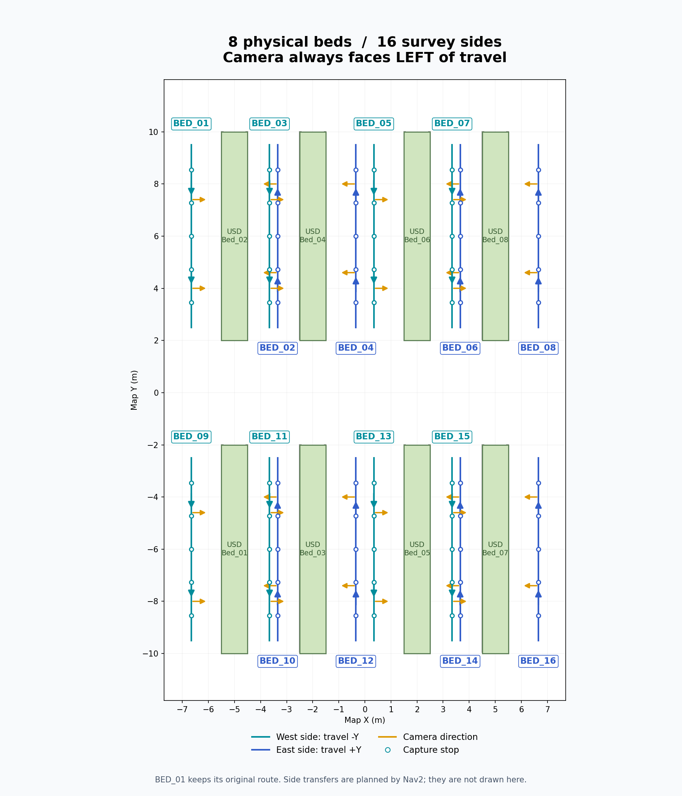

# 예찰 구역 16개 — v0.5.4

기존 물리 재배 베드 8개의 양쪽 면을 각각 예찰하도록 BED_01~BED_16을 구성했습니다. 씬의 베드 개수는 8개입니다. 관제가 요청하는 BED 번호는 이제 **베드 한쪽 면**을 뜻합니다.



## 번호와 방향

그림은 map 좌표 +Y가 위, +X가 오른쪽입니다. 위쪽 줄을 왼쪽부터, 이후 아래쪽 줄을 왼쪽부터 배정했습니다. 기존 BED_01의 좌표와 노드 1~8은 유지합니다.

| 물리 베드 위치 | USD 베드 | 왼쪽 면, 아래로 주행 (-Y) | 오른쪽 면, 위로 주행 (+Y) |
|---|---|---|---|
| 위쪽 1열, 중심 (-5, 6) | Bed_02 | BED_01 | BED_02 |
| 위쪽 2열, 중심 (-2, 6) | Bed_04 | BED_03 | BED_04 |
| 위쪽 3열, 중심 (2, 6) | Bed_06 | BED_05 | BED_06 |
| 위쪽 4열, 중심 (5, 6) | Bed_08 | BED_07 | BED_08 |
| 아래쪽 1열, 중심 (-5, -6) | Bed_01 | BED_09 | BED_10 |
| 아래쪽 2열, 중심 (-2, -6) | Bed_03 | BED_11 | BED_12 |
| 아래쪽 3열, 중심 (2, -6) | Bed_05 | BED_13 | BED_14 |
| 아래쪽 4열, 중심 (5, -6) | Bed_07 | BED_15 | BED_16 |

홀수 구역은 카메라가 +X를, 짝수 구역은 -X를 바라봅니다. 둘 다 **로봇 진행 방향의 왼쪽**입니다. 이 방향 조건은 예찰 구간에 적용됩니다. 구역 사이를 이동하거나 회전할 때는 Nav2가 주행 방향을 정하며 촬영하지 않습니다.

## 경로와 촬영 기준

- 물리 베드 중심 X: -5, -2, 2, 5m. 중심 Y: +6, -6m. 제공된 배경 USD의 베드와 가장자리 형상에서 확인했습니다.
- 각 베드의 경로 X: 중심 X ±1.655m.
- 열매 관측 기준 평면 X: 중심 X ±0.515m. 기존 BED_01의 카메라 거리 1.14m를 양면에 동일하게 적용한 설계 평면입니다. 개별 열매 표면까지의 실제 거리는 깊이 영상으로 구합니다.
- 위쪽 경로 Y: 왼쪽 9.5→2.5m, 오른쪽 2.5→9.5m.
- 아래쪽 경로 Y: 왼쪽 -2.5→-9.5m, 오른쪽 -9.5→-2.5m.
- 각 경로 길이 7m, 노드 8개. 노드 개수와 촬영 횟수는 다릅니다.
- 기존 카메라/크롭/겹침 15% 기준 자동 촬영 지점은 한 구역당 5개, 전체 80개입니다. 각 구역의 segmentation 설정을 바꾸면 개수도 달라집니다.
- 기존과 같은 7m 관측 범위를 복제했습니다. 약 8m 길이의 물리 베드 끝까지 범위를 확장한 것은 아니며, 관측 범위 바깥의 열매는 제외될 수 있습니다.
- BED_01_S001~005, BED_02_S001~005처럼 구역별 segment ID가 구분됩니다.
- 각 구역의 마지막 촬영 후 해당 구역의 task 목록을 한 번에 보냅니다. 전체 16개를 요청해도 중간에 구역별 결과를 받습니다.
- 반대쪽 면은 별도 예찰 구역이므로 ID도 별도입니다. 서로 다른 구역 사이의 열매 ID 통합은 하지 않습니다.
- 두 구역 사이를 가로지르는 직선 연결은 GeoJSON에 넣지 않았습니다. 구역 사이 이동은 Nav2가 점유 맵의 통로를 따라 계획합니다. BED 번호순 실행은 최단 순회 경로를 보장하지 않습니다.

## 변경 파일

| 파일 | 역할 |
|---|---|
| sim/ros_ws/src/farm_sim_config/maps/graph.geojson | 128개 노드, 112개 방향 연결, 16개 구역의 노드/물리 베드/관측 방향 정보 |
| scripts/apply_scout_beds_16.py | GeoJSON의 survey_sections를 기존 scout_survey.json에 반영. 설정 백업 후 장치·카메라·수확·기존 구역의 촬영 설정 보존 |
| robot/ros_ws/src/scout_robot/scout_robot/route_preview.py | RViz에 16개 독립 경로와 진행/카메라 방향 표시 |
| control/scripts/send_scout_area.py | 단일 구역, 여러 구역, 전체 구역 요청 지원 |
| tests/test_scout_beds_16.py | 방향, 물리 베드 매핑, 촬영 지점, 반대편 박스 계산, 설정 보존 확인 |

ZIP에는 기존 scout_survey.json을 덮어쓰는 파일이 없습니다. 아래 적용 스크립트를 한 번 실행해야 예찰 서버도 새 구역을 인식합니다. 새 구역의 수확 설정은 현재 BED_01에서 복제하고 segmentation은 구역별 auto로 생성합니다. 기존 BED_01에 수동 segment 설정이 있다면 그대로 보존합니다. 재실행 시 이미 있는 구역의 개별 촬영/수확 설정도 보존합니다.

패키지 버전: scout_robot, farm_sim_config → 0.5.4. 이 패치는 이전 v0.5.3까지 적용된 프로젝트를 기준으로 합니다. USD, map YAML/PNG, Nav2 속도 설정은 이 패치에 포함되지 않습니다.

## 적용

현재 작업을 취소하고 예찰 서버와 bringup을 Ctrl+C로 종료한 뒤 실행합니다.

```bash
unzip -o ~/Downloads/farm_scout_beds16_v0.5.4.zip -d ~/robotarm/
cd ~/robotarm/farm_project
python scripts/apply_scout_beds_16.py
source scripts/env.sh sim
(cd robot/ros_ws && colcon build --packages-select scout_robot) && \
(cd sim/ros_ws && colcon build --packages-select farm_sim_config)
```

적용 스크립트가 실패하면 서버를 실행하지 말고 오류를 확인하세요. 원본 설정은 runs/config_backups/에 저장합니다.

터미널 1 — 시뮬레이션과 내비게이션:

```bash
cd ~/robotarm/farm_project
source scripts/env.sh sim
ros2 launch farm_bringup scout.launch.py mode:=sim navigation:=true rviz:=true \
  isaac_python:=/home/ysy/isaac/env_isaaclab/bin/python \
  assets_root:="$PWD/sim/assets"
```

터미널 2 — 예찰 서버:

```bash
cd ~/robotarm/farm_project
source scripts/env.sh sim
ros2 launch farm_bringup scout_survey.launch.py mode:=sim \
  project_root:="$PWD" vision_python:="$(cat runs/vision_python.txt)" device:=0
```

터미널 3 — 먼저 기존 베드의 반대편만 시험:

```bash
cd ~/robotarm/farm_project
source scripts/env.sh sim
python control/scripts/send_scout_area.py --section BED_02
```

해당 작업이 끝난 다음 전체 실행:

```bash
python control/scripts/send_scout_area.py --all
```

또는 필요한 구역만 입력한 순서로 실행:

```bash
python control/scripts/send_scout_area.py --section BED_01 BED_02
```

`--all`은 기본적으로 sim의 scout_survey.json에 등록된 구역을 읽습니다. 다른 설정을 사용하는 서버라면 `--survey-config 실제설정파일`도 지정하세요. 기본 전체 대기 제한은 실제 시간 4시간이며 `--timeout 초`로 변경할 수 있습니다. 기존 서버의 목표별 주행 제한은 그대로입니다.

## 확인 범위

- 16개 구역의 왼쪽 카메라 방향, USD 베드 매핑, 고유 노드/segment ID 확인.
- 반대 방향에서도 열매 좌표를 구역 좌표로 변환하고 수확 박스를 생성하는 계산 확인.
- 기존 BED_01 경로 좌표 보존 및 설정 적용 반복 시 개별 설정 보존 확인.
- 제공된 점유 맵에서 경로를 2.5cm 간격으로 검사: 모든 경로가 자유 공간. 맵 픽셀 오차를 보수적으로 뺀 경로 중심의 최소 장애물 간격 약 0.779m. 설정상 로봇 반경 0.12m 적용 후에도 모든 구역이 같은 연결된 자유 공간에 위치.
- 오프라인 신규 5개 검사 및 기존 segment/작업 처리 10개 검사 통과.
- 실제 ROS/Isaac Sim에서 16개 구역 연속 주행은 아직 실행하지 않았습니다. 정적 맵 검사는 동적 장애물, AMCL 오차, 로봇 물리 동작을 검증하지 않습니다.
