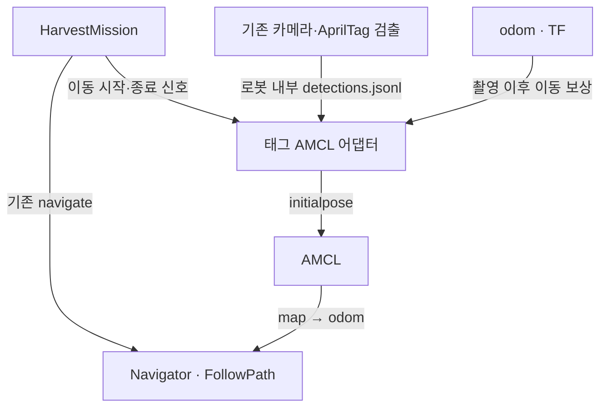

# farm_tag_localization

성공한 `pinky_tag_amcl_20261006` + 타이밍 보상 수정본의 태그 기하 계산을 프로젝트에 연결한 ROS 2 패키지입니다. AMCL이 계속 `map → odom` TF를 발행하며, 이 노드는 태그 관측으로 계산한 제한된 보정값을 `initialpose`로 요청합니다. 별도 융합 TF나 구동 명령은 발행하지 않습니다.

## 연결 구조



- 기존 HarvestTask/HarvestMission/Navigator 경로 실행을 유지합니다. 실물 `route_then_pose`는 화단 접근 `ComputeRoute → FollowPath`, 작업 좌표 이동 `NavigateToPose`입니다. 기존 graph_only 방식도 유지합니다.
- 미션 preflight 성공 후 이동 시작부터 완료·실패·취소까지 보정 사용 신호를 보냅니다. 보정 노드의 READY나 응답을 기다리지 않습니다.
- 작업 신호가 2초 동안 끊기면 **보정 요청만** 중단합니다. 태그 누락, 관측 거부, 기록 저장 오류도 주행을 취소하지 않습니다. 기존 Nav2 장애물·주행 오류 처리는 유지합니다.
- 보정 계산은 별도 스레드에서 수행하고 TF 수신은 계속합니다. 촬영 시각 odom과 최신 odom 차이로 관측을 이동 보상한 뒤, 전송 직전에 시간 유효성을 다시 확인합니다.
- AMCL `tf_broadcast=true`를 읽기만 합니다. 다른 보정 실행기와 동시에 실행하지 않습니다.

## 유지한 태그 계산

| 항목 | 값 |
|---|---|
| 영상·검출 기준 | rectified 1280×720, 기존 캘리브레이션 |
| ROI | 가로 60% × 세로 80% |
| 태그 자산 | 기존 100–106, 검은 외곽 변 50mm, 후보 실측 모델 |
| 보정 | 위치와 방향 잔차의 50%, 한 번에 위치 최대 8cm·방향 최대 5도 |
| 큰 불일치 | 50cm 또는 30도 초과 관측만 건너뜀 |
| 요청 간격 | 최소 1초 |
| 시간 조건 | 영상 나이 ≤1초, 보상된 pose 나이 ≤0.5초; 실패 시 관측만 건너뜀 |

방향 보정을 임의로 제거하지 않았습니다. 요청 발행은 실제 물리 오차 개선의 증명이 아닙니다. `tag_correction_requested`와 후속 `amcl_after_request`를 함께 기록합니다.

## 통합 실행 (2026-10-07)

`farm_bringup harvest.launch.py`에서 실물 장치·Nav2·미션과 선택적 카메라/태그 보정을 함께 실행합니다. 예찰과 같은 실물 환경 선택 구조를 사용합니다.

```bash
# farm_project 디렉터리, ROS/드라이버/프로젝트 overlay source 후
ros2 launch farm_bringup harvest.launch.py project_root:="$PWD" mode:=real tag_correction:=true
```

기본 실물 환경: `robot/config/environments/harvest_real.yaml`. 10/07 지도·태그 모델을 연결해 `configured: true`로 등록했습니다. 예찰 지도는 유지합니다. 실제 이동은 기존 HarvestTask 요청으로 시작합니다.

카메라 실행 도구는 `robot/tools/tag_camera/`, 캘리브레이션은 `robot/config/cameras/`에 포함되어 있습니다. `harvest_tag_capture.yaml`은 이 내부 파일을 project_root 기준으로 연결합니다. 실행 세션과 검출 폴더 연결·종료를 관리하며, 카메라 로컬 Domain 178과 주행 Domain 156을 유지합니다. ROS·Python 패키지와 시스템 도구 설치는 별도로 필요합니다.

OFF는 `tag_correction:=false`, OFF 검출 기록은 `tag_camera:=true`를 추가합니다. 외부 캡처 재사용은 `tag_camera:=false capture_directory:=...`입니다. 캡처/보정 실패는 주행 취소를 요청하지 않습니다. 성공 여부는 보정 로그에서 따로 확인합니다. 전체 PNG 기록은 자동으로 켜지 않습니다.

[설치·실행·검증 안내](../../../../docs/HARVEST_REAL_LAUNCH_20261007.md), [FSM 부족 사항](../../../../docs/HARVEST_FSM_GAP_20261007.md).

## 검증 범위 (2026-10-06)

- ROS 없는 계약 시험 17개 통과: OFF/ON launch 조립, 미션 종료/실패/취소, 작업 신호 만료, 과거 영상 배제, TF 소유, 전송 직전 시간 검사, odom 보상, 지도 파일 식별.
- 성공 주행 `20261006_184256_tqsyzy51`의 검출 982행을 이전 계산 코드와 같은 OpenCV 5.0.0 환경에서 재생: 채택된 41행의 위치·공분산 동일(절대 허용오차 1e-12). 이는 요청 횟수가 아니라 기하 계산 결과 비교입니다.
- Python 컴파일 및 Python 패키지 파일 구성 확인.
- **미실행:** ROS Jazzy colcon 빌드, 실제 DDS/TF 연결, GitHub 주행 코드와의 실물 주행, 새 맵 물리 오차 검증. 이 실행 환경에는 ROS가 없습니다.

```bash
python3 -m unittest discover -s robot/ros_ws/src/farm_tag_localization/test -v
```

원본 계산 파일 해시는 `PROVENANCE.json`에 기록했습니다. 외부 실험 기록과 기존 성공 실행 파일은 이 브랜치 작업으로 변경하지 않습니다.


## 2026-10-07 실험 결과 반영

- `robot/config/robots/vicpinky/nav2.yaml`의 `FollowPath`와 `RPP` 모두 경로 정렬 기준 6도(0.1047197551rad), 전진 0.10m/s, 정렬 회전 0.10rad/s입니다. 진행 기준은 0.10m/20초입니다.
- 기존 충돌 감지와 최종 도착 위치/방향 허용치는 유지합니다. 6도는 최종 yaw 허용치가 아닙니다. 이 YAML을 선택한 환경에서 적용되며 실행 중 파라미터를 자동 변경하지 않습니다.
- 기존 실험 스크립트는 종료 시 회전 0.35rad/s·진행 10초로 복원했지만, 프로젝트 YAML은 **실험 중 사용한 값**을 유지합니다.
- 태그 보정 수식·방향 보정·촬영 시각 odom 보상·AMCL TF 소유는 유지합니다. 새 주행 READY 조건이나 태그 누락에 따른 정지를 추가하지 않습니다.
- 실제 ROI는 가로60%×세로80%입니다. 모니터 `roi60_candidate`(60%×60%)를 보정 가능 여부로 해석하지 않습니다. 어댑터 시작 로그에 `observation_roi`를 기록합니다.
- 결과와 한계: [FIELD_RESULTS_20261007.md](FIELD_RESULTS_20261007.md).
- 검증: 계약 시험19개 통과. ON/OFF 여섯 주행 검출3,779행을 같은 로컬 OpenCV 환경에서 비교해 기존 실험 코드와 이식본의 채택 여부, 채택787행의 위치·공분산 일치(절대오차1e-12). ROS 없는 오프라인 검증이며 Git 프로젝트에서의 실물 실행 완료를 의미하지 않습니다.

## 2026-10-08 Git 실행 기준과 외부 의존성

- 과거 실험 코드 대신 Git 이식본을 사용합니다. 로봇의 apriltag_ws와 manyfarm_experiments는 삭제됐으며 PC 전체 백업은 보존했습니다.
- 보정 잠금은 project_root/runs/locks/<robot_id>_tag_correction.lock입니다. 같은 운영 체크아웃을 사용하며 실행 중 잠금 파일을 삭제하지 않습니다.
- 직접 사용하는 sensor_msgs, apriltag_msgs, ament_index_python을 package.xml에 명시했습니다. 선언 추가가 로봇에 패키지를 설치하는 것은 아닙니다.
- 카메라 제어에 v4l2-ctl이 필요합니다. 장치 사용 확인에는 fuser를 사용하며, 현재 코드는 fuser가 없으면 해당 사전 확인을 생략합니다.
- 수신 버퍼 설정 원본은 robot/config/robots/vicpinky/sysctl/99-vicpinky-camera.conf입니다. 시스템 적용 방법은 docs/changes/REAL_RUNTIME_BUNDLE_20261008.md를 따릅니다.
- 사용자 로그에서 Git 카메라 수신·태그 검출·카메라 설정 복원을 확인했습니다. detector/rectify 종료 -11은 미해결이며, 잠금 변경 후 실제 보정·좌표 이동 통합 실행은 미검증입니다.


## 2026-10-08 실행 연결 재검토

실행 전 `python3 robot/tools/tag_camera/check_runtime.py --ros`를 프로젝트 루트에서 실행합니다.
이번 검사·수정과 실물 미검증 항목은 [실행 검토](../../../../docs/changes/APRILTAG_RUNTIME_REVIEW_20261008.md)를 따릅니다.
종료 요청 이후 캡처 자식이 실패해도 세션은 실패 코드와 `clean_shutdown=false`를 반환합니다.
기존 detector/rectify -11을 정상으로 취급하지 않습니다.
앞선 최종 허용치 보존 설명 중 Nav2 종료 기준은 이번에 4cm/2.5도로 좁혔으며,
미션의 최종 합격 기준 5cm/3도, 태그 기하 계산, 속도와 충돌 검사는 유지합니다.
