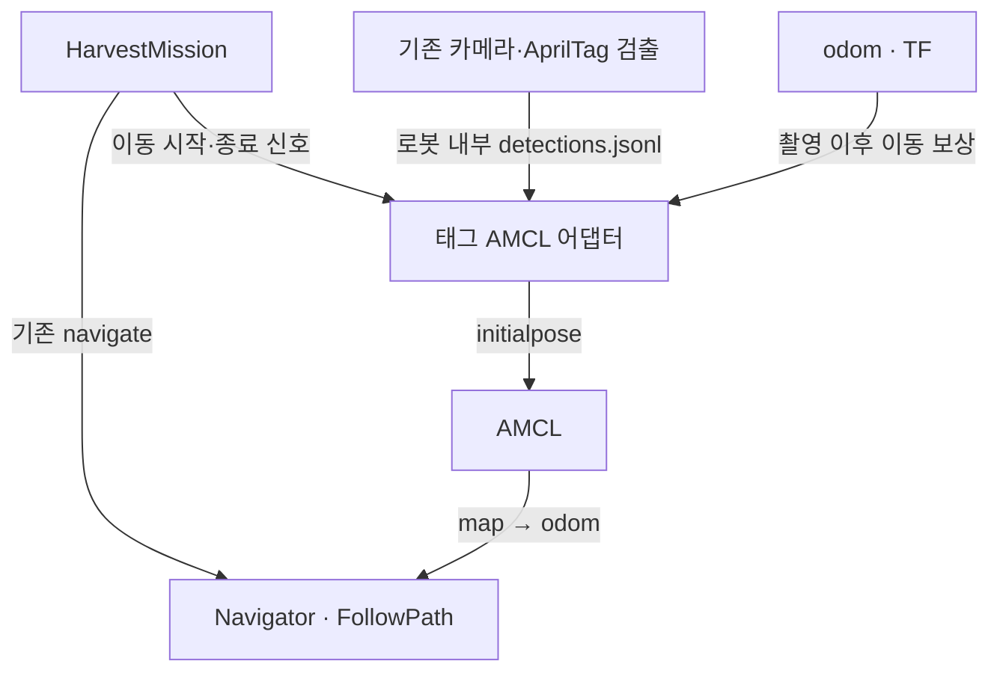

# farm_tag_localization

성공한 `pinky_tag_amcl_20261006` + 타이밍 보상 수정본의 태그 기하 계산을 프로젝트에 연결한 ROS 2 패키지입니다. AMCL이 계속 `map → odom` TF를 발행하며, 이 노드는 태그 관측으로 계산한 제한된 보정값을 `initialpose`로 요청합니다. 별도 융합 TF나 구동 명령은 발행하지 않습니다.

## 연결 구조



- 기존 HarvestTask/HarvestMission/Navigator 경로 실행을 유지합니다. 이 저장소의 경로 계산은 `RouteGraph.plan → FollowPath`이며 이전 mini_fleet 실행기를 가져오지 않습니다.
- 미션 preflight 성공 후 이동 시작부터 완료·실패·취소까지 보정 사용 신호를 보냅니다. 보정 노드의 READY나 응답을 기다리지 않습니다.
- 작업 신호가 2초 동안 끊기면 **보정 요청만** 중단합니다. 태그 누락, 관측 거부, 기록 저장 오류도 주행을 취소하지 않습니다. 기존 Nav2 장애물·주행 오류 처리는 유지합니다.
- 보정 계산은 별도 스레드에서 수행하고 TF 수신은 계속합니다. 촬영 시각 odom과 최신 odom 차이로 관측을 이동 보상한 뒤, 전송 직전에 시간 유효성을 다시 확인합니다.
- AMCL `tf_broadcast=true`를 읽기만 합니다. 다른 보정 실행기와 동시에 실행하지 않습니다.

## 유지한 태그 계산

| 항목 | 값 |
|---|---|
| 영상·검출 기준 | rectified 1280×720, 기존 캘리브레이션 |
| ROI | 가로 60% × 세로 80% |
| 태그 자산 | 기존 100–106, 검은 외곽 변 50mm, 후보 실측 모델 |
| 보정 | 위치와 방향 잔차의 50%, 한 번에 위치 최대 8cm·방향 최대 5도 |
| 큰 불일치 | 50cm 또는 30도 초과 관측만 건너뜀 |
| 요청 간격 | 최소 1초 |
| 시간 조건 | 영상 나이 ≤1초, 보상된 pose 나이 ≤0.5초; 실패 시 관측만 건너뜀 |

방향 보정을 임의로 제거하지 않았습니다. 요청 발행은 실제 물리 오차 개선의 증명이 아닙니다. `tag_correction_requested`와 후속 `amcl_after_request`를 함께 기록합니다.

## 이번 연결 범위와 남은 설정

이번 버전은 **기존에 성공한 카메라/검출 실행을 그대로 사용하는 파일 입력 어댑터**입니다. 카메라 실행 파일을 이 패키지가 설치·기동하지 않습니다. 카메라와 어댑터는 같은 로봇에서 실행하며 카메라의 로컬 Domain 178 기록을 읽습니다. 어댑터는 기존 주행 Domain 156에 연결합니다. PC로 영상 전송하지 않습니다.

현재 촬영 폴더에는 `settings.json`의 `calibration_sha256`, 그리고 계속 추가되는 `detections.jsonl`이 필요합니다. 각 검출 행은 `source_stamp_ns`, `frame_id`, `detections`를 포함하며 검출은 `family`, `id`, `corners_rectified`, `decision_margin`, `hamming`을 포함합니다. 시작 전에 있던 행은 재생하지 않습니다. PNG 프레임 저장 개수/완료 여부를 요구하지 않습니다.

`robot/config/localization/harvest_real.yaml`은 2026-10-07 실험 지도 해시와 `reference_20261007` 후보 자산을 지정합니다. 프로젝트 실물 환경과 지도 파일 연결이 아직 완료되지 않아 `configured: false`를 유지합니다. `reference_20261006`은 이력으로 보존합니다. 실제 환경 연결 시:

1. 실제 harvest 환경 설정에 `tag_localization_config: robot/config/localization/harvest_real.yaml`을 추가합니다.
2. 동일 map 좌표계의 태그 중심·방향을 등록한 자산 파일을 지정합니다. 맵만 바뀌었다고 기존 좌표를 그대로 사용하지 않습니다.
3. `robot_id`, `map_id`, TF frame 이름, map YAML/이미지 SHA-256을 환경 설정과 맞춘 뒤 `configured: true`로 설정합니다.

이 저장소는 아직 harvest 실물 장치 자동 bringup을 구현하지 않았으므로 외부 장치 드라이버와 실제 harvest 환경 설정이 필요합니다. 현재 sim 환경이나 scout 실물 환경을 대체 설정으로 사용하지 않습니다. 기존 실물 Nav2 설정의 속도/진행 기준도 성공 실험값과 자동으로 같아지는 것은 아닙니다. 2026-10-07에는 Vic Pinky 실물 Nav2 프로파일만 아래 실험값으로 변경했습니다. 기존 지도·경로·시뮬 설정·도착 판정은 변경하지 않았습니다.

## 빌드 및 연결 예시

ROS Jazzy 환경의 프로젝트 루트(`farm_project`)에서:

```bash
source /opt/ros/jazzy/setup.bash
cd robot/ros_ws
colcon build --symlink-install --packages-up-to farm_bringup harvest_robot
source install/setup.bash
```

아래는 **새 맵과 실제 환경 등록 후** 사용할 형식입니다. `pinky_project`, `pinky_environment`, `pinky_capture`를 실제 경로로 지정해야 합니다.

```bash
ros2 launch farm_bringup harvest.launch.py \
  project_root:="$pinky_project" \
  mode:=real devices:=false navigation:=true \
  environment_config:="$pinky_environment" \
  tag_correction:=true capture_directory:="$pinky_capture"
```

이미 동일 Nav2가 실행 중이면 `navigation:=false`를 사용합니다. 기존 harvest 서버/보정 어댑터를 중복 실행하지 않습니다. 보정 OFF는 `tag_correction:=false`이며 이때 태그 설정이나 촬영 폴더는 필요 없습니다. 실제 이동 요청은 기존 HarvestTask 인터페이스를 사용합니다. 이 launch만으로 이동 명령을 보내지 않습니다.

## 검증 범위 (2026-10-06)

- ROS 없는 계약 시험 17개 통과: OFF/ON launch 조립, 미션 종료/실패/취소, 작업 신호 만료, 과거 영상 배제, TF 소유, 전송 직전 시간 검사, odom 보상, 지도 파일 식별.
- 성공 주행 `20261006_184256_tqsyzy51`의 검출 982행을 이전 계산 코드와 같은 OpenCV 5.0.0 환경에서 재생: 채택된 41행의 위치·공분산 동일(절대 허용오차 1e-12). 이는 요청 횟수가 아니라 기하 계산 결과 비교입니다.
- Python 컴파일 및 Python 패키지 파일 구성 확인.
- **미실행:** ROS Jazzy colcon 빌드, 실제 DDS/TF 연결, GitHub 주행 코드와의 실물 주행, 새 맵 물리 오차 검증. 이 실행 환경에는 ROS가 없습니다.

```bash
python3 -m unittest discover -s robot/ros_ws/src/farm_tag_localization/test -v
```

원본 계산 파일 해시는 `PROVENANCE.json`에 기록했습니다. 외부 실험 기록과 기존 성공 실행 파일은 이 브랜치 작업으로 변경하지 않습니다.


## 2026-10-07 실험 결과 반영

- `robot/config/robots/vicpinky/nav2.yaml`의 `FollowPath`와 `RPP` 모두 경로 정렬 기준 6도(0.1047197551rad), 전진 0.10m/s, 정렬 회전 0.10rad/s입니다. 진행 기준은 0.10m/20초입니다.
- 기존 충돌 감지와 최종 도착 위치/방향 허용치는 유지합니다. 6도는 최종 yaw 허용치가 아닙니다. 이 YAML을 선택한 환경에서 적용되며 실행 중 파라미터를 자동 변경하지 않습니다.
- 기존 실험 스크립트는 종료 시 회전 0.35rad/s·진행 10초로 복원했지만, 프로젝트 YAML은 **실험 중 사용한 값**을 유지합니다.
- 태그 보정 수식·방향 보정·촬영 시각 odom 보상·AMCL TF 소유는 유지합니다. 새 주행 READY 조건이나 태그 누락에 따른 정지를 추가하지 않습니다.
- 실제 ROI는 가로60%×세로80%입니다. 모니터 `roi60_candidate`(60%×60%)를 보정 가능 여부로 해석하지 않습니다. 어댑터 시작 로그에 `observation_roi`를 기록합니다.
- 결과와 한계: [FIELD_RESULTS_20261007.md](FIELD_RESULTS_20261007.md).
- 검증: 계약 시험19개 통과. ON/OFF 여섯 주행 검출3,779행을 같은 로컬 OpenCV 환경에서 비교해 기존 실험 코드와 이식본의 채택 여부, 채택787행의 위치·공분산 일치(절대오차1e-12). ROS 없는 오프라인 검증이며 Git 프로젝트에서의 실물 실행 완료를 의미하지 않습니다.
