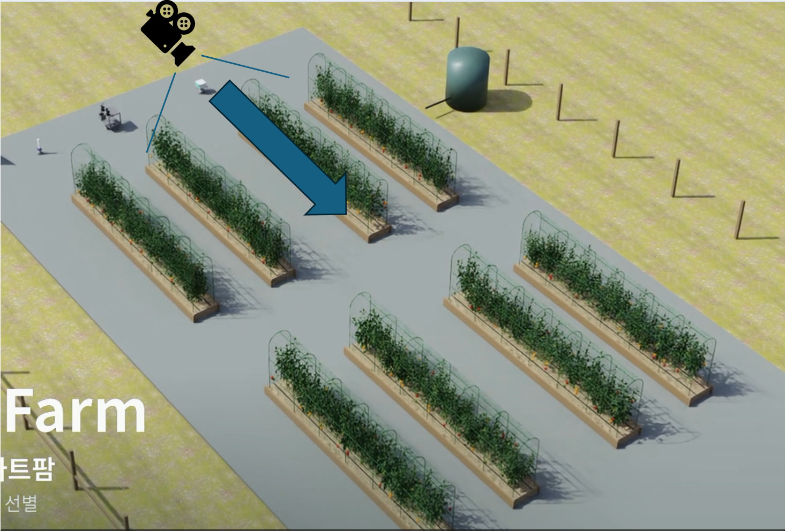
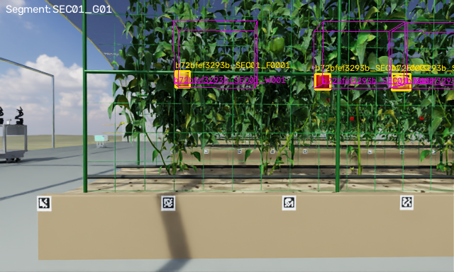

# ManyFarm 발표 영상 V3 — 사용자 피드백 반영·재촬영 지시

**상태: 사용자 확정 요구사항. 구현·재촬영은 로컬 Codex에서 수행한다.**

- 기준 저장소/브랜치: `Robot3FinalProject/main`, `main`.
- 확인한 최신 구현: `981b7944b3b74ff6b1f3dc5ced6fc2ff50df2cba`.
- 본 문서는 앞선 `PRESENTATION_VIDEO_REVIEW_20261104.md`와 콘티의 충돌하는 촬영 지시를 대체한다.
- 이번 확정 범위: 비닐하우스·태그 복원, 01 카메라 이동, 02 검출 이미지 삽입, 04 바구니 바닥, 05 개폐·과실 배출, 06 배경, 07 촬영용 설비 재배치·과실 구름, 엔딩 연장.
- **03 수확 원본은 그대로 사용한다. 나머지 01·02·04·05·06·07을 새로 촬영한다.**
- 영상은 기존처럼 촬영용 키프레임 연출이다. 실제 주행·정책 성공을 기다리지 않는다.

## 1. 전체 구성과 전달 규격

기존 20초 구성에 엔딩 여유 2초를 더해 **최종 약22초/660프레임**으로 편집한다. 마지막 2초 안에 정착 상태 유지와 페이드아웃을 넣는다.

| 컷 | 최종 타임라인 | 이번 작업 | 무자막 원본 |
|---|---|---|---|
| 01 전경 | 0~3초 | 네 베드 가운데에서 낮은 드론 전진 | 5초/150프레임 |
| 02 예찰 | 3~6초 | 최근 구도 유지 + 하우스·태그 복원 + 검출 이미지 예시 | 5초/150프레임 + 삽입 PNG |
| 03 수확 | 6~9초 | 기존 `03_grasp.mp4` 그대로 사용 | 기존 5초 원본 재사용 |
| 04 적재 | 9~12초 | 불투명 회색 바구니 바닥 + 과실 안착 | 5초/150프레임 |
| 05 인계 | 12~15초 | 바구니 바닥 개방 + 약7개 낙하·회전·안착 | 5초/150프레임 |
| 06 운송 | 15~17초 | 비닐하우스 배경, 앞 컷의 적재 상태 연결 | 4초/120프레임 |
| 07 선별 | 17~20초 | 선별장 촬영용 재배치 + 떨어져 굴러가는 과실 | 아래 엔딩과 연결된 7초/210프레임 |
| 엔딩 | 20~22초 | 안착한 과실과 설비 유지, 마지막0.8초 페이드아웃 | 07 원본에 안정된 상태2초 포함 |

- 모든 원본: 1920×1080, 30fps, 무음, H.264/yuv420p. 앞뒤1초 편집 여유를 둔다.
- 01·02·04·05는 원본 `[1,4)`초, 06은 `[1,3)`초를 사용한다.
- 07은 원본 `[1,4)`초에 동작 완료, `[4,6)`초에 안정된 상태 유지, `[6,7)`초는 뒤 여유다. 최종 영상은 `[1,6)`초를 사용한다.
- 원본에는 제목·자막·페이드아웃을 굽지 않는다. 예찰 삽입 이미지도 별도 파일로 전달한다. 검수용 합성 프리뷰는 별도로 만든다.
- 기존 두 촬영 폴더는 보존하고 새 결과는 `sim/runs/presentation_video_revision_v3_20261104/`에 저장한다.

## 2. 공통 장면 — 비닐하우스와 AprilTag 복원

### 2.1 비닐하우스 전체 복원

프레임·아치·기둥·레일·출입구·지붕 필름·측면 필름을 **원래 자산 상태로 모두 표시**한다. 가리는 구조물을 다시 숨겨서 구도를 해결하지 않는다.

현재 코드/설정에서 확인한 원인:

- `sim/runs/presentation_video_retake_20261104/settings/02_scout.json` 및 기존 `05_handoff.json`의 `base.hide`에 `/World/farm_framechanged/Frame_*`, `Rail_*`, `Entry_*`, `Arch_continuous_*`, `Cover_Roof_soft_film`, `Cover_Side_soft_film*`, `Fence_Rail_*`가 들어 있다.
- 기존 `07_sorting.json`도 `Frame_15_Post__1`과 측면 필름을 숨겼다.
- `sim/tools/stage_portfolio_photos.py`의 `apply_request()`는 이 목록을 실제 visibility에 적용한다.

새 설정의 `base`뿐 아니라 키프레임·복사한 후보·세션 잔여 상태에서 같은 숨김이 없는지 확인한다. 상위 prim의 visibility/active 상태도 검사한다. **필름을 임의로 완전 투명하게 바꾸거나 카메라 clipping으로 벽을 도려내지 않는다.** 카메라를 하우스 내부·출입구 쪽으로 옮겨 시야를 확보한다. 07은 별도로 허용한 촬영용 설비 이동을 사용한다.

공통 복원은 새로 촬영하는 장면 전체에 적용한다. 사용자가 그대로 쓰라고 한 03 MP4는 재촬영·재렌더하지 않는다.

### 2.2 베드 AprilTag 전부 설치

확인한 운영 설정은 `sim/ros_ws/src/farm_sim_config/config/apriltag_map.json`이며, **16개 Section에 태그 배치240개**가 등록돼 있다. 현재 촬영 설정의 scout/harvest도 이 경로와 `map_id=farm_map_v1`을 선택한다.

- 기존 설치 함수: `sim/ros_ws/src/farm_sim_runtime/farm_sim_runtime/apriltag_scene.py`의 `install_tags(stage, project_root, config)`.
- 생성 루트: `/World/AprilTags`.
- 현재 촬영 도구는 `install_docking_markers()`를 호출하지만, 베드 태그용 `install_tags()` 호출은 없다. 도킹 마커와 베드 AprilTag를 혼동하지 않는다.
- 촬영 세션 초기화에서 실제 선택한 장치 설정으로 기존 `install_tags()`를 재사용한다. 지도 좌표·ID·크기·텍스처·법선·장착 벽을 그대로 사용한다.
- 모든 베드의 등록 태그를 설치하고, 카메라에 들어오는 베드 면에서 실제 태그가 보이는지 확인한다. 전체240개를 한 화면에 넣으라는 뜻은 아니다.
- `/World/AprilTags`가 존재한다는 이유만으로 완료 처리하지 않는다. 중복 설치 방지 early return이 있으므로 불완전한 루트, 렌더용 Pattern, 텍스처 로딩, 단면 방향, 벽 겹침을 검사한다.
- 태그 가시성을 위한 근접 프리뷰1장을 먼저 확인한다. 크게 보이게 하려고 태그 크기를 바꾸거나 임의 ID를 그리지 않는다.

## 3. 01 전경 — 사용자가 표시한 위치에서 드론처럼 전진

아래 사용자의 표시 이미지를 먼저 연다. 이미지의 카메라 아이콘과 파란 화살표가 기준이다. 픽셀 위치를 월드 좌표로 단순 환산하지 않는다.



```text
농장8개 베드를 한 번에 넣는 기존 전체 조감도를 사용하지 마.
참조 그림의 뒤쪽 네 베드 묶음 가운데 통로 시작부 상공에서,
화살표 방향으로 베드의 길이를 따라 천천히 전진하는 드론 구도를 만들어.

실제 베드 위치와 장축을 읽어서 해당 네 베드와 중앙 통로를 식별해.
카메라는 작물보다 높고 비닐하우스 지붕 안쪽에 있도록 배치하고,
앞쪽 통로와 좌우 베드를 35~50도 정도 아래로 내려다보게 시작해.
각도는 시작값이며, 그림과 비슷한 공간감과 복원된 구조물이 함께 보이는 것을 우선해.

좌우 베드·작물·AprilTag와 하우스 아치가 시차를 만들며 지나가게 해.
8개 베드를 모두 담으려 카메라를 다시 멀리 빼거나 높이지 마.
3초 동안 베드 길이의 약20~35%를 전진하는 것을 시작값으로 사용해.
eye와 target을 같은 방향·거리만큼 움직여 높이·피치·렌즈를 유지해.
움직임은 거의 일정한 느린 속도로, 시작과 끝만 짧게 부드럽게 처리해.
급격한 줌·회전·상승·잎이나 프레임 관통을 넣지 마.

하우스가 가리면 내부에서 카메라 경로를 조정해.
지붕·프레임·필름을 지우거나 투명하게 바꾸어 해결하지 마.
```

## 4. 02 예찰 — 최근 구도 유지 + 검출 이미지 한 장

최근 재촬영의 기본 카메라 `eye=[-6.05,10.2,0.65]`, `target=[-6.25,9.05,0.4]`, 25mm와 로봇0.4m 이동/카메라70% 추적을 출발점으로 사용한다. **구도·센서 방향은 유지하고 하우스·베드 태그를 복원**한다. 새 구조물로 가려지는 경우 피사체의 화면상 위치를 최대한 유지하며 카메라를 소폭 조정한다.

화면의 중요하지 않은 바깥 배경 공간에 **베드와 검출 파프리카가 함께 보이는 정지 이미지1장**을 삽입한다. 작은 창 형태로 “예찰 → 검출 → 수확 태스크 생성”을 이해하게 한다.

바로 쓸 수 있는 저장소 자료:

- `sim/runs/presentation_stills_20261031/delivery/originals/02-scout-annotated.png`
- 같은 화면 RGB: `originals/02-scout-rgb.png`
- 대안: `evidence/scout-observation-1/`~`scout-observation-5/`의 `rgb.png`, `annotated.png`와 원본 메타데이터.

아래 예시는 이번 문서 작성 중 직접 확인했다. 베드·AprilTag·검출/작업영역 표시가 함께 있다.



```text
예찰 삽입 이미지는 기존 실제 관측 자료에서 한 장을 선택해.
새 자율 예찰을 끝까지 실행할 필요는 없어.
기존 annotated.png는 긴 ID 글자가 겹치므로 그대로 작게 줄여 넣지 말고,
같은 RGB와 실제 검출 좌표/마스크를 이용해 긴 ID만 덜어낸 간결한 예시를 만들어.
베드와 태그, 파프리카와 검출 표시가 함께 남아 있어야 해.
근거 없는 박스·마스크·성공 수량을 임의로 추가하지 마.

예시 창은 폭 약480~560px, 원본 종횡비 유지, 얇은 민트색 테두리와 짙은 배경으로 정리해.
표제는 '예찰 이미지 예시', 짧은 설명은 '작물 검출 → 수확 태스크 생성'으로 해.
기존 Noto Sans CJK KR 계열과 맞추고 작은 ID·로그 글자는 넣지 마.

현재 예찰 로봇은 화면 오른쪽에 있으므로 우측 상단에 무조건 고정하지 마.
화면 상단 중앙~오른쪽의 비어 있는 배경을 후보로 삼아,
센서·마스트·로봇·주요 작물·가까운 태그를 전 구간에서 가리지 않는 위치를 골라.
좌하단 본문 자막 영역(x80~650,y810~990)과도 겹치지 않게 해.
선택한 위치는 최종 카메라의 시작·중간·끝 합성 프리뷰로 확인해.
```

후편집용으로 `assets/02_scout_detection_example.png`, 같은 RGB 원본, 출처와 실제 좌표/마스크 자료를 함께 둔다. `overlays/02_scout_insert.json`에는 `image_path`, 1920×1080 기준 `rect_px=[x,y,w,h]`, 예찰 컷 내부 등장/퇴장 시각, 제목·설명, 출처를 기록한다. 등장 약0.3초 후부터 마지막0.2초 전까지 유지하고 약0.15초 페이드로 드나드는 것을 시작값으로 삼는다. 실제 합성은 후편집에서 처리할 수 있도록 무삽입 원본도 반드시 보존한다.

## 5. 03 수확 — 원본 유지

`sim/runs/presentation_video_20261104/03_grasp.mp4`를 그대로 사용한다. 새로 찍지 않고 원본 해시를 기록한다. 기존 수확→04 투입의 과실·집게 상대 자세 연결도 유지한다.

## 6. 04 바구니 투입 — 불투명 회색 바닥 추가

```text
최근 44도 사선 구도와 팔 동작을 유지하고 하우스·태그를 복원해.
수확 바구니 아래가 투명하거나 뚫려 보이지 않도록 불투명 회색 바닥을 추가해.

먼저 기존 USD의 바닥 메시·재질·visibility·instance를 확인해.
사용할 수 있는 바닥이 있으면 복원하고, 없으면 촬영 session layer에
바구니 내부 치수에 맞는 얇은 회색 바닥판을 만들어.
바닥은 옆벽과 맞물려야 하고, 상판 또는 밑의 지면이 바닥을 대신하는 것처럼 보이면 안 돼.

이 바닥은 다음05에서 열리는 동일한 바닥 구조로 설계해.
04에서는 닫힌 상태로 유지하고, 떨어진 과실은 바닥 위에 닿아 안착하도록 해.
과실 반경/기하를 고려해 바닥을 뚫거나 공중에 뜨지 않게 해.
수확 바구니를 통째로 불투명한 덩어리로 만들지 말고 내부 공간은 보여줘.
```

## 7. 05 수확물 인계 — 바닥 개방 + 약7개 배출

현재05는 바구니 정렬과 마지막 접근만 있고 과실은 수확 바구니에 남아 있다. **이번에는 바닥이 열리고 과실이 운송 바구니로 실제 화면상 이동하는 연출로 바꾼다.**

```text
05_handoff는 이미 정렬된 수확 바구니와 운송 바구니에서 시작해.
카메라에 상부 바구니의 회색 바닥, 열리는 부분, 두 바구니 사이 공간,
하부 운송 바구니 내부가 함께 보이는 사선 구도를 잡아.
비닐하우스·태그를 복원하고 로봇 바퀴·바구니 끝이 잘리지 않게 해.

기존 바닥 개폐 관절/패널이 있으면 해당 구조를 사용해.
없다면04에서 만든 촬영 전용 바닥판을 실제 가능한 힌지 또는 슬라이드 구조로 열어.
바닥판이 움직이는 모습이 보여야 하며 단순히 visibility를 끄는 방식은 쓰지 마.
열린 패널이 운송 바구니나 과실 낙하 통로를 관통하지 않게 해.

과실은 기본7개. 기존 파프리카 자산과 크기를 유지하고
수확 대상 색상인 빨강/노랑을 사용해 바구니 안에 겹치지 않게 배치해.
새 촬영용 복제는 가능하지만 원본 농장 배치·과실 ID 데이터를 바꾸지 마.
시작부터7개가 상부 바구니에 있고, 개방 후 같은7개가 아래로 이동해야 해.

3초 동작의 시작값:
- 0.0~0.45초: 회색 바닥판을 부드럽게 열기.
- 약0.35~1.1초: 패널의 실제 열린 영역을 따라7개가 순차적으로 빠져나오기.
- 약0.7~2.4초: 약간의 회전·엇갈린 충돌·작은 반동으로 아래 바구니에 안착.
- 마지막 약0.6초: 내려온 과실이 바구니 안에 안정적으로 담긴 상태 유지.

과실마다 출발 시점과 회전축·초기 방향을 조금씩 달리해.
동시에 같은 자세로 떠 있거나 줄지어 등속 낙하하는 장면은 피해야 해.
자유 낙하는 실제 높이에 맞춰 아래로 가속되게 하고,
바닥 접촉 이후는 작은 튐/구름과 회전 감쇠로 멈추게 해.
과장된 회전·높은 바운스·벽 관통·과실끼리 완전히 겹치는 상태는 피해야 해.
```

사용자 요청대로 **애니메이션으로 재현 가능한 결과**를 만든다. 각 과실의 궤적과 회전을 미리 계산해 베이크할 수 있고, 촬영 중 실제 전체 물리 시뮬레이션의 성공을 기다릴 필요는 없다. 자유 낙하 구간은 실제 높이와 중력 가속에 맞는 곡선, 회전은 quaternion/Slerp, 접촉 이후는 감쇠한 반동·구름을 사용한다. 실시간 물리를 쓰더라도 격리된 짧은 연출 계산 후 베이크하여 같은 장면을 반복할 수 있게 한다.

일괄 smoothstep을 모든 낙하 구간에 적용해 중간마다 감속·정지시키지 않는다. 패널 개방, 자유 낙하, 접촉, 안착을 구분한다. 떨어지기 시작하는 시점은 열린 구멍과 연결돼야 한다. 시드·궤적·7개 과실 식별자와 최종 pose를 저장한다.

## 8. 06 운송 — 하우스 배경과 적재 상태 연결

```text
비닐하우스 프레임과 필름이 배경에 보이는 상태로 운송 장면을 다시 찍어.
05에서 내려받은 약7개 과실이 운송 바구니 안에 있는 상태로 이어져야 해.
앞 컷과 수량·색상·크기가 갑자기 달라지거나 과실이 사라지지 않게 해.

기존 짧은 이동 연출을 유지하되 실제 자율 주행 완료를 기다리지 마.
로봇·적재함이 주 피사체가 되고, 하우스와 선별장 방향이 배경에서 읽히게 해.
바닥 여백을 줄이려고 바퀴나 적재함을 자르지 마.
07에서 선별장을 옮겼다면06에서 보이는 선별장도 같은 촬영용 위치를 사용해.
```

## 9. 07 선별 — 하우스를 보존한 설비 재배치와 구름

**선별장 위치를 촬영 목적으로 옮기는 것은 이번 사용자 승인 범위다.** 촬영 세션 안에서 선별장·팔을 함께 옮겨 하우스에 가리지 않는 위치를 선택한다. 공통 지도·주행 route·실물 station 설정은 유지한다.

```text
비닐하우스가 뒤에 보이면서 선별장이 가려지지 않도록 촬영용 위치를 바꿔.
프레임/필름을 다시 숨기지 말고, 필요하면 하우스 안쪽 또는 출입구 쪽으로
선별 설비와 팔을 함께 옮긴 뒤 전방 사선 카메라를 배치해.
원래 구성품 상대 위치를 보존하고 지면 위에 자연스럽게 배치해.

/World/HCRStation과 /World/HCRRobot에 같은 강체변환을 적용하고,
과실의 release/landing 위치와 검사 대상, 카메라 eye/target도 같은 기준으로 변환해.
설비 메시만 이동하고 과실이나 팔 동작 좌표를 예전 자리에 남기지 마.
가능하면 공통 촬영용 부모변환 또는 world 변환을 적용해.

팔 최고 자세·집게·과실·분류함 최소 두 칸을 담고,
비닐하우스가 배경으로 인식될 정도의 프레임/필름을 포함해.
흰 설비는 측면광과 약한 보조광으로 칸막이와 경사가 구분되게 해.

과실이 집게에서 놓임 → 아래로 가속 낙하 → 경사면 접촉 → 굴러 내려감 → 안착을 보여줘.
물체 중심을 직선으로 미끄러뜨리면서 방향은 그대로 두는 동작을 쓰지 마.
접촉면의 실제 경사와 과실 크기에 맞춰 회전과 이동을 연결해.
구른 거리/유효 반경을 초기 회전량 기준으로 삼고 파프리카의 비대칭 모양에 따른
작은 흔들림을 넣되, 접촉면을 뚫거나 공중에서 계속 회전하지 않게 해.
마지막에 작게 흔들린 뒤 속도와 회전이 감쇠해 분류함 안에 남게 해.

동작3초가 끝난 뒤 같은 구도로 최소2초를 더 렌더해.
그동안 과실은 안정적으로 있고 팔은 정지하거나 아주 천천히 복귀만 하게 해.
```

## 10. 엔딩·자막·편집

- 20초에 끊지 않는다. 마지막 안착 장면을 약1.2초 유지한 뒤 약0.8초에 걸쳐 검정으로 페이드아웃한다. 총22초를 기본으로 한다.
- 엔딩 유지 구간에는 장면을 바꾸거나 새 제목 카드를 삽입하지 않는다. 동작 자막은 부드럽게 사라지고 최종 영상 전체가 어두워지게 한다.
- Noto Sans CJK KR Bold/Regular, 기존 민트 포인트를 유지한다. 실제 동작과 겹치면 자막 위치를 조정한다.
- 05의 자막은 기존 `바구니 위치를 맞춰 인계 준비`에서 **`바구니를 열어 수확물을 전달`**로 바꾼다.
- 07은 실제 화면의 구름까지 포함해 `과실을 해당 분류함으로 이동` 정도로 간단히 쓴다.
- 03→04는 과실·집게 자세가 이어지는 직접 컷을 유지하고 다른 컷은 짧은 전환을 사용한다. 전환 길이만큼 최종 길이가 줄지 않도록 원본 여유 프레임을 쓴다.

## 11. 구현 시 반드시 확인할 현재 도구 제약

1. `presentation_video_frames.py`의 `capture()`는 현재 `duration in (4,5)`를 assert한다. 새07의7초/210프레임을 지원하도록 촬영 도구의 길이 검사와 관련 검증기를 함께 수정한다. fps30은 유지한다.
2. `state_at()`은 기본적으로 각 키프레임 구간에 smoothstep을 적용한다. 01 일정 속도, 05·07 낙하/접촉에는 구간별 보간이나 프레임별 베이크를 사용한다. 행렬 회전 Slerp는 기존 구현을 활용한다.
3. 촬영 도구의 baseline/reset에는 visibility·과실·로봇 외에도 새 바닥판 각도, 연출 과실, 선별장 변환, 조명 상태를 포함한다. 이전 컷의 열린 바닥이나 이동한 설비가 의도 없이 다음 컷으로 남지 않게 한다.
4. 변경은 `sim/` 안의 촬영 도구·촬영 설정·session layer에 한정한다. 원본 USD와 공통/실물 설정을 덮어쓰지 않는다. 사용자가 허용한 선별장 이동은 촬영 설정에 명시한다.
5. 기존 미커밋 작업과 작업 브랜치를 보존한다. reset/clean 또는 기존 촬영 폴더 덮어쓰기 없이 진행한다.

## 12. 전달물과 완료 조건

새 폴더 `sim/runs/presentation_video_revision_v3_20261104/`에 다음을 둔다.

- 무자막 원본6개: `01_overview.mp4`, `02_scout.mp4`, `04_deposit.mp4`, `05_handoff.mp4`, `06_transport.mp4`, `07_sorting.mp4`.
- 03은 기존 경로와 SHA-256을 manifest에 적는다. 동일 파일을 재렌더하지 않는다.
- `assets/02_scout_detection_example.png`, 원본 관측 RGB와 출처/검출 자료, `overlays/02_scout_insert.json`.
- 컷별 재현 설정, 이동한 선별장 변환, 바닥판 개폐 설정,7개 과실의 시드/궤적, 촬영 도구 변경.
- `README.md`, `manifest.json`, `qa/`의 실제 검수 이미지와 원본 보존 결과.

완료 전에 직접 확인할 내용:

| 항목 | 확인 기준 |
|---|---|
| 하우스 | 새로 촬영한6컷에서 숨김 없이 유지.01·02·06·07에서 배경/구조가 실제 보임 |
| AprilTag | 등록 배치240개 설치 확인 + 카메라에 들어오는 베드의 태그 렌더 확인 |
| 01 | 사용자 그림 방향으로 네 베드 사이를 전진. 전체 농장 조감도나 줌 효과로 대체하지 않음 |
| 02 | 최근 구도 유지, 삽입 예시가 로봇/센서를 가리지 않으며 실제 관측 근거가 있음 |
| 03 | 원본 SHA-256 동일 |
| 04 | 불투명 회색 바닥이 보이고 과실이 그 위에 안착 |
| 05 | 바닥판이 열린 뒤 약7개가 순차 낙하·회전·안착. 시작/끝 수량과 색상 연결 |
| 06 | 하우스 배경, 앞 컷 적재 상태와 이어짐 |
| 07 | 설비·팔·과실 좌표 함께 이동, 하우스 배경, 과실 구름·안착과2초 엔딩 여유 |
| 영상 | 해상도·fps·길이·전체 디코딩 확인. 검수용 합성에서 자막/삽입/전환 확인 |

각 컷 시작·중간·끝뿐 아니라05의 개방/낙하/첫 접촉,07의 놓임/접촉/구름/안착 시점도 프레임으로 열어 본다. 파일 생성이나 좌표 계산 통과를 시각 검수 완료로 대신하지 않는다.

구현·촬영 후 `docs/PROJECT_STATE.md`와 `sim/docs/CHANGELOG.md`에 실제 수행 결과와 남은 한계를 기록하고 이번 변경과 결과만 GitHub에 게시한다. 이 문서 작성 시점에는 새 촬영과 물리 같은 연출을 실행하지 않았다.

## 13. Codex 시작 지시

```text
git fetch origin main 후 origin/main의
farm_project/sim/docs/PRESENTATION_VIDEO_REVISION_V3_20261104.md를 읽어.
함께 있는 카메라 참조 이미지도 직접 열어봐.

이 문서가 앞선 재촬영 지시보다 우선해.
AGENTS와 현재 상태/결정 기록을 확인하고 기존 브랜치·미커밋 작업·원본을 보존해.
하우스·베드 AprilTag를 복원한 뒤01·02·04·05·06·07을 문서대로 재촬영해.
03은 원본을 그대로 사용하고,02 검출 이미지와 합성 위치도 별도 파일로 준비해.
05는 회색 바닥판 개방과 약7개 과실의 자연스러운 낙하/회전,
07은 촬영용 설비 재배치와 과실 구름/안착,2초 엔딩 여유까지 만들어.
장면별 프레임을 직접 검수하고 필요한 결과·설정·변경 기록을 깃에 올려줘.
```
