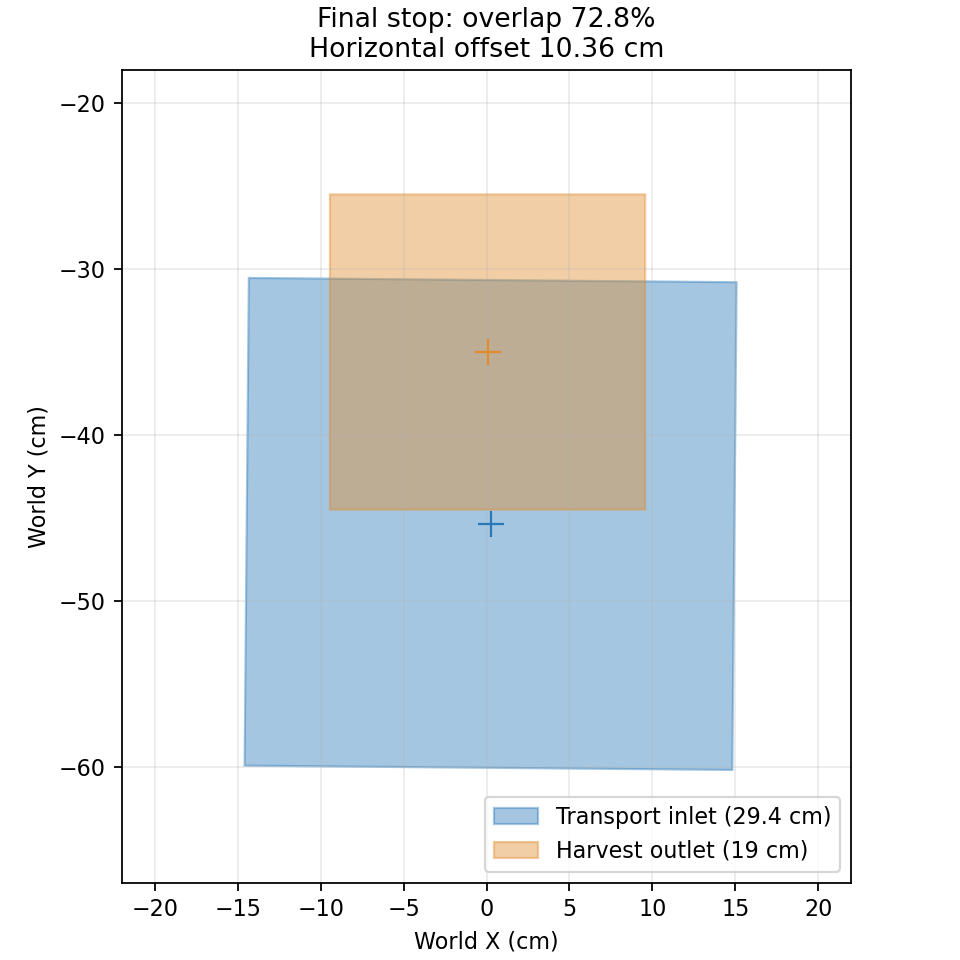

# 도킹·바구니 정렬 1차 검증 — 2026-10-27

## 결론

**접근42는 성공했다. 최종41은 기존 임시 배치에서 실패했고, 마커 면을 맞춘 시험 복사본에서는 도킹·정지까지 성공했다. 그러나 바구니 정렬은 실패했다.** 따라서 현재 상태를 인계 성공으로 보고할 수 없다.

최종 정지 시 수확 배출 개구부 투영의 **72.84%**만 운송 수용 개구부에 겹쳤다. 중심 수평 오차 **10.36cm**, 중심 높이 차 **5.65cm**(수확 쪽이 위). 바구니 실제 이동과 바퀴 odom 모두 정지했지만, 정렬·정지 동시 유지 시간은 **0초**다.



## 기준·보존 범위

- 사용자 “답변오면 수치 위치 조정…도킹 바구니 정렬 검증 시작해” 승인. 로컬 main b5ef6f2 + 이전 미커밋 통합, 원본 도킹 feature_dongmin **9686aca909cb52191862ee3500c62fadf7a8ed38** 기준. 이번 원격 fetch/병합 없음.
- **farm_docking Python27파일이 원본 커밋과 바이트 단위로 동일**함을 검사했다. 42/41 선택 프로필의 모든 숫자·불리언·키를 보존했다. 차이는 TF frame 이름과 sim 내 설정 파일 경로 문자열7개뿐이다. `preservation.json`에 원본/현재 SHA와 차이를 기록했다.
- Domain13 / SUBNET / CPU PhysX(MBP) / headless. 실제 Isaac 바퀴·카메라·라이다와 ROS PrecisionMotion/MotionGate 실행. 정답 좌표를 제어기로 주입하지 않았다.
- 42와41을 **각각 고정 시작 위치에서 분리 시험**했다. 예찰→수확→운송요청→42→수확 자세변경→41→인계의 연속 E2E 검증은 아니다.
- 운영 마커 배치표와 로봇 USD·바구니 장착 위치는 그대로 유지했다. 성공 비교 시험에서만 `41_surface/layout.json`의 marker41 Y를 -0.455→-0.251m로 변경했다. 원본/변경 시험을 혼합하지 않았다.
- 과실 낙하·배출·덮개/틸트 작동, 실제 운송 과실 수량은 시험하지 않았다. 인계 성공 이벤트를 생성하지 않았다.

## 시험 결과

| 시험 | Action 결과 | 정지 확인 | 의미 |
|---|---|---|---|
|42 접근, 기존 임시 배치|SUCCESS / status4|true|카메라로42 획득→공통 거리 접근→정지 성공|
|41 최종, 기존 임시 배치|FAILED / status6|true|마커/라이다 면 불일치 중 TF 최신성 오류로 중단|
|41 최종, 면 일치 비교1|FAILED / status6|true|접근 초기 `Final approach odom TF stale`|
|41 최종, 면 일치 비교2 + 진단|SUCCESS / status4|true|라이다 약0.203m에서 정지, 바구니 정렬은 실패|

성공한41 Action: 실제24.37초 / 시뮬24.38초. 목표0.200m·허용오차0.005m, 원본 속도/시각/정지 조건을 유지했다. 최대 겹침73.15%, 마지막 표본72.84%. 표본498개에서 완전 정렬0회. **73%는 개구부의 면적 겹침이며 과실 인계 성공률이 아니다.**

## 1. 임시 마커41과 라이다 면 불일치

- 최초 유효 카메라 관측: 마커41은 운송 base 앞 **0.6550m**.
- 운송 base_scan은 base보다 뒤 **0.064m**. 따라서 같은 면이라면 라이다 약 **0.719m**가 예상된다.
- 실제 전방 라이다는 약 **0.919m**. 마커는 차체보다 약 **20cm 앞의 빈 공간**에 있다.
- 공통 `marker_surface_depth_gate_m=0.08`을 벗어나 `Marker surface not matched to front scan`이 반복됐다. 새 collision/반사판을 가짜로 추가하거나 gate를 넓히지 않았다.
- 시험 복사본에서 마커를 실제 차체 면 앞으로 옮기자 `TRACKED_SURFACE`로 접근하고 도킹 성공했다. 다음 운영 배치 조정은 이 면 관계와 실물 답변을 함께 반영해야 한다.

## 2. TF 최신성 오류의 시각 증거

- 일반 ROS 수신 기록에서 일부 TF가 `/clock`보다 **16.7ms 미래**로 관측됐다.
- Python3.12 `sys.monitoring`으로 원본 `PrecisionServer.fresh()`의 반환 시점 local age를 기록했다. 함수·반환값·시계를 수정하지 않았다.
- 진단 비교 실행에서 fresh 거절 **184회**, age 범위 **-0.016666668 ~ -0.016666667초**. 허용 상한0.5초를 넘은 오래된 TF가 아니었다. 이 실행 자체는 최종 성공했다.
- 코드상 `fresh()`는 `0 <= age <= 0.5`를 요구한다. `lidar_odom()`은 음수도 `Final approach odom TF stale`로 반환한다. 라이다 단계 이후에는 일시 입력 대기가 있지만, 이전 획득 단계에서는 해당 RuntimeError가 즉시 실패로 이어질 수 있다.
- 앞선 실패 실행의 서버 내부 age는 미계측이다. **같은 원인의 강한 근거는 확보했지만, 그 실패 순간의 음수 age를 직접 기록했다고 주장하지 않는다.** 시뮬 clock/TF 발행·수신 순서와 공통 단계별 예외 처리를 분리 검토해야 한다.
- 공통 최신성 한계·시계·실패 처리는 이번에 수정하지 않았다. 재시도로 통과했으므로 이 문제가 해결됐다고 볼 수 없다.

## 3. 도킹 성공과 바구니 정렬 실패

평가 원본: `sim/ros_ws/src/farm_sim_config/config/docking/basket_alignment_evaluation.json`.

- 수확 출구: URDF 벽 중심±0.0975m·두께0.005m에 따른 명목19×19cm 개구부. 실제 USD `harvest_lid_fixed` 변환과 로컬Z+0.006m를 사용했다.
- 운송 입구: portable URDF 30cm 바구니·3mm 벽에 따른 명목29.4×29.4cm 개구부. 실제 USD `cargo_box` 변환과 로컬(-0.15,0,0.19)m를 사용했다.
- 현재 USD의 `harvest_box` 자체는 원하는 바구니 위치를 나타내지 않아 실제 lid 프레임을 기준으로 삼았다. 개구부 치수/배출 평면은 명목 모델에 따른 **임시 평가값**이며 실물 독립 측정값이나 정밀 collision surface 역산값이 아니다.
- 판별: 수확 개구부 수평 투영 전체가 운송 개구부에 들어가고, 배출부가 수용부보다 높아야 정렬 후보. 허용 영역을 임의 확대하지 않았다.
- 정지 조건은 공통 서버의0.005m/s·0.02rad/s·0.8초를 평가에 재사용한다. 바퀴 odom과 실제 두 개구부 중심/방향 변화를 함께 검사한다. 진단 주기0.05초(벽시계), 짝 표본 시뮬시각 차0.1초 이하, 연속 표본 간격0.2초 이하만 유지 평가.
- 이 평가기는 파일 출력 전용이다. 도킹 Action/업무 FSM의 성공 기준에 연결하지 않았다. 사용자 합의 D-063의 인계 판정기 연결은 남아 있다.

현재 정지 위치에서 운송 입구 중심은 수확 출구 중심보다 접근 방향으로 약10.4cm 부족하다. 모델의 바구니/차체 상대 위치와 고정된 라이다 정지 면 관계를 맞춰야 한다. **라이다 목표를 줄이거나 바구니를 임의 이동시켜 성공을 만들지 않았다.**

## 이번에 수정한 시뮬 연결 문제

1. `run_fleet.py`: 팔 enabled=false인데 student backend 문자열만 보고 `after_frame`/`prepare_capture`를 호출해 None 오류. 두 실행 경로 모두 실제 팔 객체 존재 여부를 검사한다. 활성 팔 경로는 유지.
2. `camera_ros.py`, `transport.json`: 운송 CameraInfo가 best-effort여서 reliable 구독인 공통 서버와 불일치. 운송에만 `ros_info_reliable=true`로 연결. 기존 영상 QoS와 다른 로봇의 기본값은 유지. 실제 서버에서 fx640 수신 확인.
3. 시험용 설정: base/scan/odom/camera 프레임을 transport_01 namespace에 맞춤. 초기 카메라 frame 오류를 보존하고 수정. 수치/기하/판정 변경 아님.
4. `drive_diagnostics.py`: 명시 선택한 평가 프레임의 실제 USD 변환을 파일에 기록. 기본 기록 주기1초 유지, 이번 시험만0.05초. ROS나 제어 입력으로 발행하지 않는다.

초기 시작실패2회, 카메라 프레임 오류1회, 위 도킹 Action 실패2회와 성공2회를 모두 남겼다. 일부 프로세스 종료는 SIGINT/KeyboardInterrupt이며,42 성공 후 Isaac 종료에서 -11이 기록됐다. 작업 중 Action 성공과 SDK 종료 문제를 구분한다.

## 자료·재현·다음 작업

- 공유자료: `sim/docs/test_results/20261027_docking_alignment/` — 원본 프로필과 변경 목록, Action/feedback/센서/실제 바구니 프레임, 실패 로그, 최종 영상·도표, SHA256.
- 전체 원본: `sim/runs/docking_alignment_20261027/`, `sim/runs/drive_diagnostics/`의 각 session. 동일 이름으로 재시험하기 전 기존 로그를 별도 보관한다.
- 직접 검증: 관련 회귀24개 PASS, sim devices/runtime/config 3패키지 빌드 PASS, 도킹 공통27파일 원본 일치, 숫자 변경0. 전 과실 예찰/수확 회귀·운송 Nav2/관제/교통/선별장 주행은 미실행.

```bash
cd /home/ysy/main/farm_project
source /opt/ros/jazzy/setup.bash
source scripts/env.sh sim
export ROS_DOMAIN_ID=13 ROS_AUTOMATIC_DISCOVERY_RANGE=SUBNET
export ROS_LOG_DIR=/tmp/farm_docking_alignment_ros
/usr/bin/python3 sim/tools/prepare_docking_alignment_trial.py
/usr/bin/python3 sim/tools/run_docking_alignment_trial.py 42
/usr/bin/python3 sim/tools/run_docking_alignment_trial.py 41
/usr/bin/python3 sim/tools/run_docking_alignment_trial.py 41_surface
```

각 명령은 이전 시험 종료 뒤 순차 실행한다. 초기 준비 파일은 원본 커밋을 git show로 읽으므로 해당 객체가 필요하다. fixture에는 공통 목표값을 보존하고 frame/path만 바꾼다. 성공 후보를 찾기 위한 무제한 재시도 도구가 아니다.

다음 우선순위: (1) clock/TF 순서 및 초기 획득 단계의 일시 실패 처리 검토, (2) 실측 답변을 반영한 마커/라이다면/바구니 상대 배치 정합, (3)42→41 연속 동작·정렬 유지와 인계 이벤트 연결. 현행 선별장 모델/그래프 위치 불일치도 전체 이동 전 해결해야 한다.

미커밋·미푸시. 시험 프로세스는 종료했다. 되돌림은 이번 sim 연결 변경 및 평가/시험 파일만 대상으로 하고, 앞선 운송 통합과 다른 작업자의 변경은 보존한다.

## 수정 파일 패치

`sim/runs/docking_alignment_20261027_patch.zip`에 이번 sim 코드/설정/검증자료를 담았다. 선행 운송 통합이 있는 현재 작업트리 기준이며 기존 runtime 파일은 그 선행 변경을 포함한다. 다른 브랜치에는 diff 검토 후 적용한다. 현재 PC에는 적용 완료다.

```bash
unzip -o docking_alignment_20261027_patch.zip -d /home/ysy/main/farm_project
```
