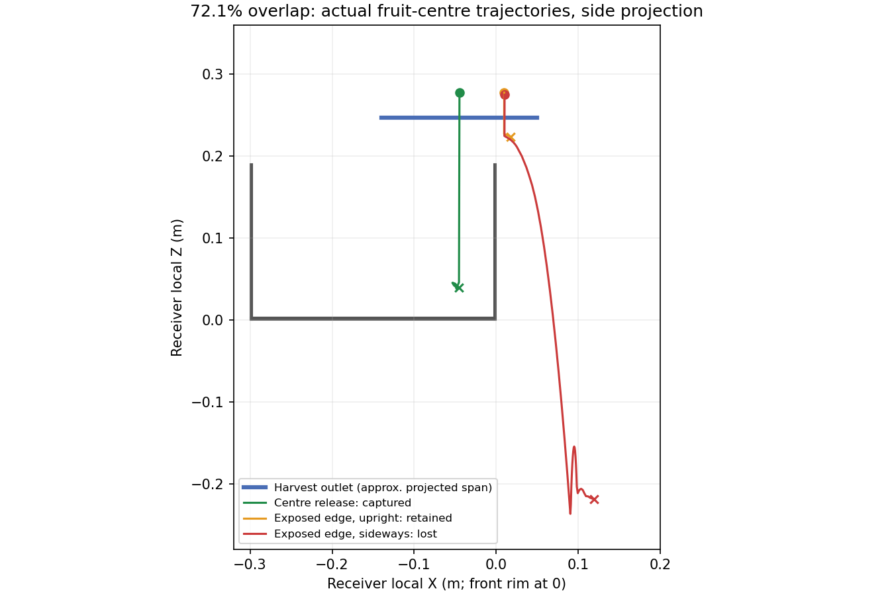

# 바구니 72.1% 겹침에서 한 알 인계 시험

2026-10-27. 사용자 요청: “72% 겹쳤을 때 인계가 정상적으로 되는지 … 그 조건만 살짝 구현해서 테스트”. 이전 D-063의 기구/낙하 제외 원칙에서 **이번 독립 낙하 시험만** 추가 승인된 범위다. 원본 바구니 USD 형상·질량·장착 위치를 바꾸지 않는 지시는 유지했다.

## 결과

**현재 위치에서는 중앙의 과실은 받아지지만, 덜 겹친 쪽 끝의 과실은 밖으로 떨어지거나 가장자리에 남는다. 모든 과실이 정상 인계되는 조건으로 볼 수 없다.**

| 조건 | 시험 표본 | 바구니 안 수용·안정 | 바구니 밖 낙하 | 가장자리 부근 잔류 |
|---|---:|---:|---:|---:|
| 실제 기록 자세: 개구부72.1% 겹침 | 75 | 60 (80%) | 10 | 5 |
| 중심을 맞춘 비교 조건 | 75 | 75 (100%) | 0 | 0 |

CPU PhysX **60Hz와120Hz 각각150개**, 총300개 독립 조건 실행. 주기를 바꿔도 개별150개 조건의 분류가 모두 같았다. 같은 표본의 반복이므로 이를 독립 확률 표본300개로 해석하지 않는다. 실제 적재 분포가 주어지지 않았으므로 **80%는 선정한 시험 표본의 수용률이며, 실물/실제 일괄 배출 성공률 추정값이 아니다.**

- 똑바로 선 과실: 20/25수용, 끝쪽5개는4초 관측 종료까지 가장자리 부근에 남음.
- X축으로90도 눕힌 과실: 20/25수용, 끝쪽5개는 밖으로 낙하.
- Y축으로90도 눕힌 과실: 20/25수용, 끝쪽5개는 밖으로 낙하.
- 실패 위치는 모두 수확 개구부 로컬X=-55mm인 한 줄. 실제 도킹에서 운송 바구니가 충분히 들어오지 못한 쪽과 대응한다. 나머지20개 위치에서는 세 자세 모두 수용됐다.

그림의 선은 과실 중심 궤적이다. 파란 선은 수확 배출구의 근사 투영, 회색은 운송 바구니 단면이다. 끝쪽 과실은 운송 바구니 앞벽의 위쪽에 걸리거나 바깥으로 넘어간다. 과실 전체 형상은 원본 collision vertices로 별도 판정했다.

## 시험 조건

- 실제 도킹 성공 세션 `aa4c1a37bc004c0bb6d95523ec2304b0`의 마지막 정지 자세 재사용. 중심 수평 차이10.5017cm, 높이 차이5.6463cm, 명목 개구부 겹침72.1181%.
- 원본 수확 벽4개, 운송 `cargo_box`와 닫힌 측면 `side_lid`를 **실제 USD collision 그대로 참조**해 정지 상태로 고정. 복사본 크기/장착 보정 없음. 모형 차체 전체/지지대는 이번 독립 장면에 포함하지 않았다. 따라서 실제 기구에서는 일부 외부 낙하 과실이 차체에 남을 수 있으나, 운송 바구니 수용 실패라는 구분은 같다.
- 수확 배출 바닥과 운송 상단 덮개가 이미 완전히 열렸다고 가정하고 이들 덮개는 시험 장면에서 제외. 덮개 구동·개방 중 과실 밀기·막힘·틸팅은 구현하지 않았다. 측면 벽 역할인 운송 side_lid는 유지했다.
- 현행 과실 USD `sim/assets/fruit/teacher_9g/pepper_{red,yellow}.usd`: 약7cm×7.5cm,9g, 기존 접촉/마찰/반발·collision 사용. 색을 번갈아 배치했으며 과실 모델을 새 구나 상자로 바꾸지 않았다. 실물 과실 질량/마찰 보정은 아니다.
- 배출구 내 중심 위치5×5: 양 축 -55,-27.5,0,27.5,55mm. 자세3종. 과실 collision 최저점이 배출 평면보다2mm 위에서 시작, 초기 속도0, 중력으로만 낙하.
- 한 조건마다 과실 한 알, 서로 다른 독립 공간에 배치. 과실끼리 충돌하지 않음. 4초 관측, 마지막0.5초 내내 과실 전체 collider가 수용 공간 내부이고 속도<0.02m/s이면 수용. 바구니 밖 낮은 시험 바닥으로 떨어진 것은 외부 낙하, 위쪽에 남은 것은 별도 잔류로 기록.
- 비교군은 수용 바구니 전체를 수평으로만 이동해 중심을 맞춘 독립 fixture. 높이와 형상은 유지. 이 위치를 운영 도킹 목표나 원본 USD에 반영하지 않았다.
- CPU/MBP.60Hz 실행에서 실제 context `gpu_dynamics=false`, `broadphase=MBP` 확인. ROS 노드/주행/팔/카메라 렌더를 실행하지 않는 독립 PhysX 시험. 환경변수 Domain13/SUBNET 유지.

## 변경·검증·자료

- 구현: `sim/tools/check_partial_basket_transfer.py`.
- 집계·그림: `sim/tools/analyze_partial_basket_transfer.py`.
- 코드 문법 검사 및 실제 Isaac 2회 실행. 비교군75/75와 주기별 개별결과150/150일치 검증. 참조한 원본 자산4개의 SHA256 전후 동일. 원본에 Save를 호출하지 않으며 공통 코드/설정·도킹·인계 성공 판정도 변경하지 않았다.
- 실제 collider의 바닥30×30cm/두께3mm, 벽 두께3mm를 USD `Cube.size`와 변환으로 확인. importer의 extent 메타데이터를 중복 스케일한 시각 BBox와 혼동하지 않았다.
- 원시 궤적/로그: `sim/runs/partial_basket_transfer_20261027/` 및 `hz60/`. 각 조건의 매60Hz 위치·속도·collision 경계를 `trajectories.jsonl`에 저장.
- 공유 집계·setup·개별result·그림: `sim/docs/test_results/20261027_partial_basket_transfer/`.
- Isaac 자체 종료 지연은 낙하 결과와 분리 기록.120Hz는 결과 저장과 Kit 종료 로그 이후 프로세스가 남아 SIGTERM 정리(exit143).60Hz에는100초 종료 watchdog을 적용했다. 종료 상세는 공유 summary.json.
- 바구니 부분 참조에서 원본 visual 재질 경로가 참조 범위 밖이라는 렌더 경고가 발생했다. 형상/충돌과 과실 내부 physics material은 별도로 유지됐으며 RGB 렌더 시험은 아니다.

실물·여러 과실 동시 배출·관제 인계 E2E 검증으로 확대하지 않는다. 중앙 집중 배출이면 수용 가능성이 있지만, 그런 유도 기구/분포를 이번에 가정하거나 추가하지 않았다. **현행72% 조건을 무조건 인계 성공으로 바꾸지 않는 것이 이번 결과에 맞다.** 다음 판단에는 실제 배출구/덮개 동작·실제 도킹 상대 위치 확인이 필요하다.

복원은 이번 독립 tools/보고서/시험 자료만 제거하면 된다. 운영 코드나 원본 자산을 되돌릴 변경은 없다. 기존 미커밋 작업 보존, 이번 commit/push 미실행.
