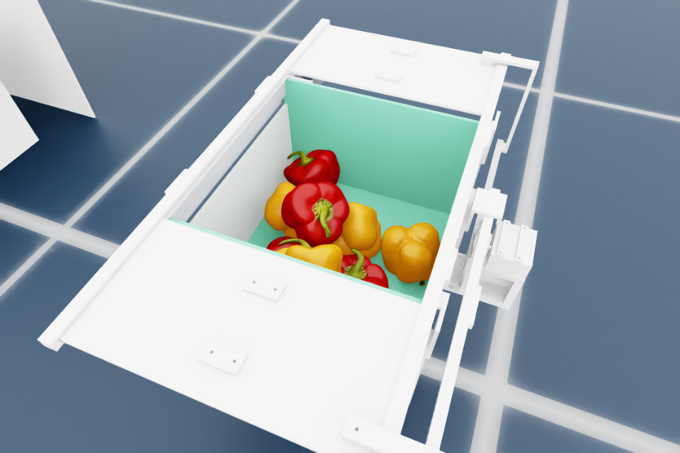
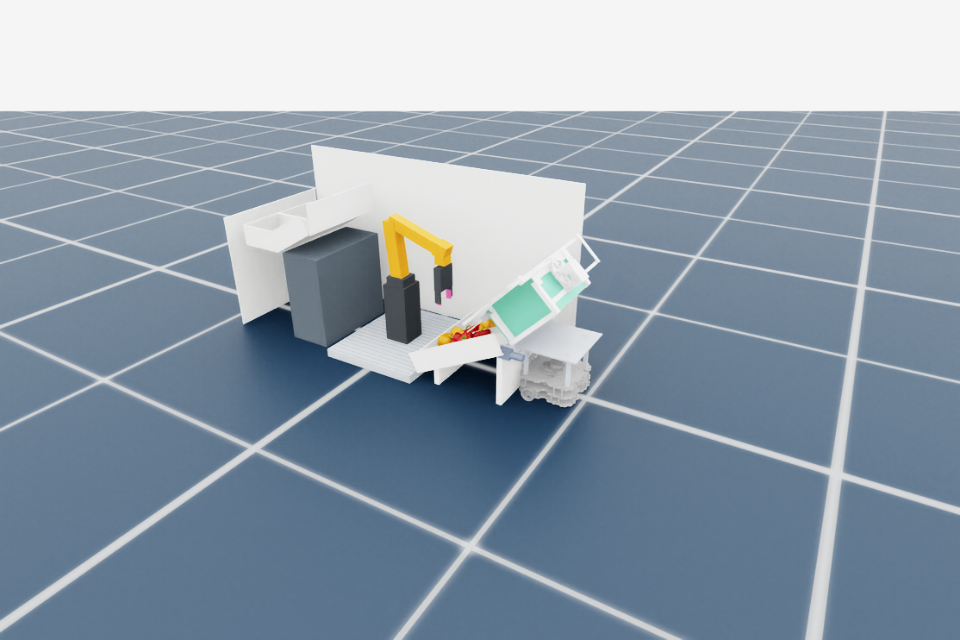

# HCR-3A 선별장 시뮬레이션팀 전달 묶음

2026-10-08 로컬 파일 스냅샷. HCR 선별장 대상이며 OMX/수확 RL 배포본이 아니다.

1. `python3 verify_delivery.py`로 전달 파일을 검사한다.
2. [팀 요청문](workspace/docs/sorting/HCR3A_SIM_TEAM_REQUEST_KR.md)을 읽는다.
3. [전달서](workspace/docs/sorting/HCR3A_SIM_TEAM_HANDOFF_KR.md)의 단독 재현 → 농장 통합 순서를 따른다.
4. `cd workspace`하고 본인 Isaac Lab Python 경로를 `ISAAC_PYTHON`에 설정한다.

```bash
export ISAAC_PYTHON=/본인/IsaacLab환경/bin/python
export HCR_GUI_PYTHON=/usr/bin/python3
bash src/sorting_station/run_hcr_sim.sh \
  --config src/smartfarm_description/config/hcr3a_random8_validation.json \
  --pepper-per-lane 2 --payload-layout random --payload-seed 43 \
  --auto-start --stop-after-sorted 1
```

새 workspace에는 성공 시험의 수동 ROI가 포함된다. 기존 농장 ROI를 덮어쓰지 않는다.
위 설정에서 기존 기록은 8개 배출/1회 선별·복귀 DONE이며 전체 배치 완료는 아니다.
다른 카메라 및 연속 선별에서는 몸통을 포함하도록 수동 ROI를 다시 확인한다.

## 첨부 자료

- [실물 사진·치수 노트](reference/photos/README.md), [HCR 결정 발췌](reference/HCR_DECISIONS.md)
- [최신 성공 검증](reference/validation/random8_seed43_sort1/report.json), [독립 감사](reference/validation/random8_seed43_unload/audit.json)
- [두 번째 영상 오판 실패](reference/validation/random8_seed43_sort2_error/report.json)
- [전체 검증 기록](workspace/src/sorting_station/hcr_sim/VALIDATION.md)
- ENVIRONMENT.json: 전달 시점 환경 실측값. SOURCE_SNAPSHOT.json: 소스 기준과 Git 스냅샷 범위.
- MANIFEST.json: 경로/크기/SHA256/출처. DELIVERY_UNIT_TESTS.log: 복사한 workspace의 회귀 검사.
- reference/source_cad: 기존 제조사 STEP ZIP과 출처 URL/해시. 동작 로봇의 URDF가 아니다.





## 전달 기준

원본 운반 자산과 현재 HCR 런타임을 그대로 복사했다. USD 변환 캐시는 수신 PC에서 재생성한다.
`reference/validation/derived_peppers`는 과거 감사의 충돌점 참고 파일이며, 절대 visual 참조를 포함할 수 있어 실행 캐시로 쓰지 않는다.
옛 audit_random_payload.py는 원래 outputs 디렉터리 구조를 전제로 한 기록용 스크립트다. 수신본의 검사 진입점은 verify_delivery.py다.
경로/좌표 변환·농장 공통 실행 루프 어댑터는 통합 작업으로 남아 있다.
보조 고정 파지/지정 차량 경로의 기능 모델이며 실물 동역학이나 여러 seed의 일반 성능 보증이 아니다.
